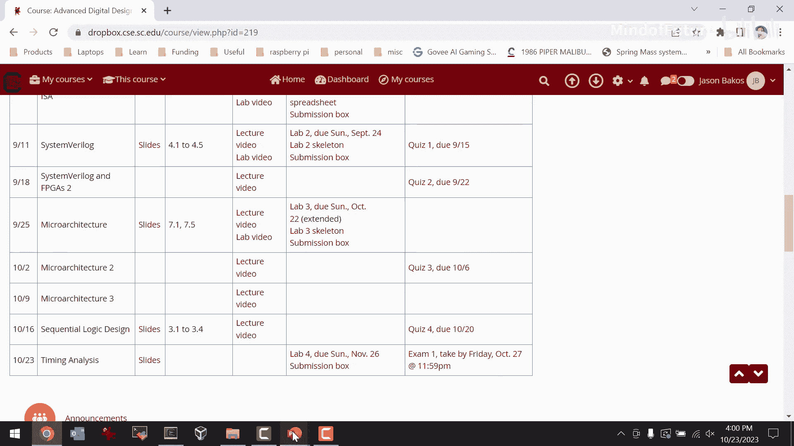
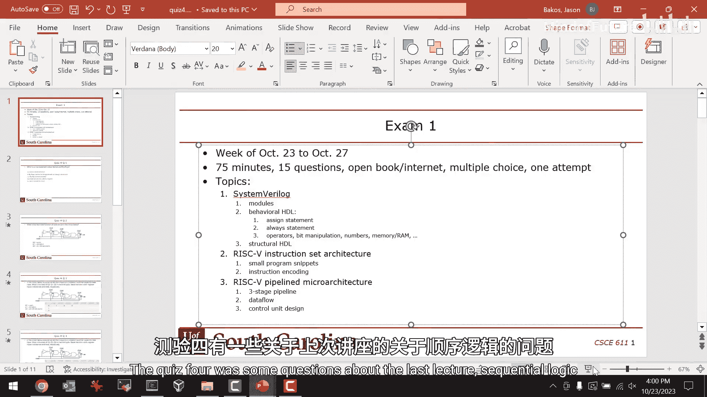
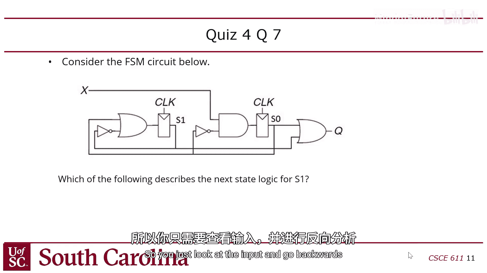
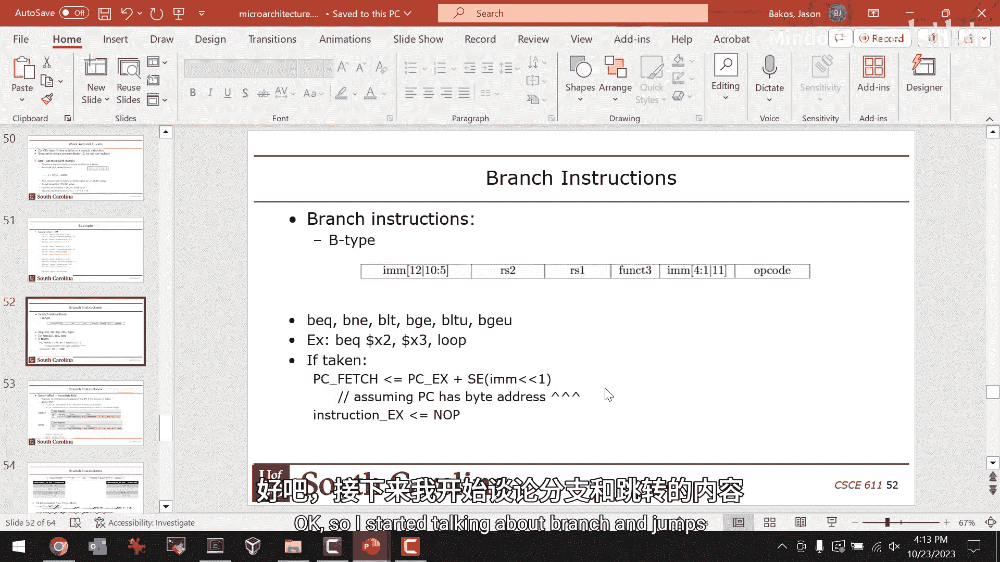
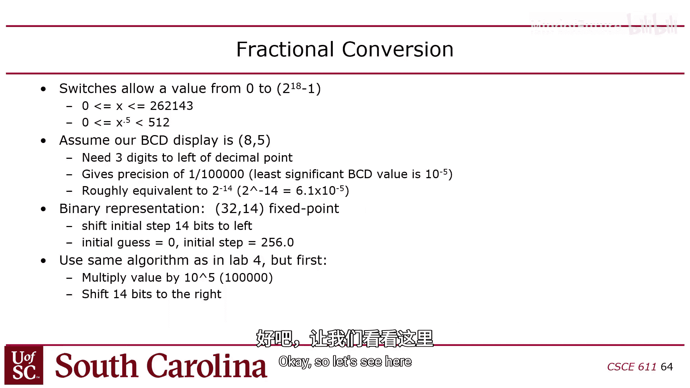
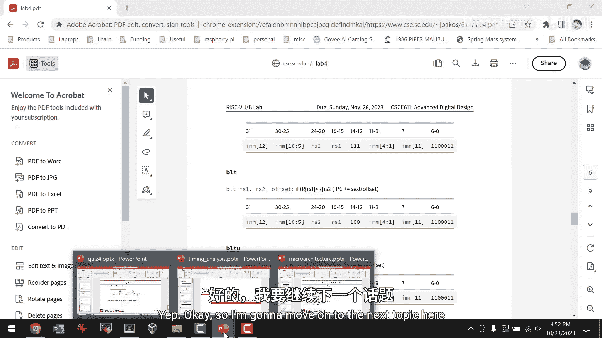
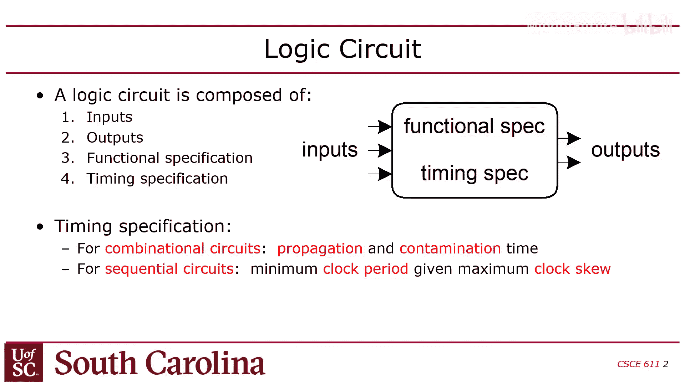
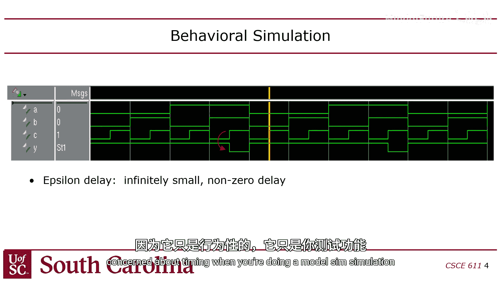
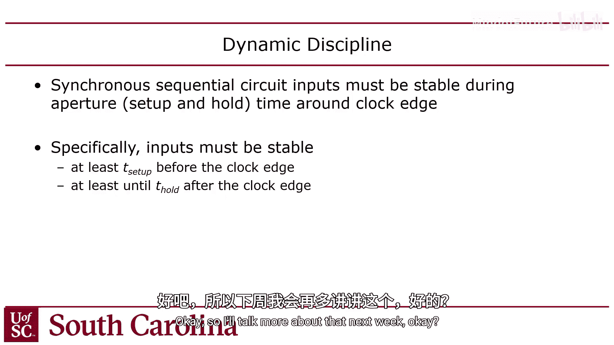

# 高级数字系统设计：11：时序分析 🕒





在本节课中，我们将学习数字电路中的时序分析。我们将探讨延迟的概念、关键路径、时序约束以及如何确保电路在特定时钟频率下稳定工作。理解这些概念对于设计可靠、高性能的数字系统至关重要。

---

## 时序规范与延迟



上一节我们介绍了分支和跳转指令的实现。本节中，我们来看看数字电路中的基本时序概念。



任何数字电路都有延迟。延迟是指从输入变化到相应输出变化所需的时间。在真实硬件中，延迟由电阻和电容（RC延迟）引起。延迟通常测量为输入信号从0到1（或1到0）转换的中点，到输出信号相应转换的中点之间的时间。

需要注意的是，输出并不总是随输入变化而变化（例如，与门的一个输入为0时）。只有当输入变化导致输出变化时，才存在延迟。

---

## 传播延迟与污染延迟

对于单个逻辑门，实际上存在两个关键的延迟参数：传播延迟和污染延迟。

*   **传播延迟 (T<sub>PD</sub>)**： 指输入变化后，输出**最终稳定**所需的最长时间。它定义了输出不再变化的时刻。
*   **污染延迟 (T<sub>CD</sub>)**： 指输入变化后，输出**可能开始变化**的最早时间。因此，输出实际变化的时间是一个范围，从污染延迟到传播延迟。

这两个延迟不同的原因在于CMOS逻辑门的结构。CMOS门有负责将输出拉高的上拉晶体管和负责将输出拉低的下拉晶体管。通常，NMOS晶体管（下拉）的开关速度比PMOS晶体管（上拉）快，因此输出从1到0的转换可能比从0到1的转换更快，导致了延迟范围。

---

## 电路路径与关键路径

对于一个由多个门组成的电路，其总体延迟取决于信号经过的路径。

*   **关键路径（长路径）**： 电路中输入到输出之间**延迟最长**的路径。计算整个电路的传播延迟时，需要将关键路径上所有门的传播延迟相加。
*   **短路径**： 电路中输入到输出之间**延迟最短**的路径。计算整个电路的污染延迟时，需要看短路径上所有门的污染延迟之和。

以下是一个示例电路的分析：

```
电路：Y = (A AND B) OR (C AND D)
假设：每个AND门的 Tpd = 2ns, Tcd = 1ns；OR门的 Tpd = 1.5ns, Tcd = 1ns。
```

*   **关键路径**： 例如信号A或B变化，需要经过一个AND门和OR门。
    *   电路传播延迟 Tpd_circuit = Tpd_AND + Tpd_OR = 2ns + 1.5ns = **3.5ns**
*   **短路径**： 例如信号D变化，只经过一个AND门（如果另一个AND门输出为0）。
    *   电路污染延迟 Tcd_circuit = Tcd_AND = **1ns**

因此，该电路的输出在输入变化后 **1ns 到 3.5ns** 之间可能发生变化，3.5ns 后才绝对稳定。



---



## 毛刺与动态约束



当电路中存在不平衡路径（即从同一输入源到汇合点的多条路径长度不同）时，可能会产生毛刺。毛刺是输出端一个短暂、非预期的脉冲。



**毛刺产生原因**： 输入变化通过不同路径以不同速度传播，导致在汇合点短暂出现非预期的逻辑组合。

**如何解决**：
1.  **逻辑冗余**： 在卡诺图中添加冗余项（对应额外的与门），确保在状态转换时始终被一个乘积项覆盖，从而消除毛刺。
2.  **同步设计**： 更实用的方法是利用**动态约束**。动态约束要求设计者确保：
    *   在污染延迟之前，输出是稳定的旧值。
    *   在传播延迟之后，输出是稳定的新值。
    *   在污染延迟与传播延迟之间的“窗口期”，输出是无效的（可能包含毛刺），应被忽略。

通过使用时钟边沿触发寄存器在传播延迟之后采样稳定输出，可以有效地忽略毛刺，这是同步时序电路设计的核心思想。CAD工具（如FPGA编译工具）的“时序收敛”任务，就是为了确保电路中最长的路径延迟（关键路径延迟）小于时钟周期，从而满足动态约束。

---

## 总结

本节课中我们一起学习了数字系统时序分析的基础。
1.  我们了解了**传播延迟**和**污染延迟**的定义与区别。
2.  我们学习了如何识别电路的**关键路径**和**短路径**，并计算整体电路延迟。
3.  我们探讨了由于路径不平衡导致的**毛刺**现象。
4.  我们引入了**动态约束**的概念，它是确保同步电路可靠工作、避免毛刺影响的关键原则，也是时序分析的根本目标。



理解这些概念对于设计能在指定时钟频率（如我们项目中使用的50MHz）下稳定运行的CPU至关重要。在接下来的课程中，我们将更深入地探讨CMOS电路设计和时序优化的具体技术。