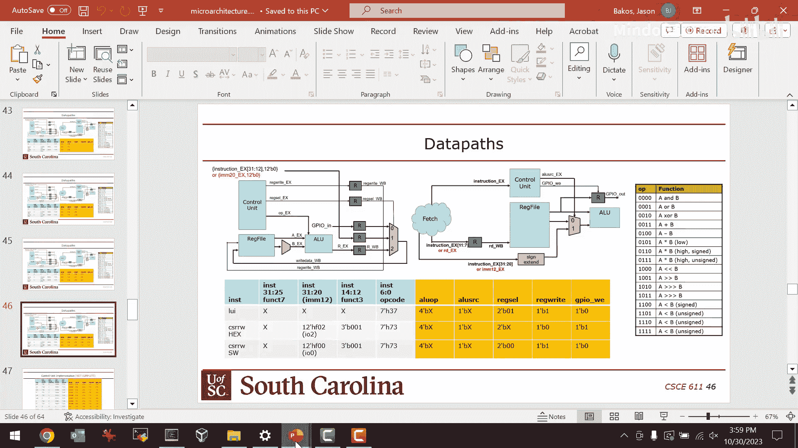
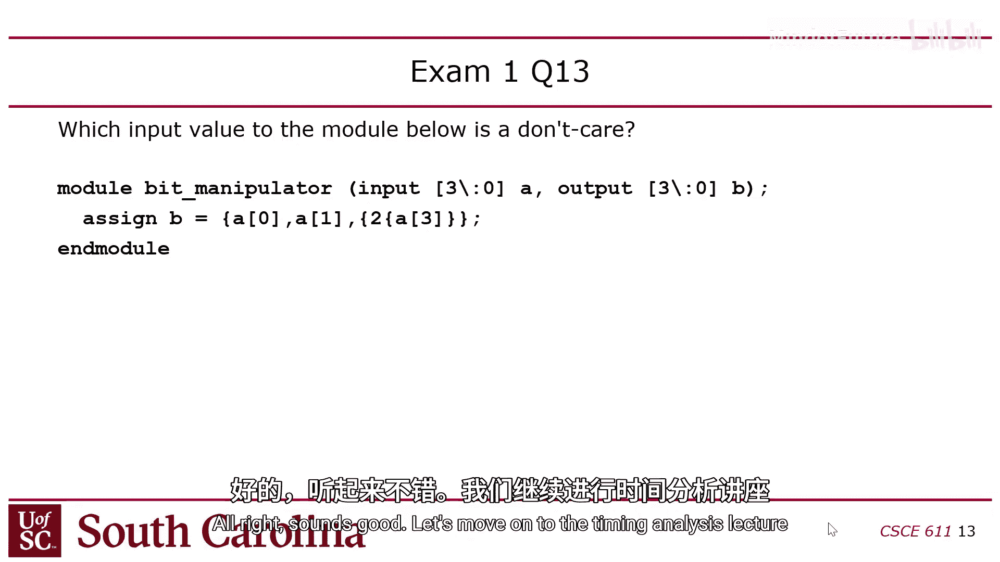
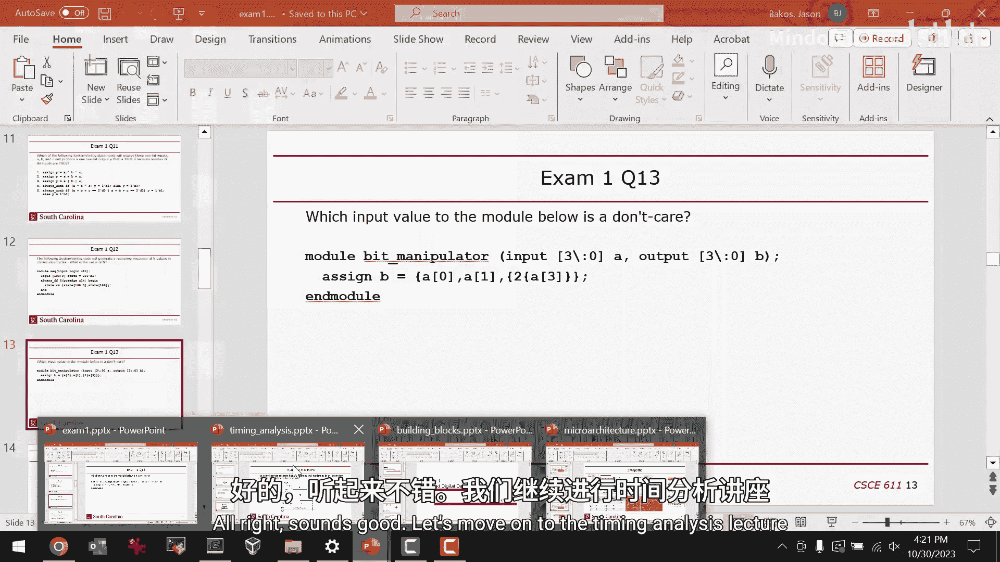
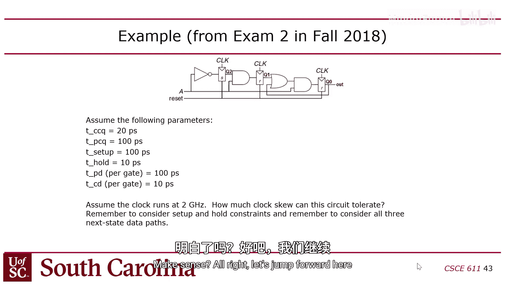
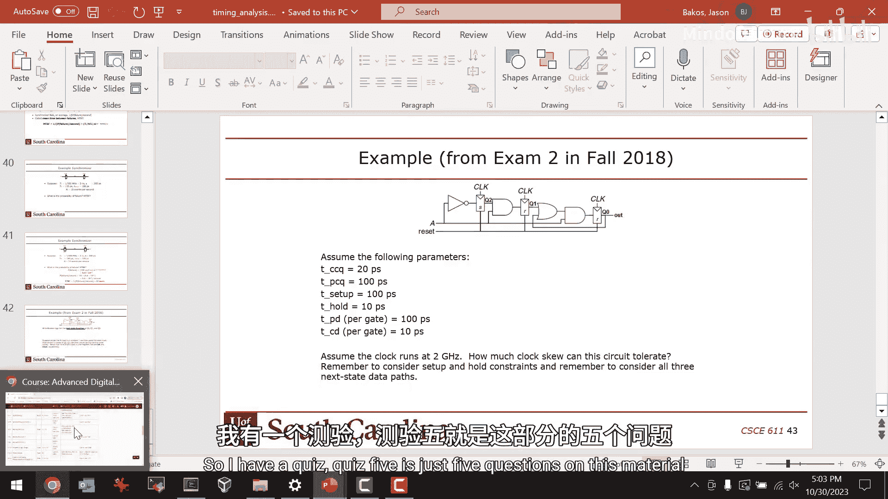
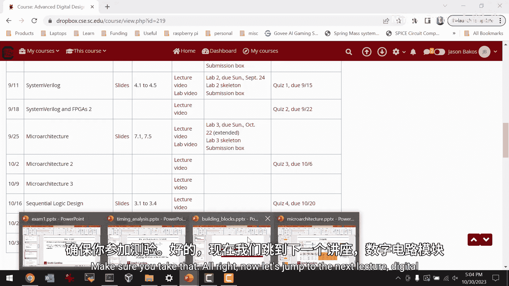
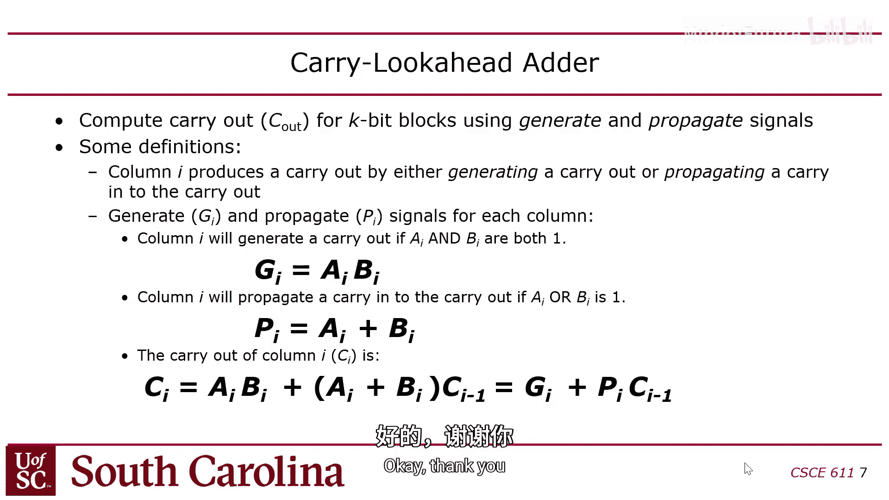

# 【南卡罗来纳大学】高级数字系统设计-CSCE611-（Advanced-Digital-Design，Fall-2023）-p12-P12-Timing-Analysis-2--BV19nf6YoEZ9_p12-

Okay， let's go over the exam， hopefully everyone remember to take the exam。

 I like to go through the exam。Just to review it real quick briefly。

 just to make sure there's no questions about it and also make sure I didn't make any。

Mistakes when I loaded it in or typed it in， sometimes there's bugs in the exams。

I don't think we had any that I know of。This semester。 So the first question was。

 assume the CPU design below has a bug where the wire labeled red rightite E X could only be driven to the value of one。

 which the following instructions would no longer execute correctly。 So if。

So red Wright is almost always one because almost all the instructions， at least in lab 3。

Write to the register file。So all these right to the register file， right at I， Ma H。

SLI and load up media。 they all write a register。 The only one that doesn't is。The one， not。

 not CSR W in general， but the one that writes to。IO2 right so this instruction does not write to the general purpose registers。

 it writes only to that IO2 out register right？So this one， you should not have the red right EX1。

For this instruction。 Now， this is a little confusing， though。

 because if this were a real risk5 processor， it would have red write 1 on this guy， right。

 But this is a specific。This is a hack that we use in this class for our project。

Where you don't want to write a register whenever the IO address for that guy is F02。

 Does that make sense， you guys with me？Makes sense， what other instructions don't write a register。

 well branches， jumps， store instructions， of course we don't have store instructions on our CPU。

 right？So this is the only one and I think in lab。And lab。3。

So it was hard to find an instruction that doesn't write a register which risk of five instruction will multiply the value stored in register four by four。

This one is a multiply， so shift left。To shift left and shift left logical immediate x4 x42。

So that's number one。These ones， by the way， one you had to select multiple those one and three were both direct。

No， actually， when I looked at it， there was like I clicked both vote， but itt March it half long。

 The game was full credit years。诶。HmWell， this one， shift left logical， this one。

 this is an invalid instruction， SL。Siff left arithmetic。

I don't think there is a shift left arithmetic right not shift left shift shift left arithmetic only makes sense if the shift amount can be negative because if you can have a negative shift amount。

 then if you ship by a negative amount to the left， you're actually shifting right。

 in which case the arithmetic might。Might come into play。 But if you shift left。

 you're not shifting an assign bit。 So I， I mean， unless I screwed that up。 the answer。

 the only answer should be one on that one。 I mean， unless F2 has two stored is the value。5 Oh yeah。

 true。 logical Yeah， X is value is Yeah， but we don't have， but we don't know that Yeah， yeah。

 it's a good point。 I hadn thought of that。 Yeah， Okay， moving along。

 which code is equivalent to the code below。Assign f equals if x equals1， then assign f to2。

 Otherwise if x equals 3， assign x to zero and if x equals。Two assign x sorry assign f to1。

 otherwise assign f to3。So what is going on there？嗯。🤧嗯。😊，What is going on。

 Anyone know how this one works？So it looks like this is tricky。But。You know。

 we're using a turnernary operator here。But it looks like。If the input is 01， then the output is 10。

If the input is 11， then the output is 0，0， if the input is 10， then the output is 0，1。

 So it looks like we're just， and what's the last case with 0，0。Yeah。

 so it looks like we're just flipping the bits， right。

 we're just taking the input and flipping the bits， so the XO with11 will do that。

I don't think any of these other options work。This one flips the bits， you know。

 just reverses the order， this one。Has no effect whatsoever because it's ending with 11 and this one is checking to see if they're equal and if they're equal。

 it complements otherwise it doesn't complement， but that。I don't believe that works， right？Actually。

 I guess it would work in this case， it works in that case。But this one。

 the first and the third cases wouldn't work out， right？Makes sense。Any questions？听。

When a program is being executed on the third three stage risk five CPU。

 in what stage is the fifth instruction when the third instruction is in right back？

If the fifth instruction is in right back then the。嗯。I'm sorry。

 if the third instruction is in right back。The fourth instruction， which is behind it。

 would be and execute， right， and the fifth instruction， which is behind that， would be in fetch。

 So the answer is fetch。Makes sense。Okay， assume the following V log module。

 this one just adds two numbers and I'm just asking you to basically fill in the。

The test vectors here。So notice here that C is two bits， three bits。And A and B are two bits。Right。嗯。

Okay， I just noticed this should be two， right？So。This should be two， but if we add0 and 0。

 we should have  zero， if we add  zero and 1， we should have one。

So it's the other two ones when just have like a zero and the highest order of it all the time automatically。

don't care if you have what's that Well because the output 3 bits and we're adding two。

1 bits but it just not No， no it'll it'll be okay because it'll it'll if you add two bits。

 it'll it'll use the carryout to generate a third bit。

 The only problem with this is the fact that these guys A and B should be marked as having two bits right right So that's I just notice that。

 That's that's a glitch here。 I think what happen here was because this is an image I updated the question and I didn't update this table。

 but。But the idea is， yeah，0，0 is going to give you 0，0 and1 will give you1，1 and0 will give you one。

And one and one will give you two， so that's going to be the first option here right matches。

 but yeah， technically this should be， I'm surprised no one asked about that。

 that should be two these guys should be marked with a two two bits。All right。但是。

Assume the following very log module， how many total bits comprise the inputs to module AAA looks like just。

One， right， yeah， clock。Consider the risk five mark architecture shown below and assume the following instructions of the corresponding pipeline surge which statement is true。

 ALU source EX must be set to one now remember ALU source EX would only be one if the instruction being executed。

 which is this guy。Is。Is an eye type， right？Makes sense。Um， but it's， u well， it's not an i type。

 right， LuUI is a U type。Now， technically， though。The ALU source could be a don't care。Right。

Because the LUI doesn't use the AU and we don't use the result from the AU because it gets blocked by this mugs。

 right？So but but it must be set to zero is is wrong AU opX must be set to 1000。Again。

 that can't be true because LUI is not using ALU right and LUI is an execute PC fetch contains the address of the instruction in Decode EX。

No， PC fetch would be the address of the instruction in fetch right and Reg writeite EX is set to one。

 well， that would be true because LUI does right to register。

 you guys with me so basically the way you solve this is when you you use the suffix of the instruction。

To figure out which signal which which which instruction each one of these signals corresponds to and then you just have to ask what that signal should be for that instruction right some of you guys I noticed in your designs。

 you don't't some of you don't put the suffixes in it's not a big deal as long as you you know it's going on I think it's helpful。

Though when you're when you're debugging。Most of the signals aret execute though anyway， okay。

 which of the following is a problem with the module below。This one。This one。

Looks pretty good right signal assignment statements have four bits on the left hand side and three bits on the right hand side。

诶。Because of the FB。If B， because a B， Well， no， but it doesn't。 they're both in and always。

 though it would， it would be， it would be always， it would be double driven if C。

We're driven in another always right or in or in an assigned statement or by another structural component right。

 but because C is set twice inside of the one always。

 this is actually just a default output for C in case that if statement isn't fired right so that's actually okay。

C is double driven so that''s I don't think that's true。 there's no structural HDL， that's okay。

 Blocking assignments are improperly used No it's fine。

 I mean combinational you're supposed to use blocking right。So the problem is one。

 the signal assignment statements have four bits on the left side and three bits on the right hand side。

 right？Because C is the four bits and A and B。A and B are three bits， and then if you do， you know。

 the result from this expression and that expression would also be three bits， right？

You guys with me， make sense。Okay。Let's see this one says what's the value of RD right back。

 so we're looking at the right back instruction which is an X or I， so what is the RD？Right back。

It would be the destination register of the instruction in right back， which is three， right？

Reg select E X， okay， the EX instruction is an L UI。 the the Regg select for an L UI should be。

We're talking about this mus？And we want this mux to have。When a select input one there， right。

 the input one on this mux is the LUi right is the U type。Amediate。So that should be one。And。

Reg select right back is referring to the X or I。And so that one is just going to be two， right。

 we're going to send the ALU value through。You guys with me？Okay。응。

W which of the system following system very log statements takes as input and unsign8 bit value and multiplies it by nine？

Okay， so this one。How do you multiply a value by9？You know that if you shift a value a certain number of by n bits to the left。

 it'll multiply it by two to the n power， right， but nine is not a power of two。

So you're going to have to。Yeah， you have to add shifted by three bits。

 the multiply by8 version and the multiply by one version right and if you take so if you take the value。

 multiply it by8 and you add that to the value， multiply by one。

 then you'll have multiplied it by nine so。This one is。A is concatenated with。Three zeros。

ThatThat multiplies it by two to the third power right so this one this one multily this sub expressionpress multiplies it by8 and this sub expressionpression just zero doesn't multiply it by anything。

 but it's zero pads the left-hand side so that way both sides of this ad have the same number of bits。

 they don't have to， by the way， I've noticed that in Ver log you can you don't have to have the same number of bits on both sides of an ad operator。

But in this case I did， I made them equal， and obviously I did that to try to make it。

 try to confuse you， but yeah， the answer is number one。

whichch of the following system very statements will receive three，1 bit inputs。

 A B and C and produce a1 bit output Y that is true if an even number of its inputs are true。

 this one actually will work for an odd number because they're X ors， right？嗯。So it's not one。

 it's two ads， A B and C。If y is only one bit？Then。If an even number of the inputs are one。Right。

 your well even number would just be zero or two right So if you add。

 if they're all zero or if there's if the sum of these three is2， right， then why will be。0， right。

 So that doesn't work， right， Yes， question odd number true Oh， did I Okay， Oh， oh， odd number。 Okay。

 so then it would be one。Sorry。I use the wrong version of this question then okay， sorry， odd number。

 so it's one。Yeah， actually， I was sitting there， I was like， wait。

 I did the X overs and I was right。嗯。Yeah， odd number one， I think technically， well， if it's odd。

Would number two work too？If Y is only one bit， I it would also be one two of them but。No。

 if two of them are true， you'd be adding one plus one， you get two。

But then if you store the result only in one bit， then two would just become  zero， right。

 you'd lose that you'd lose the carry out So I'll have to double check that one because I think two is also correct。

 right。The yeah。waitt a minute but wait if all three of them were， I don't mind。

 that would yeah yeah。If all three were one， the answer would be three， in which case y would be one。

I think this one works too， right？This one is also odd odd number right if a X or B X or C right and this one this one says if a plus b plus C。

 in this case， I'm comparing adding31 bits up and comparing it to a 2 bit value， which is okay。

 you can do that。So this is basically saying if they're all zero or if the sum is2。

Then this would be for an even number， Right， So5。 So actually， if， if the， if the exam said odd。

 I think answers 1，2 and 4 are all valid。 I mean， Yes， it is Yeah， it's just written differently。

 Yeah， so let me double check that， make sure that if， if you answered。If this one， if you answered。

 this is question 11， if you answered one， two， or four， that should be correct。Okay。

 I'll make sure that's the case。 And if it's not， I'll make sure that you get credit for any one of those answers。

 You're sure it was odd， though， right， it was okay， okay， okay， Alrighty， good。 Okay， question 12。

 The following systemella code will generate a repeating sequence of n values in consecutive cycles。

 What's the value of N。 Okay， this one is 200 B signal。 It starts as one。

So 200 B1 would just put a one in the least significant bit of a 200 bit signal。

 and then it's going to shift it to the left。Actually， it's going to rotate it。

 It's going to rotate to the left， right， So it's going to shift to the left。

 and that'll knock off the most significant bit， But then it's going to reinsert the most significant bit into the least significant bit。

 So it's a rotation operator。 So what'll end up happening is。😊，After 200 cycles。

 it will eventually become its initial value right that one bit will get shifted all the way across and then start at the beginning again。

 So it's200 the period of that is 200 cycles， right。It was on I just check It was。 Okay， thank you。

 Okay， I'll make sure that the right answers are set up then what input value is belows that don't care in this case。

 it would be a bit2。Right， because A bit2 is not mentioned in the logic there。

And which of the following statements is true， a signal can only be read by one block within the same module。

One always block within the same module， no， it can be read by multiple things that would be a fan out。

 right？An always statement is structural HDdL now it's behavioral。

 a generate statement cannot include an always block， no it can。

 a continuous assignment statement can generate memory。That one is not true， not true。

If statements can be used outside and always block， not true。

 always blocks can be used to design combinational logic true。

 so it's number six right6 is the only true statement yes so in an initial。

And then initial if you get an input， you can use if statements right for testing， Yes。

 so is that an all respond about？ThatThat's a great question initial blocks are basically they use the same semantics。

 the same syntax as an always block。But technically， yeah， I should have said。

I should have said initial slash always。That's yeah。You're right， so that one。That one would mean。

A generate statement cannot， wait， which one you are referring to if statements can be used outside of and always block yeah。

 so they can be used。In initial， so technically， in that case， five is true， right， okay？

It's fair enough， yeah''。I'll set that up as a correct answer to， so that's Q14。5。O。Yeah。

 it's a good catch， I hadn't thought of that。Everyone hear that。

 so the initial block is similar to an always block in that you can use if statements in there。

Which we did during the test bench。Lecture consider the following module how many cycles a delay exist between signal A and signal B。

 I think there's just this one is a， it takes one cycle to make it to delay one。

 another cycle to make it to delay two， another cycle to make it to delay three so。

3 right and then B is common A delay3 goes right into B right so in this case。

 B is going to change the same time as。A delay 3， so their A delay3 and B are going to behave the same here。

 so it's a three cycle delay。Okay， any questions？Yes， question。It says the exact answer is three。

 that it marks it wrong。Okay， I'll check that too。Al right， good。 I'm glad we went through this。

 There's Oh I'm sorry right I' sorry Oh， okay， do you answer question 13。😊，Yes。嗯。I you。Yeah。

 ours is it uses a0， a1 and A2 and A3 was our。sorry was our don't care so was the answer correct correct Okay Okay。

 yeah， yeah， so basically the idea so that this is an older version of this question， but。

The idea is that whatever bit isn't used in the logic is that don't care， right。我们嘅。Okay。

 any other questions？All right。

Sounds good， let's move on to the timing analysis lecture。

Okay， so last time we were talking about timing analysis and。

Just to quickly review that there's in logic there's delay delay is caused by capacitance and resistance excuse me so what that means is if you have a logic gate there's a difference in time between when the input changes and the output's updated。

In response to that。Sos that's the delay through the logic gate and there's actually。

Two delays you have to worry about， the earliest possible。Delay and the latest possible delay。

 The earliest is contamination delay， and the latest is propagation delay。

 So a logic gate or a logic circuit。We'll have both a contamination and a propagation delay that defines the range of times you can expect the output to change as a result of the input changing right。

 you guys with me？So we said that you know for a gate。

 it's sometimes the pulling the output down to zero versus pulling it up to one may have different delays and then for a circuit。

 you have different paths through the circuit， so with the circuit you have long paths and you've got short paths。

 the long paths are or the long guest path is called the critical path and it's the path from the inputs of the circuit out to the output that have it pass through they have it be subject to the most delay which is usually defined usually is going to be the maximum number of gates it passes through that's not always the case because you have to also。

You have to calculate it based on the propagation delay of the gates， right， you guys with me。So。

Yeah， but in this case it's。We've got A and B pass through three gates。

In series to get to the output， whereas D only passes through one gate。

 and so A and C passes through two gates， so A and B to Y is the critical path delay。

 or as the book calls it it's the long path， and then the short path is D to y。You guys with me？Okay。

So I mentioned that sometimes the number of paths through a circuit could be quite large。

 depending on how many fan outs you have， a fan out is when an output of a gate connects to inputs of multiple gates。

So then we talked about glitches， which is when。You have a case where you change an input。And。

Because of the。Differentiffing path， the different paths。

 the different delays of that input through a circuit to the output。

 you can get a glitch where the output will temporarily change and then change back right And so a way to fix that is you can。

You can add some redundant logic。In here to ensure that whenever you have an input change。

 it will never leave one caraw map grouping and enter another right so you can fix glitches as's a way to fix glitches。

 but you don't always have to fix glitches。And。Okay， and the reason for that is。嗯。Generally。

 you have。The gates inside your circuit， you're going to have data paths in your CPU。

 meaning that the logic is set up to where the inputs of the logic come from a register。

And output the outputs from the logic go into a register。You guys with me？

So you start with a memory element and you end with a memory element。Okay， and so you've got these。

 these are data paths in your CPU， for example， you have your instruction RA is the starting point。

of your say your execute stage， and then the ending point is the register file。

Right or you also have a chance like for the CSRRW instruction where your starting point is the instruction。

 the data passes through the register file， and then you may end up in the register that drives the。

It drives the。The hex displays right so the logic in a CPU is going to be comprised of logic paths that begin with a memory element and with a memory element。

 the memory elements are often registers。Okay， so registers have this notion， though。

 of a setup and a。And a hold time。Meaning that。The the register， like when you think of a register。

 you think of it as。They're edge sensitive。 So when there's the clock edge。

Whatever the input is on that register is sampled during the clock edge， right？

During like a really small time as the clock is going from low to high， but in reality。

 and that's fine to look at it that way when you're just doing behavioral design。

Like when you're just doing， you know， you're looking at your like your  Questicim。

 when you're designing your circuits， but the real hardware。

Has a requirement that the input to the register， the D has to be stable。

For some time before the clock edge， that's called the setup time and the。

The input also has to be stable。For a time after the clockage， that's called the hold time。

And this is a technology dependent parameter， depends the setup and the whole time depend on what technology you're targeting。

 right what's CMAOSs technology or what FPGA technology。You guys with me？

What happens if you violate that， what happens if you change the D input on a flip flop？Between。

The setup time before the clock edge and the whole time after the clock edge。

 this is called the aperture time， by the way， the aperture time is the setup plus the whole time。

What happens if you change the D input during that time， Well， if you do。

 there's a chance that the register will become metatable。

Which means instead of locking in the value。Of D and freezing it inside the register or the flipop。

The output will actually go between zero and one。Like if your voltage， if your voltage is like。

 say two volts， it might， the output will go to like one volt。And it'll stay there for a while。

But not too long， because eventually it'll settle into its correct。It's correct voltage， right？

So the meta stability is a temporary thing。You don' don't want it to happen as long as you make sure that your input is stable within the aperture time。

 then metastability wont control it won't happen if it does happen。It causes a problem。

 it's not catastrophic， but it's a problem， okay。Okay。

 so the idea is that when you synthesize the logic。Onto your FPGA or AsI。

 you want to obey the dynamic discipline， which means that you don't want any metaability to happen。

 And so you want to guarantee that。That the input to all your flip flops is stable during the aperture time。

So how do you know it will be？How do you know that's going to be， well。

 you have have to do a timing analysis or timing closure on the circuit。

So basically the idea is is that。If you have。A register。Outputting to some logic。

 and then the output of logic goes into another register。 you want to make sure that you。

 the propagation delay。Of the logic is small enough。That the data arrives at the second register。

Before the aperture。Right。Before the setup time。Right。Makes sense。This is why you can't。

 this is why it's risky to。To overclock。A chip over clock a CPU right。

 because you have to make sure that。When you're comparing the propagation delay。With the。

With a clock period time， right that the propagation delay is small enough。

With respect to the with the clock period that it'll be less than the clock period minus the setup time right so this is the clock period minus the setup time is your maximum propagation delay。

So in other words， you don't get a whole clock period to propagate through this logic。

 you actually get the clock period minus the setup time。Make sense。And if you overclock。Then。

You could get metaability。Right， you could violate that dynamic discipline。

 right now what ends up really happening though， is。嗯。When you increase the clock speed of a CPU。

 you don't just increase the clock speed， you also increase the voltage。

And when you increase the voltage， the propagation array will go down with the voltage so if you increase what ends up happening with the modern CPU is that the clock speeds constantly changing。

But when the clock speed goes up， the voltage goes up， right， So that way。

 if you scale those two together properly， you can still maintain this discipline。

 you guys with me now the voltage。The power， the power consumption of the chip is proportional to the voltage squared。

 right， So by changing the voltage， you get a huge。Benefit in terms of power consumption。

But when you do that you have to clock it down as well， right did you have a question supply voltage？

Right。Yeah。Yeah， but we're not all we're talking about here though is just， you know。

 for a given clock， which is TC， TC is the clock period。

 which is the reciprocal of a clock frequency for a given TC。In a given voltage。

 because for a given voltage， you'll have the gates will have a propagation delay， right？

And a contamination delay， you want to make sure that the propagation delay。

 the worst case propagation delay， that's the critical path delay， right。

 the long path has to be less than the TC minus the setup time to make sure that the data arrives in time to be outside the aperture makes sense。

Okay， all right。嗯。However。There's also a risk that what happens if this propagation delay is really low？

What happens if you don't have a lot of logic here， in fact。

 what happens if you just take this register and connect it directly to that register。

 so there's almost no propagation delay。What happens then， then the clock the clock tick comes。

 right， which will you get the clock tick and this guy will output his value right。

 and the value will come to this second guy so fast。

That you may violate the whole time on the second register， right。

 because the second register also expects there to be。

A minimum amount of time where it can expect its input to change on the clocker like so if I'm a register。

 clock edge comes。I have in order for my whole time to be satisfied。

 I expect no changes to my input for a little while after the clock edge right。

 so if the delay here is too short。That's also a problem because you violate the whole time。

 so if this delay is too long， you violate the setup time， if it's too short。

 you violate the whole time， that makes sense， so you have to make sure that the amount of logic between these two flip flops or these two registers。

 it can't be too short， but it can't be too long either。Does it make sense？Okay。So。So basically。

 the way it works is， as I mentioned， the clock period， which is TC。Has to be greater。

 And this is for the setup time。 The clock period has to be greater than or equal to。

The propagation delay of the logic， right plus。The setup time。

But also there's this additional term T PCCQ。That's the propagation delay of the flipfl。

 so the fliploop itself or the register has also a propagation delay from the time you get the clock edge the time its Q output actually changes。

 there's an additional propagation for that as well， you guys with me。Make sense。

So if you add together the logic delay， which is TPD propagation delay。

 you add together the delay of this R1。Flip fl， that's the delay relative to its clock。 You know。

 you get an edge of the clock and it just， it takes a while for it to update its Q。

So you have to add those together and you have to add the setup time， right？

Then that needs to be less than or equal to the clock period TC。Makes sense。Or as I stated earlier。

 you can also say TC。Minus the setup time right， and additionally you can subtract the propagation delay of the flipflop as well。

And that way， on the right hand side of this inequality。You have basically three constants。

These are constants。 These are tied to the technology。

 The propagation of a flipflop is tied to the technology。

 you can't change that as a designer or as a compiler or a synthesizer， you can't change that。

 you can't change the clock assuming you've decided on what clock rate you want to target and you can't change the setup time because that's a technology parameter so I've moved all three of those terms which are unchangeable to one side of the inequality that leaves the TPD on the left hand side and that's something you can control because you can play around with your circuit。

You can change your circuit。You can engineer your circuit and if you engineer your circuit。

 you can change the propagation delay of your circuit， right？How do you do that Well。

 you can use know like logic minimization right or if you have a really long propagation delay and there's nothing you can do about it。

 you can break it， break it down into multiple stages right you guys like you guys in 212。

 you learn about the CPU has a five stage pipeline。Did you do the five stage pipeline 212？

You talk about that。In this class， we use a three stage pipeline。So in our CPU， we have a long stage。

 We have that execute stage， right， It requires you to。Read the registers。And。Go through the AU。

 right？All in one cycle。It may be the case that that results in a propagation delay that that's just too high。

In which case， we may have to break our CPU down into say four stages or five stages。

 we may have to break that up right Now it turns out in our CPU。

 it's okay to have that long stage with that long propagation delay because we have a very slow clock。

50 megahertz。But if I told and I've been toeing around with this idea for years。

I always thought it would be cool。I just don't think we have enough time， but in this class。

If we had a lab where we tried to get your CPU to run， it' say 200 meHtz instead of 50。

Now let's yeah， well you can yeah and you can do that except you may have to deepen the pipeline if you do that。

 because the way the pipeline is set up now， we have that long propagation lay in the execute stage。

But anyway， you guys with me on this？Okay， so now there's the whole time con's constraint as well。

 where， as I said earlier， you have to make sure the delay isn't too short。And so for that。

 you have to not look at the， you have to look at the contamination delay of the circuit， right。

 So there's a contamination delay associated with the with the flip flop。 It's called。TCCQ。

And there's a contamination delay associated with the logic that's TCD that has to be greater than the whole time。

In other words， we have to have enough delay。Between the logic contamination delay and the flipop contaminationally。

 there has to be enough delay in here not to violate the whole time of this R2。

 You don't want this input to change too fast right So same thing the second equation is the same as the first。

 but it's been reorganized such that the T hold， which is not something you can changes and the contamination delay of a flipop。

 you can't change those。 those are technology that's part of the technology library。

 Those are on one side。 but the TCD is on the other side because that's something you as a compiler as a synthesizer as a designer。

 can you have power over this。 but you don't have power over these two So these two are constants。

 This is something that you have to enforce on your circuit。

 this TCD guys with me and it has to be greater than than the difference between these two guys does it make sense。

Okay， so these are。The setup const and the hold constraint are constraints on your circuit。

 your circuit has to meet those constraints。Okay， so let's look at an example here。

 so here's an example circuit。So we have over here。

 we have the contamination delay of the flip flops。TCCQ。The propagation delay of the flipopps T PCQ。

 and then the setup and the hold requirements， so these are your technology parameters here。

 and then we also have the T the propagation delay and the contamination delay of the individual gates。

Now usually this is different for different gates， but in this example we're going to say it's the same for all the gates。

 all the gates have the same contamination propagation。So the question is， is this good。

 is this going to work？Is this a valid？Is this valid。

 is this going to obey the dynamic discipline and not risk metatability？Well， to figure this out。

 we pretty much have to calculate。But we have a clock too， what's our clock time？

I guess we're allowed to set the clock， we can set the clock。To whatever the minimum clock is。嗯。

To try to make this work out。 Okay， so the first thing we have to ask is。

 what is the propagation delay of the circuit， What's the worst case path through the circuit， Well。

 it's going to be these guys， right， A and B。To y prime， right， that's the long path。

 that's the critical path。So what's that going to be。

 It'sre just going to add up all the propagation delays， right。

 So it's going to be 35 picooseconds times3。which is like 10105， I guess。

105 picooseconds and then the contamination delay。You have to base this on your short path So your short path is this guy D to y prime right so the shortest path here is one gate is 25 Pco right so the logic TPD and TCD is going to be 105 and 35 right pico seconds I think。

Yeah，25， Oh， sorry，25 P of second。 sorry the contamination list 25， right， All right。

 so the setup time constraint， if we go back to the equation for that， it says that。

The clock period has to be greater than or equal to。Proropagation for the flipop 50， so 50 right。

 plus the propagation delay for the circuit， which is 105 right， plus the setup time， which is 60。

60 right so 50 plus1 to 5 plus 60 is 215。 so that is the smallest clock period I can have that's my limit for my clock speed right。

So that's 4。65 gigahertz。The whole time constraint says that my delay the contamination of the register。

 right， which is 2 sorry， it's 30 right plus the contamination delay of the circuit in between these two is 25。

 So 30 plus 25。Has to be。Greater than the whole than the hold， right， what's the hold？70 right。

 so 30 plus 25 has to be greater than 70。Which it's not 55 picocond。

 So this guy this path is going to update the input to this guy。Possibly as slow as。55 picooseconds。

 which will blow away the whole time of this register， so this will fill the hold constraint。Now。

 luckily， the hold constraint is very easy to fix。What do you do to fix that。

 you just put additional delays in。So they inserted buffers here。

You can insert a buffer just to make this slower。 So in this case， I added a buffer here。

 The buffer presumably has the same contamination delay as any other gate 25。 So if I do that。

 then my short path now is 25 plus 25 plus 50 plus。What's this guy30， So 80 right。

 So by adding this buff right now of an 80。I had to add a buffer here too。

 because this guy also had a one gate delay， one gate。You guys with me， okay， so now who does this。

 do you do this？No， no， the CAD tool does this， the EDA tool has to do this。O。Autoomatically。嗯。听过。

Okay， so yeah， that works out okay， so， but there's some more bad news though about this。

The other bad news about this is that。The clock。Is connected to every flip flop on the chip。

Which means that you have this huge。Network， this clock network。The clock network。Is made of metal。

Wires。And because it's so big。It has a lot of capacitance。And。The clock。When the clock toggles。

There's so much metal that。Not every flip flop is going to see the cock edge at the same time。

So you got the clock comes in and almost like a wave， you know what I mean？Gates。

 flip flops that are closer to the clock pin， the clock source will see the edge。

Before ones that are farther away， you guys， that makes sense？Every chip has it's called clock skew。

So the problem is， is that。Not because they're not really not every gate sees the clock edge at the same time。

 you have this maximum possible difference called the clockcue。

 that's the maximum difference in absolute time between any two gates on the chip seeing the clock edge。

 right， you have to incorporate this into the timing closure， the timing analysis。

And you might say why， well， because what might happen is。For the propagation delay。If you have。

Two registers R1 R2。And say。Our。R1's clock is running late relative to R2's clock。In other words。

 our ones rising edge。Comes after R2 is rising edge。R ones phase shifted to the right。

What that's going to do is that's going to add effectively more delay。From R2's perspective， right。

 because what's going to happen is when you calculate your propagation delay。

The input to this logic is going to be running behind， it's going to be running。

 so the propagation delay is how long it takes the register to propagate。

 how long it takes the logic to propagate， but if they both got a late start。

That's going to cut into the clock cycle even more， right， So R2。

Is going to see its input coming in even later than it would be just because of the propagation delay。

You guys with me， so you have to build in a margin in your setup time analysis to account for the maximum skew。

 clock skew。Make sense。Okay， so。What that means is is that。Well， it doesn't really mean a lot。

 it just means that you have to add that。You have to add that。As another term。

 so the clock period has to be greater than。The sum of all the propagation delay plus the setup time。

 which is how early it has to arrive to meet the setup time plus。The skew。

 which is the sw is the maximum amount of time you'll see。

Difference between the clock edge on two parts of the chip。ok。

It's an extra margin you have to build into account for that。And again。

 this skew is technology dependent。 You can't change that。

 So that's going to end up together with these other technology parameters。

 leaving the PD just on one side。 So this is going to make it harder to meet your setup time。Also。

 though。I mean， the skew is worst case sw。So what happens if， I mean。

 do you really have to still obey the sw if you've got two。Flip flops right next to each other。

 they're probably not going to have a lot of skew if if they're close together， right？

So this is pessimistic。Because this skew is usually like the worst possible sw。

But the timing analyzer will still consider the worst possible skew， you guys with me。

Which means sometimes。It'll tell you that your F max， meaning your minimum clock period。

 you might put this on the FPG and I'll say oh， you can run it at 200 megahertz。

Sometimes you can bump it up to a little higher。But it's risky。

 but the timing analysis is pessimistic。It's trying to guarantee that you'll never have meta stabilityability。

 right？So the FPGA tools will give you the safe number for the clock whole time is the same idea。

 but the opposite， this one's even， this one's a little confusing。Because in this case。

 we're doing the opposite thing where。R 2。His clock is later than R1， the source clock。

 which means that R1 is going to get a head start。Relative R2。

 which means that if he gets a head start。That means that R2 may get the result even faster than normally would if all the clocks were synced up perfectly。

 right？You guys with me？So because the sw may give a head start。

 you have to also incorporate that in you have to say that the contamination delay。

Of the flip fl plus the logic has to be greater than the hold。Plus the sw。

 because the sw might give it again， a head start。So you're putting the skew on the same side of this inequality as the whole time because the whole time is the minimum delay。

But you're going to add the whole the skew is a more minimum delay to account for this head start possibility。

 right， depending on the phase of the clocks okay so。So does that make sense？Gys with me。

 I thought I had an example for that one， but you have to just change your。 You have to change。

 you have to incorporate the skew into these timing constraints。 Okay， but what happens though。

 if you have。If you can't enforce。The timing constraints。The timing constraints， as I mentioned。

 are between flip flop to flip flop or register to register， memory to memory， right。

 logic in between。But what happens if the input isn't a register。

 what if it's a button that the user pushes？Then you can't force the user to hit the button at the right time。

 right？So and this happens a lot。 In fact， it's not just buttons。

 It's like network traffic or any IO for that matter。 anything you can't control。

 anything the Cad tools can't control， because generally what you'll have is when a network packet comes into your ethernet card。

 it's going to get。It's going to get。Registered， it's going to get captured by a register。

 that's how it works， right， it samples， it samples the data coming through。

 but it can't predict when that packet's going to arrive。

So you may have the packet arrive during the。Aperture inside the aperture for the register。

 And there's really not a lot you can do about that。 You basically risk anytime you have an Iop pin。

 you risk metaability， you risk it。The input changing during the aperture clock edge happens and then。

What ends up the analogy the book has is like metat is when you have a ball that's kind of balanced。

On this peak。And eventually it's going to fall to one side or the other。

 these represent zero and one， right？But there will be a time that it'll be metatable and the time it's going to be metatable is a random variable。

Right。So the way that you model that is probabilistically， you say the probability。

Of the resolution time， that's how long it takes it to get out of metaability。

The probability that that is greater than the input T。Is an exponential。Distribution。

 it's E to the negative t divided by tau。Tau is a technology dependent parameter。' built again。

 it's built into the technology library。So this is something， by the way， you would get from like。

 say the fab， like if you're fbbing in a chip。If you want to tape a chip out and send it over to TSMC to get fabed。

 they give you a technology library， this is part of the technology library。Or it's part of the FPGA。

 like when you you know you guys in Corus， well you guys didn't do this because Charles scripted it。

 but when you go to Cors and set up a new project， you have to select exactly what FPGA you want。

 exactly what package is in， and the speed grade。I don't know if you saw the speed grade that in 3 yeah。

 yeah， that speed grade had to do with this these timing parameters。

Basically how fast the FPGA is right the logic。Okay。

 so the probability that the resolution time is greater than a value t is e raiseds the negative t over tau。

Okay。So there's an additional parameter here called that you put。U。Actually。

 there's an additional parameter you put as a coefficient in front of the exponential， it's t sub0。

 which is the aperture time divided by the clock period。

It's just the ratio between the aperture to the clock period。

 right how much of the clock period is consumed is taken up by that aperture time。Okay。Okay。

 so they have this， there's this idea of a synchronizer。

A synchronizer is where if you have an IO pin and your IO， you don't， by the way。

 there's no other choice if you have an IO signal， you you got to put it into a flip flaw， right but。

In order to reduce the chance that you'll have a bad input value。You。You can put。

Another flipflop in series。When you do this， it's called a synchronizer。And the idea is that。

Let's say the first flip flop goes into metaability。As long as it resolves its metaability。

Before the setup time of the second flip flb。Then we can just use the output of the second flipop as our value。

You guys with me？So basically， the idea is is that you expect the first flipflop is going to periodically become metastable whenever you have an input。

 an input wire into a logic circuit。But if you put that second flip flop in there。You can。

You can hope that if the first flipop goes meta stable， it'll resolve itself before the setup time。

 and then you'll get a clean output on the second flipop。Makes sense。🤧嗯。Okay， so。

You can calculate then the probability of this whole thing failing。

As basically what you do is the T value that I gave you before the resolution time。

 instead of just using T， you take the clock， the clock period。And you subtract the T setup time。

And that's the amount of time you have for the first flipop to resolve itself。

Before it goes into the second flipop， as long as it resolves itself within that period。

 then the second flipop won't be metas stabletable because this input in between will become stable in time。

 you guys with me。So obviously。If you have a longer TC。This probability will be much better。Right。

but if your clock is really small。Then it becomes more likely that this will fail。Makes sense。Okay。

 so。How do you calculate。The time between failures of a synchronizer。And again。

 a failure is defined as when the output of the synchronizer。

 which is the second flipflop that's connected in series， goes into metatability。

 how do you figure that， how do you get an estimate of how often this is going to happen？Um。

The number of the so the。The probability of failure every second is going to be。

The number of changes。The number of times the input changes。 Now remember。

 metatability won't happen if if if you got a button connected to a flip off， no one pushes a button。

 you're fine right because。The only time you risk metaability is if the input is changing during the aperture period。

 So if you take N。Equaling the number of。Changes per second。And you multiply that by。T0 over TC。

 which is just the coefficient。And then。Multiplily by e to the negative Tc minus t setup over tau。

 that will give you the probability of failure every second。Makes sense。Because again。

 n is the number of trials per second， the number of times you're testing it per second。

 and then if you just take the reciprocal of that， you get the mean time between failures。

Of the of the synchronizer。So here's an example， so let's say that the clock period is one over 500 million。

 so 500 megahertz， that's a two nanosecond clock period。Let's say tau is 200 picooseconds。

What does that mean，200 picooseconds Well， that， if you guys remember from statistics。

Do you guys take 590 yet， not yet？509。In 509， if you have an you probably remember the exponential distribution says that the。

嗯。This is the mean is here， right？So the mean is tau is the mean essentially。

So mean mean of what well mean of the resolution to the metaability， right， how long it takes。

What is the mean of the exponential random variable that tells you how long？The thing is meta stable。

 right， So that's why they have noticed its seconds。 Tau is in seconds， 200 picoconds is tau。

And then。T0 is 150 picoconds。What was t0 again， aperture， right aperture time？Okay。

 and then T set up is 100 picooseconds， and n is 10 events per second。

 so there's a lot of values here， but you just plug them all in。

And what you get is the probability of failure every second。Is。5。6 times。

10 to the negative sixth power， which is， yeah。fi。5。6。Oh， sorry， it's 5。

6 times 10 negative to 5 when you multiply it by 10，10 per second， right。

110 trot when you put the n in there，1010 attempts per second。

 And so if you take the reciprocal of this， you get。Five hours is your mean between failures， right？

Okay。Okay， so we've got， let's see。 I've got another example。

 So here's a quick example that I had on an exam question。

 write Boolean logic for the next state function for Q0 Q1， Q2。 So this is from the。This is from the。

Oh， I don't have the sorry I don't actually have the solution on here。

 So the next state so the idea here would be that you would have to calculate the。

The propagation and contamination delay for this circuit， so in this case， though。

 you have to look at you have three flip flos in here so you'd have to calculate the contamination delay and the propagation delay between the first two。

Right。And the second two。And then do we have something between this the third？Let's see。

 the third flip flop feeds back into the feeds back into itself。 So in this case。

 you have a path from this guy。Back to itself， right， So it's not always to just two， you know。

 flipop to flipop。 It can be flip flp。Back to itself。You guys with me？

So you'd have to calculate that。And then from this， you know。

 calculate the whether this guy meets the setup in whole time。Any questions？Makes sense。

All right， I' let's jump forward here， so I have aquiz quiz five is just five questions on this material。

 make sure you take that。

All right， now let's jump to the next lecture。

Digital building blocks。Okay， so let's talk a minute about adders。

 did you guys cover adder adders in 211？Okay so you remember so you had a full adder。

 which is basically a one bit adder， right？So you had。

 but a one bit adder had three inputs and two outputs， right？Because there was A and B。

 which are the two bits。 and then there was a carry in from the previous column。

 The carry in is from the。The adder to its right， right the previous bit。

 and then there's a carry out that goes to the next column to the left， right？Right， okay， then。

So basically， the idea is that if you have an adder， a multi bit adder。

 you just associate one full adder with each column， with each of the corresponding bits。Okay。Now。

 the problem with that is， I don't know if you guys talked about this in 211。

 but the issue with this is that。If we look at this in terms in the context of what we just got done talking about。

 propagation delay。The propagation delay of an adder， this kind of adder is very。Is very bad， right。

 because when you calculate the critical path of this adder。

 the critical path starts with the carry in。And it actually propagates through every column。

 So the more bits you have。The longer the slower it is， right？

So basicallyag the critical path is essentially from carry in。

 the first carry in to the last carry out。And so what is that， Well。

 it's pretty simple to figure out it's just n times。Proropagation delay of one full adder。

You just multiply it like if， if's， if it's a 32 B add。

 it would be 32 times the the delay of one full ladderer。 the propagation delay of one full ladderer。

 Of course， the full ladderer itself is got multiple paths of it， right。You guys remember that？

Remember the full ladderer has like。I don't have it listed here。

 but remember the full adder when it generates C out。It's pretty much a。If there's two bits set。In A。

 B and C。Or three beds set。Then carry out as one， right？

And then if there's an odd number of bits set。Then the sum。This is like the exam question， right。

 if you add up these three bits。But the output is just one bit。

Then the sum will be true whenever there's a。An odd number of 1 bit。 So the sum is like an X or gate。

 right， but the C Al is like a full， you have to do a full like sum of products， right。

 So probably the C out is， is the slowest part of the full ladder。

 And then you have to multiply that by the number of bits。 when you make a ripple carry adder。😊，Okay。

So that's， that's going to be slow。 So what else can we do， how can we make a faster adder。

Well you can use there's various ways to do that， one way is to use a carry look ahead at her。

And the idea with this is。You don't want to have to propagate signals all the way through all these full ladders。

 You want to take a basically short circuit it。And be able to calculate carry ins faster。

In other words， you still use a full ladder。But bit each full ladder instead of running。

 instead of getting its carry in by passing data all the way through all its。

Bits to its columns to its right， you can pre calculateculate the Carrion for each column right in other words。

 it changes how you get carons does it make sense Okay。

 so the way you do that is you there's this notion called generate and propagate。

So these are things that you add to the full ladderer。Each full ladder。

In addition to having a sum and a carryout。Actually。

 you probably would replace the carry out with these you just have some right。

 but then you can you can generate a signal called generate。Which is true when A and B are both one。

What does that mean， it means that if you have a full ladder and you give it two1 bits on A and B。

 you're going to have a carryout。Regardless of the Carion。That' you're generating a carryout。

Without worrying about any previous bits， any previous columns， right propagate， on the other hand。

 is if a or B is set， you will generate a carryout。But only if it's carry in was one。

So basically propagate means if I have a carry in I'm going to send a carry out。

 that means propagate if propagate is one right if generate is one。

 I don't care what the carry in is I'm guaranteed to give a carry out right and so basically it's very simple。

 generate as a and B， propagate as A or B。Okay， so then the carryout of。Column C sub i right。

 so bit I is going to be basically the generate of I。Forget this part。 Just look at this part。

 It's the generate， I don't know why this is the。This is the the logic without using So basically I just covered propagate and generate。

 and yet this guy doesn't use those right， but we do use them here。 So it's the generate of column I。

Right。嗯。Or the propagate of column I， if it's combined with the carry out of the previous column。

 makes sense。对话。Makes sense。So this is carry out， this is a little confusing C subi。

C subI stands for carryout。Carry out of me of column I is a function of the generate of column I。

And the propagate of column I with the carryout of the previous column， that makes sense。Okay。

All right， so I think I'm just about at a time， right， Okay， so let's。So， that's。

We'll continue with this next lecture， don't forget to take quiz5。Okay。

 and if you have any questions about the projects， let me know。Okay， thank you。

