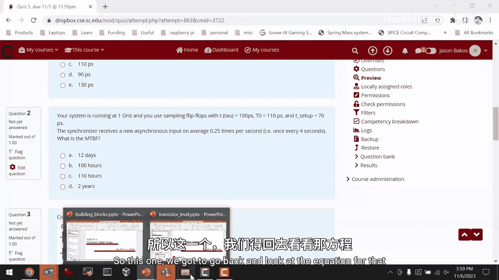
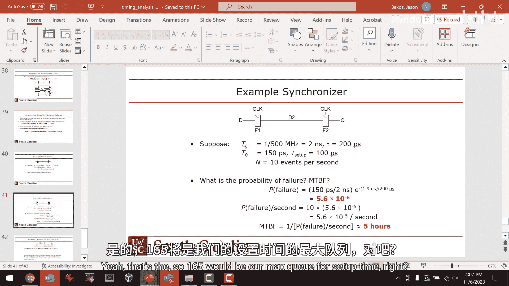
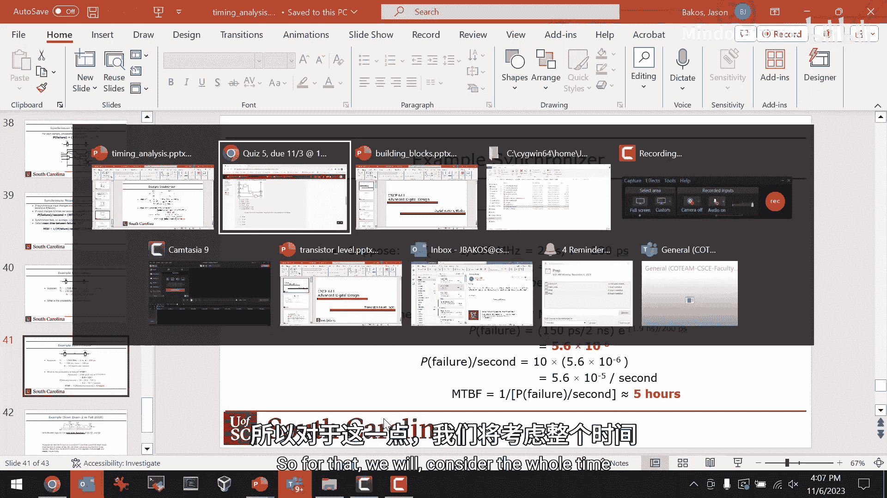
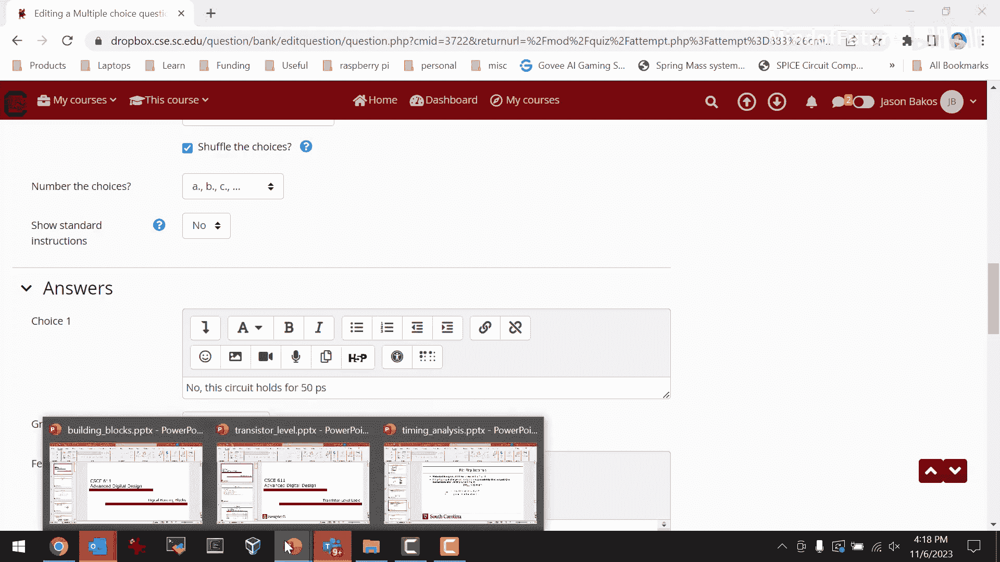
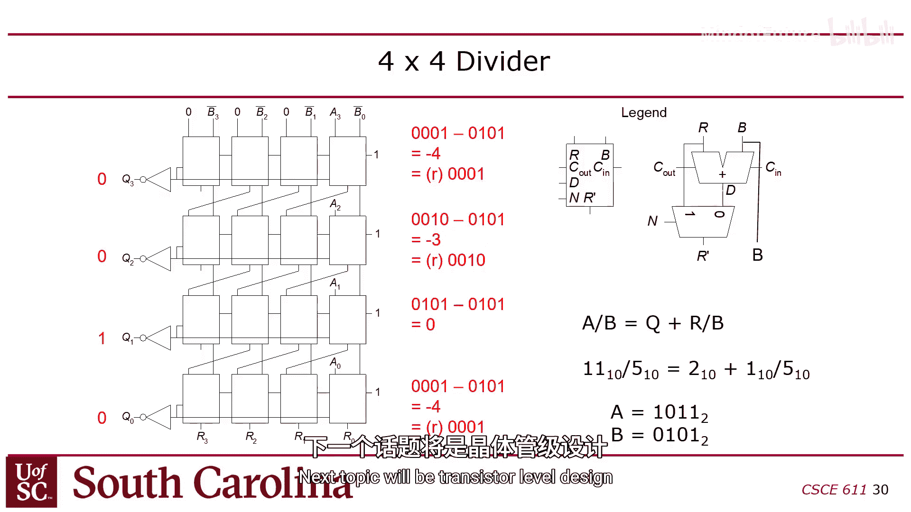

# 【南卡罗来纳大学】高级数字系统设计-CSCE611-（Advanced-Digital-Design，Fall-2023）-p13-P13-Digital-Building-Blocks--BV19nf6YoEZ9_p13-

So this was quiz5。 it was on timing analysis。 it was just five questions on it。

 So the first question said。Consider the circuit below。

Consider the following table of propagation delays and the question was critical path right Yeah what's the propagation delay of the circuit above or。

Another I probably I should have asked what what's the critical path to lay when when you're when you're calculating propagation delay。

 you want to look at worst case propagation delay So this circuit has。No fan outs in it。

Meaning that all of the gate outputs only connect to one input。Except for this one。

 which connects to two inputs on the same gate。 So this is an easy circuit to analyze because you basically just have one path for each input to the output。

 you guys with me。 So in other words， if we had some branches in there。

 it might have been more complicated， but this is a pretty easy one。 The problem is， though。

 is that all these gates have different delays， so。嗯。

You may need to calculate multiple possible delays。

 although you can see that D& E or there's no way that D&E are on the critical path， right？

Because D skips over。A gate that A， B and C goes through。 Likewise。

 E skips over a gate that F and G go through。 So it looks like we really just have to calculate。

 And then the path from A， B and C to Y are all the same。

 And the path from F and G to Y are the same。 So I think there's just two There's only two delays we need to calculate here。

 right， Everyone agree with that。 That makes sense。 Okay， so we've got a three input Nand。

So that's 30。So I'm looking at the top branch from A B and C， then we have a two input Nand。去桂田。

Nan're NN yeah， yeah， two input NN， so that's plus 20。And then we've got a two input norr。

 which is 30。And a two input NN。Which is two input in 20， right？

So that would be 50 plus 5100 pico seconds， so 100 pico seconds in the top path。

That would be from a or B or C to Y， and then the bottom path from F or G to Y would be a two input。

We go through a two input and which is 30。Two input norrr， which is 30。Another two input Nora。

 which is another 30。And finally， the two input， Nan， which is 20。Right so that's 60 91，10。

So we're going to take the max of these two values， so it should be 110， right if I did that， right？

So I think that's right。Your system is running at  one gigertz and you use sampling flip flops with tau equals 100 picooseconds。

T0 is 110 piCOconds， t setup equals 70 piCOseconds。

 the synchronizer received a new asynchronous input on average 0。

25 times per second once every four seconds， what is the mean time between failure？So this one。

 we got to go back and look at the equation for that that would be under timing analysis。

Okay， so it's one。Over。啊。Sorry， the mean time between failures is。

The reciprocal of the probability of failure per second， I'll just say mean between。

Meantime between failures。Is TC， T sub C over。N times t sub0。And E。To the。T0， sorry， Tc。

 that's the clock period minus T setup。Over tao， right？Makes sense。So this is going to be TC。

 which is。TC is， well， it's a gigahertz， so what's TC， anyone know？So one divided by a billion。

 one billionth of a second。嗯。Is。One pico second， right？All right。So one pico second。

 so that would be 1 e to the negative ninth。Right？And then， N is the。

Number of times per second we're toggling， so it would be 0。25。And then t sub0 is 110 pico。

And this would be times E to the。1 e negative9 minus T setup， which is。70 picoseconds。70 E negative9。

Negative。诶。Sorry， that would be， I got that flipped。ちち。T sub c minus T set， T setup 70 picoseconds。

Do that flipped。T sub C minus T setup。 Oh no， that's right， right， right right。 Yeah。

 it's a negative value。 And then that's divided by tau， which is the technology parameter。

 which in this case is。100 picocond， so 100 negative eye。Make sense， and we just compute that。And。

What was the answer for this？110 hours。Make sense， everyone agree Okay， all right， next question。

 consider the circuit and timing parameters below。assumingsing the clock runs at 4 gigahertz。

 how much clock skew can the circuit tolerate？Okay。

 so for this one's kind of tricky because the clock skew。

Comes into play for the setup and the whole time。Right。So the。The setup time。Is。

Constraining the maximum delay。Through the circuit， right So the delay is going to be。

 you have to add together the delay of the the propagation delay of of these flip flops here， right。

 which is T PCCQ。 So that's 30 picoseconds。So 30 picoseds plus the delay of the data path。

 which is between the two circuits between the two sets of flip flops， right， so that would be。

The critical path delay would be through three gates and in this case。

The propagationally of each gate is 15 picoconds。It would be three times。15 pico seconds。 Okay。

 so that's the delay we have coming out of here and through here。

 plus we have the setup time because we have to arrive。We have to arrive before the clock clock edge。

 the amount of time before the clock edge that we have to arrive is the setup time right you guys with me so it's like an extra margin you have to build into the delay so you have to add T setup。

 which is sorry。That's given to us what's tea set up 10 picoseconds？Yep， 10 picoconds， right？Okay。

 and then you have to account for。Um。The clock skew。So you have to potentially add the sw。

 which is an unknown here， so sw。Okay， so this is the delay of the flip flops。So this is TPC。

When is it PCD， PCQ， PCQ？Right。This is the propagation delay。Of the logic。This is the。Set up time。

And this is the sw right and all of this has to be less than or equal to。The clock period， right？

And the clock is。4 gigahertz， so the clock period is。

250 pico second Oh wait a minute I screwed that up gigahertz is a nanosecond right， yeah。

 sorry I had that wrong in the last question。So yeah。

4 gigahHtz would be Twitter for the Epeco seconds， right， sorry， that screwed up。

So 200 for the Epicco seconds is our period， right？Sorry about that， makes sense。So basically。

 we just have to solve for Skew here。 So we， we have to back。 So out of this 250。

 we have to take out。30， 45 and 10 right。30，45，10 right， And because three times 15s 45， right。

 so the s must be less than or equal to this would be 75，85， So 250 or minus-85。Is5，4，6，165。

Pco seconds。Makes sense。Oh， I'm wrong there。When I screw up 30。Right， plus 45。

 so this is 30 plus 45 plus 10。30。Right。So four gigHtz， am I wrong about that， is it four gigahHtz？

Yeah， so the clock period， so you have to， again， you have to fit all of this in the clock， right。

 we have to be able to fit in。嗯。30。See each gate is。

Proropagation lay gate is 15 right and there's three gates we go through The T PCQ is 30。

Setup time is 10， right？And。We've got the skew is added to that， right？And。

The clock is four gigahertz。So。4our gigahHtz， 250， right？So， 50。SSew。30 plus 45， 155。

 let' me make sure I got the equation right。So in our timing analysis， we have oh sorry。

 I know it's wrong actually that's that's that's actually correct except this is only for our setup time right now we have to consider the whole time too。

 Yeah， that's the。 So 165 would be our max queue for setup time right。

 but then we have to consider the whole time separately So for that。

We will。Consider the whole time。 So the whole time we have to consider the contamination delay。

 which is the minimum time for the circuit。 So that would be T C Q， which is going to be。

And this is set。And then hold。So we have the contamination delay of the flip flops， which is TCQ。

 which is or TCQ， which is 20。20 picoconds。Plus， the contamination delay per gate now in this case。

 we have to consider the shortest path， which would be one gate with a contamination delay of 10 picoconds。

Okay， and then。The setup time。I'm sorry the whole time is is 30， right， so we have to make sure that。

嗯。That these guys。Minus the s。Is greater than the T setup time or sorry T hold time rather。

 which is 30。Okay， so the earliest we can get something through this circuit is really 30 right。

 but because of this sw。The inputs into the data path may get a head start。

 they may actually start start earlier than normal right because of the sw that's why we have to subtract the sw we subtract the sw here in case we get a head start and get there early。

 we add the skew on this side though because。We may get delayed by the skew， right。

 So this is a delay skew。And this over here is a head start skew because you have to consider。嗯。

You have to consider。That the sw may delay you in the case of setup time。

 but it may give you a head start in the case of hold time。

 so you have to consider the worst case scenario with the skew because the sw is a plus or minus difference in clock phases。

So this is 30 picoseconds。Minus s must be greater than 30 picoconds， which means the。

Skew minus sw must be greater than zero。Right。Which means that sw must be less than zero。

Which means it can't tolerate any skew， right for the whole time， right？All right。

 let make sure I got that right。The answer is none， yeah。Okay， makes sense。

So we were fined with Skew we could tolerate up to 165 picoconds of Skew on setup。

 but we couldn't tolerate any skew on hold time。All right， next question。

 you're designing a two bit adder from two full ladderers， the adder is input and output registers。

Unless complete addition of once one clock cycle designed for the adder is shown below。

 so this is basically the same kind of question as before。

The idea here is that we're putting an adder in here and really the only difference between this。

Question and the previous question is calculating the contamination and propagation way through this sky。

So with the adder， you've got two full adders right。

 because it's a two bit adder and the worst case delay for this adder is basically the carry in coming in。

 the first adder and propagating out that first adder into the second adder and then coming out through the sum。

 so carry in to carry out is 20 picoconds， carry into S is 20 picoseconds。And so that's your。Oh。

 and then A and B to carry out。Is。25 Pco seconds。 so if we're looking at A and B to carry out。

 but the。OhAnd this is on each full ladderer so you you have you have to consider these separately so the critical path here would be carry in to carry out on this guy right would be 20 picoseconds and then for the second adder it would be carry in sum so the full propagation delay from carry in to sum zero would be 40 right you'd have to add these two guys you see that。

Because you got to propagate from Caran。Through this adder into this adder and then out through some。

 and apparently。According to this figure， unless it got cut off。Now， according to that figure。

 we're not putting carryout into the output register here。

 so we don't really care about the delay for carry out this second carryout you guys with me。

Make sense， we only care about carry in， the first carry in through S0。

And then for the contamination delay。The fastest will get a change is going to be。

A and B's either output or CN to either output。So I'm guessing C end C N to S on this first adder is going to be 15。

 So contamination delay is going to be 15 and propagation delay will be 40。 But of course。

 that's just the logic in between。 You have to also add。The propagation and the contamination delay。

 or consider the propagation and contamination delay of the。Flip flops as well。

 and then you just do the same calculation。I did for the previous one and in this case we're just calculating Max clock cube。

 but make sure you calculate it for both setup and whole time， don't make the same mistake I did。

And then consider the circuit and timing parameters below。

 assume the clock speed it's 1 gigHtz does a circuit mean that hold constraint why or why not。

 why or why not， Okay， so this is just asking about hold constraint。

So the whole constraint is going to be。For this guy。嗯。Contamination delay for the。

Plip flops is five picoconds。the contamination delay for this circuit is going to be essentially you have to add the contamination delay of two of those gates。

 the two two or actually the and and the or right， so that would be 20 and 25 and 30。

I don't see any knots in there， so it's 25 plus 30。25 picooseconds plus 30 picooseconds。

 and then you have to add， actually subtract the sw。And that has to be greater than the whole time。

Which is 50 picoconds。Okay， now again， there's no clock， there's no clock period in here。

 we don't care about the clock period。Like we do with setup。

 so the clock edge comes and you we have a race through the logic and the soonest we'll get a change on the output would be basically 60 picoseconds。

But the skew may give it a head start， so we have to consider the worst case for Sw so we subtract Skew。

 and that has to be greater than 50 picoconds。Okay， so。

Minus sw must be greater than negative 10 picooses， so sw must be less than 10 picoconds。Okay。😊，嗯。

This circuit holds。So this circuit meet the hold constraint。Oh， clockkew， sorry。

 clock skew is we have the clockkew， it was10， right？Yeah， so we're good。Like Kcu was。Was 10， right？

10 picoses， 10 picoses。And。Yeah，10 pico seconds， but 10 pico seconds， it should be strictly。

Less than though， so I think actually。诶。If we're right at 10。Because this is a strict less than。

 right？Let me make sure I got that right。Yeah。Yeah， so actually I think the answer is no there。嗯。

So yeah， it holds for。We're going to add up。Add up to these guys， five， that would be 5。

 25 is 30 plus 30 is 60， plus 10 is 70。So do what is the answer there？I'm sorry， not 70 to 60。

 right a subtract 10。So answer is， no， the circuit holds for 50， right， well， 50 is actually。

50 is actually， no， actually 30。50 plus5 plus 25 is 30 plus 30 is 60。

 so did I get that one is that one？Is that answer wrong？嗯。Did I screw that up？So two input in N。

 so it's 25 plus 30。Did I get the short path。 No， the short path looks good because all of these paths go through both of these guys。

 So it would be， yeah， it would be， well， I guess 1525 plus 30，55 but。

That's the contamination delay of the circuit。 And plus， then you'd have to add the。5 from the。

The flip fl。 So that gets you up to。sty。But then you subtract 10 and that gets you down to 50。

 So I guess yeah， so it is it the 50， is that the answer？Yeah， yeah， 50 right， Okay， so basically。

 yeah， we just added up this side of the inequality and this is 50 right， 50 pico secondsd。Minus 10。

 right， okay。So the answer is no， but it's close because the idea is that be you have to be less than the hold。

 right you guys with me？Okay， allright。

Okay， so last lecture， we' were talking about these digital building blocks。

And I reviewed the Ripple Carrie adder。And the ripple carry addder is when you create a chain of adders。

For each column of a multi bit addition right so these are columns。

 each column is the corresponding bit position between two multi bit values that you're adding together and then the carries a carry from one column a carry out from one column flows into the carry in of the next column right the problem with this is that。

It's slow because。The propagation delay。Is。N times the。诶。

The propagation delay of of a single full ladderer， right。

 So it's n times the time for a full ladderer where。诶。

T sub FAA is the time the propagation lay for a full ladder。

So a faster way to do this is using a carry look ahead at her。

 And the goal here is to break is to be able to break that long chain of carries。

 And the way you do that is you generate a signal called。

Proaggate in a signal called generaterate from each of the full ladderers。And then。You can。

Figure out or you can infer what the Carion is into each column from the propagate and the generate signals from the previous columns。

You guys with me？So the way you do that is。UYou。嗯。You basically look at the hold on a second run slay。

So you look at the。The generate。From the column before you。The column before you， if it generates。嗯。

Then。You know， your carrying will be one。Or if the column before you propagate and it's。

Carryion is one， then you also have a carry in， but then you can replace the carry in from column I minus1 with this same expression right and build it up。

嗯。So。So basically。Well， these are home on a second， these are for blocks， where's our。Where's our。

Okay， so home on so for a single。Column。Right。To carry in on column I is going to be the generate on column I minus1 right。

 or a propagate on i minus1。And then Mt ended with the carry in on I minus2。Makes sense， Okay。

 but we want to get rid of these carries， right， so you can replace this with。

The generate on i minus2。Plus， the propagate on i minus2。嗯。Ened with the carry of i minus2。

 carry in of I minus2。And you could keep building this out。You can continue building that out。

 The problem is is that。As you make this expression larger and larger in order to calculate carries of bits further to the left。

 you end up with this enormous logic circuit。 It's not very scalable because you end up with a lot of inputs。

 you end up with Boolean expression with P's and G a lot of different P's and G's。

 P's and G's from all the prior columns， right， Now， in principle， you could do that with a。

Just the two levels of logic right a product of sums right but the problem is that that expression is going to get big because you're going to end up with a lot of inputs to the gates in there。

 a lot of inputs to particularly the sum， the or gate at the end。

 you guys with me right it's not scalable basically the only way you can really do that is on a small group of bits。

But you can extend this method and make it hierarchical。 So the idea。

 and this is generally how these are built is。You can calculate。

 degenerate and propagates on groups of bits。So in this case this is the generaterate and the propagate corresponding to a group of columns three down to zero right so what I showed over here。

 these were individual bits so you know let me give you a concrete example for a block。

If I have a four bit adder。The carry in。For。3。Is going to be the generate for two。

Or the propagate for two and the generate for。One or the propagate for one and the generate for zero。

Right。Or the propagate for zero and the carry in for zero。Right so it makes sense。

So the carryion 3 is going to be the generate on two plus the propagate on2。

 generative1 plus propagative 1 plus propagative 1， propagative 0， carryion of 0。

Or we can expand this carry in3 equals generate2 plus。Proroppaate to generate one plus。

Proroppagate two， propagate one。嗯。Sorry， it was。哎。Proroppagate one， let's say propagate， propagate。1。

Generate zero， there we go。So propagate one， propagate two， propagate one。

 generate zero plus propagate1， propagate zero， carry in zero。

And that would be a two actually propagate two。 Okay， so if you look at this， it makes sense。

 So the carry in for bit3 is going to be the generate of bit2。Right。Or。

The geneative bit1 combined ended with the propagate of bit 2 or the gener 0。

Ened with a propagator one， propagator 2 or。The carry of zero， because we have to have an original。

 this is the original carry in from the user perspective。Anded with propagate zero， propagate one。

 propagate two and。That's it right yeah because then that would have propagated a bit three guys okay makes sense so the first basically the pattern here is that you start with the generate or you end with the generate and you start counting down from three right。

Any questions that makes sense。 So you can continue building this up。 but the problem is。

 is that if you look at this expression to put this into logic you could do you could have like you'd have to have an origgate that's 1。

2，3，4 inputs and then you have to have an and gate here that's 12，3。

4 inputs right and as you start putting these it becomes impractical to you know to make these these single gates with a lot of inputs。

 So if you were run this through the synthesize or like cors。

 it'll actually decompose these big gates and a smaller gates。

 but you will end up with is a slow circuit right So what's done instead is well you still do this for small blocks but instead of scaling up all the way to a 32 B adder。

 you you can calculate the generate and the propagate for a whole group of bits so you can see the generates bit 3 down to0 can be computed from。

The generates basically all the way。Across that block of bits so the most significant generate notice that there's a single subscript here。

 so generate or generate three or propagate three and generate two or propagate two and generate one or propagate one and generate zero so this will generate the first expression will give you a top level generate coming out of the group of four bits and then the bottom expression will likewise do the same for propagate so this allows you to propagate all the way through a carry all the way through a group of four bits right。

Okay，嗯。So this way， you can calculate the carry in to I， which for example， might be， say8。

 right bit8。And you could calculate that from the generate of bits seven down to zero， right。

 or the propagate seven down to zero and the and the carry going down to。You know。

 this would be in this case， this in this example it would be the original carry。系。

Carry negative one， right the carry coming into the group， you guys with me， right？Okay。

 so we can calculate so the generates and propagates of individual bits come out of each full ladder。

 They're used to。Generate carries in all four bits of a block of adder and then you you generate these top level。

 propagate and generate bits that。Are used to basically generate the carry ins for each group or each block of bits。

 each block of columns。Okay， so what is the delay of this？Basically。The idea is you've got。

 in this case， we're going to separate the adder， it's a 32 bit adder。

 and we're going to decompose it into four bit， carry look ahead blocks。

So the propagation delay would be the time it。The time it takes to generate all the PGs。

Proagates and generates。Now that's that's just a one time cost， though。

 because all of those things are being generated concurrently from all those blocks right from all the from all the。

From all the。The individual bits because this is p subi G subi， right？

So the propagation begins with that。And then once you have the individual bits， P and G。

 you can calculate an additional layer of logic for generating the block level propagate and generates。

So because you know， and that would be just using。嗯。Using。

This type of expression right where you're taking the individual bit， the individual column PNGs。

 and you're using combining them to create block level PNGs， right？Okay。

Now that's just a layer of logic that sits on top of the bit level PNGs。

 so the signals come out of the inputs， they go through the full ladders， you get bit level PNGs。

 those flow into another block that gives you the block level PNGs。Okay， and then once you have that。

Then。You can calculate。In this case， we're going to calculate the carry out from each one of those blocks。

And the carryout from each one of those blocks would be essentially just the。The the。嗯。

The expression for。嗯。Yeah， this expression， right？We need to have the top level the carry out would be the generate from the block plus the propagate of the block and the previous。

Carry in right， so the problem here is。The problem with this is that。

What that means is to calculate the carryout。We need。They carry in。From the previous block， right。

 So now we have another， basically another ripple effect that's happening here because。

We can calculate the P's and G's and the P's and G blocks in parallel concurrently。

 but then once we have those now we have to generate carries from each block and those carries have to flow through each block right now the good news is though。

 is that，😊，The delay from the carry in to the out of the carry out is only two gate delays。

And the reason for that is because。Of。What you end up having to do is just basically calculate that last expression。

So you have the carry in from the previous block， you add it to the propagate。

But see the idea here is that this propagate， this gets a head start so you can start the logic can start propagating this value right away。

The carry in is basically just at the back end where you end it with the propagate from the previous block。

 and then you ore it with the generate from the previous block and the generate from the previous block。

It doesn't depend on the carry， right， so the only thing that depends on the carry is。

Is this right here at the end So what you end up doing is you take the time it takes to do this and or thing right。

 and you have to multiply that by n divided by k minus1。

Because n is the total number of bits and k is the block size。

 so if this is a 32 bit adder and you have four bit blocks。You're going to have to go through seven。

Of these guys right， the original one you get for free because when when you set the input to this adder。

 you're going to give it to carry in， but then you have to generate seven of these intermediate carries between the blocks and each one of those has to go through this and or。

 so that's why you have to multiply n divided by k minus1 times t and or。

 and then you add the full adder to that because。Once you've generated all the carries。

You have to then actually do the ad， right？But again， that in the， the reason why it's K is because。

嗯。The the K of course， is the block and once you get the carry coming in here。

 you have to still like。Ripple carry that that carry in through the four bits right and so you can't do that until you've got all the carryouts right so that's why we have to add n divided by k minus1 of this and or and then you have to add the final Rple carry through the four bit block makes sense。

You guys with me Okay， so what is the point， the point is that。This carry look ahead ater。

 It still gets slower as you increase the size of the adder， but。

You're essentially dividing the performant or the delay has these three fixed terms， right。

 this term， this term and this term are fixed， the only one that scales up with the size of the adder。

 I mean assuming a fixed k is this n。RightSo if you go from a 32 bit adder to a 64 bit adder。

 you're going to just it's just affecting this one term and you're going to end up increasing the coefficient there by。

You know by another 32 divided by four， right， eight。Makes sense。

So it scales better than a ripple cartter。Okay， so the final type of adder is the prefix adder and this one's。

This one's kind of neat。The idea with this， it's kind of similar to the Carrie Look I had。

 You still have these propagates。And generates。The difference is is that。

With the carryrie look ahead at her。These generates and propagates were always calculated。

In fixed blocks。 So3 down to 0， P And G3 down to 0， right， And then you also would have。

This would be this block would give you P and G 7 down to4 right and then you'd have P and G 11 down to8 right so you would always have these four。

Column chunks for for P and G with the prefix adder。

 they don't have that same restriction with the prefix adder。They calculate。

 generates and propagates with arbitrary ranges of bits。And also。They consider。Colllum negative one。

I actually say degenerate negative one just to be the top levels。Carry in。by convention，So。

The idea is that。嗯。You can build up these blocks。By combining together two other blocks so if you have two。

If you have。If you have。A range of bits。I down to J that you want to calculate the propagate or generate for。

You can build it up from another set of two sets of bits， which would be I down to K。

And k minus1 down to J right so it's G I down to J and P down to J。

 but G I down to J can be built up from G I down to K。And。K and G K minus1 down the J。

 does that make sense， you guys with me？So basically。

 you're calculating the propagate and generator for a range of bits by combining together two other blocks。

That are both adjacent to one another。Does it make sense？Okay。

 so essentially what you can do is that。You can calculate。The啊。The idea is we want to have the。

Proroppagate and generate。Of well， let's start on the right hand side。

 the propagate and generate of two down to one。Right。

Now we can calculate that as a function of the propagate and generate of the individual two and one。

 right so two down to two and one down to two， you put those together。To get two down to one。

 So the way that works is the way that you comprise these is。If you have now， by the way。

 keep in mind that when I say like P down to J， this is a wire。

 this is basically a value a boolean value that you're calculating， right？

It's it's just it's just a wired， so you know you have these indexes。

 but this is not to imply that this is a like an array or something it's just a wire right so if you have。

嗯。P and G。Of single bits， PNG， you can combine them together to get a two bit PNG。

 but you do it for each pair of inputs， so you have and the way you set this up is you start with zero P andG0。

And P and G negative one。Right。And then you have PN G2， PN G1。Now remember。

When the full adder gives you PNG， it's part of the full adder architecture。 right。

 remember we added that。 We added the single bit PNGs。

So each one of these black boxes here is going to combine。The two separate。Groups into one group。

And basically all you have to do for that is the propagates are just and together right so I and together the propagate。

 for example， from bit six and five right to get to the propagate for six down to five right and likewise the generate for bit six down to five is the generate for six。

And the generate for。They' sorry， the propagate from six ended with the generate for five or with the generate for six right so you combine them just with these basically just these three gates。

Okay， and then once once you go through that first level。

 then you have P and Gs for just pairs of bits， right， 14 down to 13。12 down to 11， nine down to 10。

 eight down to seven， right， and then you take each one of those。Parairs。

And you can combine them together， right， But you're not necessarily just putting pairs together because you can also do stuff like this。

 You can do arbitrary things like you can take。Six down to5。So this guy takes six down to five。

Which is two bits。 And then he's going to grab four down to3 and combine those to get six down to 3。

 Okay so well that makes sense， is are just two consecutive pairs。 But over here， check this out。

 You can get generate and propagate just a bit 5， just a lone bit。

 But then you can combine it with four down to three。 So now I have five down to3。

 That's three bits because you might say， well wait a minute。 You group together a repair。

 and then you're gonna to put those pairs together。 So you're gonna have groups of four。

 then you're gonna to put those groups together and you have groups of8。

 but it doesn't work like that because you can join arbitrary。

 You can take a group of two and combine it with a group of one and to get a group of three bits or like for example。

 you can take over here。 I've got。Bit11 by itself。 and I'm going to combine that with groups 10 down to 7 to give me 11 down to7。

 right， so I'm going to take a single bit。And I'm going to combine it with 10 down to 7。

 which is 4 bits to get this5 B range of 11 down to 7。

 right so you can build these groups up in an arbitrary way。

 It's not just putting pairs and quads and together。 You're putting these arbitrary pairs。

 what you end up with is by the time you get to the bottom， what your goal is is you want to have。

You want to be able to calculate the carry in to each individual column。

 which is when you have a group that is that number。

 the column number all the way down to negative one， right？So it makes sense， so like for example。

 here， the carry in for column 9 is basically the generate from8 down to negative 1。

All the previous bits right so all of the final bits have their own individualized carry in that is calculated from a combination of groups that eventually your goal is to get the final bit output bit column down to negative one and that'll just be its carry in。

Guys with me？Okay， so what this figure shows is that this picture right here shows。This is just。

A subi， B subi。P I to I G I。 So this is a single bit。 P And G。

 This is like is a single bit right here， right， and then。This。Is how you combine？

A P and a G that you have I to K。And then k minus1 to J。

 So this is going to give you I to j right because it's I down to K， then K minus1 down to J。

 you combine those together and you get I down to J。

 And so you just have to go through two gate delays to get that right It's a very simple。Like。

 it's a very fast way to generate those。 and then。If you have the generate。

I minus1 down to negative 1。then you just treat that as the carry in and then you just do the X or thing to get the actual bit out right now you might say。

 whoa， whoa， what about propagate I minus1 down to0， do I need that no？You just ignore that。

So by the time you get down here， all you care about is the generate bit you don't even care about like on the last level。

 like once you get down of this last group of boxes。

 all you care about is the generate coming in here you actually should ignore that propagate right but once you have to generate that becomes your carry in okay so what ends up happening here is that the time for this guy is the time to calculate the initial propagate and generates this little circuit right plus。

Log base 2， N。Where n is the number of bits， so if it's a 32 bit adder。

 there's only five stages you go through。This is a 16 bit ater so there's four stages。

 you can see the four stages， four stages of boxes。So log base two times n。

 and you're multiplying that by this prefix， this thing， this circuit。

 which again is just basically two gate delays， right？And then you have to add the Xor。

 which is once you have the generate into U， you just use that as your third bit to add up to get the sum right so this adder scales up as a log base two of the number of bits。

So what ends up happening is that if you're comparing this to。Um。

If you're comparing the ripple carry， the carry look ahead in the prefix adder。

 the prefix adder is going to be the fastest one， assuming that the circuit is。Is。I is big enough。

 I think I think if your n is small enough， the carry Look ahead may win， but in general。

 for a large enough adder， the propagate， the prefix adder is going to win in this case。

 for this set of parameters， that ripple carry this was a 32 B ripple carry carry look ahead and prefix。

 we're using four bit blocks for carry look ahead two input gate delay 10 picoseconds。

 full adder delay is 300 picoseconds， and you end up with 9。6 nanoseconds for the ripple carry 3。

4 for the carry look ahead and 1。2 for the prefix So the prefix。Does really well there。Makes sense。

ok。All right， so。Those are the only adders we're going to cover。Subtractor。

 how do you make a subtractor？嗯。You just use an adder。But you negate the second input B。

 and the way you negate it is use2 to complement， so you complement all the bits of B。

RightBut you can't have another like remember twos complement。

 you complement and add one right well you don't want to have a separate adder to add one。

 so the way you can hack around that is you just use the carry in。

So if you negate B and you set the carry into one， that negates B and you get a free add one there。

 right？So that's the way you convert an adder into a subtractor。How about comparing to？Signals。

Well this is what the book says to do， the book says that you can do an X or gate between each pair of bits when you're comparing for equality。

 and then you route all the outputs of those into a big an gate。That's one way to do it。

 The problem with that though， is that this and gate's going to be really big。

 it's going to have a lot of inputs， which again， like I said。

 it'll get broken into smaller gates when you synthesize it。But another way to do this would be。

The way we do it in class， which is to subtract a。Subtract A and B， of course， even then you have to。

Technically， after you subtract it， you've got to put all the output bits into an or gate to make sure they're all zero。

 so this architecture might not be that bad。Okay。Less than。If you want to know if a value。

 if a is less than B。啊。How do you do that？Well， you can subtract。Right。And in this case。

 they look at the sign bit。So if A and B。Are both zero or positive。

 they're going to have a zero sign bit， and if you subtract them and you get negative。

You get a negative difference than A is。Less than B right， but what happens if they're both negative。

 they're both negative and you subtract。Right。Then it's the same idea。

 like say a is negative 10 and B is negative5， right。

 and we subtract them and we're going to get negative five。Well。

 that means a was still less than B if the sine bit is set， right？ok。嗯。

How about shifters so shifters are。Actually。Can be more expensive than you might expect。

 So a shifter。There's really two ways you can build a shifter。

 the one way is you can shift one bit at a time。So one bit， if you're shifting one bit at a time。

 you can just connect。Flip flops in series， But if you want to be able to shift by an arbitrary amount。

 that's called a barrel shifter。I don't know how it got that name。

But a barrel shifter is fundamentally。And this isn't necessarily how you'd implement it。

 but you could think of it as having。Your inputs come in。And。

You have a series of muxes for each output bit。And each mux is going to accept。

All of the input bits right， So if it's a 32 bit shifter， you'd have 32 mues right and。

You would you would have to be able to。The idea is that youll set the mues up to perform the shift so in this case this is a four bit shifter and so if we don't want to shift at all then you would set the mues to zero in which case this guy is going to get a3 this guy is going to get a2 this guy's going to get a1 and this guy's going to get a0 right it's going to just route wait where's it yeah a zero is right there there's a connection right there right？

If you set the mus to one。Then。嗯。hy。Y3 is going to be a zero。Because that's ground， right？

But y2 is going to get。아 아。A3。You see that。So A3。Is shifted down one position to y2， right。

 and likewise， y1 is going to get。A2 and y0 is going to get a1。Right。And a zero。A0 goes nowhere。

It gets shifted off。So a0 gets shifted off and y3 is going to get a zero。

So what's happening here is that this shifter is basically shifting。

let's see which way are we going here so if if our shift amount is1 y3 which is the most significant bit is going to get a zero right which means this is a left shift oh sorry right shift right because when you shift right you're going to shift off the least significant bit which in this case is a0 so a0 goes nowhere right if we shift by one or more right get shifted off and the most significant output bit which is y3 is going to get I'm sorry that's going to get a0 and the least significant bit y0 is going to get you know。

It's going to get。A1， if you shift by one， A2， if you shift by2 or A3， if you shift by three。

Makes sense。Yous with me？So it's expensive， right， I mean， you know， you can imagine if it's 32 Bs。

 This is only one direction， too。 This is not a left right shift。 it's just a。

It's just a right shifter， right？嗯。Okay， and as I mentioned。

 you can also build something called the shift register， which is where if you connect flip flops。

In series。Then every clock， you're going to shift one value。

Right you're going to shift each value will travel from one flipop down to the next right now you might say wait a second hold on。

How is this working with？Hold time。Because once you hit the clock。You know。

 this delay between these two guys is negligible， right。

 that's going to violate the whole time constraint， which is true。

 but it's remember the CAD tool will automatically put。

Delays in there to fix that right so you don't have to worry about that if you build a shift register like this in Verlog the CAD tools will take care of the you know the hold time constraint resulting from there being no delay between these guys right？

So what will happen is is that values will get shifted in with SN and then they'll shift it out with Q。

 This is also a serial to parallel converter because we're shifting one bit in a time and we're。

We're reading the outputs in parallel from all the registers， right all the flip flops， right？嗯。

And then you can extend this。By adding a parallel load so you can have a D input which is in parallel and a Q output which is all in parallel and then you can use a muux before each flipflop to load in the D's in parallel so you can initialize this guy in one cycle and then if you switch these muxes to zero it'll then start shifting one bit every clock cycle but again this is shifting one bit every clock cycle whereas the previous shift I showed you allowed you to shift an arbitrary number of bits right but this one if you want to shift seven bits you'd have to wait for seven clock cycles to do it right。

嗯。😊，Okay， and then we talked about。I think we talked about this earlier， which is using。

Shiftters for divide and multiply。So if you shift to the left。

 you're actually multiplying the value by2 to the power of the number of bits you shifted left right and if you shift to the right。

 you're dividing by two to the power of the number of bits you shifted to the right。

The problem with that is it's limited to powers of two right so what happens if I don't want to multiply or divide by a power of two？

Well， for that， you have to think about how you would set that up。Remember， we do grade school。

Mulultipplication。You have the。You have the。The multiple can and the multiplier。

 which can be you know。Multulipplication is commutative， you can switch whichever one。

 but one of the numbers is multichan ones a multiplier。

And you're going to take the multiple can and multiply it by。Each digit of the multiplier right。

 and then you're going to add up all the products， but each product is going to be shifted by one digit。

Right according to which digit of the multiplier you multiplied by right and you just add them up right so that's in decimals and in binary。

 it's a little bit easier because basically all you're doing in binary is you're looking at the bits of the multiplier and for each bit that's one in the multiplier。

 you're just adding one copy of the multiple can you don't have to actually change it like you do over here in base 10 right you're just saying you're going to take the multi can。

And for each bit that's set to one in the multiplier。

 you just add right except you add a shifted version of the multiple can where it's shifted by the corresponding one bit。

 So basically if you're multiplying by7， you take the multiple can you add it。

 you shift it by one which multiplies it by two and you add it and you shift it by two which multiplies it by four and you add it so you have a by4 a by2 and a by one right when you add all those up it's7 right you've multiplied it by7 So basically all a multiplier is and binary there is just a shift adder right all you do is you look at each bit of the multiplier and for each bit that set one。

 you just add a copy of the multip multi can shifted that amount right。

So that multiplier is fairly simple。 The problem is。

 is that it's expensive because you have to have one adder。For every bit。

In the multiple can or sorry， multiplier， right？嗯。😊，So that's an issue。

It makes multipliers expensive。So here's an example of one， so this one。😊，The shifting。

Is performed by。Basically， you've got your A， which is your multiple can。And B。Which is your。

Multipliier， right， so you've got A here and you've got B on the bottom。

And so what you're doing is you're taking the。And you're putting B into and gates。

And those an gates are basically turning off。Each bit of B right each bit of B is going into an an gate。

 they're turning off the the multiple canned if the corresponding。Bit and B is off right。

 Does it makes sense， So you end up having this thing where。

This first layer is an these are full adders， by the way， so these are just single bit adders。

 so this is building a multiplier from single bit adders。And so you have。

For the least significant one， you just have。Basically just。B zero and a zero， right because。

If you look over here。RightThe least significant bit of the product right is literally just a0 ended with B0 right so that's this guy right and then。

The next significant bit is。The next most significant bit of the product P1 is we have to。And a 1。

 B0 and A 0， B1， right， So you can see that those are the two an gates there， and they feed up。

 feed into a single， a single bit ater。 Now， the problem notice， though， that the carry out。

The carryout is you've got carry out chains that are at each level right so so this this guy could generate a carry。

 obviously this guy can't generate a carry because he's just an endgate。

 but this guy can generate a carry。So you have to worry about that， but then。

When you get to the third column now， you have。Two ads。So you've got your two ads here， sorry here。

Right， which is going to be。嗯。I'm sorry， where you're adding， you've got two adders。

 but you're actually adding together three things so you've got。嗯。A 2， B0， A 1， B0， A 0。

 B2 right so that would be。This guy， so you might say wait a minute。

 why is there two adders if you're adding three things。

 well the first adder takes care of two and the second adder adds as the third value in right and then you do take care of the carries at each level of the addition right？

So what ends up happening here is if you look at it， this is literally a rays of carries。

That are being sent horizontally across all these full ladderers。Make sense。

And then once you get to the final， the most significant bit again is just。Is just going to be。Well。

 you'll have a carryout from the last add as P7。RightAnd then。You've got a。See A3， yeah。

 so here's A3。Anded with B3 right， and that's ended that's sent into this adder， which is accepting。

 you know the reason why we need an adder here is we need to get the carries。

So we have a carry from the previous column。Make sense。

And there ways to there's different multiplier architectures， this is just kind of a simplified one。

All right， what about division？Division is a little bit more complex because。

The problem with division is， so you've got， if you remember from grade school， you've got your。

You've got your。Dividend， which is the you can think of that as like the numerator。

 the dividend is what you're dividing into and then the divisor。And then you end up with a quotient。

 which is the。Basically the result of the divide rounded down， and then there's a remainder。

 whatever's left over。So normally， the way you'd handle this in like grade school。

Is you look at the divisor。And you look at the dividend and you figure out。

 you use kind of human intuition where you figure out。

Where that divisor fits under the dividend right， so we have a four digit divisor and so you're going to line this up under the first four digits。

Of the divisor， right， And in this case， you're going to multiply by one。The divisor。

 and that will subtract basically 9 minus8， right， but it's not 9 minus8 because that number is bigger than 9。

 but9 is just the9 is the first four bits。Right。Okay， and then。You subtract 9 minus8 and you get one。

 and then you drop down a new bit from。The dividend， right， the problem， though。

 is that you look at that and you say， well， there's only two digits there。 and I can't actually。

 there's no way I could subtract the divisor， which is a four digit number from a two digit number。

 right， So what do you do， You drop down another bit from the dividend and you just put a zero up there in the quotient。

Right。But a lot of this， the problem with this is that。

A lot of this is governed by you just looking at it right figuring out what to do The problem is in the when you're building hardware to do this。

 the hardware doesn't know from looking at this， that2 is too small to subtract out 8 It doesn't know that right So what it's going to have to do is it's going to have to try it's going to have to say2 minus-8 and it's going to get a negative number negative 6 right And so then it's going to have to take that and reverse it it's going to have to go back undo and make that negative 6 turn it back into2 and then add another digit Well actually what I should have said is。

It starts out with。Starts out with one。 is it is it drop starts out with one， right？

 So we're going to subtract 1 minus-8。 It's negative。 We're going to bring a zero down right？

 And then we're going to say。2-8。 That's negative。 So I got to bring another bit down， right。

 And I'm going to say 5-8， and that's negative。 And I got to bring another bit down。

 So this is what's called it a restoring divider， meaning that basically you have to。

Subtract the divisor。From a shifted form， shifted right form。Of the dividend。

And if the result is negative。Then you have to restore， undo that subtraction。

 shift the dividend and try again。 So when you first start out。

 actually you're going to start out with a one here actually right So you have you're going to have eight and you're going to start out with just the first bit one。

So you're going to say1 minus8 negative 7， okay， I'm going to put a0， so there's a0 above that one。

 you guys follow me， right you just don't see it on here。

 but it's implied that there's a leading zero。 then you're going to look at two。

 You're going to shift this to the left。And it's now two， and I say two minus8 negative， okay。

 another zero there， shift it now of six。I'm sorry， four rather sorry， four，4 minus8 negative。Zero。

Shift this guy now I have nine，9 minus is say， oh， finally I have a non negative number。

 so I put a one in the quotient and I don't restore， I just keep that one there， right？

I keep the one and then。嗯。And then actually， yeah， it was wrong。 Actually。

 with the one right after you have that one， you're going to shift and you have two right。

 so after you get that one， you will， you will add that zero there and then you'll have two minus-8。

 It's negative。 So0 restore。BringBring in another bit。

 so basically what you're doing is you take the dividend， you shift it to the right， right？

You start to shift to the right and you keep trying to subtract the divisor from that partial dividend and every time it's negative。

 you restore it back to the way it was and put a zero in the quotient， every time it's positive。

 then you keep the value you got from the subtract， right， but you keep shifting in bits。

From the dividends that makes sense， that's the principle of this， right。

 So the problem with divide is the reason why divide is so expensive。

 Some processors don't do hardware divide because。This is fundamentally why with a multiplier you basically don't have any decision logic to worry about。

 you don't have to check to see if something is negative and if it is restore it。

 there's no if statement， there's no check， there's no conditional behavior in a multiplier。

 but in a divider you fundamentally have to do this kind of trial and error stuff。

 which is why division is really expensive and if you can if you can avoid divide in your hardware or。

Especially in hardware design， then then you' you'll avoid it like for example。

 the arm processor or the arm V7 processor that were in all phones and tablets up until。

The arm 64 came out， which was。I don't know a few years ago， right。

 arm processor didn't used to have a divide instruction。They later added one for the RMVA。

 but RMV7 didn't have a hardware divide， you had to emulate divide because it was just too expensive and it's not used a lot。

Okay， so， oh， sorry。 I forgot I had an example。 So basically， yeah， so here's my example。

 my animated example。 So the hardware is going to try to。He's going to try to subtract， you know。

 he's going to shift this guy over。 There's just a one showing。 right， He's going to try to subtract。

And it's negative， so you're going to keep moving that over until you get to the point where you can do your subtract。

 at which point you put a one in the quotient， and then you just keep repeating that process， right。

Okay。The architecture for this。You can build this in array kind of like a multiplier。

 but what you have to end up doing is you have to use these boxes and these boxes have an add or well。

 they have a。They have a subtractor。RightSo it's an adder， but notice how B has a bar over it。

 So you negate B and all of these adders have a。1 carry， right， So basically， this is a subtract。

 But then after the subtract， you have a mux and the mux。

Can either accept the result of the subtract or。It can。Pass the original remainder down。

 right and basically restore right， So this mux is deciding whether you're going to keep the result of this subtract or you're going to basically abort the subtract and bypass this guy。

 right， So you have this。B is the value that your divisor and A is the。

A dividend right so you start out with notice that you've got a3 right A3 is a shifted all you know。

 well it's four bits， so it shifted three bits to the right， right？So that's the first bit of A。

 but as you come down， you keep adding additional bits in here and then you shift to the left。

The result from the previous stage does it make sense right so a is getting shifted in one bit at a time by adding bits of a over here and then you have these diagonal wires that shift down right does it makes sense。

O。All right， so the idea is that if you look at the outputs from each stage。

 the outputs from each stage of this guy are going to be essentially the remainder。

 all the values that you' have subtracted at the very end you'll get the remainder out and then the quotient will be。

The quotient is going to be essentially the result of this comparison where you check to see if the result of this guy was negative。

Makes sense， which is n n is the decision， where's the logic？Yeah， anyway。

 I'm just about out of time I will finish this up， and then this is the last topic from building blocks。

I haven't posted the quiz for this yet。I wasn't sure if I get through it。

 I'll probably wait on the quiz， post it next week next topic will be transistor level design。

Okay， thank you。 thank you。