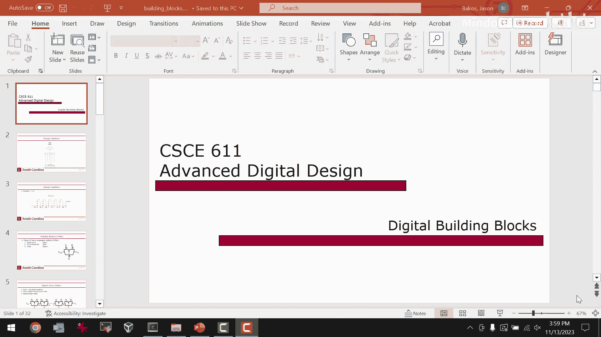
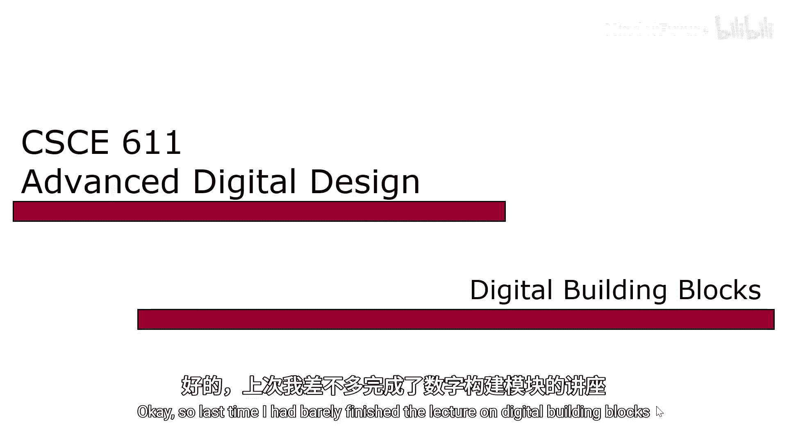
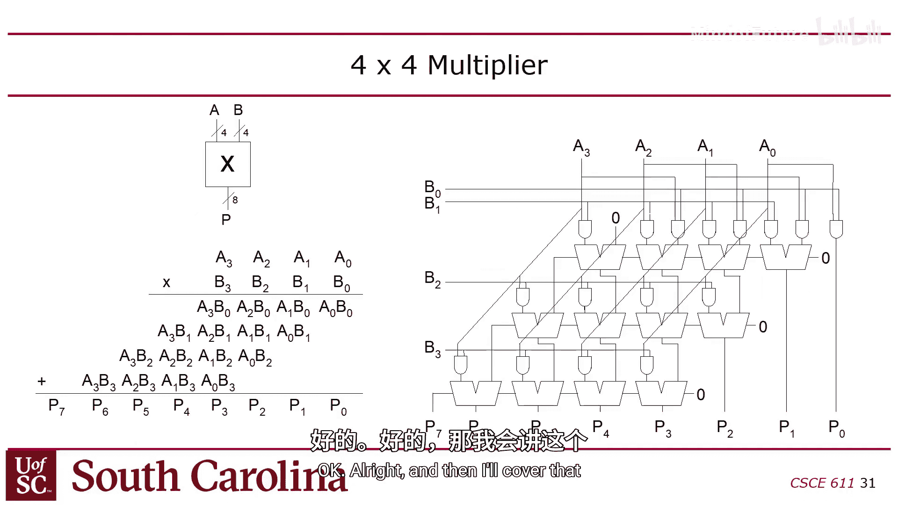
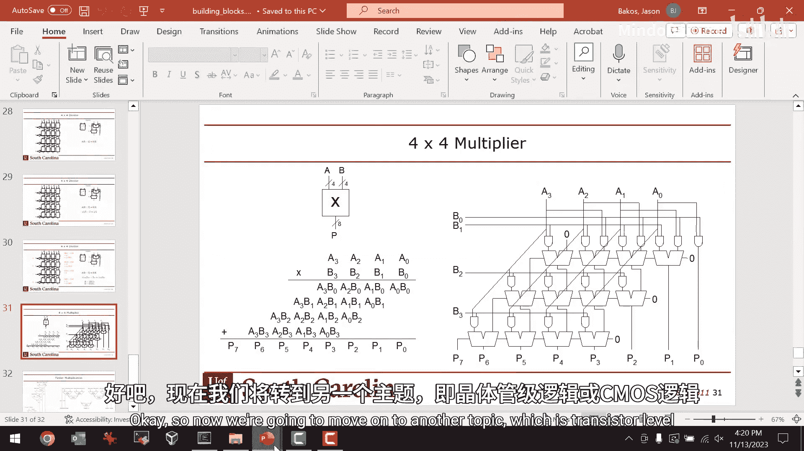
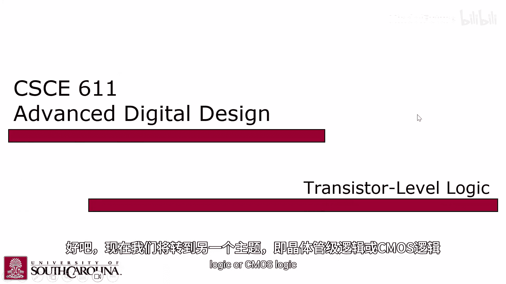
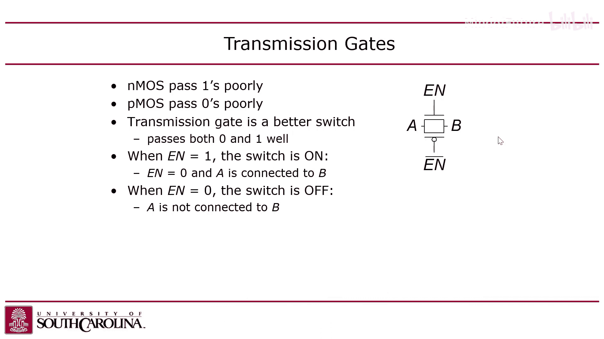

# 【南卡罗来纳大学】高级数字系统设计-CSCE611-（Advanced-Digital-Design，Fall-2023）-p14-P14-CMOS-Design-1--BV19nf6YoEZ9_p14-

Okay， so last time I had barely finished the lecture on digital building blocks。

 I'll just go over that real quick， I've got a quiz posted on that for this week。

 so we talked about adders， ripple carry adders， I think everyone's familiar with that from 211 we talked about the Car look ahead Adder。

 which is where。

You generate propagate and generate bits from each column， and then you can assemble those together。

From multiple columns to generate ranges of propagate and generates but。

The ranges are just like segments， in this case， four bit segments， blocks。Now。

 one thing I said last time I might have confused you a little bit。

Within these so basically the idea is that you take your adder and you divide it into， in this case。

 four bit， blocks of four bits， blocks of four columns。And then you generate the。嗯。啊啊。

Proroppagate and generates from each block。Right， so you have the。Time here for the carry look ahead。

 the critical path of lay is to propagate and generate。For the individual bits。And then。

You take those and you generate the block propagate and generates， right so for that block。And then。

Once you have those you。嗯。Use those to determine。They carry out。For that block。

As a function of the block level generating propagates as well as the。They carry in into that block。

Does it makes sense，The problem is is that。You still have to go through。

 so when you have the carry in from the previous block， you can arrange this logic。

 so you only have to go through two gate delays in each block in order to generate the carryout。

Does makes sense right so this is the this part is the part that is going to be multiplied that delay is going to be multiplied by the number of blocks you have this n over K minus1 n is the total bits K is the block size。

 So in this case if you have a 32 bit adder and four bit blocks you'll have eight of these blocks and so you'll have to propagate through7。

N minus k minus1， you have to go through seven of these guys。To complete the whole circuit。

 that's not。Not too bad。But then we talked about this prefix adder and the prefix adder's goal is to also build up these。

 generate and propagates from blocks， but instead of just doing it in four bit blocks or for n K bit blocks they're built up incrementally first from pairs of columns and then。

So that first level you get pairs of columns so you get propagate and generate， for example。

 like bits 14 on to 13。And the goal is to get the propagate and generate for every single final bit。

 every column， so your goal is to get the generate， actually the generate rather。

For bit for this column two， you want to get for bit two down to negative one。

And the generate for negative one is the。Is the carry in is the top level carry in So the idea is that if you can generate the if you can。

 if you can calculate the generate for each each one of the output columns separately。

 then every single full adder。Is going to have its own carry in that's going to be constructed from building up combinations of the。

The propagate and generate bits that are in groups you guys with me and this is all done through through combining together two groups like in this case。

 we have 14 down to 13 and 12 down to 11 and you can combine those that get 14 down to 11 and then 14 down 11 can be combined with。

嗯。Let's see it can be combined with 10 down to seven。To get 14 down to seven。

So you can make these arbitrary you can join these groups together arbitrarily in order to ultimately get your goal is to get each bit down to negative one。

And these are the carryion， so this is a 16 bit ater。

 the 15th full adder will have a carryion that will be the generate that's 14 down to negative one。

You guys with me？Now。Once you get down to this bottom level， you don't care about propagate。

 but you do need propagate for all these other black blocks。Makes sense。

 So the the delay here is the log base too of。The number of bits。

 so you have to go through for 16 bits， notice you have to go through log base 216， which is four。

 so you have to go through four stages of those propagate generate calculations。

Right which it turns out its they're really just。It's really just。This right。

 so what you're multilying by you're multiplying the delay of just this by in this case four。

 so this is a very fast adder。Makes sense。It looks a little confusing when you look at the fact that these propagate。

 like if you look at this， you look at propagate and generate 14 out of7。

It's 14 down to7 and you think， oh， that's a multi bit signal。

 but keep in mind that each one of these black boxes only generates two bits。

So you're generating a single bit that represents the propagate for a range of bits and a generate for a range of bits。

Okay， so don't don't let that range， that range there is not meant to mean that there's a range of like these are buses。

 like these are multi bit signals or not， these are all single bit signals。

 but they're meant to represent they're calculating the generating propagate for a range of columns。

 right？Okay， so that's the prefix adder。Then we looked at some examples of how to calculate delay for those and we talked about subtractor with just an adder where you take the twos complement of the second input。

We talked about comparators。Which is in the book， this figure is from the book they're doing a。

What is this？X X， they're doing an Xno between each pair of bits。

And then they're fan what xN is true if the inputs are the same， right， that's an xN。

And then there're。And then they're feeding all those into a big and gate。Right。

I mean see when I looked at that， I was like that can't be a good way to build a comparator right because if you look at the one we use in class。

 we do a subtract， you know we subtract a minus B and if the result is zero then。

Then the numbers are equal right， but then I thought about it and I'm like， well。

 maybe that's not a best way to do it because think about it。

 if you subtract subtracting A and B is a lot more expensive than just taking the X nor of each individual A and B bit。

 right？And then you might say yeah， true， But what about this giant fan in here。

 you got to have this gigantic and gate which takes in 32 inputs right， that's no good。 Yeah。

 but you need the same thing for the subtraction method too right because in the subtraction method。

 you have to check to see if all if you have a minus B and they're 32 B values and you have to send 32 all those 32 Bs into a single like an orgate or a or gate right because you want to check。

 make sure they're all zeros。Right so I don't know if the way we do in class is any better。

 it's actually it might be worse。 this might be better than the one that we've gotten in our ALU。

 right I haven't really done。know， in depth analysis。You know when I think about it。

 this might be a better way to do it either way， comparisons are pretty expensive because ultimately they involve a reduction where you take a bunch of bits and reduce the mo1。

which involves a fan end fan ends are expensive and reality you will never have a 32 input and gate it's impossible。

 so the way that this is done in practice， if you put this on an FPGA。

 this angate will get split into multiple am gates that will be staged in multiple stages and then those stages will probably be like a binary tree。

 so you may have like five stages of and in practice。Maybe not enough PGA because you got。

Six bit lots on an FPGA。But either way， this can be this is the hard part。

 the expensive part of a comparator。Okay， less than if you want to know if A is less than B。

 you kind of have to subtract I don't know how else you could。I mean。

 least for signed or even unsigned。 Yeah， you have to subtract right。

 check the sign bit of the result。 And then we talked about shifters。 This is a barrel shifter。

 but it only shifts one direction， right， This one shifts。嗯。This one shifts。Which way A zero？

Goes to y 0 if the shift amount is 0。But if the shift amount is1。Then。A0。Goes to。Goes nowhere。

RightBecause remember， if you have wires crossing and there's no dot on the wires of the cross and they're not connected。

 but if you have a T like you have here， then there's a connection that's the schematic rules that the book uses at least。

 so if you look at a0， a0 is only connected to this one mux。

Right so if the shift amount is anything but zero， then a zero is gone， it just gets。

It doesn't get pushed to the Ys， it doesn't get pushed to the output。

It essentially gets blocked in this circuit。And the reason for that is because it's being shifted out。

So this is a， this must be a right shifter， right， So like， for example， if you look at a1， a1。

 if the shift amount is1， it's going to be。It's going to go through this input on this mus， right。

 So a1。啊诶。Yeah， sorry here。 A1 right， There's your connection between a1 and this mu。

 So if the shift amount， remember the shift amount is the select on these muxes。

 So if the shift amount is1， I'm going to take a1 and I'm going to send it to y 0 right So a0。

Is going to be sent to a less significant bit， right， it's going to be shifted to the right。

Makes sense。So that's a barrel shifter again， that's a pretty expensive piece of hardware there。

 some processors don't have barrel shifters like lightweight embedded processors。

 some of them don't even have a barrel shifter in the NeOS processor if you guys。

 I don't know somebody you took 313。In 313 we use an embedded processor that's kind of an off the shelf IP for the FPGA。

 and you can choose whether you want to include a barrel shifter because if you don't need it。

 it's more efficient to not include it in the hardware， right？And there's other architectures。

 by the way， there's transistor level designs for barrel shifters too。

 this is kind of a one that's built from Muxes。Okay。

 and then we talk about shift registers now these are kind of cheap。

 shift registers are just a bunch of flip flops connected in series。

 these ones are kind of cheap right they're just point to point connections。

 but the problem here is that you can only shift one bit at a time。

It's not a barrel shifters can shift an arbitrary number of bits。

 a shift register can just shift one register， but shift registers are used a lot to create delay lines and also in this case you can create a parallel to serial converter。

 you can load in data and parallel and then shift it out in serial。

So this is what happens with your HDMI connection。Sata connection。

 like when you plug your monitor in。The CPU sends pixels to the monitor in parallel and they're shifted out in the HDMI cable。

 it's one bit at a time， right， same thing with Sata， that's for hard drives， disks。

That's a serial protocol。So anytime you have to do a parallel of serial conversion。

 use something like a circuit like this。Okay， and then we talked about multipliers and dividers。

 Okay， now the multiplier design we talked about is。The idea with this is。

You're basically just using these an gates。To turn off。To basically zero out。

One of these things that you're adding。One of these rows you're adding， depending on the multiplier。

So if any of the bits of the multiplier are zero for each one of those bits， you need to zero out。嗯。

The corresponding row down here right， and that's basically what's happening here。So you have A。And。

A is going into。Is coming in。And then。You are adding a to itself。

With these first levels of adders here， except you've got these an gates which are controlling whether you're turning on a or not turning on a into that adder level。

 right？Does it make sense？So basically， each one of these rows is equivalent to one of these rows。

So that's why these are shown together， this is literally just that right。

 it's even at the bit level because。All the A's and B's are all bits， right so basically。

If you look down a column and you add your partial products here。You have each one of these。

Each one of these columns is implemented through。Go adding through these full ladderers。

Does it make sense？Now you might notice here， wait a second， there is one difference。

 though you notice there's just three layers of adders here， whereas we have four rows here。

And the reason for that is because the first row actually。

 if you look at this first row of flu ladders， this actually is taking care of these two first two。

These first two rows here， right。 But then for every additional row， for every additional row here。

 you need to have。You know， one row full ladders because you have to add the， you know。

 the partial sum from the previous row。Okay。So multipliers can are also。Expensive you basically。

 if you have a 32 bit multiplier， you basically need 31 adders。Right， I mean。

 assuming you use that architecture。And then for division。

 division is probably the most expensive operation because you have this basic issue where。

You have to take。The divisor。And shifted to the left relative to the dividend right now in this case。

 we're actually doing the opposite here， we're taking the dividend， which is a。A is the dividend。

 that's the bigger number that you're dividing into。And we shift it， actually。

 we're shifting it right。That's why you see a3 there。 right。 See that A3 is in the top layer。 Y a3。

 what happened a2 down to 0。 Well， those are not being considered in the first layer。

 We're just taking a3， right， which is the version of the multiple canned shifted to the right。 Now。

 you might say， why would you do that。 Well， it's the same thing you do。

It's the same thing you do here。With grade school division。See when you take。

When you basically the idea is that if my dividend is this bigger number here。What is that 10 plus。

Three，4，5，6，64，74， I guess。Yeah， I think that's like 74。And we're dividing8 into 74。

The 74 is the dividend and the idea is that we want to subtract。

The divisor from just a the most significant bit， right， You see most significant bit， right， Now。

 if you were doing this by hand， you would never， you wouldn't。

 you would just skip this step because， you know that you're not going be able to do that subtraction。

 But the hardware doesn't know that。 So it's going to take the divisor and subtract it from the most significant bit of the dividend。

 right， And then if the result is negative。😊，It has to undo that subtraction， it has to restore。

Its a restore。The result it had prior to the subtraction。You guys with me？

Okay so that's why they call it a restoring divider， so basically I'm trying to subtract1 minus8。

 I can't do that so I'm going to restore it then I say two minus8 no。4 minus8 nope，9 minus8。

 Now every time I subtract， I'm shifting the dividend to the left by one right Finally。

 I get to the point where I could subtract and get a positive difference。

 and when I when that happens，I。What was the what am I doing， nine minus eight is1， right？So。嗯。

So once that happened， then I keep the difference， it's one， right， should be one。嗯。Yeah。

 it should be one。I think I might have screwed that up。

Yeah I should have kept down as one sorry yeah， so basically after you when you subtract and you're successful。

 you want to keep that difference in place of the original。Dividend。

 it becomes your remainder register right that's the idea so。Yeah。

 I don't know why I didnt I didn't know why I kept that one in there， I should have。

 but in this design。The idea is is that as you propagate down。

 the results that you get from each row of these blocks is going to be the remainder。

 which is the difference that you got from subtracting the divisor from the shifted form of the。

The the dividend and you'll notice that we're shifting the dividend left。

 that's why you have a2 coming in A1 and A0， and then as you go down。

 these lines go diagonal that implement the left shift。Does makes sense？

So the problem here is that divider is going to require。Subtractors。32 bit divider requires。

32 subtractors， but not only that， but it also has to have。The restoring logic， too， the comparison。

 the comparator and the restoring logic。So， divider is。

Expensive when I first started developing this class。We put a divider in your ALU。

And couldn't make that happen because used it like nearly all the logic on the FPGA right。

 The reason is because we're trying to do it combinator combinationally in one cycle。

 if we had done a multi cyclee divider， that may not have been the case。

 but we didn't want you to have to worry about。Operations that take more than one cycle。

 we wanted your AU to be one cycle。 you guys make sense， Okay。

 one of these days we may figure out a way to do。Divide in this class。Okay。All right。

 and then I'm going to cover that。 Okay， any questions， so that's the digital building blocks。 Okay。

 so now we're going to move on to another topic。

Which is transistor level logic or CMmoss logic， I' going to talk about that a little bit。

I used to teach a class on this called VLSI design。

 which was like designed for any As like chip design as opposed to like in this class obviously we target FPGAs。

 but if you wanted to fabricate a custom chip，You'd have to design it design it for manufacturing right。

 you would have to design it so there's this process you go through， which is where。

You can still synthesize HDL code， but instead of going to mapping to Luts on the FPGA。

 you map it into a cell library， which is the little。Digital logic cells。

 little footprints that you put on the AsIEC。But the question is how do you build those cells。

 how do you build a gate on an AsI on a CMOS chip， how does that work okay， well first of all。

 it's before we get to that I' want to talk about logic levels for a minute so。嗯。

The digital logic levels have changed over the years。 It used to be back in the 70s and 80s。

 a Boolean one or logic high level was five volts。and that was what was that called TTL logic。

 I guess， yeah， so VDD is the supply voltage that's logic basically logic level one。And。

And just ignore these columns I'll talk about what those mean in a minute。

 but we went from five volts with TTL logic， TTL logic was actually a different way to build gates from transistors。

 but even the first generation of CMmos logic，Used 5 volts。

 And then eventually it's been kind of going down。 I think nowadays it's。It's like less than a volt。

 like it could go as low as 0。9 volt， although modern CPUs actually dynamically adjust that。

 So whenever。Whenever you need to speed up。YourYour CPU， you increase the clock rate。

 but you also increase the supply voltage， right， so you do voltage and frequency scaling right。

 but the lowest voltage you'll see。It could be 800 millivvolts， something like that。

 and the highest you might see is maybe 1。2 these days。

So part of that has been the advances in the fabrication technology and the device technology。

But another thing you have to consider with that is noise so we have。Wirrees are subject to noise。

 and especially in a digital circuit because。Whenever you switch a logic gate from zero to 1 or1 to zero。

It temporarily shorts。Power and ground。So you get a， in fact， CMmos logic gates。

And at CMOSs is the technology that's used to build gates on a chip， on a digital logic chip。

It's it's designed to use very low power if you're not switching， right。

 if it's just putting out a01， but if you switch from zero to 1 or one to zero， there is a spike。

In current。In that gate。嗯。And the problem with that is one， it uses power。

 so where the main that's called the dynamic power consumption。

 but also it will cause the power supply rail to dip a little bit。Right。

And if you've got a whole bunch of gates around each other that are switching。

You get switching transients on the power supply， the power supply becomes noisy now you can mitigate that to a degree by putting capacitors。

Called decoupling capacitors in there to try to take that noise out。

 But you can't really get rid of it entirely。 And it's so bad that if you have a chip。

 a mixed signal chip that combines digital circuits and analog circuits。

 You have to isolate the analog circuits because the analog circuits will be will be affected by that noise。

 you have to have on different power supplies， and usually you try to build a little moat around the analog circuits。

 A little diffusionary around them to try to block out。Some of the。

Some of the noise from the rest of the circuit， right， so digital logic circuits are noisy。

So the problem is is that。嗯。An ideal in a perfect world。You would have a。

Your logic would work as follows if any value is from voltage value is from zero。

To half the supply voltage。So let's say you have a onevolt system。

 Then any value from 0 to a half a volt should be a logic 0， right。

 and any value from a half a volt to 1 should be a logic 1， right， ideally，s。

 that's how you want it to work， right， So this is a buffer。

 So a buffer is just the output is equal to the input。 right， It's kind of like an inverter。

 except doesn't invert。 And so this is showing， as I increase the。As I increase the。诶。诶。

A is the input， right， A is the horizontal line here。 horizontal axis as I increase a。

The output y is zero。So my A， let's say this is one volt， VDD is one volt。

 so as I go 100 millivvolts， 200 millivolts， 300 millivvolts， y is just staying at zero。Right。

And then eventually， I hit 500 millivvolts。At which point I switches suddenly to one volt， right。

 that's how we want these circuits to work， right？So basically。

 what that means is is that means that the voltage。Input low V IL V subilil。

 which defines the kind of the threshold for what is a logic low logic 0， right。

 that should be V to D minus2 right and V I H， which is the minimum voltage for a logic high should be the same value right Does it makes sense。

 So there's VL voltage input low and V H voltage input high voltage input low is the voltage under which you have logic 0 and voltage input high is the voltage over which you have logic1 right Okay and then the output of that gate should just always be0 the output which is。

VOL。Voltage output low should be zero and voltage output high should be onevolt right ideally right but in reality。

 this is really the kind of curve you see in a real gate。

 So what happens is is that as you start increasing the input voltage。The output voltage。

Starts to rise gradually。Right。And then at some point。You get this really sharp increase， right。

 And then it slowly starts to converge again towards VDD on the output right。

 So you get this kind of。S shapes sort of， right？And so。

What you end up with in reality is if you look at the point here where you have what's called unity gain。

 which is where the slope of the trace of this line is one， right。

 that's like the elbow of the curve essentially right where the slope is one。

 that's where it changes。It's where you have， you know， it sort of starts racing up， right？

If you look at the voltage where that happens。That's really your VIL， right， So as long as you stay。

 as long as your input voltage is below。The unity gain point on， in this case。

 a buffer buffer gate is used as the kind of the model for this， right？

As long as you stay below the Unity gain point， which is VIL， fine， right？And then for voltage high。

You want to be aboveity the other unity gain point， the other point where the slope is1， that's VIL。

 so you want to be below VIL and you want to be above VIH right for the input always。

And anything in between those two is called the Forbidden zone。

You don't ever want to be in the forbidden zone。For an input， right？Okay， now likewise。

The output of the buffer。Its voltage at that unity gain point is VOL。Right， now VOL。

Luckily is lower than V IL right what that means is is that the logic gate it's going to keep the voltage pretty low for a while as you increase the input voltage。

 So V IL could be like。You know， it could be。On a1 volt system it could be say 400 millivvolts right but VOL could still be like 50 millivvolts right so even if I start pushing that input。

 pushing it and pushing it and pushing it， the output still stays kind of low right right and then suddenly it'll fly up to at VIH。

When I set the input voltage to VIH， which might be， say 600 millivvolts。

Then the VOH will be pretty high。It's not going to be all the way at the top。

 it's going to be pretty high and that's your VOH right So what this means。

 the implication of this is this gives you a noise margin。It allows the gate。诶。

It allows the gate basically。To sort of clean signals up that have noise on it， you know。

 so you've got noise on the input。And that noise on the input。

Looks a little better when it comes out on the output， right？So this show is like basically。The V，OL。

Is shown here， like if you show this from the bottom is zero volts and the top is VDD。

 the supply voltage。VOL is like a small sliver at the bottom right so that means the gate output will be in this range。

 right？And the gate out for logic low。 and for logic high， it'll be in that range， right。

 as long as the input。Is in this range or that range right this range is between0 and VL。

 and this is V I H and V to D right So as long as the input is in this range out of the forbid zone。

Then your output will be in this range， which is even wider。

 The difference between those two is called the noise margin。 So the difference between。V， I L and V。

 O， L is the noise margin low。 and the difference between。V， O H and V I H is the noise margin high。

 right， that's basically。How much extra noise？You can add without causing problems， right， okay？啊。

Yeah， so the idea is that。嗯。So you can add。Noise here to this input。

which will add some noise to that output， but it will reduce the noise right so then I can still add extra noise here to this middle wire。

Before it gets to the receiver， that's the idea of the noise margin。 Does that make sense。

 So basically。It's the of essentially the amount of noise you can tolerate on your wires。Okay。

 any questions about that？Okay， so let's talk a little bit about silicon。So silicon is。An element。

And it's a semiconductor， which means that。It its semi conducts electricity。Kind of little bit。

 not much。In fact， semiconductors are really not good conducts at all， actually。

 they're pretty horrible。Um。So silicon is。What ends up happening with silicon。

 silicon is very abundant on earth， but it usually is in the form of silicon dioxide。

 which is sand or glass right you don't usually see silicon by itself。

 in order to get pure silicon you have to grow it there's a manufacturing process that creates you basically grow silicon in an ingot。

 which is like a cylinder which then you cut wafers out of to make chips。

 but you're not going to I don't think you'll ever see pure silicon know in nature。

 but you can grow it pure silicon silicon is it's in the group or it's in the column four of the periodic table。

 which means it has four valence electrons， electrons in the outer shell and when you have a pure silicon it forms a lattice。

 it forms a crystal where。Each atom forms covalent bonds with four neighboring atoms， right。

 but the crazy thing is because it's a crystal。Each one of the bonds is at a specific angle。

The bonds are at an angle。 So what you end up with is this thing that looks like this。

 which is this kind of crazy structure in here。 and the structure repeats。

s it's a repeating structure。 And the smallest unit of repetition of that structure is called the unit cell。

 So this is this is the unit cell。 I think there's。I forget how many atoms are in it one， two， two。

 four，6， eight，10，12。18 or so atoms， something like that in the silicon unit cell。Okay。

 so you get this kind of cool。Cool structure。Now the atoms。Are spaced apart in this structure。

Points543 nanometers。And the whole unit cell is about five nanometers。

Now does anyone think does that raise any red flags for anybody？

So you might have heard that like modern ships are fabricated on a。Technology node， they call it。

 right， they have different。Fabbriation processes that have a fabrication note associated。

 and that fabrication note is essentially what they claim anyway， is the smallest transistor size。

 right， So you've heard of like the 90 nanometer process， the 45 nanometer process。The 13。

 then they had 18 where they go 13。Anyway， right now， TSMC。Who makes chips， embedded chips and Intel？

They're claiming they're down at。Four。Nanmeters。Right。Well， that's impossible。

Because the unit cell of silicon is five nano that's smaller than the unit cell。And not only that。

They're saying， well， we're going to go to three nanometers and one nanometer。

 The atoms are only a half an nanometer。Pitch between the spacing between the atoms。

So clearly there's something going on there， those chips are not seven nanometers。

They're playing some games there with the numbers。 I think they they change the definition of what that number they used to be。

 that number used to be the size of the transistor。Gate。The gate terminal and the transistor。

 that is no longer the case， right， So don't let them fool you。 But it also means that， you know。

 you can't shrink down。Your transistors， you can't go beyond。5ive nanometers。

 that's the size of the cell， that's the size of the pattern in the silicon lattice， right？Okay。

 so I mentioned that silicon is a semiconductor though。

 so pure silicon basically hardly conducts electricity at all。

 but what you can do with it is you can dope it。So if you take an atom from。Column 3。

Which is going to be boron， aluminum or gallium。You can。You can blow it inside the lattice。

 basically。You basically。You dope it， you take this high temperature。

 you turn this thing into this element into a gas。And then you put it into the lattice somehow。

 right？So when you grow the silicon， it always it starts out as pure silicon right you can't grow dope silicon。

 I don't think unless someone came up with a new technology I'm not aware of silicon is grown as pure silicon I mean。

 there's some impurities in it， but the idea is to make it a pure semiconductor and then you change the conduction characteristics by doping it And this is like nasty work。

 That's why they don't make chips in the United States。 is this is high temperature。

Poisonous stuff right so you can put these in and what ends up happening is is that。

That ends up replacing atoms from this group 3， replace some of the atoms in the silicon lattice。

 and that frees up。 Well， actually it these only have three valence electrons。

 So what ends up happening is that。嗯。😊，It makes the lack of an electron in the lattice。

 so one thing I forgot to mention when you form covalent bonds with these guys。

 the electrons in the valence shell， they're free to move， they're mobile。

 they can move they can be they're shared between these atoms When you put in one of these group three elements in there。

 it creates a lack of an electron that can move around inside this lattice and that ends up being a charge carrier they call it a hole right。

 it's like basically a missing electron slot can move around within that lattice and so that changes that makes the thing conductive because that free hole can move charge。

 can transport charge right at a certain speed。 It's limited。 It can only move so fast。

 You might say， well， it moves at the speed of light right that's like a hole。 It's an electron。 No。

 doesn't。 It's much slower than that。So no it's not that fast。

The speed at which a charge carrier can move is called the mobility。Right likewise。

 if you put a group five element in there， there's an extra electron that can move around right so you end up with a five valence electrons in one of these slots and that can move around right and that's also can be a charge carrier right。

The more you dope it， the more conductucive it is。You can choose how many of those atoms you want to replace with doppans。

It's up to you if you put in group three element， that's called P dope。

P dope silicon P standing for positive， Y positive because there's a hole whole is lack of electron。

 and electrons are negative。 So if you put a pho boron in there， it becomes a。P doped。

 and if you put something from group five like arsenic， everyone's favorite element， arsenic。

Then it'll become a end doped silicon， negative negative charge carriers， right。

 but either way it just becomes conductive， right？Okay， so you have these two types of silicon。啊。Oh。

 I don't have the dang it。 I don't have the。I thought I had a picture of a diode， I don't， Okay。

 sorry， so all right。If you take。K do silicon。And you butt couple it。To endope silicon。

That creates a diode。And what happens is if you put a positive voltage on the P relative to the n。

 right？Charge carriers inside this N。Which our n， remember n is。And negative electrons。

 those charge carriers， those are the majority carriers。

They start to accumulate to the junction right and likewise， the charge carriers on the P side。

 which are holes which are represented as little plus signs。

They go towards the junction and so this thing then starts to conduct。Current， right。

 but on the other hand， if you reverse bias it， meaning you just switch the voltage。

So put a positive here， negative here。The charge carriers move away from the junction and it creates this。

It creates an area。Where there's no charge carriers。And so it blocks the current。

 the current won't flow backwards， so that's a diode。Now the thing that's a little weird about this。

 this is the next kind of step you have to take understand this。The majority carriers in P are holes。

 right， as I mentioned， and the majority carriers in N are electrons， right those are the majority。

Majority carriers。But there's also minority carriers。So even though P has all these holes in it。

 you also have some electrons in that too。You have some electrons in there as well， but not many。

And you got some holes in the end type silicon too。 those are called the minority carriers， right。

 How did they get in there？Unclear。嗯。Contaminants right they're just in there right but the minority carriers don't play any part in the operation of a diode。

 So when it comes to diodes， it's just the majority carriers that make a difference here in the operation of a diode right。

 however， the minority carriers do come into play for a transistor。

So the way that you build a transistor。Is basically from diets。

You start out with now okay one thing I want to mention a diode is just you just butt couple two pieces of silicon together that are doped to different ways right that's how you make a diode very simple Transistors on the other hand。

 are built in a substrate， you start out with a substrate which is your chip basically and you build the diode structures in the chip。

And so whenever you see a picture of a transistor like this one。

 this is a cross- sectional view like if you took a sandwich and you cut the sandwich in half and you looked at the side of the sandwich where you cut it。

 this is a sandwich view where you cut it。Along its。Vertical axis， right。

 and you look at the what makes up what makes up the layers right， So these are the layers。

 So you end up with a substrate now。The substrate is the basically the chip， the whole chip。

 the body of the chip。So as I mentioned， you start out with a silicon ingot that you grow。And then。

 you。You slice it into wafers， which are discs， right。

 then those discs are sliced up to become individual chips。But before you do that。

 you dope the entire wafer。And so the wafer is generally P type silicon。You put the， what is it now？

Aluminum。You put the borron， you put the aluminum， or you put the gallium in it。

You make a whole wafer。ピータ。Why they do that， I don't know why they chose P type。

 but that's generally what you have in most fabrication processes。But。You can。Reverse the dobe。

In parts of the substrate， so these are called diffusion areas， these are little islands。

embedded in the substrate， there are little islands that you punch into the substrate。

They don't go all the way through， they don't penetrate all the way to the bottom。They just。

They they penetrate partly into the substrate， and you blast it with n typed opens and that reverses。

The doping from P to N， but only for these little diffusion areas that makes sense。Now。

 these diffusion areas are basically。These form a diode right because they they're coupled right they're just next。

 they're touching each other。 The substrates P and the diffusion area here is n。

 So this creates a diode。 Now remember diode flows current from P to n right So what you have to do here to make these not connected。

Is you have to make sure you ground the substrate。 The substrate has to be at the lowest voltage possible because you want to make sure that this substrate voltage never rises above the voltage on the diffusion area or。

Boom。You get latchup chip basically blows up right so but as long as a substrate is grounded。

 you have a reverse bias here right so you don't have that happen right now that that's still not without consequence There is a consequence of that though you may not be able to send current from the substrate to the diffusion area。

 but you still get a capacitor there。Which has implications， big implications， right， capacitor。

 remember capacitors when you have。Like。Two things next to each other where there's no direct connection between them dielectric in the middle。

 so you do get a capacitor here， but they're not conducting directly connected， right？Okay， so then。

In between two diffusion areas， you stick a gate。And the gate is separated from the diffusion area with glass。

Sililicon dioxide glass， that's insulator。 That's a straight out。 that's the best。

 I think that's the best known insulator。 That's the best insulator imaginable is silicon dioxide。

I don't think there's any better insulator out there than that。

 So you and the nice thing about silicon dioxide is that you can make these silicon dioxides by basically。

 you take the top of the chip surface and you heat it up and it makes silicon dioxide。 you oxidize。😊。

The top layer you might say， why ist the whole thing covered with that then Well you create a mask。

 you do this process called masking right so you can mask off this part and then you heat the exposed part of the substrate and you can naturally create that nice that nice insulating layer just by cooking it right okay and then on top of that you put polysilicon。

What's polysicon？I don't know， it's what they make solar panels out of， it's a type of silicon。

 it's a type of very highly doped silicon， it's very highly conductive compared to normal silicon。

 right， but it's also what they make solar panels out of。Okay。

Now they didn't used to always use polysilion they used to use metal for that。

 that's why they call it metal， oxide semiconductor， moss， MOS， MossFt。

Mosspht stands for metal oxide semiconductoror， but they don't use metal anymore。

 They use polysilion here now instead of metal。 So they still call it a mospht， though。

 which is not misnomer， right， It should be。Pass。Right。

But they still call it mossFt and okay so anyway， what's the purpose of all this， okay。

 well here here's the thing where this is the part that's crazy。

So if you put a positive voltage on the gate。The gate and the substrate are a capacitor。

 I mentioned there's also a capacitor between the diffusion and the substrate too。

 but there's also another capacitor between the gate and substrate because there's two conductors separated by a non conductor and an insulator。

So you might say why are we doing this， why do we need a capacitor， well。

 you need the capacitor because capacitors accumulate charge。

And when you accumulate charge in the gate。And this is the part I told you earlier。

 you got to accept this， this is the part that's a little weird。

I told you that the majority charge carriers in P type silicon are holes， right？

But if you build up a charge in the gate。A positive charge。It will attract。Right under the gate。

Minority carriers。In the P types， which are electrons。Somehow。There's minority carriers in there。

 so even though p type silicon is mostly holes floating around。

 you can attract the little bit of minority carriers in there and they'll collect and you might say why。

 why， well because they're electrons。Electrons are negative。They're attracted to positive charge。

So what ends up happening is I put a positive voltage on here。And。Electrons。The minority carriers。

Somehow that are inside P silicon， they'll collect in the channel。

And because the minority carriers are holes and because the majority carriers in the end type silicon are holes。

 you'll form a conductive channel between these two diffusion areas and that will turn the transistor on。

 it'll make it conduct from these two sides。Sour and drain。To get connected essentially。Right。

 makes sense。Now， here's the problem， though。 There's a couple issues with this。 now， first of all。

As I mentioned， you have to build up charge to make that happen。Well， as you guys know。

 that takes time， capacitors are slow， you have to accumulate charge。That's not good for。

The latest apple chip。That wants to be fast right， So that's one issue。

 The other issue is I told you guys also that charge carriers do not travel at the speed of light。

They're pretty slow。Right。And so even once you put。Those minority carriers in the channel。

 you still have to make them move charge from one side or the other。

And so the mobility and the mobility is fixed that's a physical property of the semiconductor so the problem is in addition to having to charge this bad boy up。

 the speed at which you can get things across depend on the mobility how fast you can move you can't change the mobility。

 but you can change。How far they have to go。So if you make the channel， if you shrink that channel。

Then the charge carriers which have a fixed mobility， you can't speed them up。

 I don't think there's any way you can speed up the charge carriers in a semiconductoror but you can give them a shorter distance to go and so the shorter that distance is the faster that thing will turn on right so you got to charge it and then you got to get the guys going across the channel so you want to make this channel as small as possible and that's what that technology node is when and Intel says we have a seven nanometer process that's what they're referring to is the channel lengths。

 seven nanometers。But that's not actually what it is， because as I mentioned。

They're cheating a little bit。 They're making a three dimensional channel。

 I think they're doing this thing where they're they're in modern processes have a。

This channel is they make it three dimensional it's called a thin fe。

So they've slightly altered the structure here to add some another dimension here right and then they advertise it as having effectively a seven nanometer channel right what's the actual channel size。

 what's the actual distance at an intel chip， I don't know， it's probably still 90 nanometers。

 45 something like that。In reality。You guys with me？Okay。

 so that's the whole idea the only question is is where does minority charge carriers come from。

 they're just in there and you can attract them and when you attract them。

 that's what turns on the transistor Okay， so then you can have a P oh by the way。

 that's called an N Moss transistor because。Positive charge。

But you can also build the transistor where the channel gets negative charge。

 and if you put a negative charge here， then you can attract the minority carrier out of an end silicon。

If you make this negative。Instead of positive and assuming this P is actually n。

So what does that mean negative， well， that basically means that。

Instead of a one to turn it on is0 turns it on， essentially， but not it's not really a0。

 It's actually a negative voltage， but we think of it as a0 because it's0 is is negative compared to the reference。

 right， If the reference is VDD， and I put a zero as the input。

 I'm actually putting negative VDD in here， which is putting a negative charge here。

 which will attract the minority cares。 So that's called a PmoOS。That's what this is。

 this is Pimas where you reverse these。Right。So basically Nmoss。

I is an N moss because the diffusion area is N a P moss is a P moOSs is a P P moss is a P moss because it's diffusion area as P and of course the bulk。

 which is the substrate is of course the opposite right you guys with me？Now you might say， wait。

 wait， whoa， hold on， what about the diode effect， though， I mean， what happens。

 How do you prevent the。Diffusion areas from dumping all their current into the substrate。

Or vice versa， the substrate dumping current into the diffusion areas。

 how do you guarantee that these are not electrically connected？Well you have to bring the end。

 in this case， this has to go to VDD。So the substrate on a PMOSs。

 you have to energize the substrate to VDD that way you got to have the voltage of the substrate higher than the diffusion areas to reverse bias those。

Diffusionary diodes， right？Okay， now you might say， wait a minute， hold on。

I thought you said that substrate is always P type， though。You use P type for the substrate， yes。

 so the way you get around that。Is。The substrate is。He。Again， I don't know why they chose P。

 it's always been P。But if you want to make a PmoOS transistor。

 which is the transistor that is the opposite guy， turns on when you put zero into it。

You create an N well。Which is basically another diffusion area。

 except it's a deeper and bigger diffusion area of N type material。Right。

 so you create a localized substrate of n material and then your diffusion areas are P inside of that。

Makes sense。So that's how you make it and then of course， N。Has to be。

Set the VDD and the P has to be set to ground， right to make sure all these diodes are biased and they might say。

 well， how do you do that？Well。To energize the regular sub not to energize， sorry， to ground。

 to ground the regular substrate。You have to put a contact in there。

So the P substrate has a contact to ground that goes through a P+ diffusion area。

What's P plus it's more doped P more heavily doped P， more holes。

 There's more majority carrier holes than there are here， right。And you might say。

 well then what's the point of that， well， it creates a nice contact。You have a metal。

 you have a wire， this's metal， copper， aluminum wire， and you want to connect that wire to。

Sililicon that's more conductive。 So I'm going to dope it really hard with P。 and then。

I will embed it in a more lightly doped， so this creates a nice path。Into the substrate， right。

 and then I can make sure this substrates grounded。Right then。Over here， when I have a well。The well。

Is N， I put some n plus on there to make a nice little transition and then I connect the n plus I connect this to my wire wire goes to VDD。

 so that'll let me take this n well and take it to VDD， right。Makes sense。

 so now when you design a chip。You design a chip as a masks， shapes， polygons， right？

You design it from the top down。 You don't design it from the sandwich cutaway like this。

 or you do it from the top down， but you will have a layer for。N plus the fusion area。

Youll have a layer for I'm sorry， you have a layer for N well。Then on top of the N well。

 you can put another polygon that's the P plus layer。

And then you could put a layer for silicon dioxide， and then you could put a layer for polysilicon。

So these are all built up from drawing polygons， rectangles， mostly， we call them polygons。

 but they're really just the rectangles on top of rectangles on top of rectangles。

 every one of those rectangles represents，A layer。Starting from the bottom of layer。

 which is the well。And then there's metal layers on top of this that form the wires， right？

And then there's contact layers which every layer is separated， well not every layer。

 these ones aren't， the active layers aren't， but most of the layers are separated by sorry by silicon dioxide glass。

 but if you want to connect two layers。Vertically， then you put a Va。

 which is like a little hole and that allows you to flow metal down right or in this case you actually have metal that flows down onto that contact there onto that diffusion。

 so that's a layer。So you have a layer that's called a contact layer， which is this。

 then you have a layer that's like metal1， metal2 contact， metal2， metal3 contact， metal3。

 metal4 contact， so basically those are all your layers that you use when you design a chip。

 you just put those layers down。Makes sense。Okay， so here's a question from a quiz what type of silicon forms the body of a P type transistor Well。

 the answer to this is remember P type transistor has P type diffusion areas。

 so the body must be the opposite of that so I'm guessing N。Yeah， right。

 mass mossphts are defined as n or P according to their， as I just said， diffusion areas。Okay， so。

All right， so basically here's this is what I just got done explaining， so I put VDD on the gate。

Puts a positive charge。Now this is a little bit， this is a little confusing because I have plus signs here。

 but that plus sign is meant to represent a charge。These plus signs are meant to represent。

Charge carrier Heres it's different。 These pluses are not the same as those pluses， right。

 But anyway， I put a positive charge， and then that attracts the minority carriers。

 which are the holes in the channel and the。Current flows， right？It's the same thing， by the way。

 that happens if you have two wires， if you hold up two wires。

And you put a big voltage differential between them and you start moving them closer and closer。

They won't conduct until eventually there'll be an arc like of electricity that what that arc is is it ionizes the air between the two wires and those ions become the charge carriers right so it's the same principle as in semiconductors right you have the same issue in air that you do in semiconductors you have to have charge carriers right。

Okay， so anyway， so we have two transistors then。 we have N mos and Pmoss， and these are the symbols。

 And you can tell them apart because the Pmoss has。A bubble there。Bubble means。嗯。

Active low or compliment， whatever， not， right？Okay， and then you have gate， source， and drain。Um。

Now， do we care about which is the source and which is the drain？啊。Ah not really。

I don't know why notice the drain is on the top for Nmoss。And drain is on the bottom for Pimas。

I don't know why that's just a convention you'll notice if you look at the cutaway view。

The structure is symmetric， symmetric structure， the transistor is symmetric。So。If you call one。

 the source and one the drain， it's up to you。 that's a conventional thing， right okay。

So if the gate is on。The transistor is on， if the gate is off， the transistor is off forran moss。

 and then it's the reverse for Pmas。So then how do you build a logic gate from this？Well。

 this is where things get really interesting。Basically。

The inputs the logic gate are connected to the gates。Of the transistors。Right gate， logic gate。

 gate of the transistor is confusing， but the inputs to the gate are connected to the gate input。

Right。The inputs to the gate。Are connected to the gate input on the transistors。

And then the output is connected to。Some source and drain of the transistors right so think of the source and drain as kind of the input。

 the outputs and the gates of the inputs sort of， right？But the way you set up a logic gate is。

You have to create。Two paths。You have to create two circuits。

 one is a pull up network and one's a pull down network。

 so you have to have a circuit that's responsible for shorting the output to VDD if the output of the gate is one and you have to have another circuit that shorts the output to ground if the output should be zero right but you can't do both at the same time these have to be mutually exclusive right so only one of these networks can create a path。

Between the output and one of the powers you know， VDD or ground， only one of them。

 if you have the pull up and the pull on network both。Provide a path。It's boom， blows up， right。

 You can only have one or one or the other， but you always ideally。

 always one of these will always be on right unless you have a tri state gate。

 which is little kind of a specialized gate that you can get a floating output。

 but most gates don't have floating outputs。 They have a zero or one output all the time， right。

You guys with me？Okay， so now the other thing you have to understand is that。The pull up network。

And by the way， when you say network， it's circuit， don't get confused by it's just a circuit。

 it's a circuit that creates a possible path from the power supply to output or from the ground output。

But here's the other part you just have to kind of accept。

Only PmaOS transistors are good at pulling up。And only N MoOS transistors are good at pulling down。

When I say good， that doesn't mean you can't use N mosses to pull up。

 but no one ever does that because they're awful at that job， they're too slow。

The whole goal is to make these gates as fast as possible， right， so to make them fast。

The PmaOS is pull up and the NOsses pull down right so what you end up having to do is create a circuit of NOS transistors here and a circuit of pmaOSs transistors there right okay。

And you have to make sure that。The same now one thing I want to mention here。

 the same inputs connect to both right So you notice this fan out here。

 The fan out means I'm going to connect the inputs to both sides right also。

This is the thing that used to confuse me。 These inputs are unaltered inputs。

 You have to take whatever the inputs are and use them in the gates on these networks。 You can't add。

 you know extra inverters or anything like that。 You have to take the raw inputs and connect them directly to these gates。

Right on those transistors， right？Okay， so。Why is that relevant Okay well let's look at an example of an inverter。

 just simple example first， So an inverter has a single pOS pull up and a single nmos pull down right So if the input notice the input is fanned out to both right and then the output is connected to the middle node right So if the input is one it turns this guy on and this guy off and thus the y will be shorter to ground right that means it's called pull it'll pull y down to ground it's not mechanical when they say pull down it means that it's going to create it's going to create a low resistance path to ground right？

😊，And so this R on resistance of on is like。Blow like a half ohm right。

 but the resistance of a transitionor that's off is like 10 megaoms right So what you're really doing here is creating a voltage divider technically。

 but the way they describe it is most people think of this as switches that are on or off right。

 but in reality it's a voltage divider but。嗯。I turn this guy on that guy off or that guy on or that guy off。

 right， depending on whether the input is 01。 and thus the output will be。嗯。嗯。The opposite， right？

So that's an inverter。Now here's the problem。嗯。You would think you could build any gate with this。

 but you can't。The problem is that because Pmoes are responsible for pulling up， right？

What that mean and PMS has turn on when their input is zero。Okay。

 so what that means is is if you look at the truth table here for a gate。

And you look at all the rows。That have a one output。Okay， so this is a Nand gate so I have。

I have three rows that are one and one row that are zero。

This is the part that I used to hate about this stuff。In all three rows that pull the output up。

 at least one of the inputs has to be a zero。Because that's the only way you can pull up。

The only way you can short the output to VDD with a PMOS is have a zero right so for every output row where the output is one。

 at least one of the inputs has to be one。Makes sense。Likewise。For all the outputs that are 0。

 you got to have at least one input that's a one for the n mos to pull down right Now。

 what this means is is that。You're going to have a problem if you try to make an and gate。

Because an end gate。Its output is zero。啊。When the inputs are0， zero。

If I have an an gate and my input is 0，0。My output's supposed to be 0 because 0 and 0 is 0， right。

 That's not going to work here， because if I don't have， if my inputs are 0，0。

 none the none of these transistors can pull the output down。Likewise， or in origgate。In Oregongate。

We'll be。嗯。Oreggate has the output has to be。One， if the inputs are both one， right。

 because one or one is a one， right？But that's not going to work because there are not going to be any Pmasses to set the output to one。

If you don't have any zeros in the input， right， so you can't make an N gate and you can't make an or gate。

 which is why we see Nand gate here， right Nand gate you can make。

Nand gate is just a you know the opposite of an N gate right So the way you do that is you put the two p massessses in parallel right。

 what that means is if they're in parallel， if either one of them is on，You're going to pull up。

What does that mean Well remember they turn on with zero， so if either input is a zero。Pull it up。

 but then these guys are in series， which means the only way to pull it down is if both of these transistors are on。

 which is a 11。So one one。We'll turn these guys on and pull it down。

 turn both of those two of those parallel guys both off， right？

Any other combination of inputs will pull up。Because you're either going to have one or both of these guys turned off in they're in series。

It makes sense so you'll notice that the pull up network and the pull out network are kind of opposite right ones in series and ones in parallel right。

 it's basically the way that works。But you can't make， like I said， there's no way to make a。

 this is a negative logic gate， all CMmoss gates are negative logic。Right。Okay。

So then you can make a three input Norgate that was a Nandgate I showed you before。

 this is a nogate and also has three input so notice there's three three。And N mosses。

 N mosses in series， parallel， these are parallel and three P mosses in series， right？

That's a three input Norigate。Now you can create an and gate if you make a Nand with an inverter。

 but that requires two gates， you can't make an and gate with just one。Pull up， pull down network。

Makes sense。What type of transistors comprise the pull up network of a CM moss gate。

 pull up P makes sense， right， P positive？Pull up。Right。

 that' makes sense which of the following boolean functions can be realized with a single seaOSs gate。

嗯。I don't know， I have to build the truth tables to figure this out， so there's four options here。

This is the four truth tables for those four options。

 What you want to look for is that any time you have a one， you got to have at least one，0。

 So that check。 that one's good。But if you have a zero， you got to have at least one。1，1。

 right in the inputs。 good check， fine。 that one's fine。 How about this one， this one。Zero。

 I have at least one， one in there， good。But the ones up， that one's a problem。

That row right there disqualifies that guy from being a sea mos gate because you cannot have two zeros and pull the output out because the pmasses won't。

I'm sorry， no， that's right， no， that's right， I'm sorry， I had that wrong。

 I had that switch this one rather。1，1，1，10 that that disqualifies it because if you have 1，1 input。

 there's no zero in there to pull it up with the PmoOS， right。

 so this is the one that disqualifies that one， right。Let's see。This one， disqualified。0， zero。

 give a zero output。No， you need at least one one input to get a zero output because NN NN is a pull down network。

And then not N， sorry， N Moss， sorry， sorry， and in this case。嗯。Pull up with a0。 Yes。

 Pu down with a1。 Yes， pull up with a0。 yes， Pu up with no zeroes。 Oh， no， no one's disqualified。

 right。 So only that first guy。And by the way， if you say not a and not be。

 if you remember Dean Morgan's law from。2，11， D Morgan's losses is that's actually a norrgate。

 that first option。 So I kind of tricked you with that。 That's actually just no at the top。Okay。Okay。

 so。嗯。I'm out of time， right， yes。

