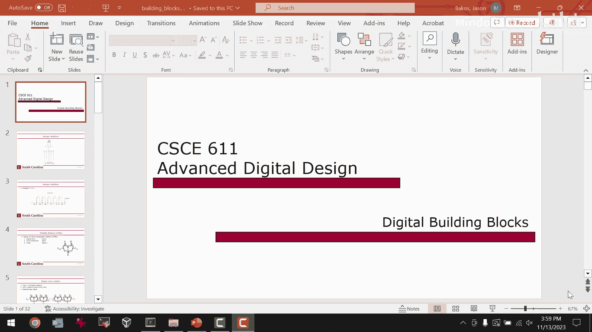
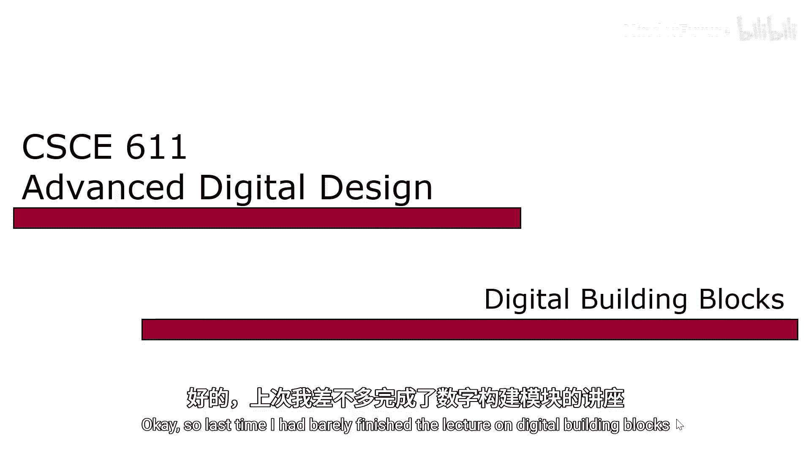
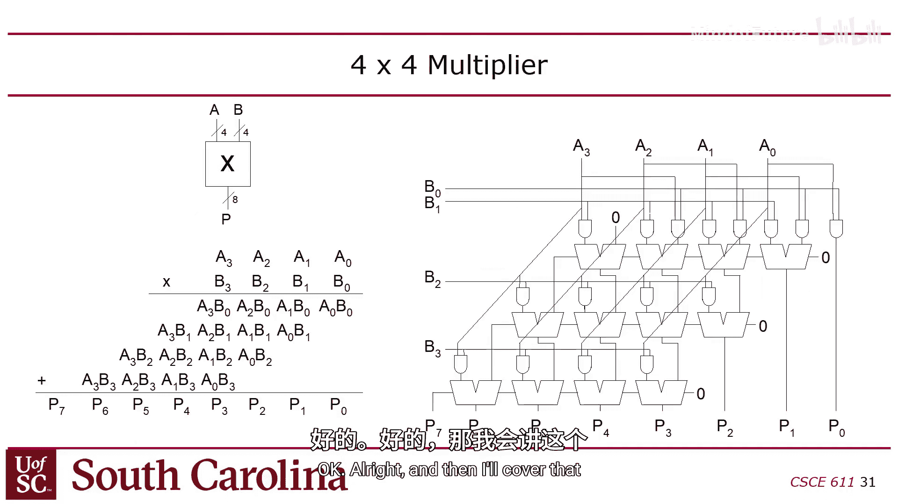
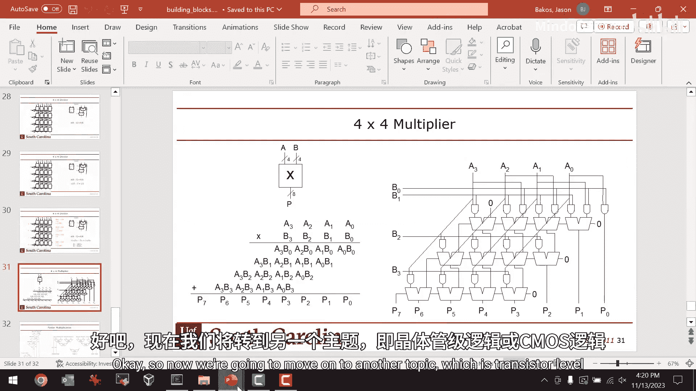
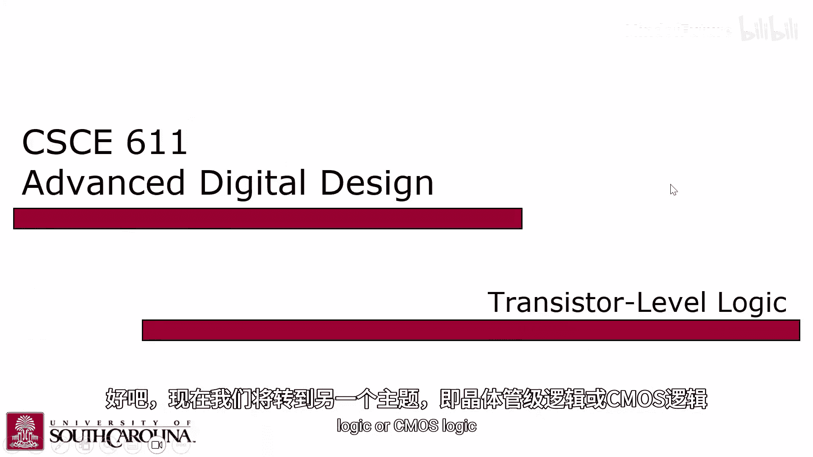
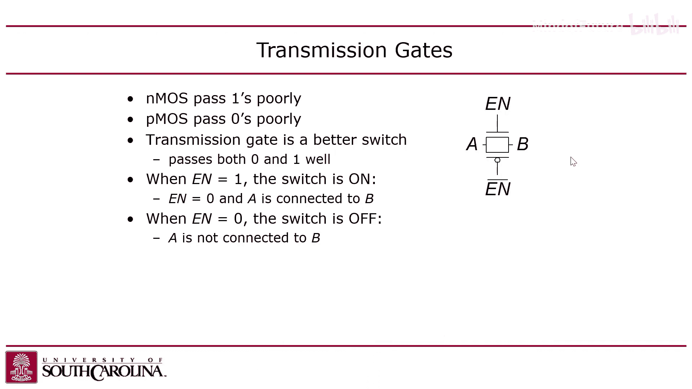

# 高级数字系统设计：第14讲：CMOS设计基础

在本节课中，我们将学习数字逻辑电路在晶体管层面的实现，即CMOS逻辑设计。我们将从回顾上一讲的关键数字模块开始，然后深入探讨CMOS技术的基本原理、逻辑电平、硅半导体特性以及如何用晶体管构建基本逻辑门。

## 回顾：数字构建模块

上一讲我们介绍了多种数字构建模块。本节中，我们快速回顾一下核心概念。

### 加法器

我们讨论了行波进位加法器，以及更快的超前进位加法器。超前进位加法器的核心思想是提前计算进位，其关键路径延迟与加法器的位数成对数关系，而非线性关系。

以下是超前进位加法器中用于计算进位生成（G）和传播（P）信号的基本公式：
*   **生成信号**：`G_i = A_i & B_i`
*   **传播信号**：`P_i = A_i ^ B_i`
*   **进位信号**：`C_{i+1} = G_i | (P_i & C_i)`

前缀加法器进一步优化了这一过程，通过树状结构组合不同范围的生成和传播信号，将延迟降低到 `O(log n)`。

### 比较器与移位器

比较器可以通过逐位异或非（XNOR）后接一个多输入与门来实现，但这会带来较大的扇入延迟。另一种常见方法是使用减法并检查结果是否为零。

移位器分为两种主要类型：
1.  **桶形移位器**：使用多路选择器（MUX）实现任意位数的移位，硬件开销较大。
2.  **移位寄存器**：由一系列触发器串联而成，每次只能移位一位，常用于串行/并行转换。

### 乘法器与除法器

乘法器通过生成部分积并相加来实现。一个N位乘法器大致需要N-1个加法器。

除法器（如恢复除法器）是计算中最昂贵的操作之一，因为它需要一系列的减法、比较和可能的恢复操作。一个N位组合除法器需要N个减法器及相关逻辑。

---

## 晶体管级逻辑设计

现在，我们进入一个新的主题：晶体管级逻辑，即CMOS逻辑设计。这部分知识对于理解如何将HDL代码映射到实际的硅芯片上至关重要。

### 逻辑电平与噪声容限

在理想情况下，数字逻辑电平是明确的：低于 `VDD/2` 为逻辑0，高于 `VDD/2` 为逻辑1。然而，现实中的逻辑门具有非理想的电压传输特性。

关键参数定义如下：
*   **`V_IL`**：输入低电平的最大电压。只要输入低于此值，就被可靠地识别为逻辑0。
*   **`V_IH`**：输入高电平的最小电压。只要输入高于此值，就被可靠地识别为逻辑1。
*   **`V_OL`**：输出低电平的最大电压。当门输出逻辑0时，电压不高于此值。
*   **`V_OH`**：输出高电平的最小电压。当门输出逻辑1时，电压不低于此值。

噪声容限衡量电路抗干扰的能力：
*   **低电平噪声容限**：`NM_L = V_IL - V_OL`
*   **高电平噪声容限**：`NM_H = V_OH - V_IH`

这些参数确保了即使输入信号带有一定噪声，经过逻辑门后输出信号也能被“净化”，从而保证数字系统的稳定运行。

### 硅半导体基础

硅是制造芯片的基础材料，它是一种半导体。纯硅的导电性很差。通过掺杂可以改变其导电特性：
*   **P型硅**：掺入三价元素（如硼）。多数载流子是带正电的“空穴”。
*   **N型硅**：掺入五价元素（如砷）。多数载流子是带负电的电子。

将P型硅和N型硅结合，就形成了**PN结二极管**。二极管具有单向导电性。

### MOS晶体管工作原理

MOS晶体管是构建CMOS逻辑门的基本开关。主要有两种类型：
1.  **NMOS晶体管**：当栅极（Gate）施加高电压（逻辑1）时，在P型衬底中吸引电子形成导电沟道，从而在源极（Source）和漏极（Drain）之间导通。
2.  **PMOS晶体管**：当栅极施加低电压（逻辑0）时，在N型衬底（或N阱）中吸引空穴形成导电沟道，从而导通。

晶体管的符号中，PMOS的栅极通常带有一个小圆圈，表示低电平有效（导通）。

### CMOS逻辑门结构

CMOS逻辑门的核心设计原则是使用互补的**上拉网络**和**下拉网络**：
*   **上拉网络**：由PMOS晶体管组成，负责在输出应为逻辑1时，将输出节点连接到电源 `VDD`。
*   **下拉网络**：由NMOS晶体管组成，负责在输出应为逻辑0时，将输出节点连接到地 `GND`。

这两个网络是互斥的，对于任何输入组合，只有一个网络导通，从而避免电源和地之间的直接短路（称为“穿通”电流）。

以下是构建基本CMOS门的规则：

#### 反相器（NOT Gate）
这是最简单的CMOS门。
*   **上拉网络**：一个PMOS晶体管。输入为0时导通。
*   **下拉网络**：一个NMOS晶体管。输入为1时导通。
*   **功能**：`Y = NOT A`

#### 与非门（NAND Gate）
一个两输入与非门的结构如下：
*   **上拉网络**：两个PMOS晶体管**并联**。只要A或B中有一个为0，就能将输出上拉到1。
*   **下拉网络**：两个NMOS晶体管**串联**。只有A和B同时为1，才能将输出下拉到0。
*   **功能**：`Y = NOT (A AND B)`

#### 或非门（NOR Gate）
一个两输入或非门的结构如下：
*   **上拉网络**：两个PMOS晶体管**串联**。只有A和B同时为0，才能将输出上拉到1。
*   **下拉网络**：两个NMOS晶体管**并联**。只要A或B中有一个为1，就能将输出下拉到0。
*   **功能**：`Y = NOT (A OR B)`

**一个重要限制**：由于PMOS用低电平（0）导通，NMOS用高电平（1）导通，单个CMOS门只能直接实现“负逻辑”功能（如NAND、NOR）。要实现标准的与门（AND）或或门（OR），需要在NAND或NOR门后面级联一个反相器。

---

## 总结

本节课中我们一起学习了CMOS数字设计的基础知识。我们首先回顾了加法器、比较器、移位器等关键数字模块。然后，我们深入探讨了晶体管级设计的核心：包括逻辑电平与噪声容限的概念、硅半导体的掺杂原理、NMOS和PMOS晶体管的工作机制。最后，我们掌握了CMOS逻辑门的基本结构，理解了上拉网络（PMOS）和下拉网络（NMOS）互补工作的原理，并学会了如何构建反相器、与非门和或非门。这些知识是理解现代数字集成电路如何从门级描述转化为物理芯片的基石。