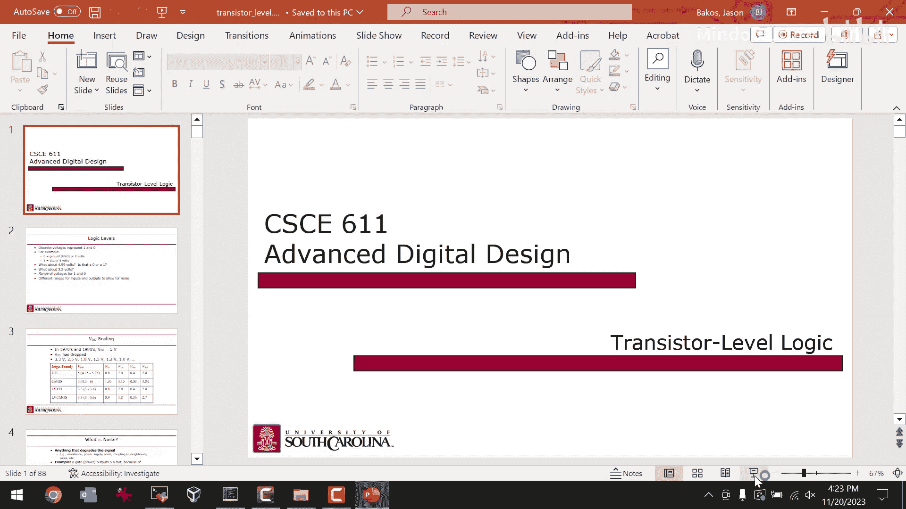
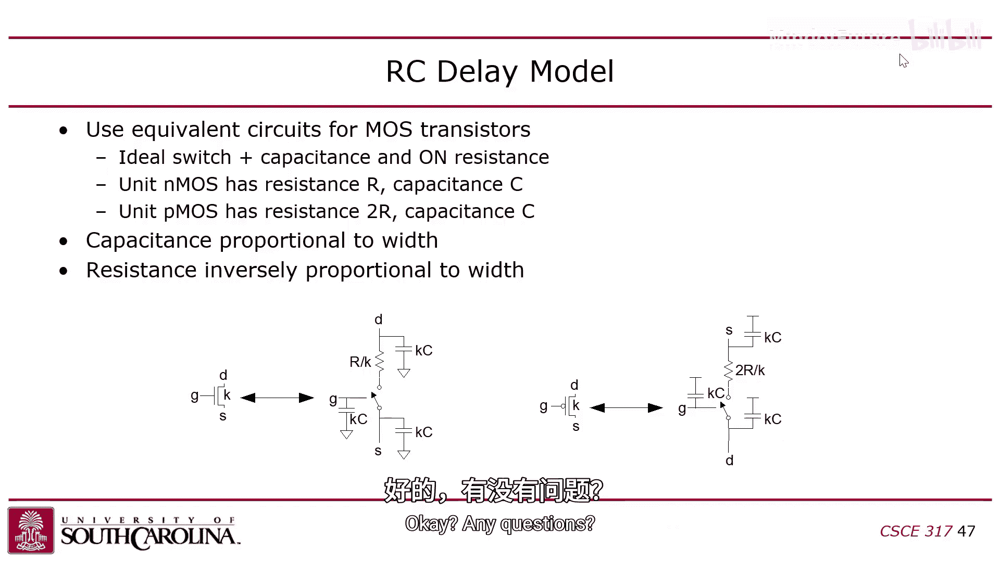

# 【南卡罗来纳大学】高级数字系统设计-CSCE611-（Advanced-Digital-Design，Fall-2023）-p15-P15-CMOS-Design-2--BV19nf6YoEZ9_p15-

Okay hey， any questions or issues with the lab， everyone okay with that？Okay。

 so today I'm going to continue the lecture from last time we were talking about transistor level logic or CMOS logic design。

嗯。Just to briefly review， we started out talking about logic levels。

 basically voltage levels for representing a zero and one。

 and those voltages have tended to shrink down over the years。

Then we talked about noise and noise margins。 so the idea there is that。嗯。Logic gates。Logic gates。

Have this。Thing where they kind of clean up。The noise affecting their inputs， because。嗯。

What a logic gate effectively considers a zero。Is any voltage between zero and VIL？

And then if you look at the output。What's considered a zero in the output is anything between0 and V OL。

 right so V input high。I sorry， input input low and output low。

 right the thing is is that that the voltage input low though is generally higher。

Then the voltage output low。 So if you have some noise on an input。

It will affect the quality of the output， but it will。It'll attenuate that noise。

 bring it closer to zero。 Does that makes sense。 and then you have the same thing on on the other side with the high voltage。

So you end up with this noise margin， which is。The difference between。The output。

What's considered low on the output and what's considered high on the input。

 that's the noise margin low right and then the same thing with the high side。

 the input high versus output high Does that make sense。

So as long as you have less noise than this noise margin then。Things should work。

Then we talked about semiconductors and this is。This is actually a new slide I put a better slide in than the one I had last time。

 so silicon， as I mentioned， forms a crystal lattice。And you can dope it， you can add impurities。

So you have this。You know， this is the silicon lattice in two dimensions。

 This is what it looks like in three dimensions， which is in reality， it's three dimensional。

 But in two dimensions， it looks like this。 You every atom forms binds with four neighbors。

 And then if you put a dont in like arsenic， the arsenic is。Over here in。Column 5。

 It has an extra electron， and that electron。Is free to move around the lattice。

And that electron becomes a charge carrier。 And the more that you dope the silicon。

The more conductive it becomes。 It becomes more conductive， the more of these。

Dins you introduce in the lattice。 And then if you put an element like boron from group 3 in there。

 you have this opposite effect where it's kind of a lack of electron， kind a hole that moves around。

 So basically， what happens is the boron only has three valence electrons。

 So there's a lack of an electron around that boron atom。

 But then an electron from this silicon atom can sort of。

Borrow its electron for the boron at which point the silicon atom is missing an electron right so that lack of an electron that hole has mobility that can move through that lattice and it can carry current。

 makes the semiconductor more conductive。 And then if you create a P injunction where you have a P type silicon。

 which is the holes。 So P type silicon is when you have the group  three dopans。 and N type silicon。

 which is where you have the group 5 dops。 you put them together。And it creates a diode where。

If you have a positive voltage of the P side， the anode relative to the cathode。

 which is the end side， the charge carriers。Are attracted。To the junction。

And then it'll conduct current from anode to cathode。

 But if you apply the voltage in the opposite way， So if the cathode has a positive voltage relative to anode。

The positive voltage of the cathode repels the holes。In the P type away from the junction。

And so this is a reverse bias condition where the。The diode won't conduct in the backwards direction。

From from cathode to anode， however。This does still create a capacitor。

A reversed bias diode is still a capacitor， so it ends up acting it doesn't conduct electricity。

 but it turns into a capacitor which has implications for transistors。

So with the transistor you have。A substrate which is usually P type， you put di fusion areas in it。

 which are little islands。And this is fundamentally how。

Chipps are made as you start out with a substrate， which you grow and you inject it with these little diffusion areas。

 These are called， these are the active areas。 right。

 So these diffusion areas are basically the way they're made is you you start out with P type。

 the substrate starts out as all P type。And then you start doping it with N type， right。

 And you can actually reverse the doping by doing that。 So in other words。

 even though this P type might have had like。One of the pe type dopeps in it。

What are they always forget， Boron， say， Okay， so you might have had boron in the substrate originally。

 but then you start hitting it with arsenic。 So this thing had boron in it。So it was all P type。

 and then I start hitting it with arsenic in these two diffusion areas。

 you can reverse the doping in those areas and make it end type。That makes sense。Now you might say。

 well， what happens to the Boron I mean do you end up with Boron and arsenic in there？I think so。

 I don't know exactly how it works， but somehow you can reverse。

That's the type of the silicon by adding the opposite thing that had been previously dealt with。

 right？I think what ends up happening is if you have more arsenic in there than boron then it becomes end type。

 right， But it only happens in these islands。 And this is where photolithography comes in。

 You might have heard that term photolithography。 So the way this works is。

 is that you apply a mask over the top of this thing。

 and there's little windows in that mask where those diffusion areas are。

 So when you hit it with the arsenic gas that arsenic gas。Diffuses。

Into the areas that are not covered by the mask， right。

 So this is all done through a masking process。 So basically， you protect everything， but。

The end type diffusion areas， and then you create arsenic vapor。Which again。

 this is why we don't generally make chips in the United States。 this is really nasty stuff。

Like arsenic is nasty to begin with， but now aerool it's been vaporized into a gas。

 so now it's poison gas。But you get the an it's extremely high temperature poison gas because that's the way you get it to get inside that substrate right that's how it gets you ionize it and you get ion implantation in there through the mask right so。

No one wants to do that work。Right， so but that's basically what happens。

 And then you end up with this diode right because you've got the substrate。

 you've got a as long as the substrate is grounded。

 then you get these reverse bias diodes right Okay。

 and then you have the gate which is in between the two diffusion areas and then the channel is under the gate right so basically if you want to turn this transistor on。

😊，要。You apply a positive voltage to the gate。And that creates a capacitor。

Because in between the gate and the substrate is a little glass silicon dioxide。

So you put a positive voltage here。And that'll create a positive charge。That'll charge the capacitor。

 That charge will attract。Electrons， which are not the majority charge carriers in P type silicon。

 but they're minority charge carriers。Again， that part I've never， you know， it's weird。

 Like how how's that where the minority the minority carriers are in there。

 they'll get attracted to the channel and you end up with。A channel。

 the channel is charge carriers that are forming under the gate。

 and that will turn this transistor on and you'll start to conduct from these two terminals。

So it becomes an electronic switch。And this is， of course， what enabled。All digital electronics。

 I mean， prior to this， you had to use a vacuum vacuum to to get this effect， right。

 which was like a light bulb essentially， right so。Now the problem here， though， is。

There is an issue here， though， because I told you before that the the substrate was grounded。

 so you might think， okay， well， here's a capacitor between the grounded substrate and the gate right。

 But the problem is is that when these。These charge carriers accumulate in this channel。

They become their own thing， they're separated from。

They become separated from the substrate and that makes a little tricky to calculate what the voltage difference is between the gate and the channel because the channel becomes its own thing。

 It's not part of the electrically， it's not part of the substrate anymore。Okay。

So i'll talk more about that in just a minute， I'll come back to that so transistors are switches。

You can make gates by essentially connecting the switches in series in parallel to create paths that can be on or off with certain combinations of gate values。

Guys with me。 So if you put two n moss transistors in series。

 their gates both they have to both be on in order to form a path through that network。 guys with me。

 it's just two transistors in series。 And because they're in series they both have to be on for the whole network to be on right。

 Likewise， if they're in parallel， either one of them could be on and they'll make a connection。

 So so the idea there is that if you for example， if you want to make a N gate。

 you can put two pmasses in parallel between the output in VDD and two n mossses in series between the output and ground。

 And so in order to connect the output to ground， you got to have these guys both on right So the input has to be11 to pull the output down And of course。

 if the inputs are one1， both of those。Pmasses are turned off， right？

Make sense with any other combination of inputs though you'll have at least one of these two guys will be off and since they're in series that means you're not going to pull down and at least one of those Pmasses will be on。

Makes sense。So to pull up to VDD， but they're mutually exclusive。

 you could only pull up that the output when only be electrically connected to ground or VDD。

 but never both。Well， I shouldn't say that it is connected to both during the transient when you're switching。

When I'm switching the input from 0 to 1 or 1 to0， then they are actually both on。Briefly。

Use short power and ground during the switching。And that's where most of the。Your power is lost。

Makes sense， that's called dynamic power consumption。However， when you're not switching。

There's very little leakage of current right when you're not switching the input in steady state。

There's very little current that will。That will go through from from VDD from the power to ground right and that's the advantage of CM that's why everyone uses a CMmo that's that's's very it has very little。

Static leakage。Now， that's changing because。One of the things that's happening is as you lower the voltage。

One thing I should mention is that this semiconductor， the threshold voltage that turns on。

These transistors is been more or less， hasnn't changed much over the years。

 It's usually about 700 millivvolts。That's what gets these transistors to turn on and what's happening is we keep lowering the voltage。

I think chips nowadays run at like 800 millivolts to a volt power supply。

And so because we're very close to the threshold voltage， the leakage current is is。

Is worse in modern ships than it was in previous generation。It's more of a concern。

But it's still the most power efficient technology available。Okay。

 so depending on how you connect the pull up and pull down， you can get different gates。

 you can get different number of inputs in general。

 the number of transistors is two times the number of inputs。

 So if there's three inputs on this Nor gate， there's six transistors。嗯。

If I mentioned last time that。The CMmoss。COS gate， a single gate has to have at least one bit in the input。

In order to。Pull down。To ground right， so because you're using N moss transistors in the pull down network。

 you got to turn at least one of them on。Right to pull down likewise， in order to have a one output。

 you got to have at least one zero input right so that that that disqualifies an and gate from being created。

 for instance， because when you have an and gate，Your inputs are 11 and the output is  one right。

 but that won't work because if your inputs are 11。

 there's no way to pull the output up to one right so you can't build an and gate Likewise or gate works the same way with an or gate。

嗯。If you put all zeros into an orgate。Its output is zero， right？

But there's that's impossible because if I have all zeros。 I I don't。 I can't。

 I can't I can't activate any my N mo transistors， right。

 So if you want to create a positive logic gate like an and or an or， you have to basically build2。

You know， two gates in series and connect them。 you can create a Nand and then an inverter separately and then you effectively have an and gate there。

 but it's two gates， it's not one gate。Okay， so let's see。

 I think that's about how far we got last time。So I mentioned that the。

The pull up network is always P massessses， the pull down network is always N mosses。

The reason for that is because notice how the pe mosses are up here。Next to VDD， right。

 and that's because what turns on a PmoOS。Isn't actually a zero？We think of it as logic 0。

 But what it really is is a negative voltage on。The gate。

And that negative voltage is because I'm putting a zero in， but it's being measured relative to VDD。

You guys with me on that， right？Makes sense。So I need to have a negative。

Voltage on the on the gate for a Pmas。 Why， because I got to track the minority charge carriers in a Pmas。

 which are。Hoholes。I got to get holes in the channel right So that's the reason why I got to have the Pmasses in the pull up network right and the N mosses in the pull down。

 But if you want to create something like a transmission gate， for instance。

 a transmission gate doesn't connect to。It doesn't have a power or a ground in it。

 a transmission gate is when you have two transistors in parallel。

 which allow you to create a tri state buffer basically disconnect like if you have a wire and you want to be able to disengage it from an output or disconnect it from an output。

The problem is， is that if you're doing that， then this a input is either going to be zero or1。

 right？Well， Pma is don't。Pass。A0 very well。 And N mossses don't pass a one very well。

 So the way you get around that is you just use them both in parallel， right， that way you got。

 you got you put these both in parallel。 And then that way， regardless of what the value of a is。

 you could pass it over to B efficiently。You guys with me？Okay。Okay。

 so I mentioned power consumption' I mentioned there's dynamic power consumption。

 which happens when you switch a gate static power consumption is just the power it always uses and so basically the idea is that the energy to charge a capacitance。

Is。The capacitance。Times the voltage squared。So if you charge up a capacitance， it's CvDD squared。

That's energy。嗯。If you want to。嗯。Convert this to power。You have to。嗯。Measure it through time， right。

 so if you have。The voltage and the capacitance and the frequency。

 the frequency at which you're charging， right， then if you multiply the frequency times that CvDD squared。

 you get power in wts。except it only costs you when you charge up。The capacitors。

 not when you discharge them。 So that's why they put a one half in front of that。

 So if you have the power， the dynamic power consumption is one half。

The capac is times VDD squared times F now F。Usually people， when they put F is the frequency。

 but it's really the frequency that the transistors are switching。You know， to simplify this。

 they usually just put the clock frequency in for that， right， but the clock is not。

 you don't necessarily have every transistor in the chip。Switching on every clock cycle， right？

Some gates don't switch on the clock some don't， but generally that's just a way this is just an estimation。

Likewise， capacitance。What are we talking about there when you're talking about the total capacitance？

In a chip， for instance， right so in other words， you're adding up all the capacitance of all the capacitors in the chip。

Right， so again， that's just an estimation。 But the important thing to note here is that it's VDD squared。

 the power， the dynamic power consumption。Is scaling with the voltage squared。

If you're worried about power consumption， you really want to try to get that voltage down as low as possible。

 right？I mean， you could also try to reduce the frequency。

 but that doesn't have nearly as much of an impact because it's。That term isn't squared。

And then static power consumption is。A little harder to quantify。

 It's basically just the leakage current multiplied by。The voltage。

And it's harder to measure the leakage current。 That depends on the transistors and how much current the transistors are letting through。

 And that really just depends on the off resistance。Because when the transistor is off。

 it's not really off， it just has a high resistance value it's R off， right。

 it's like a 10 megaomem resistance， right。Does makes sense？

So you're going to have some leakage there， even through transistors that are turned off just very little。

Of course， the problem is， is that there's millions of transistors in parallel， though。

 So even though there's a little bit of loss on an individual transistors。

 there's millions and millions of them that are all。Losing current， loss leakage current。Okay。

 so here's an example question that I might have on the quiz or test。

 Eimate the power consumption of a wireless handheld computer。 VDD is 1。2 Vs。 The capacitance is。

20 nanofare ads。That's intended to be the total capacitance。Frequency 1 gigahHtz again。

 that's just the clock frequency is not necessarily you don't have every transistor switching at the clock frequency。

 but that's an estimation。 and then the。The leakage current is 20 milliampmps。

And so you just plug these numbers in and you get 14。

4 wts you have to add the static and the dynamic so this first term is the dynamic power consumption is one half capacitance voltage squared frequency multiplied together and the static is just the leakage current multiplied by the supply voltage right so you can get total power consumption。

Okay， so let's come back here to semiconductors。So I mentioned that there's this kind of weird phenomenon that happens when you start charging。

You start charging the well， actually， normally these transistors if the gate is。You know。

 not charged up it's in a mode called。Accumulation mode。But as you start charging up the gate。

It starts to push。The majority carriers out。 So in this case， this is an en moss transistor。

 I start putting a positive charge on the gate， and those holes in the substrate start moving down away。

 kind of like a diode， a reverse bias diode。 You start to repel。The majority charge carriers。

's that's what happens when you try to send current the wrong way through the diode is that you have this repulsive effect or the charge carriers move away from the junction。

 In this case， it's not a junction。 It's。It's an actual capacitor separated by glass。

 but then eventually。You'll attract the minority charge carriers。And they'll form the channel okay。

 so this is called the depletion region where you know there's like you sort of have this effect where you disc you're moving the majority carriers down and then once the minority carriers start coming up there you have an inversion region and then beneath that is the depletion region。

Okay， now you might say， well， well， who cares， What's the point of this？ Well。

 the point is the reason I bring this up is because this is to emphasize the fact that when you get this depletion region。

You have the gate。The oxide and the channel。Become a thing。

But then this depletion region is going to decouple the substrate away from this channel。

So the problem here is that when you measure the voltage difference between the gate and the channel。

The bottom voltage。Of this capacitor， you just cannot assume it's ground。Any， yeah。

 the substrate is grounded。But once you get this inversion region。Then you。

 you have electrically separated the substrate from the channel。 This channel is its own thing。 Now。

 It's its own world。 It's not grounded anymore。 It's part of。

It's's not it's not at the same voltage as the substrate。 Now you might say， well okay。Well。

 then what voltage is it at then， how do you get the what is the voltage of the channel is the question。

 right？Because if I want to know what the remember the capacitor is the voltage of the channel of one side of the capacitor relative to the other。

 right， but now the bottom part of the capacitor is its own thing。

 How do we figure out what the voltage is。 Well， the way you figure it out is。It's actually。

 remember that the diffusion regions are here and you can get the voltage of the diffusion regions right。

 so what ends up happening is that the voltage of the channel is actually just a gradient of voltage between the two diffusion areas。

Actually， it's the average of the two。You guys with me？Okay。So why is that important？Um。Okay， well。

 let me come back to that question in a minute so you have。

So what do you really want to know when you calculate transistor behavior。

 you want to know the voltage of the channel， I'm sorry of the gate relative to the voltage of the channel。

 right， but as I mentioned， figuring out the voltage of the channel is not straightforward。So。

So to derive that， the voltage of the gate relative to the source。

 VGS is the voltage of the gate minus the voltage of the source。

 the voltage of the gate relative to the drain， and by the way。

 the source in the drain are just the two diffusion areas， right？嗯。Now， they're symmetric。

So it doesn't really matter which ones the source and which one is drain。

 but there is a convention that the source terminal is the one that's at the lower voltage。Why。

 I don't know， I don't know why that convention is there。Right。

 but the problem with that what kind of sucks about it is if you have a。If you have an inverter。Yes。

So here's an inverter and this is VDD up here and this is ground and this is your input。

And this is your output。Obviously。This terminal is at the lower voltage， right。

 because this one's connected to VDD， right， So this is the。Source。Source， right。

 and that's the drain。But if you look at the pull down transistor。This is lower voltage。

 It's connected to ground， right， So this is the source， and this is the drain。

Which means that the source and drainer。Flippped right on the P mos， the drains at the top。

 on the end moss， I they're both at the top， right， is that right？Drain source， I guess they are。

 I thought they're drain source。 No， I guess they are a balance。 You， I don't know。

 I thought I thought we， they normally switched， but like I said， it doesn't matter。 They're。

They're symmetric。The let's see gate source， gate drain and then。The drain source。

So try not to get confused here， these two guys have the gate。Gate source， gate train。

 this is drain source， which is the voltage of the drain minus the voltage of the source so。

If you do， if you substitute in。嗯。VD。I see VDS VD minus VS and this is equivalent to voltage gate source minus voltage gate drain right。

 which this we I mean we don't really care about that we what we really want to know is the gate channel right because the gate channel is the capacitor that turns the transistor on。

So the gate channel is the gate source plus the gate drain divided by2。

 it's just the average right in when it's on， not when it's off， right。

 let me just emphasize that when the transistor is off。The G channel。

Is whatever's on the gate subtracted from whatever the substrate is at。

 So in a Pmasss Pmass is VD D on Nmass it's ground。 But once you have the inversion region。In here。

 right， then your're。Your gate channel is is basically just is just an average of the gate source gate drain over two and the reason is because。

The reason is because。You know you've got the source and drain here。

And they're electrically connected to the channel now。

So if I want to know what the voltage of the channel is， I just basically take or the you know。

 it's essentially the average of the two sides， does it make sense？So。

Or gate source versus gateit drain over two。嗯。They do this， I mean that's true。

 but you can also substitute in the VDS， which we get from here。

 right VDS is VGS minus VGD and if you isolate VGD。

 you substitute in for thisGD and you end up giving gate channel。

Is gate source minus v drain source over2 right so what I'm saying is that this is equivalent to this it's just written a gate channel as a function of gate source and source drain。

Makes sense。Okay， so。What's the point， the point is is that we want to know the gate。

The gate sorry G channel，So if， as I mentioned。If we got nothing on the gate。

 don't have or if we don't have any charge on the gate that creates the inversion region。

 then that's called cutoff mode。If we。Start get if we start to get an aversion region there。

We accumulate a charge on the gate， we get an inversion region in the channel。

 the transistor goes into linear mode where it just acts like a resistor。

 they call it linear mode because it becomes essentially a resistor。

 a resistor in the sense that as I increase the voltage difference between the drain and the source。

Then I will get a linear increase in the current flowing through， right， However。

 the problem with that is that as I keep increasing the voltage over that transistor。

The drain source， drain source voltage as I keep ramping that up。The problem is， is that。

As the voltage here gets bigger and bigger。The gate。chanhannel。Voltage starts to get pinched off。

Near。One side。Because remember that the channel voltage is a gradient between the。

 the source and drain。 If the source and drain are basically the same voltage。

 then the channel voltage will be the same。 But if you start。If you start。嗯。

Widening the voltage range between the source and drain， then that channel， the gate channel。

Starts to get。It starts to close the gap between the gate and the channel towards the side that's at the higher voltage。

ok。So it creates this pinch off effect。And this is called the saturation mode where。

You're trying to draw you have the voltage difference between the source and drain high too high that ends up causing the difference between the gate and one side of the channel to get pinched off and then the transistor will stop giving you more current as you increase the voltage。

 so it goes out of linear mode and into saturation mode and then the transistor becomes a constant current source at that point。

You guys with me？So the problem is is that。Transistors are inherentlylinear because you have to。

 whenever you're modeling them， you have to consider these three operating regions。

 there's cutoff where there's basically no connection between source and drain。

 there's a linear mode which is acts like a resistor until you ask too much of it you ask it to source too much current at which point it'll go into the saturation mode and just it'll keep giving you whatever the max current was。

 but it'll peter out so you can keep increasing the voltage over the transistor。

 but it won't provide any more current。Okay， so。嗯。So I move that slide hold on a second Okay。

 so basically。That。That behavior will depend on the gate source voltage。O。They might say。

 way hold on why gate source， why not gate drain？Because remember， this well， this is an Nma。嗯。Here。

 right， This is an N mos， right， So we're looking at the gate voltage。Relative to the source， right。

 because the source。Is at ground right， so basically it's gate source。

You could look at gate drain too， if the source and drain。are。You know。

 if they're at the same voltage， but the problem is。

 is that the drain is going to be the thing driving the output of this gate， right。

 So we want to look at gate source voltage。 So the gate as。If we have the gate source voltage at 1。

2 volts。And then， the drain source voltage。Is increased from  zero to 1。8。You can see that。

You have this linear。Linear effect here。Until it saturates， it saturates here about 1。6 volts。

RightNow if we have the gate source voltage higher， then the saturation happens around 1。3， 1。

4 volts， so the saturation point depends on the gate voltage， gate source voltage。Okay， now likewise。

 within an aimmos， it's kind of reversed because the gate source。Let's see now we're up Pmas。Okay。

 so I did have these switched， sorry。So this is the source， and that's the drain。

 I was right the first time， right， sources at the top drain is at the bottom， right。So source。

 I think the problem is， is I think that bullet。I think that bullet only applies to Enmoss。

 That's why。That bullet point right here。By convention source terminal is at the lower voltage。

That's for N Moss only。 I think for a P moss， yeah， the sources is at the top for a P Moss， right。

So what happens here is that when you put a zero into this guy。The gate source， right。

 Here's the gate。 That's the source。 This is going to end up being negative。 right。

 This is essentially a negative。 We're putting a net。 we're not really putting0 here。

 We're putting a negative。Gate source voltage on， right？Which makes sense， right， Because this is。

 this guy has it's， it's， it's a bulk terminal。 It body。 It's a substrate has。And。

This is N type for its substrate is n。Right。So we want to attract holes。

 the minority carriers out of the end。 So we got to put a negative voltage here。

 you guys with me on that， right， So you're putting a negative voltage on the gate source for the Pmos。

And sorry， yeah， so we have the negative， like so， for example， the gate source like negative 1。8。

 that's like we're hitting it with the high the well， the highest magnitude gate source of voltage。

And then the drain source， likewise， is。Again， drain source。So drain versus source， right。

 source at VDD drains here。 So this is going to be if you measure the voltage of the drain。

The drain source is going to be negative here， right， you see that。If we have a negative 1。

8 on drain source and a negative 1。8 on the gate source， you know。

 it's going to be saturated until you bring that guy down to like negative one you know。

 negative 1 volt in which case we go into the linear region。Right， that makes sense。Okay。嗯。

So that's called the DC response。Okay， so I want to run through the model。

I'm going to go through this。Kind of quickly。 It gets a little overwhelming。 but there's a few。

 there's just a few points I want to make。 So this， this picture。

So this is the picture I showed before， this is a cutaway view。

 and this is like a three dimensional view， this is a much more interesting view， in my opinion。

 I like this one better。So you've got the diffusion areas and you've got the gate and you've got the bulk or bulk substrate。

 whatever you want to call it and on this side I want to point a few things out。There is a。

Capacitor that's formed between the gate and the channel。And there's the VGS VGD。

And VDS between the two。There's also a capacitor between the diffusion area and the substrate that's not shown here over here。

 you see the same thing， a couple things to call out though， this oxide thickness。

 this is the glass that's beneath between the gate and the substrate or the gate and the channel right。

 you want this to be as thin as possible。嗯。And also the distance， the channel is the length。

This is how far the current goes from source to drain。Why is that important because？

The current is being carried by charge carriers。 Those are the little。Things inside the lattice。

 the silicon lattice that move。 They don't move that fast。

And so you want to make this length short so they don't have far to go because the shorter the length is。

 the faster the transistor will turn off or turn turn off or turn on， turn off however。

There is this additional dimension that you don't see here。 the width。

 This is the width and the length and the width are actually the gate， gate length and width， right。

 although in general， the diffusion areas are the same。Are the same length and width， usually， too。

 But when you measure the length and width， you're measuring the gate， right。

 So the wider the transistor is。The more area you have to send those carriers across the channel。ok。

Okay so。In the linear region， for a transistor， the current that sent。Drain source current。Right。

And this is obviously， this is drain source， right？We are。

This is an end mosque because we're dumping current from drain to source that current's going this way。

 right？In a Pmos， it would be source drain current， right be switched。

 So the drain source is the charge Q is charge。Over carrier time， time。

 it takes the carriers to move， right， The charge is simply capacitance times voltage。嗯。

And the voltage is the gate channel voltage， which as I mentioned earlier。

 it's a little tricky to figure that out， but you can it's essentially the gate channel has to be calculated relative as a function of the gate and the source and the source drain right or you could do it as gate source gate drain or you can restructure it like this gate source source drain right why because again。

 that fourth terminal， which is the bulk， the body of the transistor of the substrate does not factor into this。

 This is the gate channel is only a function of these guys。 so that's what you use for voltage。

 and then of course， the capacitance is whatever the capacitance is。😊，嗯。And actually， sorry。

 Sc to that。 one thing I forgot。 you have to subtract the threshold voltage from that because the threshold voltage is what's required to get you the。

The inversion region， if you don't， you need the inversion region in order to a have that VGC。

In order for VGC to be calculated in this way， you have to have the inversion region under the gate in the channel。

 and you can't get that until you hit the threshold voltage。

The threshold voltage is a property of the semiconductor。

 Like I mentioned is' usually around 700 millivvolts。 That's what's required to get。

The inversion region and you start you know conducting basically， right， So the capacitor voltage。

 you have to subtract the threshold voltage。And so the charge of the channel could be calculated like that。

 I'm just substituting these in。And then。The capacitance of the gate。Is。The dielectric constant。

Of the oxide material。Which is silicon dioxide。 It's glass。 It's a really good。

 I think it's the best insulator， right， It's a really good insulator。Maybe not as good as a vacuum。

 but it's great insulator and then you multiply that by the area of the capacitor which you know the area width times length。

 and then that's divided by the thickness of the oxide。

 how close you get the two plates of the capacitor together right and then。So yeah， that's oh yeah。

 sorry， 3。9 times the。Would it。what's the letter Epsilon， thank you， Epsilon epsilon zero。

 that's the dialectric concept of a vacuum， Epsilon zero。Okay， so。The诶。

So basically you could substitute in just capacitance of oxide。

For epsilon oxide over thickness of oxide， because those are things you can't change。

 Those are those are baked into the fabrication technology。

 but you can change the width and the length of the。Of the。The the transistor gate， right。

 So this sea oxide becomes a technology parameter。s that's that you get that from TSMC or whoever's making your chips。

Okay， so then you can build this in in。You get charge of your channel is sea oxide times width and length。

 which is the。Cacitance of the channel and we multiply that by the voltage and then we need the carrier time。

 the carrier time is a function of the carrier velocity。

 the carrier velocity is a function of this mu， which is the mobility of the carriers again that's its just how fast the carriers move in the silicon。

Times the electric field strength E and the electric field is just。The voltage of the。

Drain source voltage divided by the length of the channel， right？And so。We can then calculate the。

Carrier time。Let's see carry time so we come back up here so we have the mobility multiplied by the electric field。

 the electric field is here and。Multiply by mu。Right。

 so we just get this and then the carrier time then becomes。诶。L square， so we have the。

I mean I got lost here。Carrier time is mu times E， E is VDS over L。嗯。E is the。啊冇得啦。Yeah。

 so this is V this gives us V。 So we have just mu times VDS over L。

 and then the carrier time is in the denominator there right。

 see the carrier times in the denominator so。It's。withve。So this is in carrier time。

 and this should be current， right？R the current is going to be is going to be relative to L squared because we also have L and the numerator is part of the charge for the channel the channel charge right so we have L there and then we have L here in thenominator。

 but then that's part of the carrier time calculation。 So the the。Right， so the。

So IDS is going to be。嗯。For the linear region， well so what you end up doing is you have this beta term。

Which is the mobility times the thickness， the oxide capacitance over width and length。

 That beta term is going to be your technology term because the mobility and the carrier。

 the oxide capacitance is baked in and the width and the length。

 you're typically going to you can control those as a designer。

 but you're going to typically use your minimal values when you're doing digital logic So the length is going to be like when you hear about Intel has their new four nanometer technology right that's the length right。

 It's whatever the minimum feature size is， which is the minimum feature size you want to use is the length and the width is usually like five times the length at a minimum。

 right。So those terms can be baked into beta and then the beta is just then multiplied by the voltage of the。

The voltage of the gate relative to the channel。So that would give you the linear region。

 the cutoff region is zero， and then the saturation region。

 which is where the drain source is greater than the saturation voltage。

 is this is where it turns into the transistor turns into a constant current source。

 which is going to be beta over2 VGS minus VT。嗯。Notice that the difference here is that。啊。

VDS is not part of this because VDS， once you saturate， the current is no longer a function of VDS。

And also the the mobility， the one term in here that differs between the Ns and P Nmos or PFt and NFEt is the mobility。

 that mu term， so holes which you have in the。That holes are the。

Remember that the holes are the minority carriers in the。嗯。嗯。The the if you have the the。En Moss。

N Moss is going to have diffusion that's going to be N。And the bulk term is going to be P， right。嗯。

The the the carrier over here with the n moss is going to be the electrons right。

 because the substrate is P over here with the P moss， the substrate is。And。

 and the minority are holes there， right， So holes have less mobility than electrons。

 which means that the mobility of a Pma transistor is about half of that of the。NOS transistor。

 so what you end up having to do in order to balance those out is the PmoOS has to have the way that you compensate is you have twice the width。

right。So basically， the mobility term in this beta。You see the mobility here。

 that mobility is half for Pmass。 So in order to make up for that， because that is half。

 you have to double the width， right， So the Pma transistors have double the width， same length。

 but double the width。 So if you look at a layout， you'll see that the Pmasses are usually。Taller。

Twice as tall as the enss is if you're looking down on the mask on the design。Okay。

 oh shoot I'm out of time， okay， any questions about that？Okay。

 so we've got I think we've got we've got two lectures left。

My plan is is that in the next lecture I'll finish talking about the CMOS stuff the last the last topic I want to cover is delay and how you calculate delay using the RC delay model I talked a little bit about that already。

 but basically。If you you build a circuit with transistors。

 you can calculate the resistance and the capacitance and then use that to figure out the delay and so this is where we get the propagation delay that I talked about in the delay lecture。

And then in the last lecture， I'm planning just to do a review for the exam。

 is that okay with everyone？Okay， so we'll just have one more new content lecture next Monday。

 and then the week after that we'll do review for the exam， okay？Any questions？

Okay， sounds good， thank you have a great Thanksgiving。

