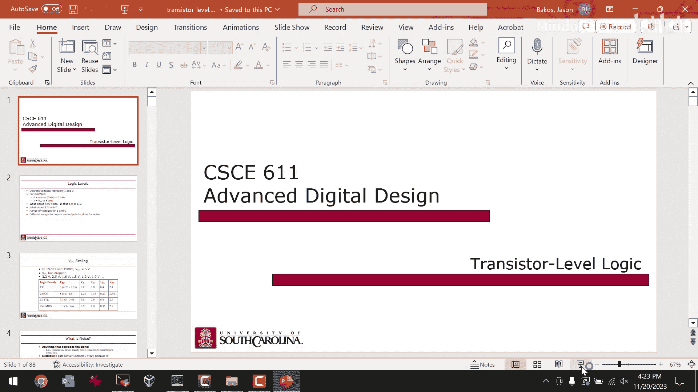
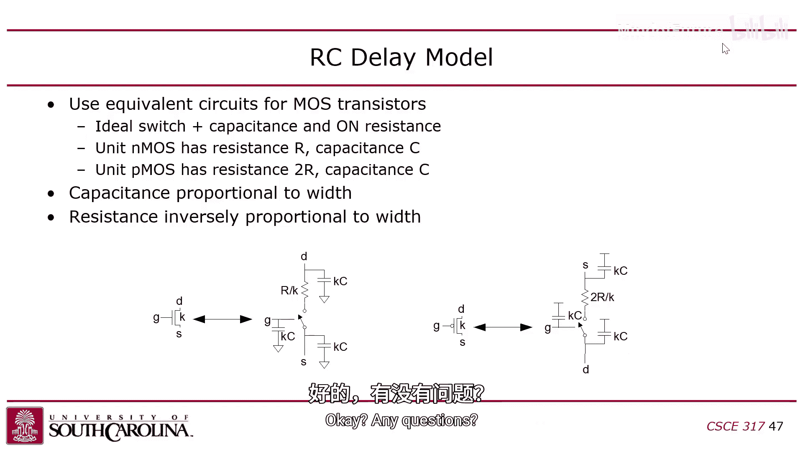

# 高级数字系统设计：CSCE611：CMOS设计（二）🔌

在本节课中，我们将继续学习晶体管级逻辑，即CMOS逻辑设计。我们将深入探讨CMOS的工作原理、功耗计算以及晶体管在不同工作区的行为模型。

## 逻辑电平与噪声容限回顾

上一节我们介绍了逻辑电平和噪声容限。逻辑电平是用于表示0和1的电压值，这些电压值随着技术进步而不断降低。

逻辑门具有“净化”输入噪声的特性。逻辑门将**0到VIL**之间的任何输入电压视为逻辑0，而将**0到VOL**之间的任何输出电压视为逻辑0。由于VIL通常高于VOL，因此输入端的噪声在输出端会被衰减，使其更接近理想的逻辑电平。

高电平侧也有类似情况，即**VIH**和**VOH**。由此产生的**噪声容限**是输出低电平与输入高电平（或输出高电平与输入低电平）之间的差值。只要噪声小于这个容限，电路就能正常工作。

## 半导体与掺杂

现在，我们来看看半导体基础。硅形成晶体晶格，可以通过掺杂杂质来改变其性质。

*   **N型硅**：掺入砷（第5族元素）等施主杂质。砷多出一个电子，这个自由电子成为电荷载流子，使硅的导电性增强。
*   **P型硅**：掺入硼（第3族元素）等受主杂质。硼缺少一个电子，形成一个可移动的“空穴”，它也能作为载流子传导电流，增强导电性。

将P型硅和N型硅结合在一起，就形成了PN结二极管。当P端（阳极）电压高于N端（阴极）时，载流子被吸引至结区，电流从阳极流向阴极（正向偏置）。反之，则形成反向偏置，二极管不导电，但会形成一个电容。

## CMOS晶体管结构与制造

CMOS晶体管制造始于P型衬底。通过光刻和离子注入工艺，在衬底上形成N型扩散区（有源区）。

以下是制造关键步骤：
1.  从P型衬底开始。
2.  使用掩膜覆盖不需要改变的区域。
3.  通过注入砷蒸气等N型杂质，在未掩膜区域形成N型扩散区，从而“反转”该区域的掺杂类型。
4.  在扩散区之间制作栅极，栅极与衬底之间由二氧化硅绝缘层隔开。

当栅极施加正电压（相对于衬底）时，会在栅极下方的P型衬底中吸引少数载流子（电子），形成导电沟道，从而连接两个N型扩散区，使晶体管导通，成为一个电子开关。

## CMOS逻辑门设计

晶体管作为开关，可以通过串联和并联组合来构建逻辑门，形成在特定输入组合下导通或关断的路径。

*   **串联**：两个NMOS晶体管串联，两者的栅极都必须为高电平，整个网络才会导通。
*   **并联**：两个NMOS晶体管并联，任一栅极为高电平，网络即可导通。

以与非门（NAND）为例：
*   **上拉网络**：两个PMOS晶体管并联，连接在输出端和VDD之间。
*   **下拉网络**：两个NMOS晶体管串联，连接在输出端和地之间。

只有当两个输入均为高电平时，下拉网络的两个NMOS才全部导通，将输出拉低至地（逻辑0）。对于其他任何输入组合，至少有一个PMOS导通，将输出拉高至VDD（逻辑1）。上拉和下拉网络是互斥的，稳态下输出不会同时连接到VDD和地。

**动态功耗**主要发生在输入切换的瞬间，此时上拉和下拉网络可能短暂同时导通，产生从电源到地的电流尖峰。**静态功耗**则是指稳态下的泄漏电流，现代芯片因工作电压接近阈值电压，泄漏问题更为突出。

## 传输门与功耗计算

由于PMOS传递低电平、NMOS传递高电平的效果不佳，**传输门**将两者并联使用，以确保无论传递高电平还是低电平，都有良好的导通性。

功耗计算至关重要，主要包括两部分：

1.  **动态功耗**：由电路切换时对电容充放电引起。
    *   **公式**：`P_dynamic = (1/2) * C * VDD² * f`
    *   其中，`C`为总负载电容，`VDD`为电源电压，`f`为开关频率。功耗与电压的平方成正比，因此降低电压是减少动态功耗的有效方法。

2.  **静态功耗**：由晶体管关断时的泄漏电流引起。
    *   **公式**：`P_static = I_leakage * VDD`
    *   其中，`I_leakage`为总泄漏电流。

**总功耗**为两者之和：`P_total = P_dynamic + P_static`。

## 晶体管工作区与电流模型

理解晶体管行为需要分析其三个工作区：

1.  **截止区**：栅源电压 `VGS` 低于阈值电压 `VT`，无导电沟道，漏源电流 `IDS` 几乎为零。
2.  **线性区（三极管区）**：`VGS > VT` 且 `VDS` 较小。晶体管像可变电阻，`IDS` 随 `VDS` 线性增加。
    *   **电流公式**：`IDS = β * [(VGS - VT) * VDS - (1/2) * VDS²]` （近似）
3.  **饱和区**：`VGS > VT` 且 `VDS` 增大到一定程度（`VDS > VGS - VT`）。沟道在漏端出现夹断，`IDS` 基本保持恒定，不再随 `VDS` 增加，晶体管如同恒流源。
    *   **电流公式**：`IDS = (1/2) * β * (VGS - VT)²`

其中，**β** 是工艺跨导参数，`β = μ * Cox * (W/L)`。`μ` 为载流子迁移率，`Cox` 为单位面积栅氧电容，`W` 和 `L` 分别为沟道宽度和长度。

由于空穴迁移率低于电子迁移率，PMOS的 `μ` 约为NMOS的一半。为了平衡上升和下降时间，通常将PMOS的沟道宽度 `W` 设计为NMOS的2倍。

## 总结

本节课我们一起深入学习了CMOS设计的核心内容。我们回顾了噪声容限的概念，探讨了半导体掺杂与晶体管制造原理。我们掌握了如何使用NMOS和PMOS晶体管构建基本逻辑门（如与非门），并理解了上拉和下拉网络的工作原理。此外，我们还学习了传输门的用途，以及如何计算CMOS电路的动态功耗和静态功耗。最后，我们分析了MOSFET的三个工作区（截止、线性、饱和）及其电流-电压特性模型，并了解了为何PMOS晶体管通常需要更宽的沟道宽度。在接下来的课程中，我们将利用这些知识来估算电路的延迟。