# 【南卡罗来纳大学】高级数字系统设计-CSCE611-（Advanced-Digital-Design，Fall-2023）-p16-P16-CMOS-Design-3--BV19nf6YoEZ9_p16-

Okay， everyone， let's get started， so this will be the last lecture with new material in it our next lecture I'll just do a review for the final exam I that okay。

嗯。Any problems with the project？Okay， so last time we were talking about CMmos logic。

And I covered noise noise margins， which is the amount of noise you can tolerate on wires in order to。

嗯。When you have noise affecting and already possibly noisy output from a driver gate in order to。

Avoid having the input go into the forbidden zone。 and the forbidden zone is the voltage between。

What's considered a。Low voltage for the input。 So that's VL。

 So anything that's VL or below is considered as logic 0。

 anything that's VIH or above is a logic high for the input。

 And so the difference between VL and VIH is fairly small。

 So there's there's a forbidden zone there that's。Fairly small because the way that the logic gates work is that。

The output voltage is or the forbidden zone for the output voltage is essentially much wider because。

Even if you give it of input voltage as high as VIL。

 the output for that is only you know is not that is not that。

Is not that high of a voltage as compared to VL to make that sense。 So in other words， the point is。

 is that there's a fairly small gap between VL and VH as compared to V OL and V OH。

 this is the logic 0 and logic one for the output for gate。 So if you're if you have noise。

Affecting the wire。嗯。You just have to keep the noise between below the difference of。For example。

 the VIL of this guy and the VOL of this guy or conversely you have to keep it between the VIH and VOH right Does it make sense？

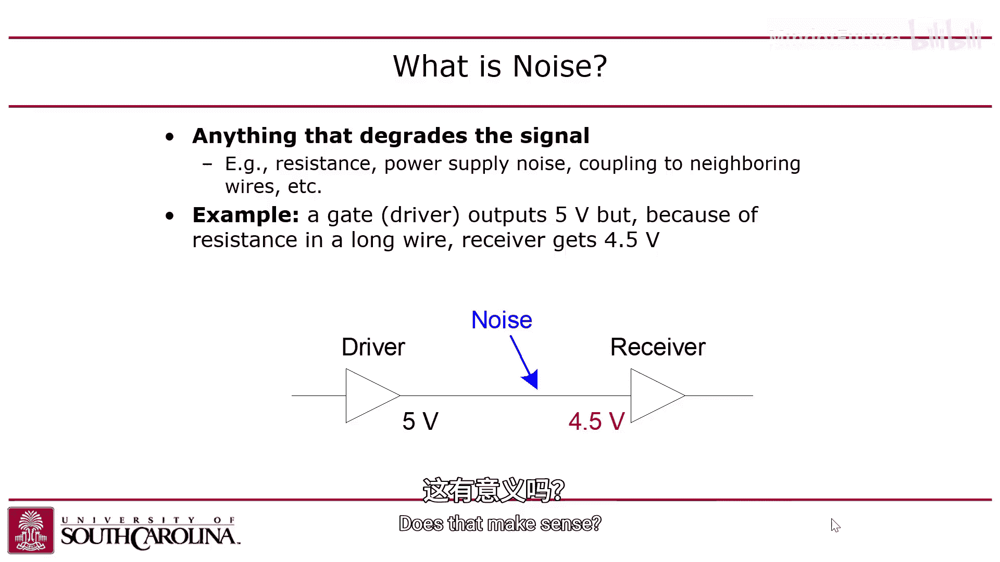

Okay， so that's the noise margin。

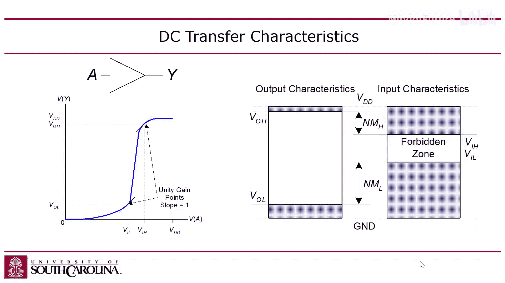

Then we talked about semiconductors and transistor structures。

And so this is the cross sectional view of the P or sorry， the N MoOSs and the P MoOSs。

And the idea is that you've got a gate， a channel and a source and drain。

 And then there's a fourth terminal， which is the。The body terminal， the bulk。

 that's the substrate underneath。

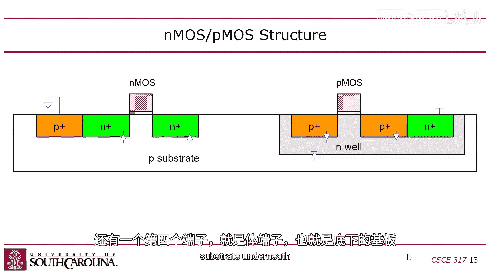

And。The idea is that you want to turn on the transistor， you charge or you apply in this case。

 a voltage to the gate。Now initially。The gate channel voltage is going to be the channels in this case is grounded。

And so you basically have a capacitor here where you've got one terminal on the gate and another terminal。

Is the is the substrate， the bulk， but what ends up happening after you apply。

 after you start accumulating charge there， you get the minority charge carriers in the channel。

 which decouples the channel。It decouples the channel from the substrate。

And so the voltage of the channel。Is no longer ground。The vulture of the channel is now。You know。

 an average of the source and drain because there's a connection there。

 so it becomes a little bit less straightforward to calculate the the gate channel voltage。Okay。

 so then we talked about how you build CMss gates， you have the pull up network and the pull down network。

 the pull up network are is a Pmasssses。That turn on with a logic zero and the pull down network are N mosses that turn on with the logic one。

And the two networks are complementary from one another。 So， for example， if you have。

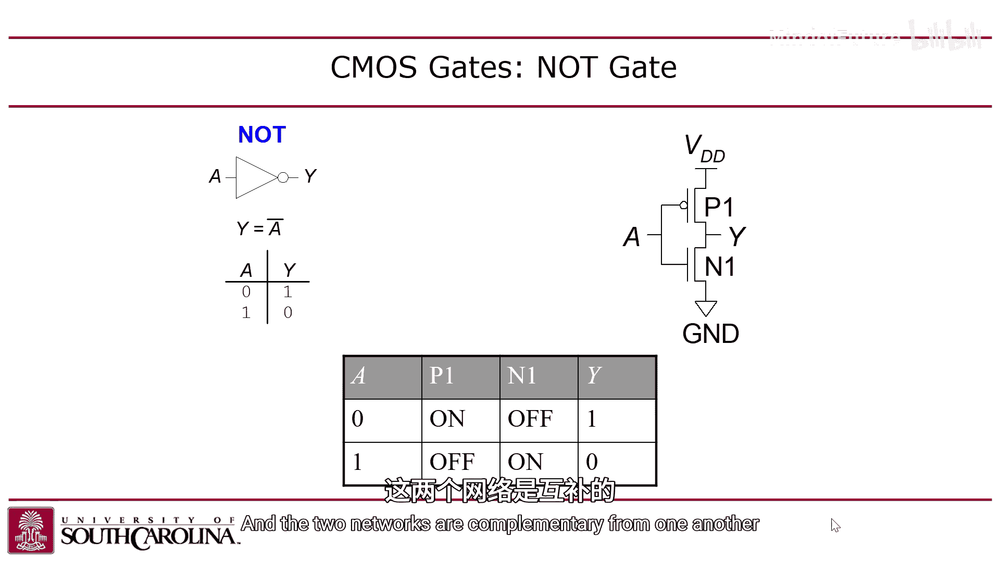

The two P mosses on the pull up network in parallel than the two N mosses on the pull down network should be in series。

And then we talked about how in order to pull the output down to ground。

 you need to have at least one in the inputs。you need to have and that doesn't apply to this gate specifically but in general。

 you have to be able to in order to pull the output down to ground。

 you need to have at least one logic high on your input and likewise the pool of the logic high you need to have one at least one logic zero and that's just because the N mosses are the pull down and the Pmasses are the pull up。

So we looked at the this is a Nand gate and an Nora gate。

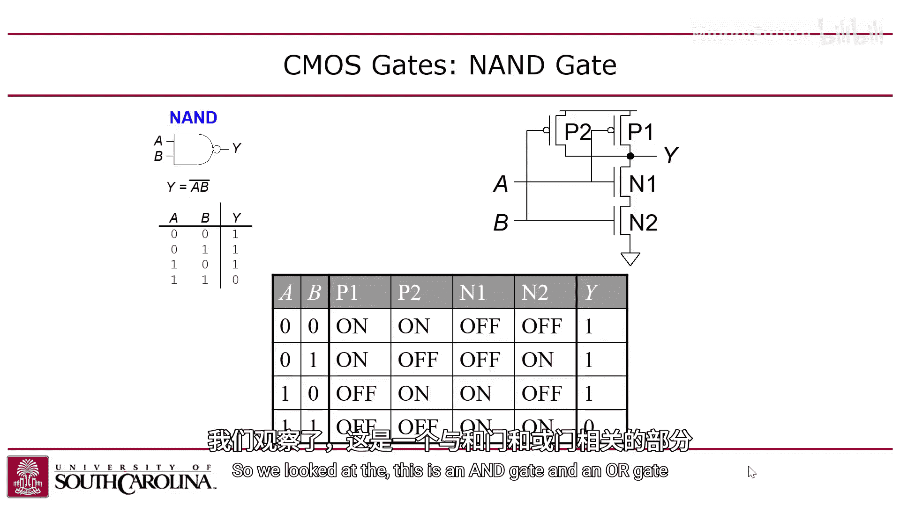

And then we talked about transmission gates， which is where either're used for tri state buffers。

 this is a transmission gate as a way to electrically disconnect。Two terminal。

 so we have an a terminal and B terminal and we want to be able to either connect them or disconnect them。

 So in that case you'd have to use a P mos and an N moss in parallel because that way。

TheThe basically the PmaOSs is designed to carry a zero across these terminals and the NOSs is designed to carry the one across the terminals right。

Sorry， I had that reverse， sorry， the POS carries the one and the MOS carries a zero。

 sorry I had that wrong。So。Then we talked about power consumption and there's there's dynamic power consumption is when you。

You switch a gate from pulling down to pulling up from pulling。Up to pulling down right。

 And so you've got like。Kind of a temporary short。So you can estimate the dynamic power consumption as one half。

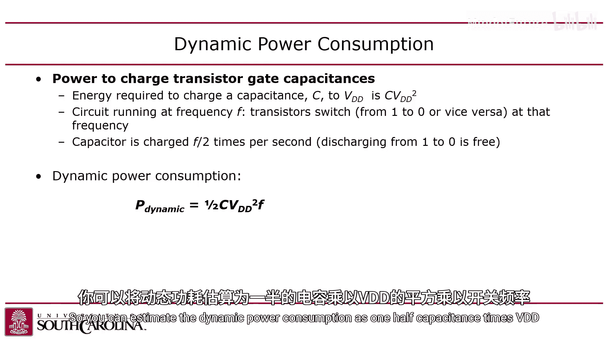

Capacitance times VDD squared times the switching frequency。

And then static power consumption is a little less straightforward to calculate。Because that's the。

The the current that。Flows from。Powered to the ground rail。Without the gate switching。

So that's just the leakage current multiplied by the voltage。Okay， so we had an example of that。

 and then we switched back to talking about MosFts and。I mentioned that。The thing to understand here。

 there's a couple things actually， so's there's three operating regions， there's the cutoff region。

 which is where the transistor is turned off。That's when the gate。The gate voltage。

Relative to the in this case， the。The body， the substrate， is less than the threshold。

 which is usually like 70s。Millivols or so。 So that's the cutoff。 That's when it's。

The transistor is off。 Now， I mentioned that the static power consumption comes from the fact that even when it's off。

 you know， there's still some current that can flow from source to drain。But。But very little。

 So when the transistor is in the cut off， it will have a。Basically a very high effective resistance。

Now， when the gate voltage relative to the body hits the threshold。

 you go into you turn the transistor on and once it's on。

It can be either in linear or saturation mode。But that depends not on the。

That doesn't what mode it's in doesn't depend on the gate voltage。

 what it depends on is the voltage drop。Between the source and drain。

 So in linear mode is when you have the transistor on。

Meaning that you have an inversion layer in the channel。

So you have this inversion layer in the channel。Meaning that。

The channel becomes decoupled from the body and you start basically connecting the source and drain。

And it's done through the charge carriers in the inversion region。嗯。So you have it on。And as you。

Increase the voltage difference between the source and the drain， the current that flows through。

The transistor。Increases linearly。Kind of linearly， right？Kind of like a resistor， right。

 so more voltage， you get more current， however， at a certain point。The problem is， is that。

You'll eventually， as you increase the source drain voltage。The gate。Channel voltage。

Starts to get pinched off。Near。The gate with the higher voltage。Sorry。

 near the trumudent with the higher voltage。And the reason is， again， because the channel。

The channel voltage， sorry， the channel voltage。Is is a gradient right from that that that I mean you have an average。

 you know， it's average between the source and drain because remember the source and drain。

 the channel is basically like a wire you think of as a wire right So if I put a big drop between these two guys。

The voltage along that wire is going to is going to start out at one side and then it's going to gradually decrease until it hits the other side。

 Well what that does is that that takes the gate channel voltage towards the part with the higher voltage and it sort of pinches it off。

Right so you end up not having a big difference here between gate and channel on one side and so that when that happens that's called the the saturation mode。

 at which point the transistor will keep conducting keep it'll keep conducting current but the current won't change even as you continue increasing the voltage because that's the。

Sauration region。U。😊。

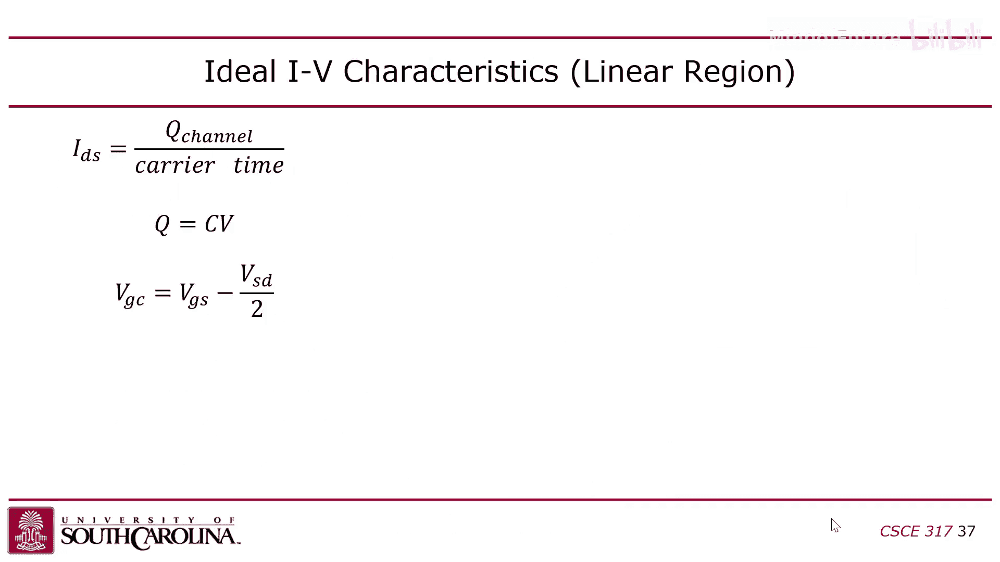

Makes sense。Yes guys with me， so there's a limit on how much current。

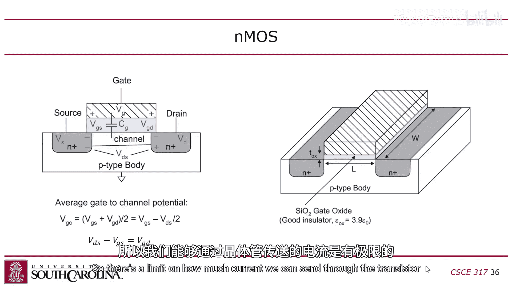

We can send through the transistor。Okay， so then I derive the the IV characteristics。

 but the really the important point is here is that。

This equation gives the current drain source current as a function of the gate source and the drain source。

 and this is for the linear region。So so basically the gate source minus the threshold voltage is you know is one factor。

 and then the drain source is another。 and then you have this beta which is。It's a mixture between。

The carrier mobility mu。And。😊，The capacitance of the oxide。

 which is that glass that's in between that's underneath the gate。

So these are technology dependent things， you can't change these。

But then you have the width and the length。 Those are not technology dependent。

 are that's up to the designer。 You can set the width and length to whatever you want it to be。

Generally， the length。Is minimized， you want the length to be as small as possible。

But the width is something you can change。In order to。Well， I mean。

 you can see what is that doing exactly？If I increase the width， that it increases this beta value。

 which is going to give me more current， right， So if you want more current。

You can increase the width。Okay so now once you hit the saturation region though。

 then the current is no longer a function of the drain source。

 the drain source voltage is out of the equation and now it's only a function of VGS minus VT the threshold right so cutoff is zero although。

That's not。That's not entirely correct。 There's， you know。

 that doesn't that just assumes that's kind of a simplified model，  zero current for cutoff region。

 linearar region is。Well， it's not really linear right。

 because you've got VDS squared here right and then the cutoff is just。

 you know it's when the transistor becomes a current source。Okay。W。One thing you have to， Oh yeah。

 so here's。You can see that the linear region isn't。Isn't。It's kind of linear， right。

 It looks kind of linear。 right， This is the linear。 So when the gate source voltage is 1。8。

And you increase the drain source of voltage。You start to。You know。

 it increases kind of linearly and then it reaches the saturation point it levels off right and then each of these curves depends on the gate source voltage so you get different curves。

 so at 600 millivvolts，You know， you're basically in cutoff right。

 This is a cutoff region because we're below the threshold here， so this line is flat。Right。At 0。9。

 which is just above the threshold。嗯。You know， it looks like you saturate around， you know。

 500 millivols drain source or so。And then at 1。8， which is where you have it wide open。

 you saturate around 1。2 volts。And then so that's NOSs and then P moss。

 that's very similar except these。

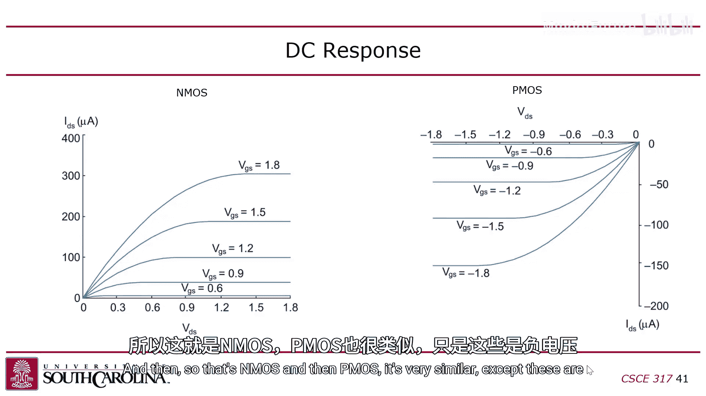

Are negative， negative voltages。

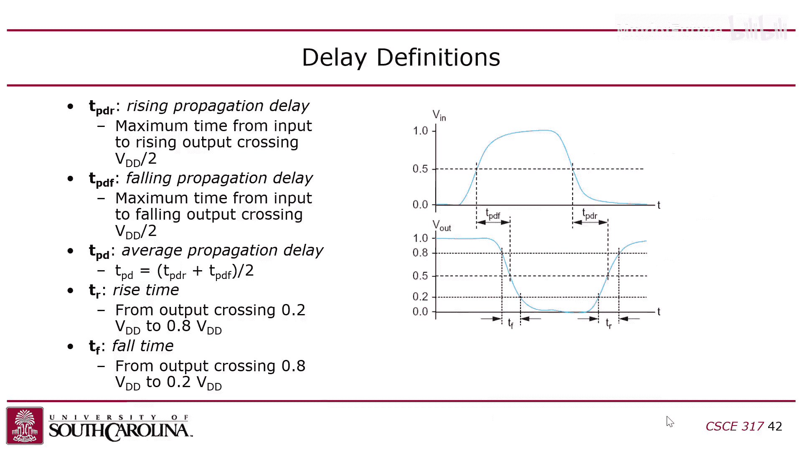

Okay， does that make sense， everyone clear on that？Okay， so one thing I want to。Mention here is。

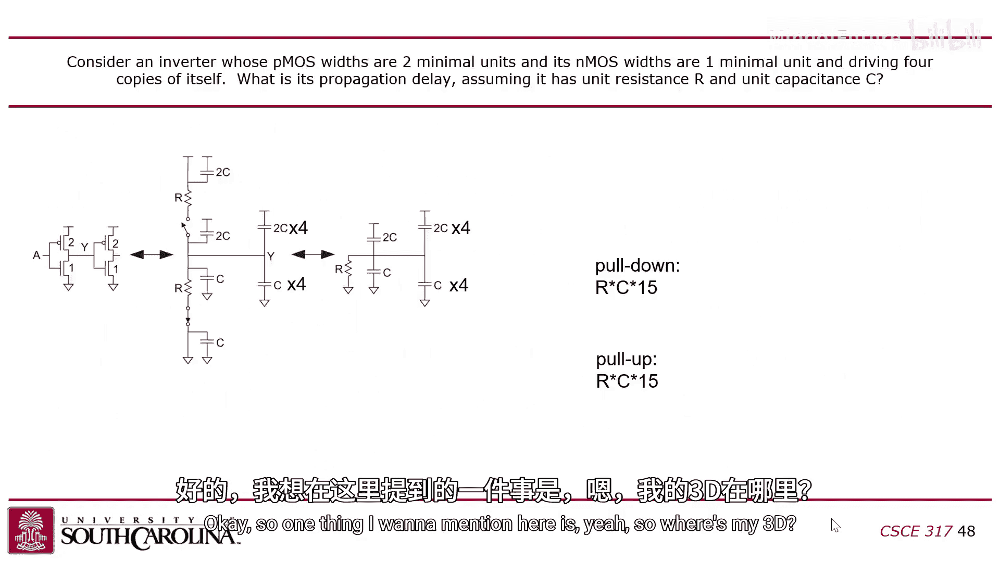

Yeah， so。

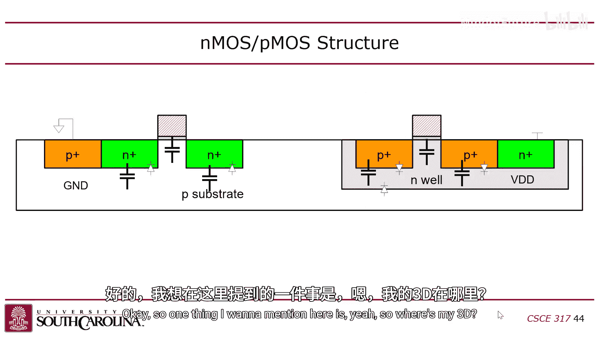

Where's my 3D？

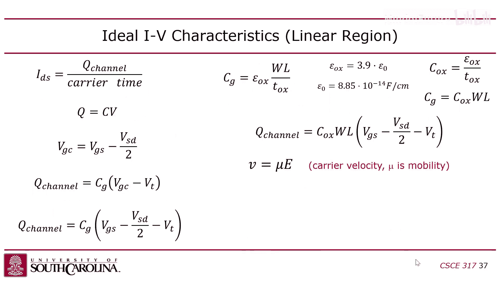

Oh， come on， I didn't delete that， did I Yeah， here we go。As I mentioned， the length。Generally。

 you want to have this length to be as short as possible。

So this is the length is what you hear about when you hear like a seven nanometer process or a four nanometer process。

 now as I mentioned， it used to be like if you had a 45 nanometer process or a 28 nanometer process。

 that was referring to this length。The the minimum feature size nowadays when they say。

 I think Intel is down to a four nanometer。I mentioned that that's an equivalent。

 it's not actually the technology， the fabrication technology node does not relate directly to this channel with or sorry channel length anymore right it's more of an equivalency and the reason is because there's just I mean four nanometers。

That's like。You know， eight eight atoms that's really small right but but the idea is is that you want to make that channel as small as possible because the smaller the channel is the faster you get you get the carriage carriers across the channel to carry the current the width on the other hand is this dimension。

And the width。Is generally， you're going to adjust the width。To make the transistor。嗯。

You're going to get more current。Out of the transistor。When you make it wider。Now。

 why would you want to do that， why would you care about how much current？

You can get through the transistor。NowYou think about this。What is the transistor doing ultimately？

It's it's driving the output of a logic gate， right。

 It's pulling down or it's pulling down to ground or pulling up to VDD。Right。

And then that output is connected to inputs of other gates， and those inputs are connected to gates。

 right， and gates or capacitors。So capacitors。嗯。Why would we want more current into a capacitor？

I one current d here repeat its down。I believe， so that means like whatever you're pushing through this resistor。

 you want to have more capacitance so you can keep your repeats down to power the rest of your circuit。

Well， the capacitor so the capacitor is。Ass part of the Gates operation， right。When I switch。

 when I have a gate and I switch from zero to1 or1 to zero。

What I'm really doing is charging or discharging the capacitors that are on the output of that gate。

 right， So， you know， your your your outputs are connected to one of these guys and so。

My goal my goal is。To。To charge up the capacitors that form the gates of my outputs or to discharge them as fast as possible and。

I can do that faster if I have more current， right， If I've got more current coming out of my。Either。

Either now there's two options here， right， either you have more current coming from VDD down through your Pmoss is out。

 right？Or。You have more current。Coming back。From the output gate down through my N mosses down to ground。

 So either I'm sending current to my outputs through my P mosses。

Or I'm sinking current back through my end mosses， right， So either I'm sending， I'm pulling up。

 which means I'm charging up my load capacitors or I'm discharging my load capacitors， right。

 the more current。And this only happens during a transition once it's discharged， then nothing。

 it's pretty much。But this is the dynamic power consumption part。嗯。So yeah。

 it's basically the idea is that I'm charging up these gates or I'm discharging。

 I need a lot of current to do that faster。 So what that means is that if I want my circuit to be faster。

 I just make the transistors wider right so I can increase this with。By increasing that width。

 I can drive more capacitance。Faster， I can charge and discharge faster。

So that's one of the things that one of the tricks you can play is usually the width is five times the length for。

An N moss and 10 times the length for the P moss generally right So if if this is a 45 nanometer length。

 then the width will be 450 nanoms。 if it's a Pmoss， right in half that for an N moss， right。

 but that's the minimum size， I can make this a stronger transistor by widening it。

 if I widen it beyond the minimums， I still keep the length minimum。 But if I widen it。

I get more power， I get more drive strength right so and you can see that in the equation。

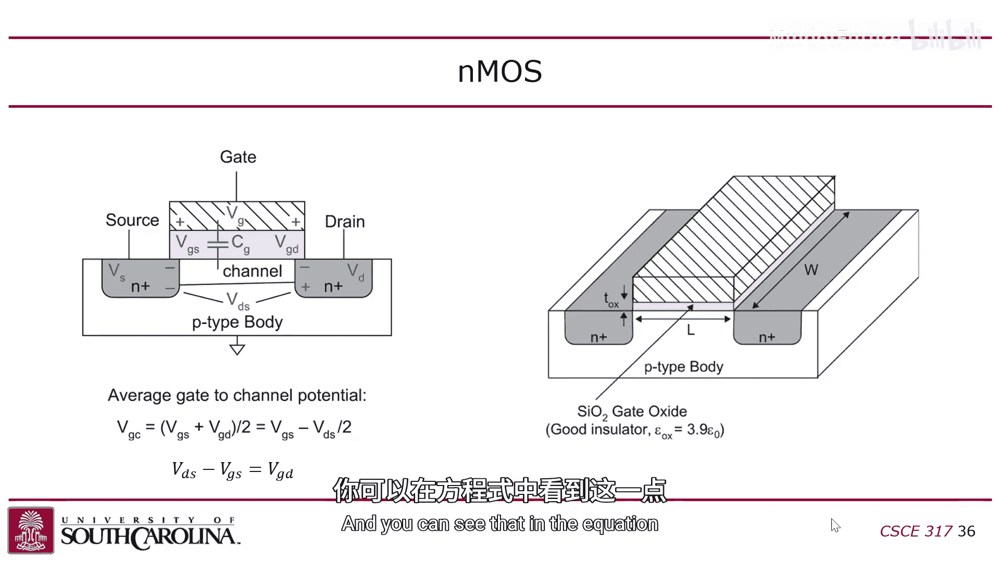

So hold on， if we go back to the。

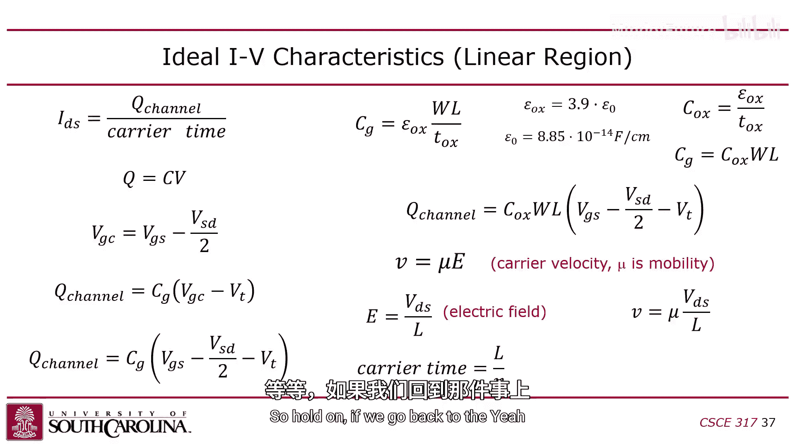

Yeah， so the now notice that the。The current。Is scaled by this beta term。

And the length is in the denominator， right， So I want this to be， I want， I want the current。

 I want higher current。嗯。So I want this length to be minimized。 I want this width to be， well。

 I can increase the width for more current， right， That's basically the idea。ok。Um。And that applies。

 by the way， too。Even to linear or saturation mode either one， right。

 so even if I'm in saturation mode， which I probably will be right on a transition， right？

Because think about it。If I'm pulling up。I have a gate that's pulling up， and its output is one。

 and I want to switch it to 0。When I switch the pull down network on and the pull up network off right after I do that。

The voltage drop。My source gain， my source drain voltage drop is basically going be VDD。

 I'm going to start out with a heck of a voltage drop right because I've got the output。

 the gates that I'm driving is one。 and I got to pull them down to zero。

 So I'm going go into saturation mode almost instantly right after I transition right And so you know but even in saturation mode。

 you still have that beta term。 And remember beta is you know。

 with over length right So then once once I get it low enough， once I start to。

Once I start to get that output down closer to zero。

 then I'll go into linear mode right and then I'll basically stay in linear mode right and then my pull up network will be in cutoff mode right okay so I can make the width。

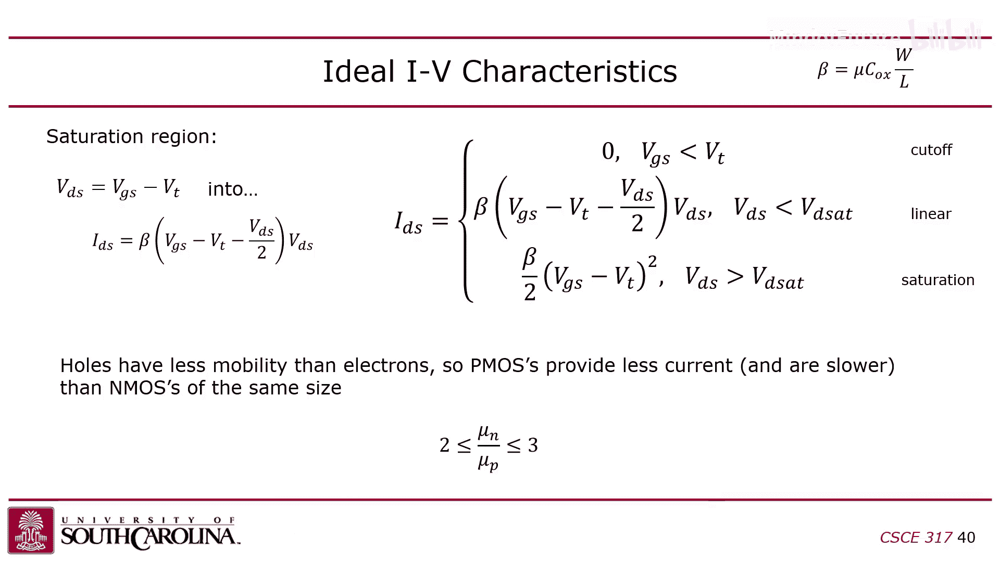

I can increase the width， right， however， there is a consequence of doing that。

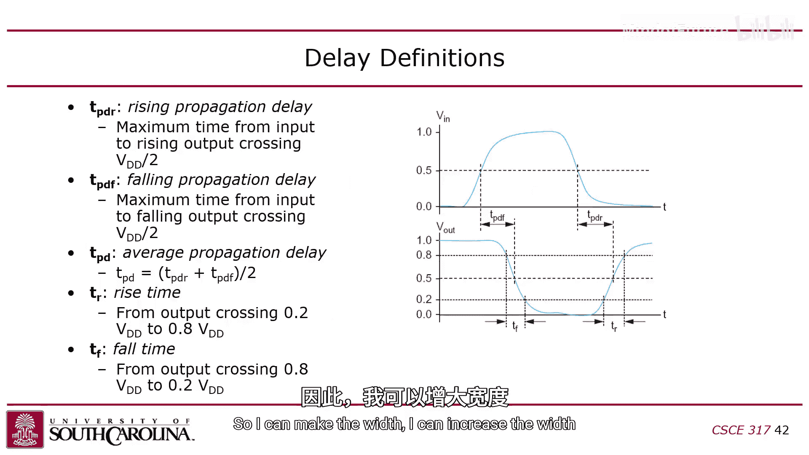

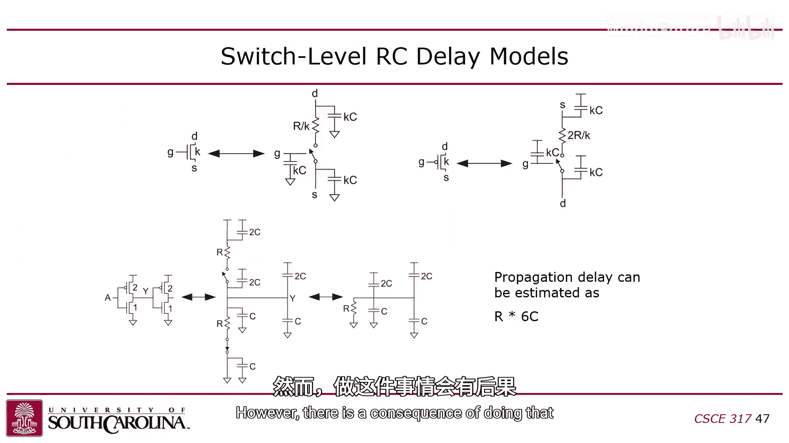

嗯。The consequence of that is。That。If you make the width bigger。

You also make the width of the channel bigger， you also make the width of the gate。The gate bigger。

 right？Now， I'm assuming we're doing this all uniformly， right， I mean。

 because I could make the width bigger on my driving。Gate。

 but I could keep it small on my downstream gate， you know， the one on the output。

 But let's say I increase the widths all uniformly， all my gates。 I make all my gates wider。

 What's going to happen is that I'm going to get more current。

 but the consequence of that is the area under this gate gets larger as well， right。

 And that increases the capacitance of the gate。So。

I kind of start working against myself because I get more current。But at the same time。

 I'm also increasing the capacitive load。For the gate， right， and not only that。

 but the source and drain terminals， the source and drain diffusion area， they have to get wider。

 their width is the same as the width of the channel。 And it's not's not。

 it's impossible to tell that from that diagram。

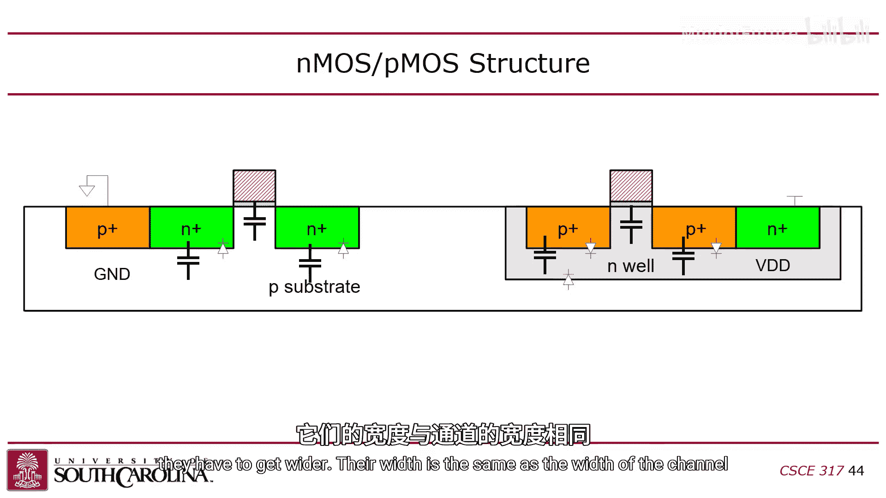

But if we look at that three dimensional picture I've got， it's a little bit more obvious there。

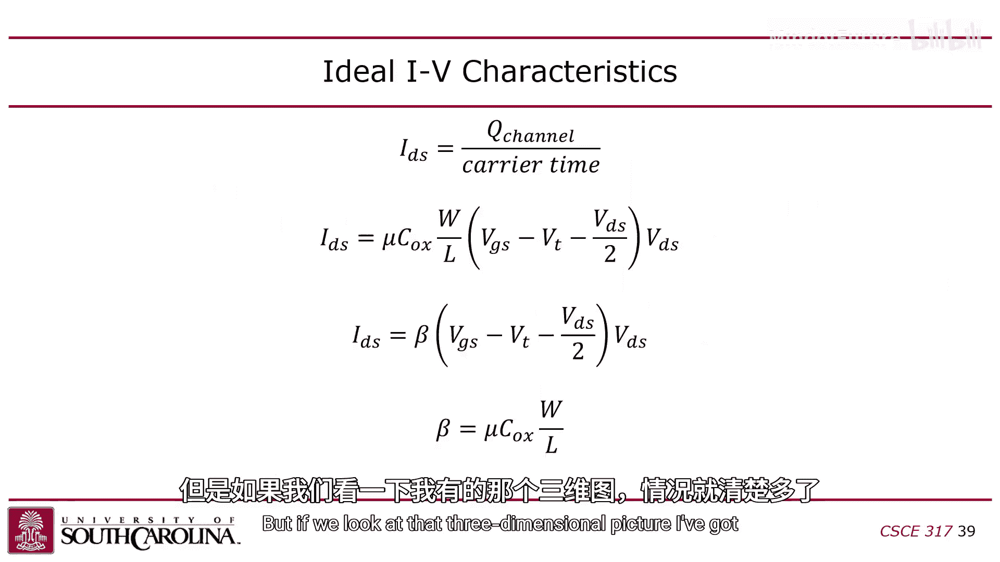

Yeah， so if you look at the three dimensional picture， you can see that the source and drain。

Willll also get bigger， theirwith is the same。Theirwith is the same as the gate width， right？

And what happens there is。

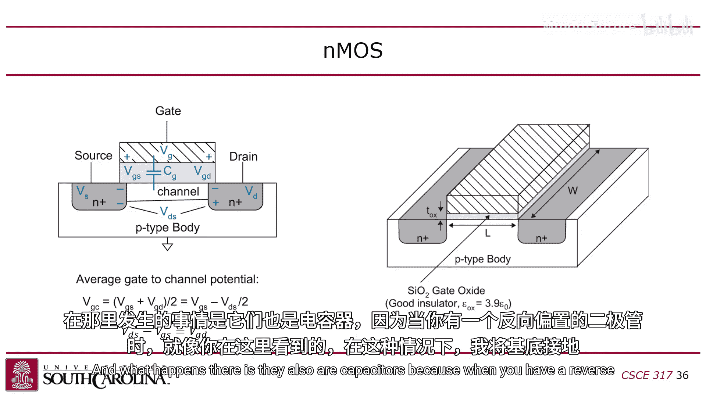

They also are capacitors because。When you have a reverse biased diode。As you have here。

You know like I in this case I ground the substrate right。

 so this is this P is at a lower voltage than these two guys。

Which means that the diode that's formed from this P to this end is reverse biased。

So they're not connected， even though they're right up against each other。

 they're not connected electrically。 However， they still form capacitors。

Because of reverse bias diode。Is actually a capacitor。Right， you might say， no， it's not capacitors。

 two conductors separated by an insulator。 That's not what that is。 Well， that's true。

 But a reverse a reverse bias diode does have an insulator。 The insulator is。The junction。

 where the charge carriers move away from the junction in a reverse biasing。

 that becomes an insulator effectively。The charge carriers， it's almost like you know。

 when the charge carriers move away from the junction because of the reverse biasing， know。This is。嗯。

You know， P is this P is lower voltage than this n， right？

So to send data through a diode P has to be positive versus the n。

 but it's negative because it's a lower voltage than the N right So what ends up happening is that the charge carriers in this end get pushed away from the substrate and the charge carriers in the substrate gets pushed away So because they get pushed away。

 it creates a kind of a dielectric， it becomes the middle of a capacitor right So as I make as I make the transistor wider。

 I get a bigger capacitor here。 I get a bigger capacitor here and I get a bigger capacitor here right So I really get I get a lot more capacitance with wider。

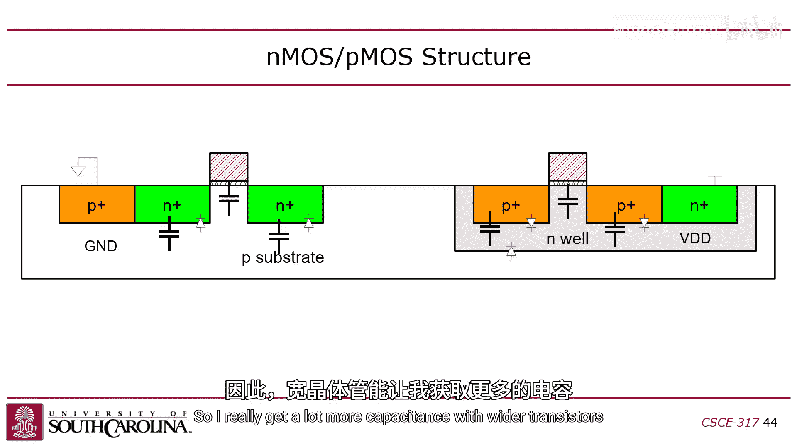

Transistors。So well first of all， how do you make wider transistors。

 so there's a couple ways to do it。There's a couple tricks。

 And so this this is probably this will be a little bit confusing because I haven't shown much top down pictures。

 I've showed the cutaway pictures。 but this is when you design a chip for manufacturing。

 it gets designed。 the design looks like this because it's designed from the top you're looking from the top down right。

 and what you're seeing are these polygons and each polygon represents a layer So。嗯。

So what happens is is that。You can see that you've got。You've got。

There's a square here and a square here， right， these are source and drain diffusion areas。ok。

Actually。Actually， let me take that back。It's kind of hard to see。

 but it's actually this rectangle of gray。That's actually the diffusion area， right？

And then these squares are actually。嗯。Contacts。And the contacts connect the diffusion area to a wire。

 The wires aren't actually shown here。 I don't have the wires here， but you have to。

 you have to have a wire that goes down and touches。The drain and the source。

 And that happens to these little black boxes。 These are Vs， right。

And the square is actually metal around the via， so you have metal via， which is a whole。

Through the oxide。And then diffusion， right， so metal hole diffusion， right。

 So that's how I contact a wire down to the source and drank。And then this guy。

 the little horizontal piece， is polysilicon， that's the gate。You guys with me？And you might say。

 wait， what where's the glass， I thought you said there was supposed to be oxide。 Yeah。

 the oxide is actually applied everywhere。Actually that wasn't shown in the cutaway very well。

 let me clarify that。

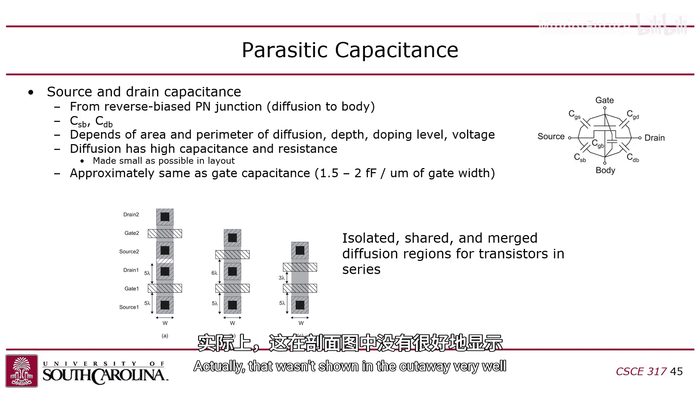

So notice how。The oxide in this picture is just shown right there。 that's actually not accurate。

 The oxide is everywhere。 This oxide covers everything， except where you have a contact。

So there'll be a contact here above here that will allow。That will be a hole of of oxide。

 leave a hole of The oxide will be There will be a hole where there's no oxide。

 And then you put metal on top of there to actually connect a metal wire down， right。

 So this is a little misleading。 This little gray area。 It's not just under the gate。

 It's everywhere。It's everywhere you don't put explicitly put a hole in the oxide。

 Does it make sense。 Okay， so now you might say wait a minute then， hold on。

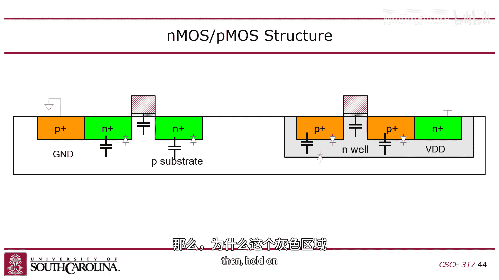

Then why？Why is this gray？It looks like the diffusion area is under the gate。But it's not。

 It only looks that way。 What ends up happening is that that polysilicon is put down。U。

I forget how they diffuse it。The diffusion area is not actually under that gate。

 I forget exactly how the steps are， but the way they deposit the layers on there when they fabricate。

 even though it looks like there's a one continuous slab of diffusion。

 it's actually this this polysilion layer actually blocks the diffusion underneath of it。

 So it makes sense Okay， so what ends up happening is that the bottom line is that's the gate and this is the source and drain right but just looking from the top down right Now if I want to make a wider。

嗯。Now， by the way， too， the length is this part。And the width is this part， see it's labeled。

You can see the width is labeled here。 So the length is the this is the width。

 and this is the length， the vertical， right， the vertical size of the of this gate， right。

Which would also be the length of the channel under the gate， right？Okay。

 so I can put two transistors in parallel。嗯。Here。You might say have those in parallel because the idea is that I would this gate would be connected。

 I would this would be one net I would I would short these two gates right and so。

This side would go to VDD， this side would go to VDD in the middle。

Would go out right And so this would be essentially two gates in parallel。

 That's one that's one thing you can do or you can take a shortcut where these two。

 instead of having a wire connected to the source and drain of these two guys。

 you can just have them overlapping with just one contact right that's more efficient or more efficient yet。

 you can literally create。wo。Parallel transistors just by having essentially two。Two gates， right。

 two gates on one。Over one diffusion area。 so that's isolated， shared in merge diffusion regions。嗯。

Oh， actually， these are first in series in this case。Yeah， these are sorry I'm putting these in。

 well that works too， if you have separate signals controlling these guys。Right。Okay。Okay。

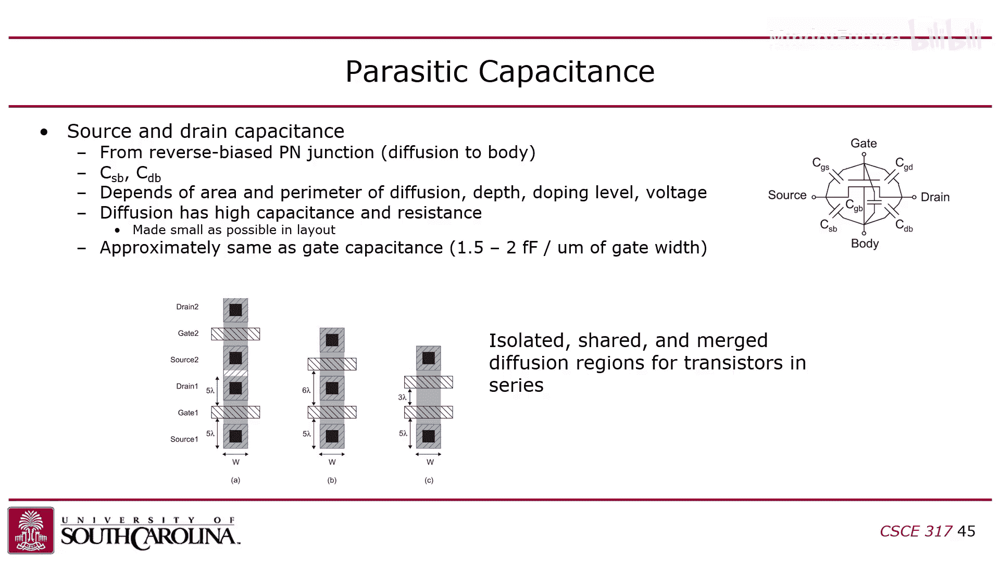

All right， so what， why do we care about all these capacitances。Well， I mentioned this before。

 but the。The delay of a logic。The CMmos circuit depends on the resistance and capacitance。嗯。

That thats seen when you switch。嗯。And so it's kind of complicated because。You know。

 you can increase the strength。Of a。Of a gate and you know you have these。

 you have to calculate the basically the delay。So。One simple way to do this is and you can do this。

 I mean， obviously the way that。One way to do it is just run run through spice。 So in spice。

 you know， you can have a transistor model there， and then you can set up these transistor level circuits and spice and run it。

 In that case， Sp is going to have a model transistor model。

 And that model is essentially what I what I showed you or similar to what I showed you with the IV。

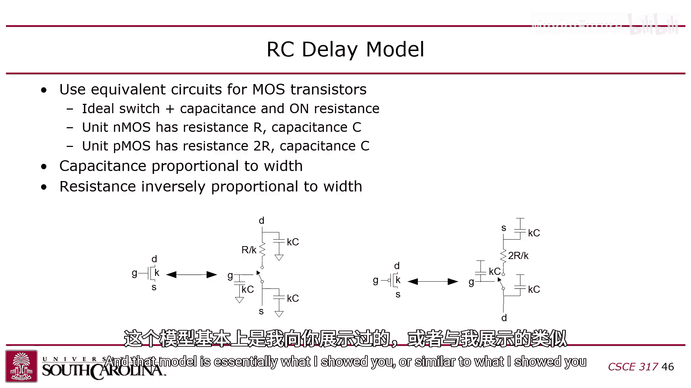

You know， this is the model。 So the problem is， is that。This model is not a linear model。

So if you try to， if you have a circuit， bless you， if you have a circuit in spice。

You have to solve the circuit， you know， like using Kra cost voltage law。

 Kraov's current law and Oms law， right， But the problem is is that。嗯。

These currents coming out through these transistors are not linear， there's no way to。

 I mean I've heard that there's a way to model this linearly or at least as a unified equation。

 you know instead of like having three considering all three operating regions。

It's called theber Eber moles model， but Spice just uses a model like this that that you know literally every transistor is in one of these three modes depending on。

嗯。Depending on the drain source and this voltage saturation voltage。嗯。And so it'll， anyway。

 it's expensive。 A simplified way to do it is to use a。

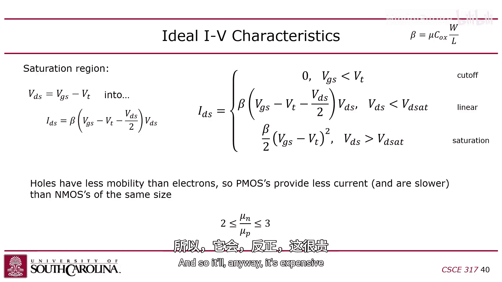

An RC delay model。嗯。So。If you consider a。嗯。transranistor。

So you have a gate drain and source terminal， and if you consider the width of the transistor as k。

So K is basically the number of minimal width， so generally you have a minimal width， as I mentioned。

 it's like it's going to be five times。The length， the minimal length， right？

And then if you want to make a bigger one， you can make a double size， a triple size。

 a quadruple size right and so that's K it's just the number of widths。

 a multiple of the number of widths of the minimal width right and so that's going to basically determine your strength。

 your drive strength of that transistor。嗯。So if you consider that transistor just to be using a switch。

 like pretend it's a switch。Then。What happens is that the effective resistance。

Is going to be the base resistance， will the resistance of the minimal size transistor divided by k。

 So this way I can， you know if I double my K2， then effectively I'm going to have my resistance right So the strength of the transistor is now basically a resistance value right。

Because。Basically。嗯。Now， the transistor acts like a resistor in linear mode and saturation mode。

 it doesn't， that's why this is not a really super accurate model。

 but you could think of the transistor as being as having essentially an on resistance is the idea。

Does it make sense？Okay， and then。You have three capacitors inside there。

 there's one capacitor that's the gate capacitance。

 and so any gate that drives this guy is going to see its gate capacitance。Then you have。A。

Capacitor from。Source。To ground。And from the drain。To ground， this is for an en moss。

You guys with me right， why because because the ground here is is the substrate， it's the bulk。

 it's the body， right， it's the body is grounded for this guy。 But remember for a pimos。

 it's the opposite， a pimos has a capacitor for the source and drain。

But it's to VDD because it's the well， it substrate is the VDD。Likewise。

 its gate is a capacitor to VDD as well。Guys with me right now the resistance though， notice is。2 R。

The reason for that is that in a PMOSs transistor， the carriers have half the mobility of the carriers in an N moss。

 so in almost every fabrication process， every cell library I've seen。

 or I should say every technology library I've seen。

 usually the width of the POSssses are twice that as the NOSsses in order to create a balanced。

You know， in order to balance them， you guys with me， okay so。Okay， so。

So now let's say you build a logic gate。 So let's build an inverter。So an inverter is going to have。

A pull down and a pull up transistor。 So we take the transistor model that I just showed you for both N moss and P moss。

 and we substitute them into the inverter。 So we have the pull down and the pull up。You guys with me。

 Okay， so you've got。You got the inverter here， and then I'm going to it I'm going to have this inverter drive another inverter。

 Now， you might say， well why， why is that important。 Well， in order to calculate the delay。

 you have to put a load on this guy。 You can't just have an inverter and give a delay because that delay is going to depend on what it's driving what' what it's sending its output into。

 So we have to have two in this case， we have two inverters。

 we have a is the input to the first inverter。 its output is y。

 which is then fed into the input of the second inverter right okay so。Now， the idea， though。

 is that on the first inverter。We don't have to look at the gate capacitance， right？

We only look at the capacitance from the diffusion regions。系。

The source and drain capacitance basically right but on the second inverter that we're driving then we have to only look at the gate capacitance。

 so you only care about the capacitance for the pull down and pull up transistors source and drains for the driving gate。

 but for the receiving gate， it's only you know the gate capacitance， you guys with me。Okay。Okay， so。

So what do you do with this then， Well， let's say I want to drive the output y to zero， right？

So what's going to happen there is。嗯。The resistance。Is R？To ground。Right。Make sense， but I have a。

I have one capacitor here。So what happens here is that。

OnOn the bottom side of the pull down transistor， that's just grounded， right， So if you have。Source。

 I always forget， sources on top drains on the bottom。always forget that。啊。For in Moss。是是是。这谢谢谢。

Sorry， I always forget which one is wedge there。 Yeah， so with the N moss， its drain is on the top。

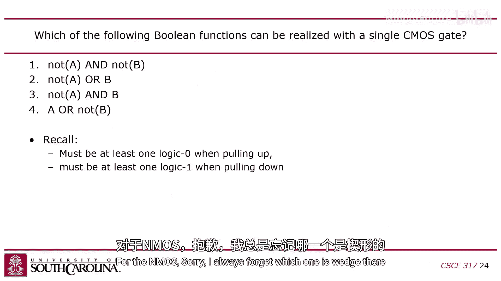

And source on the bottom。 So it's drain source， right， And on the Pmass， the source on the top。

 So the source is going to be connected。to the ground right and the drain is going to be the output on an inverter。

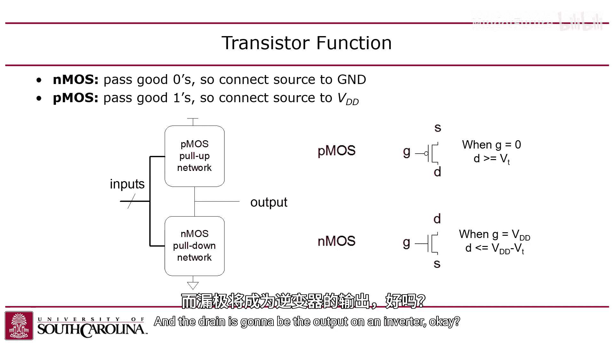

If you look at this model。The drain。

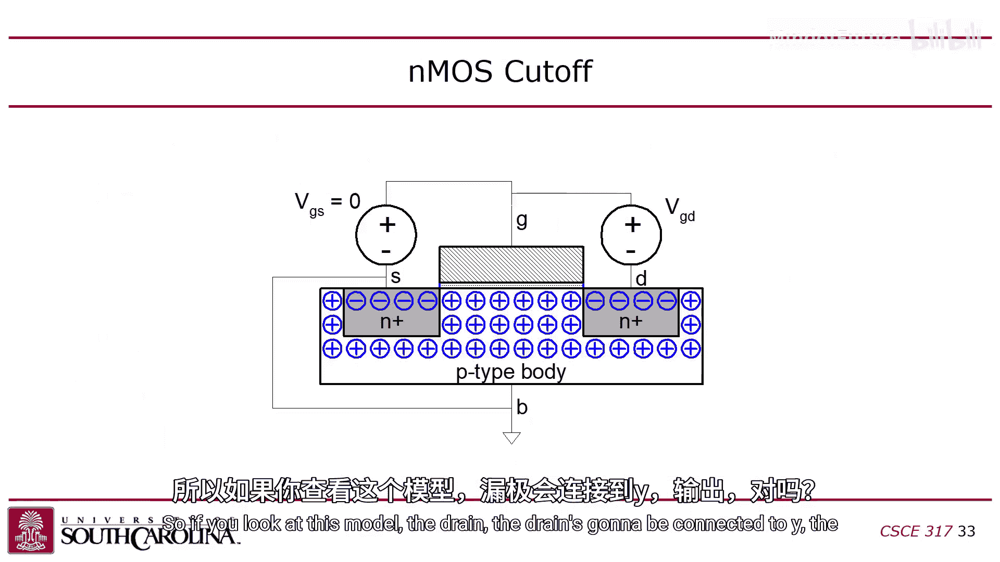

The drain is going to be connected to Y the output。

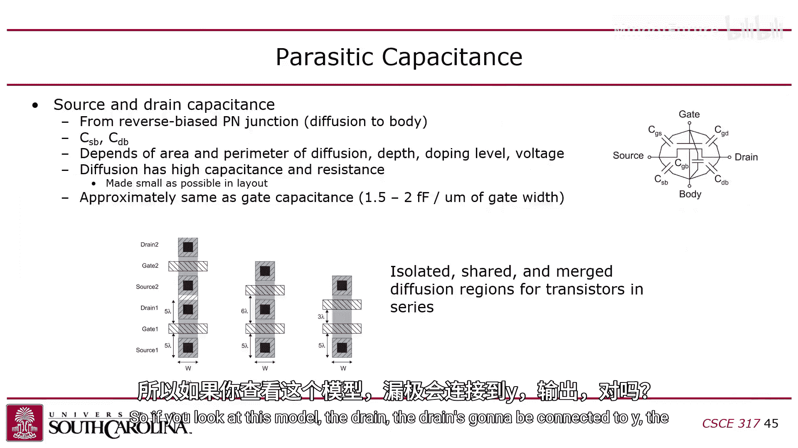

So we have to care about， we have to pay attention to this。Drain capacitance， right。

 the drain diffusion capacitance， the source we don't care about because you have a capacitor here。

 but both sides of this capacitor are grounded， right， So the source。

 the source diffusionary capacitor it's grounded So we don't care。 All we care about is。

This capacitance， right， the， this is the source capacitance， source diffusionary capacitance。

 likewise， on the pull up transistor。The source over here， this capacitor again is。Look。

 both terminals of this guy are VDD， so we don't care about him， but if you look at the source。

Capacitor。All right， this is now between Y and VDD， you guys see that？Okay。

 so what you end up with is if you simplify this， essentially what you have is a resistor that's connected to。

A capacitor to ground of C units of capacitance and a capacitor to。VDD of 2 C units。

 and you might say Y 2 C。 Well because remember the Pmasses have a K of two by at the least。

 at the smallest， they have a they're double size right， The pull up guys are double sized。

Because of the charge， the carrier mobility of。嗯。The electrons is half of that of the holes。

Makes sense。Okay， but then also that's just the driving side， then the receiving side is。

This guy is going to drive two gates， right， there's the pull down gate and the pull up gate。

Of the second gate， the second pair of transistors。 and so this is the gate capacitance。

 so I've got another two C capacitance on on his pull up and C on his pull down。

 you guys with me Okay so what does this all mean， It means that the propagation delay。Of this。

 of this first gate， driving the second gate with K sizes listed here，1 and2。

Is going to be r times 6。Right because the delay is literally。Resistance times capacitance。

Right now it's kind of weird because like。You know。You might say， well， wait a second。 these cap。

 some of these capacitors are connected to VDD and some are connected to ground。

 Why you just lump them all into one。 Well， because remember that I'm trying to。嗯。

Discharge these capacitors， right？Well I'm trying to charge the other two capacitors， right。

 so you're fighting against both sides。It doesn't matter if you've got VDD or ground on the other side。

 what matters is is that you're fighting all four of these capacitors。

 I'm fighting the source diffusion capacitor of my driving gate and I'm fighting the gateit capacits of the driven gate right so you have to basically just add these up。

right。Now you might say， well wait a minute， what about like how do you calculate that in terms of seconds？

嗯。So。If you substitute an R and C valuess， you get seconds， this is literally seconds。

 the units are seconds。The capacitance， of course， would be fair ads。

And you can get that that's just that's literally part of the technology parameters for your process The resistance though is a little harder to come by。

 but if you simplify your model for this， you're going to associate a resistance value for your transistors。

It's just an estimation though， because。Because remember， if you're in saturation mode。

There's no resistance。 You just get a constant amount of current if you're in linear mode。

There's kind of a resistance you know， because it's kind of linear right。

 but so this is just a simplified model where I associate an R value with my transistor。

 you guys with me。Okay， all right。Okay， so。嗯。Now， here's an example question。

Consider an inverter whose PmoOS widths are two minimal units， meaning K equals 2。

 and its n moOSs widths are one minimal unit and driving four copies of itself。

This is called the FO4 delay。FO standing for fan out， right。

 So this is a very common way to characterize a technology， a CMmo technology， FO4 delay。

If you have a minimal size inverter。Driving four copies of itself。How long。

 what's the delay for that， right？But how would you calculate it with this model？Well， basically。

 it's the same thing we just did， except you're multiplying。嗯。

The load of the gate load by four right so it's very simple。

 you just end up with R and then you have three units of capacitance for the source capacitor for the Pmas N Moss and an additional three and n times 4 12 right so it's three。

3 plus 12 is 15， so RC times 15， right？You guys with me？So what is this， Well I mean。

 what are we talking like。For this， I mean， what would it be for a modern chip？嗯。啊。Pco seconds。

 you know， 10 pico seconds， something like that， FO4 delay。嗯。真唔嚟噶。Okay， so。That was an inverter。

 Things get a little bit more complicated when you start considering。More complex gates。

So what if we look at a Nand， Okay， so the problem with the Nand gate is we have。

Three Pmasses in series and three Nmasses， I'm sorry。

 three Pmas is in parallel here and three Nmasses in series。So it's a little bit more complicated。

 not only that but。The delay， actually。Is now going to depend， I think。

 on whether we're pulling up or down。 It's no longer equal。Because of this。

 this is why we had before。 remember we had propagation delay and contamination。

 This is one of the reasons why we have a difference between contamination delay and propagation because this guy。

 because he has these guys in parallel。 he may be able to pull up faster than he can pull down right So the pull up time may be the contamination delay and the pull down will be the propagation delay right。

 I think that's how it works out。 But let's find out。 So let's assume now that we size these guys。

With three。And we size these with two。 You might say， wait， why would you do that。

 I thought you said the pmasses are supposed to be bigger than the antimasses。 Well， yes， normally。

 yes， but the problem is， is that we have these guys are in series， right？

 And so we want to reduce the resistance。We want these N musclessses to have lower resistance because they're in series。

 right when you have them in series or adding resistance。

 these guys are in parallel so we can afford to keep them small。And have relatively high resistance。

 right， Does it makes sense。 So that's how I've got these， these things size。 Okay， so。嗯。Yeah。

 so what do we do about that？Okay， well。So the problem here is that。

You have to replace each one of these transistors with our model， our RC model。And。So。The problem is。

 is you got to figure out。Which of these？Drain。Which drain capacitances can you eliminate now。

 you might， you might say in the inverter， we eliminated all of them， right， But with this。

 we can't because。I think we can eliminate them for these guys。For the pull ops。

 I think you can get rid of the drain capacitance because remember you can get rid of any capacitor where both sides are at the same voltage right。

 but the drain capacitors of the end mosses， you can't get rid of those because they're connected in series。

Right。嗯。Okay， so let's so what ends up happening here is。We have。Yeah， like I said。So。

Over here we have。So we have。This guy，2 C。So this is a source capacitor here。

So we got to get that source capacitor。And that source capacitor and that source capacitor， right。

 So that's our output。 So for this output， we have to consider those three source capacitors because they're all connected。

In parallel to the output wire， right？You guys with me， so that's 6 C。Okay， but then。We have。

This source。This source capacitor。Is another three to ground。 So we have 2，4，6，9。9ine see there。ok。

makes sense， so the output wire sees 9 C。Of capacitance， okay now。This drain capacitor can go away。

 just like these drains。 These three drain capacitors go away。 We don't care about him。

 This one goes away because he's grounded on both sides， right， however。These， sorry， this drain。

 these source capacitors， though， have to stay。 So this source capacitor was accumulated into this9。

 But this three and this three have to stay。They stay there， right？Make sense， guys with me on that。

嗯。And then of course， the gates， the gate capacitance。

So this first gate capacitor wire comes in and he he's going to see three units of capacitance for this gate。

 right？But he's also going to see another two on this gate。

 remember because every input is going to connect to two transistors， one in the pull down network。

 one， the pull up network， right， So this guy is going to see 5 C because of the three for the pull down transistor and two for the pull up transistor。

ok。So this is the equivalent RC model。And again， basically all I did is I eliminated some of these redundant capacitors that were on the drains because they're both at the same voltage。

And then combined other ones that were in parallel right。

 that's it that's all that's all you do there right Okay so then。Okay。

 so the other thing you have to。Consider is that。When you calculated RC delay。

It's assumed that you have a resistor and capacitor in series， right， right， In other words。

 you have a capacitor that you want to charge or discharge through a resistor。 right。

 That's the R C delay。 The problem is is that this circuit is no longer that straightforward anymore。

 because now you have branching paths。 We have a wire that goes through resistor and then a capacitor that goes to a ground or VDD。

 but then another resistor and then a capacitor， right， you have a。

You have a circuit where you've got lumps right you've got segments right with multiple resistors that are dividing up the circuit essentially right so you have to use this approach called Elmore delay。

Okay， so the El more delay is really， it's a really simple idea。 Basically。

 if you have something like this where you have。You have a signal and you want to calculate how long it takes to switch this signal。

 right The signal goes through a resistor and then through a capacitor， right， no problem。

 but then we have another resistor here。RightSo the way that you have to calculate this delay。

 the time it takes to switch this guy over here is going to be R1 times C。

RightBut then for this second capacitor it's r1 plus r2 times C2 you add those two right because this C2。

 this second capacitor sees the resistance the sum of these two resistors right so it's r1 times C plus r1 plus r2 times C2 right so that's R1 R2 C2。

 then R1 plus r2 plus r3 times C3 right。So that's the way because you have to consider。

Each capacitor， basically the time to charge or discharge each capacitor。

That's subject to all the resistances you see to get to that capacitor， right。

 if the resistors are in series like this， you guys make sense。 Okay， so that's called Elmore delay。

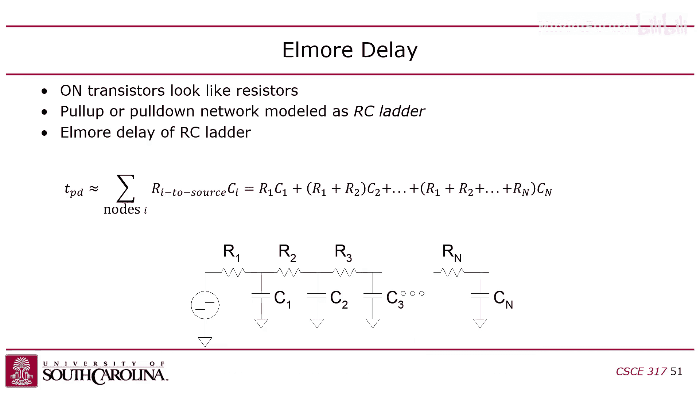

Okay， so。IfIf we want to estimate the worst case rising and falling delay of a three input Nand。

 driving H identical gates。Okay， so we're going to go to the Nand。嗯。Okay， so the Nand is。

Is the same N we looked at before， so two units for the pull ups。

 transistors three units for the pull down and the width， right？嗯。Okay， so。

We can calculate two propagation delays here。Proropagation delay rising and propagation delay falling。

 And I remember when we covered， when I covered timing closure or timing analysis。

 we only talked about。Proropagation delay and contamination delay。

 But here we can further break it down into。The rising and falling propagation delay。

Does that make sense because we can， we can calculate these separately。 So for the rising。

 it's going to be。嗯。The time it takes to。Pull up。Pull up to pull the output up。

 So here's the circuit。 We've got why is our output。And。We have， we've got these。These。

This is actually the is oh yeah， rising， so here's why。

So because we have these three guys in parallel。Right。We only need one of them on， right to pull up。

 right， Any one of those P moss is turning on will pull up。

 So the resistance for the pull up there is basically just。

R right why is it R because the size of the PmaOS is is 2 when the pma size is 2。

 remember the delay is22 r divided by k。 So if k is 2 it's just R right so R is our pull up resistance right？

Then we've got why。And we got some capacitance on why。嗯。So how much capacitance？Well， basically。

 you have to add up。The source capacitors。Of those three gates， pull up gates， right。

 the diffusion capacits。 So that's going to be。2 C。2 C，2 C。

 those are three parallel capacitors all with K equals 2。 So that's going to be 6 C。 bless you。

 So I've got six units of capacitance for those。Source terminals， right？ok。But then I also have。

I'm driving H copies， so I've got the gate capacitance of the H copies， right？What is H copy， sorry。

 H identical H is a variable， right？So what is the what is the？Capacitance。Of。Of the gates。

For this and gate， for this Nand gate。 Well， these there's three inputs。

 Each input is driving two transistors。嗯。They啊。And then remember that there's。The sizes are 222333。诶。

So。So。The capacance of the input。 What is that， It's going to be。It's going to be。

 let's go back to the other diagram， be that way。So the gates here are going to be。嗯。

Basically the capac is is 22，2，3，33， right， so it's going to be4 and it's going to be sorry，6 plus 9。

15， right？15 units in total。But， but that's all the inputs， right。

 So this end gate is only going to be driving one of the inputs of those H copies of itself right。

 now it's not going to fan it out to all of them。 that wouldn't make sense right。

 So we're assuming that this， this output wire is going to connect to one of the end one of the three inputs of H copies So for that it's just5 right。

 It's just two plus3 because each input only goes to one pair of transistors right。

 So it's five right Okay， so。Yeah， so basically。5 H。That's where we get the five H comes from there。

 right？嗯。And then one thing I forgot about here was。When you pull up。

 you're still going to get hit with， you've got the six units here。Of source capacitance。

 but you got to remember this guy too。The first Nmoss in series has his source capacitance which is three right so it's going to be2 plus 2 plus 2 plus3 right so it's going to be6 plus3 is9 right so you've got nine units of capacitance on that node with diffusion area and five times H on the gates coming out you guys with me。

Makes sense， so again the 9 c is the diffusion capacitance。

 the 5 h is the gate capacitance of my load gate， assuming that that output just goes to one input on each of the five copies okay。

Any questions about that？Makes sense。Now that's just for pull up。

Pull down is a little bit more complicated though， because the pull down has these three transistors in series。

 and this is where you have to use the El more delay。

So the problem here is that if I want to pull down。I got to turn all three of these guys on。Right。

And so the delay here is going to be。From here， pulling down， I'm going to have。Three units of。

Three units of capacitance here on this guy。Right。I'm sorry。Yeah， three units here。This guy， right？

Okay。And then。嗯。The resistance of this guy。Is going to be R over three。Right， because he's got。

 he's a bigger capacitor。 is， I mean， a bigger transistor。 So he has more capacitance。

 but less resistance because he's wider。 So it's R over 3。 Then I have to add。

So that's basically through this guy， right， So again， I've got a。

I've got a resistor capacitor right， but then I have to go through this resistor to get to another resistor capacitor。

 So this is going to be 3C， which is this capacitor the second one。

 but multiplied by r over 3 plus r over 3 because that's the resistance to get through these two guys with me right then I have to do the same thing。

Actually， I'm sorry， I started in the wrong， I should have start at the bottom。

This is the bottom one actually， so 3 c times R over 3，3 c times R over3 plus R over 3。

 Then I get to this top guy because again you' your' your're。You're calc it relative to the ground。

 So we're working our way up。 So we've got ground 3 C。

3C times this resistance3 c plus this resistance this resistance so going up up here right from ground up to this transistor and then finally getting up to the top。

 I've got the three resistors in series so I've got all three of these guys right R over 3 plus R over 3 plus R over 3 and then I'm going to multiply that by the nine which is all the capacitance I have up at this node plus 5HC which is the load。

Makes sense。So initially I was going the wrong direction， I was going down。

 you have to work your way up， so in this case I'm working my way up from the ground through this resistor。

 that capacitor， then through this resistor， that resistor， that capacitor。

 then through this resistor， this resistor， this resistor and then all these capacitors， right？O。

So what's the difference well this pull up resistance is 9 plus 5h times RC？

This one is 12 plus 5 H plus RC。 So even though I had bigger。

I had bigger transistors in the pull down because they were in series。

 my pull down propagation delay is higher than my pull up， right， my falling。

 PD falling is actually higher than my PD rising， so you can see this is why you know there's a difference between whether I'm pulling up or pulling down。

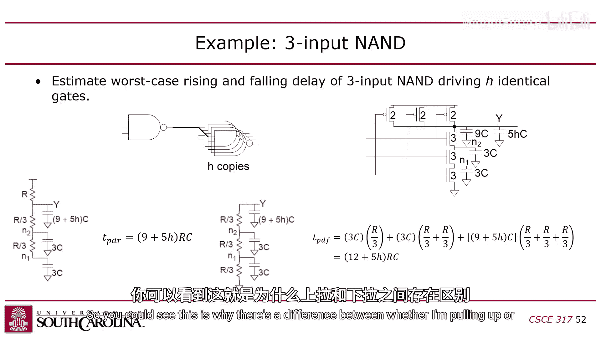

嗯。Okay， so。So I mentioned that。You know， the other thing， too。

 that that might happen here In addition to that， there's another phenomenon。 What happens if。

What happens if all three inputs？To this gate， all go to zero simultaneously。

RightSo what's the difference what I was talking about before was。嗯。I was assuming， in this case。

 that。You see this R value in the pull up， I was assuming there was only one of those pull ups were on right because there's only one R value here。

 you see that。See there's one R， so I'm assuming only one of these guys and only one of them has to pull up because if any input is zero。

Then the Nand gate is going to give you one， right， But what happens， on the other hand。

 consider the case where。All three inputs go to zero at the same time。 So all three of these pull up。

Transistors， they all turn on at the same time， so now you have less effective resistance on my pull up。

It makes sense， so what's the pull up there， it would be like having three of these R values in parallel。

嗯。So that would just be， you know the。The the one over one over R plus1 over R plus1 over R is my resistance。

 And then I multiply that by the same capacitance。 right， So I have the same capacitance。

 but I have a lot less， I have less resistance， one third of the resistance。Makes sense。

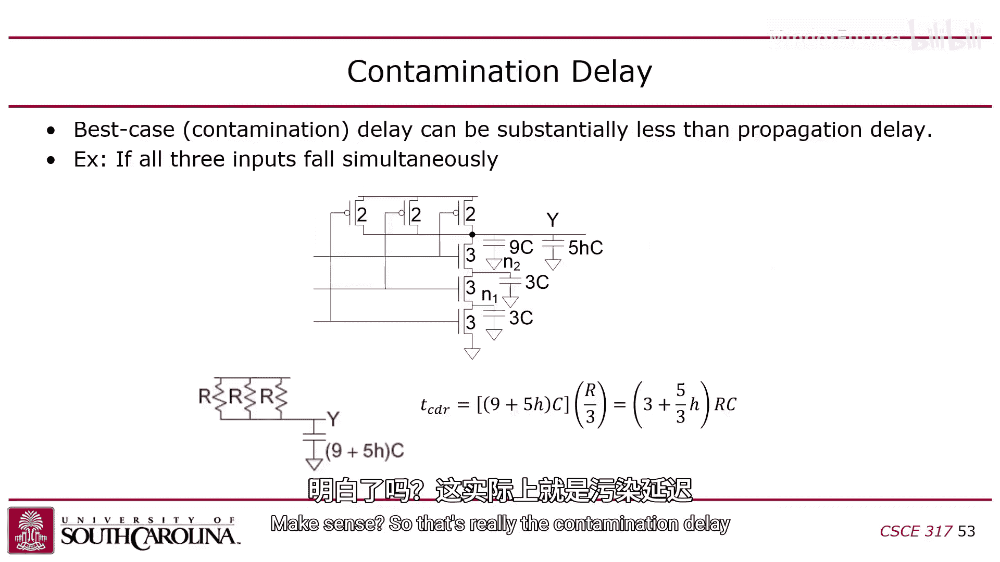

So。You know， that's really the contamination delay， the contamination delay isn't even。

Isn't even this？Because we saw that the the pull up time is faster。

 But that's even if just one pull up turns on。 If all three of them turn on， it's even faster yet。

 right， So this is， again， a difference between。

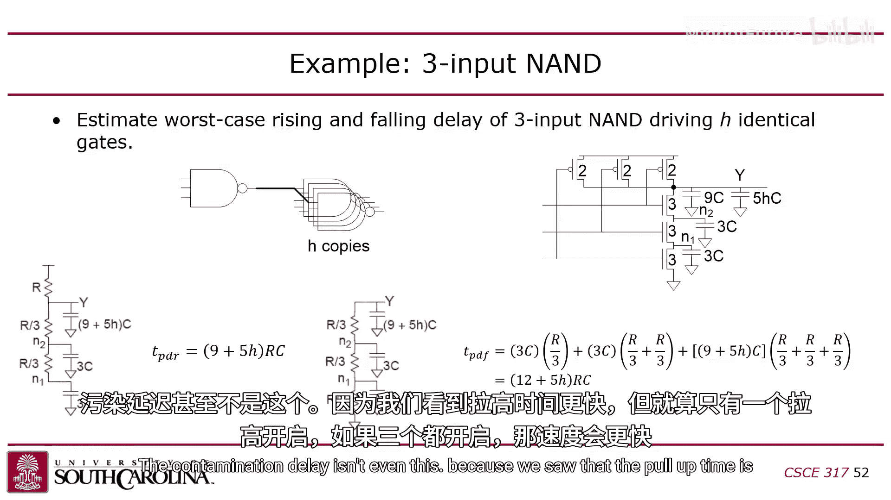

Contamination and propagation delay。Okay。So the last thing I want to talk about is memory arrays。

So we talked about memories already in class you know obviously you guys built memories on the FPGA and we talked a little bit about the memories in the digital building blocks。

 memories are basically when you have a 2D structure where you have depth， which is。

The number of entries in the array。An address input for that to address one of the entries。

 and then there's width， which is the number of bits you get out in parallel。Right。

So there's different kinds of array ras of memory arrays， dynamic。Random access memory DRA。

 static random access memory has S RamM， So DRAM is like your main system memory。

Sure you guys have heard a DRA， right？And SRAM is when you have Ram that's on chip that's like your cache that's on your CPU。

And then， of course， there's a non volatile flash memory。So。Whether you use M DRAM or。

SRAM or flashRAM， they all work in a similar way。The memory is physically built as an array。

 as a 2D array of cells。The sell each store 1 B。And so you have。

The 2D array has these wires that run horizontally and vertically。

 the horizontal wires are called the word lines， and the vertical wires are called the bit lines。And。

The word lines are how you write into the memory。And the bit lines are how you read from the memory。

 essentially。嗯。So。So for example。If you activate， if your memory cells wordline。Is set。

The bit line allows you to write into there， right？So you can write， for instance。

A zero and there a one right， or alternatively， if the bit line is Z， high impedance。

Then it won't write， right， Now， how do you get Z， We use the transmission gate that we talked about earlier。

 you know， P moss and Moss in parallel， you can。Turn it off。And create a high impedance。

He is with me。Okay， so。So basically what you end up with is an array where the number of rows of that array represents the depth of the Ram and the number of columns is the width of the Ram and so if you want to read。

From you want to read a word。You you need a decoder， so you send the address in the decoder。

 which converts from a binary to a uninary representation where just one of the word lines is activated right and then。

That will， when the word line is activated，ll it'll connect the bit line to that。

To that to that word， to that row， right？And that allows you to read out right now when you do that。

 you would have to drive the bit line here， the input bit line to high impedes because you wouldn't want to write to it right but if you do want to write to it。

 then you can set the bit lines and then you can just write write into that word。You guys with me？

Okay， so。So in DRAM， the difference between D RamM and S RamM is basically how the cell is set up。

 So in DRAM。The cell in a DRA is comprised of one transistor。And one capacitor。So basically。

 the bit line。The word line is connected to the gate of the transistor。

And it acts kind of like a pass gate， transmission gate。

 even though there's only one transistor in there。 And then the bit line allows you to。

Assuming the word line is active， if the bit line is grounded or set to VDD。

It'll charge or discharge that capacitor。And that stores a bit right So every every cell is just one transistor one capacitor。

 that's how DRAM fundamentally works， right。嗯。Now that capacitor is always discharging。So， you know。

 you have to periodically refresh it， even if you don't want to write it。Right so in SRAM， though。

 SRAM is no capacitor because you can't。In a CMmoss technology。

 your whole goal is to minimize capacitance， right？

And so you you build the seamos chips fundamentally you fabricate them differently。

 so you can't have capacitors。 So what instead you do is you create。Two inverters。

That are cross coupled。Make sense， you got one inverter feeding another in a loop。

So this will capture a bit。And then if you want to。Right in there。You have to set。

The bit line has to be 0，1 or 1，0， or could they can both be， you know。

High impedence if you don't want to write， but if you want to write。

 you would set these bit lines up。And then the word line will allow you， I'm sorry。

 the word line is turned on， which allows the bits into the loop and then the bit line will inject a bit。

Right into into this。Into this。啊。Cross coupled inverter， does it make sense。

 so you can either put a the bit line will be 0，1 or 10 that you'll use to then set。

The bit value in there。 So it makes sense。 Now， what's the difference here between the the the D Ram。

 the S Ram and the D Ram， The S Ram has two inverters。Right，How many transistors are in an inverter？

Remember there's always two transistors per input， right inverter has one input。

 so there's two transistors here， two transistors here， and then you need two transistors here。

 so that's in total six transistors per bit。that's an SRAM cell is six transistors per bit just for the cells。

 that doesn't count the decoder for the word lines， right？The D Ram， on the other hand。

 is one transistor。One transistor per bit。Transistor capacitor， that's it。 right， So DM is。

Much denser because it's costless resources， which is why we still to this day use。

 you know DRA for the main system memory because。嗯。You can DMs can be bigger。And they're fast。

 They're still fast。 They're bigger They're fast。 The only problem with DM is they have to be on a different chip than your CPU because they're designed with a in a process that supports。

High capacitance right whereas in an SRAM， a logic chip like your CPU。

 it's specifically designed to have minimal capacitants right because that's what makes the logic slow right So we have this thing called the memory wall。

 which is the problem where you've got the CPU and you got your memory and there's a bottleneck in between them。

Because they're on different chips and there's only so many wires you can connect them with。

 so any any application that requires a lot of memory activity will be will end up having low utilization of the hardware on the CPU because you spend all your time waiting for the memory read and write。

十。Unsolved problem。 That's why people are looking at the in memory computing technology。Okay。

 that's it。I got timed that pretty well。That's all the content I have， so like I said。

 we'll review for the exam if you have any questions about anything we covered all semester， you can。

Bring those questions to the next lecture。And we might finish up early。

 the final exam is comprehensive。And it'll be given on Blackboard like the midterm。And like I said。

 you can， you can， if if you're not confident about it or you don't even want to take it。

 then you can just do the final project。 week Yes， it'll be open all week。 It'll be two hours。

 just like the midterm。Okay。Yeah， and obviously， there will be an emphasis on。

The stuff I covered later。Because the stuff I covered earlier were designed for the practical parts for your CPU design right the later stuff was more conceptual so that's more of the testing kind of stuff。

 right？So make sure you understand all the conceptual stuff。

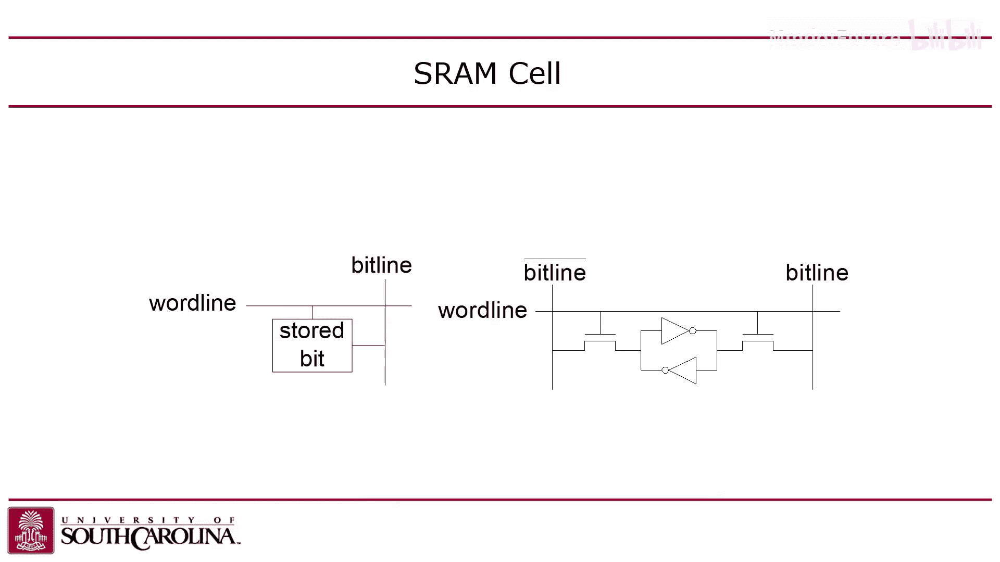

Okay。