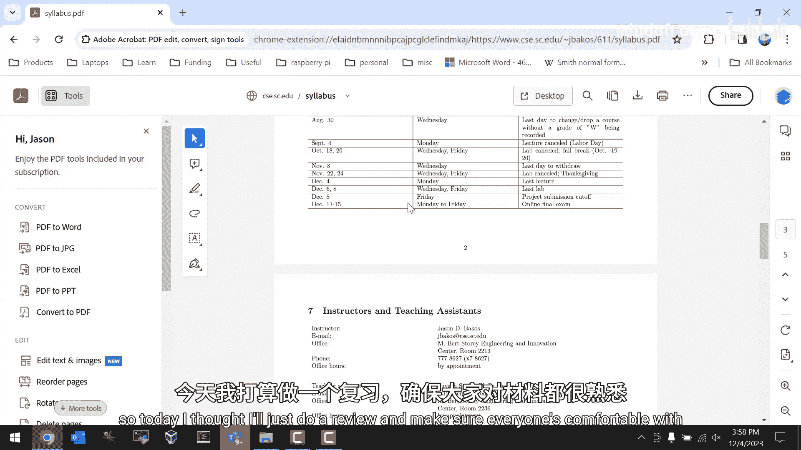
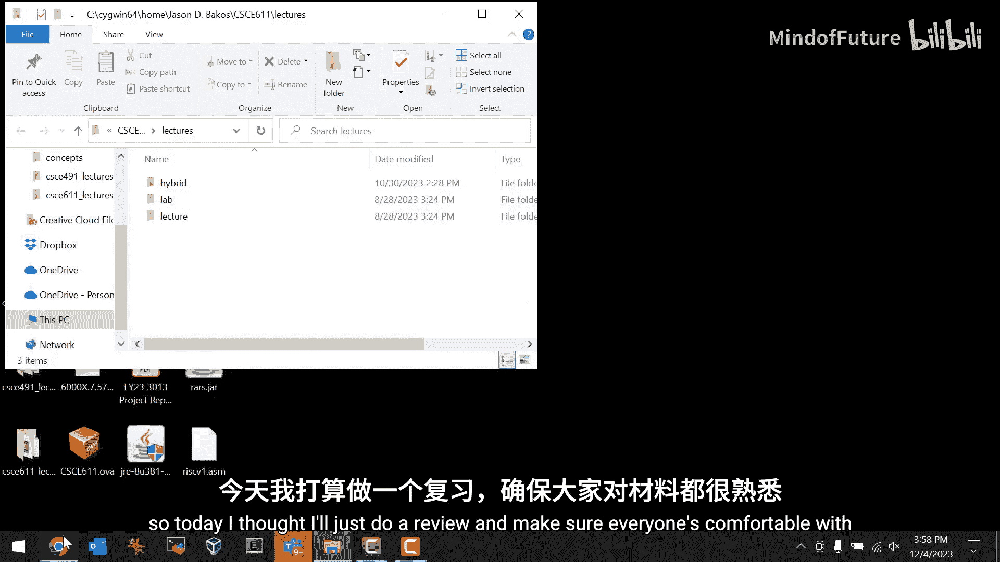
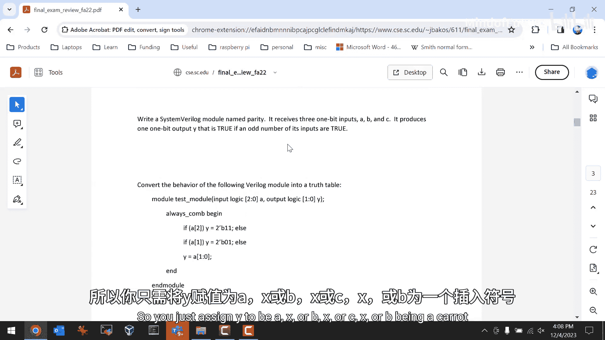
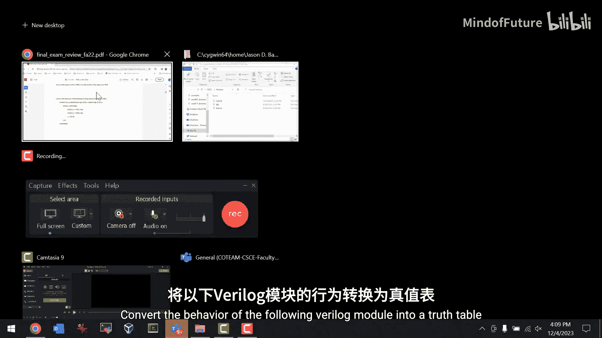
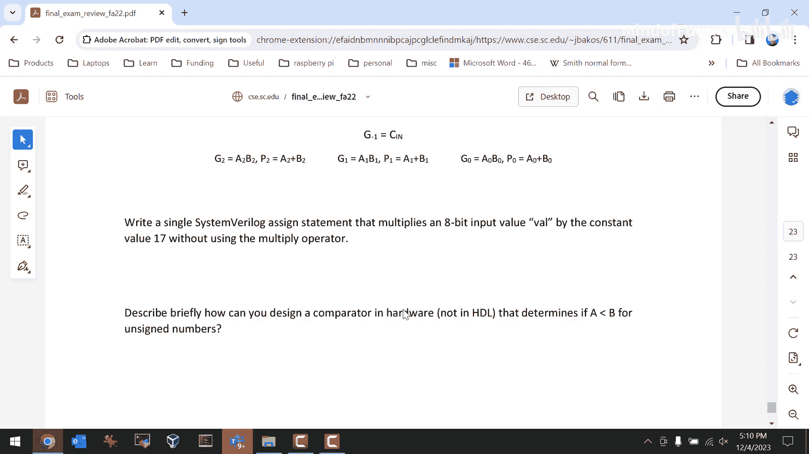

# 【南卡罗来纳大学】高级数字系统设计-CSCE611-（Advanced-Digital-Design，Fall-2023）-p17-P17-Final-exam-review--BV19nf6YoEZ9_p17-

Okay everyone， so this is our last lecture and we have our final exam。Next week。It'll open on。

啊 monday。And it'll close on Friday at midnight。And it'll be online just take it like you did the midterm it's comprehensive so today I thought i'll just do a review and make sure。

Everyone's comfortable with the material。I've got。An example。

 or a study guide here for the final exam。There's two of them on here。

So we'll take a look at this one。 We'll just run to these questions if anyone。

Needs any clarification， let me know。So the。We' got we'll have questions on the Ri ISA。

 like assembly language。And。Instruction and coding， that kind of stuff。

 and then there'll be a part on system V。And。Then， we've got。

The pipeline architecture from your project well some questions specific to that。

The micro architectureit rather， and then we covered sequential logic and。

Timing analysis and building blocks。 And then finally。

I don't have a review section on here for for it， but we also covered transistor level logic。

 CMmoss logic， so they'll be。系。Quion or two on that。Okay， so。

 so here's an example questions says consider the。The following sequence of instructions and their corresponding memory addresses assume the code is running in a machine that uses byte address instruction memory。

 which means that if you look at the the，The addresses are incrementing by four instead of by one as we have on your CPU。

's the by address。嗯。Then there's a question， is the instruction or address？

400000 in Hex audo instruction， If so， to what machine instruction does at map， Well。

 that's a load immediate。 There's no machine instruction for load immediate。

When you use a load immediate， it's translated to anyone know？

It's translated to an ad immediate with register zero， so that's why。That's why。

Register zero always contains the value zero so you can add an immediate to it， right？啊。

Is the instruction address 400010 as pseudo instruction， that's a branch。嗯。Branch。

 do is there a branch instruction？There's not。 There's no branch instruction in risk。

 It's that would map to。Jump in link。 Ju in link instruction。

Where the link register is register zero。You guys with me？So you remember a MIPS。

 it was a jump instruction that didn't link。There was also a jump in link instruction in MIPS。

 but in risk five there's only a jump in link instruction， they've simplified it。

 so they've eliminated the jump instruction I think at arm there's a branch instruction which's essentially equivalent to a jump right but anyway yeah that's a pseudo instruction。

And。Is the instruction at 14 a pseudo instruction that's a jump register。I don't think so。

Unless there's jump and link register， do we have to use jump and link register for that。

 anyone know？Did you guys implement and Ju register in your CPU？네。Re。

Let's jump a link register right with registers here。Yeah， so that one's a pseudo instruction， again。

 the question is whether or not there's a hardware instruction for these or if they're translated to something else that is a hardware instruction。

How many times is the branch？At address eight taken。

So this one requires you to be able to understand what's happening in this program。

 we load5 into x1 and then we have this loop here where we decrement it each time。

 so the branch instruction is going to first see x1 as4。And then 3，2，1， and then。0。Right。

But then it's going to see it as negative one。So I think six times， do I got that right？See。

 so you're going to start out at five。The first time the branch hits， it'll be 4 then 3，2，1，0。

 That's five times， but then it'll actually。Encounter that branch to sixth time。

Where x1 will be negative 1。At which point it won't branch。

 it'll fall through because it's branch if。As long as x1 is greater than or equal to。

 but once x1 becomes less than x0， it's not going to branch。

 but the branch instructions should be executed six times， right？Makes sense。

So the loop is supposed to iterate。Five times。 but the。

 but the branch will be encountered six times based on how it's structured。 Okay。

 what is the fetch sequence for this code， assuming a one cycle branch jump stall。Well。

 the fetch sequence will be， you know we're going to fetch zero，4，8。

 and then this branch will be taken。But if we have a one cycle。St。

Then even though even when that branch is taken， we're still going to fetch the instruction at C right。

 and then after we fetch C， which will just be a stall instruction。

 then we're going to go to label 2 and we'll get 14。Right。Does that make sense？Oh sorry， label one。

 which is four， sorry， label one， we got to label one， right， thank you。Makes sense。So it'll be zero。

 four。eight。C，4，8， C，4，8， C，4，8， C，4，8， C。 That'll have。 that sequence will happen five times。

 And on the sixth time， we won't take the branch， so we'll fetch C， and then we'll fetch。10。

 which will be a stall from that jump in link。And then we'll go to 14。And then we'll fetch 18。

 which is the stall after 14， and then we'll be jumping back to two， which will be 10。

Because the link address from this J will be 10。Make sense。Okay。

So the point there is that you basically have to follow the whether the branches are taken or not。

 and you also have to remember that you're always going to fetch the instruction right after each。

 you know。Take in branch and jump as a stall。Okay， what is okay。

 so how many cycles is the following code required fully a complete execution？Same idea。

The same idea here， you're going to execute the first instruction。The second， which will zero out x2。

The third， which is checking to see if x 2 is 0， which they are equal。

 So then we're going to go to skip。 But that branch is going to require two cycles because of the stall because you're going to have to fetch the jump and then install it right So that's  one。

2，3，4。 And then the skip has one cycle for loading immediate。 So I think that's five cycles， right。

Five cycles， right， assuming one instruction per cycle， but remember。

 you also have to consider the pipeline depth too。So once the pipeline is full。

 it executes one instruction per cycle。But in this case， if we're not starting out full。

Like we're starting from that first load， load is going to enter the pipeline， there'll be nothing。

There'll be instructions behind it。We're just counting the instructions from beginning to end of the loop。

 so you have to actually add two to this， so makes sense right so it's five cycles plus two。

 seven cycles to finish that。On our CPU， so if you ran this on your CPU。

 it should take seven cycles to execute that loop， right？So it's basically the number。

The number of instructions。Multiplied by the number of cycles per instruction。Plus， the。

Latency or the depth of the pipeline， right？You guys with me？Okay， system ver log。

 identify any problems with the module below。Can't put a assign inside in all ways。

 such just a syntax error。A and B are three bits and C is four bits and。

So there's a mismatch in bit width between the two sides of this assign right。

 so didn't I think that's it。Yeah。I miss anything。I think that's it it's what value will the following system barrel log code set the signal when a is 1011。

This is just scrambling the bits of a。 So B is going to be。one。1。0， zero， right，1100。

Any questions on how I got that？Gay， write a system very like module name parity。

 it receives31 bit inputs， A B and C， it produces a one bit output Y that's true if an odd number of its inputs are true。

 that's just a Xor right you could just do an Xor on that。嗯。Right， odd number， yeah， X or， right？

So you just assign y to be a， X or B， X or C。

Xor being a carrot。Convert the behavior of the。

Following very log module into a truth table。 So this one is you've got， So to make a truth table。

 you have to look at every possible value of。The input a and a is 3 B。

 So there's two to the third power8 possible inputs， right， So a can be， you know。

 basically 0 through 7， right， And then for each one of those inputs。

 you have to calculate what y is， which。So for half of the rows of that truth table。

 which is basically if a bit2 is set， meaning that the value of a is a three bit value is between four and seven。

Then the output y is going to be 11。If。Bit of the remaining four values， which would be。

Between0 and 3。Of those， two of those have bit one set， right， you guys with me。So， you know。

 if a is。If A is。A and y。 so 0，0，0，0，0，1，0，1，0，1，0，1，1，1，0，0，1，0，1，1，1，0，1，1，1。 So for these。

 these inputs， you're going to have y is going to be。11， right now because it's an if then else。

It's prioritized， right？So。You're going to consider the other four inputs on the else part of this ifF statement。

And so。We're looking at these two guys。Would be。Zero1。

And then the else would cover the last two cases， which。Is。Well， in this case， it could be。0。

 zero or 1，0，1， right？Make sense。Okay。Okay， write a system very log module in a minority。

 It receives 3，1 B inputs， A B and C， it produces a 1 B output。 Y that's true。

 If at least two of the inputs are false。 So you could do this with a。Case statement。

 you could do this with an if then else。You could even do it with the ternary。Asignment。诶。

Any questions about that？Seems like everyone's pretty comfortable with the very log stuff。

 write a self checking test bench for this module。 So the test bench would be。

Because there's no clock， right， because this is a combinational logic。

RightThe design under test is combinational so you don't need to worry about a clock so you can just use an initial block to set the inputs and check the corresponding output you guys with me。

 the only thing you have to be careful is that you after you set the inputs to the design under test。

 you need a non-trivial delay afterward to check the output right it can be you know like using the pound sign right right。

Okay， what's the purpose of the sensitivity list and an always statement。

 it's it's basically execute the always statement whenever any of the。

Value specified in the sensitivity list。Change。And if you have pause edge in there。

 then it only counts if there's a positive edge， rising edge for that signal。

Blocking assignments update the assigned values immediately while non blocking assignments update the assigned values after other actions associated with the current event have completed。

 obviously this is referring to an always block。How many clock cycles of delay will the code wait？

Is that a oh， it's kind of out of context。 I don't know what the purpose of that is， actually。

 because this is another question。 How many clock cycles of delay will a code impose between input。

And output， oh， right。 I see why I said that because the there is a mixture of blocking and non blocking in here。

 Okay so。This case， this is really bad code， you wouldn't want to write code like this。

 I don't think I think this is but I think it'll still work in model SM。

 but inV is assigned to a and then a is assigned to B because the first one is a blocking and the second ones a nonblocking these two guys will activate together on the same edge of the clock right so basically there's only one cycle of delay between inV and B right。

Likewise， there's one cycle of delay between B and D because of the same reason。 So in total。

 there's two cycles of delay between inV and D。So it'll take two cycles before whatever I had is invalid。

 gets popped out of the D value。🤧嗯。Makes sense。Okay。

 sketch the hardware that the following system very log module implies。

 this is basically just a gate level 211 style， you know or gate and end gate。

But there's also a flipflop on the output of this thing though。

You have to be careful you don't miss that， which。I am did。So。

So what this is doing is creating a flip fl for y and for x， right？So you got to put a flip flop in。

For。There's two flip flops。So， why。An X， right？Okay， and then y is going to get x。Or C。

So C and then X。Is going to come around like that。And then。X is going to get a。And B a。Ybi。Like that。

You guys remember this right from 211？没有。Do you guys use flip flops into a liver？Yeah。Yeah。

 so basically just two flip flops and two gates and this one is kind of strange because you've got a feedback here。

Right between the output of this flip flop and the input of this next state logic。

 so this creates like a。A little state machine， essentially。

Because you've got the clock logic and the next state logic。嗯。Okay。

 assume the following V log module， this thing just assigns a to not A and B。

 how many total bits comprise the inputs， 3，2， A and B。One output， C， right， two inputs。

 two input bits。How many bits are output bits are just one and they fill in the missing values for the test vector。

 so if a is zero。Not a is1。Then if b is0， you're going to end it with 0 and so C would be 0 for that。

 right？Makes sense。嗯。Now。Obviously， the in this case。

 I'm showing this I'm showing an exhaustive set of test vectors here。 So the second one can be。

The second one could be a。11。Or a zero1？No， it can't be a zero one， right？Yeah， it has to be one one。

 right？Ca if it was 0，1， there'd be no other spot in the table for。1， one， I guess。Another would。 No。

 that would be fine。 Yeah， we could do that。 Yeah， thank you。Oh， right， right。

 Then the C would be wrong。 You're right。 Thank you。 Yeah， that's a good point。 Yeah， thank you yep。

Yeah， so you have to pay attention to the expected out， what the expected out would be。 You're right。

 So if we want to figure out what a is here。Yeah， you have to， you have to。Note here that the C is1。

 And so a would have to be 0 there because if a were1， then it would be 0 and1。

 So the output would be 0。 Yeah， thank you。Okay， any questions？Okay， assume the following module。

 which instantiates the module above。 So we have， this is a wrapper。

 So we have module B BB is wrapping around module A A A， and it's obnoxiously changing the。

The inputs， it's associating C in BB with A and AAA。

And A and BBB with B and A A so basically this is the same table。

 you just have to pay attention to the scrambled input values， any questions about that。Okay。

Describe any problems with the module below， let's see we've got two always are're both driving B。

 so we can't do that we'd be double driving B。So that's a problem and also these always are always at star。

Which is another way of saying always underscore calm and。

They both imply latches because they don't say what happens to B if the if condition is false， right。

 So you'd want to put an else on these guys to say what happens to be otherwise。

 if you want to avoid。Latching is there。Describe the process by which a user entered HDL design is converted from form maybe load on F PGA So what is the process I don't know if I talk much about this this semester but。

The their log code is synthesized， which is。Very similar to。Compiling， we don't call it compiling。

 we'll call it synthesizing， which converts it into a graph representation called a net list。

And then the net list。Has nodes in it， which don't necessarily match one to one with the nodes on the FPG。

 so you have to go through this mapping process where you have to map the nodes like for example。

 if your FPGA only has lookup tables that have up to six inputs。

 but the net list has a seven input lookup table， you have to break the seven input lookup table into six input。

Lookup tables， right， it's called mapping。And then once it's mapped。

 then you have to place and route。You have to place each of the nodes in the Mas net list onto the hardware。

 right， and then connect them。Makes sense， so synthesis map place and route。

 and then you have to generate a net。诶。Bitstream， bitstream file。

 that's the file that actually configures the FPGA and this class they're called soft files， C SOF。

Corts calls them soft a serial output file。 I think that's what this stands for。 But basically。

 it's just， it's， it's the binary file that's。Shifted bit by bit into the FPGA configures everything on the FPG。

 All the B Rams get initialized。 All the registers get initialized， all let's get initialized。

 all the。Switch boxes that form the connections between the lots they all get set up when you send in the bidstream。

Okay， fill in the table for the module below， this is another。almost like a test bench。

 except this one， the difference here is that you've got these clocked elements in there。

So in cycle0， we're going to set a to0。 what's B， delay 1， B， delay 2， and B。We don't know。Right。

It's。There's no initial values listed for those， right？So they're unknowns。

 so they would come up as x's， I think， in modelsome， they come up as a。Unknown value， right。

 We're only going to know what B delay 1 is。After one cycle。

 B delay1 will show up because it'll be the previous value of a and after two cycles。

 B delay2 will show up， and it will be the prior value of B delay 1。 And after three cycles。

 B will show up right， So basically this is a shift register where you're taking the input A， B。

Sorry， A and every cycle it gets shifted down one slot and the order of those slots is it goes to B to A 1。

 then B to A2 and then B right so it just creates a delay essentially。Right。

Okay write a very log module that takes an 8 bit value and produces an 8 bit output value where the upper four bits and lower four bits are swapped。

How would you do that。We use the curly braces。You just combine curly braces。

With comma that concatenateates and then。I don't know what the values are called， I'll just say a。

Three down to zero， comma a seven down to4。Right。And then you can。Asign。B。

Okay write a very log module called fine cycles， having the following requirements so I used to。

Years ago， I didn't give a traditional final exam in this class， I would just give everyone。

 I would give them like a design problem， and then everyone would come in the lab and I'd just give you two hours to design it and test it in very and then submit your your code and your simulation result。

 your waveform。And this was similar to the， the type of thing I might have asked for that。

 This is a little simpler than。Than those ones， but same idea is that I'd give you a list of requirements so you've got your inputs and outputs in this case those would just go in your module line。

And then I'd show you the you know the expected output。

 And so the idea with this thing is it just sits there and doesn't do anything until you give it a go signal。

 which is when you assert go for one clock cycle and then after that it will pulse cycle 7 after seven cycles and cycle 11 after 11 cycles。

 So how would you build something like this。 Well this is pretty easy you would just have to create a counter right So the counter。

Would get initialized。Sorry， would get well， you'd start the counter with the go， right。

 so you'd have to have。You'd have to have an internal register that would keep track of whether the thing is counting or not。

 right， you'd have to have something that you call like running， right， and you'd set running to be。

 you would initialize running to be zero and then。Once you see go。

 you would turn running on with an always a edge clock， you guys with me？So if you saw go。

Then you'd turn running on。 And then at the same time。

 you would have a counter that would tick up once per cycle running was whenever running was on。

 right， And then once the cycle counter got to 11， you'd turn running off automatically right。

 So basically， you turn it on。嗯。So you'd have， whoops， you'd have。You have always。Underscore FF。At。

Pause edge。Clock。Begin。Okay， and then you say if。go。Then， running。Is going to get1， B1。 Now。

 the question is， what happens if I say go when it's already running。

 Like I'm assuming that running is turned off initially。And then I'll turn it on。 Well。

 I didn't tell you what happens in that case。 So I'm just going to assume that。I'm going to。

 you know。If it's already running and I assert go， then it's probably going to。

It's going to act goofy。 It's not going to give me。Like in other words。

 I'm assuming that it's invalid to assert go。Within 11 cycles of the last time you sort go， right。

 Does that make sense， Fair to say， right。Okay， so then I'll say if。Running。Then you can have counts。

Equals。Hounds plus， and then how many bits is the counter， I got to go up to 11s of four bits。

So4 apostrophe B1。And then if。Count equals for apostrophe D。seven。Then cycle seven。Is going to be。

One apostrophe B1。If。Counts equals equals4 apostrophe D 11， then cycle。

11 is going to get1 apostrophe B1， right？And if， oh， and also， if it's 11。

 I'm going to reset the counter as。Yeah， I want to reset the counter to zero because I don't want to。

Put that。So I'll say begin here。And then I' also set。Actually， no， I won't even yeah。

 reset the count to zero。For Horophe D0， and I'll set go to0。And。And sorry， no semicolon。

 And then also I need default values for。I'll set cycle。7even is going to get。

One apostrophe be0 by default and cycle 11 is going to get。One apostrophe be0 by default。

 which will be overwritten in this case， right， makes sense。And then， end the always。So。

Set default for cycle7， cycle 11 to zero。If I get a go input， I'll start it running。If I'm running。

 I increment the counter。RightIf I hit cycle 7， I'll assert that。 If I hit cycle 11。

 I'll assert that。 right now the problem is， is that。This is a little weird， though。

 because what's going to end up happening is that。If I tell it to go。

It's going to set running to one。But this thing is not going to see that until the next time it activates。

 right？You guys with me， so the first time I increment。Count。

Will be the cycle after I turn running on。Right。So cycle 0。 when the count is 0。

 That's the first cycle。 right， The problem is， is that according to this，1，2，3，4，5，6，7。

So the counter is actually going to be zero in this cycle。The cycle after。

Because it's going to be one like so in this cycle。Let's see， hold on this rising edge。

After go is what I'm going to turn running on。So running will be on in this cycle。

 but the counter will be zero， right？And then the counter will be one， two， three， four， five， six。

Right， so actually。This shouldn't be seven。I need to subtract one。

 I need to make this6 because the counter is only going to be 6 on the seven cycle because it takes one cycle just to turn on the go signal or the running signal rather。

 you guys with me。 So this should be 6， and this should actually be 10。So I'll decrement。

 so I'm going to look for the counter to be six。Which should line up to the seventh cycle after。

Running now another option is I could have just set， I could have initialized the counter to be。One。

Also yeah。And of course， there should be a reset here， but I didn't give a reset signal， did I？No。

 there's no reset here， unfortunately， so there's going to have to be an initial you'll have to initialize the initial value。

Then initial begin。We'll have to set。Counts to be。0。And running。To be zero。And。

So we'll have an initial that initial statement will be。

Will be implemented by theirPGA being reprogrammed。You guys with me。

 normally you'd use a reset signal to reset， but I， like I said。

 the problem doesn't state that Any questions？ok。Pipeline and microarchitect。

 we've got the three stage pipeline， write a system very like snippet to implement the sine extend block。

That's pretty trivial， that's just， well you guys know that right， you guys all did that， right？

So you just replicate the sign bit， with bit replication。The sign bit， by the way， is in this case。

 what is the sign bit， the sign bit is this is sign extending a 12 bit signal。So whatever bit 11。

 so you've got 12 bits coming in here， bit 11's got to be replicated。20 times。Make sense， okay。

Write a system very， snippet， implement the block that produces a GPIO out signal。

A lot of groups had trouble with this GPO IO out because they forgot to。Implement the enable。

So when they ran their code on the board。The GPIO out got the value that it should get。

 but only for one clock cycle， and then it got reverted to zero again。

 right because the enable it was always enabled。You guys with me？So you need an enable on there。So。

Is basically。Always。啊。Flip， flip， flip flip flop， sorry， pause edge。Pause edge clock。If。

What's it called。啊。Where to go。GPIO， oh here it is。GPIO enable GPIO right enable。

 if GPIO underscore right enable， then。GPIO out。Is equal to what？Ohll redd it one， yeah。

 reddated one。Read。😔，Data1 underscore， probably EX， right？Yeah。

And you don't need to begin an end here because。There's only one statement inside the always。

 and there's only one statement insideF。Right a system very logs， okay。

 got that in the following table， marked the stage holding each of the instructions listed in the first four rows。

For this one。In cycle zero， we're fetching。The load upper immediate and cycle1。

 we're going to be fetching the add eye and executing the load up intermediate and then in cycle 2。

 we're going to be fetching the multiply， executing the add eye and writing back the load upper immediate。

 right。And so on right and then for each of these signals down here。

 all you have to do is check to see which instruction is in which stage and then fill in the corresponding value for that right so for example。

 when the loadup per immediate is being fetched。Well。

 I don't know what any of these signals are supposed to be because none of these relate to the fetch stage。

 right， so they're all don't。Don't knows。 Don't care。I don't know what， don don't actually。Actually。

 it should be unknown， right， unknown value because。Because if this guy is fetch。

 I don't know what's in the other stages， right， There could be other instructions in there， right。

Unless that's the first instruction。So you should put you in there， right。

 These should all be used in the first column。 And the second column， I'll be executing that L U I。

 So Reg Wright。Should be one because load load up immediately it does write to register。

 Reg Wite WB is again an unknown though， because I don't know who's in right back， right？Makes sense。

 so that's how you figure that out you just have to。Match up the signals to what's in each stage。

Any questions about that？I've got the solutions to these two， by the way， on Dropbox。

 if you're interested if you want to look back， what changes to the design would allow the CPU to execute the made up instruction。

 I think I think it's made up NV PCC。That behaves as shown below。

It copies the address of the current instruction into the register file at address RD。嗯。Well。

 but we already do that， don't we， don't we have an instruction that does that already。The jump。

 the jump and link， right， The jump and link already does that， right， Which PC， though。

 does it put in the register file， it puts in。PC fetchch。Okay， well。Which PC is this evos oh PCEX？

Okay， so this is not the same as jump in link because jump in link。Jump& Li puts the PC fetch in。

Now you might say， wait a second， no。No， no， no， we put PCEX in in our design yeah， but。喂。PCEX。

Is PC fetch with a one cycle delay for the right backstage， right， So when you guys design your CPU。

 you should have actually done， you should have wired PC E X into the register file for jumping link。

 However， in this problem。I assume when it says PCEX， we're talking about。The PCEX。

When that instruction is an execute， in other words the address of that instruction right not like not the address of the next instruction。

 the address is the current instruction right so this is a little different。

 I think you would have to actually add another you'd have to add another register for PCX。

 you'd have to add you'd have to delay PCEX one cycle and call it PC right back。

So you would have to add another。Register for that you guys with me。

So what's the difference Dr and link？Is storing the address of the instruction that follows it。

 right， whereas this problem is asking you to store the address of the actual instruction itself。

 right， So it's there is a slight difference between those because the。And this one， you'd want to。

You'd to not use you'd not want to write back PCEX， you'd want to write back PC write back， right。

 which is the address of the instruction that's in the right back stage。

 which would be this instruction Does it make sense。系。Okay。

 under one conditions is the stall signal generated。 Also， why is the stall needed stall is。

Is going to be used to。Have the CPU ignore the instruction that is fetched。

After a take branch or a jump。Because by the time。You know that you've got a jump instruction or a branch。

 You've already fetched the next instruction。 Make sense。 So you can't avoid fetching。

The instruction that's placed after the branch or jump， so you just stall it， you just。

 you fetch it and you just don't do anything with it。 You don't execute it， okay。

What does the PC shown above， does the PC CPU shown above support the load word instruction now there's no memory for load store。

 there's no data memory。Write a sequence of two risk instructions that would trigger the register file bypass。

 basically any instruction that writes a value that's read by its immediate successor。

So if you have a ad。That writes the write x2 and then another addd。That reads from x2。

That when this guy is in right back。This guy will be an execute and so the problem is is that this guy won't actually write back until he's out of the right backstage right so in other words。

 this instruction is in the process of writing X2 while this guy is in the process of reading X2 so you have to trigger the bypass。

You can't because otherwise if you didn't have the bypass。

 this second instruction would get the old version of X2， not the new one， you guys with me。

Alternatively。You could just not tell the compiler not to do that。

You could tell that you could program the compiler not to generate code like this。

 and if it has to generate code like this， then it could just put a no op in between。Problem solved。

 right， but it's。Be slower， be slower code。So the bypass is really kind of a performance enhancement。

 right？The performance improvement。Or performance。It's a feature designed to improve performance as compared to not having it。

嗯。😊，What would happen if the Reg file act right by passing， well， then， like I said。

 you'd have to have a you couldn't。You couldn't have。Two adjacent instructions with a dependency。

Consider the risk five design below as it possible to add support for the ad with right logical shift。

Oh yeah。This instruction is actually on arm processors， believe it or not。

 it actually arm processors support this thing called a flexible second operaand。

 where you can actually do certain things to the second operaand like shift it before you feed it into the ALU。

It's pretty cool。It's useful for things like。Fixed point， for instance。嗯。Can we support this？

Not with the hardware we've got， right， because you need to add some hardware like the do the shift。

You might say we have hardware to do the shift ALU， yeah。

 but ALU also has to add this instruction has to shift and add we have to do two things。

 we only have one ALU so you have to add hardware for this。Makes sense， like a second ALU。

Using the delays in the table below， what's the minimum clock cycle time for the processor design above Oh okay。

 so this is。This is something I always wanted to add to this course。Which is。

 once you've designed your CPU， how fast can you clock it？

Because we're only clocking them at 50 megatz， which is pitiful。I think our CPUs could run faster。

But I don't know how much faster I never tried to。I never actually tried to。Make him run faster。

I would guess that you might be able to run those things。On this FPGA， 300 megahertz， maybe。

But the question is what's the limitation， well it depends。It depends on these propagation delays。So。

If these are a propagation delays， then what's the critical path of our CPU？Oh嗯。Well。Well。

 first of all， it's got to be the execute stage， right？So in the execute stage。We are。Reading memory。

No， that happens in touch。ExQ， we've already read the memory。Register clock to queue。

 I think we still have to pay for the 10 picocon。So I think we'd start with 10 picoseconds。And then。

We have。嗯。We have the instruction memory。So I think that's going to be 10 picoconds， right。

 but then we're going to go into the register file。But then we also go into the control unit。

RightAnd then from the register file， we go into the ALU。And then from the ALU。

 we go back to the register file。But there's a mux in between the ALU and the register file， right？

Because we have multiple things we can write back， right， for example， CSSR and the L U I， right。

 So there's the mus here， right， So we have 10 pico secondss propagation delay。Register file read。

Is 100 register file set is 25。But let's do Reg file， read 110。So that's 110 picoconds there。

There's a mux here too， right？我你有 you。Multipplex are 30 piCOconds， so we have 30 piCOconds here。

 and then ALU is 100 picoconds。And then we have another 30 picoconds here。

And then the register file setup time is 25。We have to get the result2 we have got to get there 25 picoconds early for the setup time。

 right？Make sense in the control unit。That's 100 picoseconds， but see that's happening in parallel。

With all this， right， so that that control unit controls that mux and that mux。But， you know。

 that path is much。嗯。Well， you got to go through， yeah。

 that path is shorter there because you got to go through 110 Pcoconds with the register file。

So the critical path would be this top one。Makes sense。Yes with me。So what's the total？10 plus。1。

10 plus。30。Plus 100。Plus 30。Plus 25。So that's 120， 1502 50 to 80。305。305 picooseconds。

I just made these numbers up， by the way， but they're probably。Reasonable。So 305 Pco seconds。

Actually， they're probably not reasonable because 305 pico seconds would be like  three gigahertz。

I don't think the FGA is going to run that fast。But you know what on FPGA？In practice。

 most of the delay is not in these logic， it's in the wires。The wiring delay。

Is longer generally than the logic away。And I didn't even give you any wiring delay here。

 Wires on FPGA really long because the FPGA is。Is very sparse compared to an AsI because it's more spread out because the luts are larger than the six input Luts on FPGA。

Are bigger than a six input gate on a custom chip， right a six input gate is only 12 transistors。

But a six input lot。Is。A six input light is storing what？64 bits in each bit is six transistors。

Right。So remember， logic， CMOSs logic， if you have a six input， six input。Gate。On CMOSs， right。

 would be 12 transistors。But remember we learned。A lot， which is a Ram， right。

 a Ram would be two to the six power bits。64 bits times。

 remember there's six transistors per bit in a Ram in an S Ram， that's with lots are S Rams， right？

RightSo this is going to be 64 times 6。Versus 12。So。4。是。402。402。402 transistors。For a six lot。

12 transistors。For a six input gate in a。Fabricated chip in an application specific integrated circuit。

 right， So the FPGA。Has。About。30 times less density in terms of logic。

Thenhan a chip that you send out in fab right and so the result of that is wires that are like 30 times longer。

Which have a lot more delay than the wires because the wires have less， you know。

 the the capacitance and the resistance of the wire scales up with its length， right。

 So if the wires are longer， that means more capacitance and resistance， which means more time to。

Charge it up and discharge it， right， which means that the delay， the wire delay is longer， right。

 So that's that's what's going on here。 That's why FPGs are。

 but I still think this CPU would probably run it。2，300 MHz， if we really pushed it。

 if we started to learn how to read those timing report and。Be able to tune our design。

 maybe make the pipeline deeper if we needed to。Anyway。

 what would happen if Regg Select EX was stuck at zero， then you'd only be able to write？

Whatever that corresponding muux input is， right， the load up intermediate。

 You'd only be able to do load up intermediate of the instructions add subtract branch if equals CS SR W。

And then I give the CSRRW parameters there， that's the reading the switches， right？

For which is the redright signal not asserted。Branch if equal， right。

 branch of equal doesn't write the register file。You guys know that， right？

What data path changes are needed to add support for the branch on less than instruction？

Wait don't we have that？I thought we had that instruction。We have that， right？Yeah， we have that。

Yeah， I don't know， nothing。How many ports each of the memories of the CPU have， how many ports？

Well there's two memories on the CPU， there's the instruction memory that has one port because we read one instruction per cycle and there's the register file that has three ports because we can support up to two reads in one right per cycle。

 right？All right， another CPU。Yeah， same idea， this one you just figure out what the control signals are。

What instructions is fetched in cycle6？What？Cycle6。嗯。Ftch， fetch， fetch。Oh， cycle 3， sorry。

 Did it say 6。 Oh， there's one for 6， too。 Okay， so in cycle 3， we fetch。None， right？

Same as in cycle 6。嗯。But why we have fetch and cycle4 Oh， because we have the branch。 that's why。 Oh。

 I'm sorry， forgot。 we have the branch， right， so that we have a branch here that that this branch has taken。

And so we fetch the first instruction second， third。 and after the third。

 we fetch the the in cycle 3， we're going to be fetching。The fall through for the branch。

 whatever comes after the branch， right， that's the stalled instruction。 And then in cycle 4。

 we're going to be fetching。The ad。Cycle 5， we're going to fetch the second ad。In cycle 6。

 we're going to fetch the branch， right？Make sense。So is there another way we can？Express this。

So let's do it this way。 We have add I。Add I。Branch of equal， right？Okay， now the branch of equal。

Is going to go up。 So remember that this negative2。Is relative to itself， right， so that means one。

 two。right。That's not the same as MIPS in MIPS， negative2 would have been the add eye。

 the second add eye， right？But in risk 5， that offset is relative to the branch instruction itself。

 right？ So we're going to fetch the first add eye。 But right after the branch。

 we're going to have a stall， actually， right， And then we're going I'm going to just call this 1 and 2。

 Now we're going to fetch add eye1 again， and then add eye 2。 and then the branch if equal。

 and then the stall。 right， So the cycle that we fetch these guys in is going to be 0，1，2，3，4，5，6，7。

 right。So the question says， who are we fetching in cycle 3， that's a stall。

 and who are we fetching in cycle 6， that's a branch of equal， the second branch of equal。

Makes sense。Okay。Makes sense because there's a brand that I was confused initially because I forgot there was a branch in there。

Okay。by the way， is this taken both times？I'm assuming it's taken both times。

We're going to put two in register。X2， so that'll be decmented once。And then decrement it twice。Oh。

 so actually。嗯。Actually， the second branch is not taken。

So it's going to be whatever's after the branch。Fall through。He goes with me。

 So there was another curve ball in there， right， because you're going to initialize register x2 with 2 and you're going to decrement at once。

 so it'll be one the first time I hit this branch。Oh， but wait a minute， I'm gonna reinitialize it。

 though， right， So never mind。 So I keep going reset it to two， decrement it to one， reset it to two。

 decrement it to one， reset it to two。 So actually， I sorry， So that would be a stall。

 It is gonna to be taken。 That's an infinite loop。😊，It's an infinite loop， right？Because that branch。

 every time that branch is taken， it's going to reset register x2 back to 2， right？So。Okay。

 so suppose the Regg cell WB was stuck at three， what would be the impact？Rgs Se stuck at 3。 What's3。

Register select is it do I have it， Oh yeah， right here， PCEX。

So it's going to only be able to write the program countervalue to the register file。All right。

 sequential logic， what's the difference between combinational and sequential logic combinational is。

Function of its inputs only where a sequential logic has memory。

 so it also includes information about past inputs， potentially， right？

Difference between Dlatch and D flipop， Dlatch uses a level sensitive clock and D flipflop is an edge sensitive clock。

Consider the circuit below， write the next state logic and output logic and bulloleing algebra。 Well。

 this is easy。 Basically Q 0。 the next state logic for Q0 is Q0 prime。

 and it's just going to be a ended with。Q0 or Q1。Right， so you just have to trace the wires back。

 translate the。So you guys already know how to do this from 211。

 the only thing that's new between now and when you took 211 is this notion of next state logic。

 the next state logic is the input to the fliplo right and the current state logic is the output of the fliplo。

咁。You should have learned that in 211， but I don't know why they don't cover that。

Can this circuit operate at two gigahertz？Well， we got some propagation delays here。No。Oh yeah。

 we have all the stuff here to figure this out。嗯。All right， so the delay。Is going to be the。TPCQ。P。

 C， Q， you guys remember what that is。 That's the time it takes to actually change the output as a flip fl the flip flops。

Proropagation delay， right， And then we have to add。The delays of the logic。

 the critical path delaying， what's the critical path， probably these two guys。Wargate and Annegate。

嗯。So that's going to be。30 piCOoseconds plus 85 picoconds。30 plus 80。Plus。Set up time。

Because we got to set this guy up。So。Set up time is 100 picooseconds。 That seems extreme， Okay。

 plus sw。10 picoseds。Okay， now all of this has to be less than。500 picooseconds。Right。

Is it less than or less than or equal， I think it's less than or equal， all right？Less than or equal。

Okay。So TPCQ is what was it？50 yep，50。So this is 50， so this is 80。160260。270， yeah。

Seems comfortably fits in there， right？Make sense。Okay， what about that's the setup time。

 What about the whole time， The whole time is the short path。So it's the contamination delay。

On the flip lot， which is TCCQ plus。The short path。Short path。 short path。 What is the short path。

 It's the probably。Probably just the angate， right， Yeah， Angate by itself。

Contamination delay of the end gate is 25 picoconds。And that has to be greater than。This hold time。

The whole time is 20 picoconds。And。Plus， the sw。Right， what's the skew to 10？

RightAnd what's this guy？5ve。Okay， so basically 30 picooseconds has to be greater than 3000。Well。

 that's an issue。So this would violate the hold time。But it's， you know， pretty close。Make sense。

He was with me。That's easy one to fix， though， you can just add more delay。Okay。

 next state function again， that's similar I。Then we have this elevator example。嗯。嗯。Okay。

 so this one sketch the state transition diagram for the finite state machine described by the system very log code。

So this guy has a type F with four states， so there's four states， clock logic is pretty standard。

 just says that the start state is S0。And then the next state logic is shown in the next state logic。

We've got one， two， three， four， what are they calling again？S 0， okay， S 0， how'll create it。S0， S1。

 S2， S3。And。Looks like A and B are inputs， which are just two bits each。Okay， so if A。Wait a minute。

 really？What the two bits， y， okay， okay， if A X or B。Next state， if I'm in S0。

If my current state is s0 and A X or B， then I go to x1， S1。A， X or B。

 What does that mean if they're two bits， that means that they are。If they're both the same。

 if they're both the same。So a doesn't equal B。If A doesn't equal B。If a equals B。

 then the x or will give you all zeros， right？Makes sense。嗯。Otherwise， the next state is S0。

 which means it's a wraparound， right？And if you're an S1， A and B。We're going S2。A and B。Yeah。

 I guess' if a equals B， right or no， yeah， no， what happens if just one bit？

As long as they're not both different。Yeah， I don't think I think that's a typo。

 I think they were supposed to be the same with， I think there was supposed to be one bit each。

Because it's kind of confusing if there're two bits。

 so I'm to say I'm going to assume they're one bit。Right。So。

I'm going to say they both have to be one to go take that transition。Right。Otherwise。

 you go back to S0。That's your default transition。And then。S2 is going to if A or B。

 then you go to S3。So as long as。a。嗯。A or B。 So as long as one of them is one， right？So A or B。

 right？And then otherwise you go back to S0。And then if you're in S3， if A or B， you stay in S3。

Otherwise， you go back to as0。Makes sense。ok。And then the output logic is。The output is what？

The output is y， so y is going to be1 here。And why is going to be one？In S2。

And then y will be zero here and y will be zero here。

OkayThat's the output logic is just this one assigned statement at the end。Okay， any questions？

All right， so we have another timing， I'm going to skip that another timing question。A， glitch。

Could the circuit potentially glitch。The single value is changed。 Yes， right。

 This circuit could glitch if you jump from this caraw map group to that caraw map group。 So。

 for instance。If A and B are both 1 and C and D are 01 and you changed。Ay。If you change A。

That might cause a glitch。And you could fix it by。Adding another grouping that covers， actually。

 you just want to cover these two。You wouldn't want to include any zeros。嗯。All right。

 another timing question。Digital building blocks， give a Boolean expression for the carry in input for column3 of the following type of adders。

Use multiple equations to construct the expression oof。Okay， ripipple carta。So。嗯。

So the Ripple carry is going to get carry in three。Carry in three is going to be。嗯。

To carry out on two。RightThe carryout on two is going to be。A2。嗯。And B2 or。A2 and carry in Car in2。

Right。Or。B2， carry in2。Right。And then Carrie。Carry into is going to be the carry out on。1。

 carry out on one is going to be。Pretty much the same thing as this， right， a。B1， or。A1， carry in。1。

Or B1， carry in one。Right。Carry in。One is going to be carry out zero。

 carry out zero equals and then pretty much the same thing again， right you guys are with me。Right。

Make sense。So these would all have to be nested。嗯。Carry， look ahead at her， on the other hand。

Would be。What does it carry？Carry in three is going to be the generate from2 or。The propagate on two。

And the generate on。Sorry， the general propagate too and。To generate on one。Right。Makes sense。

 but we're not done because you can also have propagate on two， propagate on one， generate on zero。

Or you can have the propagate on two， propagate on one， propagate on zero and the carry in zero。

Makes sense。You guys remember that？So the propagate just means that it's going to propagate its carry。

 The generate means it's going to generate a carry， regardless of what happened。

On earlier columns to the bright。Makes sense。Okay。Design a schematic for 32 bit comparator that takes inputta in B sets as outputpo Z if a is greater than B or0 otherwise。

Yeah， so pretty much you obviously have to subtract and check to see if the result is negative。

And how many gate delays are needed for a shifter that performs an arithmetic right shift by four？

ooof。For 32 bit input A。Hm。How many gate delays are needed for a shifter that performs an arithmetic right shift by4？

Any ideas？Well， that was that mu based design that we looked at， right？So basically。But actually。

The MuC based design assumed a variable for the shift amount， right？

But this is using a constant shift amount。So how would we build a constant shift amount？No gates。

 right？A constant shift amount is all that's doing is just reassigning the bit indexes right so pretty much if you're shifting right。

 you're just chopping off the right right most five bits and then putting zeros in to the left side right。

 so that requires nothing。 that's free。So a variable shifter is really。

 the irony is that a variable shifter is very expensive because you have to be able to essentially build a mo。

Where the number of inputs to the mus is the number of bits that you're shifting， right？

That's barrel shifter。But a fixed shifter is free。Okay。

 fill in the Boolean expressions below and I'm just not about at a time， aren I， Okay。

 so there's only one question left it involves the prefix adder。

 so if you have any questions about that， let me know any other questions about anything。

So I didn't review the I didn't obviously didn't review the prefix that or I also didn't get to the。

Cmoss logic， so make sure you check that out too that was the。

The last three lectures I gave was on a CMmos logic。

