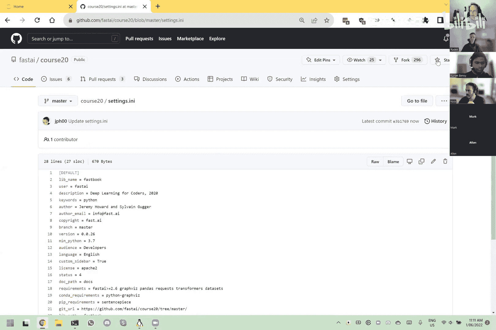
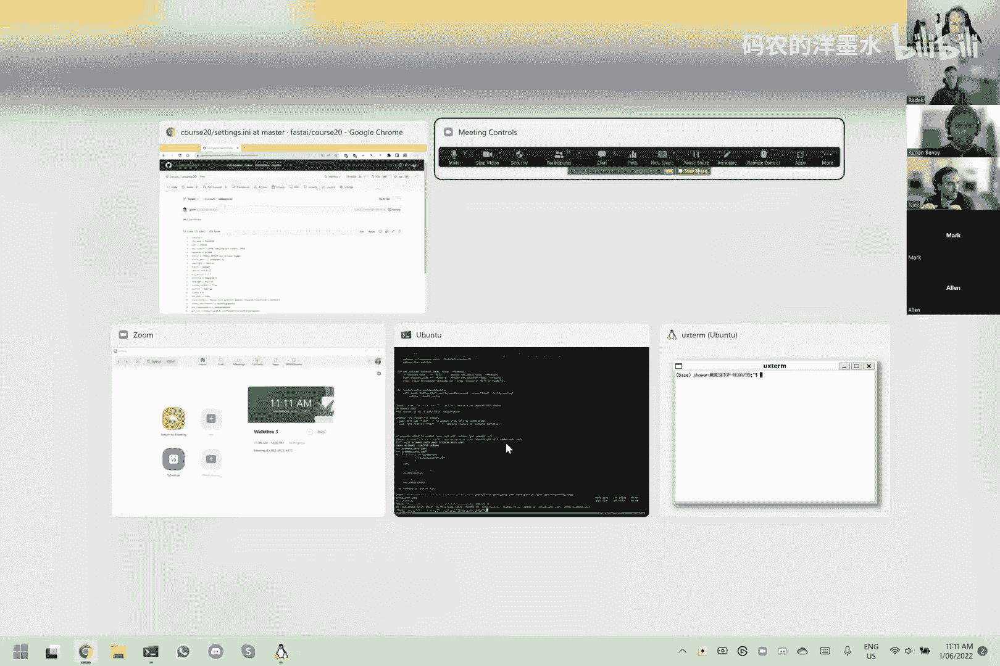
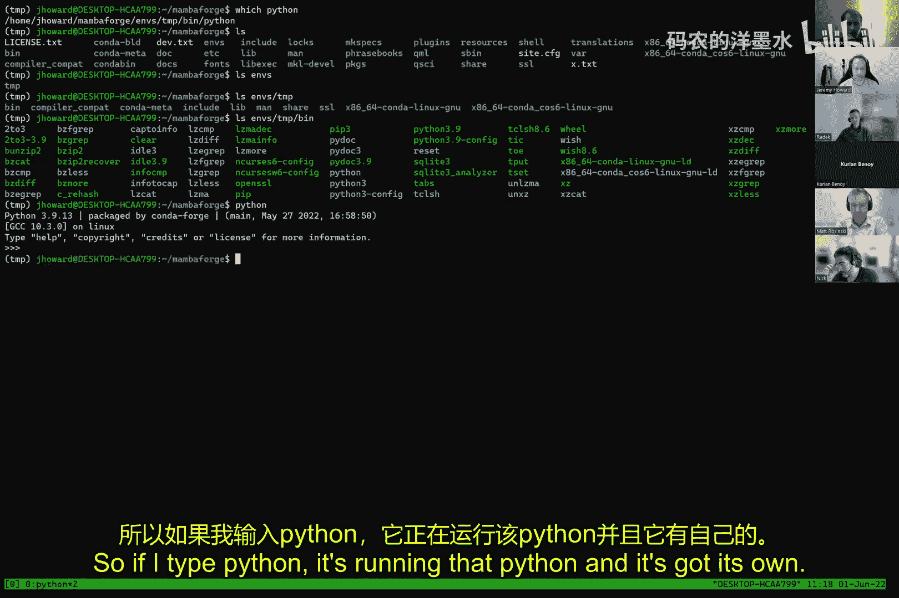
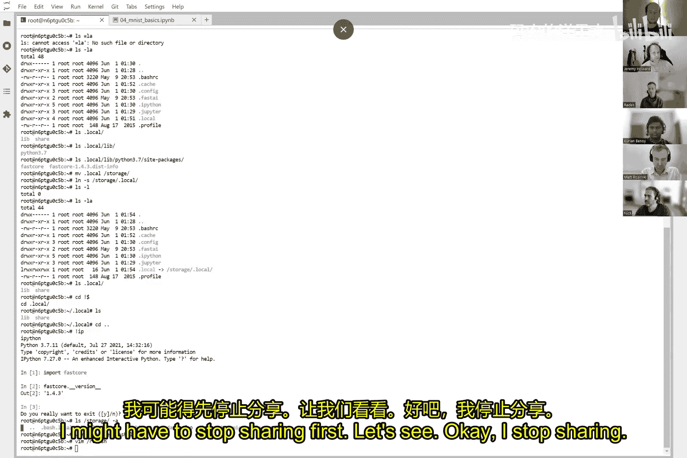

# 003：Paperspace配置与自动化 🚀

在本节课中，我们将学习如何配置和使用Paperspace的免费GPU服务器，并实现环境的自动化设置，使其使用体验尽可能接近本地计算机。我们将涵盖环境变量、符号链接、SSH密钥管理以及如何持久化自定义配置。

---


## 概述






上一节我们介绍了如何在本地计算机上使用Python和Jupyter。本节中，我们来看看如何在云端使用Paperspace的GPU服务器。我们将学习如何配置服务器，使其在每次启动时都能自动恢复我们的个人设置、安装的库和SSH密钥，从而创建一个高效、可重复的工作环境。

---

## 环境变量与路径



在Linux系统中，Shell使用一个名为`PATH`的环境变量来查找可执行程序。`PATH`是一个用冒号分隔的字符串，列出了系统搜索程序的目录列表。

你可以使用`echo`命令查看当前`PATH`：
```bash
echo $PATH
```
当你在终端输入`python`时，系统会按照`PATH`中列出的目录顺序，查找名为`python`的可执行文件并运行它。

Python也有一个类似的机制，称为`sys.path`。这是一个Python列表，包含了Python解释器搜索模块（即库文件）的目录。你可以通过以下代码查看：
```python
import sys
sys.path
```
通常，通过`pip`或`conda`安装的库会被放置在`site-packages`目录中，该目录默认包含在`sys.path`里。


---

## Conda环境的工作原理

Conda或Mamba环境本质上是独立的目录，包含了Python解释器、库和其他依赖的副本。它们通过修改`PATH`环境变量来工作，将特定环境的`bin`目录置于搜索路径的前列。

以下是创建和激活一个名为`test`的Conda环境的命令：
```bash
mamba create -n test python=3.9 fastcore
mamba activate test
```
激活环境后，`which python`命令会显示Python来自新环境的目录（例如`~/mambaforge/envs/test/bin/python`）。环境的所有文件都存储在`~/mambaforge/envs/`目录下。

要返回基础环境，只需运行：
```bash
mamba activate
```
虽然环境对于隔离项目依赖很有用，但对于追求快速迭代的数据科学工作，维护一个统一的基础环境并保持所有库更新，通常是更简单高效的做法。

---

## 配置Paperspace服务器

Paperspace的Gradient Notebooks提供了免费的GPU资源。但需要注意的是，每次启动的服务器实例都是全新的，不会保留之前的更改（除了挂载的持久化存储）。因此，我们需要一种方法来自动化设置过程。

### 持久化存储与符号链接

Paperspace提供了一个名为`/storage`的目录，用于持久化存储文件。我们的目标是将所有个人配置和安装的库链接到这个目录。

例如，使用`pip install --user`安装的库会出现在`~/.local`目录中。为了让这些库在服务器重启后依然可用，我们需要：
1.  将`~/.local`目录移动到持久化存储中。
2.  创建一个指向持久化存储的符号链接。

以下是操作步骤：
```bash
# 1. 将本地目录移动到持久化存储
mv ~/.local /storage/
# 2. 创建符号链接
ln -s /storage/.local ~/.local
```
符号链接（Symbolic Link）类似于Windows的快捷方式或Mac的替身，它允许一个目录指向另一个位置。

### 自动化脚本：`prerun.sh`

Paperspace允许我们创建一个名为`/storage/prerun.sh`的脚本，该脚本会在每次启动Jupyter服务器**之前**自动执行。我们可以将所有的符号链接创建命令放在这里。

以下是一个`prerun.sh`脚本的示例内容：
```bash
#!/bin/bash
# 创建必要的符号链接，将持久化存储链接到正确位置
ln -sf /storage/.local ~/.local
ln -sf /storage/.ssh ~/.ssh
ln -sf /storage/.git-credentials ~/.git-credentials
ln -sf /storage/.cache ~/.cache
ln -sf /storage/git ~/git
```
确保脚本有执行权限：
```bash
chmod +x /storage/prerun.sh
```
这样，每次启动新的Paperspace实例时，我们的个人环境都会自动准备就绪。

---



## 在Paperspace上管理SSH密钥


为了能从Paperspace服务器访问GitHub等代码仓库，我们需要配置SSH密钥。

以下是操作步骤：
1.  **生成或上传密钥**：你可以在本地生成SSH密钥对，然后通过Jupyter Lab的文件上传功能将私钥（如`id_rsa`）和公钥（如`id_rsa.pub`）上传到服务器。也可以直接在服务器上使用`ssh-keygen`命令生成新的密钥对。
2.  **放置密钥**：将密钥文件移动到`~/.ssh/`目录下。
3.  **设置正确权限**：SSH对密钥文件的权限要求非常严格。私钥必须只有所有者可读。
    ```bash
    chmod 600 ~/.ssh/id_rsa      # 私钥：仅用户可读写
    chmod 644 ~/.ssh/id_rsa.pub  # 公钥：用户可读写，其他人只读
    ```
4.  **测试连接**：
    ```bash
    ssh -T git@github.com
    ```
    如果看到欢迎信息，说明认证成功。
5.  **持久化密钥**：最后，记得将整个`~/.ssh`目录移动到`/storage`并创建符号链接，或者确保你的`prerun.sh`脚本包含了创建该链接的命令。

---

## 使用Python调试器（PDB）

在开发过程中，调试是必不可少的技能。Python自带了一个强大的命令行调试器`pdb`。

在Jupyter单元格中，你可以使用以下魔法命令启动`pdb`：
```python
%%debug
# 你的代码将在这里进入调试模式
for i in range(3):
    print(i)
```
进入调试器后，可以使用一些简短的命令进行控制：
*   `n` (`next`): 执行下一行代码。
*   `s` (`step`): 进入函数调用内部。
*   `p <变量名>` (`print`): 打印变量的值。
*   `l` (`list`): 显示当前行附近的代码。
*   `c` (`continue`): 继续执行，直到下一个断点或程序结束。
*   `q` (`quit`): 退出调试器。

另一种更常用的方法是在代码中直接插入断点：
```python
import pdb; pdb.set_trace()
# 这行代码之后的程序将会暂停，并进入pdb调试模式
```
掌握`pdb`这类通用工具的技能，可以在各种环境和编程语言中复用，大大提高效率。

---

## 总结


本节课中我们一起学习了如何深度配置Paperspace的GPU服务器。我们了解了环境变量`PATH`和Python的`sys.path`如何影响程序与模块的查找。掌握了使用符号链接将易失的实例目录与持久化存储`/storage`绑定，并通过`prerun.sh`脚本实现自动化。我们还实践了在服务器上配置SSH密钥以访问Git仓库，并介绍了使用Python内置调试器`pdb`进行代码调试的基本方法。通过这些步骤，我们可以打造一个既拥有强大GPU算力，又具备高度可定制性和持久性的云端开发环境，使其体验无限接近本地计算机。