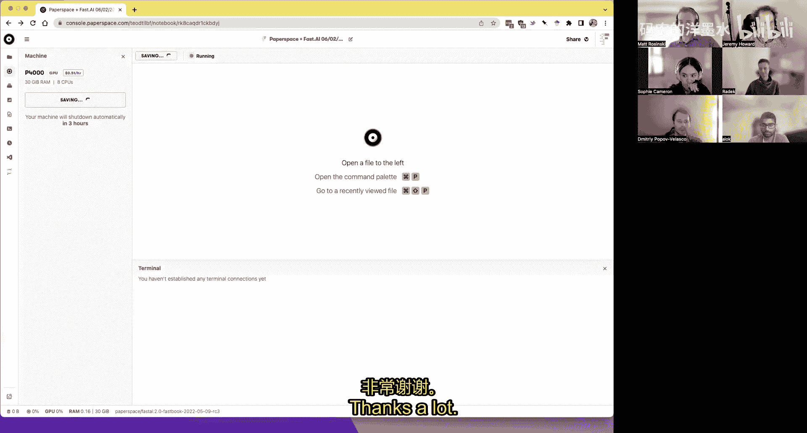

# 004：从零配置 Paperspace 🚀


在本节课中，我们将学习如何从零开始，一步步配置 Paperspace 环境，以复现上一节课的操作。我们将重点关注如何设置持久化存储、管理 Python 包以及自动化配置过程，确保环境可重复且易于维护。

---

## 环境概览与核心目录 📁

上一节我们介绍了 Paperspace 的基本操作，本节中我们来看看其文件系统的核心结构。理解这一点对后续配置至关重要。

在 Paperspace 的根目录中，有两个特别重要的文件夹：

*   **`/storage`**：这是一个持久化存储目录。存放在这里的任何内容，在你创建的所有 Notebook 服务器实例中都是可见和共享的。它位于一个独立的 500GB 磁盘上。
*   **`/notebooks`**：这也是一个持久化存储目录，但它仅对当前这个特定的 Notebook 服务器实例可见。如果你删除了这个服务器，这里的文件也会消失。它同样位于一个独立的 500GB 磁盘上。

你可以使用 `df -h` 命令来查看这些磁盘的挂载情况。注意，你需要为使用的存储空间付费，因此请定期在账户的“账单”部分查看使用量。

---

## 管理 Python 包：Pip 与 Conda 🐍

接下来，我们讨论如何在 Paperspace 中安装额外的 Python 包。这里涉及到包管理工具 Pip 和 Conda 的选择。

一个常见的疑问是：同时使用 Pip 和 Conda 会冲突吗？官方的回答是“会，不要这样做”。但根据实践社区（如 Fast.ai 论坛）的经验，成千上万的用户同时使用两者，很少遇到实际问题。

我们的建议是：
*   对于**需要 GPU 支持**的包（如 PyTorch、TensorFlow），**优先使用 Conda**。因为 Conda 能自动处理 CUDA 工具包等复杂的依赖关系，省去手动配置的麻烦。
*   对于其他通用包，使用 Pip 并安装到用户目录通常是安全且方便的。我们本节课将采用这种方式。

如果你想卸载包，可以使用 `pip uninstall <package_name>` 命令，或者直接删除相关的目录（如 `mambaforge`）并重新开始。关键在于，你应该能够随时重建一个可工作的环境。

---

## 持久化用户安装的包 🔗

我们的目标是将用户通过 Pip 安装的包（默认在 `~/.local` 目录下）移动到持久化存储中，这样每次启动新实例时都能使用它们。

以下是实现步骤：

1.  首先，在 `/storage` 中创建一个目录来存放我们的配置，例如叫 `cfg`。
    ```bash
    mkdir /storage/cfg
    ```
2.  将家目录下的 `.local` 文件夹移动到持久化存储中。
    ```bash
    mv ~/.local /storage/cfg
    ```
3.  创建一个符号链接（软链接），将持久化存储中的 `.local` “映射”回原来的家目录位置。
    ```bash
    ln -s /storage/cfg/.local ~/.local
    ```
现在，`~/.local` 看起来像一个普通文件夹，但实际上指向 `/storage/cfg/.local`。之后使用 `pip install --user` 安装的包，都会实际存储在持久化空间里。

你可以通过导入包来测试是否成功，例如：
```python
import fastcore
print(fastcore.__version__)
```

---

## 自动化配置：创建启动脚本 ⚙️

为了让每个新启动的 Notebook 服务器都能自动建立好我们需要的环境（如上面的符号链接），我们需要创建一个启动脚本。

在 Paperspace 中，一个名为 `prerun.sh` 的特殊脚本会在每次实例启动时自动运行。我们将把这个脚本放在 `/storage` 中，使其对所有实例生效。

以下是创建和设置 `prerun.sh` 脚本的方法：

1.  为了能在 Jupyter 界面中编辑 `/storage` 中的文件，我们可以在 `/notebooks` 目录下创建一个指向 `/storage` 的符号链接。
    ```bash
    ln -s /storage /notebooks/storage
    ```
2.  在 Jupyter 的文件浏览器中，进入 `notebooks/storage`，点击“新建” -> “文本文件”。
3.  将文件重命名为 `prerun.sh`。
4.  编辑 `prerun.sh` 文件，内容如下。这个脚本会先清理可能存在的旧链接，然后为我们需要的目录创建符号链接。
    ```bash
    #!/bin/bash
    # 移除可能已存在的链接或目录
    rm -rf ~/.local ~/.ssh
    # 创建指向持久化存储的符号链接
    ln -s /storage/cfg/.local ~/.local
    ln -s /storage/cfg/.ssh ~/.ssh
    ```
5.  保存文件后，需要为其添加可执行权限。我们使用 `chmod` 命令设置权限为 `755`。
    ```bash
    chmod 755 /storage/prerun.sh
    ```
    这里解释一下 `755`：它是三个数字（7，5，5）的组合，分别代表**文件所有者**、**所属用户组**和**其他用户**的权限。每个数字是读（4）、写（2）、执行（1）权限值的和。因此，`7=4+2+1` 表示所有者有全部权限；`5=4+0+1` 表示组用户和其他用户有读和执行权限。

现在，当你下次创建新的 Paperspace 实例时，这个 `prerun.sh` 脚本就会自动运行，为你设置好 `.local` 和 `.ssh` 的符号链接。

---

## 配置 SSH 密钥 🔐

为了能够从 Paperspace 访问 GitHub 等外部服务，我们需要配置 SSH 密钥。其流程与处理 `.local` 目录类似。

以下是配置 SSH 密钥的步骤：

1.  生成或上传你的 SSH 密钥对到 `~/.ssh` 目录。
2.  设置正确的文件权限至关重要，这是 SSH 安全协议的要求。
    ```bash
    chmod 700 ~/.ssh       # 目录仅所有者可读、写、执行
    chmod 600 ~/.ssh/id_rsa # 私钥仅所有者可读、写
    chmod 644 ~/.ssh/id_rsa.pub # 公钥所有者可读、写，其他人可读
    ```
3.  同样，我们将整个 `.ssh` 目录移动到持久化存储，并通过 `prerun.sh` 脚本创建符号链接（上一步脚本已包含此操作）。
4.  使用以下命令测试 SSH 连接是否成功：
    ```bash
    ssh -T git@github.com
    ```
    如果连接失败，通常是因为文件权限设置不正确。你可以添加 `-v`（verbose）参数来获取详细的调试信息，例如 `ssh -v -T git@github.com`。

---

## 测试与验证 ✅

完成所有配置后，最关键的一步是进行测试。

1.  停止你当前的 Notebook 服务器。
2.  重新启动一个新的 Notebook 服务器实例。在创建时，请确保：
    *   选择 **Fast.ai 镜像**，因为它包含了我们所需的基础环境。
    *   在“高级选项”中，可以删除“Workspace URL”的内容，以便从一个干净的环境开始。
3.  启动后，打开新的实例，检查以下内容：
    *   `~/.local` 和 `~/.ssh` 是否已正确链接到 `/storage/cfg` 下的目录。
    *   能否成功导入之前安装的 Python 包。
    *   SSH 连接到 GitHub 是否正常。

如果一切顺利，说明你的自动化配置脚本工作正常，环境已经可以持久化并跨实例使用了。

---

## 总结 📝

本节课中我们一起学习了如何从零开始配置 Paperspace 环境。我们首先理解了 `/storage` 和 `/notebooks` 这两个核心持久化目录的区别。然后，我们探讨了如何使用 Pip 和 Conda 管理 Python 包，并将用户安装的包通过符号链接持久化到 `/storage` 中。接着，我们创建了自动化的 `prerun.sh` 启动脚本，确保每次启动新实例时环境都能自动配置好。最后，我们还配置了 SSH 密钥并进行了全面测试。




通过这一套流程，你建立了一个可重复、易维护的云端开发环境，为后续的机器学习项目打下了坚实的基础。如果在尝试过程中遇到任何问题，请随时在论坛提问。