# 008：Kaggle竞赛本地实战 🚀

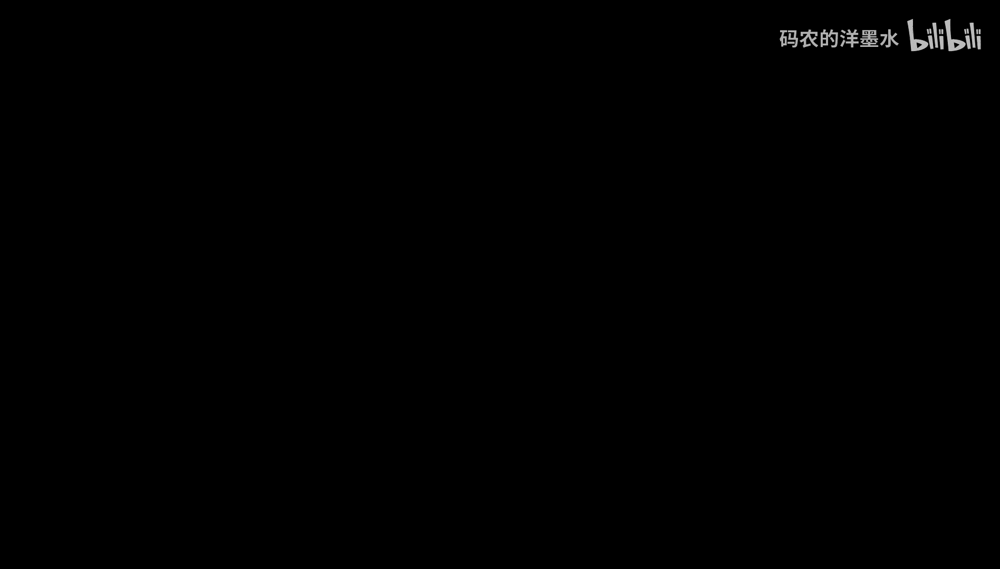

在本节课中，我们将学习如何在本地环境中准备和参与Kaggle竞赛。我们将涵盖从设置环境、下载数据、训练模型，到生成预测并提交结果的全过程。通过实际操作，你将掌握在本地高效进行机器学习项目的基本工作流。

---

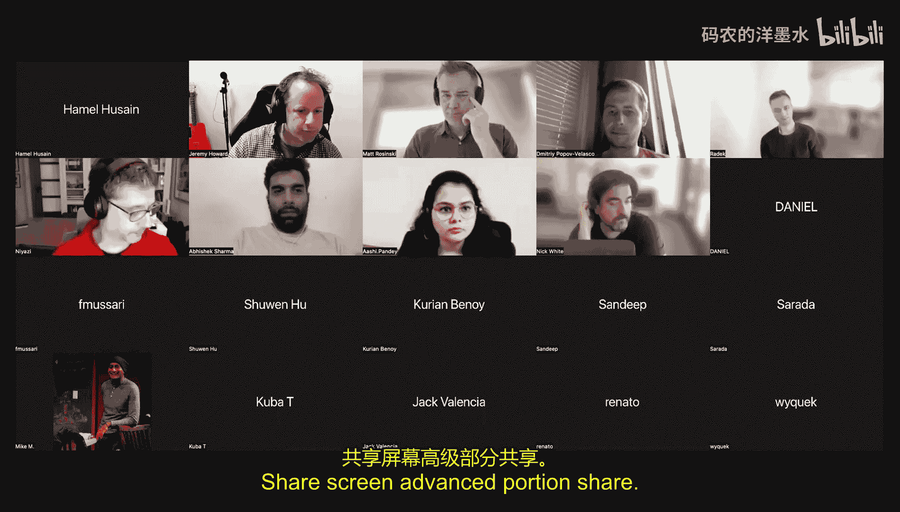

## 环境设置与数据准备

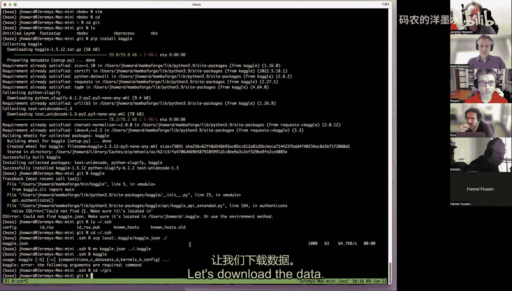

上一节我们介绍了课程目标，本节中我们来看看如何设置本地环境并获取竞赛数据。

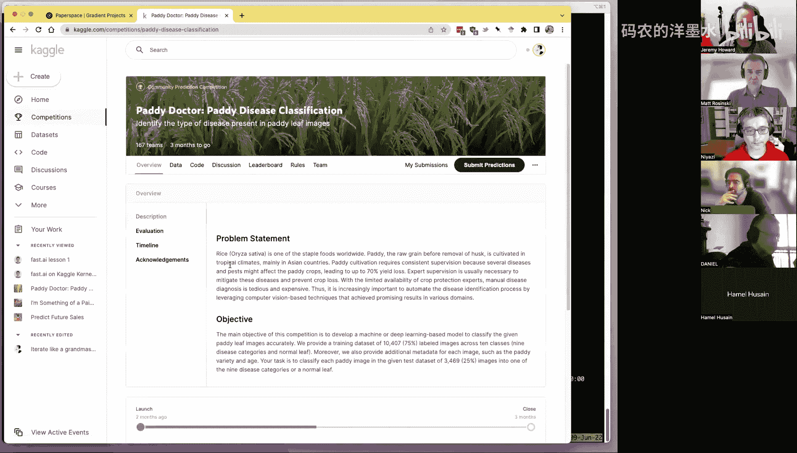

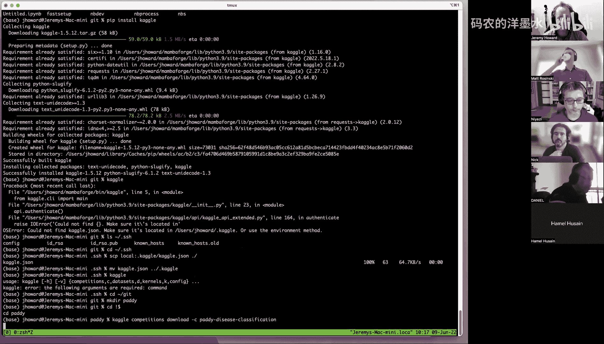

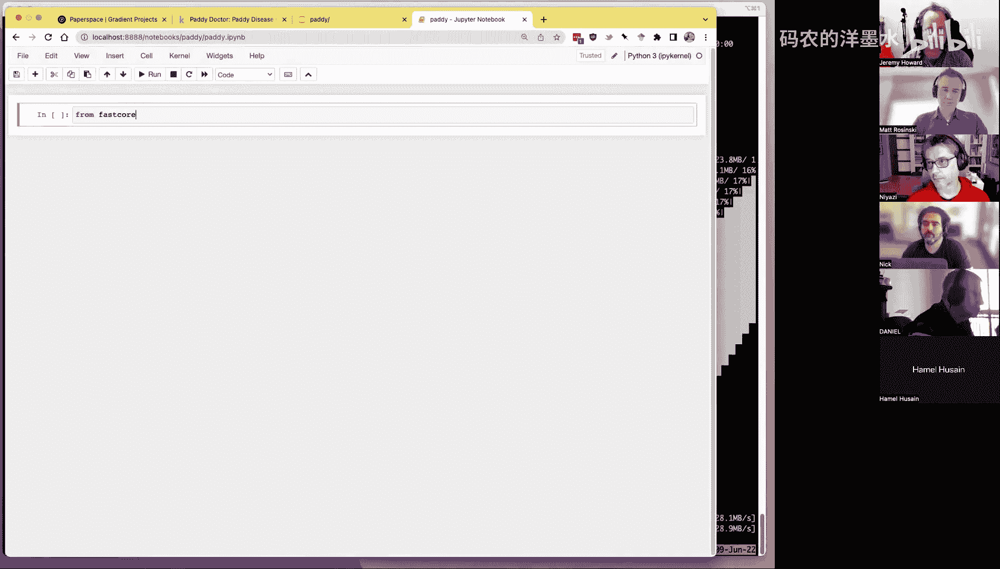

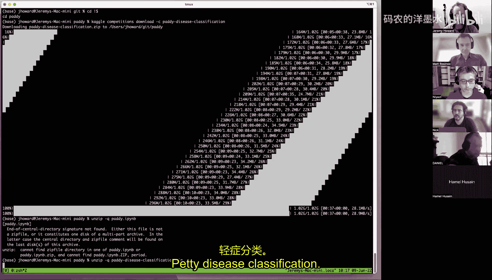

首先，我们需要安装Kaggle命令行工具并配置身份验证。

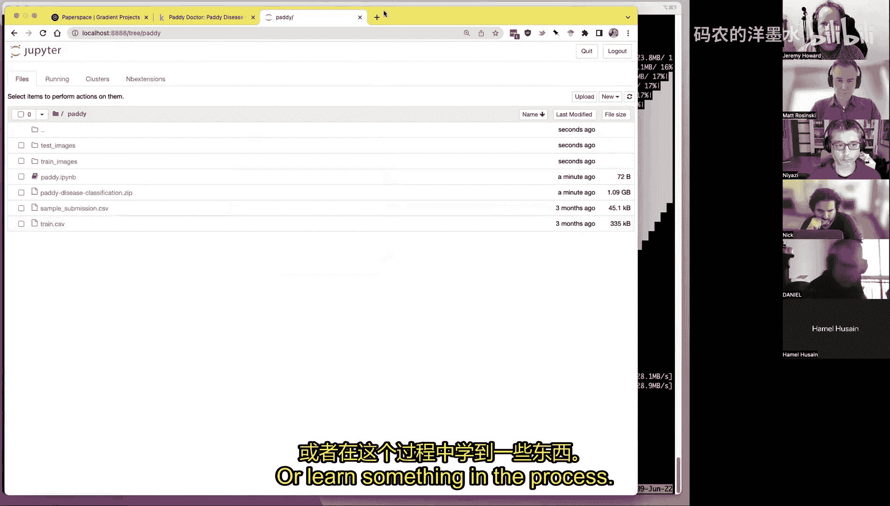

```bash
pip install kaggle
```

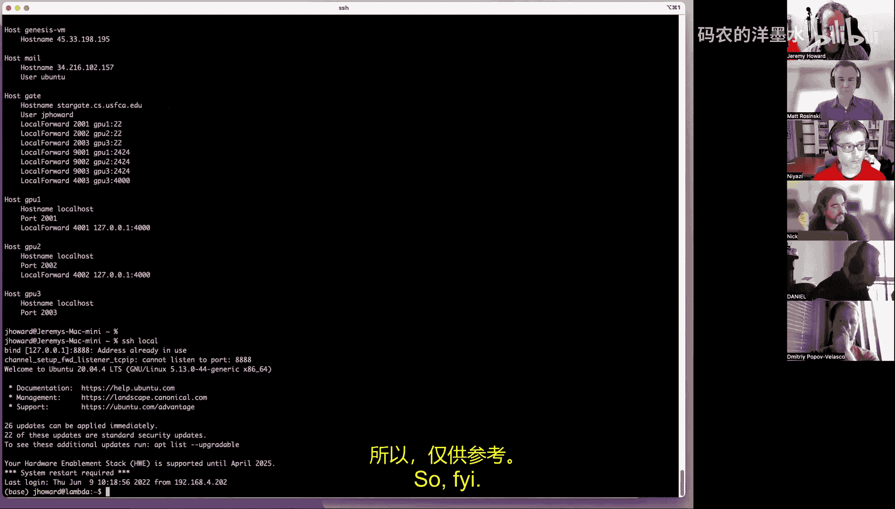

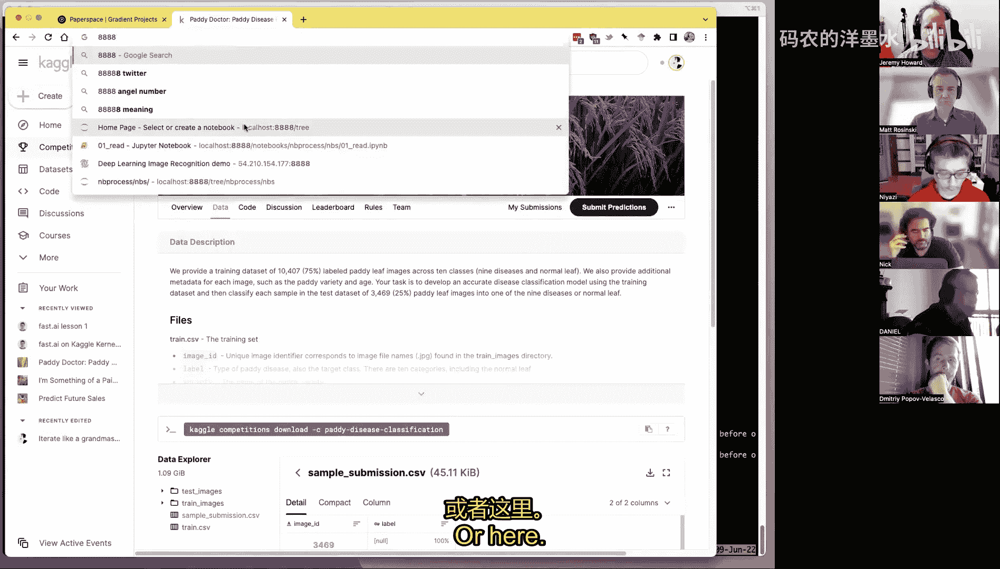

接着，将你的Kaggle API令牌文件（`kaggle.json`）移动到正确目录。

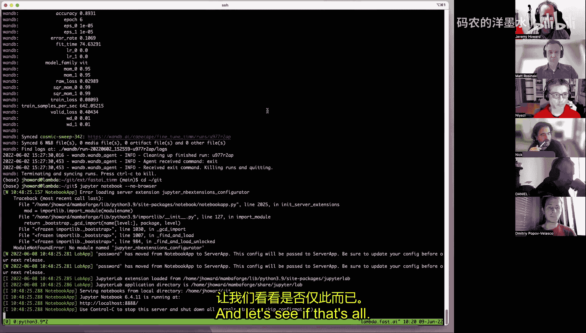

```bash
mkdir -p ~/.kaggle
cp kaggle.json ~/.kaggle/
```

现在，我们可以从Kaggle竞赛页面下载所需的数据集。

```bash
kaggle competitions download -c <竞赛名称>
```

下载完成后，通常是一个压缩文件，我们需要解压它。

```bash
unzip -q <下载的文件名>.zip
```

## 数据探索与加载

数据准备就绪后，下一步是加载并探索数据，为模型训练做准备。

我们从FastAI库中导入必要的模块，并查看数据路径下的文件。

```python
from fastai.vision.all import *
path = Path('.')
image_files = get_image_files(path/'train_images')
```

我们可以查看一张图片及其尺寸，以了解数据的基本情况。

```python
img = PILImage.create(image_files[0])
print(img.size)
```

为了高效地获取所有图片的尺寸，我们可以使用并行处理。以下是两种方法：

*   **串行处理（较慢）**：使用列表推导式逐一处理。
*   **并行处理（较快）**：使用`fastcore.parallel`模块加速。

```python
# 串行处理示例
sizes = [PILImage.create(f).size for f in image_files[:100]]

# 并行处理示例
from fastcore.parallel import *
def get_size(f): return PILImage.create(f).size
sizes = parallel(get_size, image_files[:100], n_workers=4)
```

## 构建数据加载器与模型

在了解了数据之后，我们需要将其转换为模型可以训练的格式，并选择一个合适的模型架构。

我们使用FastAI的`ImageDataLoaders`来创建数据加载器，并指定验证集比例和图像尺寸变换。

```python
dls = ImageDataLoaders.from_folder(path/'train_images', valid_pct=0.2, item_tfms=Resize(224))
```

对于模型，我们不再使用基础的ResNet34，而是尝试性能更好的ConvNeXt系列模型。这需要安装`timm`库。

```bash
pip install timm>=0.6.2dev
```

然后，我们使用`vision_learner`创建学习器，并指定使用混合精度训练（`fp16`）以加速GPU计算。

```python
import timm
learn = vision_learner(dls, 'convnext_small_in22k', metrics=error_rate).to_fp16()
```

## 模型训练与学习率

模型构建完成后，我们开始训练。FastAI的`fine_tune`方法会自动进行预训练模型的微调。

```python
learn.fine_tune(2)
```

在训练过程中，学习率调度策略（如`fit_one_cycle`）非常重要。它会在训练初期使用较低的学习率，然后逐渐增加，最后再减小，以帮助模型更稳定、更快速地收敛。你可以使用`learn.lr_find()`来可视化并选择一个合适的学习率范围。

## 生成预测与提交结果

模型训练好后，我们需要对测试集进行预测，并按照Kaggle要求的格式提交结果。

首先，为测试集创建数据加载器。

```python
test_files = get_image_files(path/'test_images').sorted()
test_dl = dls.test_dl(test_files)
```

然后，使用模型获取预测结果。`get_preds`方法返回预测概率、目标类别（测试集为None）和类别索引。

```python
preds, _, idxs = learn.get_preds(dl=test_dl, with_decoded=True)
```

我们需要将预测的类别索引映射回实际的类别名称（即`dls.vocab`）。

```python
# 方法一：使用映射字典（高效）
mapping = dict(enumerate(dls.vocab))
results = pd.Series(idxs).map(mapping)

# 方法二：使用lambda函数
results = pd.Series(idxs).map(lambda i: dls.vocab[i])
```

最后，将结果保存为CSV文件，并使用Kaggle CLI提交。

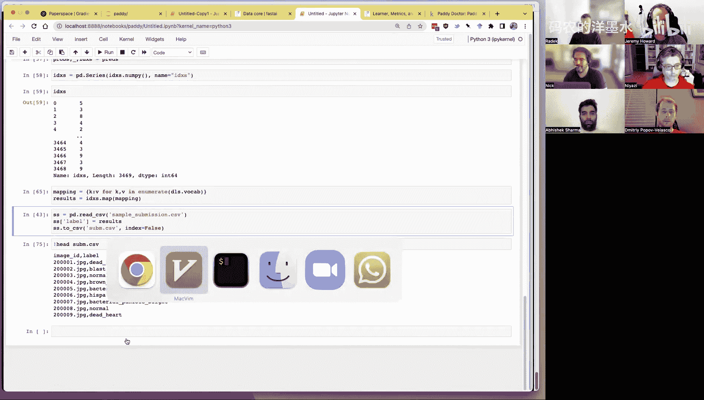

```python
submission = pd.DataFrame({'id': test_files.map(lambda x: x.stem), 'label': results})
submission.to_csv('submission.csv', index=False)
```

```bash
kaggle competitions submit -c <竞赛名称> -f submission.csv -m "提交信息"
```

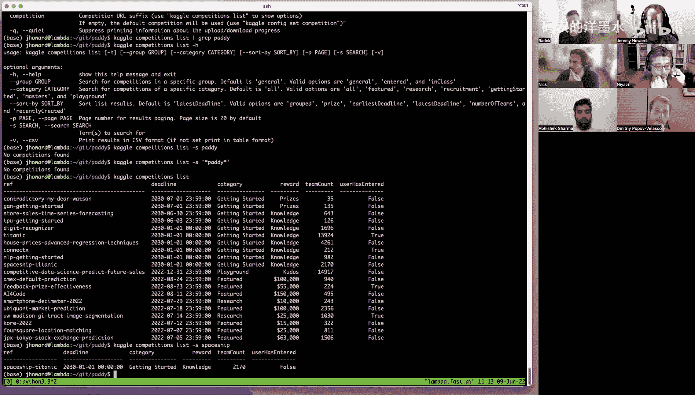

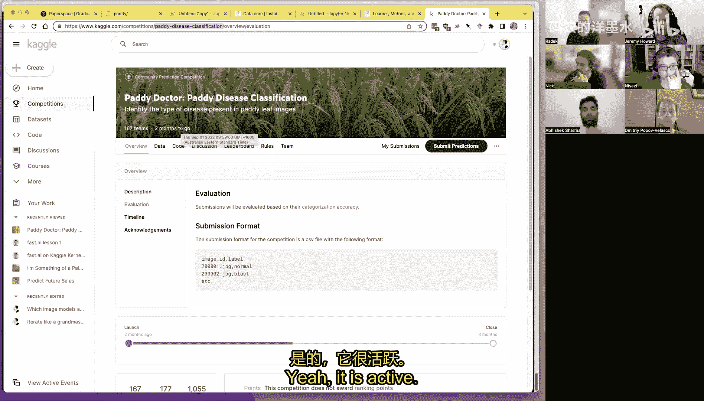

## 常见问题与调试

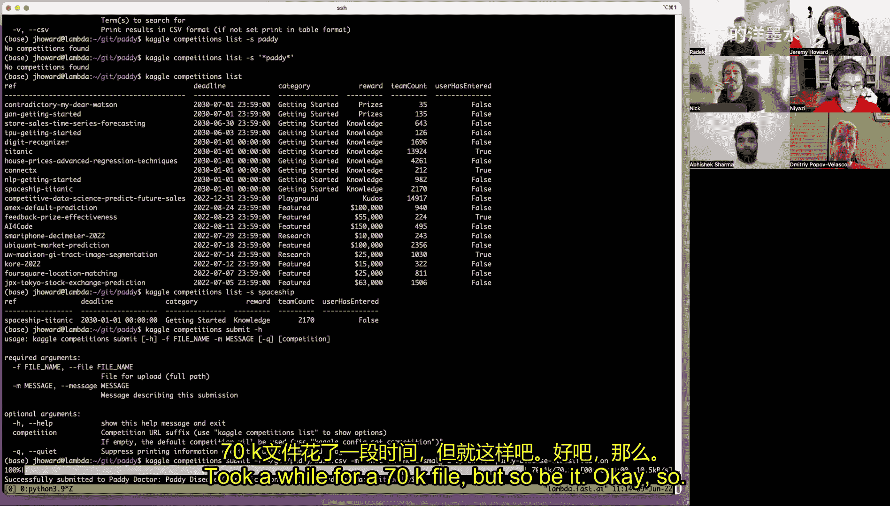

在实践过程中，你可能会遇到一些问题。本节汇总了一些常见情况及其解决方法。

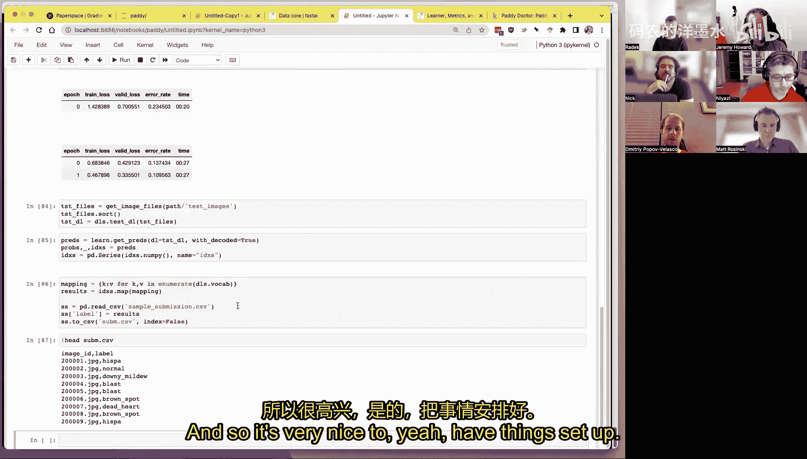

以下是几个关键问题的排查步骤：

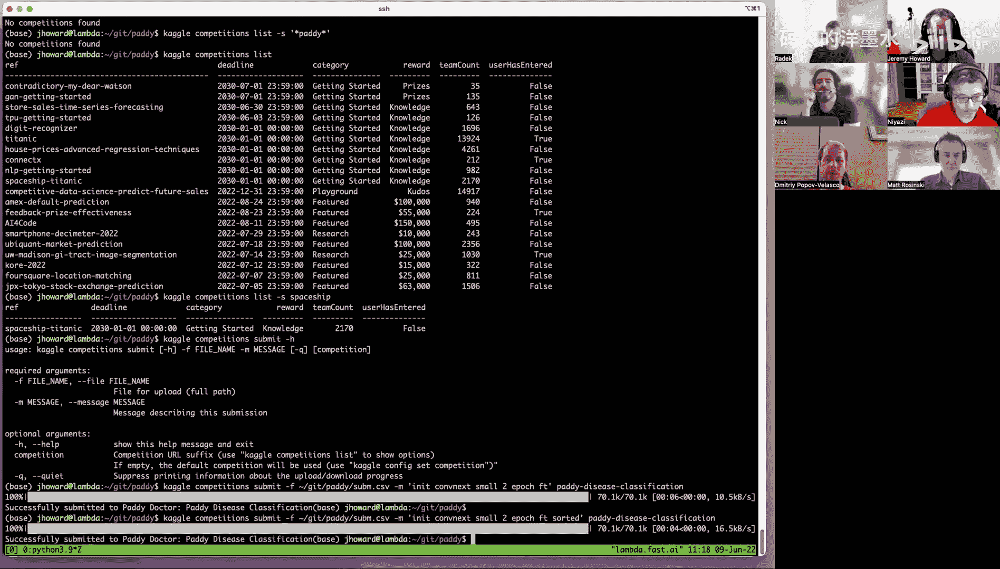

*   **`NameError: name 'timm' is not defined`**：这表示Python环境中没有导入`timm`库。请确保在代码中执行了`import timm`。如果是在安装`timm`后首次导入，可能需要重启Jupyter内核。
*   **提交结果排名异常低**：这通常是因为测试文件的顺序与Kaggle期望的顺序不一致。确保在创建`test_dl`之前，对`test_files`进行排序（例如使用`.sorted()`）。
*   **并行处理未加速**：如果并行处理没有明显提速，可能是因为任务瓶颈在于磁盘I/O（读取图片）而非CPU计算。使用SSD硬盘会更有帮助。

---

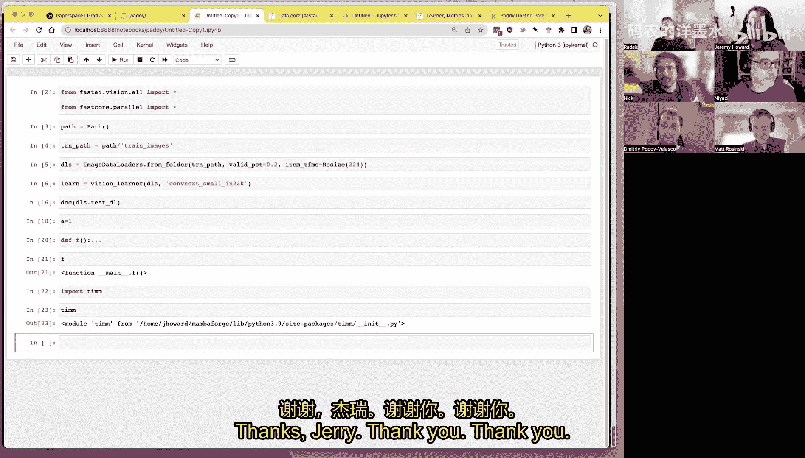

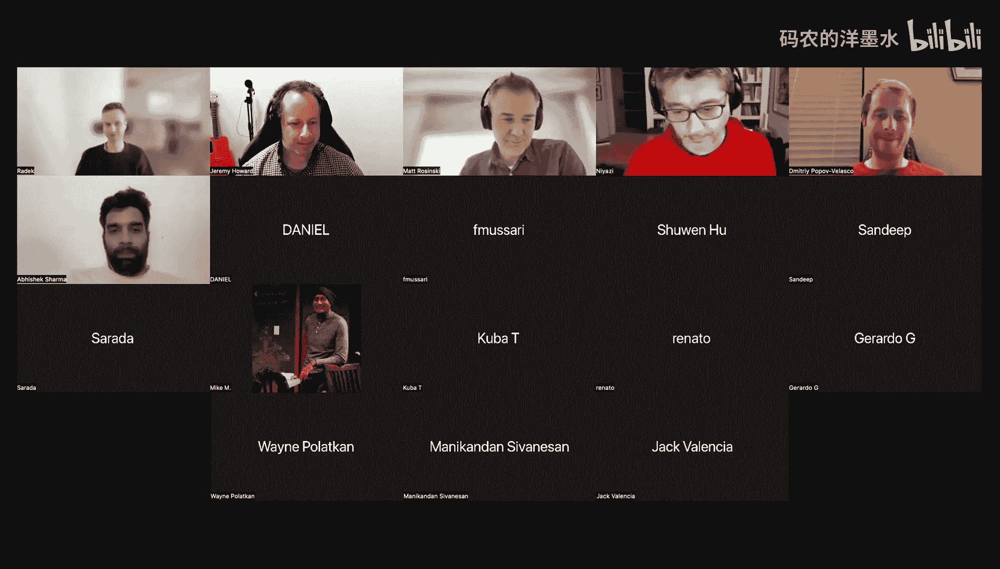

本节课中我们一起学习了在本地进行Kaggle竞赛的完整流程：从环境配置、数据下载与探索，到使用FastAI和`timm`库构建并训练先进的图像分类模型（如ConvNeXt），最后生成预测并提交结果。掌握这个工作流将使你能够更灵活、更高效地在本地开展机器学习项目。