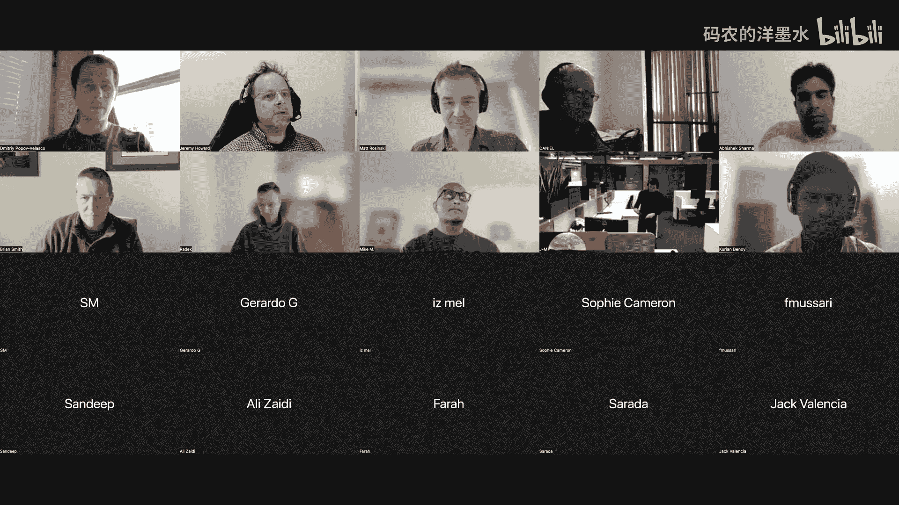
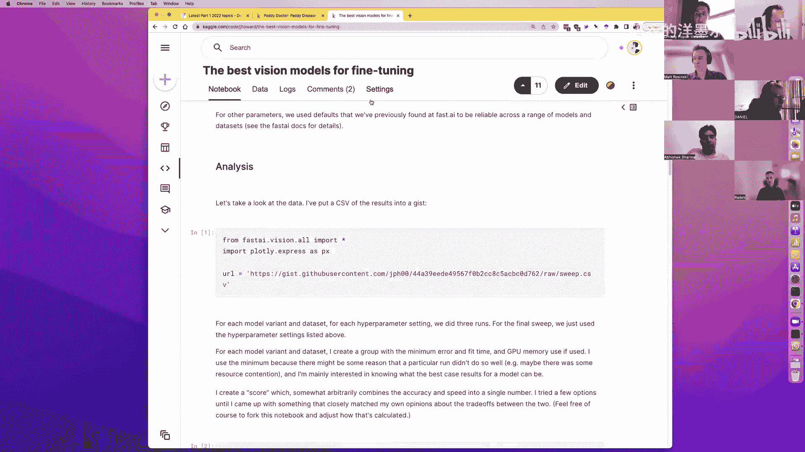
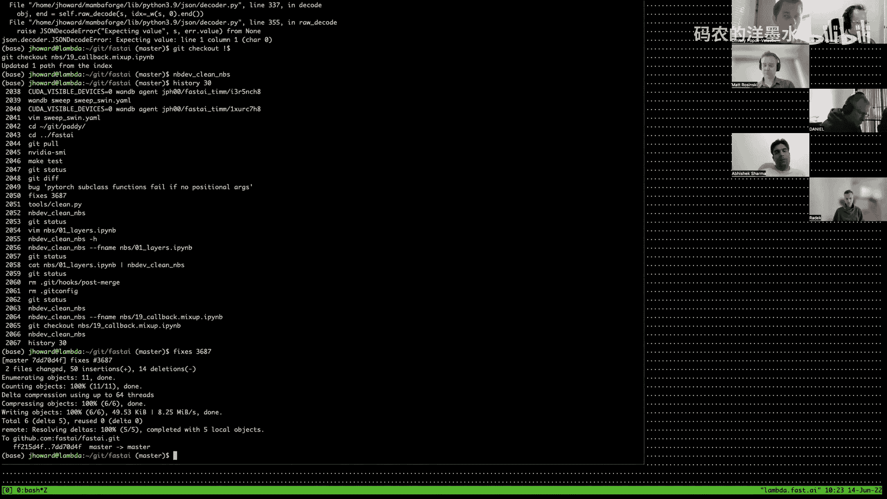
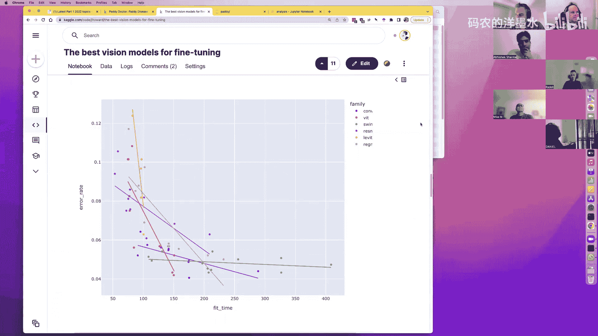
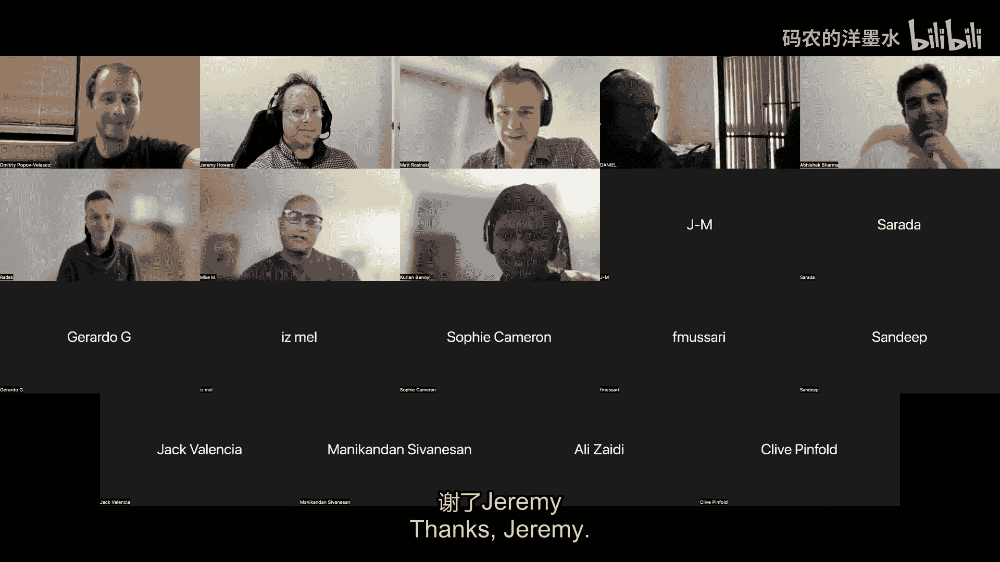

# 010：Kaggle图像识别竞赛进阶 🚀


在本节课中，我们将学习如何为Kaggle图像识别竞赛进行进阶优化。我们将探讨如何系统地评估和选择最适合微调的预训练模型，以及如何通过实验设计高效地提升模型性能。

---



## 概述

在图像识别任务中，微调预训练模型是一种常见且有效的方法。然而，模型的选择、数据预处理和训练策略都会显著影响最终结果。本节将分享一个系统性的实验流程，用于找出在特定数据集上表现最佳的模型。

上一节我们介绍了Kaggle竞赛的基础知识，本节中我们来看看如何通过系统实验来优化模型性能。

---

## 模型微调的关键维度

微调预训练模型的效果主要受两个关键维度影响：





1.  **数据相似度**：你的数据集与预训练模型所用数据集（如ImageNet）的相似程度。
2.  **数据规模**：你用于微调的数据集大小。

以下是这两个维度的具体影响：

*   **高相似度、大数据集**：例如“Pets”数据集，其图像与ImageNet相似。此时，关键因素是微调过程能否有效保留预训练权重。你可以利用大型、精确的模型，因为它们已经学会了与你任务几乎相同的功能。
*   **低相似度、小数据集**：例如“Planet”卫星图像数据集，与ImageNet差异很大。此时，预训练模型的许多权重可能无用，因为它们学习的是特定特征（如纹理、眼睛、毛发）。同时，数据量小也限制了模型学习利用大量参数的能力。

---

## 系统性模型评估实验

为了找出最佳微调模型，我们设计了一个实验，在两个代表性数据集（Pets和Planet）上测试了多种模型架构。

以下是实验的核心步骤：

1.  **编写自动化训练脚本**：脚本核心仅包含几行标准代码，用于创建数据加载器、初始化学习器并进行训练。
    ```python
    # 示例代码结构
    dls = ImageDataLoaders.from_folder(...)
    learn = vision_learner(dls, arch, metrics=error_rate)
    learn.fine_tune(epochs)
    ```
2.  **参数化与自动化搜索**：使用工具（如Weights & Biases）对关键超参数（如学习率、模型架构、图像缩放方法）进行自动化扫描。
3.  **结果收集与分析**：通过API收集所有实验的运行结果（如错误率、训练时间、GPU内存使用量），并整理到CSV文件中进行后续分析。

---

## 实验结果与洞察

通过对结果数据的分析，我们可以得出一些通用性洞察。

以下是针对Pets数据集（高相似度）的分析结果：

*   **最佳模型家族**：ConvNeXt、ResNet表现突出。
*   **权衡取舍**：例如，`VIT_base`模型错误率很低，但训练速度较慢；`ConvNeXt_tiny`则在速度和准确率之间取得了良好平衡。
*   **实用选择**：对于需要快速迭代的场景，可以筛选出在错误率和训练速度上都优于中位数的模型。其中`ConvNeXt_tiny`的综合表现最佳。

以下是针对Planet数据集（低相似度）的分析结果：

*   **最佳模型家族**：基于Transformer的模型（如VIT、Swin）占据了前列。这表明这类模型特别擅长快速学习未见过的数据特征。
*   **模型大小与数据量的关系**：大型、复杂的模型在此类数据上未必表现更好，因为数据量不足以有效利用其大量参数。
*   **推荐方向**：对于与ImageNet差异大的任务，可以优先尝试VIT等Transformer架构的中小型模型。

---

## 在具体竞赛中应用洞察

我们将上述洞察应用于“Plant Pathology”竞赛中，进行快速实验验证。

以下是尝试的不同预处理和模型组合：

1.  **基础预处理**：使用`ConvNeXt_small`模型，尝试不同的图像缩放方法（挤压、裁剪、矩形填充）。
2.  **尝试优秀模型**：根据之前的结论，尝试了`VIT_small`和`SwinV2`模型。其中`SwinV2`即使在较小图像尺寸（192px）下也表现优异。
3.  **处理内存限制**：当模型过大导致GPU内存不足时，使用**梯度累积**技术来模拟更大的批次大小，而无需更换硬件。
    ```python
    # 梯度累积示例
    learn = vision_learner(dls, arch, metrics=error_rate, cbs=GradientAccumulation(n_acc=2))
    ```
4.  **模型集成**：训练多个表现良好的模型，并**对它们的预测概率进行平均**，这通常比简单的投票法能保留更多信息，获得更好的集成效果。

---

## 总结





本节课中我们一起学习了Kaggle图像识别竞赛的进阶优化策略。我们了解到通过系统性的实验设计，可以高效地评估不同预训练模型在特定任务上的表现，并得出具有指导意义的洞察。关键步骤包括：理解数据特性、自动化超参数搜索、分析实验结果以权衡速度与精度、以及使用如梯度累积和概率平均集成等实用技巧来提升最终成绩。这种方法使得我们能够在有限的计算资源下，科学地进行模型选择和优化。