# 018：现代API使用


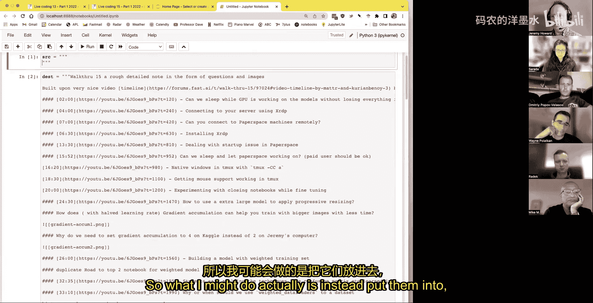

在本节课中，我们将学习如何解决一个实际问题：处理论坛帖子中的图片链接。我们将使用Python的正则表达式来解析和替换文本，并最终构建一个简单的Web应用来自动化这个过程。我们将从数据准备开始，逐步构建解决方案，并学习一些有用的命令行技巧和正则表达式知识。

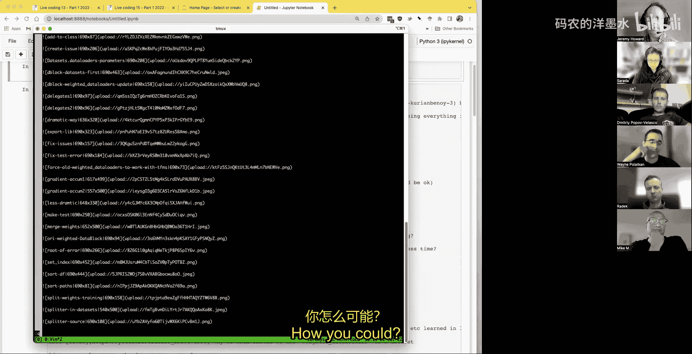

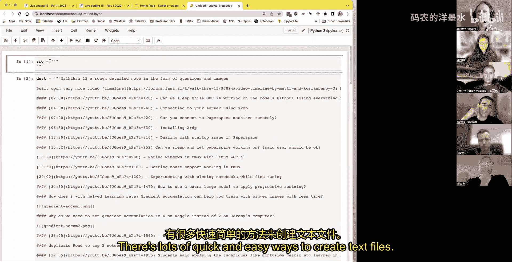

## 数据准备与问题定义

上一节我们介绍了课程目标，本节中我们来看看具体要解决的问题。论坛用户Daniel在总结课程内容时，需要将帖子末尾的图片链接替换到正文的特定位置。原始数据包含两种格式的图片引用：一种是带尺寸的完整链接（在帖子末尾），另一种是正文中的简略引用。我们的目标是自动完成这个替换。

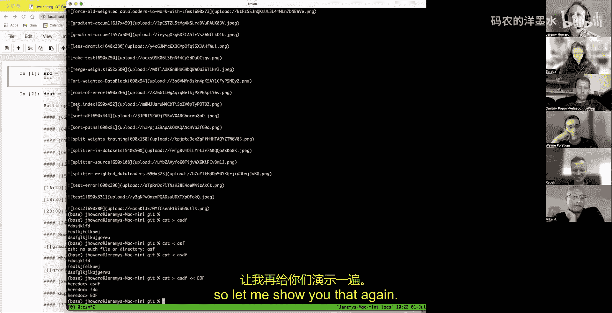

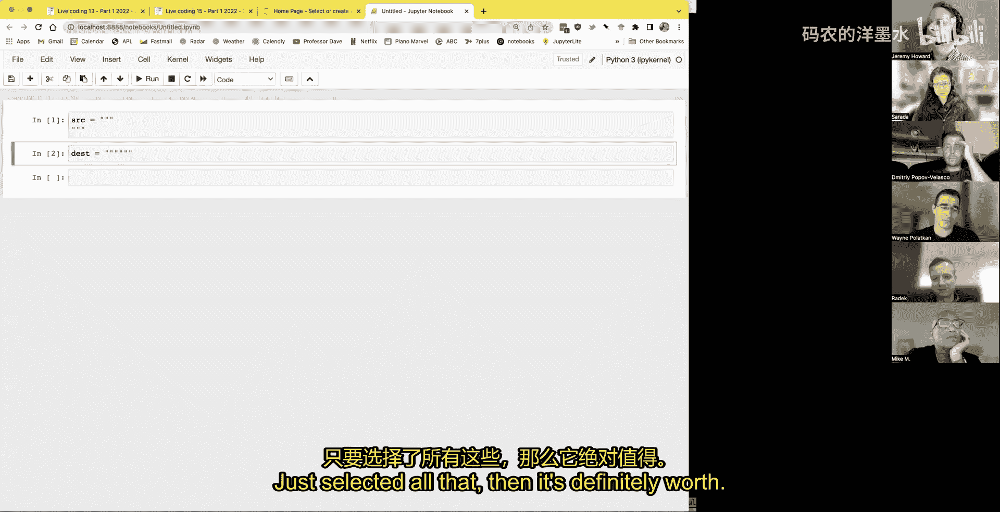

首先，我们需要将原始数据保存到文本文件中，以便于处理。以下是在命令行中快速创建文本文件的方法：

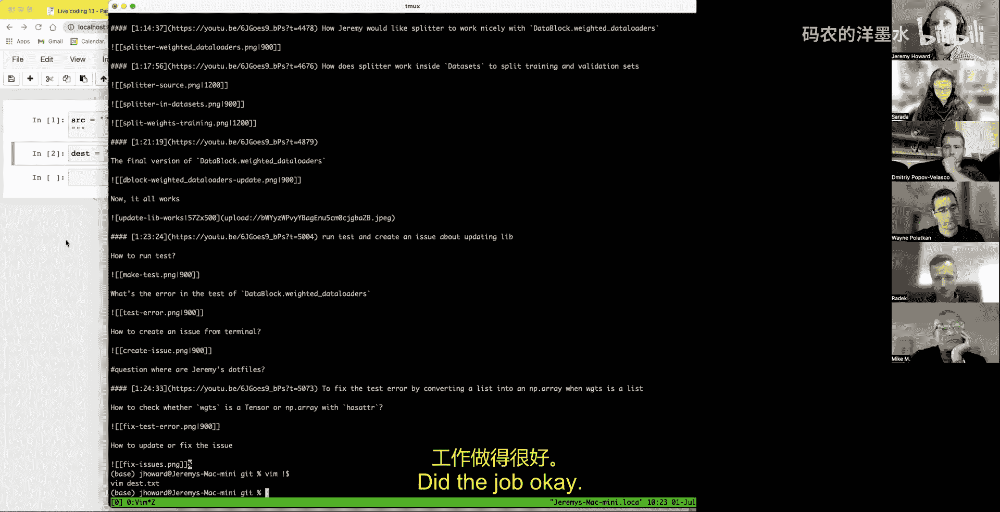

```
cat > source.txt
# 粘贴源文本内容
# 按 Control+D 结束输入
```

```
cat > dest.txt
# 粘贴目标文本内容
# 按 Control+D 结束输入
```

## 在Python中读取数据

现在，我们在Jupyter Notebook中读取这些文件。我们将使用`fastcore`库增强的`Path`类，它提供了更便捷的文件操作方式。

```python
from fastcore.all import *
src = Path('source.txt').read_text()
dest = Path('dest.txt').read_text()
```

为了查看内容，我们可以使用`!`在Jupyter中执行bash命令并打印结果。

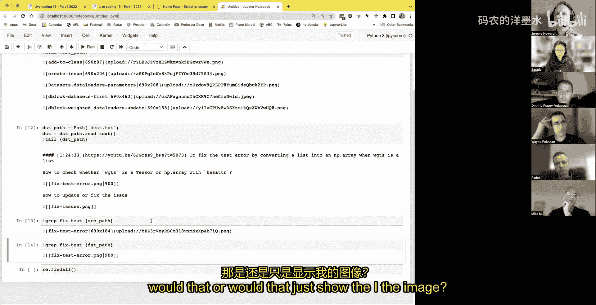

```python
print(f"{src}")
print(f"{dest}")
```

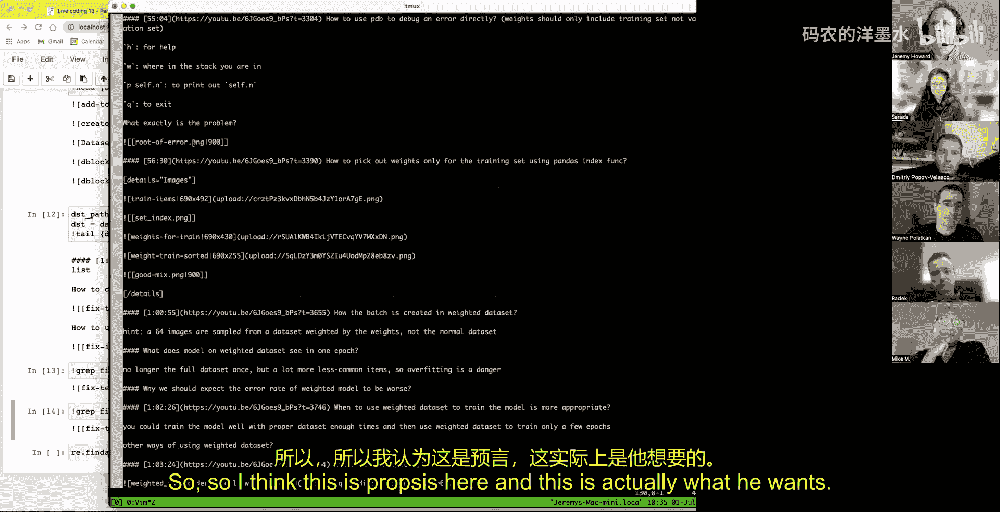

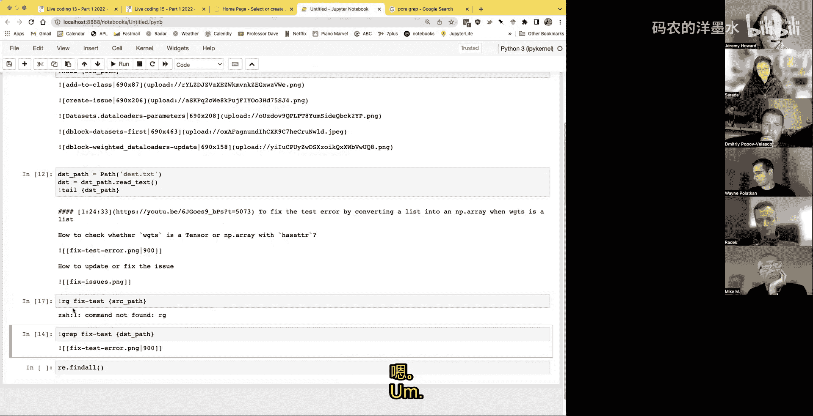

## 使用正则表达式提取映射关系

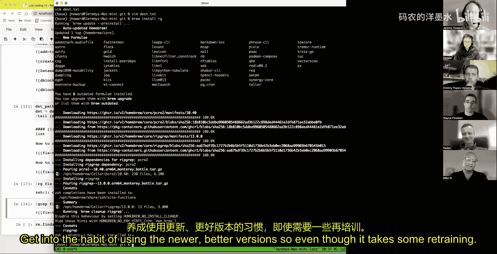

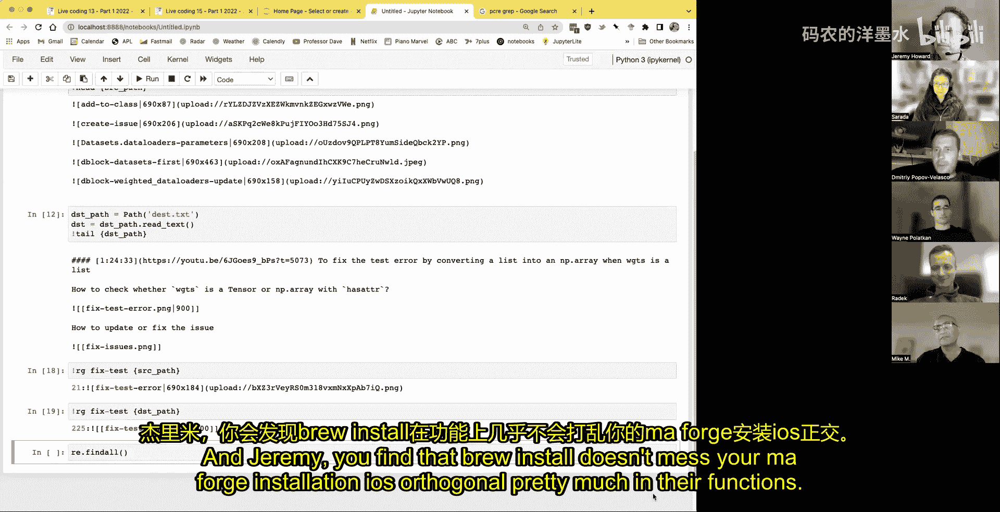

上一节我们导入了数据，本节中我们来看看如何从中提取图片名称与链接的映射关系。我们需要从`source.txt`中提取出图片名称和对应的完整Markdown图片链接。

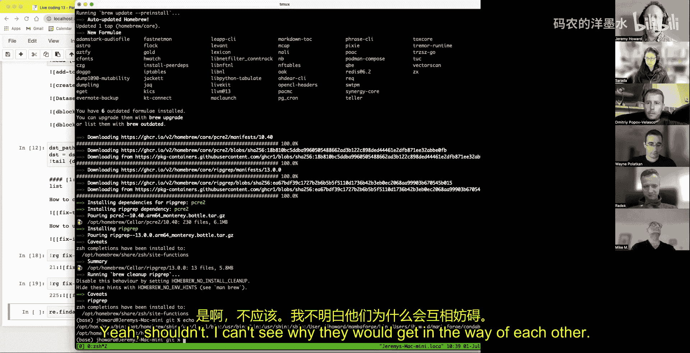

正则表达式（regex）是处理这类文本模式匹配的强大工具。我们将使用Python的`re`模块。

```python
import re
```

我们需要匹配的源格式类似于：``。我们关心括号内的文件名（不含扩展名）和整个链接部分。

以下是构建正则表达式并提取字典的步骤：

# 正则表达式模式：匹配 

```python
# 我们使用括号捕获“文件名”和“完整的链接部分”
pat = r'!\[[^\]]+\]\(attachment:([^\.]+)\.[^\)]+\)'
founds = re.findall(pat, src)
# 创建一个从文件名到找到的匹配项的列表（暂时）
print(founds[:5])
```

然而，我们实际需要的是一个从图片名（如`add_to_class`）到其完整引用字符串的映射。我们需要调整正则表达式以捕获更多信息。

    # 提取图片名，例如从 `` 中提取 `add_to_class`

```python
# 改进的正则表达式，捕获图片名和完整的attachment链接
pat = r'(!\[[^\]]+\]\(attachment:[^\)]+\))'
founds = re.findall(pat, src)
# 现在 founds 包含了完整的图片标记字符串
img_dict = {}
for img_tag in founds:
    # 使用另一个正则表达式
    name_match = re.search(r'!\[[^\]]+\]\(attachment:([^\.]+)', img_tag)
    if name_match:
        name = name_match.group(1)
        img_dict[name] = img_tag
print(list(img_dict.items())[:3])
```

## 在目标文本中进行查找和替换

现在我们已经有了映射字典，接下来需要在目标文本（`dest.txt`）中查找简短的图片引用（如``）并将其替换为完整的图片标记。

目标文本中的引用格式为：``。我们需要构建另一个正则表达式来匹配这种模式，并使用一个函数来执行替换。

# 匹配目标文本中的图片引用，例如 

```python
dest_pat = r'!\[\]\(([^\)]+)\)'

def replace_img(match):
    "接收一个re.Match对象，返回替换后的字符串"
    filename = match.group(1)  # 例如 'add_to_class.png'
    # 去掉扩展名以获取键
    key = filename.split('.')[0]
    # 从字典中获取完整的图片标记，如果找不到则返回原字符串
    full_tag = img_dict.get(key)
    if full_tag:
        return full_tag
    else:
        return f"![缺失图片: {key}]"

# 使用 re.sub 进行替换，其第二个参数可以是一个函数
new_dest = re.sub(dest_pat, replace_img, dest)
print(new_dest[:500]) # 打印一部分看看效果
```

## 处理更复杂的情况和可选尺寸

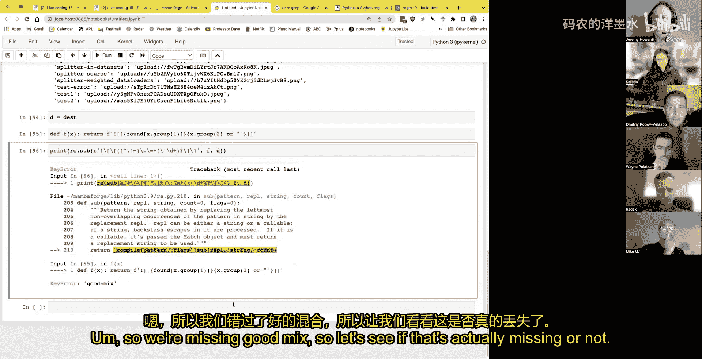

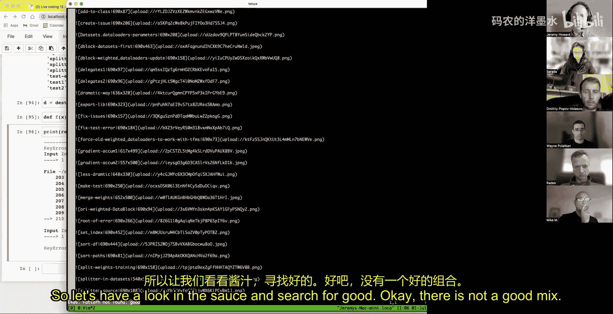

实际上，Daniel的源数据中，链接可能包含可选的尺寸信息（如`|900`）。我们的正则表达式和替换函数需要处理这种可选情况。

我们需要修改源数据的正则表达式，以捕获可选的尺寸部分。

```python
# 更新源正则表达式，使尺寸部分可选
src_pat = r'(!\[[^\]]+\]\(attachment:[^\)]+(?:\|\d+)?\))'
founds = re.findall(src_pat, src)
img_dict = {}
for img_tag in founds:
    name_match = re.search(r'!\[[^\]]+\]\(attachment:([^\.]+)', img_tag)
    if name_match:
        name = name_match.group(1)
        img_dict[name] = img_tag
```

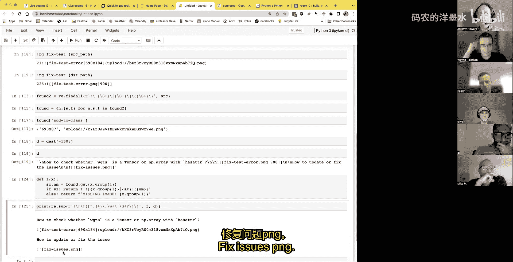

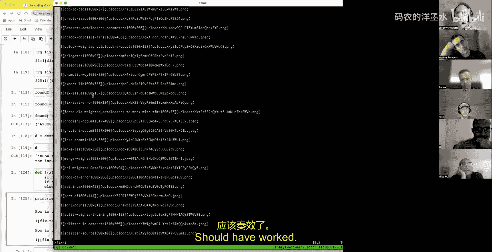

同时，目标文本中的引用也可能包含尺寸（如``）。我们需要更新目标正则表达式和替换函数。

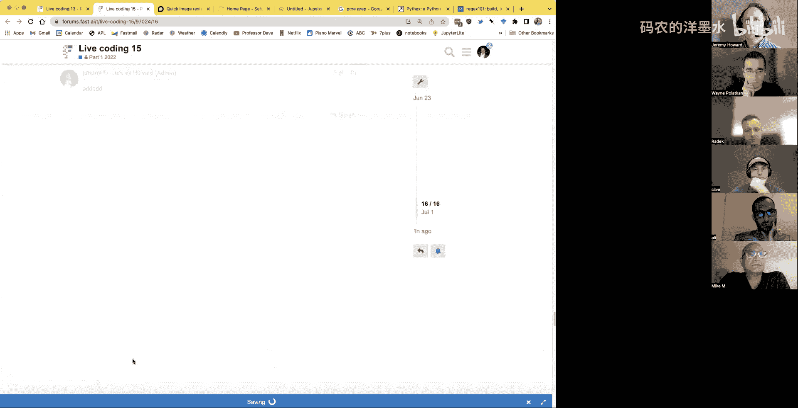

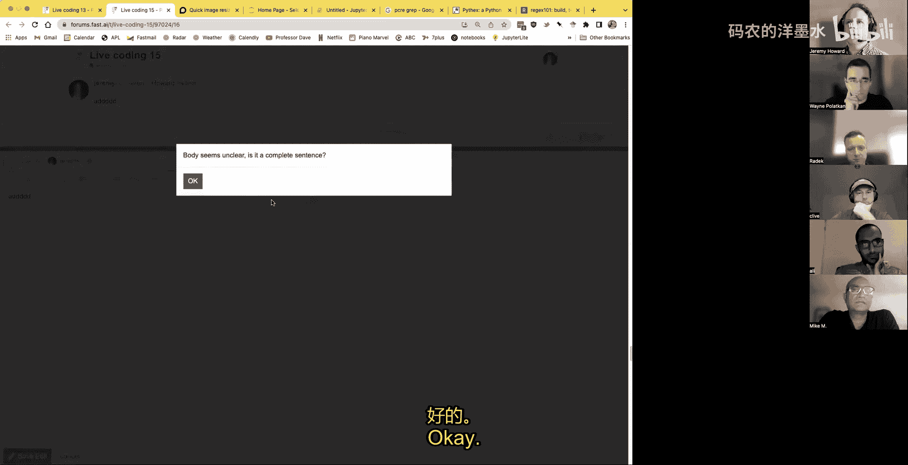


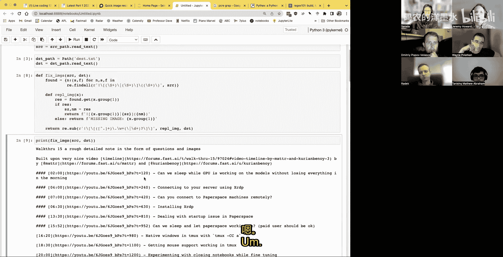


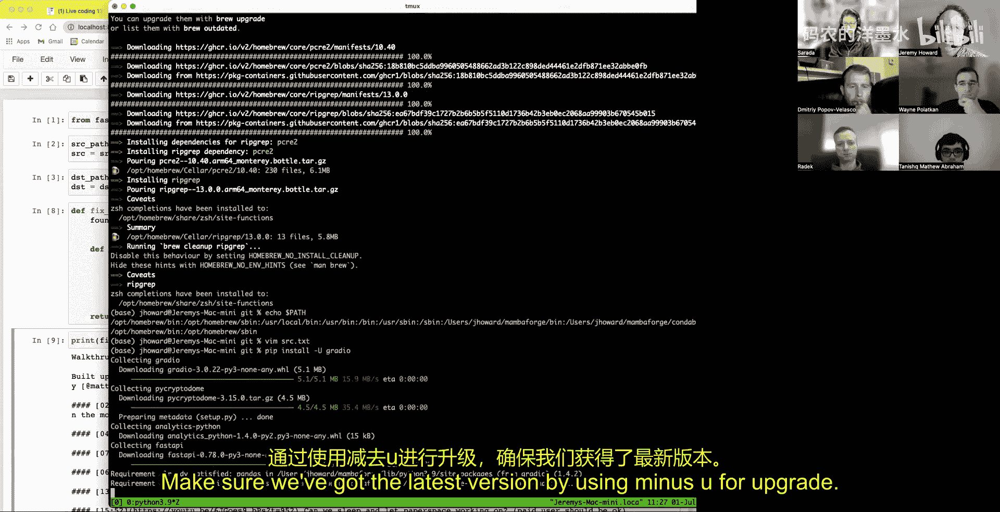

```python
# 更新目标正则表达式，匹配可能的尺寸
dest_pat = r'!\[\]\(([^\)]+?(?:\|\d+)?)\)'
def replace_img_v2(match):
    filename_part = match.group(1)  # 例如 'add_to_class.png' 或 'add_to_class.png|900'
    # 分离文件名和尺寸
    if '|' in filename_part:
        filename, size = filename_part.split('|')
    else:
        filename, size = filename_part, None
    key = filename.split('.')[0]
    full_tag = img_dict.get(key)
    if full_tag:
        # 如果原目标有尺寸，且完整标签也有尺寸，可能需要调整。这里简单返回完整标签。
        # 更复杂的逻辑可以在这里添加，例如保留目标尺寸或替换为源尺寸。
        return full_tag
    else:
        return f"![缺失图片: {key}]"
new_dest_v2 = re.sub(dest_pat, replace_img_v2, dest)
```

## 封装为函数并创建Web应用

现在我们已经有了一个可以工作的脚本，让我们将其封装成一个函数，并尝试使用Gradio创建一个简单的Web界面，让Daniel可以更方便地使用。

首先，将核心逻辑放入一个函数：

```python
def fix_images(source_text, dest_text):
    import re
    # 从源文本构建映射字典
    src_pat = r'(!\[[^\]]+\]\(attachment:[^\)]+(?:\|\d+)?\))'
    founds = re.findall(src_pat, source_text)
    img_dict = {}
    for img_tag in founds:
        name_match = re.search(r'!\[[^\]]+\]\(attachment:([^\.]+)', img_tag)
        if name_match:
            name = name_match.group(1)
            img_dict[name] = img_tag

    # 替换目标文本
    dest_pat = r'!\[\]\(([^\)]+?(?:\|\d+)?)\)'
    def replacer(match):
        filename_part = match.group(1)
        if '|' in filename_part:
            filename, _ = filename_part.split('|')
        else:
            filename = filename_part
        key = filename.split('.')[0]
        full_tag = img_dict.get(key)
        if full_tag:
            return full_tag
        else:
            return f"![缺失图片: {key}]"
    fixed_text = re.sub(dest_pat, replacer, dest_text)
    return fixed_text

# 测试函数
fixed_output = fix_images(src, dest)
print(fixed_output[:1000])
```

接下来，使用Gradio创建一个界面。Gradio允许我们快速构建机器学习或数据处理模型的Web界面。

```python
# 确保已安装 gradio: pip install gradio
import gradio as gr

# 创建界面
iface = gr.Interface(
    fn=fix_images,
    inputs=[
        gr.Textbox(label="源文本 (包含完整图片链接)", lines=10),
        gr.Textbox(label="目标文本 (需要替换的文本)", lines=10)
    ],
    outputs=gr.Textbox(label="处理后的文本", lines=20),
    title="论坛图片链接修复工具",
    description="粘贴源文本和目标文本，自动替换图片引用。"
)

# 启动界面（在Jupyter中可以使用`launch`方法，但通常更适合在脚本中运行）
# iface.launch(share=True)  # 这会启动一个本地服务器并生成一个可分享的链接
# 在Jupyter中，我们可能只想显示界面
iface.launch(inline=True, debug=True) # 在notebook内联显示
```

## 部署到Hugging Face Spaces

为了使工具更容易分享，我们可以将其部署到Hugging Face Spaces。这需要创建一个包含代码和依赖的仓库。

1.  创建一个新的Hugging Face Space，选择Gradio SDK。
2.  创建 `app.py` 文件，包含上面的Gradio界面代码。
3.  创建 `requirements.txt` 文件，列出依赖：`fastcore` 和 `gradio`。
4.  将代码推送到仓库，Hugging Face会自动构建并部署应用。

## 命令行工具技巧回顾

在课程中，我们还学习了一些有用的命令行技巧：
*   `cat > file.txt`：创建新文件并输入内容。
*   `Ctrl+D`：在命令行中表示输入结束（EOF）。
*   使用 `grep` 或 `rg` (ripgrep) 进行文本搜索。`rg` 是一个用Rust编写的更快更强大的搜索工具。

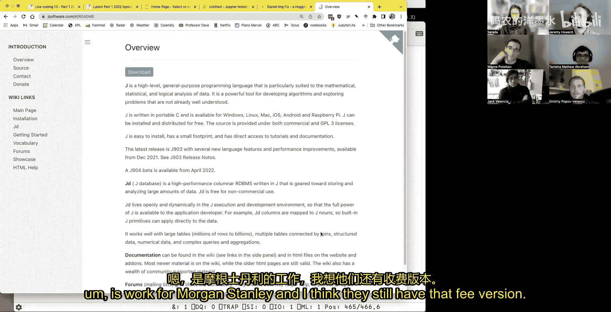

## 总结与展望

本节课中我们一起学习了如何利用Python正则表达式解决一个实际的文本处理问题。我们从理解问题、准备数据开始，逐步构建了正则表达式模式来提取和映射信息，然后实现了查找替换逻辑。最后，我们将脚本封装成函数，并用Gradio构建了一个Web应用界面，甚至探讨了将其部署到云服务的可能性。

通过这个案例，我们不仅练习了正则表达式这一强大工具，还实践了从问题分析到应用部署的完整开发流程。正则表达式作为一种领域特定语言（DSL），是处理文本模式匹配不可或缺的技能，值得深入学习和掌握。