# 【全集】旧金山大学 实时编码 中英字幕 1080P p01 Lecture 1 - 终端与环境管理 -BV1KZiTBWEeH_p1-

。It。

Great。All right， so let's at least go introduction， so let's say hello， hello。😊，Um。

I guess probably people know me， I'm Jeremy cofounder of Fast AI and we're going to be doing a。

Careful， thorough and correct walkthrough of。Fast AI lessons and more generally。How to data science。

 I guess， that's the plan。And。We will see who ends up being regular guests with us。

 but at least we we have at least two regular guests hopefully being Radock and Nick。

 so Radick and Nick， do you want to say hello and introduce yourselves？Sure。Mic want to go first。

Sure I can go first react no worries hi everyone I'm Nick I'm friends with Jeremy I've been involved in machine learning and deep learning over the last ge longer than I care to think about actually but it's great to be here and yeah I'd love to help you out however I can and i'm looking forward to getting into it so nice to meet you and so Nick your background is mainly trading I guess yeah yeah mainly quant finance and it'd be fair to say like。

😊，You're extremely numererate， extremely good coder。

 but you haven't had as much experience with deep learning using Python like you intermanly from what I've seen you've used Wolfra quite a lot like what yeah exactly technical background。

Yeah so I suppose I'm a one trick pony in one sense in machine learning and deep learning in that it's usually been pretty heavily tabular data and financial data and some other bits and pieces along the way I've always coded in R and less so in Python so it's a transition for me so I'm learning stuff along the way here too and especially coming to these frameworks like Fast AI like I'm making my way around them just like the rest of you are but it's fantastic to be here and I'm glad to be on the journey with all of you。

😊，Hello everyone， my name is Raik and super happy to be here。

 so I guess I was trying to learn machine learning for quite a while and then I did a fast AI course which was four years ago and it's changed everything for me and I have been doing fast AI courses ever since。

嗯。Hoping to contribute in whatever way I can。And just because。

The home of global AI is clearly in Queensland， Ra E and I all happen to be in Queensland within within about an hour's drive of each other in fact which absolutely absolutely AI can take you to interesting places。

😊，If it weren't for AI I wouldn't be able to be here so that's quite fun you normally don't expect that to happen when you take an online course but hey。

 fast AI is unique making in many ways。So I thought we should start at。😊，Step 0。1。

Which is making sure that we've got Python working。And not just working， but working。Well。

 so these sessions are not going to be about showing。Options for things。

 but showing you the one true way。Which by which I mean， of course， the way I do it。Having said that。

 I do actually try a lot of things。😊，Totally addicted to trying out software libraries and tools and configurations or whatever and i've been doing that for 25 years。

 so I have actually。More than 25 years so yeah， you know， I find a lot of people on the forums。😊。

Watch your fast AI course and then go and have this conversation about like how to set something up and nobody actually seems to just set it up the way I said just do it like this and when I say like no actually do it what I said。

And then people are like oh wow， that does actually work so before you get into complicated things you read about in the blog somewhere。

😊，Just。Do this and that you're going to see me do it from scratch so you'll see it really does work。

嗯。So one of the things we're going to be doing a lot is using。A terminal， which a terminal looks。

Like this。Which is not the most exciting looking thing。You know， I started out。

Not back in you know 30 years ago not using a terminal much at all O or kind of exc Vb。

 whatever and those were all very useful tools， but the terminal。

Is great for data scientists because rather than having to have like a long list of click here。

 click next， minimize that， click there drag here。You put it in a little script and you just say run the script you know you can do things very quickly。

 you can automate things it's like it's also like the difference between。

Me speaking to you with with English language versus me holding up pictures and kind of diagrams or hand signals。

 you know， languages really。Powerful way to communicate with a human and also with a machine so there's a reason we're going to be using the terminal a lot of the things we do there will be goy ways of doing it as well。

 but because this is the opinionated。Do it my way version that's what we're going to be spending a lot of time on and I want to like assume。

Nothing。Except that you like。Know how to use the computer and you know the basics of Python。嗯。U。

That's hard for me because I've been using terminals and Python and stuff for a long time。

 so I'm highly reliant on people asking questions。嗯。

And I would certainly appreciate it if people ask questions。Here in Zoom。

Directly on audio if possible。Otherwise。On YouTube live。

Don't use the Zoom chat because it's a little bit harder for me to like zip in and out of。So yeah。

 before I get started， anything particularly Nick and Radock that you were hoping to。

Get out of these sessions or to share in these sessions I know Radick you were interested in learning a bit more about paper space I believe。

Yes， yes， that's true。 I'm wondering where it fits in my stock as a data scientist。

Even as a use so I'm thinking about having something that I could access in my browser without thinking about starting the ending instance somewhere and you know essentially just a this could be helpful not even if we're doing the course but just something something useful to have so definitely looking forward to learning about how we can use paper space and of course Ra。

 you're anI expert in NviDious that's not like you have a shortage of GPUs you can access but theyre not necessarily set up in as convenient a way as you describe but just jumping into a browser and starting work right that is true and I'm thinking so I want to use tools in a way that speeds me up you know I want to create an environment where I feel comfortable where I remove that tools from the equation and I can focus on doing the work and。

That not only includes work for like professional work。

 but a big part of being a data scientist is continuing to grow your skills。

So if I could be working on something and very often in data science。

 you know you still have to wait for something to start or for some calculation to compete and in those unit of time where you know it's two minutes。

 three minutes， 10 minutes I would jump into onto Reddit or you know would essentially waste my time and to my attention。

 if I would have a window in my browser a tab I could jump and do something useful something exciting like for example。

Submitting the Kaggle competition or trying out the new library I think that would be a really really nice outcome so yeah I'm curious if thats that's something the paper fast iteration speeds important for sure by the way。

 Rad I can hear you okay but you're a little quiet and I don't know if you've got a headset you can use a microphone you can move or a volume control you can change or anything how about you Nick。

Yeah I would reflect what Raddick said straight off the bat there that yeah you want to just have as little friction as possible in your tool chain and I think one of the great things about doing these sessions is for people who it can be intimidating I think once you really start to get down into the tool chain when you go from perhaps having tried your first notebooks on Cagle or you've been on coabab or something else it can be intimidating to actually start getting down in the weeds of your system and getting to really know it and some things can be so confusing' like I should be using condo show should be using Ma what's right Python environment all these things and it can be intimidating to find that out so like not always great exactly and almost everyone who's opinionated about how they want to use their tool chain for their things but I think what I hope that everyone gets out of this is a way of as you said there's a canonical fast AI way of doing things and to be able to have a tool chain that's as frictionfree as possible so that you can get product。

With whatever task in your general compute environment。

 I think that's fantastic and yeah looking forward to anybody else listening or on YouTube live want to say what you're hoping to get out of this。

😊，Hello everyone， my name is Ashi hi Ashi' trying to switch on my video Can you guys see me now where are you joining from Ashhi I'm in Brisbane what do you do you're working in Brisbane or student Yes I'm working as a graduate data scientist at Rioton Do and it so happened that today I don't have any meeting so I was like this is good as joining and I can totally reflect on what Nick and Radick said about being as about having as little friction as possible because。

😊，Like since I'm a graduate data scientist， I'm just starting my journey as a data scientist so trying to become a data scientist is what how I describe myself and。

😊，Most of the times the problem that arises are just conflicts and libraries and I want to do data science but I still end up doing that lots of data inring stuff and which is good to realize that。

😊，You're learn you're like learning what a data engineering role or that sort of thing what they do and help us in getting our environment set up which is good to learn that they do a lot of stuff and I have future respect for the data engineers at least at Rio now but also learning that it's a good thing to you know what my interest like was we just data science and I would like to do that so that's something i'm looking forward to as well this session yeah I mean there's a lot of stuff I think we need to really begin into over the coming weeks you know it needs to include stuff like you know SqL and you know。

That working with CV files and all this stuff。 And it' good that all of you have talked about。

Kind of decreasing the friction of data science because it's not just about doing it more quickly。

 but if you have a lower friction then it's less cognitive overhead for your brain and thinking about the process。

 which means there's more room for your brain to think about solving the problem Yeah absolutely Okay anybody else Jeremy on。

I'm just really enjoying the narrative。嗯。And also， I'm hoping it'll be ugly。

Tune into the environment by the end of it so well great where are you joining from？

I've had a bit of a with a paper space but I've finally got that yawning after about what since five weeks and so anyway that's set me back a bit but so I'm really grateful that you're running these additional。

That's great， and could you quickly introduce yourself who are you and where are you joining from me。

I'm at QT。In Brisbane and on my late entry PhD student spec coming to the end of that in fact I saw you at the IDM when you presented there great and looks like your name is Daniel according to on' playing in the。

Decomposition of heterogeneous data into。Emodgenous sections and then using that for modeling of simulation Oh。

 interesting Okay， all right， well， let's， let's let's make a start then so I'm。

Yeah so please just dive in anytime， I do recommend if you're planning to join you know on a regular basis。

 the best thing to do is to get a headset with a boom like I have here and like I see Nick has there and then you don't even have to worry about muting yourself especially if it's a noise cancelling headphone because you can then just chat。

Any time。Yeah， and as I say， just don't feel like you have to wait for the right moment。

 just jump in and treat this like a conversation。嗯。Especially if I kind of like do something that。

You're like what did Jeremy just do or I talk about something as if everybody knows about it and you're like I don't know what that is like please ask so let's start so step one to working with the terminal is is running a terminal on your computer so I guess you know people here hopefully either have the Mac。

Or Windows or Linux if you have a Chromebook， things are a bit difficult and so I would suggest trying not to use a Chromebook right if you're on a Mac。

嗯。To start your terminal， just if you Google for Mac OS terminal， Apple will tell you what to do。

 you can use command space type terminal， you can click Launchpad type terminal or in the photo。

You'll see lots of conversations online about all the different terminals you can download and use as you'll see it really doesn't matter Okay。

 so just use the one you've got if you're on Linux you probably already know how to use the terminal if you're on Windows。

Windows now has a terminal as well so if you just go to Microsoft store and type terminal it'll download that for free Okay so what's a terminal a terminal is strictly speaking you know it's a program。

Looking like this that knows how to display。A console window or a shell window now the thing inside it with the flashing cursor and these words and stuff is not strictly part of the terminal right that's something called a shell so this thing called the Windows terminal can start a number of different shells it can start a shell called power shell and so forth so there's two different things there's a thing called the shell there's a thing called the terminal we often use them a little bit interchangeably and that's fine but the first time you start the windows terminal it's actually going to start something called power shell。

Which looks like this so if you're running Windows， the next thing you need to do is type。

WSL install which stands a Windows subsistant for Linux and nowadays in Windows it's a single line you just type WSL install and it says do that in administrator powerhe so if you type start Powerhell run as administrator。

Right and then you can copy and paste that into the window and then reboot when it's done and then you'll have actually an entire copy of a Linux distribution called youbutu running inside Windows and that's what I recommend for Windows users。

Okay， so once you've done that。😊，You should now find that you can glue。😔。

Click here and go Ubutu rather than Powerhell and one of the things I like to do is to get。

All of my tools working。So that they do what I want kind of automatically each time so I don't use Power shell very much I mainly use Uubuntu as I expect you will be especially for this course。

 so if you go into settings。You can choose the default profile as being Uuntu and then。

Next time you open it， it will do Ubutu by default okay， so first time you run it。

 it'll ask you to choose a username and a password。

 that's because this is a whole separate operating system。嗯。So I've actually set up a new user。诶。U。

Totally empty， so I've got an empty， I'm going to start with a totally empty kind of virtual machine here。

Okay。U。And then， you know， the other thing I think a good idea is。

To kind of give your terminal a full screen so。On Windows for example。

 if you hit Windows tabab you have the ability to kind of move things around and if you hit Alt enter you'll get a full screen so now I've got lots of room working with my terminal so I'm not sure for whatever terminal you use on Linux or Mac。

 what the equivalent keyboard shortcuts are but Google for keyboard shortcut Mac terminal full screen or something and virtual these different these different like separate kind of virtual windows called virtual desktops。

 very good idea to learn to use virtual desktops。

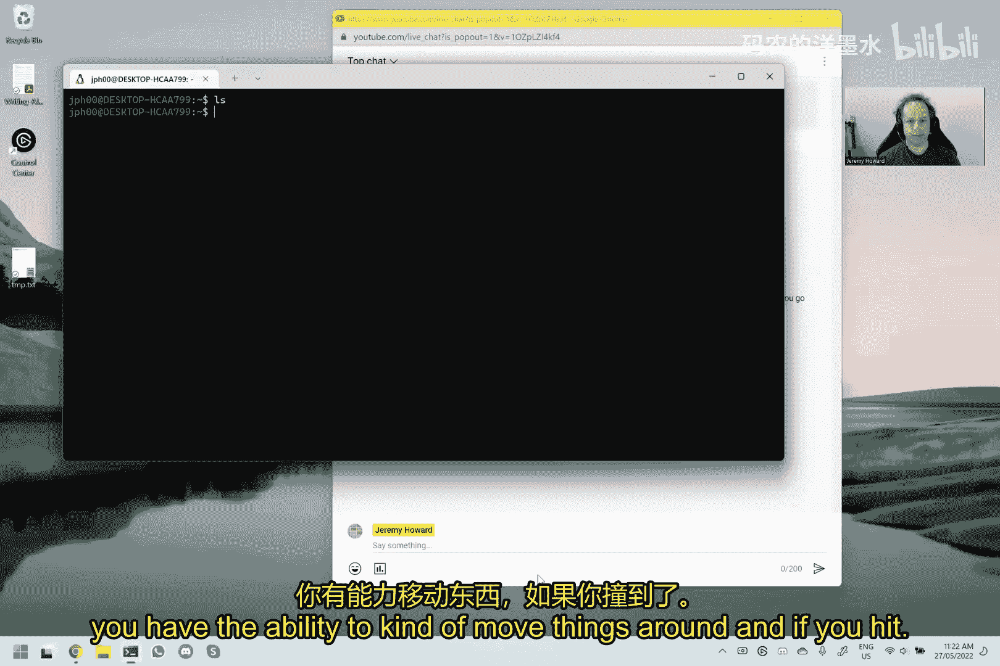

嗯。Okay。So this is here we are in the terminal and were going to we're going to set up Python now the first thing to do in your terminal。

Is to type Python。And。This is bad I typed Python and something happened I didn't want something to happen because we actually want to install our own version of Python and so if you typeython something happens that means you've already got a version and we definitely don't want to use it and the reason for that is that the version that you're going to see by default is going to be what's called the system Python it's the Python that your computer users were like running stuff we want to put in a separate version of Python。

So when I type a command like Python， what it's actually doing is it's finding this somewhere on your hard drive and running that program and you actually want to know which one is it running？

And so you can type which followed by the thing that you want to run Python。

 and it's going to tell you this is running from something called slash user slash bin slash Python。

Now， on the other hand。😊，So user I created， which is called JPH00 if I want to find out where I am right now。

I can type print working directory， Pw ED。 So this is idea of like。Direectctories。

 which hopefully you're kind of somewhat familiar with from using like you know the finder or or explorer or whatever。

 so on your computer。You know， there's some directory that you're in in Finder or Explorr and that you're seeing the contents of it and you can kind of move up and down and move around and there's kind of a concept of a current。

Diirectory you're in。So in the terminal， it's exactly the same。

There's a concept of what directory I'm in and if I type PWD， it tells you what directory。

so currently I'm in a directory called slashho slash JP00。So on。呃。

All of the operating systems we're talking about today， I believe there's the same idea。

 actually I don't know if this is John Macck， there's an idea of a home。Radak or Nickki。

 you guys Mac users， if you go to terminal and type PwD do you end up at some kind of home directory？

Yeah， you do by defaulting that yeah， okay， and there'll be like slash home slash neck or whatever。

Correct， cool， yeah， home slash your system username great so all the same terrific。Um。

So generally speaking we want to install everything into our home directory we don't want to be using any versions of python or anything that are in anywhere else such as this system directory so let's go ahead and install our own。

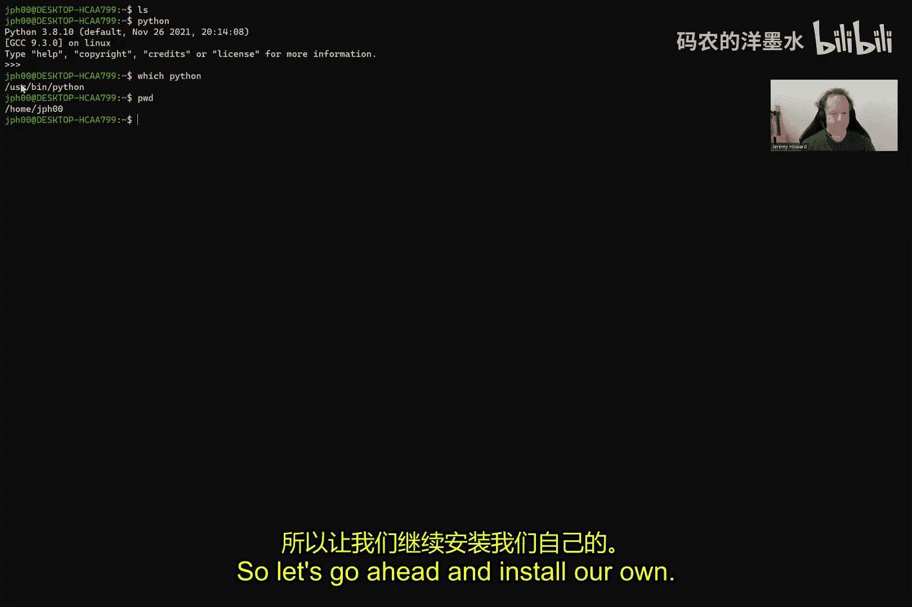

Version of Python we can use and there is one and only one correct answer at the moment in my opinion to what should I install which is to install some kind of Ananaconda distribution so Python is' an open source program lots of different people package it up for your computer。

Which？Which python you install is going to make a huge difference to how easy everything is。😊。

yeah may ask a question please are you using Windows 11 or Windows 10 I'm using Windows 11 either they're almost exactly the same I actually don't like it quite as much as Windows 10 to be honest about to force everybody to upgrade anyway I just thanks it's just I guess WSl install there is a slight difference between so tell me again what's the difference the WSl install I guess under 10 you have to WSl2 or something I would suggest a good reason for installing Yeah I do think Windows 11 that the WSl story is a little easier so that's probably one reason to upgrade Also if you do。

Have a in a GPU in your laptop like I do， it's much easier to use it in WSL if you use Windows 11。

Okay， so。😊，The particular distribution I strongly recommend using is called。Mini forge。

Sorry not actually we're not going to use any for， we're going to usember membermber for。

 I always get this confused。N。Touch。So let's go ahead and install it。So if we scroll down。

 we'll find installers for mini forge， keep scrolling down minii Forge803s， click on it out here。

 Amber forge。Okay。U。😊，Rs。So I'm going to try to remember to put stuff。In here as we go。Mber forge。

Installer。Save。All right。So。Let's do everything through the terminal I think it makes life easier so not P3 just member Forge plain member forge。

 so we'll find so I know I'm on Windows but I'm using WSL that means I'm effectively on Linux and I've put most computers AMD 64 unless you're on a Mac。

So I'll right click on this and I'm going to choose copy address。

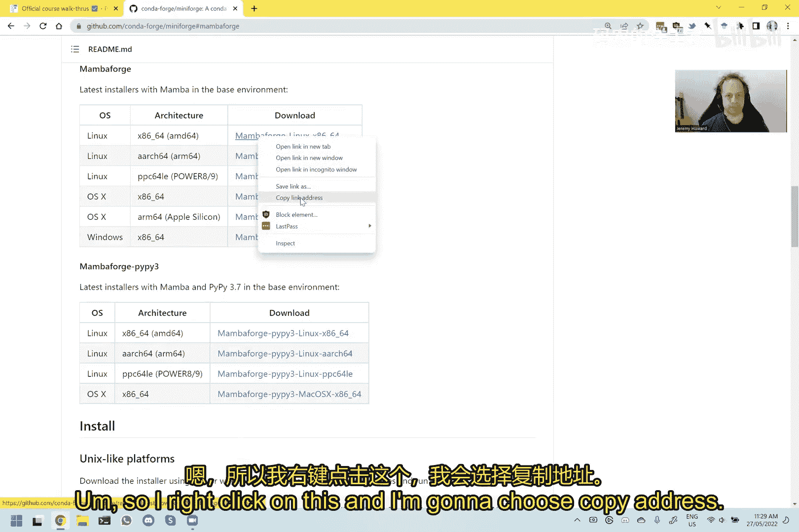

Okay， let's go back to our terminal。So in our terminal you don't just like in find or explore it's good to keep things nicely organized so let's create a directory to put things we download into so to create a directory。

 we type MoCD， make a directory。And then we'll call it downloads。

So if I now list the directory that shows me LS shows me all of the things that are in this directory and so I've now got something called downloads so to make that the current directory I change directory CD into it now typing downloads takes far too long so instead i'll just take the first couple of letters and then hit the tab key on my keyboard。

And it fills it out for me。So the tab key is very helpful key to use in。In your shell。

 in your terminal。So we need some in the terminal of downloading the file and the main one I recommend using is called。

W get so W get gets a URL and make sure you know how to paste things into your terminal。

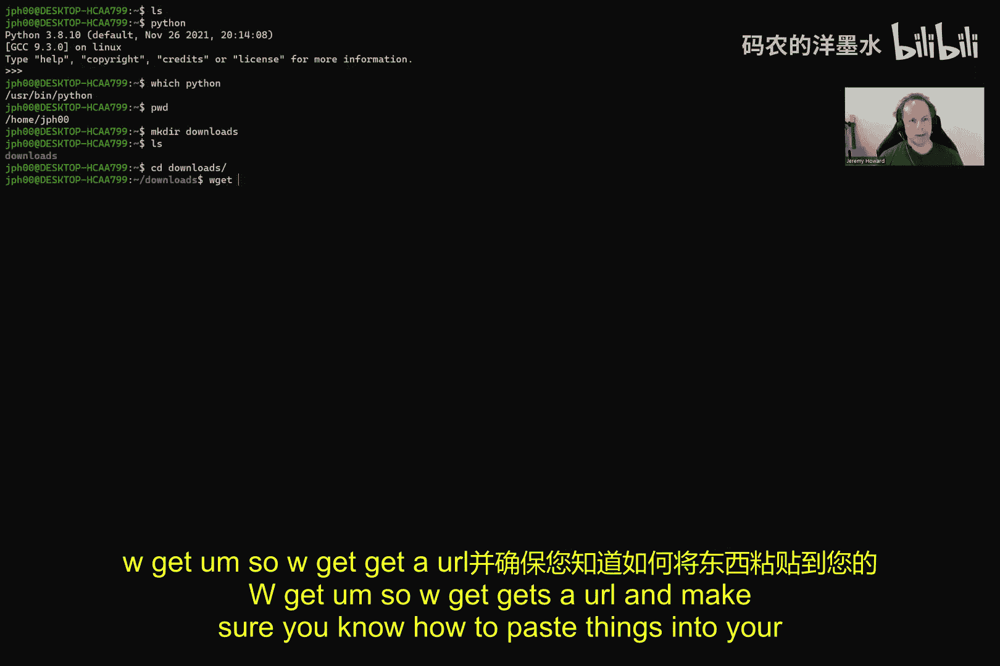

嗯。So I'm trying to remember， I think there's some。😔，嗯。Things you can fiddle around with。😔。

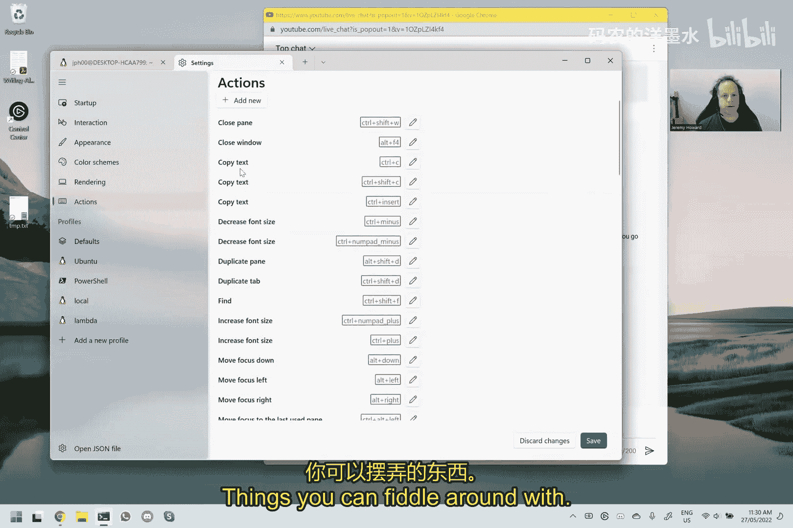

Or maybe it's just a default so in I think maybe it's a default in in WSLs in Windows terminal you hit control shift fee to paste so there's the thing that I just copied the URL。

So if I hit enter to now。It's going to go ahead and。Download that for me。There we go， okay now。😊。

With data science， you spend a lot of time waiting for things。

And so don't spend time waiting for things that downloads， do something else at the same time。

So you'll see here there's a little plus sign that lets me create another window or I can use control shift one now I strongly recommend using keyboard shortcuts wherever possible。

 so if I hit control shift one，I've now got a second。Terminal running。

 and I can control tab between them。And so now we can keep doing things where that's happening。

It's going to switch to my fresh new user， okay。So。So while that's happening。

 let's talk about if you've tried to install Python before and you've got a million different versions of things。

That can get really confusing I strongly recommend trying to clear everything away and starting from scratch so the first thing is if you're in your home directory。

😊，So if you see this little tilder here that means I'm in my home directory so although my working directory is slashho slash JP0 on Linux and on Mac most shells the shortcut for your home directory is just to call it tilda so if Id into downloads change directory into downloads it says you are now in tilda slash downloads so it's a shorthand way of saying slash home slash JP00 s downloads okay if you've got any other Ananacondo minicondo miniforge whatever here right now。

Delete it。And so let's see you've got a mini condo for example。

 so to delete a directory and all of its contents， well first of all。

 you could just move it out of the way if you're worried you might lose something important so to move something you type MV for move。

Move miniconda to Yucacoa Lake。Manycon do old say and that now is going to get out of the way it's not going to interfere with anything so either remove or move out of the way any existing installations。

Um， the other thing you want to make sure is you don't have any you don't have sorry。

We had interruption， I think。Oh， you lost me for a Ben。😮，Can you hear me now？Yes， it's working now。

 Okay， how long did you lose me for。About five second。Oh， just five seconds okay。

Thanks for letting me know。Um。Okay， so。Yeah。Um。As well as making sure that you don't have any other copies of Ananechor or minir or miniiforge lying around。

 you also want to make sure you don't have any copies of Jupiter installed or anything like that installed in your system Python so if you type i Python。

You want nothing to happen because this is what you want， or if you type Jupiter。

You want nothing to happen okay if something is happening。Then try typing Pip。Uninstall， for example。

 OPthon。And Jupiter they try to uninstall all the copies of this stuff you don't want them in your system play and it's going to make things very very confusing if you can't uninstall things no matter how hard you try then find out where that is so for example type which Jupiter right and if you've got it installed it'll tell you in slash user slash bin slash Jupiter or whatever and delete it。

So to delete things。To delete a directory and all of its contents。

 this is obviously very dangerous so be careful， you don't delete something you don't want to RM for remove minus R means recursively so all folders and files underneath it F for force so do this without asking manyconr dot old for example。

And you could do something similar if you had a slash user slash bin slash Jupiter， for example。

 you could type IM slash user/lash bin/lash Jupiter and that would get rid of it。

So you wanted to be at a point。Where yeah。You don't have iPython。

 you don't have Jupiter and you've downloaded， you don't have any anyconda directories in your home directory。

And you've downloaded。Mamba Forch。All right。Any questions or comments？So far。

If you're kind of trying to follow along and something weird happens feel free to let us know you're welcome to share a screen you know de buggging we'll help Jeremy yeah I dont if you can see me hopefully you can'm Rob I'm down in Hobart hiy Robin Hobart I love work thatt it's a great place。

It's just got above 11 degrees outside a little different to play Royal tennis if you ever been Oh tennis yeah I know the tennis club there yeah beautiful anyway I work for the bureau meteorology there's a bit of background but you're the guy that did the clouds detect yeah that's me yeah yeah yeah so it's fun。

😊，Over quick question would you mind talking a little bit about Honda versus mummba yeah we're going to do that now so absolutely sorry no no don't be sorry please anytime jump in。

All right so let's just get this installed first of all so we've got okay so we've learned that LS lists the directory that we're in right now and ls minus L gives is like alpha for long form gives you more information about each thing and so long form。

It tells me how big it is now that's quite hard to read so another really helpful these are called flags a really helpful flag is minus L minus h h is for human readable89 big and when you pass multiple flags to a program like this you don't actually have to put them each with a dash you can just put them notes to each other so minus LH is the same as minus L minus H so this is list long form。

😊，Human readable， so we just downloaded an 89 megayte file。

And this is a dot S file a dotsh file is a script， it's something that it's basically a shell script it's a list of shell commands like LS or CD or which that are listed in order one after another in a text file so you can look at a text file by typing less and then the name of the file to look at now we're going to type capital MA I'm not going to type all this out because I'm lazy I just tip tab。

And then I'll press enterer。And so you can see this is what a script looks like。

 anything starting with a hash sign is a comment so it doesn't do anything and then everything else is literally the shells is going to go through each of these lines one at a time and run them in your terminal。

😊，And so this is the thing that installs Bamberforge。So to run a script， there's a few ways to do it。

😊，The best way to do it is to run it。嗯。😊，Well there's a few ways to do it I think the way they suggest in the docs is that you type bash space and then' so let's explain what's happening here。

I mentioned that inside the terminal， the things that's like printing out this information and listening to my commands and doing stuff like LS is not the terminal itself。

 but something called a shell。And a shell its just a program that somebody wrote to yeah let me type commands and get answers and stuff like that the shell that Ubutu uses by default is called bash and the shell that Linux most Linux is used by default is also called bash the shell that Mac uses by default is called。

Z SH。They're so similar。My suggestion is just don't worry about it like you'll find basically almost everything I think everything we see today if you use a Mac will work just as well with bash Macs also come with bash so it's like a pretty safe thing to run scripts with so if you type bash base。

And then that， it says， please run this shell script。Using this shell。

 So it's going to run this as a bash script。 So if I press enter。Okay。

 so this is now running this program called Manmmaforlinux。sh。So please review the license agreement。

 of course。Do I accept the license terms， I read them very carefully。Okay。

 and it's going to get installed for you， so I'll just press enter。

And you'll see here it's going to install it into my home directory into something called Mamber Forge。

way it goes， okay， so while that's happening let's describe what's going on here。

 so this is installing not just Python。But a whole bunch of libraries。

 these are all the libraries that it's installing。U。Okay。

 so it's finished That was quick Do you want to this to initialize it so the answer is yes。

 we do and what that means is each time in the future that we。Open our terminal。

 it's going to automatically set up。Our Python environment for us， or type yes。There we go。

 so as it says， for changes to take effect， close and reopen your shell。

 so let's go ahead and do that。Jeremy， I have a good question。Yeahep。

I'm using a Mac and I went through lesson three and I think you had covered something about installing。

Some of the software of。Including and then getting through the notebook。

I'm a bit confused so your bandtu doesn't apply to Mac。

 does it or everything just' used so far will work perfectly on Mac， yes。

But can should I be using the terminal directly， and I do see the yes。

 I suggest doing everything exactly as I'm showing it， although the Mac version of the installer。

Let's see OSX。😔，The Mac installer might be not a shell script let's no it is a shell script yeah。

 so it looks like it should work Yeah I do see I I can confirm it is。对。Yeah。

 so that should all work fine if it doesn't， let us know。But yeah。

 should all the steps should be identical， great， thanks。

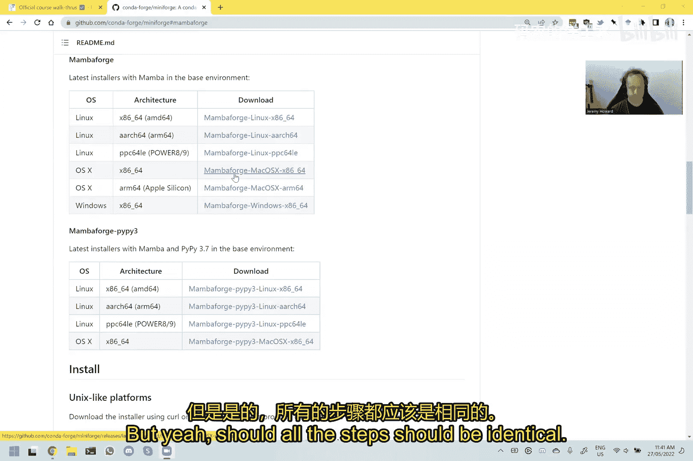

嗯。😊，All right。Okay， so I just closed and reopened my shell So one way to do that is just to close your terminal and open the terminal again and my terminal now looks slightly differently it looks got it's got the word base before it and this is the way we can tell that we are we have our。

😊，Python environment。Running， we're inside it， if you like， So we're all set up to use Python。

 So if I now type which Python。It doesn't say slash user slash bin slash python anymore it actually shows me i'm in my home directory there's a man before directory and there's a bin slash python there this is what we want okay you know you've set this up correctly if you type which python and you get back an answer that's inside your。

H directory。嗯。There's a number of reasons for this。

 but really a key one as I say is that the main alternative is that you'll be using your system Python。

 that's the Python that your computer uses for like running stuff in your operating system and that causes all kinds of confusion with between what your computer is trying to do and what you're trying to do。

 it's also super easy when you're using the one in your home directory because if anything ever goes wrong。

You just RM minus If membermber forge and that deletes everything and this run it again and you're up and running and do you want to get to a point where you can do that。

Incredibly easily。U。So let me now describe okay， so what I'm now going to do is I'm going to I'm going to show I'm going to start from scratch right so currently I've got that all set up there's my Manmber forge directory created so I'm going to go IM minus Rf manmba forge。

There we go， I'm going to go to downloads and I'm going to even remove the installer we downloaded。

Okay。Um。And I'm got to show you how we can do all the same steps。

 but using a script oh and also let's delete the thing that it that it added remember it said do you want to automatically initialize manmberforge when you start your terminal well what it actually did。

Was it edited a secret hidden fail normally LS doesn't show you secret hidden files。

 but if you add the minus a for all it does and so you can see now there's a whole bunch of files that we didn't see before anything starting with a dot。

Is by default hidden in the show。And。This one here called dot BashRC。

 which if you're using a Mac will be called dotzshHRC。

 is a script where all the things in that are run automatically every time you run your terminal。

So if we edit that script。Um。Then you can see at the end of it。

The installer has set up stuff to initialize condo， so I'm just going to delete all that。

So that we're really back to scratch， Okay， so if I now close and reopen my shell。

You can see it no longer says base， right， so we've totally started again。

So I don't like to do anything i'm going to do more than a couple of times。

 I don't like to do manually， so i'd like to automate this whole thing。

 so at which I have there's a repo called。

Fast set up。Which Radick knows well because he's helped set up some of this。

 which contains all the things I use to like very rapidly set up。

Everything on a new computer or a new server or whatever。

 and there's a thing here called setup Conda。I just wanted to ask。

 can you tell me a little bit better now I switched to a different microphone that's really Oh wonderful wonderful so now the hear me if I could maybe make one tiny comment please please you know with the comments like we've seen Alice。

Dash minus a or there was another one Mv dash minus RF the Fl。

 they often have the same meaning for different programs so if you have Mv minus R that's recursive。

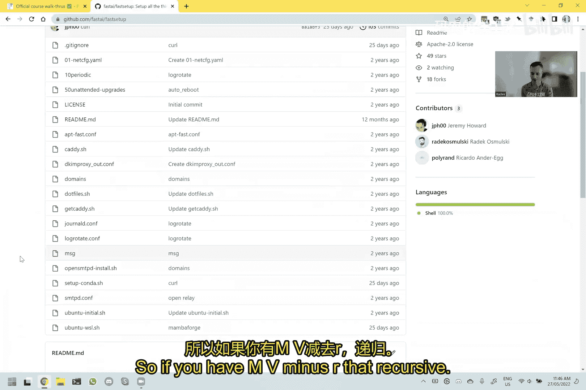

I don't think you actually need that for MV， but for example with the LS the minus H flag。

 you will see across a bunch of other command that the minus H will be human red so it might sound a little but overwhelming to see these flags that maybe don't seem to make that much meaning。

 but since you will be using them across many commands and then there's also a trick to very easily list the flags for command you know it actually gets quite straightforward。

Yeah， that's a great point。Many， many programs have a special flag， minus minus help。😊。

Which will list。Or the flags， for example， they can be a bit overwhelming because there's a lot of flags。

 but that doesn't mean you have to know them all。I mentioned something else which is like， you know。

 we're covering a lot of stuff pretty quickly and so people who haven't used a terminal before there's going to be a lot of new information here。

 obviously it's a good idea to watch the video afterwards but something that would I think help a lot of people in the community would be if there are a bits that you do read watch again afterwards because you want to learn that bit is if you write it down like just write down what you know。

 this is what Jeremy，Sad and here's a link to the thing he was talking about chuck it into a blog post that would like help a lot of people because you know watching a video is。

Takes more time than grabbing the best of bits out of out of a blog post so that would be something if you're interested in both giving back to the community and documenting it for yourself that would be amazing and I guess something we should probably talk about in more detail at some point is。

How to write a blog post。sharingharing things like that your blog posts or your tweets or on the forums。

has a lot of nice benefits it's not only that you're helping others。

 but you're also remembering the stuff better or understanding the things better when you explain something in words。

 you know I often find myself writing something out and I think I understand it but it's only at the point of putting it in words that I identify gaps in my understanding it's definitely great for remembering things and then another effect that I still have hard time believing that it is real thing but it is you will write something and you will share it and then somebody else would read it and they will say that's useful this person maybe knows about what they're talking about and suddenly people will reach out to you asking you to collaborate or maybe even you know。

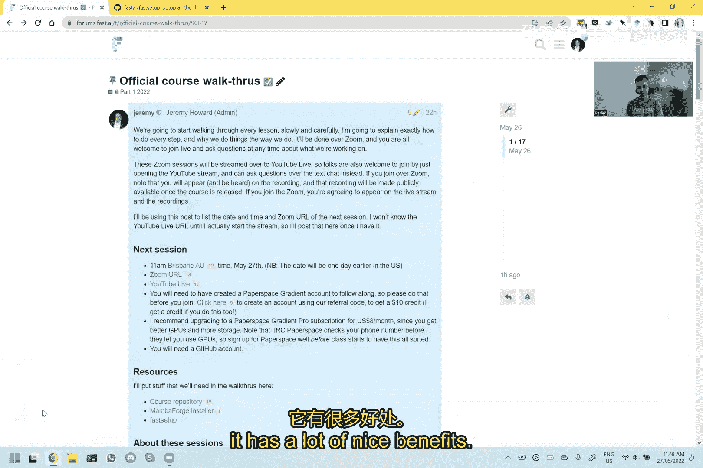

It might lead to professional opportunities。It's something that is very far away from what we normally imagine that is possible。

 but apparently it is a very real thing。Well， it happened to you for sure and lots of our people in our community when I look at the most the biggest contributors to our community。

😊，Pretty much all of them started out without having a job in AI and pretty much all of them have jobs or research positions in AI now。

 so probably not a coincidence。Now this thing we're looking at right now is a Git repo in Gitthub we're talking more about Git a lot。

 but for now it's enough to know that GitHub is a place that has。

Lots and lots of coding libraries and coding tools that you can。Download， edit， play with。

 explore and so forth。Very very very useful tool to get extremely familiar with in this case we want just one file from it which is the file called setup Connda。

sh which is a list of steps necessary to install membermberforge on your computer as you can see it's just 28 lines it's very short so how do you download a single file from Gitthub the easiest way in my opinion is just to click on the file。

Click on raw because you see at the moment it's got all this stuff around it。

 we just want the file itself， click on raw。And now there's just the script right and now if I click on the URL and copy it。

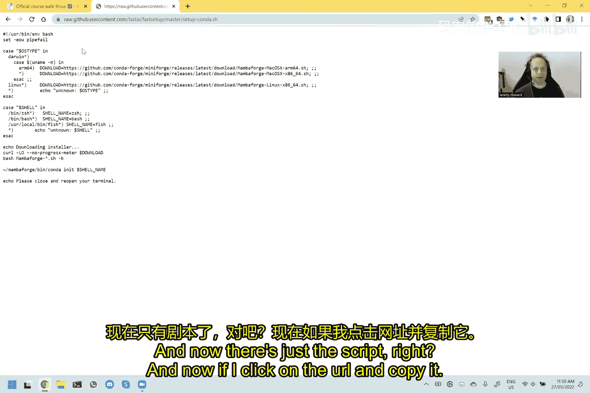

I can now go back here and who remembers what we type W get is the way we download something so if I type W get。

Set up condoda， then that's now created。A file called setup Conr my computer and if I want to look at it。

 remember we type less。And there we can see there's the file， so we want to run this script。

And as you can see a ba script a shell is a little mini programming language so it's got a case statement so the case I mean we can look at what it's going to do right it's going to check the operating system type if it's Darwin that's a Mac it's going to check what kind of CPU you have and it'll download the appropriate mini mamber forge for your environment and then it's going to check what shell you're using and then it's going to set up bash or ZH or fish is appropriate。

Echo meanss print it'll print out downloading installer， it'll download it。

 call is just slap up you get and that it'll run that bash thing we just saw and it'll initialize it。

There's a handy flag for the mammofor install installer minus B which is something that causes it to not ask you to check the license and stuff like that it all happens automatically so if I now do exactly what I did before to run my script type type bash setupcon。

sh that would work。But another thing we can do。Is the very first file here。Hash exclamation mark。

 blah， blah， blah， blah。This tells our computer how to run this script that says to run it with Besh。

So we actually don't need to say bash and then that we can just run it directly。

So we could try doing that set upcondo。sh。With a dot slash， this means in the current directory。

And that doesn't work and the reason that doesn't work is because by default。

 things you download from the internet you can't just run your computer assumes that。嗯。You know。

Things are dangerous unless you specify otherwise， so we need to tell it that this is something where I want to give it permission to execute this as a script。

So if I type LS minus LA。Actually， if just LS minus a would be fine， that no LS minus L。Oh。

 here's a trick。 I want to repeat the last command， but I want to change the A to L。

 so let's press up arrow。To get back to the last command， backspace， make that an L。

So this thing over here we skipped over before， this is what's called the permissions。

 this tells you what you're allowed to do with a fail。😊，And R says you're let to read it。

A W says you're allowed to write to it， and this dash here， if that was an X。

 it means you're allowed to execute it。So to change the permissions of a file。

 so we want to say that the user is allowed to execute it。

 we use a program called CH modD so it type CH mod and you say， okay。

 who do you want to change the permissions for and I say this user that's aW what permissions do you want to change I want to add the executable permission so you say plus X。

And then you type the name of the program that you want to change the permissions for， so press tab。

And so now if I go Ls minus L， I'll press up arrow twice and then hit enter。There's that X we wanted。

Okay， so now I should be able to rerun。/ setup condo， so press up a few times to find that。

There it is， and hit enter。And so that's all going to go ahead and download and set that up。For us。

Okay， so while that's happening， does anybody that'll take a minute or two does anybody have any questions or comments up to this point？

H Jeremy me good。I had out which version of Python are we using right now and。

In case of some other kind of experimentations， if we want to switch Python versions do you have any recommendations on that so this is just going to use whatever the default is and generally speaking the default will be the most recent release so we can check which version it's going to be。

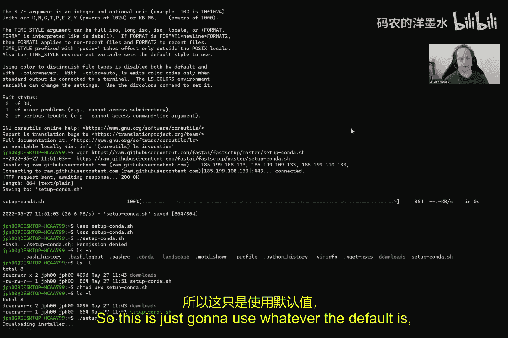

By looking at Mamba Forage。And。Does it say which version？Latest installers have Python 3。9。

So I just use whatever's like the default because that's。

Gooning to be most likely what most other people are using there is actually a Python 3。10 now。

 but the fact that。They're making the default 3。9 suggested。

Folks are thinking that's probably the most reliable thing to use。

 so that's what I would also recommend using。That's a nice thing about Manba for sure and I come that that it allows you to create environments very easily。

 So if you just want to experiment with a different python version。

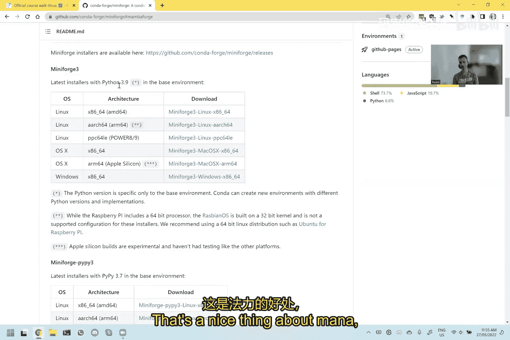

Or with you know some different sets of packages， then it's just one command in your term that you have to execute and。

You're transported to a new environment， which is very helpful yeah。

 although I would recommend not using different versions of Python if you can avoid it sometimes you need to because you need to check compatibility like a lot of workplaces use really old versions。

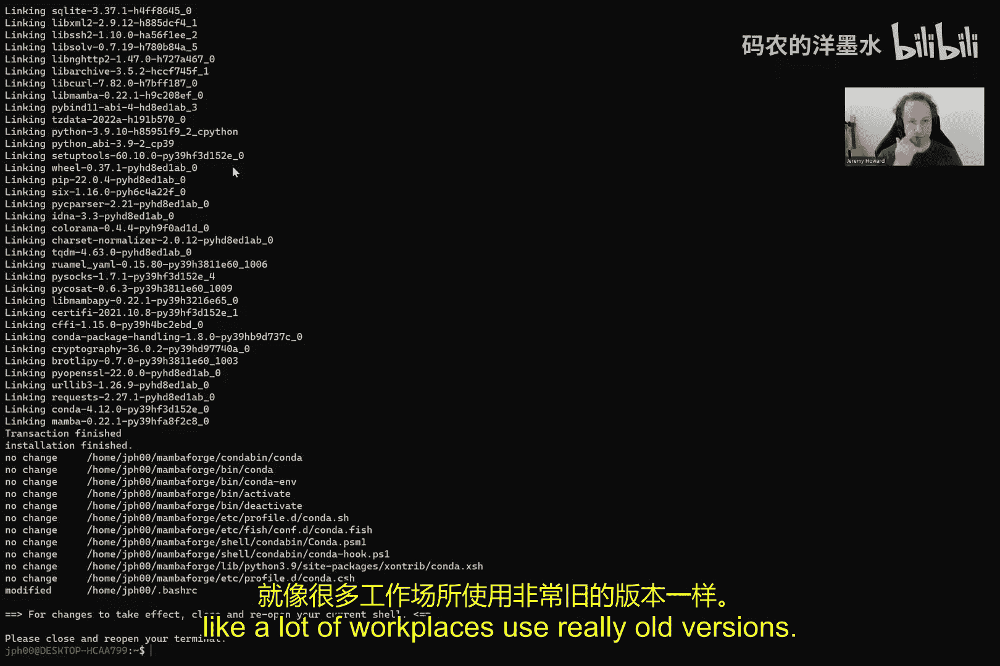

There's actually if you look at Python EOL for end of life。

There's a list of like when each version of Python。Became end of life。

 which means you shouldn't be using it anymore， so 3。6 isnt now officially。Anded security support。

 So if your workplace is using 3。6 or older， you should be strongly encouraging them to upgrade because it's insecure。

And so currently 3。7 to 3。10 are all。Supported versions of Python I do must I do tend to like avoid using the very most recent version for probably a year after it's released because it just I find it takes a while for everybody to get compatible 3。

10 in particular introduced some nasty incompatatibilities which。

I try to make sure fast AI works with all the versions as long as Pytorch does， but yeah。

 I'd say the penultimate version is a good one to choose and that's the default。

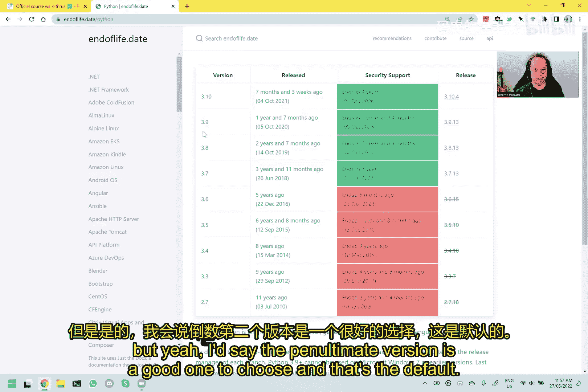

Okay， so look at that， we just ran a single command and it downloaded and installed。😊。

Sorry may I have run into an error saying。May I share my screen if that's course？Absolutely。

 do I need to do anything Yeah， you might need to give me permission to share， so I'll stop sharing。

And then。Okay， get got it thank you Okay so no worries sure great this is great aee buggging session here we go yeah so this is the error I think。

Expected environment not found at prefix ating。Interesting okay so did you do the manual version first and then now you're doing the script version or right that's right but I remove the through our mrf the oh I see the problem do you see how you've got base in brackets before your yes okay that means your your inside condo right now so you've removed it but then you didn't close and reopen your shell I see so let's try again so close your close your shell。

Yeah， and reopen it。嗯。

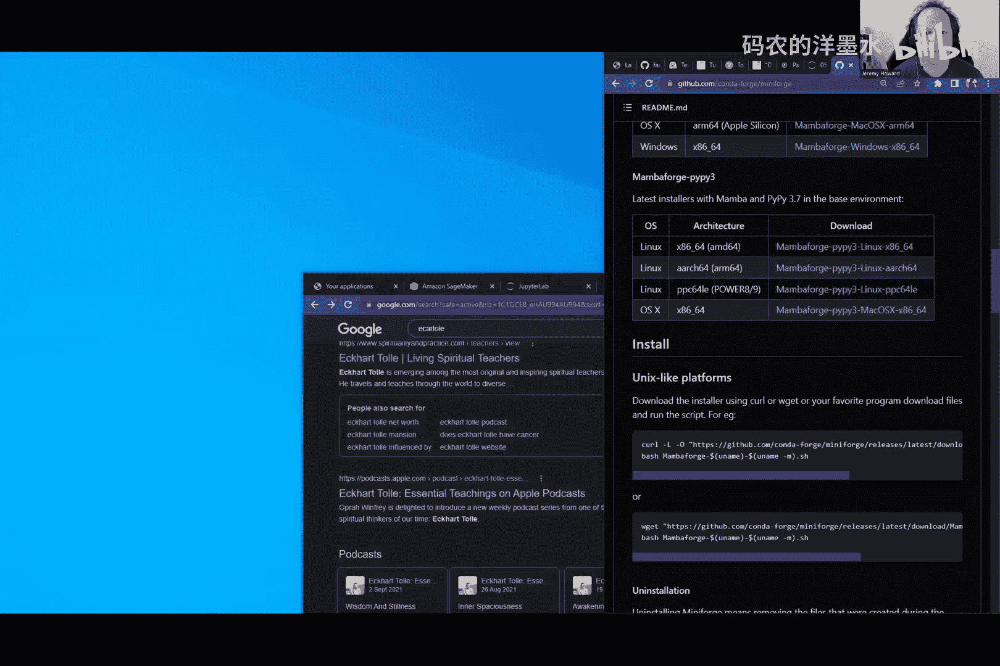

嗯。Okay now so the next thing you'll see here is it's complaining no such file directory oh add's something else never mind about that Okay great so oh now yeah good so that something that Ashie just did is she typed CD with nothing after it and that put her in her home directory so you buntu on WSLs a bit weird most things put you there by default as one doesn't。

Okay， great and that should run the setup quant file now so I would do an I minus If member forge at this point。

😊，And then yeah and then dot。s and then yeah come back number that's it good nice all right。

 then then come back to us if that awesome causes do all right， thank you so much my pleasure。

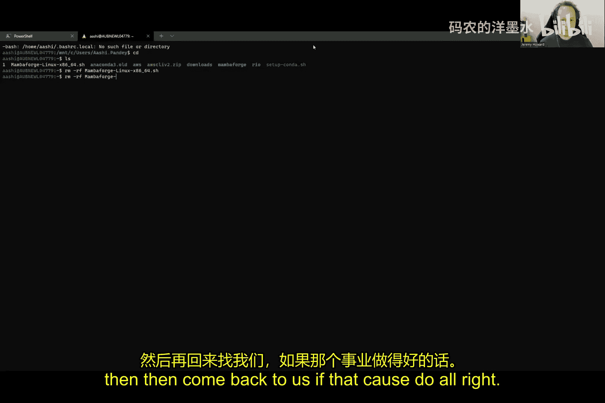

I the Python versions that we discussed before， it is very rare but it happens that you might encounter some code and Github that you will want to use in your project and it will use it will require some Python version you know that's much earlier from what you're using and in the environment that would be。

Using in a Jupyter notebook there is actually a way to run a specific version of Python for a given notebook so okay。

 should we add that to our list of things to talk about then that sounds useful should I put that here things to cover。

Sure， running， I mean，' it's useful in the sense that you don't have to switch environments while you're working on something and usually that would be part of your workflow that you want to do something to your data right？

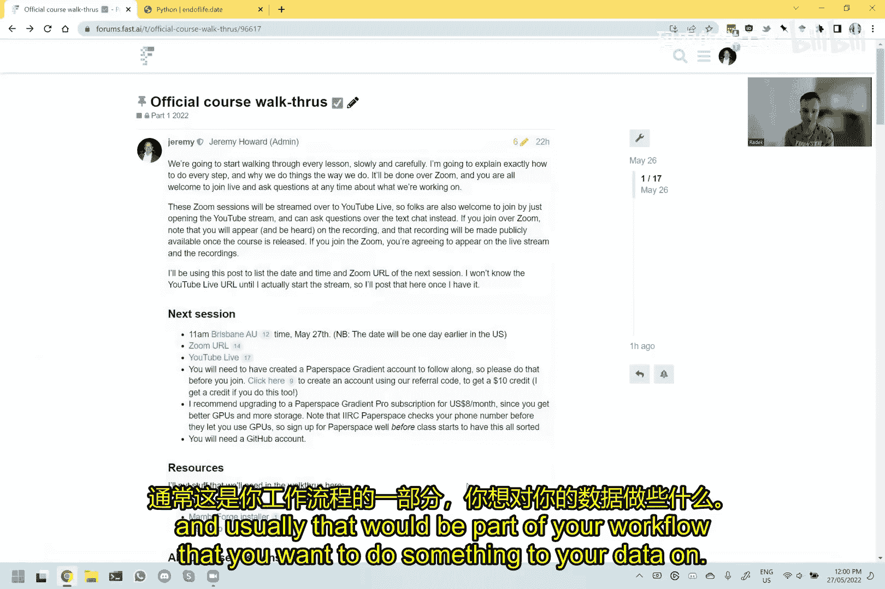

That is wrong。Thanks， Radock， great， Okay， so I have to close and rear my terminal。😊。

Done and so again， we put that base there， okay。And we'll also double check with Rich Python。Okay，😊。

With Python installed。We can run。Python scripts。诶。hi isn't that useful of itself unless I mean because we want to be able to like。

 you know， have some environment we can we can work in。

 particularly and particularly we want Jupiter。So we can install we can install stuff into our。

Python environment， but actually this Python environment， it's more than just Python。

 we can actually install。Just。Any program we like。In fact into into here， so basically what。

Mmber forge and condo and so forth do is they basically create a whole kind of directory of of programs and libraries for you in your home directory so it's not just for setting up Python but for installing literally any program。

You want。So you'll find often when you install something。

 you don't just end up with a Python library， but there's actually programs that you can run like Jupiter。

 for example。U。😊，Jeremy just just very quickly this is a quick interruption I think maybe some people might find it helpful even even I find it helpful still try and understand what I guess what disambiguates membermba from Conda from using Pip why would you choose one over the other to now exactly Okay cool perfect so so how do you install。

😊，Software into your Python environment well let's start just by talking about how do you install Python libraries into your condor environment and Nick just mentioned the three options you have which is Conda Pip and mamba you'll come across all of these three things let's just focus first of all on Conr and mamba。

So Conr and Mamba are literally two ways of doing the same thing and they are fully compatible with each other MAmba is a faster version of Con。

So why would you use Connda？Basically you wouldn't but memberm is very new so the vast majority of documentation you'll find on the internet users condo anytime you see something that says。

Conda Blair， you can type manba Blair and generally speaking that's going to happen much faster。

 at least if the Blalair is installed。So let's look at an example。

If I want to so a really helpful thing for playing around with Python at the command line is i Python that's interactive Python which we'll play with now I don't have i Python it doesn't exist right now when I try to run it it says oh did you mean some of these other things this this is Uuntu talking to me？

I don't want make sure you never install any Python stuffth through through brew or Mac or a on Ubutu or whatever that's just for the system Haon only use condom membermber or pe the vast majority of the time you're going to be using mamba so if I type mamba。

If I just type membermba， then it tells me， okay， well what do you want to do？And in fact。

 it even says condonda is a tool for blah， blah， bh， so you can see Manmba and Conda really。

Nextixed up right these are things you can do most of the time after typing membermba you're going to be typing install so membermba install what do you want to install a Python？

😊，And so what that's going to do is go away and check its index to see if anybody has uploaded something called。

IPython and if they have， it's then going to see what are all of the things that i Python depends on and so it's now going to check with me it's going to say okay。

 if in order to use i Python， you've got to install all these other things as well。

Is that okay and I'll say yep， that's absolutely fine so that goes ahead and downloads those things。

And it's awesome， and now I can type my Python。And there we go。

 so this is a Python rapple a raple is REPL a read Eval print loop， I can type things。

And it will tell me the answers， okay？Um。So this is like a good way for quickly experimenting with stuff in Python on the command line。

 I don't use it very much because I mainly use Jupiter， but you know。

 sometimes the really quick and dirty stuff can be helpful。嗯。

If you've read Wes McKinney's fantastic pandas and so forth book Python for data analysis， he does。

Most things are know Python。To close a Python， you close it in the same way as the fastest way also to close a bash or ZshH shell。

 which is to hold down control and press D。And。That access Okay。

 so control D is a nice fast way of closing probably most programs at your terminal。Okay。

 so that's how you。Install stuff。So let's install。😊，Pytorch。Shall we？So。

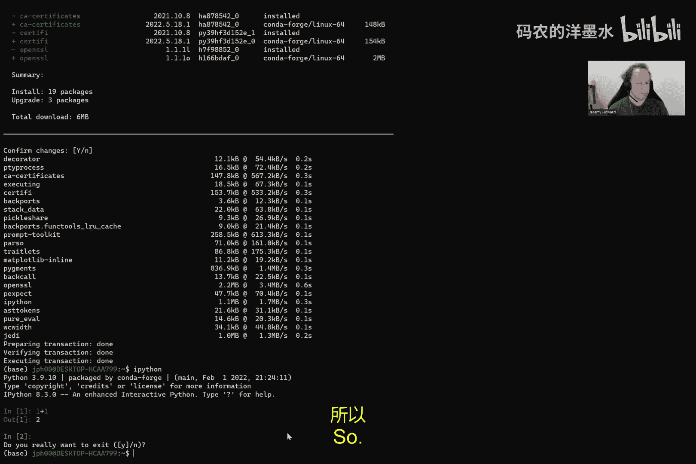

Py torch。Install。Hi， torch。Pro get started， I guess。There we go， start locally。

All right get the latest version it's choosing Windows。

 but I'm actually not on Windows like I'm not WSl is not considered Windows it's considered Linux so Linux。

😊，Connda， Python。And then there's various platforms you can choose。

 so if you've got an NviDdia GPU which you probably don't， you would choose Kuda。And。

If you don't you choose CPU I actually do have a nvidia GPU on my laptop。

 but just to keep things simple I'm going to do this and you can see by default it says Conda install So remember it's going to be faster if I use mamber install so I'm going to copy everything except the Conda。

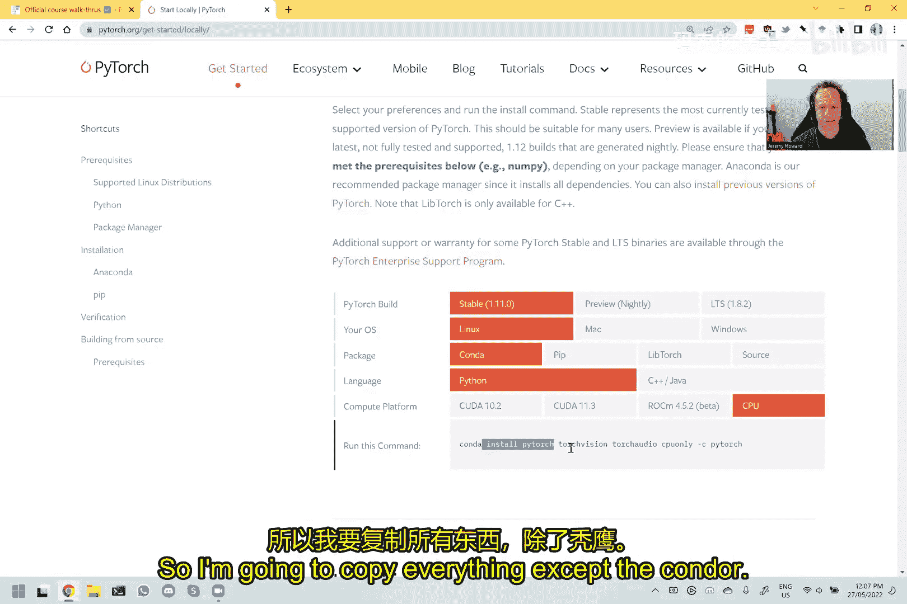

Copy。And then over here， I type membermba。And then control shift the to paste。And enter。

There we go Now you'll see here it's going to install。😊，It's going to install pieytorch。Torch vision。

 which is the computer vision bit of paytorrch， Torch audio。

 the audio bit of playtorrch just for the CPU。 And this minus C is important。

 This is called a channel， a paytorrch channel when people upload。

Stuff to that you can install from membermber， it can kind of be installed to the main default repository that people grab stuff from。

Which in the case of the manmber forage package we're using is called ConForge or they can upload it to their own channel so Pytorch and FastD and Nvidia we all upload things to our own channel so to get stuff from the Pytorch channel you see minus C Ptorch that says please search。

In Py Torchs channel for this software。Okay。So it's now downloading。

All the packages that we asked for。嗯。And also decompressing them and so this is basically a list of all of the stuff that it figured out was needed to install。

Ply torch。Jeremy quick question， let's say that I'm yeah like I just come along and I type in Manmba installs Pi torch or something similar or even if I'm reading through a blog post or a tutorial and I accidentally type in PIip install XYZ。

 have I created a cardinal scene for which there is no return？😊。

You mean if you Pip install something rather than member installing the thing correct， yeah， yeah。

 so if you。😊。

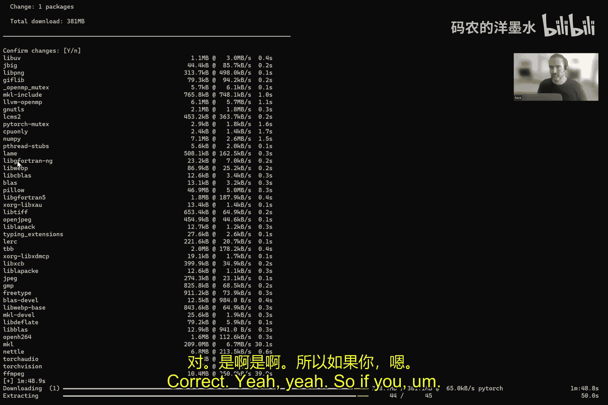

Pip install pay torch。Like that is an option here，Um， the thing is， though。

 that they've got some extra things here to make sure that you get the version you want。😊，Right。

 members， so for one thing， if you've got a graphics card right and then video graphics card。

 Pip installing。😊，Won't work unless you do a lot of futsing around with installing NviDIdia's Couda software development kit which you don't want to do that it's annoying right if you use Conda or Manba to install it it installs those libraries automatically for you。

Even if you're using Windows， your NVDdia GPU will still work。Um。😊，So yeah。

 in general installing with Conda or Mamba is going to more reliably give you the kind of correct setup of everything without you fuing around because Conda and Mamber are able to install what's called binary dependencies so installs all the libraries you need if you've accidentally Pip installed something you can just typePip uninstall the same thing。

Problem is though that PP's going to have installed also a bunch of dependencies again they came from PP rather than membermber and again they might not be the right versions that are optimized for your machine so。

Yeah， you know， I would be inclined to。Delatete my。Mamber to directory and start again。

 if I particularly if I did that for Pytorrch because it's just really important to have a good Pytorrch installation。

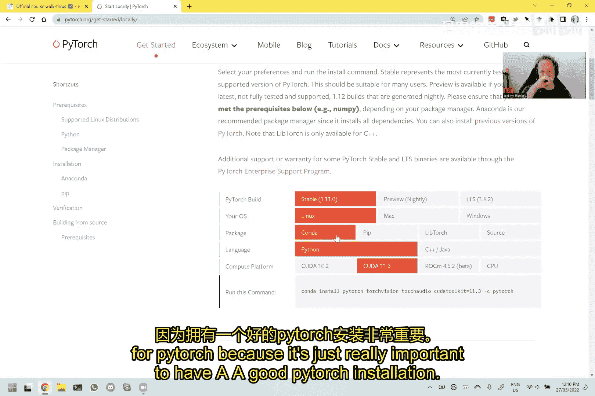

So that would be certainly my recommendation， I feel a bit the same way when we do Jupiter if you accidentally pit installed Jupiter。

Yeah I'd just be inclined to start again， but if you' always type mamber or condo instead of pep。

 just make that。Your habit。Then you walk get in that situation， can it？That' helpful yeah yeah I。

Can you hearYes。So for certain things， I believe was Tim， there is no way to install it with Honda。

I think I didn't see it so there is we will get to that don't worry but for now my channel called fasterster Chan will let you do that。

Can I just type in or just make it make a comment with a Pip now if I understand correctly I think like if you just do PP when you like set up a con environment that's the Pip is still going to be I think for like the system right so what I usually do no no no it's not it'll be fine in fact let's check shall we。

诶 okay。All right， so which tip？No， we're all good so it should okay be a problem no。

 but like if you were to create a new environment， right then。

Because right now you're from the base right so if you create your own environment yet so I wouldn't worry too much okay sorry。

 no worries。Emaine， did you have a question or comment？😊。

And it was the same as already discussed some great thanks everyone good Okay。

 so now that we've like installed this stuff how do we know if it's working so if I hit up arrowarrow I can find my iython。

😊，And I could just try importing it。And there it is， right。

 so I can now type torch do and if I hit tab in a Python， it actually gives me a nice list of things。

So for example， torch do tensor。And you can see it's going to give me the arguments。There we go。

 so that's working， so remember C D。So yeah， another thing we probably want to install is Jupiter。😊。

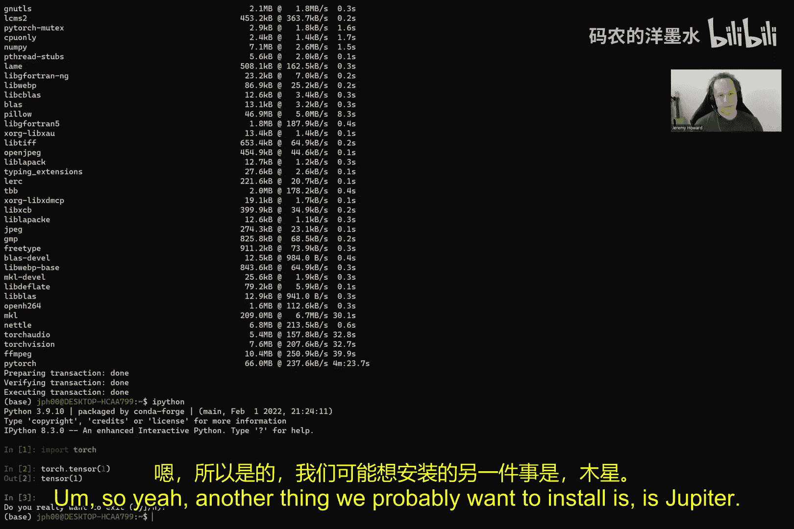

。So there's a couple of different versions of Jupiter， there's Jupiter Lab， there's Jupiter notebook。

😊，嗯。So we'll probably。Use Lab because we're using MamberForge。

 this condoda forge channel we're going to be using automatically。Right。

 so we don't need this minus C condo of forge， so we can just type。

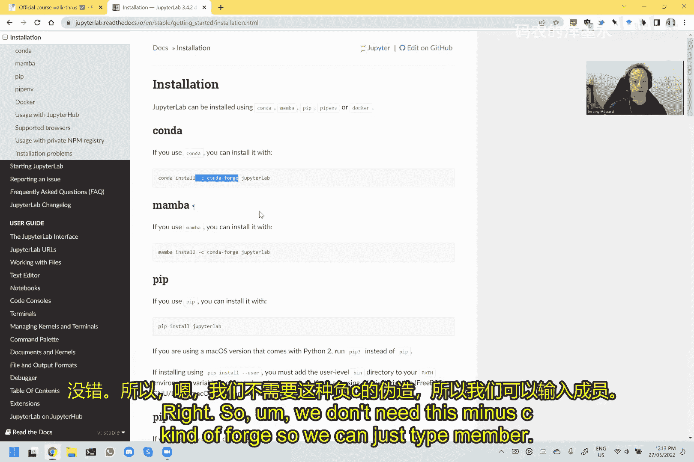

Memba。Install Jupyter La。Okay， so that's got a lot of stuff。It's a big piece of software。

But that's okay。嗯。Doesn't take too long。There we go， it's finished。Okay。

 so now we're ready to create our first。Notebook。So it's nice to keep things organized。

 so let's create a directory for our notebooks。So I make a directory called NBs。

And change directory to NBs so that's empty Okay， and so now we can type Jupiter lab。And there it is。

Okay， so。😊，It got a little bit confused here in my version because WSL。😊，Tried to open my browser。

 but my browser is a Windows application， not a uuntu application。 so it tried to。

Open it up and said there was an error now it's actually fine I can still use this so you can see here if I fit if these are hyperlink I can。

Control， click on it。

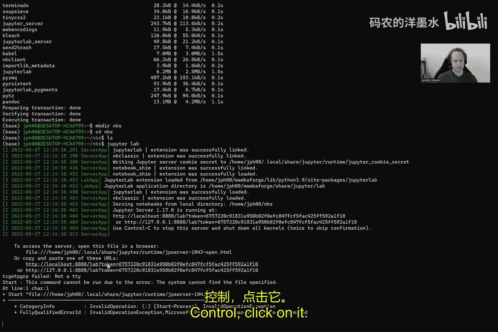

And it opens it up。😊，There it is， right if I don't want it to。Complain like that。

 you can say don't open a browser by typing no dash browser。And that's it， okay， and then click。

on control click actually yes Alan helloen my everyone I'm from Brisbane as wellbane currently getting over COVID how you feeling apparently I'm loud out of isolation today but I don't feel that great yet I'm sorry mate。

😊，Much better though so that's fine you know the most important thing to know about for COVID is to take it easy on exercise until you're fully recovered because it actually makes long COVID higher probability if you exercise when you've still got any symptoms so take it easy。

That's good well I'm going to go for a walk later just just to the shops。

A nice one just I was going to say with with that Jupiter lab and then no browser this is one of the ones where I discovered the aliases were really my friend so I was about to show that yes Yael and away I go yeah so。

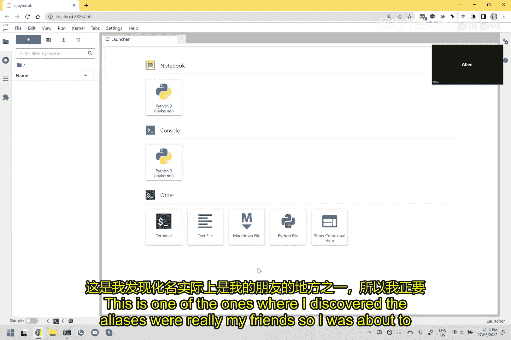

Yeah， exactly so。😊，嗯。I have。Let'sSa what have I got here。So I actually have even an alias for alias。

 so for things that are kind of long and annoying to type。😊，You can create an alias。😊。

UThere's a few things we could do to not have to type Jupyter La no browser。

 one would be to hit our arrow。Now one nice thing about Up arrow is if I close by Shell。

And go back into it。Ourarrow is your works。And by the way。

 none of this stuff is magic right if you if you're wondering why does that do work。

 it's because Bsh creates a file called dot bash history。

Which is actually really useful to know about because everything you've ever done is listed in that file so here's all the things we do and this is another good reason to use a terminal is you can always go back and repeat things this is actually how I create scripts I do everything interactively and then I copy and paste stuff from my bash history into a text file and that creates a script。

😊，So if I hit up arrow I can get my Jupyter lab browser a very。

 very very helpful thing that works in bastions ZshH is the control R keyboard shortcut if I type control R。

 it says reverse search and then I type JU for Jupyter。😊。

That will show me the last thing I typed with those letters in。Okay， and if that's not the right one。

 just hit C R again and it'll keep searching。So that's very useful。

And Jeremyery is there any way to clean this is very clear this is I assume that after a while it's become such a long fo it's very difficult to don't worry it's just it's just text I think it automatically like cleans itself but yeah just leave it you can always delete it if you want to or you can even edit it with an editor but。

Yeah， it's kind of nice to have all your history there， in my opinion。No， another thing you could do。

 sorry。😊，I think I defaulted stores 1009 or something like that。

 but you can set it to something more yeah that's right I think there's some environment variables isn't me。

And then one other one which is kind of interesting is exclamation mark followed by some letters。

 runs the last thing that starts with those letters， exclamation mark JU。

Well ran Jupipyter 1no browser。Something that you'll see quite often is exclamation mark。

 exclamation mark， and that means just rerun the last command。😊，As you see。

And you can put that anywhere， by the way， so for example， if I type echo。😊，Do了 dollarella。

That filters it out as Air code youve to lab their browser。

 so there's a little trick for you as well Okay so。Alan mentioned aliass I could type alias。

Jupiter La JL equals。And then I could put。Wonder if this is going to work。Let's try it。Yep， okay。

 so Alias JL equals E Jupyter La， oh I don't want the echo there never mind so。

That's just to let echo a bit。Oh， okay。When I am editing this line。

 there's a few shortcut keys to know about to go to the end of a line， type control E。

To go to the start of a line， type controlr A。And then to go forward and backward by a word at a time。

 press alt left and right， which radical Nick is that option left and right on a Mac。

To move by a word， never had the mic。I'm not headed for a month， but I couldn't get used to it。Nicki。

 you want to Mac？I'm using one as we speak right now because it's better for running Zoom on but yeah。

 you can do things like that， although I'm used still the Eax key bindings。

 but that's a rabbit hole I won't subject people to。😊，😀ふ。😊，So now I've got this alias。

 so I can just type JL。😊，And it does the same thing Now the problem is that's not going to appear automatically next time I run my terminal。

But do you remember I told you about that special hidden thing called dot bashRC that automatically runs。

 so if we put it in there。Then it will automatically run。So if I close my terminal and reopen it。

There's JL beautiful now you'll notice that when I edit files in the terminal I tend to use a program called Vm which as Nick well knows is obviously much better than the competition called EmX but you don't have to use either of these you can use whatever you like and in fact on a Mac if you type open。

😊，Yeah type of an open dot， it'll open the finder at this directory or on Windows type。嗯。😊，Explorer。

x。t。Oh， why isn't that working？That's weird。Okay， that's never happened before。All right， so。Amazing。

Must be some recent change to WSL， which I will have to look into to find out why ExplorerX is not working。

I think you made a ty in the spelling Explorer。What did I do wrong。I think要睇。

Expl you added an extra period。Yeah the period at the end is intentional， that's to say。

 opened it in this directory。And I tried to tap complete and tap complete didn't work。Is it caive？

Change it work on my end No， it's not works I think get let your user maybe you need to go to other user。

 Yeah， I tried it in another user。 Yeah， I think。YeahAll right， doesn't mind。

Come back to that another day， I wonder if likePa。Ha。Yeah， they he changed something。

It seems to work for me Yeah I don't know if there's not worked before here it looks。Okay。

 we'll figure this out and we'll cover it in the next session。

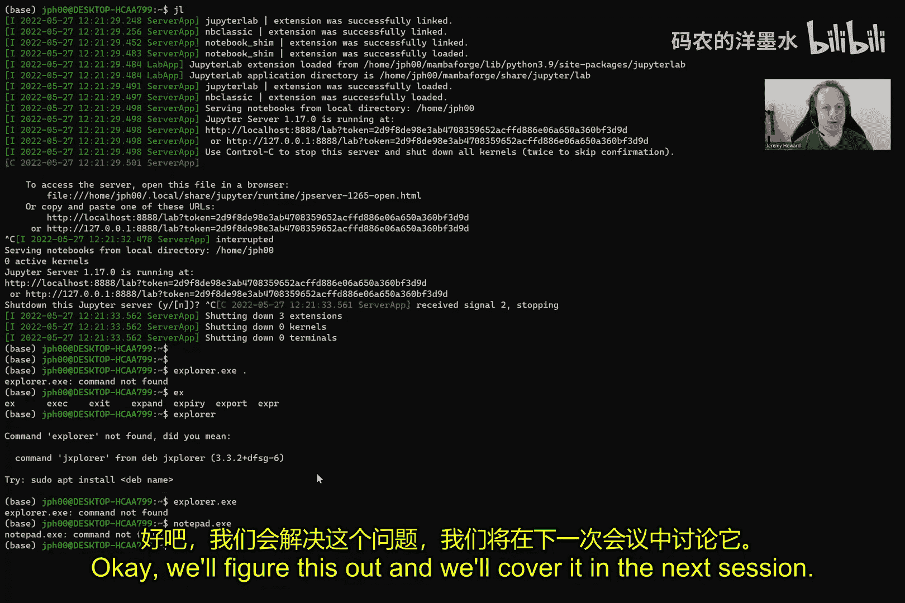

呃。Every year that is this。Super amazing。One of the things I like particularly about it。

 WSL like was the expert thatX that trick， I think that's super useful and super amazing。

 but another wonderful thing that WSL allows you to do is to run GuI Linux programs in the next for example。

 as for example。

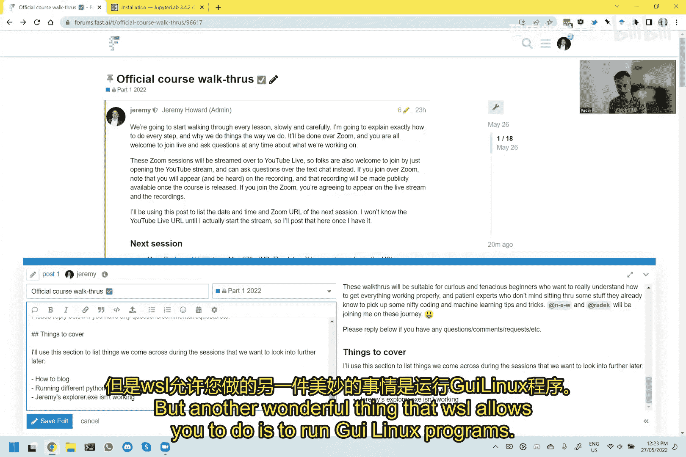

Use a password manager， I can't imagine living without it and it's a key as X that I used and I can just start it in WL and it pops up a window in Windows。

So I don't have to go via there other in WSO is you can just access。Through wsl。

 local host so if I change this to。JP H00。I can't do it this way。And so here's my best shall see。

And then I can edit it with whatever I want to。Visual Studio code， for example。All right， so。

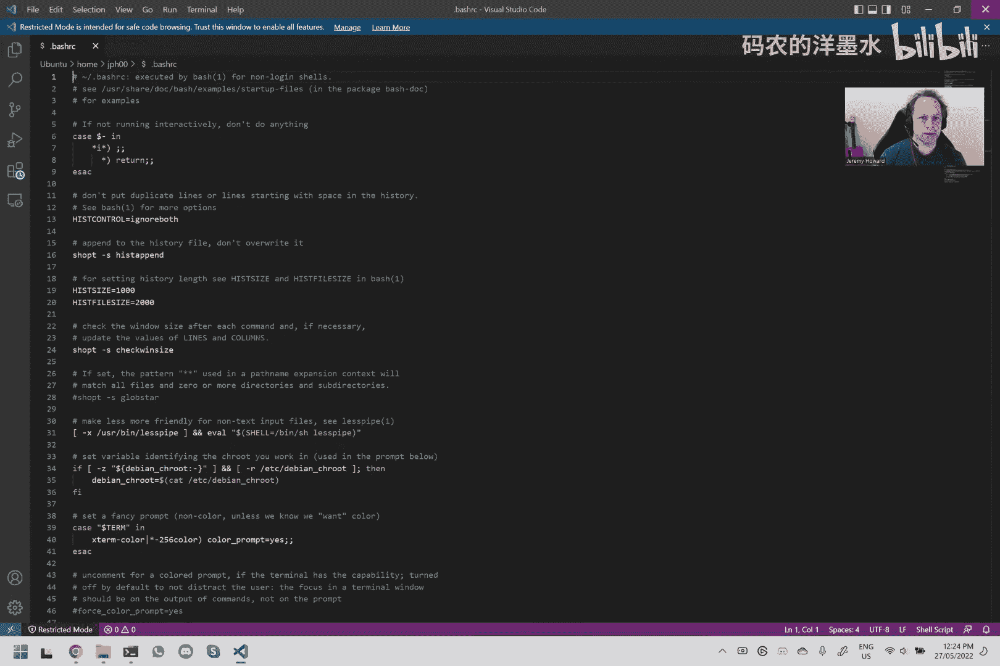

Okay。So let's take a quick look at Jupiter。U。Yeah。Yeah。CD and Bs。So when I run Jupiter。😊。

Ill do the other window。Yeah。Chaale。Okay， so our'll control click here。嗯。

When I run Jupyter by default it's going to it's going to kind of be inside the NBs directory so when it says here there's nothing in here like it kind of says slash it doesn't really mean slash it means wherever you launched me from so this is the contents of the NBs directory so I can now create a new notebook。

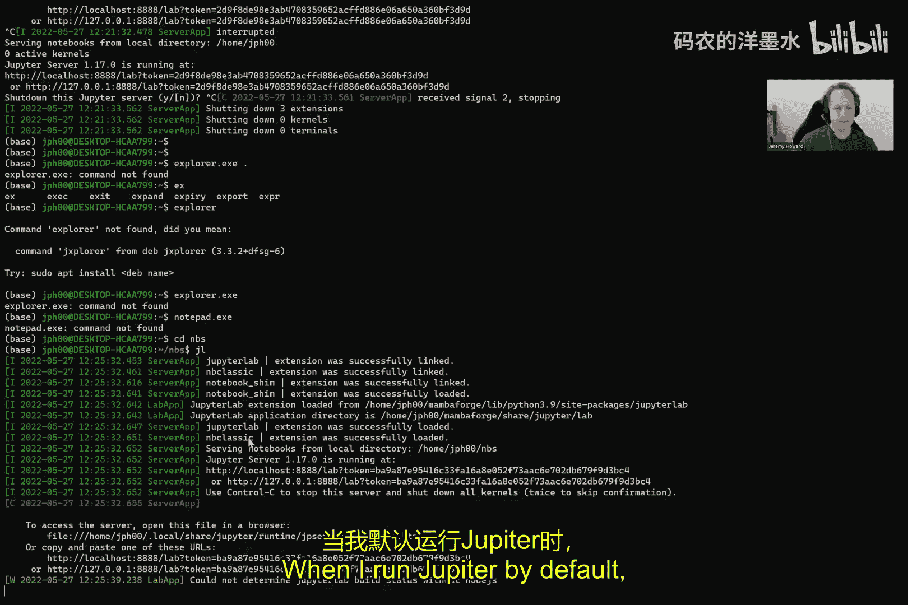

Like so。And。Wt a cell。And save。

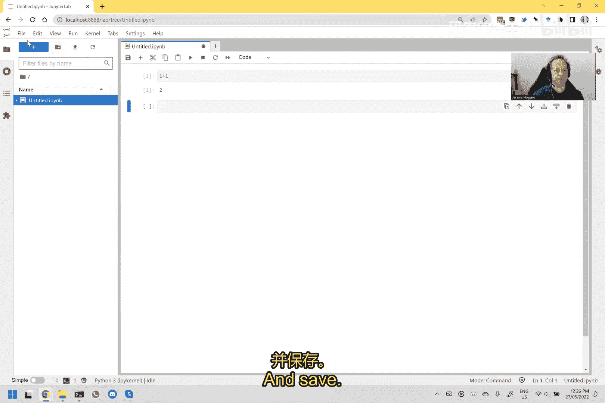

Okay by default it's called untitled。ip and B so if I now so that's now running here right so I can't like do stuff here because it's busy running Jupiter so I'll open up another tab。

And I can LS。And so on Windows terminal it's just control tabs switch between tabs and you can see there it is untitled。

pay and B right we can even take a look at it it's just a normal text file。

Right。Okay， so we have Jupyter working and we can。嗯。Import torch。

Please update Jupiter and i widgets Okay， that's interesting torch， start。Tensa。Cool， okay。So。

I'm guessing we need to install IP widgets so we're getting pretty good at this， let's try it。

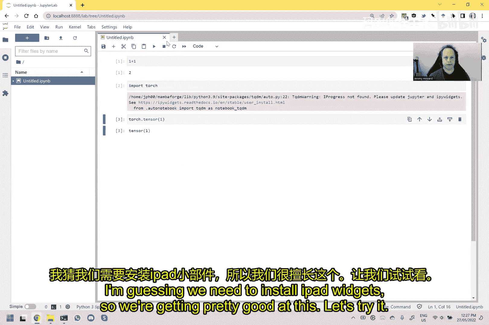

Mmber， install iPad widgets。😔，是。Oh， this is。Needs to be reopened。Okay。

I surprise that's not installed by default， but there you go。So I'll close Jupiter。Very open。

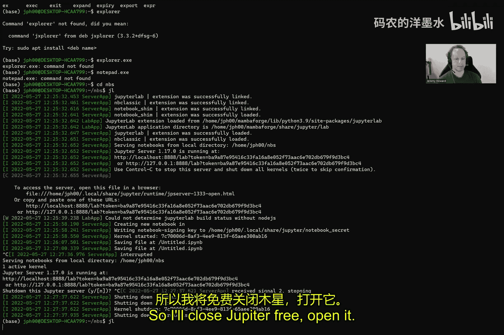

Control， click。😔，I already had a open。And let's see if it now works， okay。How did I say new。

 didnn't mean to say new。There we go and let's see if it now works。Yep， it's not complaining anymore。

Okay。😊，And you can see Jupyter La， you can kind of do like normal gooei kind of stuff。

 so if I want to delete this， I could either go into my terminal and click and type IriaM untitled one or I could right click on this and choose to delete。

This feels like a pretty good place to leave things Does anybody have any questions or comments before we。

Wrap up。Appreciate the session Jeremy， that was really helpful in setting up and very smooth as well。

😊。

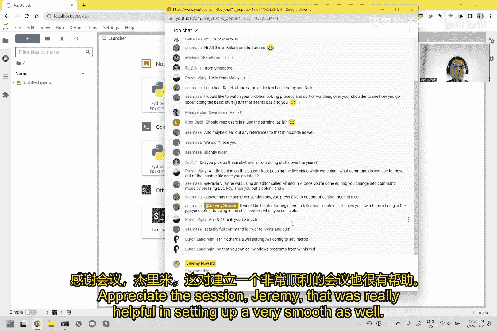