# 【全集】旧金山大学 实时编码 中英字幕 1080P p02 Lecture 2 - Linux与Git开发流程 -BV1KZiTBWEeH_p2-

Can that be complicated。So。I think I've broken the back of it， I think I' basically figured it out。😊。

Does anybody have any questions or？Areas of interest or anything following our last chat。Okay。

Hi yeah I am interested to know more about fasthan generally because I just Googled and found it very yesterday we will get to that that might be a little while though。

Hi， Jeremy。Joe， hi Joe where are you I is from Jack Oh just about seven minutes away from where you're Oh you're on the Redcliff Peninchula somewhere now in。

 I thought you were in Brisbane in Redcliffe。Iect， not it's about seven minutes away。

Quest I have like really impressed with the blogging sort of setup out of Jupiter and just I'm curious what your workflow is and how you are able to do an experiment and be able to blog about it very easily because I find。

I've got to move it from this gith to another sort of thing and there may be things in that space and my definitely I said yeah I think we've already。

Let me just double check our list of things to cover yeah how to blog is actually number one of our list of things to cover in our walkthroughs topic and I don't think first chance there yet so let me add that。

Fast chin。Here we go。嗯。All the awkward good questions。😔。

I'll introduce myself I'm Matt from Britain as well，I would like to。I think。😊。

We started looking at setting up Jupiter lab last week from remember briefly。

And so I think we'd installed Jupiter Lab prior torch。

 so even managed to get that working successfully and that work okay it works apparent looks like it's working。

So and I managed to。Install fast AOA as far as an know。So I guess。Being。

Compfident that I can work on that and my machine would be yeah。

 that's actually what we're going to do today， I think we're going to focus on。Yep。

 getarrow and kind of start doing some work on our own machine。Exactly。U。Okay。

 well let's get underway。😊，With that。So。

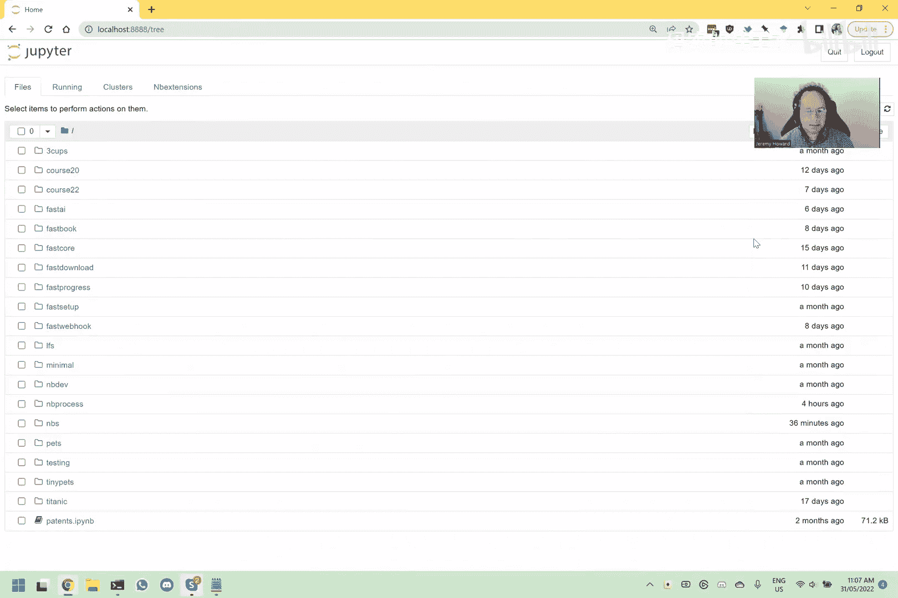

🤧。Just to explain something oh， just to explain something you might have seen。Last time。

I have two different users in my WSL installation I don't normally。

 but it's just like I just wanted to mention that。And in a Linux。

You know distribution you can add multiple users and switch to them and so the way you switch between users is by typing pseudo minus U for username and then the username you want then minus I to open up an interactive terminal as that user so that's why you see me doing this sometimes so when I do that you can see it's like said oh welcome JP00 and kind of starts from scratch and you can now see before the a sign it tells me that the only reason I'm doing that is so that I've got like an empty user。

That doesn't have anything installed or anything set up。

 so I don't accidentally assume something that。And。Fil to create something。Generally speaking there'。

You won't normally have a reason to act。Create multiple users on your account unless you want to kind of set up something like this that's totally separate。

嗯。😊，So yeah， I thought we could try to like， create， you know， a notebook and。Python script。

And put them in a gi repository。And， you know， I'll just kind of go through that workflow， basically。

U。😊，So I normally create a directory to put my my gi repository， so what's a git repository？

A repository is a folder。Containing files and potentially subfolds。嗯。😊，Which。

Basically to simplify slightly you can easily store somewhere else and the most commonplace people store it is GiHub。

com that they provide free storage of Git repositories and most interestingly Git keeps a kind of a copy of every version of your files and you can switch back to any previous version at any time。

 so if you ever a mess something up and save it and then realize later I messed it up you can go back and。

Get an old version。

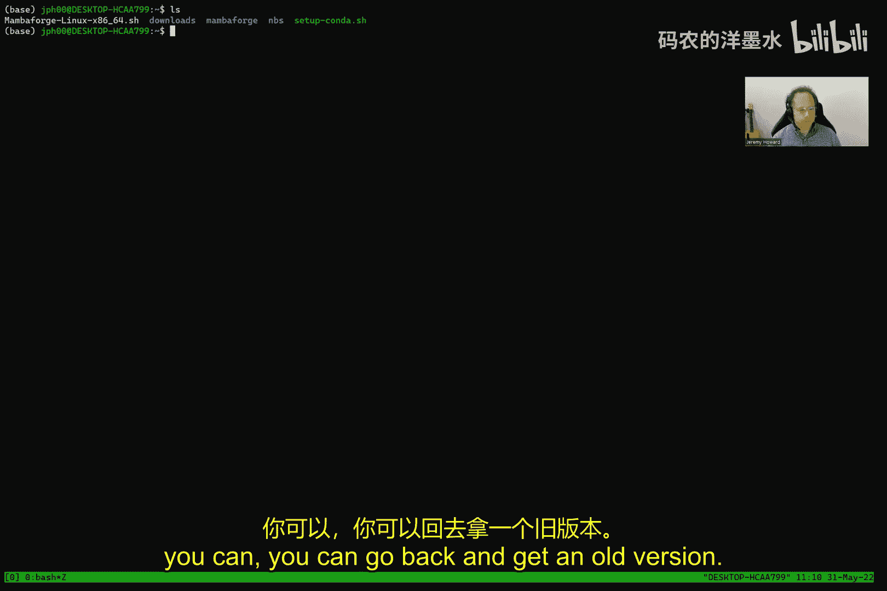

So maybe before we create our own GiHub repo we could look at a Github reos so we could look at the fast A1 so GiHub as I say is just one particular company that stores Gi repositories for you you don't have to use them there's also one called Gitlab but。

I don't know most people use GiHub so I think it's easier to go go you know be where everybody else is and so this is an example of repository so the name of the repository is fast AI。

And then that belongs to some particular person or organization。

 in this case it belongs to an organization， the organization is called Fast AI。

U so if we get rid of the first of those， the last of those fast AIs， this is the organization。

 FA AI， and you can see the 119 repositories that are in that organization。So if I click on one。

 say fast release。See how the URLs changed， this is now the Fast AIs organization repository called Fast release。

Pair of things with a slash is basically a unique identifier in Gitlab for a repository because it has the username or organization and the repository so fast AI is an organization my Gitthub username is JPH00 and then that also has repositories。

And so I can click on one like tiny pets。And you can see this is now the tiny pets repository and JH00。

Okay， so let's go back to the first AI repository。So a repository， as I mentioned。

 contains folders and files and then folders can contain folders and files。

They can contain basically any kind of folder or file any kind of file you like。

 they ask that your filess that each individual fail is smaller than 50 megabytes。

They don't particularly enforce that， though。嗯。So that's what we see here。There's a special file。

 which is a file called readme or readme。md。And that file is special because in this display。

 it's automatically shown in this。Repository website。

A kind of minimal useful repository is something that just contains a readme。

md file and in fact as soon as you have that you have something that you can。

A website you can show people。嗯。So maybe we should start by doing that。😊，So if you go to。

Your own GitHub page。GitHub。com/y username。Yeah。You can click repositories and so you might not have any repositories yet。

 which is。Fine。And here you could click new repository so why don't you go ahead and do that。

 click new repository。😊，Um，And so。You need to give it a name。嗯。Walk through。3。😊，不。

If you want a description， not a bad idea to remind yourself of what things are sample repo for walk through three of AI course so you can make it private so nobody else can see it or public。

Something you'll hear a lot from fast AI folks， the community alumni myself is that。

The more you can work in public， the better， the more you can share your your portfolio， the better。

 something which。A lot of folks aren't used to and can feel uncomfortable， but like here's you know。

 here's a place you could start trying that is to make this public if your default is to always make things private。

 maybe try not doing that this time。Okay， so we can yeah， walk through second。

 please walk through two。😊，Sorry。😊，That the second walkthrough view going walk here。Sorry， yeah。

 thank you I don't know why I imagined that there was another walkthrough。Maybe I dreamt it okay。

 I guess it's because it's the weekend it's been a long time so we can say add a read me file。

Now there are some things that you don't want to put in gett kind of like temporary files and stuff like that。

 and there's a special file called do gettign which lists all the kinds of files you don't want to store so if you。

Click on here and start typing Python。This will kind of create a list automatically of the kinds of like Python's intermediate files and stuff。

U。So again it's a good idea to use a license that allows other people to use this if you don't then other people can't use your code I always use Apache license too and the reason for that is that it's like。

Gives users， you know， really as much flexibility as possible and how they use the code。

 but it also has a clause that minimizes the chance that I'm going to get sued for patent violations or that people would use this to kind of。

Enforce patents in inappropriate ways so Jeremy tonight can I ask a question， of course。

Sorry my name is Mark i'm from Toronto I'm representing North America here tonight I think great or this morning late night for you well it's only okay you're at the of course your West Coast I see east but yeah sorry can you just go a little bit more into the get ignore and I didn't quite follow what that yeah let's create the repository and take a look at it Okay we sorry I'm embarrassed I've actually been to Toronto when。

😊，Completely butchering my geography is this way you want questions asked or do you want hands put up or something I like one question yeah I like I like。

 you know， as informal a conversation as possible yeah。

I'm not even sure I would see if hands go up so here's here's the replay we just created and if I click on get ignore。

It will show me the contents of that text file and so here is the text file called get ignore with line numbers on it you can see it without anything else by clicking raw。

So that' this is just what the text trial contains。And you can see for example。

 in Linux a dotsO file is a compiled C library which is not something you normally want to save into a reos so star。

so star means anything do so Cxc library files would not be stored Python has a cache of things that it's precompiled which it puts in a d pcash directory so this says don't put that into your git repo so basically when you when we add stuff to get reos shortly。

 it will by default not include anything that matches these。Take patents。

Does that answer your question， Matt？Okay。It does in the sort of literal sense， I guess。

 tell me more about what your non literal sense is。

Well so so I understand that it's I understand that these are the files that will be excluded。

 but I guess other than just always choosing Python for gett ignoregno I don't know how to decide which files to include and which files to oh yeah well we'll see that as we go one example that will come up if it's not already in here is Jupyter stores backups the most recent save copy a backup director calledip checkpoints you would know and when you go to get a you might say oh it's adding this directory calledip checkpoints I don't want that and' be're like okay I'll put it in my giIgno so it's generally like if you'll see things that you're like oh I don't need that to be backed up or like oh that's the thing that contains my password I definitely don't want that in my public get those are the two main reasons inside the stuff that doesn't need to be there or stuff that you actively don't want to be there so but choosing the Python。

Get ignore is generally a good first this is a good startt。

 so this is just kind of pre populated it with a bunch of lines that we we'll add to later as we find stuff that we don't want to include。

Okay。So you can see it's created a readme do Md file。 And if I click that， you can see it's。

 here's its contents。 and that's the same as the contents down here。 and so。We could like create。

 you know， a little website now which is basically I mean websites bit of， you know。

 I guess it's a website by editing readme。md。So if you click that little pencil。

We can now edit so try editing your readme。tmd and this is。😊，This is Markdown。

Which we use in Jupiter， we use in Readney files， it's kind of used pretty much everywhere。

And so it's well worth getting used to so at this stage the markdown file you've got one line that starts with a hash。

 that means this is a level one heading。Um。A level 2 heading would have two hashes。Introduction。Okay。

 and then you just put things in。On separate lines of text， so this is a sample repo。

We'll walk through of the faster AI course and then if you want a new paragraph。

 just put an empty line between them。This is another paragraph。And then， you know。

 you can have lists by putting hyphens。Okay， and so forth。And maybe we another header here。Okay。

 so if I save that。It doesn't say save， it says commit。

 so this is a concept in gett is that you don't just save things。

 but you create you know a version called a commit。

 which is basically all the changes since last time you saved。So commit means save。

 but it means save。With version control and so when you save。嗯。

You need to have some description of what the change was you made and optionally you can add more details about it so by default it's made a description for me。

U。😊，So I can commit my changes。And so now if we go to our repo， you'll see that we've。

Got more in our evening。Um。You'll also see that this repository now has two commits。

 so if I want to go back and see what it used to look like。Then I can see here's the initial commit。

And here's my update read me if I click on this commit code over here。It shows me the difference。

 so things with a minus and a red are things I deleted and things in plus and green are things I added。

And this is called a di， a di or a difference。And so very often people will you know。

 say that they want to have a look at a deathaf。To see like if you've made some changes to their code。

 to see what changes did you make， otherwise， it's very difficult to know what somebody did。

So this commit gets automatically， gets a little unique name， as you see， and we can see the di。U。

Or you can even click on this little button here， browse repository at this point in the history so you can go back and pretend。

😊，That life was before a minute ago。And see exactly what this looked like back then。😊。

So this is now looking at the state of this repo before I made the change。Yeah。

So gett is pretty handy and GitHub is a very useful place to store stuff in Git。

So generally speaking， we don't normally edit things directly with the GitHub editor because it's pretty basic。

 I mean I do sometimes， you know， if I just want to make a quick change to a read me I will sometimes click that pencil button。

 but more often I'll it on my computer。So to put it on my computer。

We need to clone the repositorory so cloning at men making a kind of a linked copy on our computer。

 so you see this code button here。嗯。We can clone it。

 we're going to clone it using something called SSH， which is something we'll use a lot。

And SSH is a way of logging into remote computers and also automatically doing stuff with remote computers and copying stuff from remote computers。

So here is a URLL， it's not to a website， but to a Git repository。Using SSH。

So I can click here to click copypy。

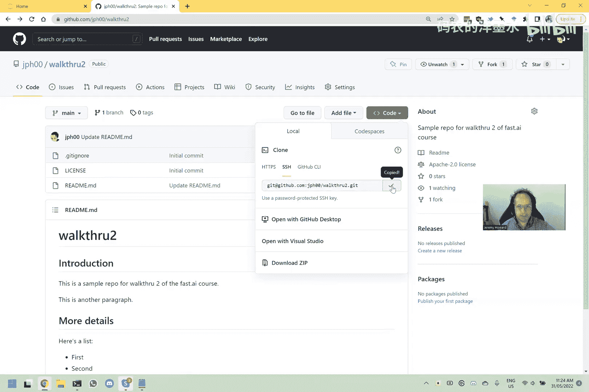

Okay， so I've copied that so how do I clone it well the first thing I do is like say let's get things organized so I like to have a directory for all my clone gi repos so I'll go make to gi。

CD git and so if I go print working directory， you can see I'm in my home。

And remember that Tilda is a shortcut for your home。

So I can now type so get is a program on your computer。😊，And so you can type get。Cone。😔，And then the。

Here I real。So I just pasted it。Okay so there's a lot of security stuff built into SSH and one thing is to make sure that you don't accidentally connect to places you didn't mean to。

 you know I don't use that much of the security stuff because I not too worried you know for most things I do so in this case it's just saying you sure you want to connect to this new place。

And I just say yes， and it's going to save that。Yeah。Okay， so。😊，Permission denied all right。

 so I've asked to clone a repository using SSH。But I got permission to note and that's because to use SSH。

 you have to use an SSH key。So the first thing I mention is if you want to clone somebody else's repository。

 you can use HTTP instead of SSH， so I can click here HTTP。

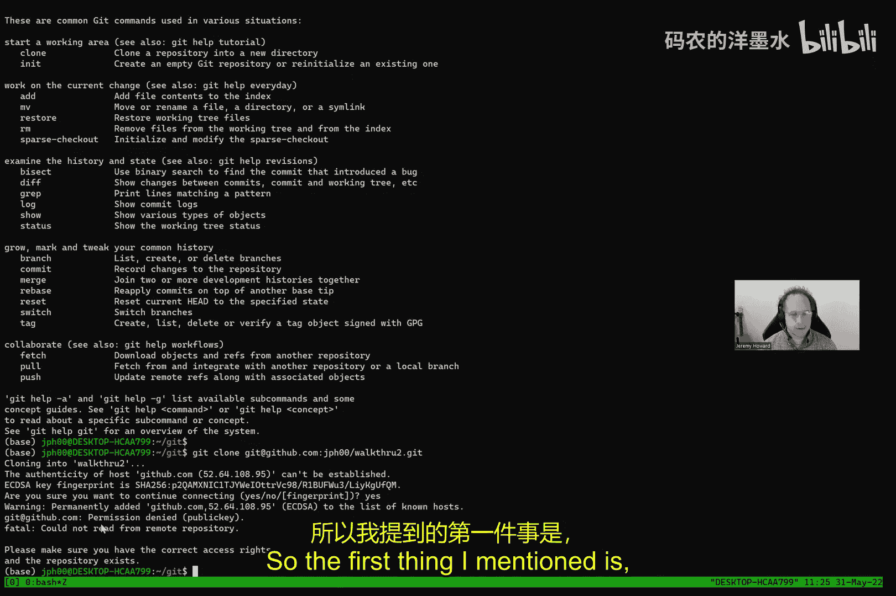

Copy。

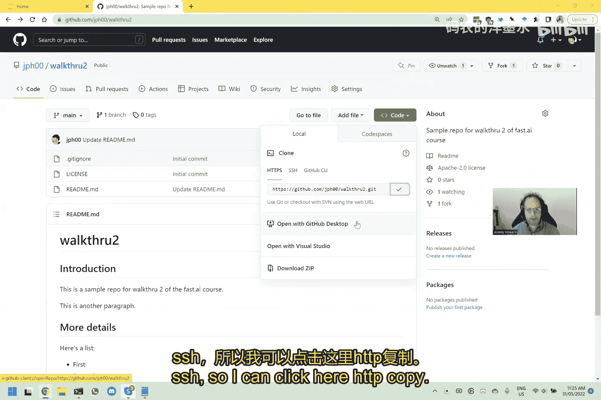

And then I could clone that。And that works fine， that's a perfectly reasonable way to work with other people's code。

So if I go C walk through two， here it is， and they can edit the read me。

And then I could go down and I could add something else。And。

The problem is I can't save that back again without logging in to GiHub so if I try to commit that i'll explain committing from the command line in a moment。

 but I just want to show you that。Oh， okay， so the next thing to know is if you want to save stuff back to GitHub。

 it needs to know your name and email address。So it tells you some commands you can use。

 so one approach would be just to paste them in。Right。

 and obviously that's not the right email and username， but things like this in the terminal。😊。

They basically always create。Hidden files in your home directory， so if I just type CD。

 it takes me to my home directory。And you can actually see here， there's now a file called。getconfig。

And so I could edit that。And here we go。So info appfa@ AI。Jeremy Howard。All right。

 now I'll show you a little trick which most people don't know I want to go back to the directory I was in before。

 I could type CD get slash walkthrough2 or I could just type CD space hyphen and space CD hyphen means change directory to your most recently used directory。

So that's very handy at。嗯。😊，One issue with that is if you've like CD three or four times there's no kind of history there so what I would do if I want to come back here later and I'm going all over the place is instead of typing CD you can go pushD which is the same as CD but it remembers where you were if I go pushD。

And change to my home directory。 I'm now in my home directory。 I can C D to downloads。 I can C D to。

And these， how do I get back to where I were were where I was before， well I pushed。

From get walk through too so I can pop if I take P D。There we go， I'm back， Ray。😊。

Whereose originally so there's a couple of good tricks for zipping around in your directories structure。

 it's a bit like pressing the back button， I guess almost on on a browser。Um。Anyho。

 if I now try to save my change and the way you do that we'll talk about it this more in a moment is you push。

You can see here it's asking for use of them and so you obviously can't save things to other people's repositories if you don't have their credentials。

It's also annoying to type in your username and password all the time。😊。

I never use almost never use HtTP。Get cloned for my own repositories instead I use SSH so let's that directory。

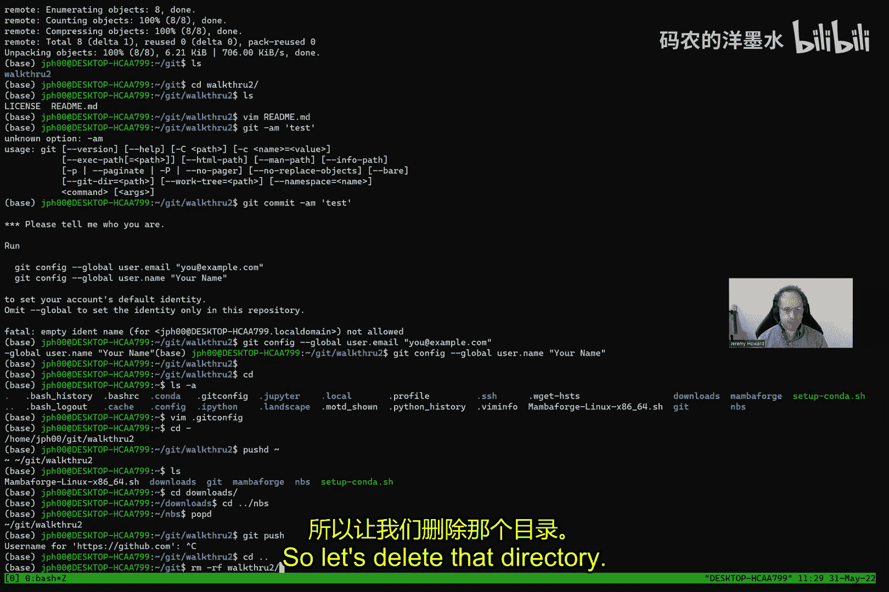

And get clone with SSH， so click SSH and copypy。

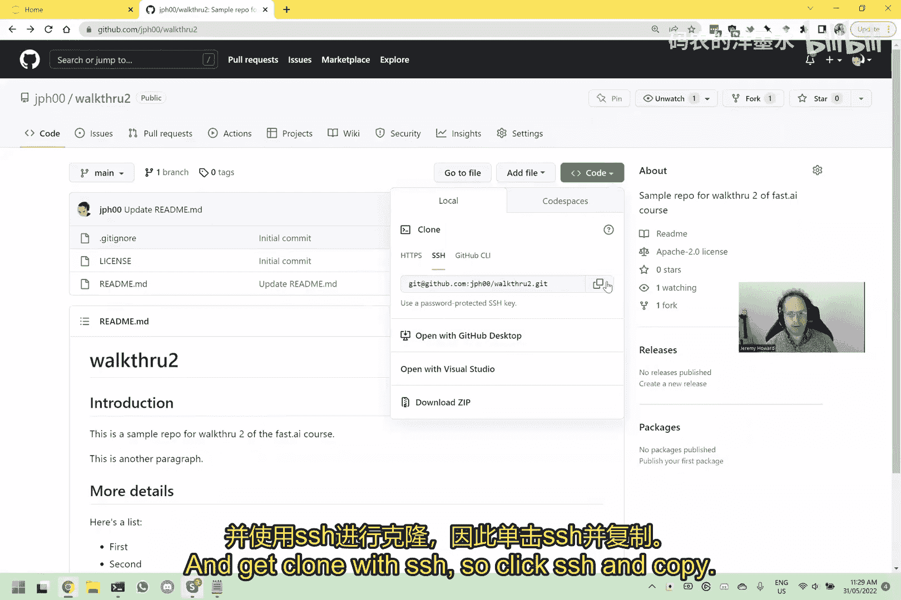

And let's take a look again at this error we got。Okay， so why do we not have permission。

 that's because it doesn't know who we are and it doesn't know that we have permission to copy and change this repository。

SSH is really nifty， it doesn't use passwords。Instead。We create a secret key on our computer。

Ca the private key and the second thing called the public key。

 which we can give to other people and then anybody who has our public key we be able to accept we will be able to log into basically but they can't log into us that's why it's cool it's not like a password。

It's a one way thing。So we can get into GitHub， into our repos。

 but nobody on GitHub could like log into our computer or anything。

So we need to create it's called a key pair， a public key and a cut private key。

 so to do that you type SSH。Yops。Dash keyG， SSH keyG。So that's generate SSH keys。

And then just hit enter， hit enter again， hit enter again。All right。So that's created。

Keys in my home directory。In dossh。This one here's the private key。

And this one here's the public key。So we need to tell。GHub about our public key。

So that we can log in there。So to display a file in the terminal。Without like。

Basically show it all at once， you can just type cat。So if I go cat。In myho directory。sh。

pub there it is now there's no problem with me showing this on a live stream and it being on a video this is not in any way private or secret because this is just something that lets me if it's it's placed on another computer lets me log into another computer。

In fact， it's even stored publicly like anyone can access this public or Jeremy because it's on GitHub。

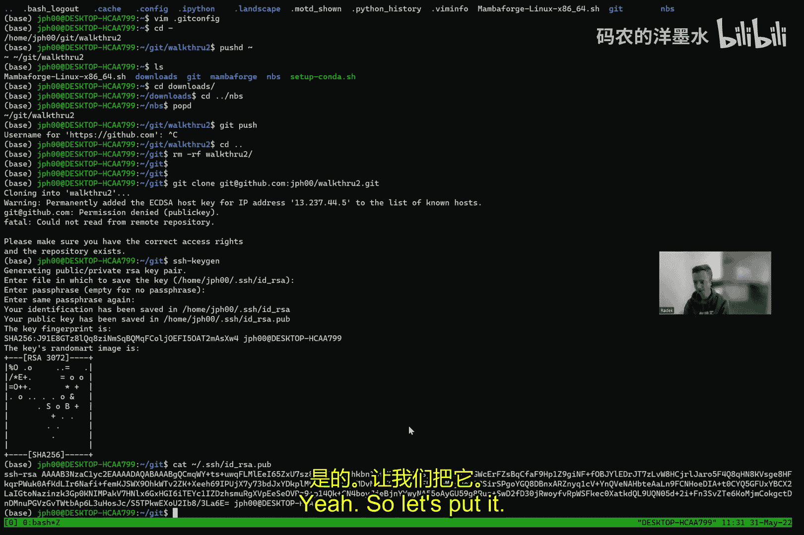

Yeah， so let's put it one weve got to put it on GitHub so let's do that Yeah so let's go back to GiHub。

😊，Click on my face。And。嗯。😊，Probably going to be in setting somewhere。All right， here we are。

 SSH and GPG keys。There we go。嗯。Three were not at them here， here we go， new SSHK。Title。

 I us call this the walkthrough key。And paste。There we go。Addd。Maybe at the user they might used。😔，清。

All right。So that is now in my account。 So I should now be able to。

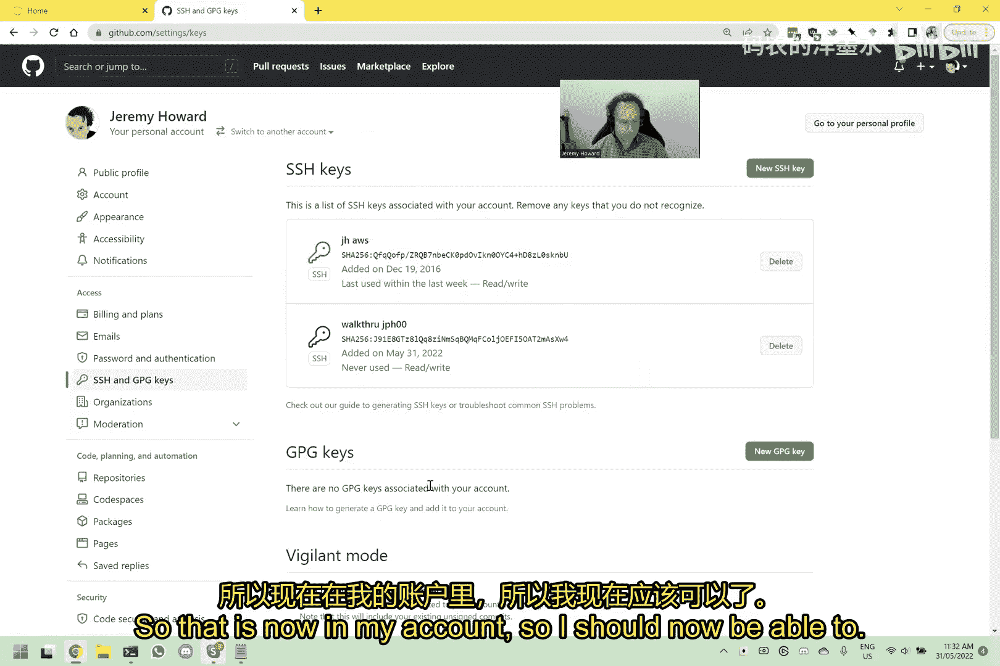

Rerun that get clone command。 So remember if you press control R。

 you can type a few letters from a previous command， so I'll start typing clone and there it is。

 And so if I hit enter。Now it's working， so I don't have to worry about ever typing you know。

Getit password， GiHub password。So here we are， great。😊，U。Let's make sure I've closed my other。

Gpiter session， haven't。嗯。不是。Jeremy， I noticed when I did that。

 when I did the SSH key Jen already had one。Okay， no worries so if you just use that one yep just use that one there should be your ID ID RSA or ID DSSA or something like that that's your private key and the one that ends in dot pub is the one you'll copy over。

Yep。And so you don't need I how did you how did you just split your terminal like that。

 we will learn it's something called TX T MuX， but we'll certainly be covering that。

One of the best things ever。嗯。Allright。Ja， one thing that I just thought might be interesting for people or just something that can catch people out is making sure that your identity that you set up in your terminal as you showed before and that the email that you use in GitHub that they're consistent sometimes if you are using a different email or especially if it's probably not a case here but if you have multiple GiHub accounts。

 you can end up having one identity making commits to a repository that you didn't intend to under that identity and back and forth。

 so just just be careful when you first get started that you're using a consistent email identifier like it's not necessarily always important for your public key but certainly for your identity on GiHub and for we you're going to be making commits and things like that it's often helpful when you get started to make sure they're consistent。

Yeah， I mean， I don't honestly ever think about that I kind of just chuck in any old email address。

 it doesn't like it's。😊，It comes up sometimes， but。😊，Not too often。

Because it's kind of mainly informational I think this information so that other people can I I've found it's more down the line。

 especially if you have a separate GiHub account for personal and a separate one for work。

 then if you have different identities or different emails being so said with it then when you make a commit to a workre you've accidentally committed it from your personal one which you didn't want to reveal your identity on or whatever。

Yep。😊，Okay， and somebody else have a question or comment？Just in the same context。

 like you said the public key， even if somebody else knows it they cannot commit to your gift is that because the private key is unique only on your computer like correct high level correct the private key is the secret code so if you wanted to be able to you know log in from another computer you would you would copy the private key over there and then that that computer can log in y so the private key is the thing that says。

I can prove I'm Jeremy Howard， and the public key is a thing that says anyone who prove that Jeremy Howard can log in here。

Thank you， no worries。This is something that this way authentication is used across many different contexts。

 so GiHub uses it， but for instance， today I was installing Gi to server on my local machine and。はい。

Could point the installation to take my public key from GiHub just to make things easier it grab the public key and it set it up so that I can easily connect to my computer without any additional setup steps so there is absolutely no danger given the current state of mathematics you know to making this information public and yeah。

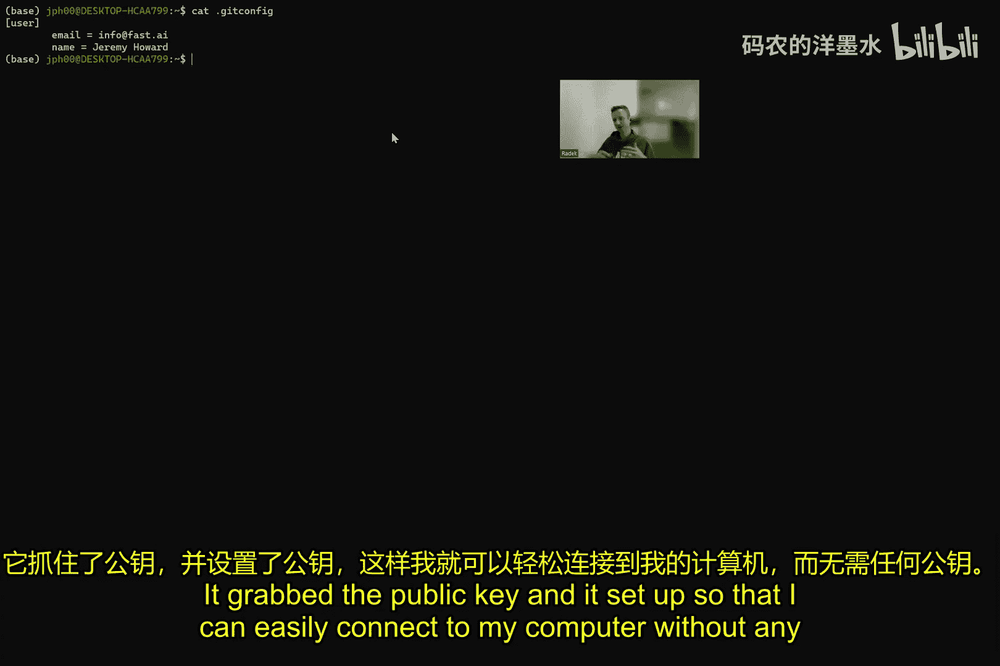

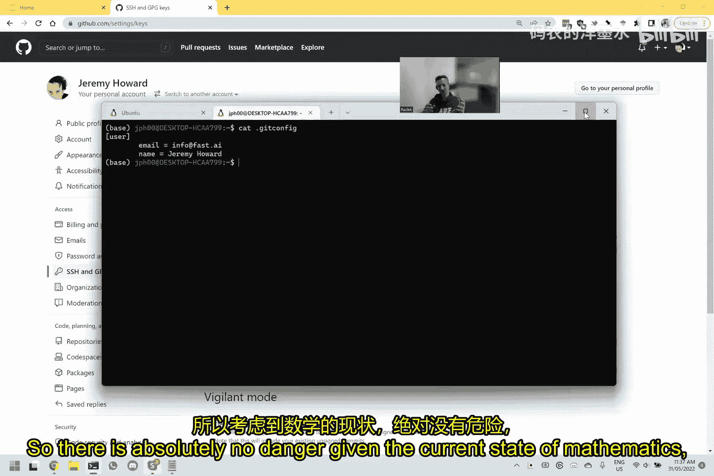

Without that， you know， going to the HTPS and password authentic that makes it for such a cumbersome。

GitHub workflow that this is so so much better yeah， yeah， SH is used everywhere。 So for example。

 I've got a GPU server sitting next to me here， which and then I've set up a。

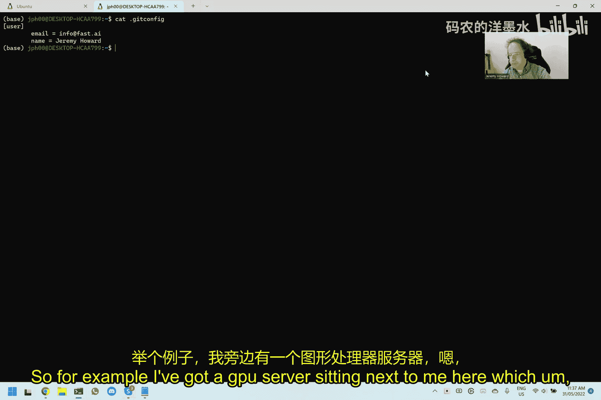

嗯。Oh somebodybody at my door。And' to take。Yeah。Okay。

Our dooror bell keeps switching itself to a Christmas chimes for some reason。U。Yeah。

 so I've actually created a profile here for logging into my box， which。

As you can see it just calls SSH and then that's attached to control shift3 so anytime if I want to log into my GPU box I hit control shift3 and here I am I'm now you know typing in just as if I was at my own computer but I'm actually now typing into my GPU server。

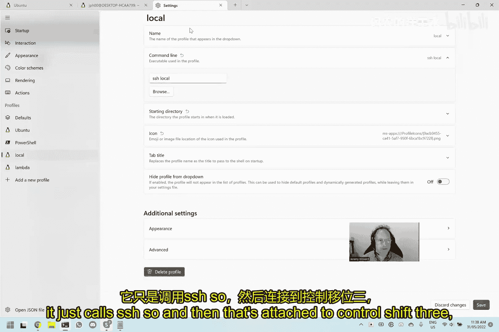

嗯。

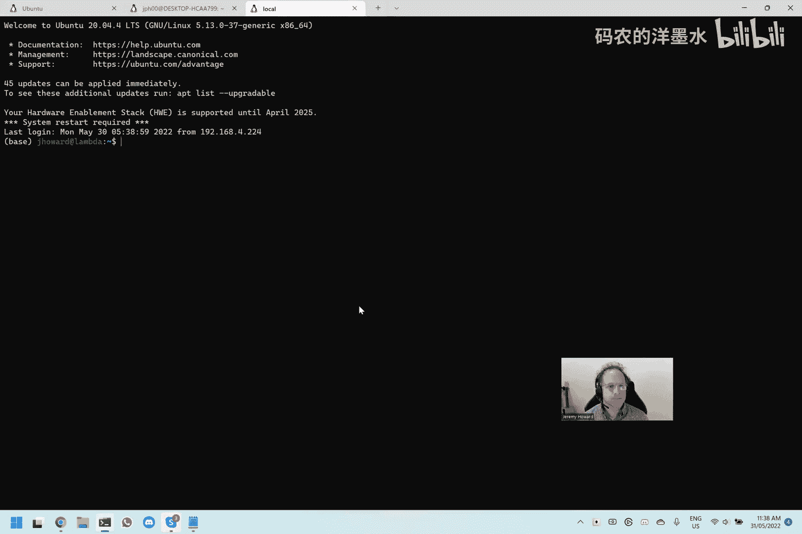

So SSH is a good thing to learn about properly。嗯。

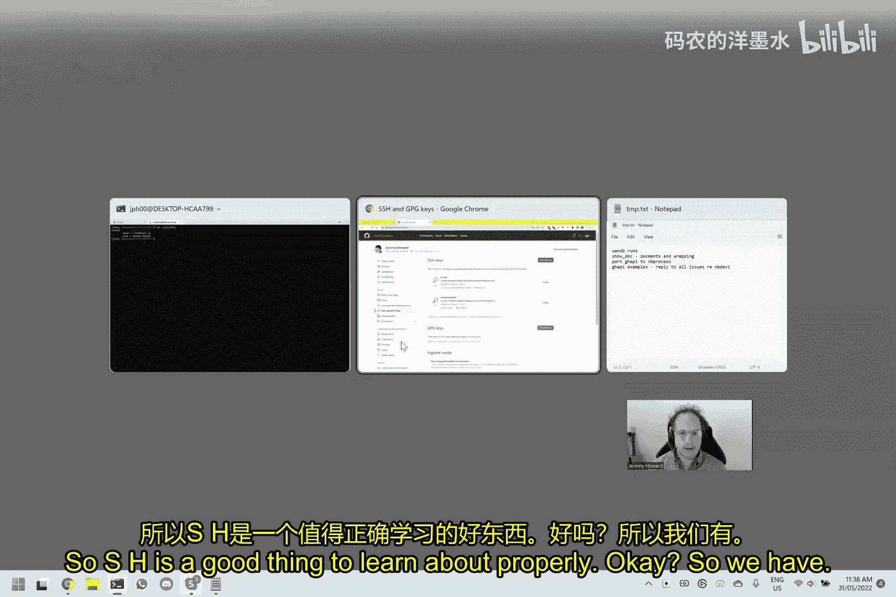

Okay， so we have。Treammy。With regards to creating repos and committing and I mean what we are practicing right now。

 I guess in the course itself you show how we can deploy an application and sometimes you need to do the same thing how and get pushed to those application Yeah and just wanted to see is it possible to have。

Both Github and also pushing a repo communicate two different。Theination sources if it makes sense。

 yeah yeah， we can do that and we'll be seeing that once we start looking at hugging fair spaces。

Yeahep you can so you can have as many reos as you like and each repo kind of has this kind of default destination it's connected to which will normally be GiHub but you can even connect one to multiple destinations and choose which one you're。

Pulling and pushing from and。Fantastic can I ask one more with regards to the to and password that you mentioned that for that ignore file just wanted to see if that is important only for the public reports or even a private report on GitHub you shouldn't share to and passwords or yeah I would tend not to I mean it depends how important it is you know。

I mean， at least the people on Gr Hub can see it so you know when it's yeah。

 I would I would try to avoid putting。😊，Private stuff onto public websites in general。

 particularly things like that where it's like。At some point you might decide oh。

 I want to make this repo public and then you forget that somewhere there was a at some point there was a secret file in there and you know one thing to be very aware of is even if I in fact let me show you。

 let's create a super secret file。And my secret is I don't like bananas。

I don't want anybody to know this， right， but let's say， you know it was a currently。嗯。😊。

Private repo pretend and so if we put that into GitHub。Because it's fine， it's all private。

And then I pushed that over to Github。com。And then， later on。I say， oh， okay。

 I want to actually make this a public reppost。 so I need to delete this from from， from Github。

 so I'll get Rm that file。GoMove secret。😔，And like， okay， now I make my repo public。

 everything's fine， nobody has to know that I don't like bananas and then I can check on my repo。

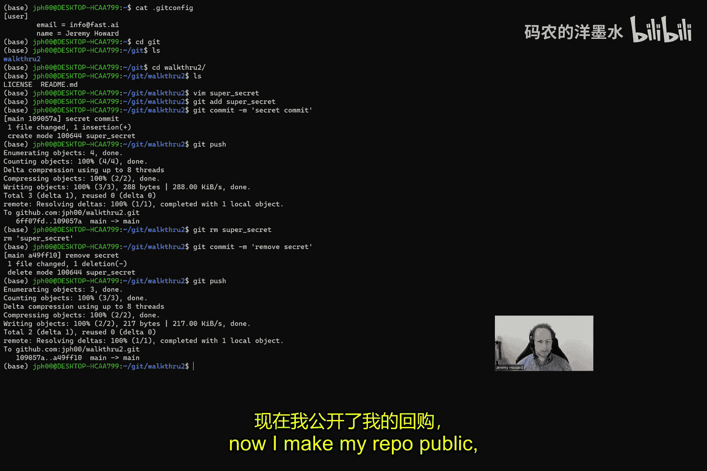

嗯。And okay， my super secret files not there， but。Remember， commits。Let's go back。

To the world as it was。Oh， it's here in my history right when you remove things from Github。

 it removes it from the current commit， but it's not changing history so people could still find out my secret。

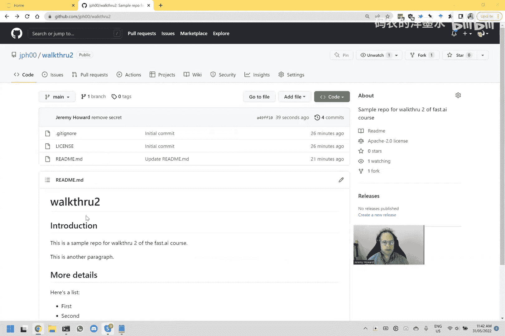

Jeremy I just noticed there as well that was a good example when you looked at those commits of the identity issue we were just talking about before because on that commit screen you had some commits that were verified because you will have had an SSH key that was tied to your Github email you see you've got those first two commits there are verified and then the latest two arent that's because you just created a new key so that's the key you won't have had the same email ID as your first one so's that's an example where especially like if you are trying to make verified commits if that's important to some project you're involved in yeah that's where that'll keep you up so I decided I mentioned that never been of interest in my projects I guess I'd never thought about it but yeah。

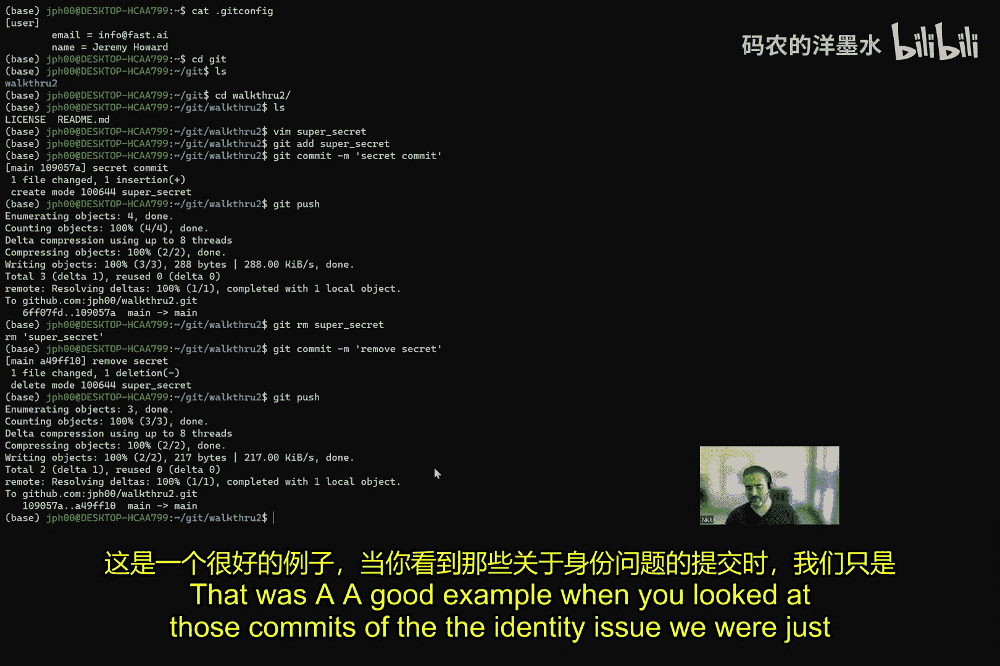

This one was。Actually， yeah， because， you know， anybody could create a。😊。

Dt get config file that says I'm minus12 vols and push and it'll say this is a commit from minus 12 vols it once say it's verified yeah。

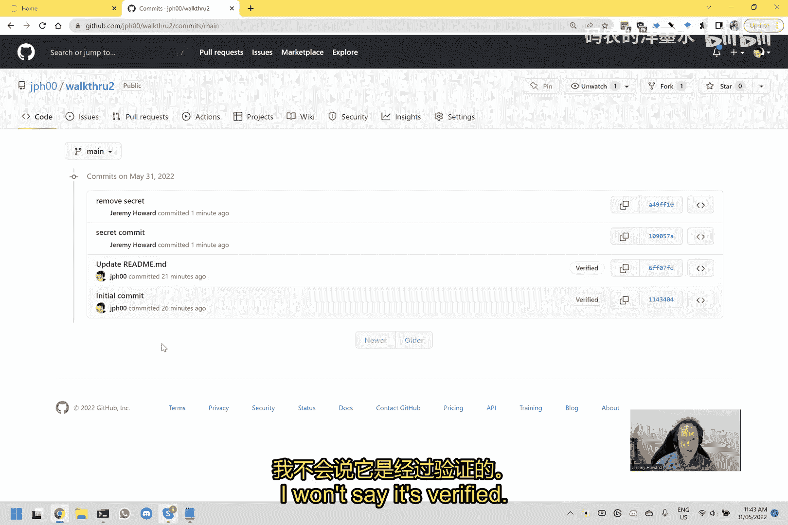

Okay， so let's put a notebook in here。😊，So I can run Gpyter lab。

 and I think we created an alias last time。仲油。嗯。And I pointed out that at this point， it's， you know。

 this terminal， I can't use it anymore。Because it's busy running Jupiter。 Now。

 I could run another terminal session in。Windows terminal。Um。But I actually never do。

 I actually always use instead， something called teamworks。

TamMarX is something which actually runs inside your terminal。

 so regardless of what operating system you're on and what your preferred terminal is。

 you'll always be able to use TMs。And let me show it to you， if you type。Tamax。Well。

 the first thing I'd mention is if you type T marks。😊，It might say command not installed。

And if it does say that， then in Linux， you can type pseudoo。😊，And pseudo。

If you don't say what user a runner is， it says runner doesn' an admin it's called rootot route。

 So so to install software， you have to be root。 say pseudo。

Apppt install means install Linuxux software or Ubutu software TeamMs。

 and so that's how you would install TMs if you got that error。And so to run stuff as root。

 you have to put in your password， and so in my case I already have Tmax。But yeah。

 so that's that's what you would do on Mac， you would normally use Bw。

 which unfortunately does not come with Mac。

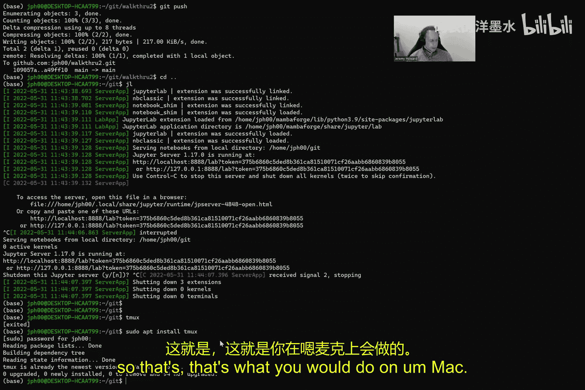

So if you。😔。

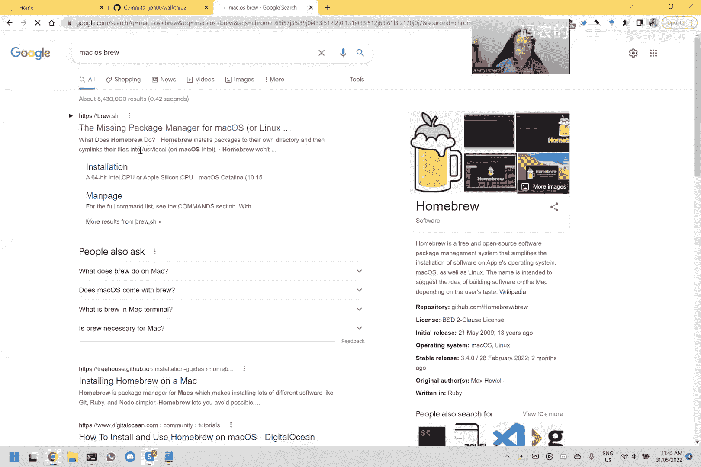

As it says， it's the missing package manager， so if you just copy and paste this。

Into your terminal and Mac， you'll then be able to should be able to do brew installed Tms if you double check that it's available。

 yep， it is。So B and apt equivalentvalence for Mac。

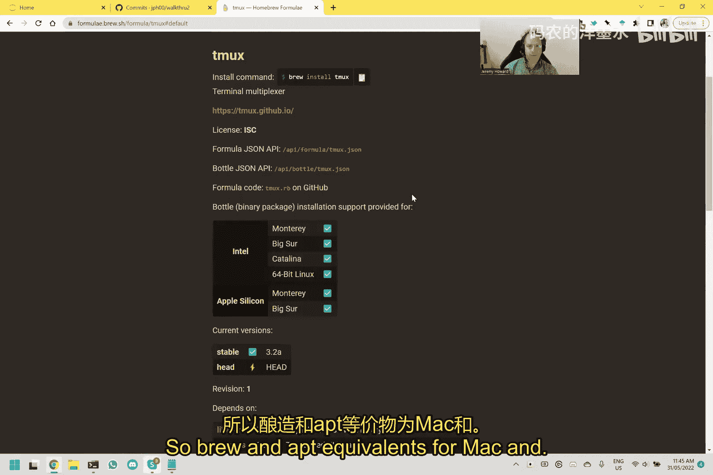

Linux and remember when I say Linux， I'm including Windows as Linux because it's it is Linux。

So once it's installed， if you type T marks， you'll get a new screen that looks exactly like your old screen。

 but now it's got a green bar on the bottom。😊，And this is what Tworks looks like and it behaves the same way as usual。

😊，U。嗯。You know， one thing is if I kind of like。Go off the end of the screen。

 It's nice I can use my scroll。If you've got this mouse set up。嗯。But you know。

 I basically just look like a normal terminal where things get interesting is that I can add additional windows。

And so in team Maxs， everything， almost everything you do team Maxs。

It starts by pressing the key the keyboard shortcut control B， control B is。

The TOs shortcut and so let's say I see the in。And I run Jupiter La。

 I always like to run it from the place where I've kind of got my。Notebooks and repositories。

And I'm like oh okay what do I do now well I'll create another GiHub window sorry another Tmx pane I should call them tmx pane and I can create another either split them horizontally or vertically so if you hold hold hold down control press B nothing happens and then press percent。

😊，So control B percent and you can see what that's done is it's created a second window over here。

As opposed to control B double inverted commas。Which creates another window down here， a pan。

And you can close them in the usual way， and remember the usual way is control D。

And each time you close them， they just。Disappear。So I pretty much always。😊，Do that。

Now then how do you move around between these different panes depending on how your terminal is configured you might be able click with your mouse。

 I never do I just press controlr B and press arrow keys control B right control B up see how my curse is moving here I am in the bottom。

Right， control B left， I' in the bottom left。Control B left up， now I'm in the top。

So that's how you can move around between the panes。Um。And then another thing to know is。嗯。

This window looks very small now this panel looks very small。

 I'd like more room please to get more room is Zoom with Z so control Bz so if I press control Bz。😊。

That makes that pain take up the whole screen。And once I'm done， you know。

 and I don't want the whole the thing to be maximizeimd anymore， it just press control Bz again。

And now it goes back。嗯。😊，ry and Jeremy what？How did you get the four by4 right so we get again so it's let me go back to where I was so I'm going to first of all split vertically so that'll be control B double quotes sorry control B percent。

😊，And then I'm going to split the one on the right。😊，Up and down， so control B double quotes。

And then I press Cr B left to go to the left hand tab。Theres pain， I should say。

 and then I'll go control B double quote again。And there I've got it and you kind of like there are things you can do to make that automatic but after a while you get so used to it that like I show you when I do what Is go control B control B double control B left control B double quote and I'm done you know it only takes three seconds and then the other nice thing about t marks is it sits there running in the background for as long as you like so I can actually detach from this team mark session as long as I don't turn on off my computer by pressing control Bd for detach and then I'll close down my whole terminal。

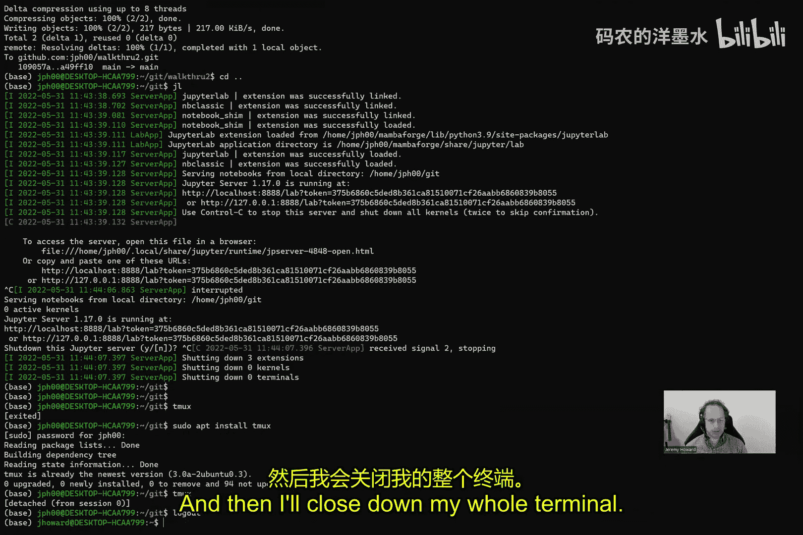

Everything's gone， okay， don't have a terminal running anymore。😊。

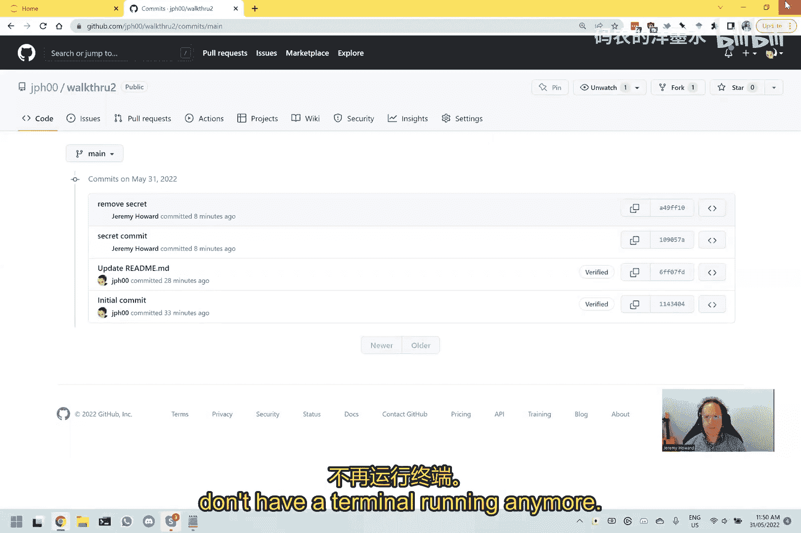

that's going to be annoying to have to set everything up again， get to the right directory。

 rerun Jupyter notebook， blah， blah， blah， but actually I don't because I detached from T marks so all I have to do is attach to read T marks again I do have to be the right person。

😊，So let go back to my。😔，To attach to T marks again， you type T marks。A， a for attach。

And everything's back。So that is。One of the very handy things about team Maxs and so if yeah。

 if you've got some long running。Jorb or something， it's totally fine you can。

Detach if you need to and come back to it later， obviously if you reboilt your computer。

 it won't work。Otherwise， it should be fine。I think there's a main， Yeah。

 just to confirm if you close any of these windows that ends the process that's key the process no。

 I just closed the window it didn't close the process， but I attached first。

 so control B D did attach and I closed the that it's all gone。ClSure。

 but I mean that at the beginning when you split into the four and then you close the tree and then went back to the original the so for example。

 the movie the Jupiter if you close if you close a pan yeah so。Yeah， so like the pain here。

 I can't close it because it's running a program， so the only way to close that would be to actually cancel the program。

🤢，This paint's not running anything， so I can close it so I can just hit control D。

And so that just closes that session and if I do control B double quote。

 it just creates a new session。A new a new interactive login if you like so each of these windows are totally separate to each other so if I overhear CDd and to walk through two you can see none of the other ones you know these are all like separate copies of bash。

Running this 50 this copy over here is actually running Jupiter。诶。Alright。😊。

Gem me one more out like can we assess it into a different session from teamma digital Yeah。

 so absolutely so I I， you know， I could SS into my machine into my GPU machine from here。Oh。

 I need to be not JPH00， so let me just do that as somebody else。Yeah， so I could SSH。

another machine， no worries， you can even run Ts inside Tms if you want to。Gets a bit crazy， yeah。

They're all totally separate。😔，嗯。Okay， so let's so we've got Jupyter running so I can control click on this URL。

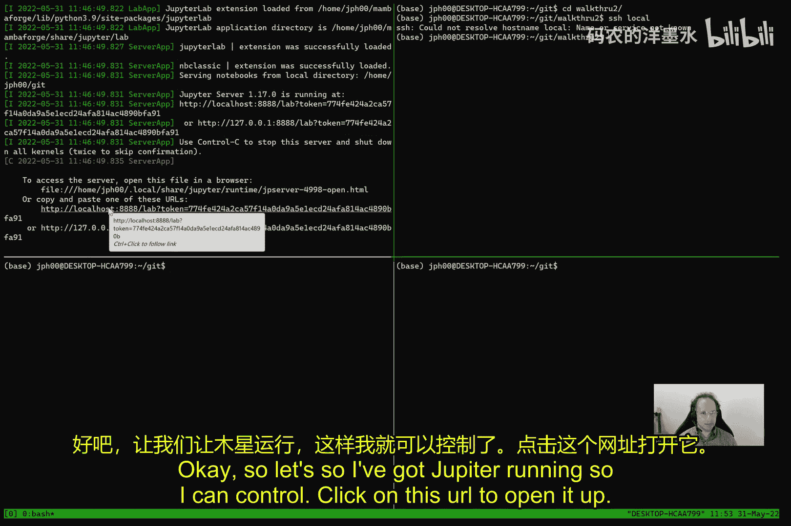

So open it up。

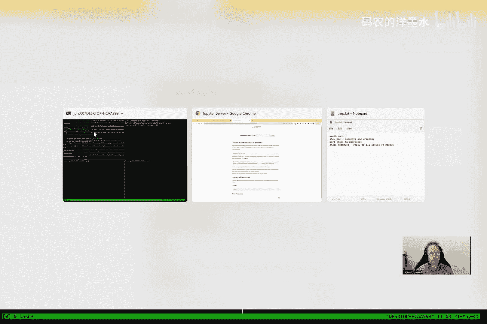

That's interesting so that didn't work because you see how it's wrapped to the next line so it didn't get the FAA91 it's kind of not considered part of it that's why this didn't log in correctly。

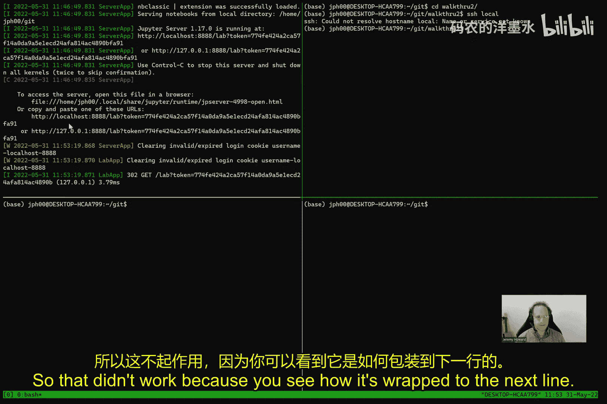

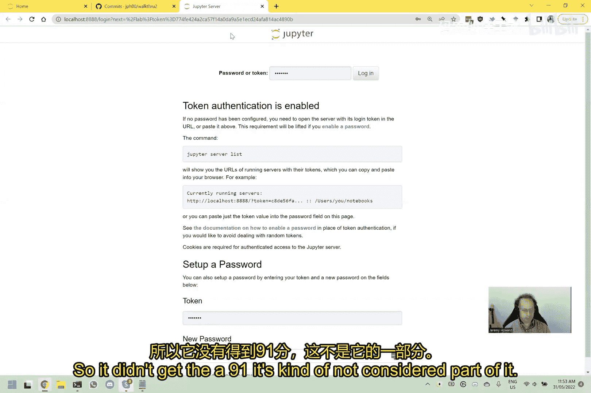

So what I could do is to。Zoom in with control B。

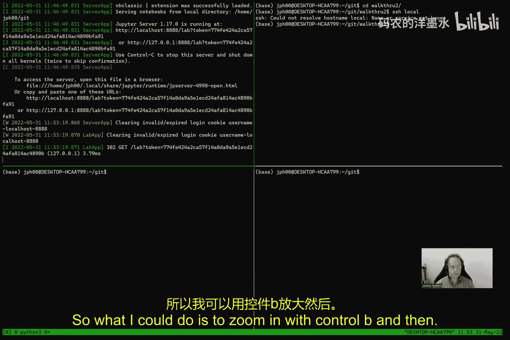

And then。The kind of。There we go。The other thing you can do is just set a password which isn't a bad idea。

 but for now we can just use this because it's using this。Unique token that it audit creates。Okay。

 so because I launched Jupiter La from inside the Git directory。

That's why I'm here inside so the get directories， so here's walk through to so I could now create a notebook。

Ting that to a mark down cell so I。stronglyly recommend learning the keyboard shortcuts。Which。

What's the easiest way to see that in a lab I much more familiar with classic notebook so here's Laun Class notebook which is what I normally use in classic notebook。

嗯。You can hit。😔，H， to bring up the keyboard shortcuts。嗯。Let's see how to do it in Jupiter lab。

 Jupiter。😔，Lb keyboard shortcuts。Advanced settingstting editor in the settingstting menu。

Doesn't sound very friendly。😔，Settings， advanced settings， okay， that's control comma。Keyboard。

 keyboard， keyboard。There okay。All right。U。Great。So anyway。

 the keypoint shortcut to turn a changer cell to markdown is just to hit M。

And so this is now markdown。As you say。Or to switch it back to code， you press Y。And that's now code。

Another useful keyboard shortcut is you can just press one。

 two or three to create a first level second level or third level header or change one to a header。

 as you can see。So。嗯。walk through。Sample notebook。😔，Here is how I calculate。😔，One plus one。

 put things in back text to say this is just started as code。Here is how I calculate。Yeah。Sme。

So if you hit shift tab after typing a function， it'll tell you。

The parameters and so forth of a function。A， it callss aray。1。0 comm up high over two， whatever。😔，嗯。

Sday。Okay。so by default things get called untitled。ipnb。

 which is not a great name so you can rename it。To sample whatever。Okay。Now， if I close that。嗯。

It's actually running， so that that Python session is still。In memory。

 most of the time that doesn't matter， unless it's something where you're like training a model on a GPU in which case it continues to use your GPU memory。

So a couple of things you can do。One is rather than closing from the X， you can click。嗯。

Close and shut down notebook， which is control shift Q。Yeah。Or alternatively， you can click the。X。

 here。All right。嗯。Since we've got a proper terminal on our computer。

 we don't really need to use it much， but if you and we will use it later。

 you can create a terminal inside your browser， which is identical integral to the terminals we've seen before。

And just like before， Control D will close it。

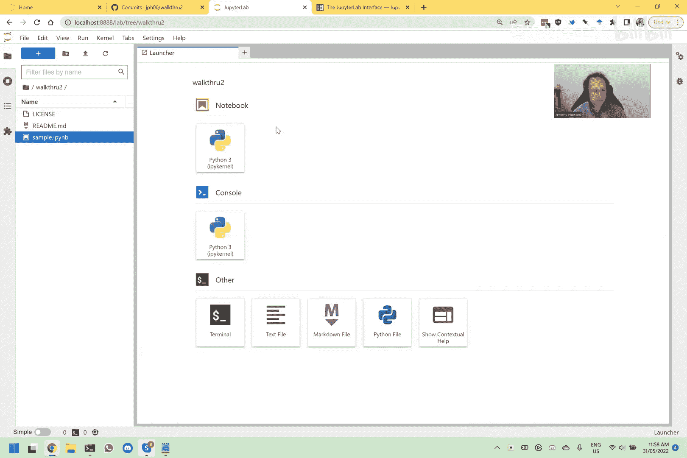

All right， so we've now got。😊，嗯。Yeah。Another file called sample。ipplanb。

 so we would like to put that into our Gitthub repo for other people to share and just so offer to backup up and so it's version controlled and so forth。

So everything you want to do in get your first type gett。😊，U so。😊。

What you'll often do at this point is type gets status， which tells you。

What's in gett and what's not in gett and so it'll give you a list of untrapped files so these are things you haven't yet got in Git。

So to put it into gett， you have to commit it。So if you type if you type get commit that'll commit anything that you've added to get so first of all you have to say。

 okay what do I want in my next commit？I want sample。op and B， so get addsled。op and B， I'll zoom in。

Okay， so now。This is a， it's not un trackracked， it's now a change to be committed is that we've added a fail。

U。So now we can commit what we've added by saying get commit。And then it'll say， okay， tell me。

Your commit message and so by default， it's opening up an editor called Nano and we can change this。

 but nano is probably like。The easiest editor to get started with。

 so it's not a bad place to start so let's。Put in our commit message for people to see what have you done。

 we added。Sample。Notebook。And you can see down at the bottom that we can accept by press and control X。

And it'll say， do you want to save and a press wire for yes？And by default。

 just leave the file name as it is so hit enter， Okay， so that has now。Added the。Faiil to。My commit。

 so if I now say Git status， it's now in a third place。

 it's gone from untraracked to do be committed to be committed and it is now committed and that means it is now actually version controlled on your computer。

 so Gi actually version controls things on your computer even without using GitHub。嗯。😊，In fact。

 originally when Git was created by Linas Tovololds。

 who was not a Sing's GitHub and people kind of sent changes to each other directly rather than going through a server。

😊，But in this case， we are connected to a server and it said oh， your branch。

 so your copy of this repo is ahead of the copy， the place that you got it from by one commit。

So use push to send your commits back to the server so get。Push。There we go。😊，So now if we。

To get status again。There we go。 So that's the whole。Cycle。

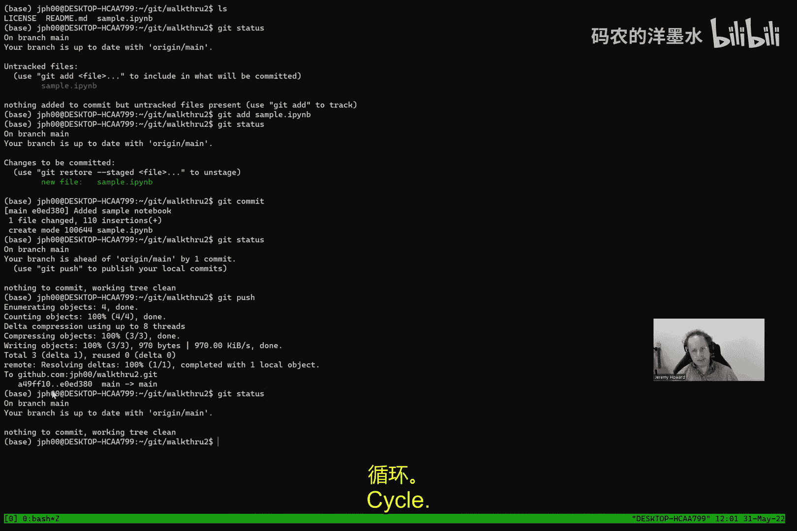

。And so if we now go back to GitHub。There's our notebook。嗯。

And GitHub does have a basic notebook viewer， it's not amazing but it does the job most of the time。

And so there's our notebook。And so， here's like a。Really minimal way of like it's not a blog or anything。

 but you older to just like quickly share things with people， this is the easiest way to do it。

 you know， and you can just say his。Here's a repo and you know you can create as many reos as you like so like don't feel like it's in some way inappropriate to create。

😊，A repo for one or two notebooks you want to share with somebody it's totally fine you know I generally have kind of。

A repo I put。Somewhat temporary things into。But， you know， often when we're kind of。

Sharing something with somebody else， for example， the bug we found we want to show how to recreate the bug where it like create a repo just to send somebody。

An example of a bug， for instance。So yeah， so repositories you can create as many as you like。

A really good way to use repositories。😊，Is let's go to the fast book repository。

It would be nice to have your own copy of the book because you would like to run cells， edit things。

 stuff like that so。If you clone this， right， you won't be able to do an SSH clone at all because your public fee is not in my account。

😊，You can HtTP clone it but you won't be able to save changes back to GitHub so ideally you'd like your own separate copy of this and so you can create your own separate copy of this by clicking fork。

And so fork's going to create your own copy。So you just say create fork， heres a fork a copy。

And you can experiment with changes without affecting the original。And here goes。

 So it looks exactly the same， right， but now I can。😊，SSH， copy this。

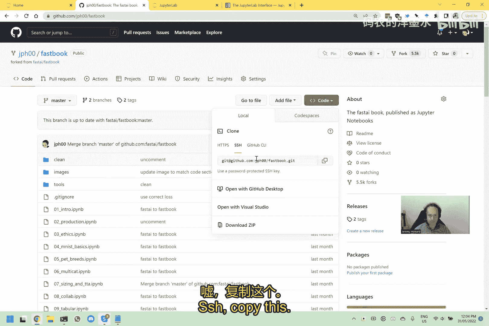

And then say they。So Cd dot dot means go to the parent directory， which in this case is Gi。Get clone。

Past。Um。Actually， Ashsh， yeah， no that's fine， yeah， so we'll go get climb， here we go。😊。

And so now it downloads the whole book and so now if we， in fact， let's do it。

 let's open up a notebook， so let's go back to Jupiter Lab。

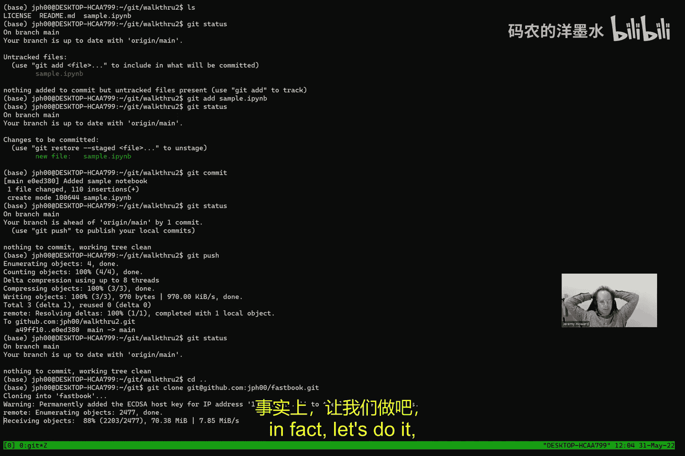

Fast book。Apminist basics。Actually， you know what would be good would be。

 let's go into the clean version。😊，Because this is really the one you want to be experimenting with。

And so I can now start running。Salls， oh， can't run fast Ai， fair enough。So at this point。

 we need to install fast AI。Yeah。So we can see here it says condo and storm minus a sea fast Cha futi。

So I'm going to copy that。

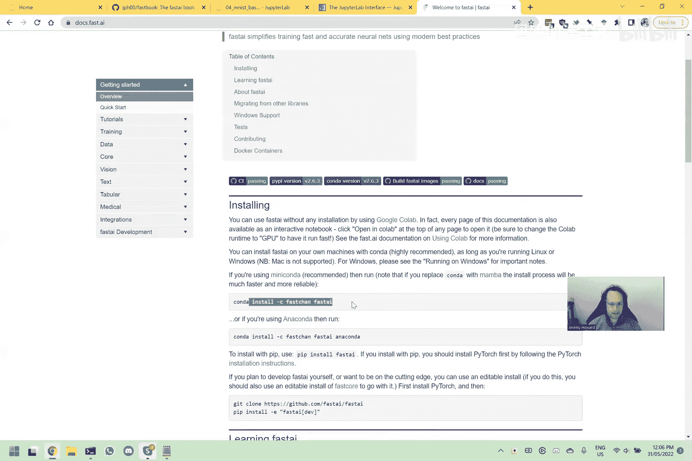

Except for the Conr Vi I want is membermba。So my the C remember says to bring it from some other channel。

 so this is not coming from the main channel， but from a channel called Fast Cha so fast Cha is a channel that fast A providesdes where we try to put in。

You know， a lot of the kind of pieces of software that。Data scientists are likely to't want to use。嗯。

Okay， so we can now say， yep， that all looks fine。So FAA relies on the kind of the whole。You know。

 kind of。Ecosystem of Python scientific libraries and since this is a brand new user。

 you know things like Mattpllotlibb that's used for plotting， for example。

 and psyit Learn that's used for classic machine learning then none of those were there so because it relies on all these。

It grabs them all。Downloads them and install them。Can I ask a question while it's done there？

I I notice you're installing it in the base directory is that usually how you do it that's how I always do it yes yeah you don't create separate virtual environments never never I okay a lot of people do but I strongly dislike them particularly for beginners or unless you've got some very special reason I always put stuff in the base。

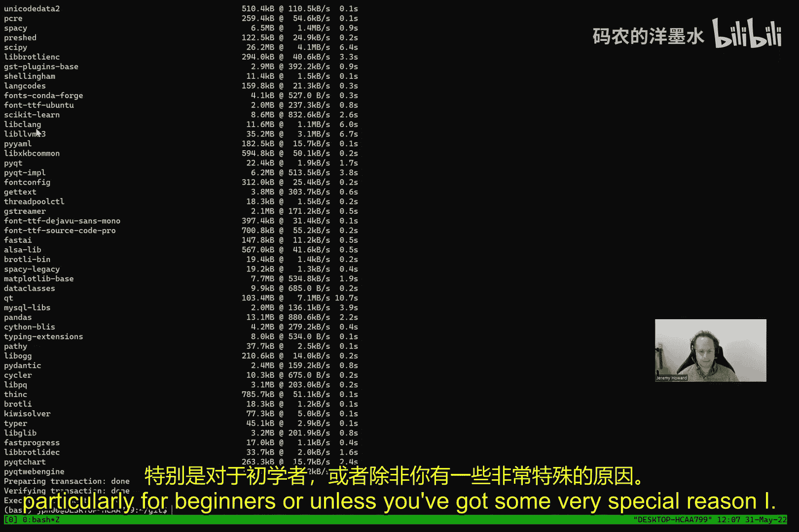

Okay， and then the other thing I noticed was that the notebooks all use P。

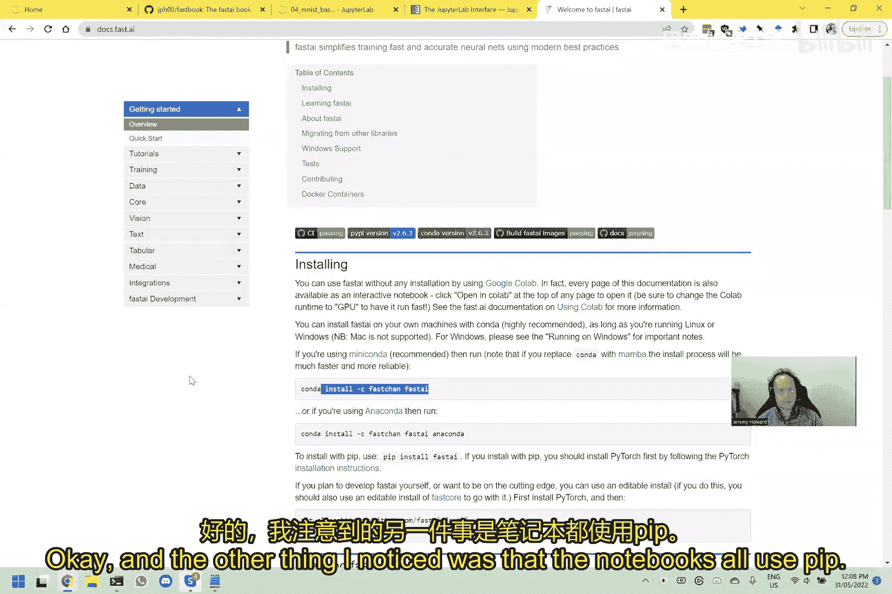

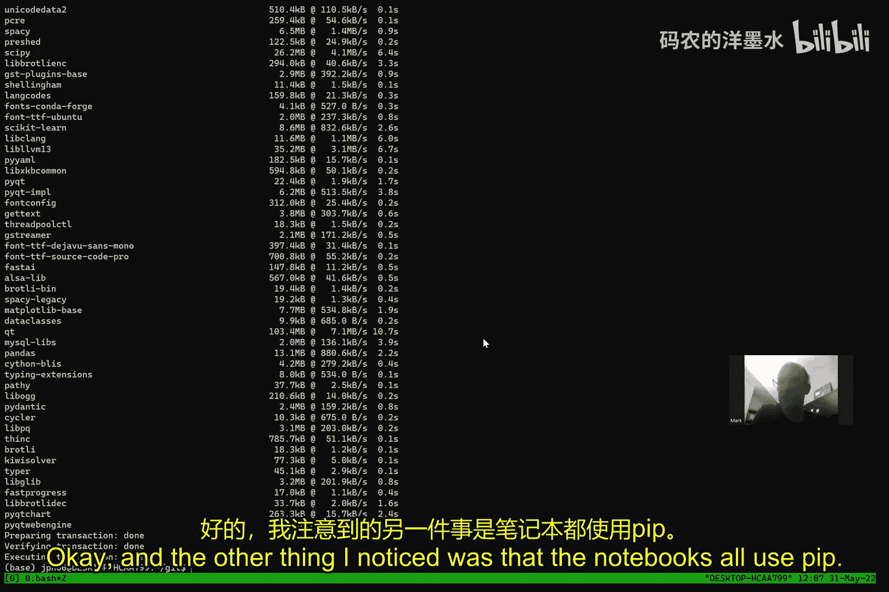

Yes， they do， but it won't do anything for you because it says here。😊。

See if theres this is a bash thing so see if there's a directory called slash content which there isn't this exists for something called coab which is a free Jupyter server environment which doesn't generally have up to date things installed in fact I think they still have fast AI version one so this cell will on coLab install everything because coLab uses Pip basically。

But we have what they' seeing on our computer。OhAnd we also need fast book。Now fast book。😔。

I'm not even sure。 I'm not sure if there is a。

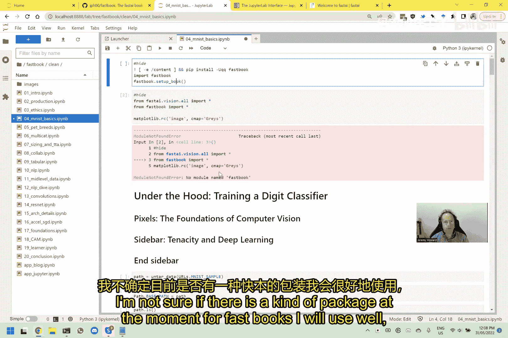

Kin of package at the moment for fast books so I will use well let's check。Nmber， install minus C。

 fast and fast book。😔，I a feeling that won't work。OhApparently， it does' work I think you go。嗯。Was I？

And actually， fast book includes fast， fast AI， so we could have skipped the whole fast AI one。

Fast book is just a。😊，It's basically just a list of dependencies of like all the different things we use in the book。

It doesn't really have much code at all。Of its own。

 it's just a kind of quick and easy way to grab all the stuff that you'll need for the book。

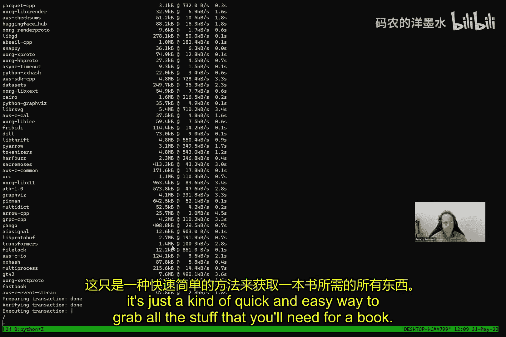

All right， so now we should be able to run this。嗯。Okay。Um。That is actually。

 I think a little out of data， I think we could use any sentence piece nowadays。

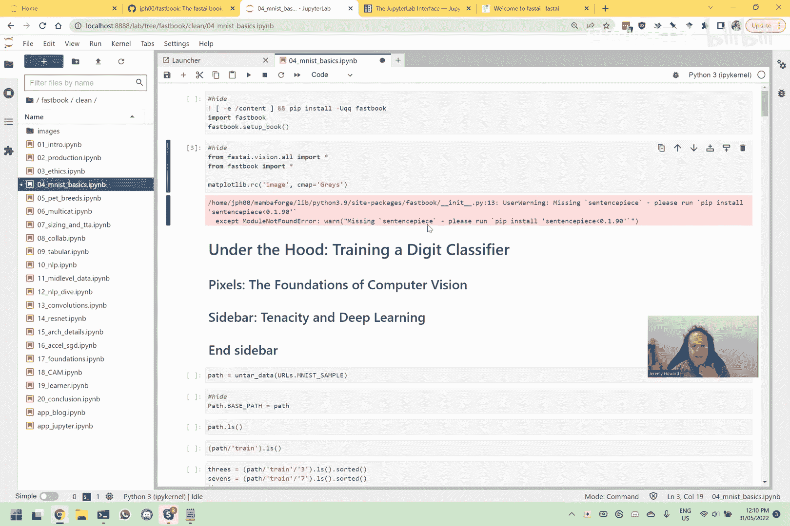

And I think we might have that in。Fast gen to sentence piece。

That's something we use in the NLP chapter。Yep。Looks good。Wow， that's a slow download。

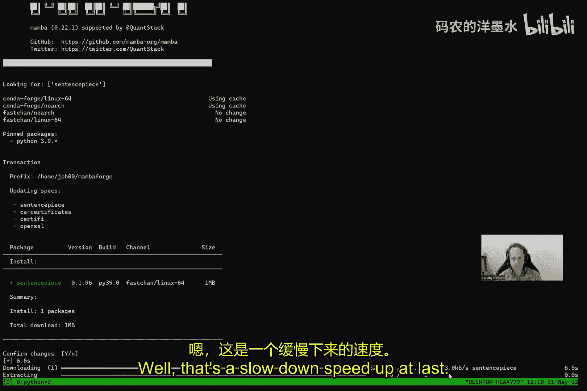

That's betting up at last。Let's try again。Okay， so now we've got a。Copy of everything we need。

 So this is like a unusually。😊，You know big kind of set of dependencies because it's a big book that teaches lots and lots of things。

 but the nice thing is once this works you know you'll generally find everything you need is going to is going to work Okay。

 so at this point you know i've started doing things you know maybe i'll make some notes to myself。

To install。😔，We have to go remember， install basically this。😔。

I forward we need would be membranes to minus C first1。😔，Fast book。Sentence， peace。

That would actually be all you would need to do。So if I save this and so now， you know。

 we've created a note to our in our own copy of the book。

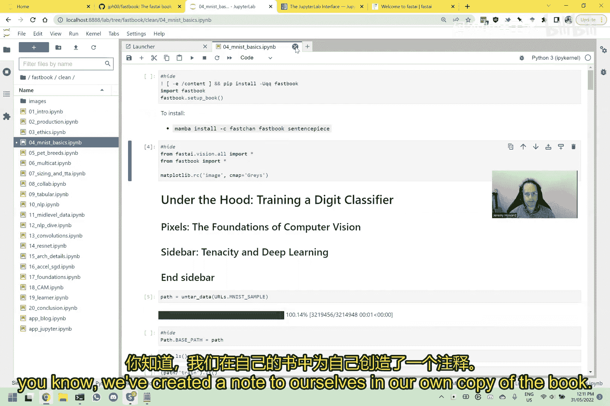

So we'll close that。And if we now Cd to fast walk。Kit status。

You can see it tells as we've modified that file。So we would like to save that back to our copy。U。

Ty in Git addd。And then get minus M and then changing things in the editor。It's a bit slow。😊。

So a shortcut is if you type gett commit minus AM， that minus a means add everything that's not committed。

And this this M here says I'm going to put a message right here on the command line it's got to be in quotes。

U。Change， amnest。Maybe add install notes。So at that point， if I type Gi status。

You can see now it's gone ahead and added it and committed it and it now says， all right。

 we're ready to push， so if I type get push。That same saved that change。

So that change has not been saved to Fast AI's copy of the book。

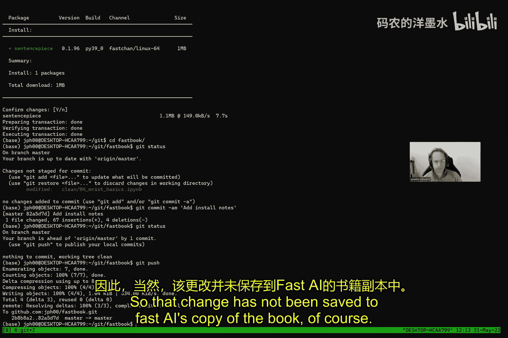

Of course。But it has been saved to。The JPH fork so at this point my fork is one commit ahead of Fast right so that is I've made changes that are not in FAo's copy。

And so I could see what commits there are and that and here's all the commits that are in the what I forked and here's my addition。

And here's the change， which is that I added this one cell。Okay。I think that's probably about enough。

🤢。

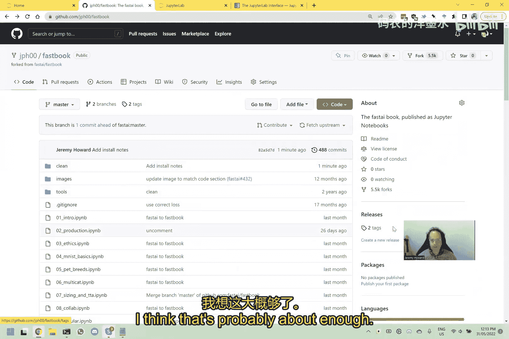

。For one day， it does any home never eat。Questions or comments about。That。

The only one I found was that sometimes if you sort of we started off creating the repo within GiHub。

 sometimes I've done the reverse where I've created the repo on my computer and then。

Had a few issues trying to get it into GitHub。And。Yeah yeah， okay。

 well let's add that about list of things to。Do in a future session I find it easier to do it in GiHub so I actually always try to do it that way like literally like because I find it so like I always have to look it up to remind myself how to do it otherwise so often I'll like I'll create it in GitHub pull it and then copy over things that are on my computer you know like that's the really lazy way to do it but let's do how to create Gi repo locally all right let me pop that。

嗯。All right。Thanks， gangang， so we're doing。Tuesday， Wednesday， Thursday Friday this week so。Steven。

Thanks for joining us in Toronto。bye。Thanks， thanks bye。

