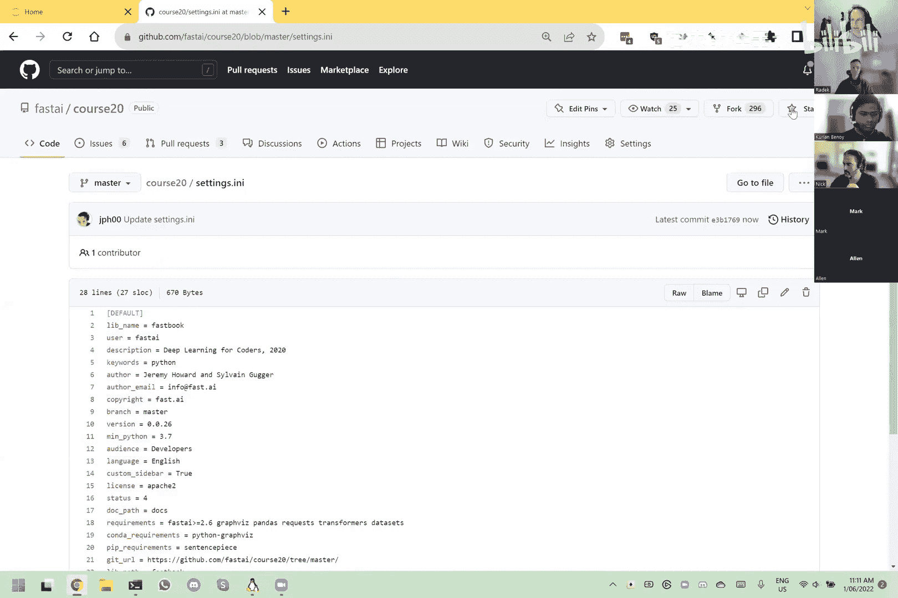
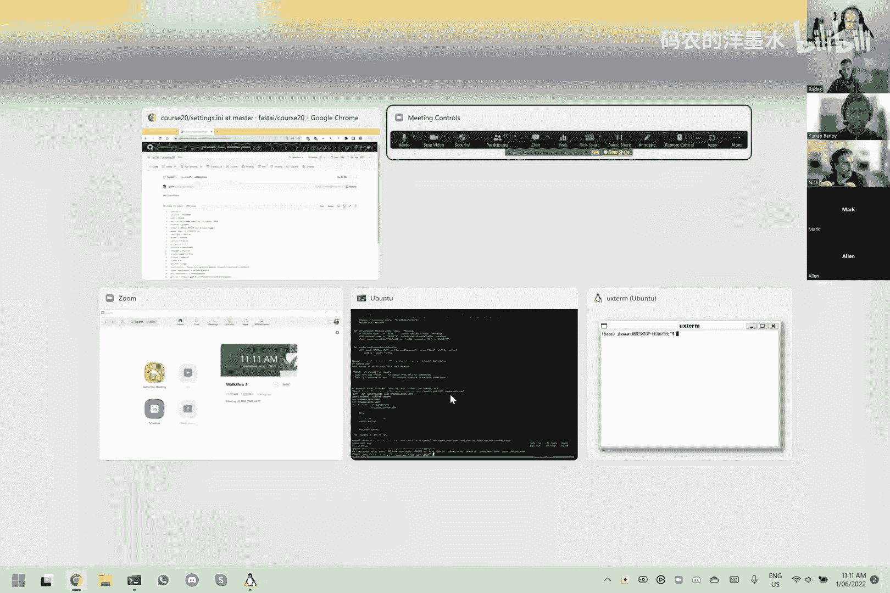
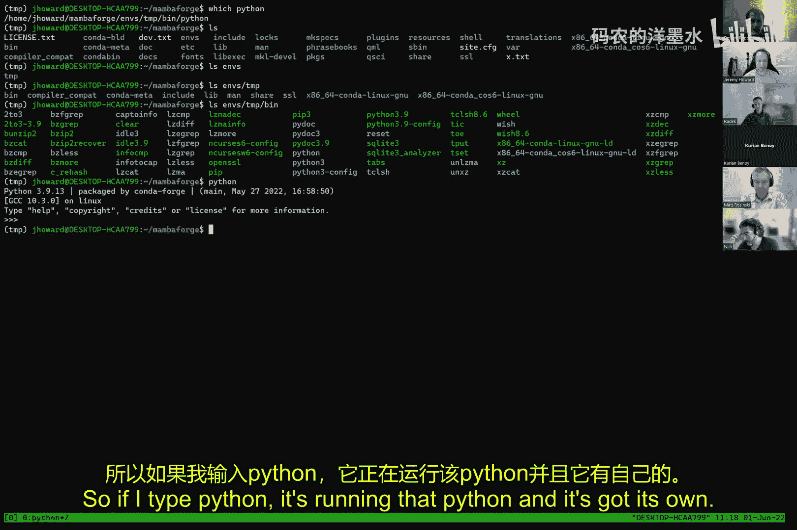
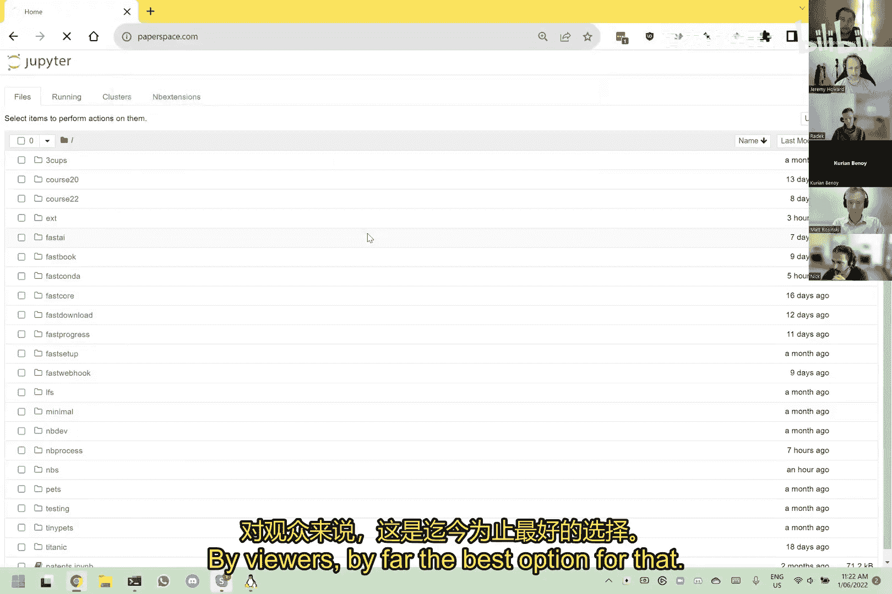
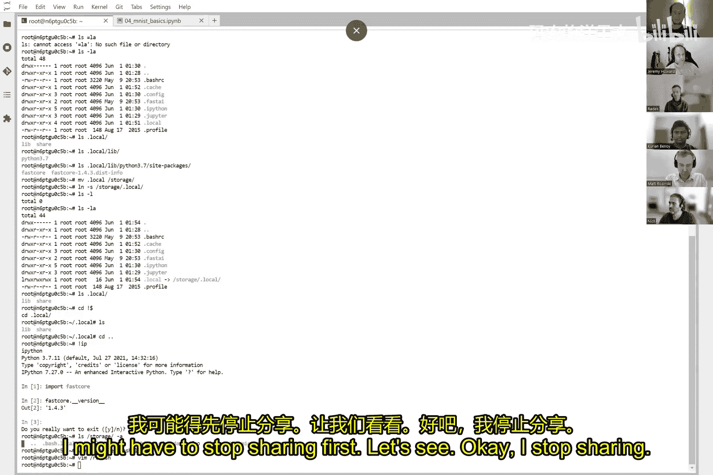
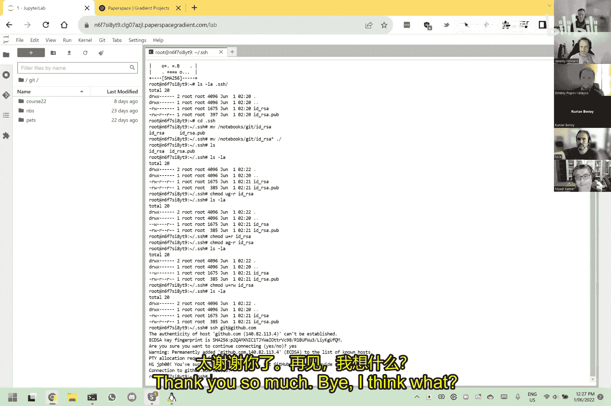

# 【全集】旧金山大学 实时编码 中英字幕 1080P p03 Lecture 3 - Paperspace配置与自动化 -BV1KZiTBWEeH_p3-

Yeah。All right， does anybody have anything Yeah， they wanted to ask about or。Talk about or。

And anything else before I had a quick question yeah I least I hope it's quick when we were talking yesterday and I asked you about the environments you seem to feel very strongly that you should work in the base environment and i've been rolling it over in my head and i'm just when I think about the mistakes that i've made and how i've screwed up environments and gotten conflicts and stuff like that I was wondering why why you feel so strongly sure I mean we'll talk about it more where we kind of get to environments but because we haven't discussed them yet but you know briefly。

You know， environments are basically。Separate folders with separate installations of Python and Python libraries and so forth。

There。Often。Used for kind of keeping separate projects separated with different sets of kind of dependencies or versions of Python or whatever。

 and they certainly have a role to play for advanced users。Almost never use them， I mean very。

 very occasionally use them， but my feeling is the most important thing is to。

Be able to rapidly iterate and experiment and I kind of want。

My projects to live together as a as a whole is a bunch of things which all help each other and come together。

 so I don't like the idea of like oh i'm working on this project now I go over there and。

Everything's kind of new， you know？So instead I really like to get very fast and very good at just quick leaders going RM minus Rf miniforge and it's gone and run set Con。

sh and it's back and have a single script that if I need one I probably don't even need a script I go member install minus C fastchan fast book and that installs everything that I need andll I'll go so I kind of like。

Never want to be in a situation where anything on my computer is。

I don't really like it's working but I don't know how I got to a point that it's working and I don't want to touch anything lest I undo that you know。

 so i'm more in the kind of chaos monkey side of like。😊。

Explode things from time to time intentionally and be really good at putting them back to where they were I guess and yeah so nowadays I。

U。Never have problems basically with dependencies or weird things going on in Python or whatever because I just sometimes you know。

 like probably every a few weeks so does。Throw it away and clean install it just to try something out for teaching or whatever always always feelified。

😊，You know， this morning， I did use an environment。

Because I specifically wanted to test something on a different version of Python。

And I wanted to check that it would install into somebody's fresh new environment and so he。

I used it for that。I think it's useful if you。😊，Are like。Installing some library where they've。

Doneone a poor job of keeping their dependencies up to date so you need like Python 3。

6 and sentence ps 1。8 and I don't know old versions of things in which case you want to be able to go。

Pit minus our requirementsments。t and get all these exact versions of things but my approach is to for my for my projects is to not。

Pin versions， not pin dependencies， want I want anybody to be able to install my work。

Ento whatever they're doing and work with all their other programs that they're running in libraries that they're using without anything getting messed up。

Unfortunately， not everybody works that way， but。That's how I you know try to make other people's life easier and so therefore any programs you use from me。

 you'll be able to install into your base environment without messing anything up or install into any environment without messing things up。

And when sorry just a quick follow up if you're installing if you're installing into like a new computer or whatever would you use would you install fastbook or would you install fast AI you know I would it depends I would just probably install fastbook because fastbook installs。

Fast AI， which installs Ny pandas with the mappl lab。 It also installs transformers。

 It also installs data sets。 It also installs sentence piece， you know。

 maybe it doesn't install center piece。 I think everything except sentence piece maybe。

There's no reason it shouldn't installst sentence peace so should。So it didn't yesterday yeah。

 I was just remembering that。Sa said Jeremy， yeah。So if you're blowing blowing it away and you're basically using a new OS installers as like people do with environments。

 how are you keeping track of your things like RSa keys etc cetera。

 how are you not blowing those away those are not part of a con environment so that's。

That's fine they sit there in my home directory it's just that mini forged directory or manycon directory or Ananaconda directory depending on what you're using。

 I just delete that。Cool， yeah。Jimmy you talked about uninstrolling always right in this base environment so yesterday I was trying to I mess up one of the dependencies so what are the steps for uninstorrolling usually I know out to your home directory and type IM minus Ifber forge。

Only that doesn' look good okay， I and then close your terminal and reopened it because I remember the other day Ashhi didn't do that step and so I didn't install properly。

😊，Yeah， like I'll share the screen and show you a quick trick。😊。

Yeah， so this is sorry， this is a little more advanced than normal， but that's okay。

So this is slightly confusing， but the fast book。PPip piee and condo installer actually comes from a repo Court course 20。

And it's here。嗯。It doesn't really contain any code。It contains a few us， but that's actually。Like。

Search images being， but you know this has got nothing to do with what we're using it for something that returns an image of a cat。

But actually， the key thing is it's got a settings not anyF。Which contains a list of。

Requirements and so if I now put this up on pipe and condor。

 then if I say Conr install or paper install fastbook then。

That's one quick way of just getting all these。U。Or you could create a tiny little script that goes。

 you know， condo install。And then with these things in it。嗯。But yeah， you want some way to。

Get yourself into the basics setup instantly oh here we are this is why it didn't give me sentence piece sentence piece only comes with Pip and that's because when I set this up I didn't have fast cha。

And so I didn't have sentence piece in condo so Jeremy I think you've got a you've got minimum python there 3。

6， but I think fast AI。Reippo has 3。7 and yeah， yeah， right， which I suspect it probably。

Overriidedes， but yeah， so here's a here's a good use of the。😊。

The GitHub gui right I want to just change it while I'm looking at it。And we're done。

嗯。Cool。Yeah， okay so。That's a good question and you know' we'll at some point I'm sure we'll need to create an environment for something and we'll。

Talk more about that I guess like maybe something else just well we go since we are as I said。

 this is a bit more advanced and people can totally skip this， but。

Just， I mean， it's probably worth。Understanding。

What Con slash membermber is and how it works。Right。So remember the other day， I typed which Python？

And and I saw that i'm getting the Python is coming from this directory so like one obvious question is well how does why is it coming from this directory and。

The reason why it's coming from this directory。Yes。

Let me just open up this a bit more so I can see my people here we go。😔，Um。Is that。Lux， I mean。

 I shouldn said Linux， you know， bash and pretty much all shells。

 they use the concept of something called the path。

And the path is the list of places to look for programs to run and the path lives in something called an environment variable and an environment variable is just like a Python variable。

 but it's a variable that lives in your shell and can you can print them out so that instead of print in your shell you type echo and then an environment variable。

 you know normally if I just say echo something。It just prints it right so if I want to echo the contents of an environment variable I have to work dollar before a dollar means this is a variable that i'm printing and so the variable path。

There it is right and so you can see that this is a string a colon separated string and in my colon separated string there's something which is home J Howardd Maberforge bin and so that directory if we take a look at it。

Contains lots of programs。 And one of those programs is。Pe， p， Python。Okay。

 so that' that's why it is when I type Python。That I' didn't mean to do that。嗯。When I type Python。

That's the python that it runs。嗯。😊，So。Here's a little trick。

 I want to take which Python and I'm so lazy I couldn't have bother typing Python so if you remember double exclamation mark means the previous command。

 so that's going to be which Python。So it's worth looking and seeing like， well。

 what is this Manmber Forge directory？So the Manmber Forge directory。

 for those of you that have kind of seen UniX type directories before。

 it contains a bin directory and an etca directory and a Le directory and this is basically looks very similar to my。

To my Ubutu's route directory and so basically you know， a condor or mamber Forage or whatever。

Root directory is kind of a copy of a Linux or， or even actually a Mac Ro directory contains very similar things。

 etc cea。嗯。Useer。So forth。😊，And what happens is that the thing that it puts into our bash RRC。

 so remember our dot Bash RRC is the script that automatically gets run this thing here。

Basically this is a little it runs a little shell script that sets some environment variables and one of the environment variables it sets。

 for example， is the path environment variable and it adds this to path and it does something similar to kind of make all the libraries work as well。

😊，U。And so。We mentioned how you can create。A totally separate。

You know environment is totally separate place you can work that has its own copy of Python and libraries and stuff the way you do that is you go mamba create minus n give it a name and then say what do you want to have in it so let's say okay I want to have Python in it I don't normally like to have I don't normally like to have the latest python so let's get something before 3。

10。And I also want fast coin in it。So that's going to create so you can go member create or Con createre。

I actually already have that because I used it this morning as I mentioned。

 so I'll remove that automatically and create a new one。And so， that's going to。Set up a new。

Environment， which we will take a look at。 so currently what it's doing is it's downloading。

From the Internet， a list of all of the。Conda packages that are available from a channel called Conda Forge。

 which is the main channel that。Man before to users and it says， okay。

 I'm going to install Python and Fastcore。To install those things。

 I'm going to need these other things as well。That sounds fine。You'll see it's cached。

 so basically one of the nice things about。😊，Member and condor is that it kind of saves the。

The archives that you've downloaded it doesn't have to re downloadload them。

 so as it now says you can activate this environment by typing membermba activate T or Con activate T。

USo that's changed my shell if I now say which Python。

It's getting it from his new place and it's getting it from the same places as before Home J Howardwick Mamber Forge。

 but it's now getting it from Ms。😊，Temp。And that's because this Manmber For directory has a directory called Ns。

And that ends directory is a folder that contains each of those environments。

 and it's really interesting to see what's in them。Because look。

 it's yet another copy of the kind of things you would see in the route。

A of a Linux installation so that's that's why it works right it's basically yet another copy so for example we'll see that in m's temp bin。

Here's another copy of Python。😊，So if I type Python， it's running that python and it's got its own。

Set of libraries。So it's using those libraries so it's yeah it's really neat and you can install compilers you can install you know any binaries you like you can install rusts you know separate copy of Jupiter whatever you know by the way something is quite neat not as important as it used to be but these are actually using something called hard links to to create these so they're actually not even separate copies so it's like not even using disk space so yeah the whole thing is really。

Quite nifty so yeah， so basically when you go activate。😊，It's in fact， let's take a look at my path。

It changes my path， see so now。This comes first we could myself another place I just create the hard link createlink so hard because normally you use for that the does the expression yeah we intolink。

Let's wait until we kind of need them， maybe， yeah。Okay。

 so to go back to activating the base directory， I just take Con activate now I'm back in my mainine。

Main environment。So yeah， hopefully that explains a little bit about what environments。😊。

And why you might use them。You know like a。There's a certain way of。Developing software。

 which is particularly common in the JavaScript world where。You， you freeze。

The exact versions of everything at a particular point in time and so you end up with things like。

You know， well in the Ruy world， you end up with a gemm block file in the Python world。

 you end up with a requirements textex file in the JavaScript world。

 you end up with your packages JON file。You know， this is something that I would strongly recommend trying to avoid as a data scientist when you。

Freeze particular version numbers。It makes it almost impossible to to mix and match things from different places。

 you know this library from here and this thing from here and you know you end up going into this huge。

Complex。Ecosystem of docker containers and and you know。

 trying to find ways to make that all work as。Can get quite overwhelming， and you can actually。

It can you can actually entirely avoid it by just。You know using a single base environment and keeping your libraries up to date and having good tests and knowing when release has broken something and so forth。

 you know this it's not always the way， but this is my suggestion for。You know。

 rapid iteration data science too。Is to do things。This particular way。All right， so then。😊。

That's we've got。We've got our own computer running and。It's it's nice to。

Be able to use Python on your own computer because you know you can rip it out a laptop anywhere。

 you don't have to be on the internet， you don't have to start a server somewhere it's you know it's nice to be able to quickly play with things。

U。😊，And you know， I think like ideally， a large amount of the time you're not using the GPU because a large amount of the time。

 hopefully you're like exploring results or you're testing out things on really small samples that don't need a GPU or you know。

 hopefully you can do a lot of stuff on your computer。At some point， you need a GPU。And。

My view is that you should try to。Use a GPU in a way that feels as much like your computer as possible。

But doesn't cost you much if any money so at the moment。

By viewers by far the best option for that is。

PaperSp， PaperSp is actually a company that have a few different products and specifically it's a product called gradient。

Um。Gradient is。诶。In fact specifically it's gradient notebooks so it's keep going topot gradient notebooks so gradient notebooks is basically something where you can get a free GPU server。

嗯。Which behaves a lot like what we've just been working with， you know。

 you'll get a terminal and all that stuff。

So let me sign in。😔，Okay， so paper space has this concept of projects I have。

No idea what they're useful for。 I just have one project。 So I'll just go ahead and click on it。

They're just they're the things that contain your they call them notebooks。

 but these are basically servers right these are some servers now I there's a few。Options。For like。

payying their money and if you can afford it you know。

 this is such a good deal the $8 a month not only because as you'll see you get some pretty good GPU options and you can keep things private but you also get more persistent storage so that means you can store things。

Betweent sessions。Now， the reason this is really important is because these aren't actually my servers that paperspace has not put aside servers for me to use。

These are kind of。Small little saved snapshots basically。

 and it's going to kind of create a new computer each time I fire one of these up。Um。

And so it's really nice that as you go from， you know。

 instance to instance to be able to access the same files。It's time。U。So。

Let's start from scratch because that's what we're doing。

It says selector runtime Basically what this is going to do is it's just going to prepulate your server with some files and so if you choose the fast AI one then you'll have。

The main stuff， you know， basically everything you need for the book。Pinstled。So let's do that。Um。

And so as you can see， there's various free options and various paid options。嗯。So I'll use there。😔。

So basically you know important things to know about is how big is the GPU。

 these are all pretty good8 or 16 this great 16 is obviously better。And then how fast is it？

P that'll probably be a Pascal cards that's a couple of generations old。

 so it's like quite a lot slower than modern cards RTX is totally up to date card。

That this one's got a lot more GPU， so I'm just going to pick this one。Six hours， so it's going to。

 you know if you're paying for it， make sure you've got order a shut down set to something saying otherwise you'll end up paying for it for a long time。

You can easily share notebooks with other people by turning public access on， which is by default。

There's a few advanced options here。I don't think we particularly need to touch them， to be honest。

One thing I'm just going to note now is that it's going to run a command called Run S so we're just note that down because we're going to check it out later and you'll also see it's actually going to。

Cone a get rippo。So I mean， one thing you could do is if you've got a fork。😊，Of fast book。

 then replace fast AI with your username and you're going to get your forked version。Okay。

 so I'll start。So yeah， so I don't know， I find this a bit confusing that it says notebook。

 it's not a notebook right it's starting a server for us。😊，And that server is going to run。

Juruppiterter notebook automatically。U。So the thing that appears here is。The paper space。Gy。

I don't love it， honestly。So I。Don't really use it very much。

The one thing that you do particularly want it for though is to be able to stop your server when you're finished。

Especially if you're paying for it， but I mean you should do it anyway because there's no points using their server hours so what I'm going to do is I'm going to just copy this URL and create a second tab and paste it。

Just so that i've got two versions of that so this one here is just going to be sitting here and I can go back to it and click stop later in fact when I close this tab it'll remind me that I have to click stop so this is a good way to not accidentally。

Um。Forget to stop your server。You me， yeah， that auto shutdown。

It happens if youre inactive or that would shut down regardless。 shut down regardless。 Yeah。

 yeah so that because， you know， they don't really know。If you're doing things。

They don't really have any telemetry or anything by the way。

 this five hours seems to be truncated down so it's actually。5。 nine hours， you know。

 that's just something I noticed it's a bit of a bug， I guess。Yeah， so in five hours time。

 it's going to shut down。You know， hours 55 minutes's time it's going to shut down， regardless。

So the first thing I do actually is I click this button， which gives us proper Jupyter La。

And then I don't have to use their slightly crummy gooey anymore and this is also nice because now we're going to be using something that's just like what we have on our computer。

 which is the goal。Okay， so here's Jupiter Lab and。You can see that the book is here。Um。And。对。Yeah。

Yeah， this is basically the Git repo that was automatically filled in for us as being。

Cient into here。Just what I'm going to do is。😔，对。Startt a copy of an old machine as well。😔，嗯。

Not gradient， what am I doing gradient yet？Because I want to access some files from there。😔，嗯。Okay。

So。嗯。啊。Starttop a ashamed。Okay。Okay。So。Let's， I mean， so I guess to start with we could go into Cla。

Open up ournes basics。😔，Yeah。So let's see how much they've got installed if it's all ready to go。

 let's tray running this cell。哦。Yeah there we go， looks like it's got everything else' try running this so nice。

 okay， so it's basically got。😊，Fast book installed and sentence piece installed， so that's good。

Sorry， Jeremy， we checking Ju the lab or are we checking the。Paper space。

We are in paper space right now， see。嗯。So just to remind you， I expect on this button。

And that gives us Jupiter lab in paper space you sorry no no problem it's easy to miss things ask any time。

嗯。😊，So one thing that。Is actually， I find kind of confusing about Dpiter La is。

It has its own set of tabs and its own interface and it kind of replicates things like it could be in a browser。

 so in a lot of ways I kind of prefer。The old version of Jupiter， Jupiter classic。

 which you can always switch to。But you know， you can get used to it and one thing that helps a lot is if you just full screen。

This right and kind of know the keyboard shortcuts so control shift left and right square brackets which between tabs and that's the main one to know and control B。

Turns on and off the sidebar。 So this way at least you can like get a nice。You know。

Good Ju the screen， particularly when I click terminal， so if I click terminal here。

That's not bad right I've got plenty of room to see my terminal so that's nice。Okay。😊，So I don't。

Oh Jeremy just just on the bottom there if you want to get rid of those tabs for any reason there that little switch says simple yeah they'll hide those tabs yeah that actually gets rid of the tabs as well which i'm actually using the tabs but what you can do is you can go remove status bar it gets you a bit more room as well cool。

So yeah， now we've actually doing pretty well and one particularly nice thing in Jupiter， by the way。

 is it actually has a graphical debugger which you know， so if we go。For I in range 10。😔，Print I。

And then we turn on the debugger with this little button here。And。So we can turn this。

 we can put a break point here on and off by clicking。And so now if I run this cell。

You'll see that it's got a break point。Which is very nice and we can。嗯。嗯嗯。

Ive got a lot of things in here， doesn't it？😔，Okay。Okay。Okay。Why is that Jeffy？隔啲。There we go， music。

What。😮，Read that one。Okay， so you can see like his eye。And so if I now step through this。😔。

That's be a better way to just show what we want。😔，Step。Okay， so it's kind of like。Yeah， it's， it's。

That's kind of a useful thing to have， I think。Yeah。

 I guess this would probably be easier if this is actually probably a really good place to。

Not use import star because I don't see an obvious way to only add variables if we want to the debuger。

 so let's restart the kernel。T。Okay， and then rather。😔，There we go。 that's much better。

 So now we can just see。That variable changing。😔，嗯。You might be wondering why it is that I。Clearly。

 I am not very competent using the graphical debuggger。

 And that's because I don't use it myself because I actually。Really like the。Non graphical debugger。

 which I'll quickly show you the non graphical debugger you can use anywhere Jupiter doesn't have to be Jupyter lab can be in a terminal or whatever。

 but inside Jupiter if you just put percent percent debug，At the top of your。So。嗯。It。😡。

Runs the the regular Python debugger， which is a it's a raple re our print loop based debugger and you can type H for help to find out what you can do and basically you can type just the first letter of any of these if they're。

嗯。Unique by first letter。You can see actually the buttons which have our first letter。

C is short for continue。 H is short for help and is short for next。 P is short for print。

 So the we single letter ones are short for like。The ones that you use all the time and they always use the single letters because you know why wouldn't you。

 so for example L。U。Actually， I'm not really going to file so that。Yeah。That won' work。So let's try。

 for example， we can do n for next so that just n goes to the next line。So here we are。

 so we've now gone into the。That' you know the code that we have in ourselves。

 so we should now be able to next again。WellThis is really weird， why is this not？😔。

That's be something to do with。Wonder if this is some weird you putter lab thing？Yeah。

 okay I think what happened was that because I had the graphical debugger it broke the normal debugger okay。

 so let's start again so。So I hit n for next and。It's still not really working。😔，嗯。Okay。No worries。

 let's switch to regular Jupiter because I know itll work there。😔，Okay， and here we are。😔，Okay。Yeah。

Okay， percent% debug。For I。1 range10。Fch eye。嗯。Now， curious。

What if I put this in a function with hope function？😔，嗯。Oh， okay。I don't know。

I prettytty much always。Debug things that are in functions。 So that's。What's going on。

So I create a little function， I put but I called the function。

And then the first thing I did is I type S S steps into a current function。

 so this is pointing at the thing it's about to run。

 it's about to run the thing called define F so we're now inside the definition of F and now it's going to run something for IN range 10 so n is next to N just advances one instruction。

So now that I've done that， I should exist。So you can print the contents of something by pressing P and then the thing you want to print。

 so I is now zero。And so then I can go next。And in fact。

 you don't even have to type n if you just hit enter。

 it redo the last thing you did so that just jumps to the next line and so I can。PI。Okay。

 now it's one。And so you get the idea。 So basically， and then I can type L to list the。

The file that I'm currently at。I can also see W to see like what called this。

 which it was actually called in this case by I Python or by Gter Note。

So this is how I always debug things and I'm sure at some point we'll actually need to debug something。

I thought I'll just quickly show you that。嗯。Folks here who have used both the graphical and the regular Python debugger。

 do you have any preferences or anybody here that？Haves just used one or the other。Likes it。

 doesn't like it。I have only used the text bugggger yeah I love it yeah it's wonderful especially learning about you know doing the first icon course you can just put set tries wherever you'd like and you are immediately transported the there so for instance when working on a new architecture we' implementing some architecture of I don't know my own idea or trying to reimple something I create my own class and then I can step through the shapes of the ten source it's just super useful。

Yeah， so you mentioned， said Trace。So。PDB stands with the Python debugger。

So set trace is very useful， it' how you set it's how you set a break point。

It may seem like a weird plate wait to set a break point， but basically if we。

Run this now we don't even have to say percent percent debug it jumps into the debugger immediately after that set trace call so you can put that。

Not only in your own。Python fails， but in Python fails that you've installed from Pi Pochond or whatever and then steps through it in the way we just talked about and hit in and start running through and check the values of variables。

 whatever。Oh， I didn't say how to to exit U Q for quid。😊，If you are learning a new library。

It's super useful because you just put the library from Gitthub， you do P edit installed。

And then you literally can step into the code that you're reading about。So what。

And also basically pretty much every major programming language debugger works the same way。

so you can， yeah， if you're doing C code， there's a like could called GB that。

Works the same way if you're doing Pell code， the Pell debugo works the same way。

 they'll have the same short keyboard shortcuts， the same way of working so。

It's skills you can reuse and that's another thing like in general。😊，Really try to avoid。You know。

 unless they're really really good， but in general proprietary tools。

 I generally avoid instead try to use tools that I can use everywhere because then I don't have to learn as many things。

 I can learn a small number of things and reuse them all the time。

And particularly these like really old tools like this。😊。

The way the Python debugger works goes back a long time even before Python existed。

These tools have been developed over many years to get make them really perfect， you know。

 really to make them work really well by many people and so they're very nicely optimized once you learn them and they do take some time。

It then。嗯。But if you're doing these walkthroughs， then you're the kind of person who's prepared to put in that timeless。

There's another thing related to what Jeremy just talked about and those are key binding in things like TmaX or even in Jupiter notebook that。

We're looking at right now。 So my normal。Intuition and what I would do。A couple of years ago。

 when I jumped into something new， or I would just。

Come up with my own unique key bindings that hey they will make life comfortable for Radock。

 they make it you know they're ergonomic and they're easy to remember but then as you switch to a new environment you sort of have to bring the key bindings with you which is a horrible pain so just like Jeremy mentioned that she tries to use software that is readily available a way to shoot yourself in the food would be to come up with your intricate key bindings it's just sometimes very useful to go with the key bindings that are already there。

And I mean， and even more importantly。Learning to use the keyboard。For everything。

Is a good idea I tend to use the mouse a little bit for teaching because I want people to see what I'm doing but in normal life I hardly ever touch my mouse because I'm just zipping around so。

Yeah there's a few tips Okay Jeremy just a question slightly on a different topic but on the same thing if if the library behind this notebook has changed or get upgraded how do we get the latest that's what I'm going to do right now so if you exactly Okay。

 so let's say I want to upgrade something or install something in this environment。

In this on this paper space server no you know as we discussed a paper space server is not really a server at all and so if I p or condor install something。

It's actually not going to be here next time I come here so that's a bit of a bummer so how do we fix that it's。

We're actually going to learn a lot in order to fix this The first thing to know is that paper space has this idea of persistentence storage and specifically there's a directory。

Called s storage， which contains your persistentence storage。And so as you can see。

 even though I only just created this server， you you know。😊，Just now。

 there's already things in here。And that's because that's my persistent storage。

So this is basically a mounted network drive， you can see all of the drives。

And how much room you've got in each one by using Df which is disk free and then if you remember minus H is the human eyes it tells you sizes in like gigabboats and mega boats and stuff and he say here's a list of all the discs that。

Paper space is provided for me and so there's one called slash which has got 168 gigabytes available and here's my storage which has got 496 gigabytes available so that like by default the free for free you get five gig。

I just still pretty good right before  eight bucks， you get 15 gig。

 which is a hell of a lot better not all of these are ridable。 So for example。

 they have actually a slash data sets thing mounted there for you。

 which is kind of cool because you can actually start using。😊。

Data sets that's used by fast AI straightaway， which is pretty nice。Yeah， they're the main ones。

 basically。😊，So。What are we going to do about this you know slash storage。

 This is really where we want to install Pip。Libraries or condo libraries too。嗯m。😊。

So let's I'm just trying to think can anybody think of a。K library they want to install。嗯。

Any favorite ones？😔，use something like auto Peate or Jei or something like that just that's you know doesn't really do much better i'm sorry no yous already installed maybe we'll just be up the latest version of fast core say okay so。

So normally to install the latest version of something so you can use paper condo for for this actually for installing。

Stuff， kind of like。Locally the way we're describing it it's actually going to be easier to use Pip than condo so we're going to be so we use Pip in in the in a past lesson I said like avoid PP。

😊，You know， I think we're down a point where we can talk about。Where it's okay to use Pip so Pip is。

A perfectly good way to install things which just contain Python code。

Or which are kind of pretty self contained。 You wouldn't normally want to pip install pietorrch because it requires like。

Cuda and stuff。 And yeah， Pp doesn't really have a way of installing those kind of libraries。

 and that's why if you use PP。To install Pytorrch， you have to like separately install the NVIDdia software development kit。

With condoda， you don't have to， but for a library like fast Cor。😊，And in fact， honestly。

 most libraries， you know that aren't like GPU kind of libraries。Pip's actually fine。

And so normally to upgrade software with PP， you would type Pip minus U and then you type the thing that you want to upgrade。

Or if you just want to install it you do it without the minus you there's extra flag you can use which is minus minus user and that's going to install it into your home directory and so there's lots of reasons you would want to do that for example。

 if you don't have route access or like in our case we don't have the ability to like。

Save the stuff in the root directory。So if I run that， oh and of course， I have to sit install。Okay。

 so it's upgraded it from 1。4。2 to 1。4。3， so let's see if that actually work。

So Jeremy why are you using like is mummba not an option for this Yeah。

 so this is this is it's it's not a great option for installing stuff into a user directory at least I'm less familiar with。

With that， this is a way that I know is going to work fine for for this special situation where we want to put stuff into our。

Into our home directory。So yeah， Matt Mamber and Conor。

kindind of synonyms members are faster way to do it whereas PP is a different thing altogether and it has this specialty I'm showing you right now which is minus minus user and if Con or member has such a thing。

I don't know about it and haven't meant how to use it yet I'm not saying it doesn't exist。

 but at least for Pp this works fine。So if we now look at fast cause version。There we go。

 so it has in fact installed 1。4。3 now where did it put that？So oops。Here in our home directory。

You can see it's actually created something called dot local and dot local is where。Pip puts。

Stuff that you install with dash dash user。And as you can see， it's got。Various subdirectories。

And here is fastco。So if we want to be able to continue to use the latest version of fastcore。

Next time we start this notebook server。We want this local directory。To still be there。Right？U。😊，So。

How do we do that？嗯。😊，Well， what we can do。😮，Is we can actually。Put that。Into our storage。

So we could move that。Intro S storage。Now。Okay， that's all very well。

 but it will now be in storage next time we come back。😡，That。

Python needs it to be here in our in our home directory So what do we do Well what we have to do is we have to make it so that。

😊，Dot local in our home directory and dot local in our persistent storage are the same thing and the way we do that is something with something Ra was mentioning before which is using a symbol link or a symbolic link if I say LN for link and minus S for symbolic and I say what's the thing that you want to symbolically link and I say it's。

Slashdage/。local， that's the thing I just moved。Then you'll find。That in this directory。Oops。

 if hidden。There is now a dot local， but it looks special， looks different and it's like saying， oh。

 it's not a folder at all， it's actually just pointing at this other place。

But it's like it really exists。LSO， for example。I can see D into it。

And remember to say the last token from the previous line， I said this before。

 is exclamation mark dollar， so that'll be do local。You can see it at cd。g。So yeah。

 it's basically like a。😊，It's not a copy of it。It's like a shortcut into it In fact。

 I think on Mac they're called aliases and on Windows they're called shortcuts it's the same thing。

And on。Gudics type things it's called a symbol link or a symbolic link。

So now if I run I Python again。And check the version。😔，Yep， it's still 1。4。3。

 so it's still finding it。So this way。We can actually。嗯。Make sure we've got。

You know that we can install and upgrade packages and still see them every time we launch even if it's a new notebook server or relaunch an existing one or whatever。

 we just have to make sure that。Every time we。Start a new paper space instance that it that it creates these any selinks we want。

And so paperspace has this really nifty thing。Which is。You can create a file calledbash。local in St。

And it will run that file every time you start a notebook。And so you'll see I've got a file there。

That goes through and。Creates a Sim link to dot Ssh and to dot local and to dot get credentials and get a bunch of stuff that we haven't talked about all of them yet in dotcaaggel and Sim links them all to slash storage and so this way。

Every time I。Start a new computer， I'm going to have。All that stuff。嗯。Set up。Autoomatically。Which is。

Yeah， I think it's pretty， which is pretty great。 So that's how you can。😊，Customize。Your paper space。

Instance。So Jeremy just to just to recap there to make sure i've got that clean in my head and everyone else too so like essentially what you've done is that you've got this batchsh script that you keep inside your persistent storage which contains all your config and bits and pieces that you want and then every time you fire up a new。

😊，A new instance， you' just simlinking all that stuff you've got storage to the to the machine you've just created。

😊，Yeah。Um， yeah， and and and in particular， you know， after I type， you know。

Pip install minus minus user something it's created this dot local directory so and that's something that I want to be persistent so I move that into storage and then sim link it back to。

Where it's meant to be。Understood， thanks。And the reason that you're doing this is because you can't get access to the the root directory on their server like would you need to do this on your own computer no this is just for paper space it's not that I can't access it Mark I can I can install it。

 but the problem is。These are not real servers' that's not persisted so if I in five hours time when this shuts itself down and then I start up the server again。

 it's not there。It's， it's a。It's a mock server it looks like it's your own server。

 but it doesn't actually keep your changes so unless they're this is necessary only on virtual machines。

 but like on on your own computer you with this is not only just this is like just this one this is just paper space this is just for paper space and we're spending time talking about paper space because it's。

So much better than any other option out there for GPU servers。

 like they're the only ones that have these。Nfty。Tricks， yeah， on your own computer。

 you don't have to worry about any of this stuff。 and if you've got your own GPU you certainly don't have to worry about it。

 but you know， there are other。Notebook servers like Google Coab or whatever， but they don't。

Have anything like this。 So on Google Co Laab， you're going to have to like。

Reinstall everything you need every time you start up a new notebook。You know。

 he won't have any of this proper environment。So yeah， as you might have seen， even my SSHP。😊。

S linked here， so I'm always going to have my。SSH keys anytime I create a new paper space instance so yeah。

 this is like a super。Convenient way to have a free。GPU server whenever you want it。

 which I think is pretty amazing。Jeremy， a question。

 I followed what you did in terms of installing people installing the fast core。

 but then when I used Python and try to import fastco it throws an error。

 but when I do I Python and import fastco it can find it does it That's interesting。

 you want to share your screen and we could try to。Of see back that。Yeah。The sure。

I might have to stop sharing first， let's see， okay， I stopped sharing。😔。

Yes。She。Yeah。Should share now， let me know， please。😔，Okay。

We're not saying here comes I forgot forgot to press you。😔，He one。可以。Okay， so let's have a look。

 So this is on。Paper space and you went paper store good。And you went。I thought interesting okay。

Great， so press control D to exit from my Python。And and you can press it again or hit enter you didn't actually have to press why see how's in square brackets。

 that means it's a default so you can just Okay， so let's find out what's going on so type which Python。

Okay， so。嗯。Okay， and then。Type which I Python。I've got a strong suspicion。

 try typing Python3 instead of Pythons， just type Python3 or one word。Not which Python sure。Okay。

 now try importing first call。Yeah。interesting， let's see if I have the same problem on mine。

 so Python。😔，Import fast core。😔，Oh， I'm getting the same error on mine， very interesting， okay。

I'm going to share my screen again。😔。

Yeah。Very well spotted。Okay。So this is exactly the kind of bug that I want us to have so we can learn how to hopefully fix it。

😔，U。😊，对。嗯。对。I wonder if。Because I hardly ever just run Python and I've only recently started using PipP install user。

Because it's。Because of this papers based thing。So I wonder if it's something。😔。

Pecific to Pi store user， so let's see if we can debug this。😔，嗯。Actually， what's interesting？不。

Is no module name Fast Core is actually very interesting because that means it also doesn't have fast AI。

Which。Yeah， okay so。The way。Python finds modules is a very similar idea of how Bsh finds executables as there's a path basically。

 and so in Python there's a module called Cs which is where。All kinds of things are stored。😊。

And so if we go says dot。😔，There's a sister Perth。Now this is not。This is not the。

Bash path environment variable This is a totally separate thing with a similar name。

 which is an all lowercase path ci path in Python， this is a list of places that Python will search for Python libraries。

Now if I。不是。Import fast core。嗯。And you can see it's getting it from Opt condo Lib Python 3。

7 site packages。And you can see that is in my sister path。 So that's how it's finding first core。

 So why isn't Python finding it， Well， we could do the same thing。Yeah。嗯。Sist stoppath。😔。

So that's interesting， so Python here is not including。Site packages。Where else， whereas。Ipyython is。

So there's something， I guess， about how。U。Paper space have installed things because I'm pretty sure that's not what happens here。

 let's try it， hopefully。Import ci， cis dot path。😔，Yeah， so here's site packages。Um。Sir。

Let's see what happens if we。😔，Site packages。😔，So this is like the normal place that Piip and condo install things is into the South packages directory。

嗯。And yeah， I've never really looked into it because I've never had problems accessing it before。Oh。

 it's something to do with Debbian。Puts things in。Dis packages， that's interesting。是。

So it package is not in path。😔，嗯。Jeremyeremy why is this talking to me hang on Jake sorry going yes。

 sorry no its just when you were looking at those two paths one was 3。7 and one was 3。

9 I guess they were two different。😊，Oh， I didn't even notice that， is that true？😔，Um。You mean here？3。

9 oh yeah and 3。7 you go， you're quite right， thank you， Okay， so that'll be the reason。Which Python。

Which i Python？Yes， okay。😔，Yeah， all right， so it wasn't just a case for typing Python 3。

 it was a case of typing Python 3。9。There we go。Oh， still not there。😮，Oh， it's 3。

7 that Iython is using Python 3。7。Aha。Okay。Thanks， that's exactly what it was。

I don't know why they've got so many。😊，P it's installed， it seems a bit like overkill。😊。

So the Python the 3。9 give us the system Python right and the Python 3。

 and was I mean because we're on paper space。I think they were all。Which Python。Which Python three。

 they're actually all the ones in condo so it's so paper space is installed。

Conr is the root and so none of these are the system Python actually。Yeah。

 paper space is a bit unusual in that。😊，They have a runner's route。

So things are a little bit confusing， actually。嗯。Yeah， now as to why ipyython is running 3。7。

I'm actually not sure。😔，嗯。So something else that I do。Is。Is I create a gett directory？

And obviously I create a get director。Um。😊，And then I get clone things into it。Using my SSH keys。

U and then what I do then what I do is I move forget get directory into slash storage。

And then simlink it back。And actually where I simlink it to I don't actually slink it to my home folder actually simlink it inside slash notebooks and the reason for that。

Is that。That's where。嗯。That's where Paspace uses as the root of its Jupiter lab。

So actually you can see here I've done it before because it's in slash storage right so you can see。

Here's my my get stuff。 And so I actually。Think you know it's I don't really want any of this stuff that they've get put put in here for me so actually maybe I should try。

Deleting， in fact， let's try that。 What happens if we。嗯。Create a server and we make that。

Get reosing empty。Because that's really what I want。've uploadYeah。

 I've uploaded them and I've put them in slash storageage and in my storage/。brc。local。

 I as similarlink them into my home directory。Correct，' not paraoid such Yeah I mean。

 if you were if you were paranoid about such things， then create a separate SSH key pair。

Just for this and put that in your Github so then people。If somebody steals your SSH private key。

 the worst thing they could do is to get into your GitHub。That's so cool。 I didn't think about it。

 wonderfulnder。 we do that。 Thank you。All right， so what would happen？That's a bit overkied for。😔。

Notebooks at the moment， let's delete some of these。😔，So yeah， for me on paper space。😊，You know。

 everything's kind of going into that slash storage so I don't really care about。Deleting things。

All right。So， if I。Well， it let me delete this because that's really what I want to do。😔。

So I pressed a it's still showing me this， I don't know if that's a default or if it's just an example。

Well i'm here so I just want to mention maybe sorry maybe i'm the only one I understand in principle what you're talking about with the SSH keys and importing them and everything but the details of the execution if i'm the only one that's fine i'll struggle with it but oh yeah no let's let's do that I don't know that I can actually do it yeah let's do it that's that's excellent thank you。

One thing I just want to do for my own interest is I'm just going to。Jump onto YouTube。

And see if anybody actually watches these live streams because if they don't。

 I won't waste my time running them。啊。Four people watching them， not sure it's worth it。

mightight just use Zoom in the future。Did you know your hands up， Fredick， by the way？y yes诶 so。

You don't have to put your hand up， you can just talk。Okay， okay， okay。You know， some libraries。

 the more exotic ones， like I'm not sure maybe grabs this or they require to install something via up to install。

oh yeah， let's talk about that as well， great。嗯。Okay， so this thing has。

Successfully started a new machine， let's see if there's anything in it。😔。

So I was just starting new machine and deleted the Git repo thing。

 yeah okay great so this is actually is empty， this is actually probably what I would。

Be more inclined to do， although I expected to see my slash get there。😔，Oh， wait。Okay， all right。

 here's an interesting problem。😊，That thought basha see。local file， it runs when you run a terminal。

So my get foldered SElink didn't appear until I actually opened a terminal as soon as I did that。😊。

It appears。And I probably hadn't noticed that before because I always run a terminal as soon as I start pretty much。

😊，There's a way， actually。ThatWhat they actually run when you start a notebook。

 when you start a server， is it actually runs this file run。sh。Which we can't change， but。

It does actually have a pre run dotsh file， which is if you put stuff in slash storage slash prerun dotsh。

 it will run before Jupiter。Starts。Which。Maybe is actually a better place for all the stuff I'm doing。

 Maybe that's what we should use instead of dotbashrc。

lo because this only runs when you run a terminal。Yes， interesting。Let's try that。Actually。

 I'd forgotten， it looks like I have got local member stuff working as well。

Maybe we can try that next time。By the way， to look at the end of a file。

 you can just typetails so if I go tail/run。sh。There it is， so if I movebaashrc doash。local2 pre run。

sh。All right， let's try that。So if we now create a new notebook。If you're wondering why it is。

 by the way， that paper space is so perfectly set up everything to work really well。

 it's because I've basically been nagging the perks at paper space for the last。

Four years about all these things and and actually it's just really in the last three months that they actually really started listening and they've。

I told them put this here， put this here， then it's going to be great so they're actually yeah they've been really great。

😊，Particularly recently。That's setting everything up exactly the way we need it。Okay。So delete that。

😔，And so I think， yes， see here's that command， that run S。So I guess what you could do， by the way。

 is you could like put some different like your own URL here。

 and it's going to like automatically put that in slash notebooks。

And maybe you could even put a shelf script then that comes from Gitthub。

 I haven't really thought about that。Anyway。Okay。So I think it was Mark that was asking。

 how would I actually get my dotsshH keys onto this machine？嗯。😊。

The short I think the easy way to do it。Would be to use the upload file feature in Jupyter Lab。

 this is a really handy feature to know about so you see this little button here upload files。

So you could click that and then you could go into your。Got SSH folder。And。

Find the files you want to upload and upload them。嗯。So for example。

 I do config and you can see here it appears and so then if I open my terminal。There it is there。

 right， and then you could just move that。To where you need it。Um。😊，One tip with SSH keys actually。

 in fact， let's do it from scratch。Because that's what I'm meant to be doing。

Let's do it from scratch to make sure everything works， so I'm going to Im。ssh。Okay。

So let's do it from scratch。😊，SSHKs。Actually have to have very exact permissions on them if it's possible for anybody else to read or write your SSH keys。

 SSH will refuse to use them and so。One way to actually see the correct permissions is to create some SSH keys so I could go SSH keyG。

Anser， answer， answer。And then I can go Ls minus LA。ssh。And so to remind you。

 we just briefly see this the other day， the permissions。These three here tell you。This user。

 which is root， can they read， write and execute the fail？So this user。

 so the root can readwrite and execute this is the proper key file， and it can also read。

r and execute。The public sorry， read and right， the public key file。

These three here is what about everybody else？And this says everybody can read。The public k file。

But they can't do anything through the private key file。

And then Dart refers to the current directory。 So the directory itself。

Only the root user can read write and execute the directory the idea of executing a directory might sound weird。

 it actually refers to seeing what is in a directory they call executing a directory。So let's upload。

😊，My cases。Okay， so there they are now they're going to be put into slash notebook slash gett So if I go cd。

ssh and then I'll move。Slash notebooks slash get。Slash。IDA now if I hit tab again。

 it'll show me that。There's multiple things starting with those letters if I say star that refers to everything starting with those letters。

 so I'm going to move all of those things into the current directory so the current directory remember is dot so dot slash。

And so there they now are。And。Now they don't have the right commissions anymore。

My private key is readable by everybody， which is no good。So to change permissions。

 we say CH mod change， I don't know what it's called mod rather than CH perm or something。

And we can say that the group and the user should not have read permissions。

 so the user and the group subtract read permissions。On the private key。And then check again。Oh。

 as I shouldn't if it's user and group yeah。😊，What I meant to say。

I just can't remove permissions for myself to read it。😊，U。😊。

A meant should have said group and everybody， which I think is all。So Jeremy， the dashes。

 the first three dashes are for user， the next three dashes are for the first dash is for directory or not directory。

 but the next three dashes， yeah going， the next three dashes are for user for user the next three dashes are for group and the last three dashes are for everyone。

That's correct。Okay， that's what we want。 So now the user can read and write the private key。

And everybody the user can read and write the public key and everybody can read the public key。So。

We can test this by SSshching to Github。com and Github。

com expects you to log in with the username Git。So when you SSH before the at sign。

 you say the username to log in as。And by default， it uses your current username which is root。

 and I definitely can't log in to getHub。com is root。GetitHub。com。Yeah。Yes。Great。Hello， JPH。

 so it knows who I am， right because it knows who has my public key in that account。

 you've successfully authenticated。😊，And then it closes it because you can't actually use a terminal on Github。

com it's only used for forget， but you can see my key is working。I ask。

 wouldn't it be simpler or am I missing something to generate a new key in paper space rather than import it and then just give GitHub that new key？

U。Maybe I don't know， Im speaking with all these with all these like changing like with all these changing of permissions and stuff。

U。Yeah。I'm going to say like， okay， so I obviously I don't think so because I don't do it that way。

 but if I think about why I don't do it that way。😊，Some people do it your way。😊，U。

Your way is in many ways。More correct in that you would have different。Public key on Github。

t com for every。Machine you're using and if somebody like stole a machine。You could delete。

Just that public key and that person now couldn't log in。

 but you could still log in and maybe that's more convenient or something。

It's a perfectly fine way to do it， Mark， honestly。😊。

I don't like the mental overhead of having to think about having multiple keys and which is which because like I've had a GitHub account for quite a long time and probably used。

I don't know， maybe 100 different machines to access it and I don't like the idea of having 100 public keys and thinking where are they and should they still be there。

 but yeah I think it's fine either way？All right， so that was actually pretty intense today。😊，嗯。

So for folks who。You know， was just getting started。There was nothing we use today。

 I don't think that we haven't learned how to use before。But it's tough using things。😡。

That you've only just learned about and so therefore you know it does need a lot of practice so if you're kind of new to this then yeah then like you probably want to rewatch the video and like。

Also， pepperpper me with questions next time if you try things and。😊，And it doesn't work。

 or you're not sure why we do it or whatever。All right， anything else before we yep。Yeah。

 what about these things you have to have installed them between Okay， let's do that next time。Yeah。

 let's see that next time I will put it on the forum thanks so nice to see you all。😊。

Thank you so much， bye， I think。

Thank you， bye。

Thank you， Brian。