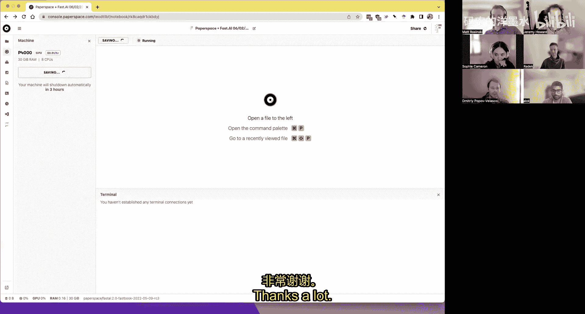

# 【全集】旧金山大学 实时编码 中英字幕 1080P p04 Lecture 4 - Paperspace从零配置 -BV1KZiTBWEeH_p4-

Okay， so let's see how to do。That paper based stuff that we did in the last session。But from scratch。

 like。Step by step。And。One very reasonable comment on the forum after yesterday's session was like。

This all seems。Kind of complicated and it is and like definitely one option is like don't worry about it for now。

 but I would say like。Trying to get this working is a pretty good exercise actually， so you know。

It's totally up to you。 But I I， you know， I think it's， I think it's probably worth。

Worth trying to get working and。Ask lots of questions about anything that you're not sure if it doesn't make sense or it doesn't work for you or whatever。

Okay， so if I say share screen。😔，Yeah。Here we go， share portion of screen。

 I've never tried this before and I could happen。

Share。Mos that。😔，これね。是。不。This is cool。 Okay， do you see。My browser window。Yeah。Yes， yes， all right。

 Okay， I'm successfully sharing a portion of the screen。😊，嗯。Pa space。

So what I did this morning was I just went in and moved all of my paper space set up in persistent storage out of the way so that when I create。

A notebook， it's going to be totally empty。So let's create a notebook。😔，HowNo， I mean。

 I just like I went into slash storage and moved the files。

 renamed them to give them a light dok extension or whatever so they wouldn't be run。

Moved everything into a different order， that's all。

So right the idea this should look like what you should all see so I'm going to delete the workspace URL so we have something totally empty which I think。

Actually， probably best。Yeah。嗯。嗯。Right， and yeah， so follow along。If you want。

 and if anything doesn't work。For you， let me know。And then what I thought we would do is I like。😊。

To learn as few things as possible because i'm lazy and so the way to get away with being lazy and learning as few things as possible is to learn things which are really versatile and powerful so that they can like do a lot of things so in particular。

I。Haven't really spent the time to learn bass scripting very well。

 I know it a little bit because I have instead spent the time to learn to use Python。

As an effective scripting language and I can also use Python for machine learning。

 I can also use Python for creating web services。 I can also use。

Python for creating console applications I can you know use Python for creating continuous integration scripts etca so that way I can be lazy and I like being lazy it's one of Larry Wall's three virtues of a great programmer is laziness along with impatience and hubris。

And I would like to be a great programmer， so I follow those principles。

 so let's try to use python to to kind of automate the things we want to do so remember that I you know we're going to avoid using。

The weird proprietary goi because we're lazy， we don't want to learn it and also because it's not that good。

 So I'm just going to。U。Open up a second tab。And so over here I'll click Jupiter La。

And so what we should find is that we're in a totally empty。But here we go。😊。

So this morning I did do some reading of documentation。

 which is also a great thing to do if you're lazy because if you read documentation then you can like find out straight away how things work rather than spending ages trying to figure it out and so the documentation for paper space was actually very useful and it。

It explained how their different folders work exactly。So。In the route directory。

 it would be a bit bigger， I think。Very we go。Actually。

 I think if I go view presentation mode or something that makes it a bit bigger anyway。

That didn't do anything at all。Okay， in the root directory there's a couple of particularly interesting folders。

 most of the folders you see here are the same that you would find in any Linux box。

 but the notebooks and storage folders are interesting and one of the ways we know they're interesting is if I go Df minus H。

 which you might remember is disk free it lists all the mounted discs in human form。U。😊。

It's made it way too wide so we can't really read it， never mind。Okay。

 I make it smaller just for the purpose of showing this so the。

Slash notebooks is actually on a whole separate 500 gigabyte disk and s storage is on a whole separate 500 gigabyte disk。

So what Paspace does is slash storage。Anything I put in there。😊。

Is going to be seen by every single notebook server I create and in fact if you've got I think if you've got that model particularly people in the organization they might see the same thing as well so that's going to be shared。

Across yeah or at any notebook server I create that's that's going to be handy because anything I want to use on every one of my servers。

 if I put it in there， then I don't have， you know， I don't have to worry about。

B creatingating at each time。Something we didn't mention last time is slash notebooks is interesting。

 that's also persistent storage， but it's persistent storage just for this one。😊，Server。

So stuff that's in there， we will see every time we start up this server if we delete this server it's gone lets we back it up so that's where we would put things that we don't want on every server。

 but just on this one。U。You pay for storage and you pay。

 I think it's like 30 cents a gigabyte or something like that per month。And they don't。Lit you。

 you know， except for the 500 gig limit so it's up to you to be careful of that you will find in your account there's a section called billing that shows you how much storage you're using。

😊，So they will add up。😊，Stuff in slash storage that just appears once and every single one of your notebook servers slash notebooks that'll all be added together。

Okay。So the first thing we did last time。😔，Was we tried installing something extra。From Pip。

So one conversation that we had on the forum since then is like。

Are you sure that's not going to mess me up because？诶。You know， paper space is installed stuff。

 I believe using condoda and Pip and condor。Different things for installing。Python libraries。U。So。

 you know， is that going to mess things up and the the official answer is。Yes， it will don't do it。

 but the unofficial answer is。You know we've got tens of thousands of people on our forums and I've never heard of anybody in practice actually having any problem with using both Pip and Conda slash memberm。

So I'm just going to say don't worry about it as we said yesterday。

 I think the only the place you really need to use Cond or Ammba is for stuff that uses the GPU。😊。

And particularly for Pytorrch or if heaven forbid， you have to use Tensorflow。U。Yeah。

 so I'm going to say don't worry about it and and the reason we we actually want to use Pip in this particular case is we want to be able to install。

The packages into， into our home directory， into a different place。U。Yeah。

 the reason the reason we want to use conduct for stuff that requires the GPU is that they have a way of dependencies like they have a way of installing the coa toolkit requirements so we don't have to install the coa SDK is basically the reason and that's。

And， and。It's not just like one less thing to install， but more importantly。😊。

One less thing to maintain like you don't like。Your couder version and your Ptorrch version have to the mesh correctly。

 other ways it'll break and if you just use Conda that happens automatically。

 but if you use PP then it's up to you to make sure you're installing the correct。

Meing versions of each things。 it's also more challenging in a something like paper space because。

You know， installing things like the couda SDK into your home directories。

I don't even know how you would do it without using kind of， frankly。😊，Yep。

 does that answer your question， Reddick？Yes， thank you very much， okay。Great。Um。

So somebody's got a loud clicky keyboard， they should probably mute themselves。Gearem me， yes。Hi。

 if if the big installation。Do something wrong。😔，哎。Can I own stone or get to a preview state。Yeah。

 I mean， kind of， you can always just type PIP Uninstall。😊，Or just delete your。

Mamber Forge directory and start again。嗯。But， you know， people will always like， I mean。

Or you can just， you know， install a condo package over the top of it like it shouldn't。😊。

Rearely be an issue， generally speaking， the issue tends to be more if you accidentally install something into your system Python。

U。Yeah， but the idea is that you want to feel like you can。

Blow away your mamba forge miniconr or whatever directory anytime and recreate it。Um。Yeah。

 because you don't want to be in a situation where。Things work。

 but you don't know why they work and you don't know if you can get them back to a working state again。

 that's really unsustainable。But yeah， the short answer is you could just type Pip on install to remove her。

😊，Mt real。Thank， what about when it says the？Some packages are going to be downgraded。That's okay。

 yeah， that's okay it's going to downgrade packages。

 I mean Id I'd kind of check how much it's been downgraded， but sometimes it'll be like one or two。

 you know。You know， 0。02。0。0。02 difference in version or something it's not going to matter。

 I mean if it's。Download it downgrading it by a lot that might mean that something wrong is happening。

But yeah， it's not necessarily a problem。Okay， so and I think like。

Pip almost never downgrades things。😔，Condi does sometimes。嗯。

So let's try so the thing we learned yesterday is we can go Pip and store and if you want to upgrade something。

 it's minus U。And there was this one extra thing we typed， which was minus minus user。And so。Yeah。

So the key thing that does is it puts it into our home directory。And so。In our home directory。

 the place it put it。Is the。Dot local。嗯。Volder。Yeah。

So the thing we wanted to do was to make sure that the next time we start。Our computer， we want that。

That dot local。To be there。So that means we have to move it to persistent storage。

 so that's easy enough to do by using move so we can move it。Into our。Persistent storage。

And you know， what I would be inclined to do actually is。😊。

To create a folder in there just for the stuff that where the things in storage that we're using specifically for that configuration like this so I was just about to delete this line when I realized I haven't taught you folks how to delete lines yet。

 so to delete everything left of the cursor it's control U and to delete everything right of the cursor it's control K so hit control U。

Um。And so let's create a directory for this， so we'll go make a directory。In slash storage。

 which we'll call like I don't know， CFfg for our configuration stuff。Okay。

 and so then we'll make a Sim link。From so then we're going to move。 Okay。

 so we're going to move our dot local folder into there。 Now， do you remember the way to say。

The last thing I typed on the last line。Is。Is exclamation markdollar so I can say move。

local to/dage/config by doing move。local and then exclamation markdo and you can see it's filtered out here to show me so that's。

Quick shortcut and then so I want to sim link。😊，That back again into this directory。

 So create a same link from slash storage。Config。Not like call。😔。

To here and here is the default right， so I don't have to say to here。

And so you can see we've never seen cordd。loc。And it's not a real normal folder。

 it's just a pointer to this other place， but it acts like a normal folder。As you can see。

 and so that should mean。😊，That I can import fast core。😔，And。嗯。Get fast core。Dot version should be。

One， four， three。Control D twice to exit okay。Everybody happy with that so far？😮，Jemie。

 I had a doubt so which part where was the dot local actually there like in which border was so the dot local is in my home directory and so see how here I typed CD so CD takes you back to your home directory and you can tell where I am because it's the bit before the pound sign and tilda means in my home directory。

basically everything it creates for like kind of your configuration will be somewhere in your home directory that we're talking about it Jeremy I noticed that when doing C back slash space back slash probably in C space forward slash forward slash that one。

😊，U。😊，That went to a different place to the home where to goes CD space tiltor Yeah。

 so CD space slash takes you to the root directory。Okay。

 so that's the top level where C enter or CD tilder same thing takes you to your home directory。

 so if I go to CD slash and I type print working directory it says oh you're in slash。

And if I just type Cd and say print working directory， it says， oh you're in your home。

And since we're root， that's out home， normally the home directory is slash home slash username。

 roots a special case。Okay。Does that answer that question， yep， thank you。

Just a quick question Jeremy， like in terms of starting your the instance that you just started is that without an image right I used the fast AI image。

 but I used the trick that we learned yesterday which is to go to advanced and then delete the contents of the Git workspace。

Oh click on create I click on Fast AI make sure you do choose the fast AI image because it's got all the stuff we need to make this stuff work but I then clicked advanced options and then deleted that and the only impact of that is it just it doesn't put the contents with this gett repo into your notebooks directory that's the only thing that's okay so I could try all these things that you're doing right now without because I do have a notebook already created but it's with the fastbook yeah so you could like just delete them you know you know just Rmstar。

ip B or just ignore them or yeah absolutely okay thank。No worries。

Jeremyery ask one more question any time the so now you've you've the dot local that you've created now let's say you so it's on your storage so it's persistent now you reboot the system and you don't download another you install something else and you move that new dot local that it's going to create isn't that going to overwrite what's in your storage Yeah so we haven't got to that bit yet so at this point we've got something that's working just for this instance。

 but it's not going to work for a future one so we need to we need to what we're going to do Mark is we're going to create a little Python script that。

That is before it starts the server， before it starts Jupyter in the server， it's Sim links。

 it creates this Sim link。And then in the future， if I type Pip install store minus minus user。

 it'll store it in dotlocal/B， dotlocal will already be pointing at slash storage so it'll actually stick it in slash storage and that's the secret trick。

I got it Okay thank you and Mark， I think you're the one who said on the forum about like are we sure this is a good idea was that was that you and yeah that's me I don't want to I don't want to make it all about me but I've had so many well I want to make it about you because like you're at my target demographic here is people who aren't particularly confident at the showminator but no no not at all it's just you're the one person who was brave enough to join in I think despite having less experience at the terminal so I actually want you to be particularly happy to interrupt any time something's not clear。

😊，Okayect。Yeah no I've started this course a few times and every time the problem is always the thing that always makes me stop is this stuff yeah and I end up like getting conflicts and I remember there was an old version of I think it was paper space I can't remember that you were recommending and it kept crashing and I kept losing work and yeah so I guess I'm a little paranoid about creating things that are going to create problems so to be clear I don't feel like we've had a great solution。

The running fast A。Saply and easily until now。 So the reason you've had problems before is that like。

There wasn't a great solution before。 So， so this is the first time I'm actually saying to you。

 I really do think this is going to work。 And so any time something goes wrong。

 like feel free to like share your screen or anything because。😊。

That debugging process will also be useful so I'd say for now。

 you know suspend disbelief give it a go and you know if it all falls apart blame me and I will happily fix it and so it goes through anybody as long as you're roughly following along with these steps if you do something totally different。

😊，And maybe I won't be so patient。😊，Okay， so。So look at what we did here we did two things we first of all moved our do local to slash storage and then we Simlink it back now we're not going to have to do that move ever again right with that that was just enough to kind of create a dot a slash storageage sconfig。

 local so all we need to do next time we。😊，Um。Next time we create an instance is to create the samelink。

U。Like so。So。Let's do it like for something so simple because I said I'm going to just show you how I would do things for something so simple。

 I would actually create a batchsh script for this。😊，U。

And this is where things are going to get particularly interesting。😊，Because。Um。

W okay i'm going to show you the proper way to do this and i'm also going to show you the slightly improper way to do this i'm going to show you how to use bim which is actually a highly recommended editor that works in your terminal but i'm also going to show you a trick for how you can use the Jupyter text editor so Jupiter has an Em browser a text editor。

😊，Um。😊，Which currently we can't really use because it's pointing at slash notebooks。

 so how would we change stuff how would we edit stuff that's in slash storage？

But what we could do is if we see data slash notebooks。And then we create a Sim link。😊，嗯。

From my chair。Yeah， just letting you know on my screen， at least。

 your cursor is just cut off from the bottom of the screen。Okay， so so like I need to like， make the。

Browse her a little bit。Small one。Sounds like Jupiter is not quote showing this properly so you can see it now cool you thanks letting me know so if I s link slash storage into slash notebooks。

Um。Then what should happen， there we go is it appears here。😔。

Because this is showing me the contents of slash notebooks， so that would be one simple way to。

Create a script here。Would be I could click plus。And I could click text file。

And we've got a text file and so now we could。Copy and paste our。Simlink。So maybe copy， nope。

 let's see， copy。😔，Oh。😮，That's annoying。😔，关系。That's very annoying。不管。

Can't copy stuff from the terminal W， you're rotten scoundrel。

I just did it with control C and control B。Yeah， I， oh。

 it's because I'm on a Mac now I have to press command， not control right， thank you， okay。😊，And。

You need to make sure you're in your home directory for this to work， so Cd。Okay。

And to run this as a script， you have to tell it， it's a script。

The reason why it doesn't matter too much， but the official。

 the kind of correct way to do that is to you first of all， say。Hashb。

 that means the first line of a file in Linux and Mac tells it what program to run it with。

And we want to run it with bash and you're meant to do it like this for slightly obscure reasons。

Slash user slash bin slash end bash， that will run this script with bash。Okay， file save。嗯。Yeah。U。

The slightly less correct way to do it is you could just say which bash。

To find out where bash is and it's actually slash bin slashbsh and。You know。You can also type。This。

 that would also work。So that says when to Linux or Mac， when you run this file。😊。

Run it using this program sorry run it using this program。Okay， so file save。😔，All right。

 so let's rename that and so in。Paper space， the special file called prerun。sh is run。

When it starts a new instance。Now。You might remember that。You know， in fact， let's， that's。

 it's good to before you just go ahead and start an instance。

 let's try to like run it and see if it works。 So if I type dot slash prerun。Dotsh and press enter。

It doesn't work。 And so the reason why it doesn't work， hopefully you're starting to。

Remember now is that we need permissions to be set correctly。And in particular。

 we're missing the X here， the execute permission。Um。And so in the past lessons I've shown you。

 you can type C mod U plus X to add the execute permission to a file。嗯。Likea。Um。

 but I also actually kind of lied， I don't normally use that way of setting permissions。

 normally I set all the permissions at once。I would actually normally type this， I would 755。Preerun。

sh then let me explain why 755。And the reason I did it the other way before is it required less explanation。

😊，755 is not the number 755， it's actually three separate numbers， the number seven。

 the number five and the number five， it says these are permissions for the user。

 these are permissions for the group， these are permissions for everybody。And then。Commissions。Oh。

 just a amendment。I'm going to take you chest in a moment。Yes。Yes。公是。啊。他是。预俾。这个是。系费。ちさ。Sder Court。

没有吗。嗯。😊，So actually， it's not quite 555 that I want， but that's okay。😊，So basically for each one。

 it's going to add up three numbers， a one， a two and a five， a one if it's executable。

 a two if it's ridable， and a four if it's readable。

So seven means readable and readable and executable for the user。

 four means readable for the group and then this four means readable for everybody。嗯。

So if I check this now。😔，You can see it's got， okay， so this RWx is4 plus2 plus one equals seven。

D dash that's 4 plus0 plus04 plus0 plus0， so these permissions are 744。

So that's yeah slightly weird if you've done stuff with bit flags in your programming before it'll look pretty familiar and then if you haven't it might look weird。

This kind of thing does come up quite a lot actually in programming a a surprising amount。

It's probably worth getting familiar with the idea of bit flags。So that now should。

Be able to be runnable。And it is now runable and so it's good we ran it because it tells us that， oh。

 you can't create a symbolic link because it already exists。😊，Now。

I'm not sure before Jupiter starts if this directory will be here or not。嗯。

So it would probably be a good idea to assume it does。To avoid that， we could first of all。

 go remove。Recursively and forcefully。Any dot local。Directory or file that exists。

And so if I now save that。And try to run it again。Okay， it's what？So that's good。

 So we should now be able to。嗯。Create a new。Notebook。😮，Yeah。And overall。

I'm not really doing anything with the GPU at the moment。

 so I'm not going to spend their money unnecessarily， so let's just create。

Ty tiny little instance here。😔，对。Next space， start。😔，There we go。😊，嗯。😊，Okay。

 so that's going to go ahead and start。So that's。That's done that bit from scratch。

 So let's now do our。Our keys from scratch。As well。Um。

So and you know I would probably not do that SS key gen thing in real life so let's let's do it all the way I would do it so I would just say make。

ssh that's where our keys are going to go。Okay。And then upload my keys。😊，Oops。Yeah。Okay。

 there they are。Um。And so then that's Cd to。tssh。And move。I put them in storage。

 so storage ID RSA star。😔，Inter here。😮，Oops， oh crap， I just messed it up。

Now I' going to have to uploadload them again， sorry。What happened。That's correct。嗯。

Move them into here。Okay。Okay， so there they are， in fact， let's do LA because that tells us Dart。

 which is the permissions on this directory。Okay， so the dot SH directory。

 nobody else should be able to access it。 So if I go C mod。700。700。

 that means  four plus two plus one， so all permissions for me。

 the user and no permissions for anybody else。On the directory。Okay， and then actually。

And then for the ID。RSA， it's just readable and writeable， say 600。For my private key。

And then for the public key， it's readable and readable by me， but only readable by everybody else。🤢。

So there we've got it。This is what 700 permissions look like， this is what 600 permissions look like。

 and this is what 644 permissions look like。And after a while。

 actually you start getting used to the idea of like， oh644。

 anything that you can read and write and other people can read， you know。

 700 any directory that you can fully access 600 anything that only you can read and write。

 they kind of become like，😊，Standard little concepts in your head。So at that point。

 we should be able to test this now。By SS to the username gett@gitthub。com。

And I've successfully authenticated now if that doesn't work for you。

 it's almost always because of permissions， but you can get a lot more information by running SS verboly。

By typing minus v and it's quite cute， the more V's you type， the more verbose it is。Very， very。

 very barebo okay， and it'll tell you all the stuff it's doing。Um。And so now we've done that。😊。

Hopefully you won't be too surprised to hear that we want to do exactly the same thing with our dotSsh folder。

 which is we want to move it into our persistent storage and then link it back again。So move。tsshH。

Into slash storage config。😔，And then s link it back again now。😊，Rather than manually doing that。

 we could just go into our script。And copy and paste these two lines。Yes。Yeah。Yes。Okay。

 and do it for our SSH folder as well。嗯。So save that。And so if I run that script now。嗯。是。

You can see my SSH is now slinked。And if I test it， so I pressed。

Control our git gets me back the last thing I typed with Git in it。Yep， it still works。Okay。

And this notebook is hopefully finished starting， yes it has。U。

And I'll just go to quick to use the paperspace IDE just because I'm testing and we can test。Yep。

 so this is a brand new instance I started in another tab and my do local has successfully appeared there so we can see that our pre launch thingy is working。

不上。Okay。I think that's everything that I。Wanted to show today， does anybody have any。

Questions before I go。Sorry about the slow start。One quick question， yeah Jeremy。

you can see a file structured there on the left hand side I see just nothing thats Yeah so this is my Yeah so my persistence storage already had stuff in it。

So I've just been deleting stuff。And the reason we see storage is because of that Simlink I created earlier。

😊，So if I type history part grab。😔，诶。When you start the instance。

 it is when you on the left hand top， you will be looking at your notebooks directory exactly that is your notebooks directory。

And so it might have missed it， but earlier on what I did was I simlink my slash storage directory into my notebooks directory so that I could。

Edit and so if you missed that bit， just watch the video and you'll see it happen。But yeah， it was。

 this is this line here， Ln minus S slash storage and I put it into。Like box。

other it's going to have to show you how to use Vm， but I might show you how to use Vm next time。

 but this way we can use our our editor。😊，And the thing that makes it work across new servers is that the pre run file is in the storage。

The prerun file is special so you might have noticed that when you go to the advanced options when you start the instance it says what program should it run when it starts and it's a default it runs a program called run。

sh and if you look at that run。sh it says here run the prerun。

sh so it has to be that exact place and that exact name it's a special file。

This is a paper space specific thing。Okay so as long as pre run is in storage with that exact format it will be across servers exactly right yeah it'll be across servers because it's in slash storage and it will be run because the run butt sh file runs it as you know。

Yeah， exactly。So Jeremy just a quick question about pre run did did you created that right I created the prerun but S file it was not there Yeah so in bash this if here actually says if minus F is this file exists。

 then run it that's what that bash means and so paper space。You know I said to Paspace。

 could you please add that to our image and so everybody who uses the fast AI。

Image will have this and so if you create a pre run dotsh in here， then it's going to run it。

Right so we would be creating that it will be pre correct the way I created it and again go back and watch the video if you if you missed this and you want to see it again。

 I double clicked on storage and then I clicked on plus and I clicked on text file。

And then that created a text file called on title。text。

 which I then right clicked on and I said rename and I renamed it to prerun。s。

Right there was one like I saw the dot backs so the dot back one yeah don't worry that that's that's the one I moved out of the way that's my actual one that I woke for myself I saw that already and I was like okay did it did the system created for you that was just trying to get mine out of the way so it didn't make me cheat。

All right， so then the last step， of course， we have to do。Is to stop our server。😔，U。

Gem me one quick question。How do we ensure that we are not disturbing system Python Mariritime when I'm installing in my system。

 I somehow I， I mess up things。Have you watched the previous three walkthroughs？Last one I missed。

 Okay， so watch that。Where we basically answer that question， I believe， but if you have any。

 if that doesn't answer your question， then please ask next time。Thank you。 Thank you。 That worries。

 All right， thanks so， bye。Thank you Jay thank you everyone。Thanks slide。

Oh。So。

。