# 【全集】旧金山大学 实时编码 中英字幕 1080P p05 Lecture 5 - Vim编辑器实战 -BV1KZiTBWEeH_p5-

All right， I will start recording。😔，嗯。I wanted to just start with。At issue。Which。

I can't remember Mark or Matt， somebody pointed out that。😔，Their paper space is broken， yeah。So。

Anybody else who's been following along probably found the same thing that they couldn't see their notebooks anymore。

😊，嗯。Which is a bit of an issue。😔，So let me start an instance。😔，And we can see it。Oh。

 and I should share my screen， I suppose。😔，S screen。Advanced。Quion of screen。That looks good。

 Put up there。And。吃吃吃吃。Right。You guys can see my paper space window now。Cool。🤧Ham。

Now to delete the Workspace URL as we do。Start。Okay， while that's starting up。

 I'll show you the other thing。Which is。I mentioned the other day when we were talking about how do we。

Create bash scripts for example， we created that batch script run do ingredient and I said oh you know you can。

Use the Jupyter text editor if you want。But that's not how I would do it myself。 And I said。

 I would show you how I would do it myself。And the way I would do it myself would be using a program called Vm and Vm's a text editor。

Which。Has a。You know， somewhat deserved。Reputation。

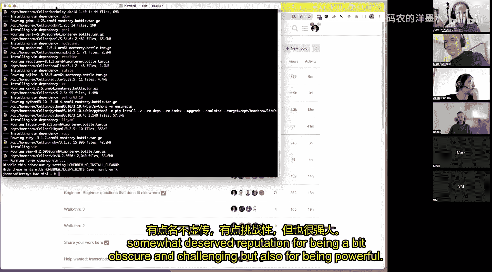

For being a bit obscure and challenging， but also for being powerful and all of those things are true and it's kind of something I wouldn't。

Normally cover in a beginners guide， but in in a guide of like the things that are going to make your life better。

 I would certainly say， yeah， we do need to include it because it's actually。

Really quite terrific and but I don't want you to take my word for it I wanted to。

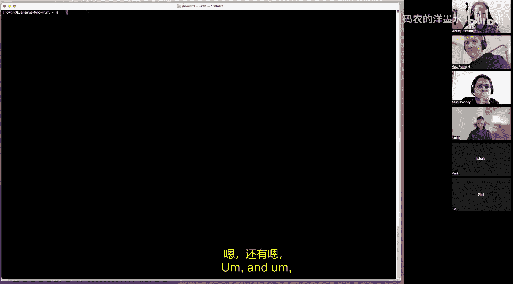

Give you an example of like。How how it works and why it's terrific and so I thought like a good example was what are the folks who's been。

Following along on these。I just try to make this bigger。😔。

So I can see more faces there we go one of the folks who's been watching these course is Daniel has been kind enough to。

😔，Create these timelines。Which I think， actually really useful to like remind yourself of what we covered。

😊，And。They're useful for me， because I can。嗯。Use them to create timestamps in YouTube。

 so timestamps in YouTube the photos show you an example。呃。

They look like you see how at the bottom here those little chapter markers appear。U。

And to make them appear you basically have to have like times in a particular format in the description。

 so I actually used vim to turn Daniel's。诶。Thing into those timetents。

 And I thought that might be just a good example of。

Like how Vim's a bit different to your average editor。Um。By the way。

 you might have noticed when I selected this， I actually selected it。Quite quickly。

 And the reason I the way I did that was with the keyboard， like everything。You know。

 most things I use have good keyboard bindings and。呃。The forums have good keyboard bindings。

 if you just hit a question mark， you'll see them， but they tend to be pretty consistent across programs。

And you'll see that。J and K moves the selection up and down， so if I press K。

 it moves the selection up and if I press J it moves it down。And。It kind of selects it。

 And then if I hit E， it edits it。So now I can get Apple A to selector Apple C to copy。Um。

And you'll see that these keyboard shortcuts have a lot of overlap with with Vm and so it's kind of nice that as you do more stuff with the keyboard you start to realize you don't have to relearn everything from scratch so I only just set up this Mac。

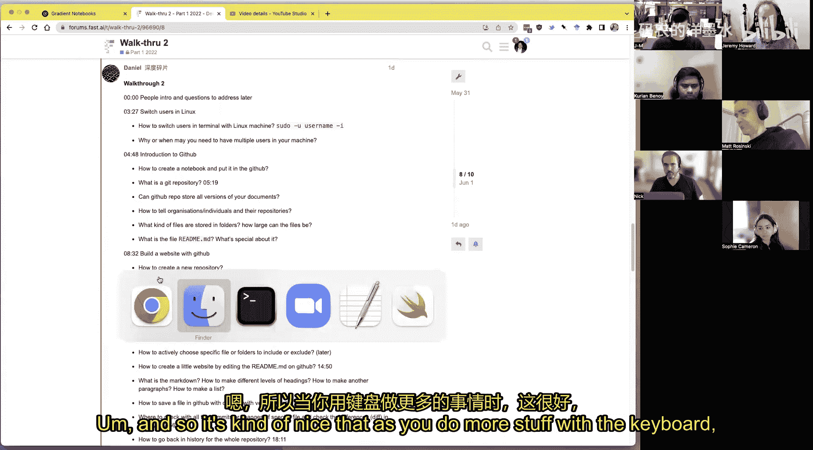

And so I just installed Vim literally before。We started this session by typingB install Vim you need'm using because I'm trying to use a Mac a little bit。

And you need to set up homeburyw， which you can do from their website and so when Vm opens。

This is what it looks like， it's going to be preinalled。😊。

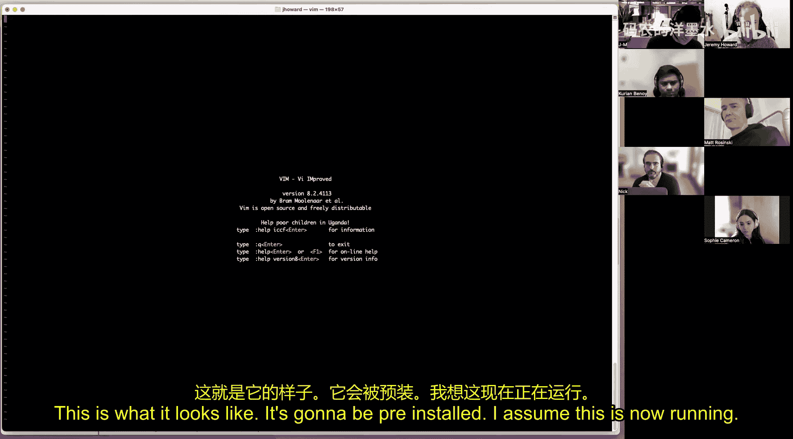

I shame this is now running，😔，It should be preint on。Paper space。

So we should be able to use its straight away there as well。It'sTak a while to start for some reason。

😔，Hello。I suppose it's an link this isn' it。😔，It's taking a while for me too。系啊。嗯。That's okay。

 I don't have to watch it doing that。 So while we're waiting I just going to go back to this one on my Mac。

 Okay， so here's Vim。 so the first thing you'll notice if you start vim。 So if your're。

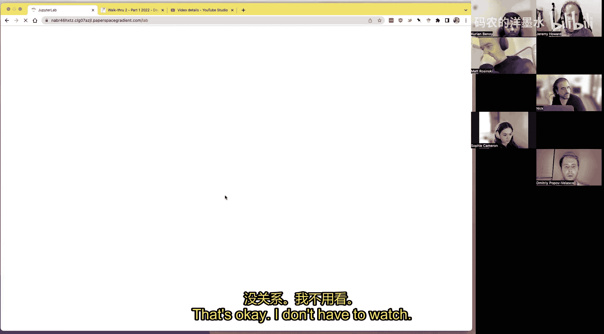

OnActually， let's talk about different options so on Linux。嗯。To run， to run vim。

You would type pseudo app， actually let me do it in the Vm window because otherwise it's going to order complete things in annoying ways。

😔，So in Linux to install Vm， if you don't have heard already。

 you would type pseudo app to install Vm。Now on Mac。

 you would type B install Vim after you've Googled for Mac Bw and installed Homebrew。

Windows is going to be the same as。Linux， of course， because it is Linux and WSL。

And so once it's installed， you can just type。Vim at the command line。

And yeah the window appears and one thing you'll notice is if you start typing nothing happens text doesn't appear so that seems like a problem a text editor where when you type it doesn't put text on the screen what on earth is going on well it's exactly actually the same as Jupiter notebook which is in Jupiter notebook when when it appears。

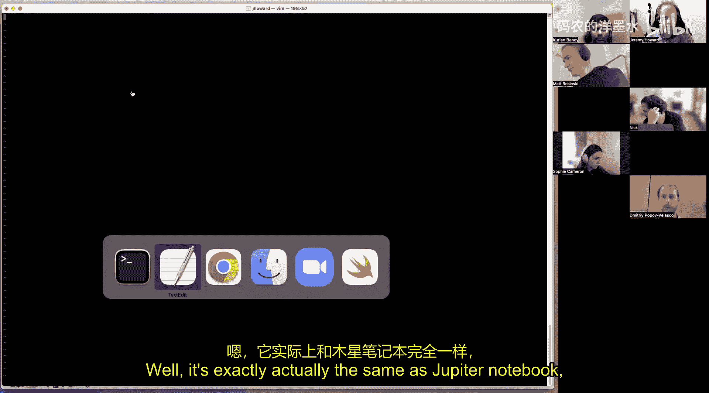

So if I create a notebook。😔，If I start typing nothing happens either right and that's because in a notebook you know you have to click inside a cell or press enter to go into edit mode and then if I press escape I'm now in command mode and buttons do things rather than types so for example X cuts Vm is the same it's modal you're either in a mode where you're entering an editing text or you're in a command mode。

😊。

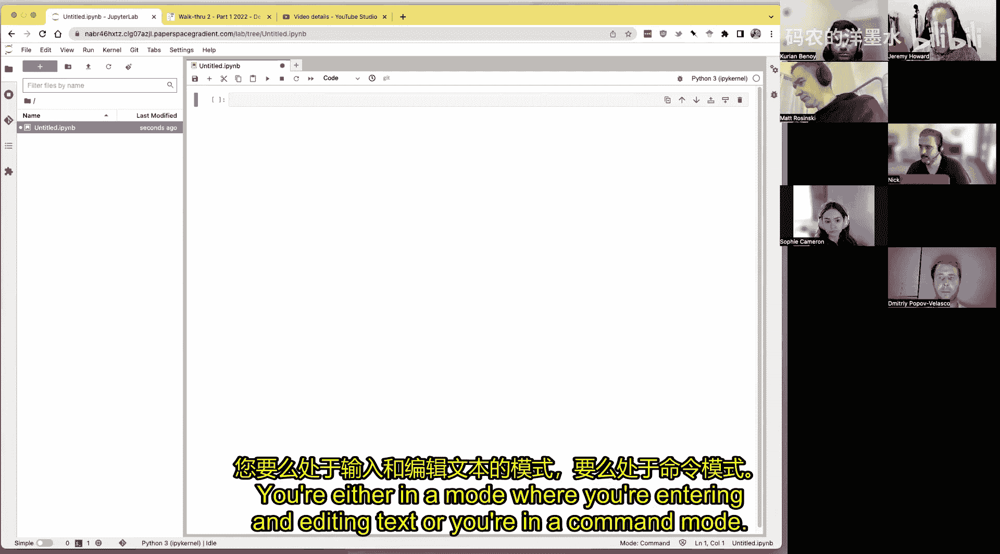

So by default， just like in Jupiter you're in a command mode。 So to go into edit mode。

 you press I I stands for insert So I can start if I press I and it says down at the bottom here。

 insert So now in insert mode now if I type。It types。Okay。

 and then if I want to go back into command mode， I press escape。😊。

And if you don't see a mode that means you're in command mode， my arrows keys work as usual。😊，嗯。And。

Up and down work as usual， but one thing you might notice is in command mode。

The same buttons that we use in Discord for up and down J& K also work for going up and down。

And it's not just J& K， it's actually all the letters in a row there are all movement。

 so J& K go up and down and El and H go left and right。

It's totally fine to use the keyboard the arrow keys in your keyboard as well。

 and I would say honestly probably for the first couple of years of using VMI or used the arrow keys。

😊，At some point I started using HjKL all the time instead。

 I guess my fingers noticed they were a bit closer and I didn't have to move and they decided that they liked doing that better that's but oh this is fine So yeah。

 so you can move around and so at this point。We can run Vim， we can enter text。

 and then the one thing we don't know how to do is to exit and save。So I almost never just type vim。

 I almost always vim something I want to vim a file， so for example。😊。

Let's say I wanted to vim my dot Z profile file， which is a。

One of the startup scripts that's run automatically when you start the terminal。

 I would type Vmspace dot Zp tab and there there it is。 Okay。

 and so this is something that brew installed for me。 So if I wanted to now edit this。

 maybe I wanted to put a comment above here。 I want to go into edit mode。

 and I'll show you like the slow way to do this。 I could press I for insert。 I could press enter。

 I could press up and I could start typing。Does that be one way so I could type my comment？Okay。

 and then press escape。Now I want to show you a different way， so I want to undo all that。

 so to undo the last thing you did， it's press U for undo。And you again。

I is not the only way to go into edit mode。 There's lots of ways to go into edit mode to go into edit mode in different places。

And one of them is to press O， which opens a new line underneath。

So that puts a new line underneath edit mode I want a new line above which is shift O shift O is a new line above。

 so it's pretty common that like a letter and the capitalized version of the letter in Vm are kind of related versions of similar things。

😊，Um。So if I could put a comma here， shift O。Aut added by Homeburyw。😔，InSter， for example， Okay。

 that's good。 So now I want to。😊，Save and close。So there's actually a third mode。

 there's not just command mode and edit mode， there's also a mode they call EX mode。

 which is where you hit colon now when you hit colon。

Our cursor moves to the bottom and you can enter various different commands here。

 So one of the commands you can enter is W for rate， and so that will save。

So by default it saves it to whatever I loaded it as so it saved it back to dotz profile。

 I could save it to something else by going W you know backup profile or something and that would save it to that finally another useful EX command is Q whichs so Co and Q。

Quits。So。Um if I now。I decided I don't want to capitalize that， so I changed that to a small A。

You can combine EX commands together so to save and quit， you would take colon WQ， right and quit。

And so when people say how do I exit ViIm， you'll normally hear people say colon WQ and that's that's why and so by the way that like what I just did there when I changed the big A or a small a。

 I did that in a single button press and that's because the Tilda command changes case。

And moves one to the right。Okay， so thiss like an example of， you know。

 when you've got the whole keyboard available and shifted versions available， like there's a lot of。

😊，Things you can add right and then hit you a few times so if I wanted to。

Change the case of the next 10 letters， I could hit tilda 10 times one，2， three， four， five， six，7。

 eight910。Okay。😊，Um。😊，But I wouldn't do that， because in Vim。You can always say before you do a。

I call it。A verb before you do like one of these you know letter command single letter commands you can type a number。

 which is how many times do you want to do it so if I type1 zero 10 so if I type 10 tilda it runs it 10 times。

And so this is where things。😊，Start getting interesting， right， because every single。Um。

In our verb you can run in Vm， you can also say how many times to do it。So for example。

To delete a line。And just creates her oops， I've accidentally created far too many lines。😊。

So to delete a line， you press DD。To delete five lines， you just press5 data。Okay。

 so so it's important to remember like everything you can do， you can put it。A number after it。

 but actually' it's even more powerful because after most commands， you can also say。

You can add something called a motion a motion， for example。

 is right arrow moves right one left arrow moves down one shift G goes to the bottom of a file。

 motions are things that move your cursor around。 Now that doesn't sound very exciting unless I tell you。

After a command， you can type a motion and the command will apply to the region that that motion covers。

 so for example I'm currently on line three。And if I press shift G。

 shift G is the motion to go to the end of the file。

D is the command to delete so I can combine these together D shift G will delete to the end of a file D shift G。

So that's pretty interesting。😊，So GG takes you to the start of a fail。

 so to delete from here to the start of a file， DGG。Right， or you know。

 there's some really interesting motions， for example。😊，Let's create two bits。😡。

There's a concept of a paragraph， so right curly bracket takes you to the end of a paragraph。

 takes you to the end to the next empty line。Right， press it again。

So that means if I want to delete everything from here to the end of the paragraph， I would press D。

 write curly bracketett。Okay， or if I want to do that twice。

 so delete from here to the end of the paragraph and also delete the next paragraph。Actually。

 television me show， I want to copy this whole second bit。😊。

And and make a copy of it so in Vm copying something it's not control or command C。

 it's called a yanking so you press Y。So I want to copy the next paragraph。

 so to copy this paragraph， I would press why write curly bracket and then to paste its P and by default。

 it pastes it to the line underneath to paste it to the line above， you won't be surprised to hear。

 it's shift P。 So there's a copy。Now， I want to go down to the next paragraph and change that to third bit。

 So I'll press right， curly bracket。And。I now want to delete this word and replace it with a different one。

Deleting and replacing in Vm is called changing and that's C and so like everything else that can be combined with emotion。

So the motion to move to the next word is w W goes to the next word。 B goes backward。😊。

So to delete this word and let me start typing in a new one， it would be change word CW。Third bit。

Okay， so if I want to delete from here to the end of the paragraph and the paragraph underneath。

 I can just delete two paragraphs so that would be 2D right curly bracket。Okay。

 so we I would describe this as being highly compositional right you can you can。

 you know kind of combine。😊，Numbers。Motions and and commands。

Together and then we haven't even touched on on EX right so let's talk about EX so I'm going to delete to the end of the file D shift G and delete this line DD and call and WQ to exit。

So I mentioned。

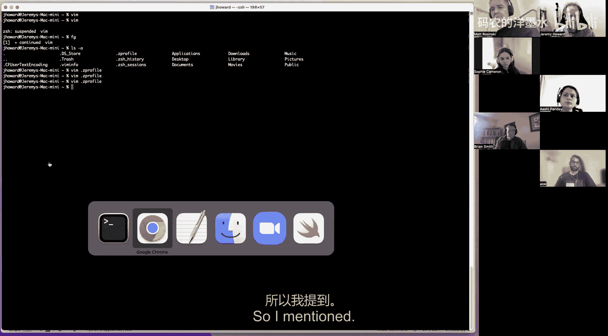

That。We want to change this。Into something suitable to put in a YouTube video so I press E。Yeah。

Apple A， Apple C， cancel。

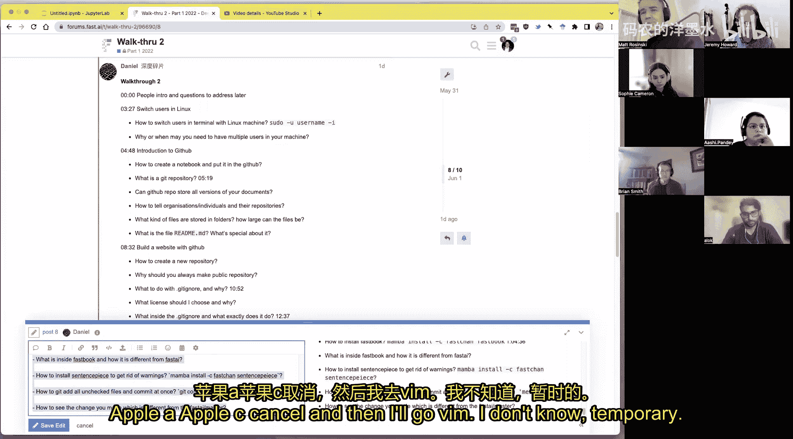

And then I'll go vim， I don't know， temporary。😔，Insert。Apple V。G， okay。

 so here I've just posted in this text， right？and I want to clean this up。😊，So， I want to。

Clean up the title so Ill press DD。And I want to do the same thing to the next line。

 so to do the same thing you just did again。Press dot。 So that's going to delete the line again。 Now。

 where this gets interesting is that will redo。The entire。Like number。

Command motion that you just did So for example， if I press 4 dW to delete four words4 dw to delete four words and then press dot。

That deletes another fours。And so that can get pretty interesting， so for example。😊，Oh， okay。

 I'll show you a really cool example。😊，To search in VM you use slash which is pretty common in a lot of different tools and so if I want to search I don't know if how many of you are familiar with regular expressions you can put any regular expression year if I wanted to search for the next timestamp that Daniel created I'd want to find a digit at the start of the line right so to go to the next place where there's a digit at the start of the line regular expressions use carrot for start of line and back slash D for digit so this is going search there you go and selects the next。

L digigit at the start of the line to search again， press n。And right。

 so this is kind of cool right because what we could do now。😊。

I if I want to delete everything up to all the next digit at the start of a line。Well。

 slash is a motion， so I could type D slash。😊，Carrot back slash D。

And that searches for the next digit at the start of the line and deletes to it。

And so now I want to do it again， I press down， Ill just press dot。😊。

So now I'm removing everything that's not a。Chapter header。So that's pretty interesting。

And then I could just delete to the end of the line with D shiftG。😊。

And delete the first line and I'm just about done right plus there's more than one way to do it。

 so let's look at a few different ways。😊，嗯。Another way we could do it。😊。

Is we could delete all the lines that start with a hyphen。So there's a really useful EX command。

 which is the command G G is I think it stands for Gr， it searches for things and it doesn't action。

To anything any line that it finds so with any EX command you first of all have to say what lines do you want to apply it to and nearly always you want to apply it to all lines which is percent so generally speaking for most。

AX commands will start with percent and then you say what command do you want to run。

 so I want to run G， which is I'm searching for something。And then in EX， the different parts。

 the kind of the different parameters are generally separated by slash。😊。

So the next thing is what do you want to search for。

 I want to search for at the start of a line a hyphen。😊，Okay， and then another slash， okay。

 what do you want to do and now I can put in any vim command。😊，And so。

 remember the commander to lateton Vis D。So this is going to search for anything with a hyphen at the start of the line and delete it。

There we go Okay， so we could now do a similar thing to delete all the empty lines。

 so delete all the empty lines I would do percent G slash Okay I want to do anytime you've got the start of a line。

😊，Followed by zero or more spaces followed by the end of a line， that's an empty line。

 what I want to do， delete it。Okay。😊，So and then finally I want to put a dash between that first space and the thing after it。

 so that's a search and replace so again we do column percent to apply some EX command to the whole file S for search and replace。

😊，Then the slash to put in our different parameters， so first what are we searching for a space？

And then what are we replacing it with space， hyphen space？And then enter。

 and so this would just apply it by default the first time it finds it。Okay。

So that's like an overview of， like。Why themm is cool like when say people say them is cool。

 they're not saying like oh， you should use it because it's retro and interesting。

 they're saying you should use it because it's powerful and。Specifically， data scientists。

Should learn VIm because this interactive text muing is what we do with input data files and output data files all the time and you know something we can look at later if we want to is it's super easy to create macros in VIm which is where like literally it'll just record each button you press and then you can just rerun that macro so if you want to run the same process on six different files you just run the macro six times。

Um。Now in this case I want to close without saving。

 so normally if I go call and queue and it says no you haven't saved so it's kind of careful to help you there it says add exclamation mark to override so I'll do that Q exclamation mark。

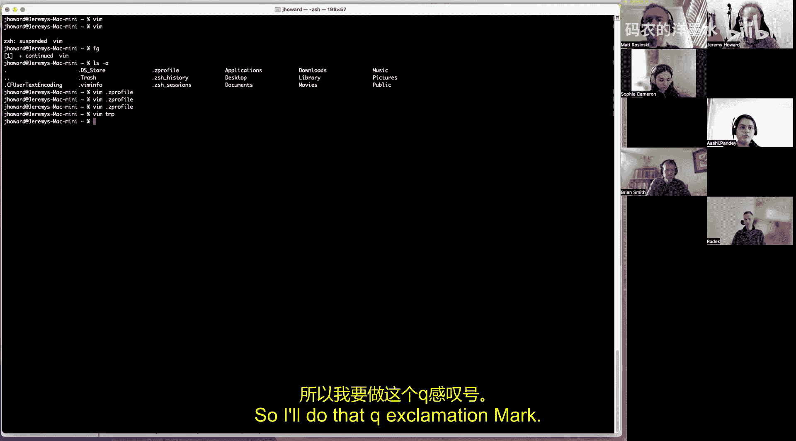

Okay。Um。So we can use that in。In Jupiter。And so now we're going to fix the problem。

Which we talked about earlier， which is how come。How files disappeared。And to fix it。

 we need to edit pre run。tsh so if I type vim pre run。sh。

So here we've got this and the reason that the files disappeared is that at the start of our script。

😊，We typed Cd and that changed to our home directory。 and we never went back to where we were。

 And so that meant when it ran Jupiter， it ran it from our home directory。

 This is actually currently showing the contents of our home directory。 Now， okay。

 I want to show you now。How we know this by looking at Run dotsh。

 I want to switch to editing Run dotsh。Without saving where I'm up to。

 and I want to show you a really neat thing in in Linux that lets you do this Nmac。

 which is control Z。Control Z does something really interesting。It stops the process I was running。

 and it puts it in the background。 So if I type jobs， I can see what's running in the background。

 Vm is running in the background。 I can do anything I like。And then anytime I want。

 I can type4 FG for foreground。And it comes back。To where I was。 right， so I can hit control Z。

 and then I can type themm。slashrun。sh， which is actually what I was going to show you。

 this is the thing that they run for us when we start an instance。

And you can see here it runs our script。And then it runs Jupiter。

 so our script was CDd into our home directory and then running Jupiter。

 and so Jupiter was in our home directory。What I red。So Ill column on Q to exit that and I'll go Fg。

There we go now。😊，Optional power user thing， which I use a lot is I would not。

 that's not how personally I would have looked at the Rundot S file to look at the RunD S file。

 what I would do in Vmo I type colon and SP understands to split slash Rundotsh。And as you can see。

 Vm actually allows me to have multiple。Windows open at once Okay。

 kind of like teamax actually teammax and vim has very similar functionality and so then I can you know scroll around here and then in vim。

😊，Instead of pressing control B and an arrow to go to a different window。

 which is TATs invehemments control W。Acept that control W。Coseses a tab in Chrome。

 so that's possibly not going。Um。Okay， so。😊，So there's a couple of ways we could solve this that probably the best way in a script is to use that trick I showed you last time Py。

Tilda is our home directory， so that's the same as CD changes to our home directory。

 but it remembers where we were。And then pop tea。Let's us back to where we were before。

So that should fix our problem。Okay， so this untitled。ip and B， we'll probably find that， yeah。

 see here it's here it is in our home directory， which was not what we intended。So let's delete it。U。

And we'll shut this down。嗯。And then we'll create another instance。Just to check that worked。Okay。

 so while we're waiting for that to get started， does anybody have any questions or comments？

About them。Hi Jeremy that is is very good that took me back to a previous life where I used to install word perfectect on Unix boxes and then just working in a legal firm and said what do you use for a word processor today before I put on word perfectect and this。

Person legal secretary said， I use VI， which was like。Vim is VI improved or improved so。😊。

But its just amazing the power of it， if you know。Everything it can do yeah it's it's a perfect word processor yeah it's it's great I mean I don't use it as a word processor to be clear I use you know Microsoft Word or Google docs as a word processor cicus。

😊，I think they're very good word processor， but for a text editor。

 I use it a lot if I've got you knowa。😊，CSV file I want to do some quick cleanup to or something like that。

Or a log file。I'll use it yeah， pretty much any time i'm editing a。

Quick script or something on a terminal。That's great。😊，You know， I will say。嗯。

Visual Studio code is also excellent， and I wouldn't say like Vms。

Better or worse than visual Studio code。Use both of them， I use VM more often the visual Studio code。

 but you do use both of them and in fact， there is a button here。I thought somewhere。😔。

I thought there was like an open Viual Studio code button， but maybe I'm imagining things。

Or maybe it has to wait until it's finished opening。The server。😔，Oh there it is， yeah。

 so there's a access remote kernel actually lets you connect Visual Studio。😊，On your machine to。

To the remote machine， so you can even use visual Studio remotely， you can also use it in WSL。

On Windows， don't install visual Studio code into the Linux box。

 install it into the Windows box because it's got a WSL connector built in so it uses it it。

Treats WSL you know， just as if it's a local Windows directory。

 you can also connect to any SSH instance using the VS code remote connector or yeah。

 this remote kernel thing。U。Jeremmy I had a question so you know you showed a lot of keyboard shortcuts for them right so how can anyone approach learning it because it feels a bit indemating when you are a beginner Yeah yeah so I mean the trick with。

Learning something new is。For try and like do it in small chunks right so don't expect to learn all of vim like so at this point I would say learn I to start inserting things arrow keys to move around escape to go back to command mode call and wq to close and save and at that point you can now use vim。

To edit your shell scripts and stuff and then like。

Try and learn maybe one or two new commands each day。So you know， one useful one。

 you know or a motion each day so。You know， W and B are useful to note to can move forward and backward a word。

And yeah， there's a lot of Vm tutorials and things out there， so for example， here's openvim。com。

Which is。Going to introduce you by saying oh hit the enter key like okay I'll hit the enter key and so you could work through a tutorial like this yeah it's。

We all get intimidated， honestly， Car when we see。An expert working with something that we don't know yet。

And at first， it's like， wow， that's powerful。 I wish I could do that。 But my God， you know。

 how would I ever get to that point and the goal is not to。

Be an expert at vim the goal is to like be able to do vim to like slowly do something that you want to be able to do and this is one of the things I you know really had to practice for myself in my late teens and early20s was。

To repeatedly put myself in a position where I was。Intentionally doing things slowly。

By using a tool that I wanted to know and I was pretty sure at some point would be useful。

 but I didn't know it well enough。To do it faster than with other than some other tool so i've always you know since since like 16 been pretty good at using Lous 123 and Excel spreadsheets and I tended to turn to them for everything and then I wanted to learn SQl databases so I kind of forced myself to do things ening lists with databases for a while even though I got slower and。

Then I was like， okay， well I'm going to stop using。You know。

 I got to start doing more stuff with VBA macros and start doing stuff manually and again it was kind of slower for a while and particularly like。

You know， things like cleaning up that。YouTube timestamp thing。I could have done that manually。

You know， and and the first 10 times， it would be faster to do it manually， but don't do it manually。

 right because each time you do it manually。You know。You're missing out on the opportunity to。

 to get better at the thing that's going to make you faster。 And the thing about。

Prating what you think might eventually be the fast way is that those fast ways。

Accumulate together in kind of these multiplicative ways。 And so。You know， I've been kind of。

Using this approach of always。Trying to do things the way I suspect would be the fastest if I was an expert at it I've been doing that for like 30 years and now most people who watch me work go wow。

 you're very fast at。Doing stuff， you must be really smart， you know， I'm like oh no。

 I'm not really smart like you should have seen me when I started I was terrible。

 but now these things are all。😊，Accumulated right， so yeah。And if anybody finds。

 you know good tutorials， let me know， honestly it's been a long time since I've run of VM tutorial。

 so I don't know if this one's good or bad， it was the first one that came up in Google。

But I think large tutorial is good。就。The best tutorial is on Linux in the terminal if you just type in a Vmtotor in the terminal it should pop up a very nice tutorial and I just wanted to say Jeremy that you know a few minutes of speech that you just gave that was absolutely wonderful and very very useful I think。

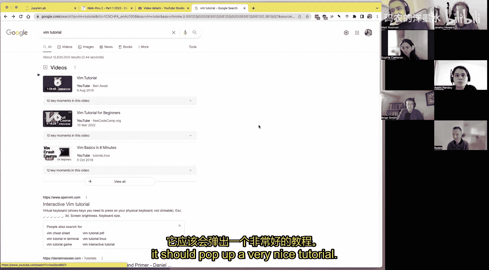

Okay， yeah， so here is what happens if you type Vim tudtor and it will teach you exiting vim。😊。

So lesson one， moving the cursor， lesson two exiting Vm so that's。

That's a goodz make sure caps locks not to press to press J enough time so that lesson 0。1。

1 fills the screen J J J JJ。Okay， so because。The vim tudor is in vim。It forces you to use themm。

Which is good and the nice thing about this is you know。

 move the cursor to the line below marked blah， blah， blah， here it is。😊，Fix the errorss。

 move the cursor， okay， so here's a useful for one to know x to cross out something so x。There we go。

Thanks for that reminder and the first thing you do you go through the it will feel overwhelming。

Add did to me only after， you know， on like。Third fourth try does it start to make sense and I able to complete the entire thing。

 but also when I was learning the basics of them I realized that it has a steep learning curve and I like to make things。

Appeaing attractive and simple for me so I think Dimetry also mentioned this in the chat here a second ago。

 there is a game called VM Adventures which is in your browser and it's another way that you can get exposed to them。

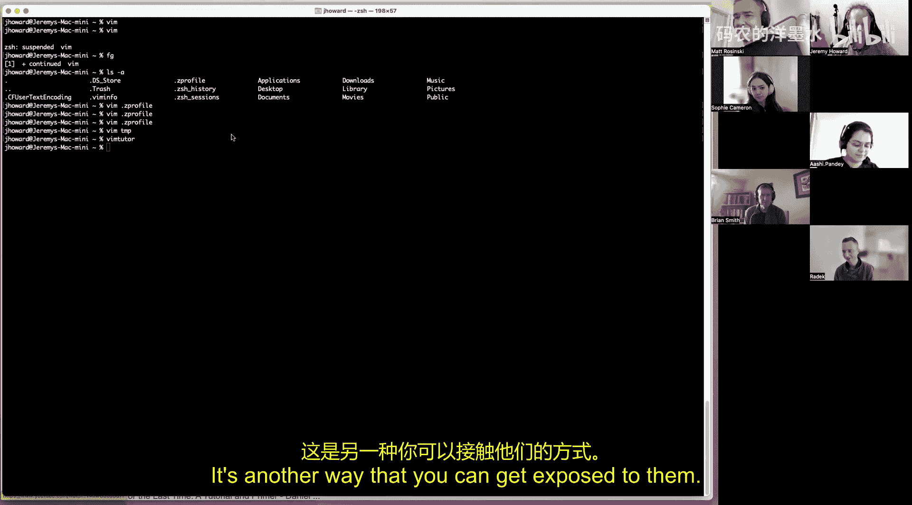

That's how I learned it so I would run into a call when I had my corporate job and instead of you know whatever people do on calls which is。

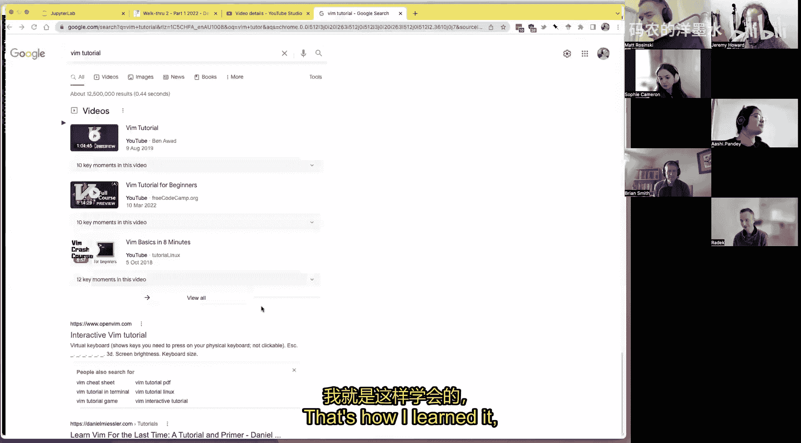

Just， I don't know， browse reddit。I would do this。And so time okay。

 now I just tried pressing the arrow keys and vim to see what the vim adventures and it says don't use the arrow keys use HjK now I don't agree with that by the way I you know some like a lot of people are overly。

😊，Purists about like。

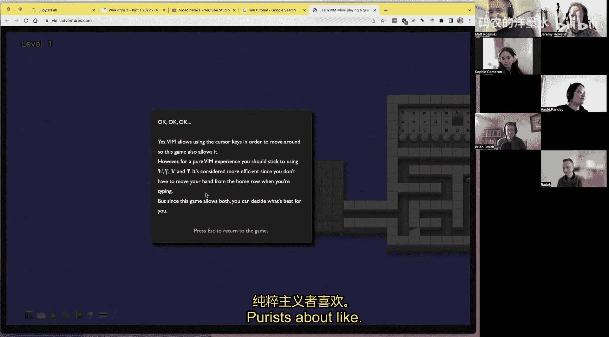

You have to do things the vimway so okay yes you can use hjK and all but seriously it doesn't matter anyway by the way I see there' if actually just notice there's a few things in the zoom chat。

If you can。Please say it out loud there's a couple of reasons why the first is I really enjoy social interaction otherwise i'm kind of。

Sitting in my little office you know and then the second is of course for the video people can hear the questions now though sometimes people just can't really talk because they're in some environment they can't do it in that case if you see somebody asking something in the chat could you say oh Mike M asked what key are you pressing to undo Jeremy rather than just answering it in the chat and that way I could like？

😊，Say that anyway， it looks like， so yes， somebody said how you how did you do undo。

 so the answer is you to undo。Can I suggest one last resource that is quite amazing for them？

It's the Vin book editing at the speed of light。Eiting， I don't know that one speed。

Speed of thought yes， yes， yes。Patctor Covin is absolutely。You know， really what written。

And there's a similar book for TmX。So that' that's how。Now let me tell you something not to do。

 which is don't install lots of plugins。There's lots of plugins you can install and you know。

 after using Vim through well over 20 years。I don't use any plugins at all。

It's not to say that there are none under any use。But like。They're not。That useful honestly。

 and you can get lost in that whole lake。Customizing things thing。

 And I just wanted to make it clear to say， like actually out of the box I works extremely well。 Now。

 having said that。😊，I customize it。Using a VMRC so an Rrc file in in Linux and stuff is like。

You know the normal kind of suffix for configuration files and I do do some customization of it and I actually put。

All my configuration files。In a GitHub repository。Got dot files。And you'll see here there's a VMC。

And but it's only。99 lines。And there's things like for example remember I mentioned that you can jump to the next you can jump around Windows by pressing control W CW here means control W I made it so you can also press backslash W and back backslash up and backslash down sort of control W because it's like one key rather than two so I could just really minor things like that and also some little things like oh I guess I do have some things installed I don't use them anymore。

嗯。Also， some things like Python's syn text highlighting。嗯。Okay。

And also to be able to see things clearly when you've got a black background with light text。

 you have to say set background equals dark， so I don't know， little things like that。

And it comes with some nice defaults， you can just actually do this source command to get some nice defaults。

是。Click question please， is this one public or private？Everything of mines public， fantastic。

 thank you pretty much， I think。Yeah I have a I have a question what are your thoughts about Vi studio code to edit those edit files theyre great I just talked about it yeah I said it's really good。

Yep， I like Vi Studio code。系。你系で边。Hi do you suggest using Vm key bindings for Jupyter and V code as well I don't because I find it's not about the key bindings it's about the the numbers and the motions and the dot and the macros and like that stuff and I don't find that there are other editors that that Vm as well as Vm do so when I use VS code I rather。

You know， like fully inhabit the VS code world and so I use the normal VS code key bindings and try to learn to use VS code as well as I can。

嗯。So yeah， I don't do that。I' sometimes I've tried。And I'm always disappointed， you know。

 it's always like， yeah， it's not really so VS code's great at。That being VS code and you know。

 I would use that for。U。I don't know。Eiting a big markdown file maybe gosh， I't I don't give it much。

But。Like。I guess so far as like working with HTML or CSS or something。

 I feel like the way it kind of handles those kind of file formats is really nice。

You can set up them to being really nice as well， but here code works a bit better。

 more out of the box， I suppose。Yeah， and also for like navigating through a large repository VS code。

Can be a bit easier to use， maybe。😔，to ask whether you could use a very large project with multiple files and whether it was doable。

Viavinine， Yeah， it's definitely doable via Vm。Yeah I mean we can take a look if you're interested so so yeah let's take a look actually it is useful to know how to do this so let's take for example。

 the fast AI repo。嗯。Okay， so let's clone it。And so let's do it all in paper space。Now in paper space。

The slash notebooks directory is persistent across machines right so it probably makes sense to clone this into the slash notebooks。

Diirectory。So if I open up my terminal。So it's persistent within a machine and it's persistent across restart so if I get clone here。

It'll still be on this machine next time I open it。Because that's what slash notebooks is。

 It's persistent across restarts on one machine。Requestion Germany Yeah actually just before you do I'm just going to cancel this and mention some a little shortcut if that's okay did you see that as taking a really long time to clone the reason why is it's cloning every single version of fast A that's ever existed and since I don't need every single version if you type。

Minus minus depth 1。It'll just give you the most recent version that'll save some time so yeah so go ahead。

One of the other scripts you had you were bringing in slash notebooks from from storage not like storage somewhere is that yeah that was yeah I didn't really understand how notebooks slash notebooks persistence worked at that point I hadn't spent enough time reading the docs yeah so let's pretend that never happened Okay so now that I've cloned this into s notebooks you can I see it's appeared right because this is where Jupiter is running from。

Now。So fast AI is what's called an NB dev project， which means it's all developed in notebooks。

 so these are the notebooks which create fast AI and then。Those all get exported as。

Python modules into here。嗯。It's not a very interesting one。And as you can see， it says， oh。

 don't edit B edit。😊，The notebook that's fine okay now。If you want to explore through a。You know。

 a code base， it's really helpful to be able to like。😊，Click on symbols。

 whatever and jump to their definitions and then jump back again to kind of see how it all works。

And so you can actually do that on GitHub。By the way， I don't know if you've noticed this。

 but it's quite neat。So for example。嗯。To attachach if I click on it。Now it's interesting。

 it doesn't know how to find that one， it's not perfect。That one's actually from Ptorrch。

 that must to be something it knows how to find。へ。All about this one。That better model may be。

Whats tabular model。Okay， well， this is。Very strange。In theory。😊，It would。Have， finally。

 it found one。Okay so okay once so one problem with doing it in GithHub is it's not particularly good at it。

 but yeah so Vim Vim can also do that as can VS code and VS code and Vm both rely on something called CTts to do that CTts is a project to create an index of the of the symbols that are in your。

😊，In your program。嗯。😊，So。So we want to install that。I actually haven't bothered Googling it for。😊。

Like 20 years。 So I didn't realize that the thing I am used to using has been updated to this new thing。

So that's interesting。I guess I should try using it so you bun to install。Universal ct。Oh God， snap。

 I don't like S。嗯。Well guess I can， if I have to。Actually。

 I tell what I normally do for installing things is I like to find out if there's a condor installer。

😊，Because that makes life very easy。And there is， there's a universal ct， okay。

 that's handy universal ct。So membermba， install universal seat tags。😔。

And this is one of the really cool things about Conr and Mamber is that I can install， well。

 we don't have Mamber installed， that's fine。you can set that up。😔，嗯。

Connda install minus defaults minus C Honda forge andda。😔，And so in some future lesson。

 we'll talk about how to get these condone mamba installed things。Working in。

Persistently in paper space。嗯。不。There's probably some way to do it in snap as well I've never bothered checking I don't know if anybody knows you've done to snap install home directory。

This thing that Jeremy is going to show us this will give us superpowers you know this is one of my favorite features of them and of just jumping into them whenever I'm brging through any code on the next in a teammark Spain and this will。

The way that professional developers interact with code and it's not even all the professional developers so like you know but the ones who like a limited field very few people can navigate around code that quickly and I think that that really makes an enormous difference so whenever Jeremy covers this I become excited and you know。

That's great， we you lucky getting excited， Raick。😊，Okay， so。

As member so we can never remember install。😔，Oh， I just press up every a couple of times universal sea tags。

😔，Oh and we don't okay， so we're not using mamberforge here。

 which should probably I might ask paperspace if they can switch to using mamberforge so we don't have to worry about this in the future。

 but for now we'll have to put it's from the Conva Forge channel。

Because the one that they've got installed does not use condo of forge by default。

I Matt also talk to them about making it so that Python 3。9 is the default since it's still using 3。

7。As we saw last time。All right， so。If we C D into the fast A directory。

There's a bunch of Python code we want to look through。So if you type C tags。

 that's the program that creates the index that we want and to run it recursively on the current folder。

Most things in Linux and stuff for capital are for recursive and then dot means the current folder。嗯。

So that's indexed the current folder and it's created。嗯。I expected it to create a file called CTags。

 so I wonder if it's changed how this works。😔，So it's created to file called tag so see it's created this file here called tags and if you look at it you're basically it's just a whole list of like symbols that are found in my code and redex is to find where they are and what file it came from you don't ever have to look at that the key thing to know is now we can jump straight to a tag so for example。

 if we want to open up the。Aray mask。Whatever file defines a ray mask and put it in the right place。

 second type Vm minus t for Vm jump to a tag and type a ray mask。

 and that will jump straight to the definition。Okay， so that's one way to do it。😊。

Another way to do it would be， let's say we were looking at something else like layers。

 pay is you can type。Tag jump。And then type AR tab， and then it'll list all the things that match。

 and then I can hit enter。And that will jump to that tag。Um。Another thing that you can do is you can。

Notice， for example， this is inheriting from array image base to jump to the definition of array image base。

 it control right right square bracket。And so when I hit that。

 it jumps to that definition and then go to go back to the previous tag， it's control T for tag。Okay。

 so they're the key ways to jump around Okay， so for example。

 if we wanted to find out some tabular class I could go tab tag jump and I'll start typing tabular and hit tabab and here's my various tabular classes。

Go to Tula Coabab。Okay so Catpillar coab is defined in two places now that's annoying one is it's in anip checkpoints which is the the backups so this is where you would actually create a C tags。

Config file telling it to ignore anything inside iPad N B checkpoints because you never want to go to the backup version anyway。

 So for now， it's confused about which 1 I once or hit to。To go to the nun。Confusing one。

 and there you go。U。不是。Any other tricks you know with tags， Radick？Yeah。

 yeah just just wanted to mention one and this is what I did only once or twice because I'm always too lazy to set it up。

 but there is some way like with。The fast AI code here。

 so you know that it's using Pytorch a lot and sometimes you will be editing a fast AI file。

 but you would like to jump to the definition of some functionality in the Pytor is code base so。

This is very helpful especially for you know， if you're just starting with Pytorch starting out。

 it's so much nicer than using their documentation on their website。

 which is slow and you know you have to still search for it， but yeah。

Yeah so you know maybe in the future we can try setting that up as well so yeah you can set it up so that these tag jumps can jump into the paytorch source code as well as the fast Aos source code I'll just show you one more trick which is if I wanted to look up to find out how data loaders worked but I want to be able to see coab data loaders at the same time then hitting right square bracket isn't quite ideal because i've now lost what I was looking at so instead if you type。

If you type S tag， that means split tag and I can start typing data loaders。

Then that will split the window and jump to the tag so I can now see。The two things that I'm doing。

Which I find handy anyway there's a lot more stuff you can do with this。

 but hopefully you've got a sense of like。Yeah， this seems worth investing time in because。

Here are some things that I didn't know how to do before and might be helpful。

Just on the split again， Jeremy， my tab closed down when I pressed Command W to move around。

 how would you do that within the Chrome browser again？So。Between windows on the Mac。

 it's fine because control and command are different so you can just control W does work。right。

On Mac on the Mac， on Windows。If you use my dot files。

 maybe we can in some future one we'll learn about my dot files， but in my dot files I set up。

And so if you make this your VRC， then basically you can hit back slash up and back slash down to go up and down a split。

Because I think this CW this means control W will be sent to VM rather than the browser。

 so I think that should work fine。嗯。Great。All right。Nice to see you all again。Have fun with them。

Tell us if you find any call。Tricks。On the farm。And'll see you next time。

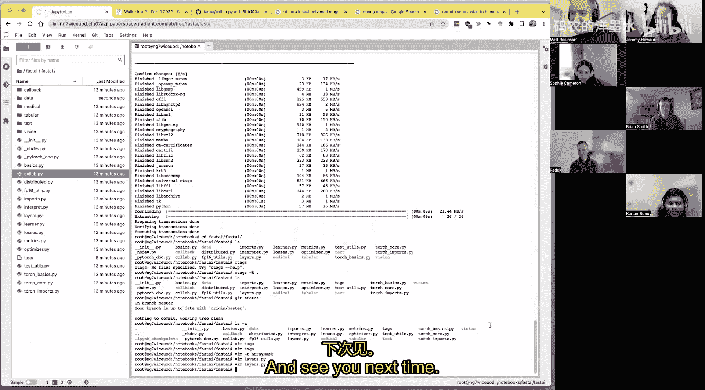

Co， thanks Jeremy， thank you thanks， Jeremy， bye everyone。

