# 实时编码：05：Vim编辑器实战 🚀

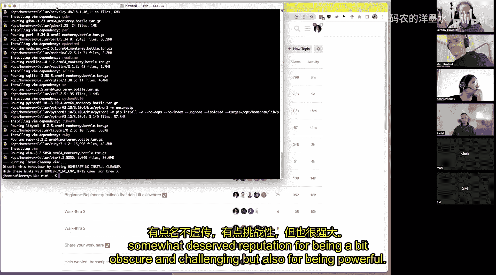

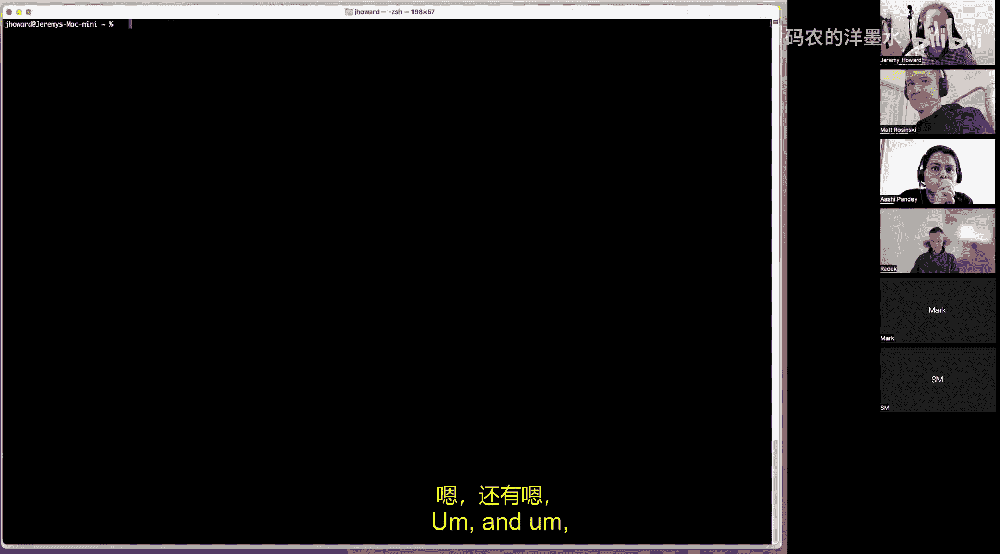

在本节课中，我们将学习如何使用Vim编辑器。Vim是一个功能强大的文本编辑器，以其高效性和可定制性而闻名。虽然它最初可能看起来有些复杂，但掌握其基本操作将极大地提升你的工作效率。我们将从安装Vim开始，逐步学习其核心概念和实用技巧，包括如何移动、编辑、保存文件，以及如何利用其强大的组合命令和代码导航功能。

---

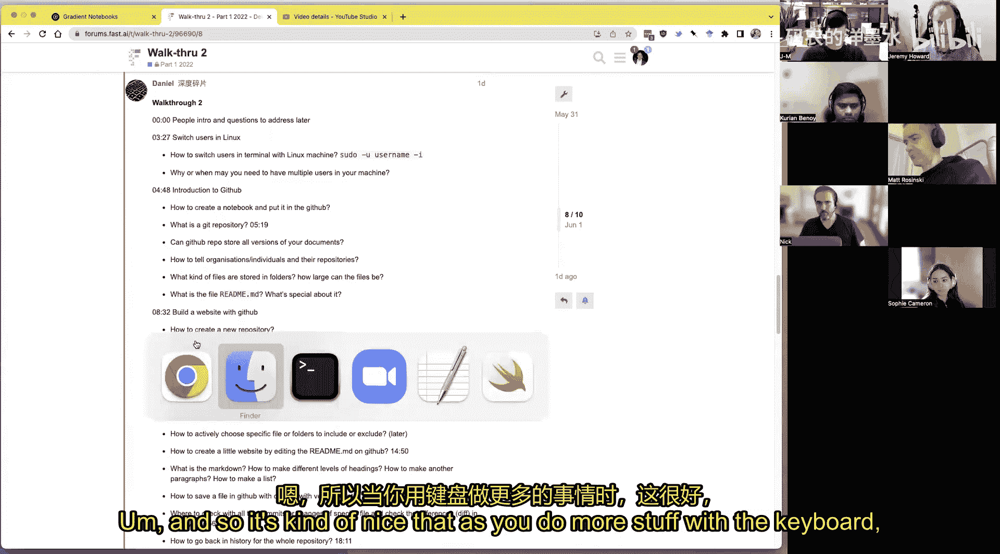

## Vim的安装与启动

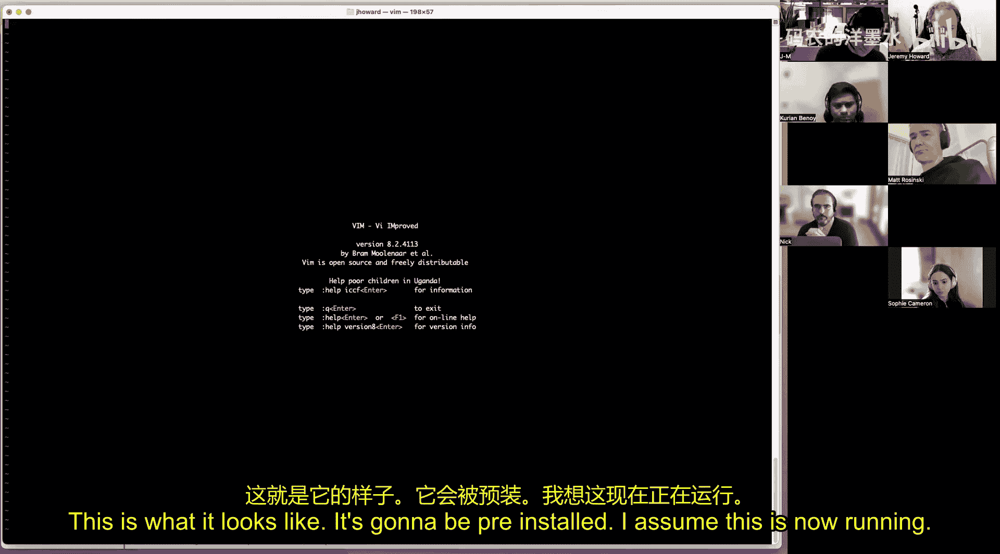

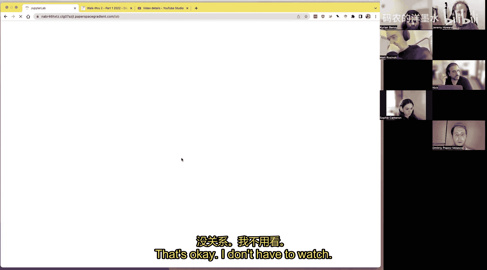

首先，我们需要在系统中安装Vim。安装方法因操作系统而异。

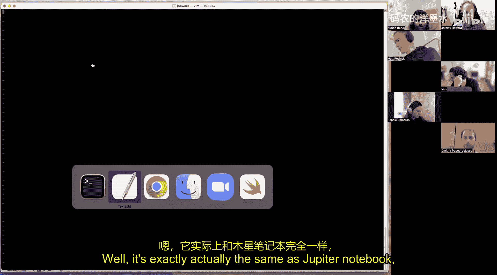

*   在Linux系统上，可以使用包管理器安装，例如：`sudo apt install vim`。
*   在macOS系统上，可以通过Homebrew安装：`brew install vim`。
*   在Windows的WSL（Windows Subsystem for Linux）环境中，安装方法与Linux相同。

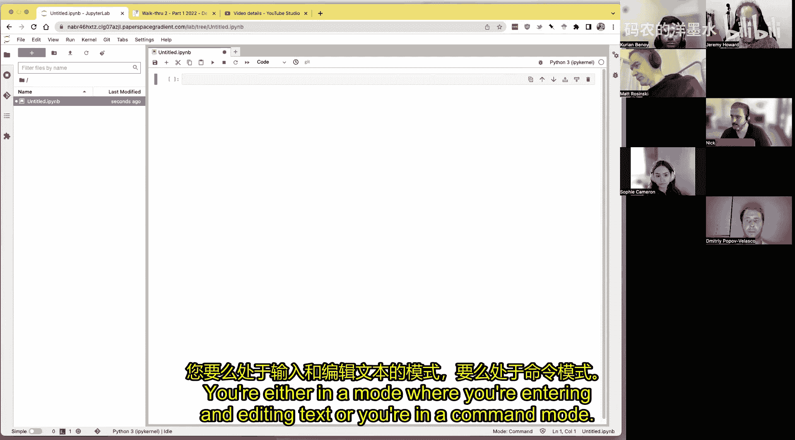

安装完成后，在终端中输入 `vim` 命令即可启动Vim编辑器。

---

## 理解Vim的模式

启动Vim后，你可能会发现直接打字，文本并不会出现在屏幕上。这是因为Vim是一个**模态**编辑器，这意味着它有不同的操作模式。

默认情况下，Vim处于**命令模式**。在此模式下，按键用于执行命令（如移动光标、删除文本），而不是输入字符。这与Jupyter Notebook类似，在Notebook中，你需要进入一个单元格的编辑模式才能输入代码。

要进入**插入模式**（即开始输入文本），请按 `i` 键（代表“insert”）。此时，屏幕底部会显示“-- INSERT --”字样，表示你现在可以正常打字了。要退出插入模式并返回命令模式，请按 `Esc` 键。

---

## 基本移动与编辑

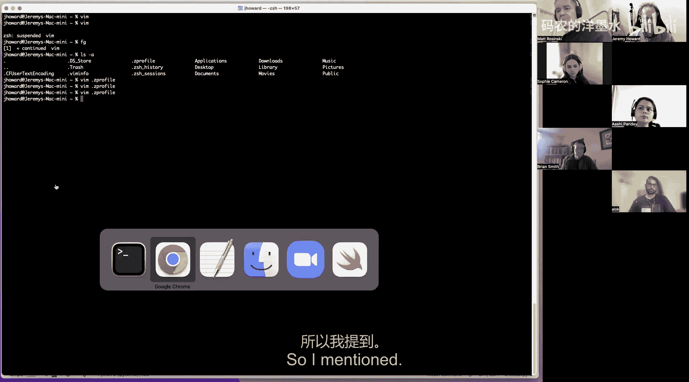

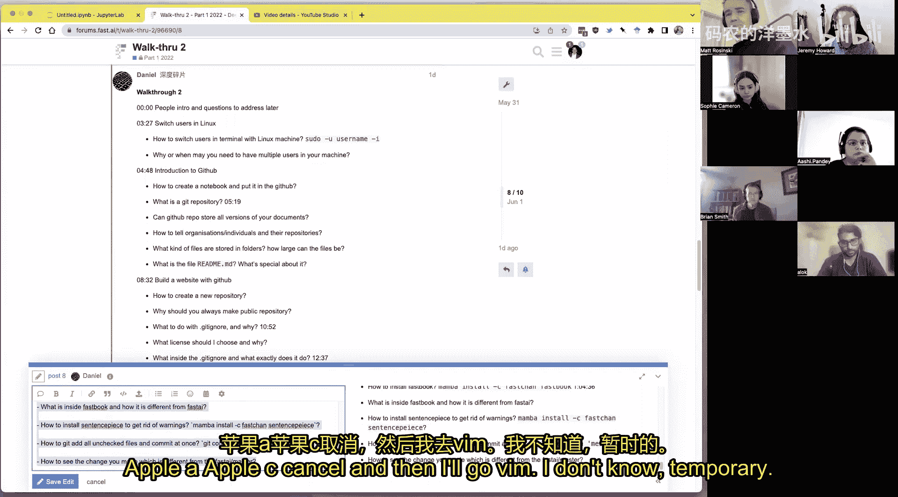

在命令模式下，你可以使用多种方式移动光标。

*   使用键盘的**方向键**是最直观的方式。
*   Vim也提供了基于字母的移动键：`h`（左）、`j`（下）、`k`（上）、`l`（右）。这些键位让你的手指无需离开主键盘区。

现在，让我们看看如何进行一些基本编辑操作。

*   **删除一行**：按两次 `d` 键，即 `dd`。
*   **删除一个单词**：按 `dw`（`d` 代表删除，`w` 代表移动到下一个单词开头）。
*   **撤销操作**：按 `u` 键。
*   **重做上一个操作**：按 `.`（句点）键。

---

## 保存与退出文件

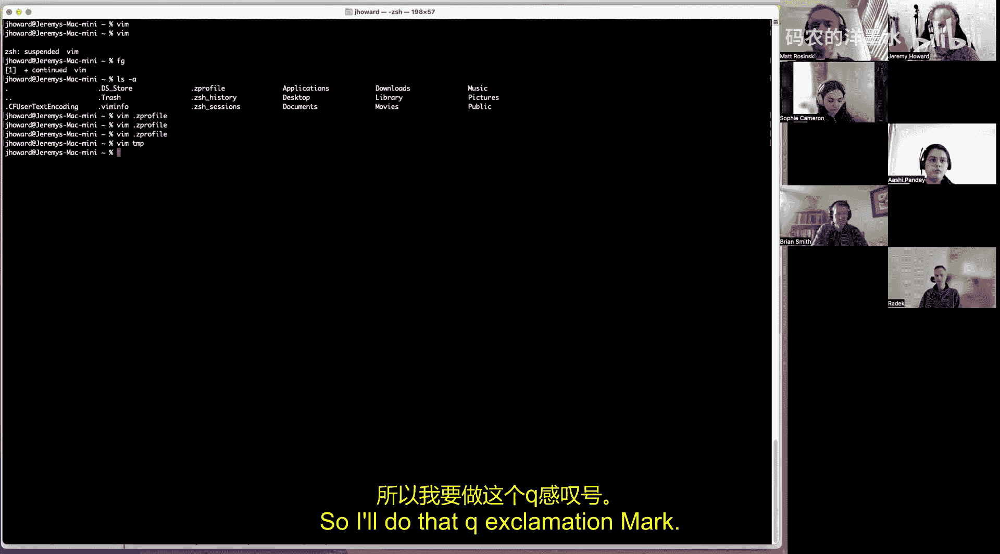

我们很少直接启动Vim而不指定文件。通常，我们会编辑一个特定的文件，例如：`vim .zshrc`。

编辑完成后，你需要保存更改并退出。这涉及到Vim的第三种模式：**Ex模式**。

按 `:`（冒号）键进入Ex模式，光标会移动到屏幕底部。在此你可以输入命令：

*   **保存文件**：输入 `w`（代表“write”），然后按回车。例如，`:w myfile.txt` 会将内容保存到 `myfile.txt`。
*   **退出Vim**：输入 `q`（代表“quit”），然后按回车。
*   **保存并退出**：可以将命令组合起来，输入 `:wq`，然后按回车。这是最常用的退出方式。
*   **不保存强制退出**：如果文件有未保存的更改，Vim会阻止你退出。此时可以输入 `:q!` 来强制退出。

---

## Vim的强大之处：组合命令

上一节我们介绍了基本的移动和编辑命令，本节中我们来看看Vim真正强大的功能：将命令、数字和动作组合起来。

在Vim中，许多命令可以接受一个**数字前缀**，表示重复该操作的次数。

*   例如，`5dd` 会删除5行。
*   `10p` 会粘贴10次。

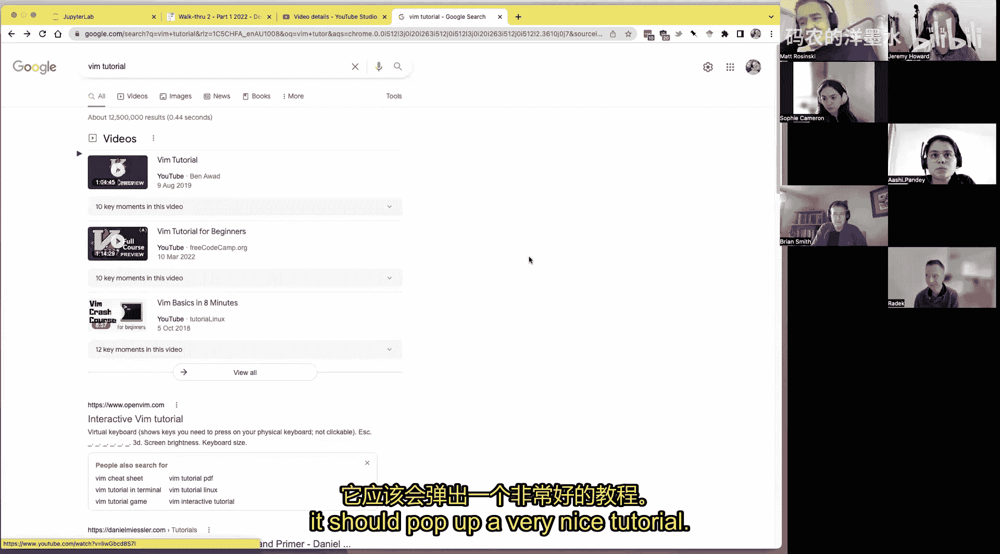

更重要的是，删除（`d`）、复制（`y`，称为“yank”）和更改（`c`，删除并进入插入模式）等命令后面可以跟一个**动作**，该命令会作用于从光标位置到动作结束的整个区域。

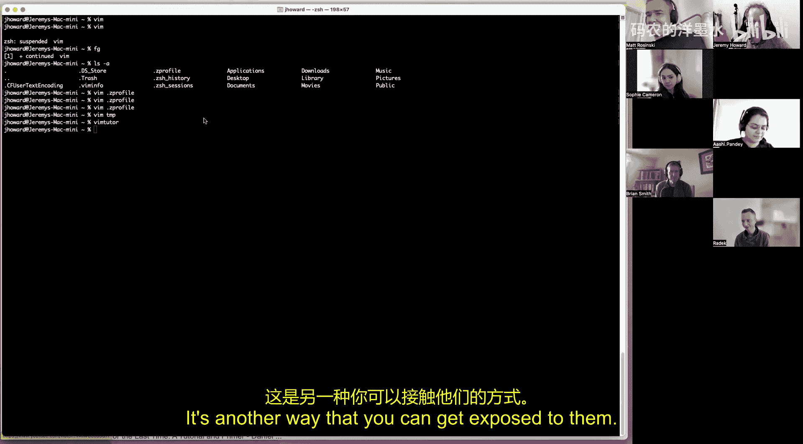

以下是几个核心组合示例：

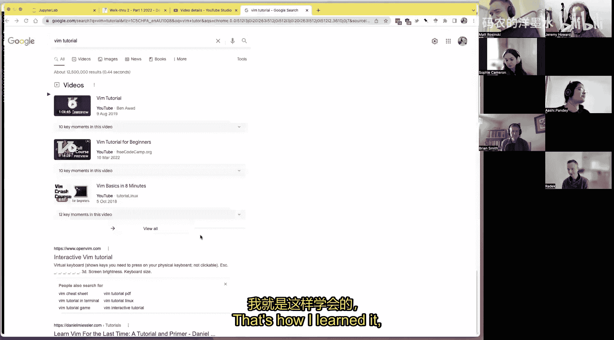

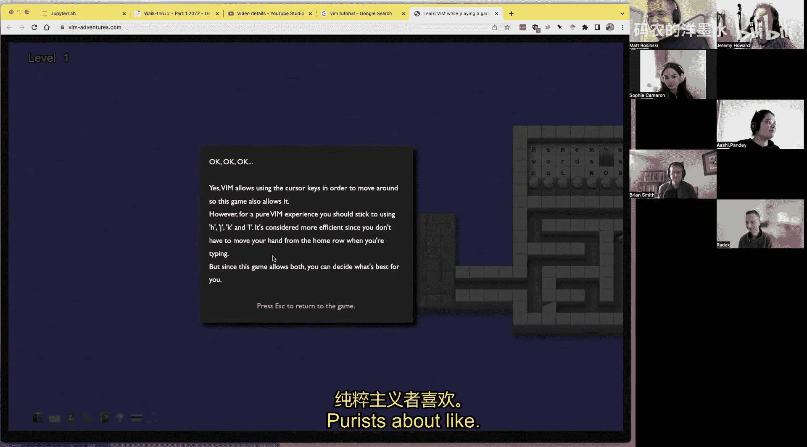

*   `d$`：删除从光标到行尾的内容（`$` 代表行尾）。
*   `dG`：删除从光标到文件末尾的内容（`G` 代表文件末尾）。
*   `y}`：复制从光标到下一个段落末尾的内容（`}` 代表下一个空行）。
*   `cw`：删除当前单词并进入插入模式以输入新单词（`w` 代表下一个单词）。

这种组合性让你可以用极少的击键完成复杂的文本操作。

---

## 搜索、替换与Ex命令

除了单行命令，Vim的Ex模式提供了强大的批量处理能力。

*   **搜索**：在命令模式下按 `/`，然后输入要搜索的内容（支持正则表达式），按回车。按 `n` 跳转到下一个匹配项，按 `N` 跳转到上一个。
    *   例如，`/^#` 会搜索以 `#` 开头的行（`^` 代表行首）。
*   **搜索并作为动作**：你可以将搜索用作动作。例如，`d/error` 会删除从光标到下一个“error”单词之间的所有内容。
*   **全局命令**：`:g` 命令可以在匹配特定模式的所有行上执行操作。
    *   例如，`:g/^#/d` 会删除所有以 `#` 开头的行。
    *   `:g/^$/d` 会删除所有空行。
*   **替换命令**：`:s` 用于搜索和替换。
    *   例如，`:%s/old/new/g` 会将整个文件（`%` 代表所有行）中的“old”替换为“new”（`g` 代表全局替换，即一行内所有匹配）。

---

## 多窗口与代码导航

对于更复杂的项目，Vim支持多窗口和强大的代码导航。

*   **分割窗口**：在Ex模式下，输入 `:sp filename` 可以水平分割窗口并打开另一个文件。输入 `:vsp filename` 可以垂直分割。
*   **在窗口间切换**：按 `Ctrl` + `w`，然后按方向键（或 `h`/`j`/`k`/`l`）在不同窗口间移动。
*   **使用Ctags进行代码导航**：这是一个高级功能，可以让你在代码库中快速跳转到函数或类的定义处。
    1.  首先，在项目根目录生成标签索引文件：`ctags -R .`。
    2.  在Vim中，将光标移动到一个符号（如函数名）上，按 `Ctrl` + `]` 跳转到其定义。
    3.  按 `Ctrl` + `t` 跳转回之前的位置。
    4.  你也可以用 `:tag function_name` 直接跳转到指定符号。

---

## 学习建议与资源

面对Vim众多的命令，初学者可能会感到不知所措。关键在于循序渐进。

1.  **从核心开始**：首先掌握如何进入插入模式（`i`）、返回命令模式（`Esc`）、保存退出（`:wq`）以及用方向键移动。这足以让你开始使用Vim编辑简单的脚本。
2.  **每日学习一两个新命令**：例如，今天学习 `w`（下一个单词）和 `b`（上一个单词），明天学习 `dd` 和 `p`。
3.  **使用教程和游戏**：
    *   在终端中运行 `vimtutor`，这是一个内置的交互式教程。
    *   尝试浏览器游戏 “Vim Adventures”，在游戏中学习键位。
4.  **实践出真知**：强迫自己在一些任务中使用Vim，即使最初比用其他编辑器慢。这种“投资”会随着时间累积，最终让你的编辑效率产生质的飞跃。
5.  **保持简单**：初期避免安装大量插件。Vim本身已非常强大，过多的定制反而会增加学习负担。你可以参考一些简洁的配置文件（如 `~/.vimrc`）来获得一些实用的默认设置。

---

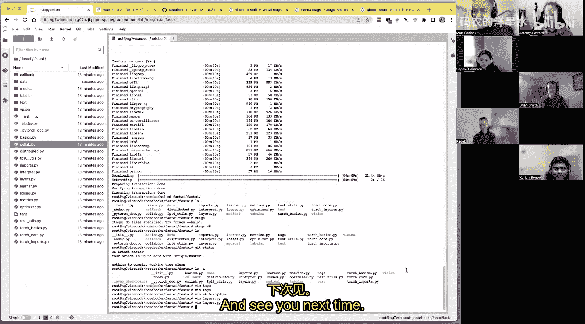

本节课中我们一起学习了Vim编辑器的核心使用方法。我们从安装和基本模式开始，逐步探索了移动、编辑、保存文件的操作，并深入了解了Vim强大的组合命令、搜索替换以及多窗口和代码导航功能。记住，学习Vim是一个旅程，不要试图一次性掌握所有内容。从今天开始，尝试在下一个文本编辑任务中使用它，哪怕只使用最基础的几个命令，你也会慢慢体会到其高效和优雅之处。