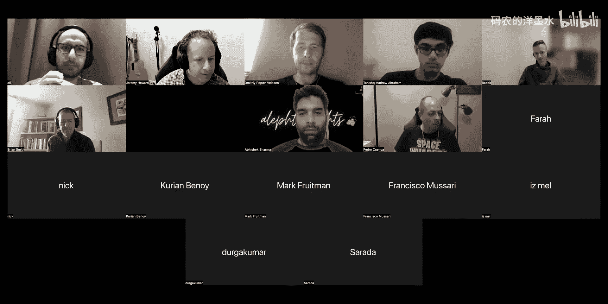
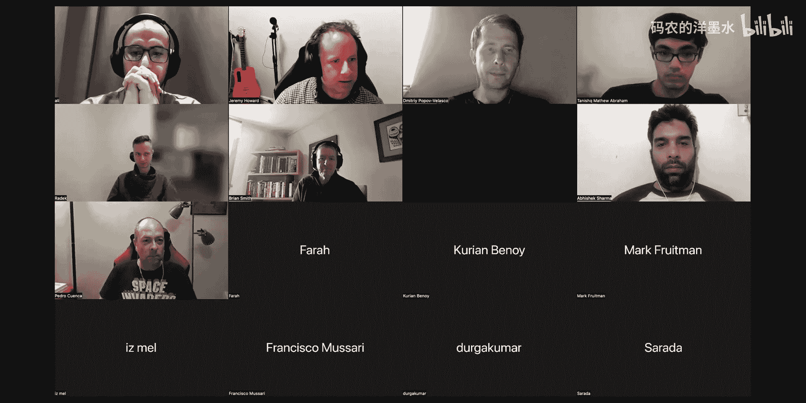
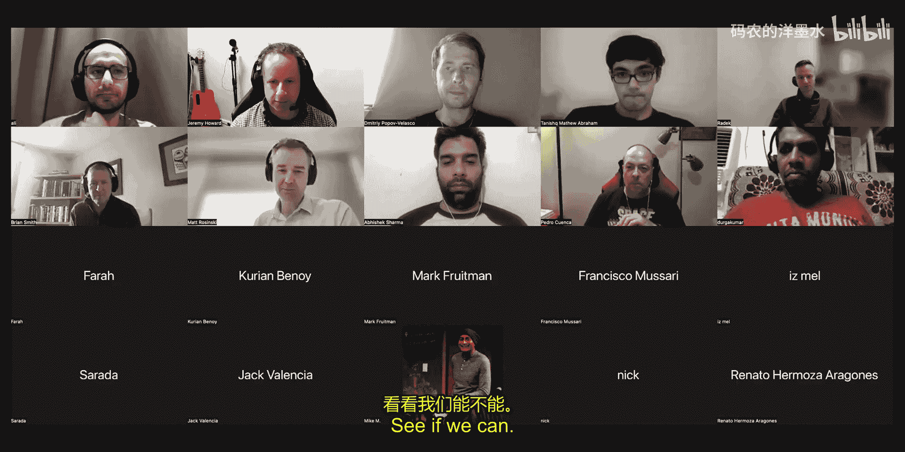
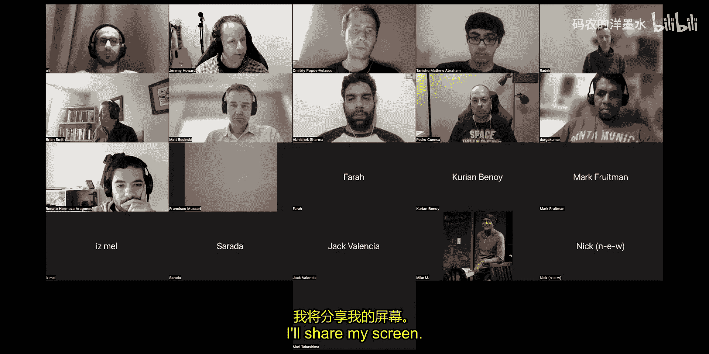
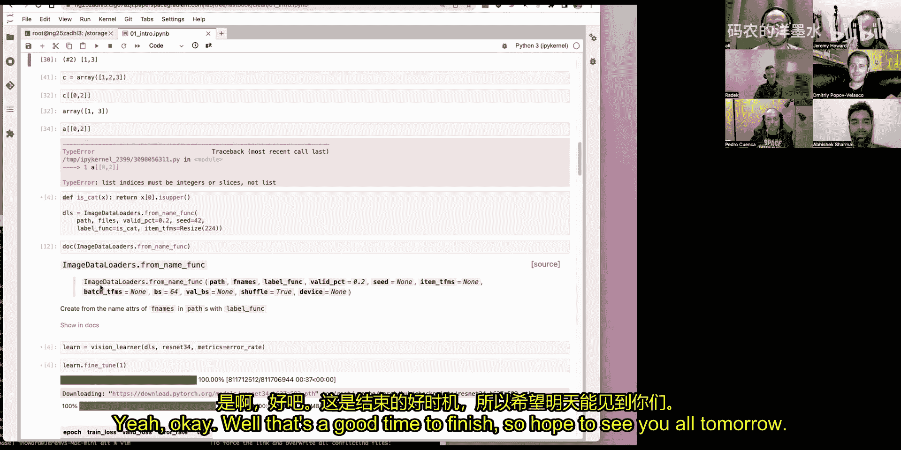
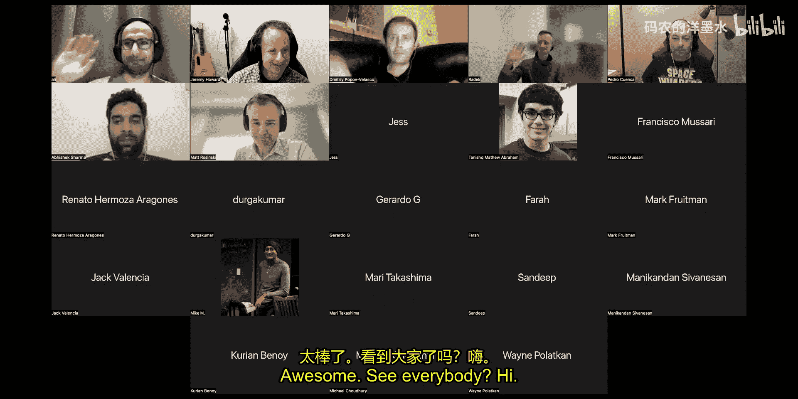

# 【全集】旧金山大学 实时编码 中英字幕 1080P p06 Lecture 6 - Paperspace高级优化 -BV1KZiTBWEeH_p6-

Okay。Did a。Anybody have any。Questions or anything。From last time。Or comments or anything else。

How's your vim going。I just had one， Jeremy， I wasn't really sure what happened when I。

So I did the VI and CT tags thing in paper space and as per the session and then when I shut down the machine or the instance and went back into the same machine。

 it didn't seem to work。I'm not sure why or if you want to go to that， but okay， that's have a look。

See if we can。

Yeah， what might have happened？What happened when you？T to use it。Sorry I muted myself。

 so what happened was。The member and I do reinstall member and。诶。

And what else was this in CTts again？嗯。And the sea tags。File had changed。

 but actually didn't have anything in it。Compared to how it was when it was originally created。

So I don't know what happened。But。呃。All right， and then when I tried to rein。

 or'll recreate the index and that didn't seem to work either。Well， I mean。

 one obvious thing we should probably try to get going is being able to。Say。The same。Yes。You know。

 binaries and stuff reintall having to reinstall CTts every time is certainly not ideal， is it so。

Let's try and figure out how to do that。B Sha I great。

Alright， can you see that okay。Thanks。Great。Yeah。All right。Let's start this one。

 this is the one we created the other day。So， the only things that。

Go to still be there next time we come back things that are in slash storage。

Or things that are in slash notebooks on the exact machine that we just started。嗯。And。To remind you。

 there are， you know， we can make this more flexible by taking advantage of the。

What's it called pre run dot S H and the dot S C dot local。

Scrips that we can put in slash storage and we can use those to。Copy。

 link or move stuff out of those persistent places into our home directory。If we want to。

So that's kind of how we've been。Organizing things。U。

And so when we do Pip installst with a local flag， it installs things into our home directory into a subtcord。

 local and so that we have moved into slash storage and then Slink it back again and now script back to home and so now anything that we install with Pipinstall minus minus user will be persistent across all of our sessions。

嗯。Yeah， can I ask a question about that。 So does that mean that if you give in the past suggested that you can wipe your mamba directory and use it to reinstall Well。

 the fact that you have the same link to local on the storage drive will that mean that those P installed files will be persistent even if you wipe your mamba drive Yes。

 although that thing about wiping was not for paper space because remember on paper space。

 the mamba stuff is installed into the root director into the slash up to whatever it's not in our home like usual So you can't really wipe condo on on paper space on paper space is always wipe clean because you start with a new server And so the only stuff left will be stuff in dot local But yeah。

 I mean I don't know why you would， but you could do the same thing on your own machine。

 you could pi install minus minus user and have a dot local directory that yeah would be。

Separate from。Your member environments and stuff。Okay， I guess it's I guess it's mut yeah。

 I hadn't thought it that way， okay， thanks that's fine。诶。So I'm just having a look。😔。

I think the way we， yeah， the way we want to install。Stuff like sea tags。

 which is not a Python thing。Is using。看的。And so we can install with Manmda as we've done before。 Now。

 by default， that's going to install it into the， you know， slash opt slash， etc cetera， which we。

Well， lose。嗯。But what we can do is。Member comes with a。A flag we can use。Which is minus P for prefix。

And if we use the minus P flag， it will install stuff into a different directory。U。

And so we should be able to use that to install stuff in a way that we can。That we can reuse it。And。

I think this is going to be a good exercise in understanding。Ps and aliases and as with simlinks。

 I should say， and all that kind of thing。 So I think， yeah， I think this will be a exercise。

Worth doing。So。So I'm just loading up。J you put a lab。Here we are。 And so this is the same。

Server notebook server that I used last time and since s notebooks is persistent。

 that fast AI folder that I that is signal that I get cloned is still there。All right。

 so if we get a terminal up。And we could probably take a better advantage of our space。Sir。对。

All right， and then。Apple B or Control PB shows and hardset Sbar， which is quite useful。嗯。

So what we could do is we could create a so I just type C， right。

 which is moving me into my home directory。 And so we could create something to put other condoda stuff in here。

 we'll call it condoda。And I believe we could go member。And then say a prefix。

 So our prefix is going be our home directories condo directory that we just created。

Install universal。Dash sattx。So， okay， so alright， So we also don't have member installed。

 which is a good point。 So we'd like that to also be。Pmanently available。So， let's start by saying。

Conduins to a minus P。Conda minus P install membermba。Okay。

 that's probably going to be after the install command， as my guess。到。inus p and ups minus P。

Tilda slash condo。Okay。So while that's going on。Okay， and then。

Because they're not using mamber forge。 That means that the。

Condefor channel is not available by default， either。So if you use membermber forge。

 then it kind of assumes that you're always going to say that you're always saying minus C condoda forge。

 But since we're。And I think the plan is that paper space is going to hopefully switch to using membermber forage soon。

 but for now we'll have to say minus C condo forage。😊，All right。So while that's going on。😊。

Let's also get our fast book here。嗯。Which actually makes me think about something。 I just tried to。

Reuse a command that should have been in my history。And it wasn't there。And。

I think the reason it wasn't there。Is that we out here we go， let's say yes over here。Right。

 why is this installing Python even。Jos。Oh， okay， that's annoying。 So mamba。Yeah。Okay， it's say。

 okay， so let's trying to install it into the tilder slash condo directory。 And it's saying， oh。

 that directory doesn't even have Python in it。 So I want to install Python。

And everything into there。That's annoying。嗯。Let's say， no。Okay， I do have another plan at my sleeve。

Which is。There is a version of Manmba that is fully self contained。

 everything statically compiled into it。Called micromem， which。 So we're just experimenting bit here。

 Once we get this working， we will。We will make this all easier。 So if instead of using memberber。

 we say。Slash storage so we could put this。Somewhere else in a moment。

 So let's see if that would work。😔，Okay， that's also not working。 this is quite tricky， isn't it。

So maybe we need to figure out what a minimum environment is because we don't want to use up lots of our storage directory。

With junk that we don't really need。诶。So what I'm going to do is I'm going to install all this junk。

 and then I'm going to see。What that actually installs。

And then we'll try to get rid of as much of that junk as possible。That's my plan。

I'm not sure if anyone is trying this out S your journey。

 but I tried with the condoda installed minus P TD for search Conda minus C Conda for manba。

 and I'm getting an error environment location not found， not the Koda environment。Yeah。Yeah。

 that's roughly what I was getting as well。Okay， no channel specified。

 I think I might be getting closer， though， on this。Cona forge。Okay。

 that seems to be doing something。So we might be on the way to finding a solution。😔，Okay。

 let's see what this condo directory wow， it's got a lot of stuff in it。So I wanna fight， I would。

 I don't wantna like。Have stuff that takes up storage base， and I don't need。

 So the first thing to find out is how much storage base does things take up。

 So D U stands for disk usage that shows you how much storage based things up。

 Min S just gives you a summary per directory。 And H is as usual， human eyes。 So like。

 show me megabytes and stuff like that。's what's easier to read。

 So this is gonna show me the size of every directory。And if I want it for the whole director tree。

Okay， so I've got 2，76 meg， which isn't terrible。But let's see B is 38 meg Lib is 203 Meg。

 So it's mainly in Lib， right， So what I could do then is go Lib slash to see which ones。Now。

 that's quite hard to read。 So when things are kind of hard to read like that。

 I want to find everything that's like over a megabyte or more， so。In on the terminal。

 one of the really nice things you can do is you can use the vertical bar or pipe。

And what pipe does is it takes the output of the previous command and it sends it to another command。

 And so the thing that you're most likely to pipe to is grab and grab searches and only prints things that match a pattern。

 I just want to find those things that are a megabyte or more So there's a capital M for megabyte。

 And then there's going to be a space after it。 So if just search for an M followed by a space。呃。

Nope， that did work。 Maybe that's not a space。 and it's actually a tab。Yes， okay。

So here's all the stuff that's。I prefer a megabyte。U。Inlib。And we could do the same thing for。

The directoryies inside condoda。Yeah。than they are。So of that 203 meg， it's mainly Python。

 which I'm sure we're not going to need。诶。Dip Python， we're not going to need。So we could。

RM minus IF。呃。Python。And。See what else have we got here。The python。诶。Yeah。So we've now got 161 meg。

 still quite a bit。Yes。Still mainly in Lib。😔，Yeah。So this giant thing here， lip ICU data。

 I don't know if we need that or not， so what we could do is just move it out of the way。嗯。S。

so dot 70。one。And maybe just move it out of the way。And then， let's see if。Bamber works。 Oh。

 we haven an installed letter。 So let's see if we can。Oh， so Mapa， okay。So we've installed。

See tags and membermba， but I can't run them。And oh， that's interesting。 I can run see tags。

Why is that。Oh， okay， so。It looks like。Paper space comes with an old copy of Cts。

 and this might be the issue。That。You were having with not being able to use it。嗯。so。

Normallymally dash dashash version should tell you the version of things。 There we go。

C tags from Emex。 Wellow， okay， so my guess is it's not going to work the same way as what we're used to。

 And that's probably why some people were having problems。

 So this is not finding the one we just installed。 and we're not finding membermba at all。

 And so to remind you， the reason for this is that the way that we that the computer finds things to run is it searches in our path。

And。The stuff that we installed。Is in the tilda slash condo slash bin directory， is Manda。

And here's our newer version of C tags。 So we could run things manually by typing bin slash C tags minus minus version。

Okay， so it doesn't need that， let's move that back in。IC you data so that needs to go into Libb。

Okay， and yeah， so here's a current version。5。9 compiled， w。Two days ago。

 so to make it so that we'll be able to see stuff that's in our condo directory。

 we need to ensure that it's in the path。So to make sure that things are in the path when we run a bash terminal。

 we have to put them into our vim。bashrc。local file。嗯。So that's going to be。Okay。

 so itt looks like I don't currently have one。So let's create one dobashrc。lo。All right。😊，So。

This is a file that needss to be run with bash。And what we're got to do is we're got to so export sets a variable。

And so the variable we need to set is path。And we want to set it equal to。

The condo of bin directorory。In our home directory。

 And then we want to also have the contents of the existing path variable。

 So you have to put dollar path to say the contents of a variable。Okay。

 so now if we create a new terminal， we can test whether that worked。

By printing the contents of Dollpath， an echo is how you print things。Okay。Lets see。

 so that did not work。 Let's try running it manually and see if it works。

So source is a way of running a。The script and storing all the variables in this shell。

 So if we say slash storage slash。baashc do local。There it is。 Rick kind of been。 Okay。

 so why was it not working。Oh， it's not bashc。local， it'sbash。local， that's why。So， we could。

Move so I don't have to type dot bac dot local。 I can just type exclamation mark dollar because that means the last token from the last line。

 which in this case is dotc dot local and move it to dot baash。 local。Let's try again。There it is。

 Okay， so now if I run C tags。I've got the right version and I should be able to right run memberba。

Okay， so membermba doesn't like being run。 So that's fine。

 What I we can do is we can instead use this micro memberm thing instead。 So let's move。

Micrommber into condo bin。And so you can get micro memberber。Micro remember。You can download it。

I'm here。All right， so。Let's see how we're doing。Now let's get rid of membermba。

And let's see how much space we're now taking up。That's not bad， right，175 mix。 So we've now got a。

You know， place that we can。Install software， like。C tags into， and it will work。

 So to make sure that thatll work next time， we now need to move that into our slash storage。

And then of course， we'll need to simlink it back again。So， let's edit our。Prerun but S file。Okay。

 we definitely don't have to remove anything it won't be there。

 So we just simlink slash storage slash。Honda。Back to the home directory。Okay。

So there's one other thing I'd like， which is my dot bash history file。

 It's really nice to come in each time and have the same。😊，Bash history file Auto a machine。

In my opinion。So let's move that also into slash storage。

Because that means that our control R and our appararrow and stuff like that。Are gonna always work。

So that goes into slash storage。And so let's do that as well。So how am I going to do this in VM。

 I want to copy two lines and paste them。 So to copy two lines。To copy a line is shift way。

 so to copy two lines， I press two shift way to copy two lines and then shift P to paste those two lines above。

Okay， and then I can press shift W to move a word forwards。And。

Shift C to change the rest of the line。 So that deletes。 And then it puts it in insert mode。

 and I can type。Bash， underscore history。His story。 Now， here's where it gets fun。

Is I want to do exactly the same thing for this line is to replace this the rest of this line with dot bash history。

 so to repeat my cous press dot。Isn't that fun， so。Alright， let's， and that's not a directory。

 So it doesn't need to be recursive。Okay， so let's。Try this out。

 shall we by spinning up a new machine。I guess I mean， what I mean is spin up an existing machine。

 but a new instance of it。So the reason we're spending quite a bit of time to kind of set up our paper space environment is like。

 because I think it's。Good。Like practical examples of using BM and using links and using scripts。

 you know， which hopefully you'll better to reuse these ideas lots of times。So let's start that one。

Okay， so I' just going to start up another machine。See if that all works。Okay， while we wait for it。

😊，So yeah， I have a feeling now once you've installed universal CT tags properly and it's in your path。

 it's just a case of checking the version so let's create a new shell because that one's。

And I hit uparrowarrow。Oh， this is still。About giving me the right version that's interesting。

Add up to the show to thepath。It kind of been， that's interesting。看a。In ct。嗯。Oh， okay。

 it's not similar back again because we didn't run that storage script because this is not a new machine。

 So for now I'm just going to run the storage script manually。Okay， and。Okay， Joe， not right。嗯。😊，Oh。

 then the thing that puts it in the path is meant to be the dot baash dot local right。

 which should have run。Just create a new shoulders to see if something weird happened。Okay。

 so alright， that's in root condo of bin。 So now if I type C tags minus minus version。

With control R to find it quickly。 Okay， it is working。So that's just a case of。Getting that。

 running it again。 Okay， so here's our new machine。Which is now finished starting。

So let's see if the same thing works on a brand new machine。

Ro its take a long time to start Open up Juputter lab the first time for some reason。On each machine。

Here comes。Okay， so fingers crossed。Yeah。Sa tags， minus minus version。There it is。 And in theory。

Yeah， we've also got our history。 So our history is actually saved between machines。

 which is quite nice， right。😊，I love it， so if I wanted to echo path again。

 I could control our capital PA and it'll find it from my history。

Even as they were on a totally separate machine。One thing weird is we're getting the path here is repeating itself。

 not quite sure why that's happening。😔，Doesn't really matter too much， to be honest， but un'just。

Curious about why slash opttcondacon bin is appearing。That thats not appearing twice。

That it's just true。Use a utter they unique Don't mind me。 Okay， I was imagining things。

So on this computer， I don't really want all this。😊，Stuff in my notebooks either。

 So let me R minus R F。Everything。That's a really dangerous command。Oh， haveel， here。 hi， Hamel。

 Yeah， I'm so sorry for being late。 I forgot。 I didn't even tell people you were coming。

 So they don't know you were late。 So you could have。😊，Stayed silent and not not known。

 So Hamel hopefully is going to be joining most to all of our sessions from now。

 So do you want to quickly introduce yourself Hamel。

Yeah yeah i'm Hamel I have you know worked on fast AI a lot。

 I especially like contributing to all the dev tools like NB dev and fastco and stuff like that and。

And like two other tools that help people automate what people do， so yeah。Ha's got background as a。

Machine learning， researcher and developer， and also。Quite a bit of stuff with ML ops。嗯。

And also training as a lawyer。 So you know， if anybody needs help with the law。He's a guy。

Please don't， that's supposed to tell people about that， Jeremy。All right。😊，Nice to see you。

 So we're just setting up our paper space environment Ham。

 and we've got to a point now where I just launched a new instance and everything is exactly how I want it straight away。

 which is really nice。 We've got a way to install persistently Python modules。

 we could install persistently binaries。 So I think that's a good place to start。😊。

Working through the book because we've got ourselves in environment。 So that is step one。

 Is there anything else that people felt like we're kind of missing from the environment that they would really want。

 or shall we start working on chapterpt 1 of the book。Thatunds like we're all happy。 Okay， great。

I'll stop this machine because that one's costing me money。So here we go in slash notebook。

 So the first thing we're going to need is we're going to need a copy of the book。So， fast book。

Is here。So we can copy the SSH。GitHub thing。And clone it into slash Notes。Actually， wait。

 we're trying to do this properly， right， So if we're going to do it properly。

What we should actually do is create our own fork of it so that we can。

Make changes and save it back again。 So actually， rather。

 so what I'm going to is I'm going to click fork。And that's going to create my own copy in JPHO0。

 Okay， so let's get rid of that copy in JPHOO。So we can actually do this all from scratch。Okay。

 so try following along with these steps。嗯。😊，Make sure it works for you。

 So I'm just gonna delete my copy of this。JPH O0 slash fast。So that we can start from scratch。

All right， looks like I need to go get my phone， excuse me。嗯。That's annoying。

Normally it lets me used GitHub on my phone。😔，唉。All right。

I'm just going to do this on my other computer。Rather than set the soil up。It show。Last book。

This device option seemed like it was promising to me。This device。Yeah， no。

 because like this is by near Mac that like， I don't even have because like normally on my Windows machine。

 I use Windows hello to do face recognition。嗯。And when I say do it on my phone。

 it's not doing it with the GiHub app on my phone， which is what normally happens。

 but instead it's not saying on my phone， I have to install a USB security key， so I don't know。

That's right， I just do over on my other computer。Delete this repository。😔，And I worry about that。

 another time。Okay， my other computer， I should be able to use my security key。

 Yes because it uses face recognition。Okay， great。I love Windows。 Hello。 It's very handy。 Okay。

 so now that's all done。 So I now great。 So now I can。Okay， so now I can create my fork。Rops。Book。

There we go。So this is going to create a basically a copy of the repository。嗯。

But it's a copy that is linked back to the Fast AIs version of the repository。

 so as if Fast AI makes changes then I can click F upstream and it'll copy those changes into our version。

 which is nice， but it'll also keep our changes as well as long as they don't conflict。So now。

 rather than cloning Fasto's version， we will clone our version。

And we can save those changes back as we need to。Go to go get clone。Our fog。

You can see here it's got our username and then the repo name。

And notice that I'm inside slash notebooks when I do that。Which means that now we can see it。

And here it is， so let's open chapter one in fact， let's open chapter  one and clean。Checking。

I remember previously with get clone you'd done depth of one to not clone the whole repo yes no I wondered about doing that this time。

 but。Because we want to probably save， like， commit things back to our bulk of the repo。

 I decided not to go with depth 1。This time。Because we're not just reading it。

 but we're actually changing it。嗯。I have a question， I have never done a fork and an a。

And I wonder if you can do a sample just little test if that's okay， yeah。

 let's make a change and copy it back so let's just all the way to the master。Yes， yes， yes。Okay。

 so let's see if this first cell runs， first of all。

You'll see at the very top there's a Pip and store fast book but it checks this is a bash line because it starts with exclamation mark and it's checking whether something called slash content exists that only exists on coLab so that'll only run on coLab。

So actually， it's importing the fast book， and then it's going to try to import it。Okay， great。

And we could try running something。Okay， great。 So now let's try pushing that back。To our repo。

 So if we're now Cd into fast walk。And we do our kit status。Get status。sorry。

It looks like you haven't saved that notebook yet。 Yeah， I thought I did， but apparently I didn't。Oh。

 because it's on a Mac and you have to press command us and I'm just not used using a Mac yet。Okay。

 so it tells us that we've made a change。So to remind you the kind of the shortcut for adding something to a commit。

And giving it a commit message is get minus a to add it and M to provide a message。

And then you need to say， what it was you want to do。 So I'm gonna commit。

And the message has to be in single quotes so it knows that's all one string。Test making a change。

Okay， so here's another thing that we're gonna want to add。嗯。To our。I don'ts so we can see better。

 Here's another thing we're going want to add to our persistent stuff is who am I。So。Let's。

Run the things it says to。Okay， and then what you'll find is。

But there's now a dot config file that's appeared here。That contains that information。

 So hopefully you won't be too surprised to hear that what I want to do is move that into slash storage。

And then， vim slash storage。P run。B simlink。You know。Co。First time around。

 we have to do that manually。Darage slash tu。Okay， and so I rerun the commit by typing control R to search backwards and type commit。

Yes enter。Oh， and I'm in the wrong place to get back to where I was as CD hyphen。There we go。 Okay。

 so that's committed to my local。Version of the Git repository。 So if I control our status。

You can see that I don't have anything left to commit。

 but it does say that your branch is ahead of master。

 so that means that I haven't pushed it back to the server。

 so a get push will push it back to the server。There we go。 So if I now go back to。GitHub。

You'll see that this branch is one commit ahead of Fast A Master， so I've made a commit。

That isn't part of fast A。So， you know， by the way。

 sometimes so like a lot of the time you create a fork and you make changes because you just want to make changes to your version sometimes you make a fork and make changes because you actually want to provide those changes back to the original。

Project， you know， you fixed a bug of theirs or added a feature of theirs。 And so if I wanted to。

Send my changes back to Fast A A because I think they're an improvement to the book。

Then I can say contribute， right？And then that'll say， oh， okay。

 you can create something called a pull request。 And so the pull request。

 it's going to show you the changes， which is I've executed some cells。 I hadn't executed before。

 and I've added a cell where the source was one plus one and the result was2。 and then I could。

Create a pull request and that would send something back up to。

Fast AI and I'll show you what that would look like。

 obviously never do this unless you assure you want to。Because that's just going to annoy the。

Developers。嗯。So then what happens is that would appear on my copy of fast book。

 it would appear in pull requests。And so here's an example， so when you send in a pull request。

 I'll then be able to see what files you've changed。usingsing this thing called review and B。

 I'll even be able to see the changes that were made。To the notebooks in a graphical view。

 so I'll show you what that looks like。So there we go。Psons out of these cells。

And they've provided a description and so then if I wanted to add this back to fastAI I click this button。

 so that's what people talk about when they talk about making a pull request。Anyway。

 that's not quite what we're doing， we're just keeping our own copy of it as we discussed。All right。

 so。Can we have a version of review andV in local machine。Yeah。

 absolutely review and is a is a startup they're very。

 very good you can absolutely so you can totally add it to your own repos just by going to review NB do co No I mean in my local machine。

No， but you can use something quite similar called NB dime。嗯。Which is actually。

 so it doesn't really make sense to like， have it on a local machine because like， you don't。

Poull request to yourself on your machine。 But what you do want us be able to see is to see differences。

And so for example， with mine because I've got NB dive installed if a well let's make a change。

 so let's delete this cell。Save it。And so's NB times already installed on paper space so I can click here and I can see。

 okay， I've made this change as I've deleted one cell。啊。Alright， so let's try running。Yeah。

 something's happening， okay？While， this is running。Let's talk about what's happening here。

 So the first thing we've got here is a from Blah import b。Statement。

So let's understand what's happening here。 And to do that， let's Cd into。The fast AI repo。 Okay。

 so here's the first AI repo。 And the fast AI repo contains a folder。嗯。Called fast Aye。

And that contains the fast AI。Library。And in the Fast AI library。

 there are some also as well as some dot Python files there some subfolds Now in this case。

 we were importing stuff from Fast AI dot vision。And that tells us that there must be a directory court vision。

 and there is indeed， here's a directory court vision。A a fast AI s vision。Right， and then in there。

 finally， we're importing from a module called all。

 And that means that there must be a directory called。All， sorry， I fold a file called all up pay。

 And here it is。 all up pay。 So what happens when we say from Bla import Bla is it goes through all the dot separated components。

 except for the last one and treat Ca as directories。 right And so basically。

 what it's doing is it's going to look for a file。Cold。Oops。Cold。Pas a I。Slash vision。Slash o。Dot。

 that's how it gets translated。It's all very mechanical， you know。

 there's nothing magical or weird about it。啊。And so then if we look at that file。Here it is， right。

 And what does this file do， Well， this file is just importing things。

And so it's importing something。From。Models， basics blah bh bh。 Now。

 when you're inside a library like this， you'll see sometimes it uses dot or dot dot prefixes。

 That's gonna be replaced with a file called dot dot slash basics dot pay。

 This will be replaced with a file called dot slash augment dot pay。

 So we should be able to find if I go control split control S P A U G tab。 Yep， there is indeed a。

Auggament， so I've got a split plane here。 Here's my augment file。

And so when it goes from dot augmentug import star， what does that do？

If there's a special variable called Dunder all this whether you've got underscore。

 underscore b underscore， underscore， we pronounce that Dunder b。 So this is d to all。

 If there's a special variable called done to all， that's a list of all of the。

Symbols that it wants to bring in， right。 And so here's a list of all the symbols it wants to bring in。

 So this file， this， this command here will bring in， for example。

 a symbol called RA transform into this file。Now， this file doesn't have something called done at all。

And so if you don't have a file cord under all， then every single thing that is imported or defined in this file。

Will end up being exported from it。So since this line here imports。Something called RA transform。

 And there's no done to all here。 That means importing all dot pi should also import RA transform。

 And so that means I should be able to type。Rand tea tab。

And there it is there is a RA transform and if I hit shift enter you can see where it's come from So it's come from fastaii。

vision。org。ran transform， which remember is translated to fast AI slash vision slash augment slash sorry okay this is actually the name of a method so this will become fast AI dot vision。

Fas ao svision/auugment。pay， and then we'll find the RA transform class or symbol inside there。

And so let's find it。 So if I click on ran transform。I'll show you a really nifty trick。

If you select something in Vim and hit the asterisk key shift8， it will search for the next。

Place that this word occurs。 So if I press star asterisk。Is the next copy of。Rand transfer。

And so here's the definition of it。So that's what it does when you say from blah import blah。

 if you say import star， then that will import everything that's exported。

 So everything in done to all or if there's no done to all， everything that's defined or imported。

So that's why we now have a thing called RA transform available to us。Yeah， if you ever want to know。

😊，Where something's from， a lot of people are used to not using a wild card imports and not using star。

 but instead listing。Specificallyally exactly all the symbols they。

 so if somebody does that you can scroll back to the top of the file and search through it and try to find it。

 but you don't have to， it's much easier and indeed with star necessary to simply type the name and press shift enter and you can find out where it's from。

Or to get more info about it， do the same thing with the question mark。And as you can see。

 it will give you the signature， the dock string and the fullpath name of where it's from。

 right And so this is one way if you want to go and look at the source code for this is I could copy that。

And type call S and paste it。And now I've got a third split。 and here's the。Is that file， okay？嗯。

But if I just want the source code for that one thing， I can just put two question marks。

And as you can see， this gives me the source code for that thing。Okay。

 so that's what the first line does， vast AO vision or imports are。What does the next line do？

So if I type Doccanar data in a fast AI library。It'll tell me。

Well this one didn't quite work correctly somehow。Thats。嗯。

It'll tell me all the information about it for some reason this one's not getting the usual documentation I would expect to see。

 but that's okay you can always click on source。2。Get a link to where it's defined。

So here it is on hot data。嗯。Or you can click on show in Docs。Yeah， this one works correctly。

That's interesting。 So for some reason， the help， the documents not working right， I'll fix that。嗯。

Yeah， so you can see here's the details here。 And you can see that there's。You know， it says here。

 for example， C URLs， you can click on these things to get more information about them。

So there's lots of similar links。As you can see within the documentation。So unt data。

Downloads an nexts URL。By default into subdirectories of tda/ FAo。

 so we now know that means your home directory。And it returns a path。Okay。

 so let's see if we can understand what this is doing。So what I generally like to do。😊。

To understand a cell is to run every single line separately。

 So the most important thing to know how to run every single line separately。Is to。

Kow that you can press control shift hyphen is control even on a Mac， not command。

 control shift hyphen to split into two cells at the cursor。

So step one is to separate this out into separate cells。Okay。And so then。You know。

 run each one and see what happens。 So after I run this one， I should be able to look at pathth。Okay。

 so it tells me here that。嗯。It's been stored in slash storage， slash data， s， et cetera。 Now。

 that's good news because we know that means it's persistent。So if I create a new instance。

 or whatever， I'm going to have this same thing now。Downside is， if you。Have a free or cheap account。

 You don't have much space。 and you might not want all that space being taken up。

 So let's find out how much space is being taken up。 So let's copy that。

 Head up over to our terminal。Get over there。And so remember， we can type to you minus S dot。7。

89 mix。 that's pretty big。 so you might not want that。To be there。Which is fine。

 So you can just move it somewhere else。 You know， put it in the home directory or something like that。

 So one interesting question is here is like。According to the documentation。

It was going to extract things by default to subdirectories of tilda/。fata。

 but that's not what happened。Why is that not how happened。Well。

 it says it's a wrapper around fast download dot debt。 So we should probably。

Look up that documentation to find out what's going on。So here's fast download。

Add here's fastdownload。cat。嗯。Okay， so this is pretty much what we saw why other than you know。

 this is using D dot get， it returns a path by default， it goes into base archive。Which by default。

 is， in this case， dot fast download for fast A to change it to fast AI。嗯。

You can change them by passing fast download。 Okay， oh， look at this。

 If there's a config file in the base directory， then they will be used to fast download。 Now。

 our base directory for Fast AI is dot fast AI。 So let's go and have a look in the dot fast AI directory。

C tilder slash。 fast AI。There we go。 There is indeed a convict on him。

So you can see that paper space has actually set things up for us so that by default。

 all of the archives。Models we create data we download is all going to be put in the persistent storage。

 So that's like。That's a good thing。Unless it's not what you want， right。😊。

I would say this is another of these things that we probably want to be able to adjust if we want to。

 so how about we move that。Into slash storage。嗯。😊，And then as per usual。Tim link it back。So。

When we start the machine， I don't know if there's a fasta I folder there or not。

 So what we can do is we can say。Makeda minus P basically creates a folder and all of its subfolds sorry all of its parent folders and doesn't complain if it's not already there。

 so I'll use makeD minus P to create a dot FA AI。And we will then。Remove。系。Dot fastste I。 Oh。

 now I'll share a little trick。嗯。I want to fill out the word fast AI without typing the whole thing if I hit control P。

It will fill in the rest of the word P for previous。

 it will fill in the rest of the last word that it can find， it starts with those letters。

So I want to remove fast eye slash config。Got any。And then we will link that back again。So。

It's going to be in slash storage， so I hit control P to fill out slash storage and it's going to be called confit on any。

 so I press control P and actually if you then hit control X control P， it keeps filling in。The rest。

诶。Alright， so now we're gonna have。Config any file。Oh。

 except I don't want to put it in the home directory。

 I want to put it in the dot class A I directory。And so we can test that。A copying it。Paste dirt。

There we go。 Okay， so we've now got a con persistent config on any。 I think in my case。

What I want to do。And this might not be bad for most people。

Is they probably don't want the archives to be stored。In my storage directory。

 because I'm not going to need them again once it's been unarchived。

And so let's Cd to slash storage slash archive。Yeah， I don't want this there。

 so let's just remove it。co。Okay， so。This is now going to put。By default。

 stuff that I download will be in my storage。 I'll be better to use it anywhere。 But， you know。

 I can always move it somewhere else if I want to。okay。The next two lines kind of go together。嗯。

Which is I'm going to use image data letters。 So again， you know， before you use something。

 it's good to understand what it is。So。诶。Show in。Alright， image data loadus。

Is a wrapper around several data letters with methods for computer vision problems。

And what you're going to be using is one of the factory methods， so they're the things underneath。

And all these factory methods， except。Various things。

 so this tells me that there are various different ways of creating image data loaders and they've got a consistent API。

So， that's good。In our case。We've got。So if I hit shift tab， I can find out what the parameters are。

So I've got the path。I've got a list of file names。I've got a labeling let's see， oh。

 then I've got valid percent in seed。The valid percent and seats。 So what do those mean？嗯。

Are we using。A from name fuck valid per。Is passed to image data loaders dot from Pathmark。 Okay。

 so quite often， you know， we'll take a argument and just pass it to something else。

 So I have to click on here。To find out what that does， here we have validationation set。

 Validation set is a random subset of size validation per。Okay， no worries。

 it's optionally created with seed reproducibility。Um，Cool。And it's got a labeling function。So。

I wait。嗯。Name picture。A function that receives a string， which is a file name and outputs a label。

 Okay， so let's just have a look at some of these things。 So the list of file names。

 So remember the second argument。Whereas a list of file names is this， so let's pull this out。

And create some code files。So if for press A for append above， our'll type files equals。

Paste it here。Okay， and let's look at that。Okay， so files。There's a list of 7390 items。

And it contains various paths in it。嗯。I only remind myself you go path up base or base path。😔。

Show you what I'm doing to check。呃。Let's get rid of all this prefix。Copy。And paste。There we go。 Yeah。

 So if you create a special variable called path based path， then it will delete that。

From the start of everything it prints out， so it just shows you the relative to here。

 it's a bit easier to read。So theres7390 things with images slash b， images slash b。

 and it looks like it's going to be the name of the breed。And then an underscorer， and then some。

Concutive number。嗯。😊，Now， this looks a little bit different to what you might be used to seeing normally if you。

Look at something like unless list you expect it to look something more。Like this。

 right this is what lists look like in Python。 So to find out why that looks different。

 we can check out what the type of it is。By typing type。And it turns out it's not a list。

 it's something of type capital L。That's a special， a special kind of list， which has lots of。

Convenience functions in it。嗯。We could。Just use question mark to find out a bit more about it。

 So here's the definition of where it's coming from。 Here's a dock string from it。嗯。

Or we could type help。L。Ado help doc So help is it helps useful as well。 That's a built into Python。

 it shows you a list of all the stuff it can do， actually， maybe that's useful。So as you can see。

 it's got lots of functionality in addition to everything that a list does。Or we could type doc。

Show in docs。So you can see this stuff' not just for Fast AI libraries。

 it's for all libraries created by Fastster AI， look pretty similar。And so hiss。

Lots of information about ill。嗯。😊，Let's learn how to read this documentation。

 and then I think we'll stop。嗯。So L L is like a list。 Okay。

 so a list in Python is something that you create。Like this。Square brackets。And you can print them。

For example， or you can index into them。Or you can select multiple things from them。Everything up to。

 but not including element two。That's a list， okay。😊，And L is very similar。

But it doesn't have any special。Senttax like Python does， you have to create it like this。

But it basically looks。Much the same。As you can see。But。

It has quite a lot more functionality than a list， so I don't use I don't use a normal Python list that often because like why use something which is less useful。

So let's see， Okay， behave holds its like a list so you know what a list looks like。

 So a drop in replacement for a list。 So when somebody you describe as a drop in replacement anywhere that uses a list。

 you should be able to use this as well。So it's got a superet of the functionality。It's like Numpy。

 it supports advanced indexing。Okay， so what that means。Is that。

You should be able to select multiple things from a list at once。

I'm just trying to remember exactly how we do that。 I think you can go。Like this。Yes， okay。

 so I can select the zero thing and the second thing and one go。So that's an example。

 And as it mentioned， this is similar to what Npay can do， so。ISo Dey has a thing called an array。对。

And so in Ny， you can do the same kind of thing。But a regular list， remember， A is our regular list。

Can't do that。So you can kind of think of a capital L object as being a bit like a hybrid between a nu array and a Python list。

You could try to use a dumpy array for things that you would otherwise use a。An L4。

 But the problem is that a nuy array kind of expects everything to be of the same type。嗯。

So you have to be a bit careful。谁。Sometimes it might do it for us。 No。

 sometimes it can actually handle it for us。 It's gonna put them into some important object。 So。

 you know， yeah， I mean， actually， you know， I think about it。

 You probably could use an array array quite often， but they do behave differently。 Actually。

 I'll show an example。 So if we go。Bay plus。Hello。Then。That's what that does in an L。

 It adds hello to the list， So notice that Ls show you how many items are in it and it also by default doesn't show you all of them。

 but it puts dot dot dot， which is both very convenient things， a Python list。嗯。Oops， I。

I used control by mistake。Works the same way。A nuy array。Doesn't work the same way。

And that's because nuy is designed mainly for math， so if we make all of these into numbers。

Then a  nure array。We could do this。It adds element wise。Okay， so， you know。

 if you're kind of trying to。Go deep and fully understand。Each line of code。

 This is the kind of experimentation that you can do， right。

 And hopefully what you can see here is that。WellAll of the information you need to fully understand all of these things is available for you right in the documentation which you can link to directly using the dot command。

嗯。And by experimenting， but it is like initially， it's。得乐。To learn。 But the nice thing is that the。

The things you're learning are very reusable， right because all this stuff is used。

All over the place。Alright， so I'm gonna to wrap it up。 Does anybody have any。

Questions or comments has been。Itit less interactive than usual。

 So I apologize that's because I'm talking too much， but I definitely want to。

Ear your thoughts or questions。Nothing。😊，That's fine。 Thank you。 Is that because it's。

Too easy or too hard or totally obvious or。Whenant I go away and think about it。

For me it was very good Jeremy Okay great right now I think it was I think it was perfect for me Oh listen coaches okay。

I haven't seen somebody called Jess in Estreamam before， are you a new？

Person hereover does not notice you。A new old person who just saw it pop up in the forum it's like where how did I how did it not pop up for me sooner but you that's all can get caught up where are you joining Yeah。

I am in the Seattle area of USA。Fantastic， well， that's， that's great， I think。Yeah， okay， well。

 that's a good time to finish， so hope to see you all tomorrow。😊。

即系。Right， awesome， see everybody。

哎 thank you。