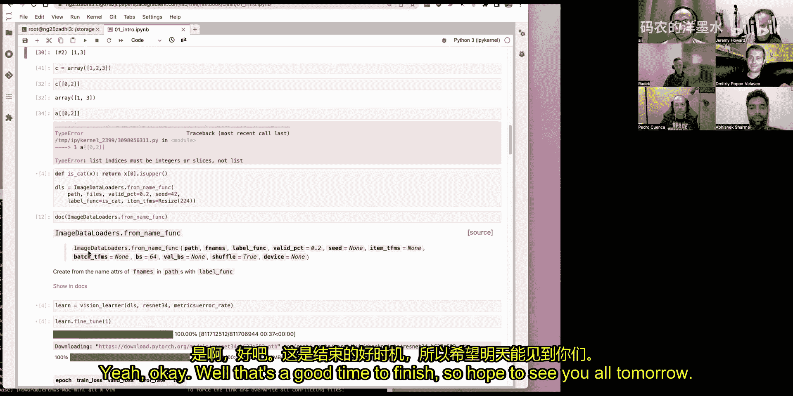

# 实时编码：第6讲：Paperspace高级优化 🚀


在本节课中，我们将学习如何在Paperspace环境中进行高级优化，包括持久化安装软件、配置环境变量、管理存储空间以及使用Git进行版本控制。我们将通过一系列实践步骤，确保我们的开发环境在每次启动新实例时都能保持一致和高效。

---

## 概述

上一节我们介绍了在Paperspace上使用Vim和Ctags的基本方法。本节中，我们将深入探讨如何配置一个持久化、可重复使用的开发环境。我们将学习如何安装和管理软件包，设置环境变量，以及使用Git来管理我们的代码库。

---

## 持久化安装软件

为了确保我们安装的软件在Paperspace实例重启后依然可用，我们需要将它们安装到持久化存储中。默认情况下，`/storage` 和 `/notebooks` 目录是持久化的。

我们可以利用 `prerun.sh` 和 `.bashrc.local` 脚本，将持久化存储中的内容链接或复制到我们的主目录。

例如，使用 `pip install --user` 会将包安装到主目录下的 `.local` 子目录中。我们可以将这个目录移动到 `/storage`，然后创建一个符号链接指回主目录，这样所有用户安装的Python包都会在会话间持久保存。

---

## 使用Mamba安装二进制文件

对于像Ctags这样的非Python二进制文件，我们可以使用Mamba进行安装。默认情况下，Mamba会安装到系统目录，这些内容在实例重启后会丢失。

我们可以使用 `-p` (prefix) 标志，将软件安装到我们指定的目录，例如主目录下的一个自定义目录。

以下是安装Mamba和Ctags到持久化目录的步骤：

1. 创建一个目录来存放Conda软件：
   ```bash
   mkdir ~/conda
   ```

2. 使用 `-p` 标志安装Mamba：
   ```bash
   conda install -p ~/conda mamba
   ```

3. 使用Mamba安装Ctags（指定conda-forge频道）：
   ```bash
   mamba install -c conda-forge universal-ctags
   ```

安装完成后，我们需要将安装目录的 `bin` 文件夹添加到系统的 `PATH` 环境变量中，以便在终端中直接运行这些命令。

---

## 配置环境变量

为了让系统能够找到我们自定义安装的软件，我们需要修改 `PATH` 环境变量。

我们可以通过编辑 `~/.bashrc.local` 文件来实现（如果文件不存在则创建它）：

```bash
export PATH="$HOME/conda/bin:$PATH"
```

然后，通过运行 `source ~/.bashrc.local` 使更改在当前shell生效，或者重新打开一个终端。

为了确保每次启动新实例时都能自动配置，我们可以将这个 `.bashrc.local` 文件也移动到 `/storage` 目录，并在 `prerun.sh` 脚本中创建指向它的符号链接。

---

## 管理存储空间

在免费或低配账户中，存储空间是有限的。我们需要定期检查和管理 `/storage` 目录的使用情况。

使用 `du` 命令可以查看目录的磁盘使用情况：
```bash
du -sh ~/conda
```

如果发现某些大型文件或目录不再需要，可以将其删除以释放空间。例如，如果Python库占用了大量空间，我们可以考虑移除不必要的包。

---

## 使用Git进行版本控制

为了有效地管理我们的代码，特别是像《Fastbook》这样的教程代码，我们应该创建自己的GitHub仓库分支（Fork）。这样我们可以自由地修改代码，并轻松地将更改同步回原始仓库或保存自己的版本。

以下是操作步骤：

1. 在GitHub上找到原始仓库（例如 `fastai/fastbook`），并点击“Fork”按钮创建你自己的副本。
2. 在Paperspace的终端中，克隆你自己的分支：
   ```bash
   git clone https://github.com/你的用户名/fastbook.git
   ```
3. 进入仓库目录，进行修改并提交：
   ```bash
   cd fastbook
   # 进行一些修改...
   git add -A
   git commit -m '描述你的更改'
   ```
4. 将更改推送到你的GitHub分支：
   ```bash
   git push
   ```

如果你想将改进贡献回原始项目，可以在GitHub上你的分支页面发起“Pull Request”。

---

## 理解代码导入机制

在Python中，`from fastai.vision.all import *` 这样的语句是如何工作的？

1. 它将 `fastai` 视为一个目录。
2. 在该目录下寻找 `vision` 子目录。
3. 在 `vision` 目录中寻找 `all.py` 文件。
4. 导入 `all.py` 文件中定义或导入的所有符号（如果该文件定义了 `__all__` 列表，则只导入列表中的符号；否则导入所有）。

要查看某个导入对象的来源，可以在Jupyter Notebook中在其后输入 `??`，例如 `DataBlock??`，这将显示其源代码。

---

## 实验与探索

理解代码的最佳方式之一是进行实验。例如，当你遇到一个不熟悉的函数或类时：

*   使用 `?` 查看其文档字符串：`ImageDataLoaders?`
*   使用 `??` 查看其源代码：`ImageDataLoaders??`
*   在独立的单元格中逐行运行代码，并检查中间变量的值和类型。
*   尝试修改参数，观察输出如何变化。

例如，`fastai` 库中的 `L` 对象是一个增强版的Python列表，它提供了类似NumPy数组的高级索引功能，并且打印输出更友好（会显示元素数量并用 `...` 省略中间内容）。

你可以通过创建普通的Python列表和 `L` 对象来比较它们的行为：
```python
# 普通列表
list_a = [1, 2, 3]
# L对象
from fastcore.foundation import L
list_l = L(1, 2, 3)
# 比较它们的打印输出和功能
print(list_a)
print(list_l)
```

---

## 总结




本节课中我们一起学习了如何在Paperspace上构建一个强大且持久的开发环境。我们涵盖了从使用Mamba持久化安装软件、配置环境变量、管理存储空间，到使用Git进行有效的版本控制。我们还深入探讨了Python的模块导入机制，并强调了通过实验和查阅文档来深入理解代码的重要性。掌握这些技能将为你后续的高效学习和开发打下坚实的基础。