# 【全集】旧金山大学 实时编码 中英字幕 1080P p07 Lecture 7 - Kaggle竞赛实战配置 -BV1KZiTBWEeH_p7-

Okay。So。Let's， yeah， let's。Look at how we。Can automate。

A process like the one that we packeded together yesterday。And actually， what we might do is。嗯。

Heaven look at something that Radick put on the forums。

Because I kind of want to have all the stuff we want to include there and then we can automate the whole thing。

Yeah， here's Reds thing。Okay， so Radick， do you want to tell us about what this thing is。

What your project or goal or what is yeah， what's this forum post about？

This is yet another of F's crazy inventions but essentially this is how I learned right so if I'm this is the fast way of learning at least I think of this as the FA I way of learning because I like for those who have read it yet。

 can you just take a what it is yeah absolutely so yesterday in the workthrough。

 we covered some material and I wanted to find an fun way to practice it so I went to Kail I looked for competitions and there was a competition that seemed like participating in it could allow me to practice what we learned about the workthrough so I created this as a resource for others you know I've been creating such things for a couple of years now and maybe it requires also a little bit of understanding of Kagil which somebody who has not played around with？

Yet they might not have it so I thought hey let me put this together share it with others so this is a getting started back with a community competition it features images of plants and you're supposed to detect one of nine or one of10 classes of plant diseases that they can be affected with。

 I haven't looked too much at the data essentially I relied on fastized functionality where if I present the image data loaders and then by laptop and if I present the learner with data that seems to be appropriately formatted。

 then the learner will do the rest so I try to through this as quickly as I could just put it together and to practice on my own。

As well while doing this and hopefully this can be useful to others。Great。😊，嗯。

Shall we try going it through together， There somebody's got a fast A I went here already。Sounds fun。

Let's try it。So。That's great。 And I like the fact that you're looking to run it。😊，🤧咳。On paper space。

Rather than on kggle， I think that's good practice。 So let's。

 let's do the same thing that Radick did。嗯。😊，So， yeah， so on kggle。嗯。You can see。

For their competitions that are running。嗯。Active competitions。So there are various different types。

 right， There's kind of the normal ones that have money。Involved。

And as well as having money involved。They also have ranking points， So that gives you。

The opportunity to try to become a。Master or grandma or whatever by getting ranking points。

Then there are some which。Just for kudos。So there's no money involved and no ranking points。And。

You can kind of use the little buttons at the top to find getting started competitions。

So those are just knowledge。嗯。Some have prizes。 I wonder what prizes they have。A TPU star。

20 extra hours of TPU time for four weeks。 There you go。

Kind of sounds like a drug like you use PPs to win and then you need more to keep going， I love it。呃。

And then there's also playground competitions。Which they kind of repeat each month。Alright， so。

Looks like Ras picked out a Kudoss competition。 So we're not going to get any money or ranking points。

 We're just doing it for the enjoyment。And the learning。

 so we have to click before you can download the data。You have to click join competition。

And this is a really common mistake people make is they try to download the data without doing that and you'll get an error。

😊，So as it says， you can download the data by running this command here。

Now that's not going to be installed yet， so we need to install it。嗯。So we can install it with。

Pip install， minus user， etc cetera。Um。I feel like given how much we're typing Pipin store。

 minus minus use or whatever， it might be worth creating an alias for。Is this taking a long time。

Do you like paper space so far generally？Very， very much。 Yeah， Yeah。 I， I， it's the first。Platform。

 I found， which I feel like。II can， I can use this， you know。对啊。好。

So just not nice I have to give another try then not opening my Ju level Yeah。

 make sure you do all the previous walkthroughs because it really does take you through like。

How to take advantage of this。 And it's。Yeah， otherwise， it's not particularly exciting。 All。

 I'm having some trouble with Junile lab。 So I'm just gonna go to。And is there。Rather unappealing。

Grue。Hopefully， that'll work。No， even that's not working。

Did that have the ability to SS into these machines， do you know？They do not。

 but because you've got Jupyter La installed， you get a full terminal。

 so it doesn't really make any difference。And you can also connect VS code to them。嗯。Anyway。

 for some reason。This is the first time this has happened。It's not liking me。

I can't open a Jupyter La notebook either， it's timing out。

I'll see if I can fire it up in VS code then。It's unusually sluggish today。嗯。

This is my experience whenever I've tried it before maybe it's just year so the first came with me it used to happen to me all the time and。

They seem to have really improved。诶。try I've never had motion before。I try I paid one。That helps。

I have a green dot。It's promising。嗯。W where the green。com and that was the other I've got two tap。

 yes。The green dot is the。The free one， the free one。I can't connect through VS code either。

 not even wanting to start。YeahAll right， should be a red dot。But it's not working。No worries。

Change of plans would do things locally。They will。Yel at paper space。Yeah what the hell happened。

 So let me just。Switch to my other user。嗯。Okay， so let's see if Kegel's installed。 No， Allright。

 there's no kgggel。So here I am with no cagel， so I would generally。

 it'll start by creating a tms session。Because I like to be able to run a few things at the same time。

And。I would run Pip install minus user。Kttle。There we go。Now。Cagle is not just a Python library。

 but it also has a command loan tool。And because I did minus minus user。

 it installed the command L tool into my home directory into the dot local folder。嗯。😊，And binaries。

 things that you can execute are generally put in bin。

But local slash bin in my home directory isn't in my path and therefore I can't type kgggel。Okay。

 so as we know， to fix that。If you're on paperspace， you would modify/dage/bash。

local or here in my local machine， I would just modify my home directories。ash I see。

So on Thursday on paper space。If you do this， if you modify best as local。

 it will not run before Jupipyter notebook runs and correct， which is fine okay。Yes。

 because Jupyter notebook doesn't need。U。Access to this， unless you want to do exclamation mark kle。

 If you want to put exclamation mark kle in Jupiter， you would need to put it in pre dash run or S H。

 Is that your。Your point there。it is yes， cool cool great yeah y yep so doashdout local only will execute in a new terminal sorry go on。

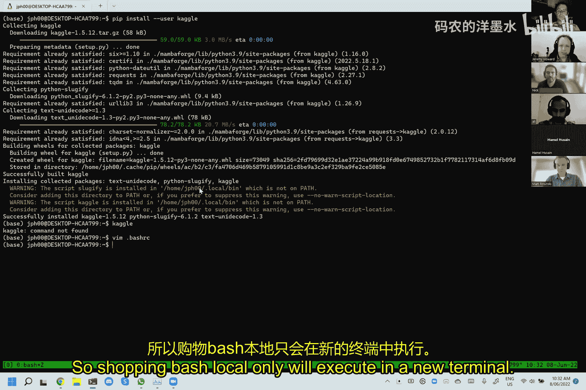

So I suppose like in some operating systems， I think the local bin directory is。

On the path by default， so maybe do you think that it's just I've whatever reason。

It's possible there's lot of distributions around。It could be confusing with like user local bin or whatever perfect there's some of them on Mac that are yeah slash users un Mac slash user slash local slash bin is not in your home directory and that is always part of your path。

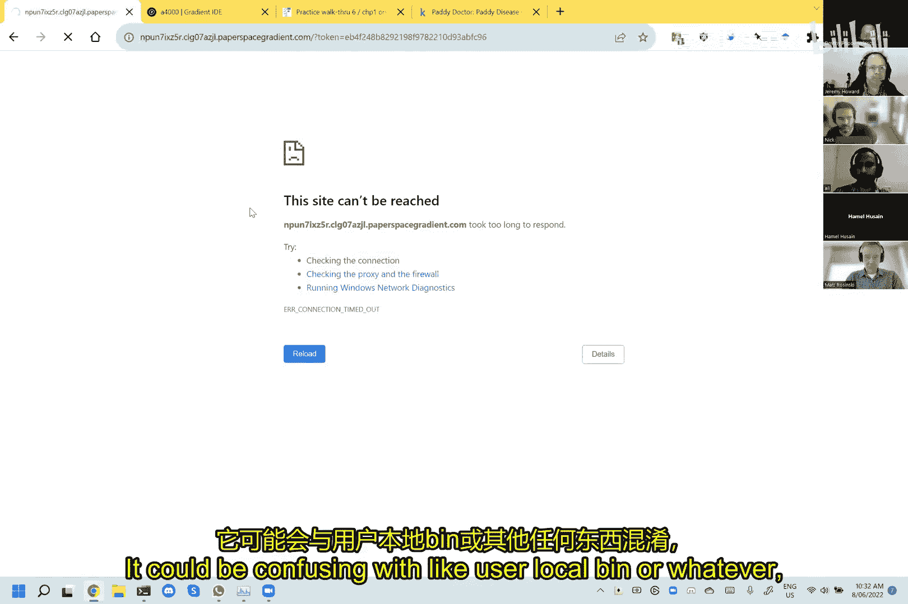

But this is something in your home directory。Oh yeah， okay， all right。嗯。😊，Okay， so。嗯。By default。

 your B has a bunch of stuff in your best shall see， by the way。

 So I'm just going to go to the bottom。 So to go to the bottom in vim， it's shiftji。

go to the bottom and then O to open up a new line underneath this one， so insert this。And so。

 we will export path。E equals t slash dot local。U。Slash bin。

And then colon and then everything that's already in your path so that prepends it to our path。

So I could close and reopen my batchshai or I can reexec it and any exported variables I want to go into my shell so to execute stuff and put variables into your current shell you can type source so source batchshai is going to。

Safely having to close and reopenap from my terminal and B shallRC is the last thing on the last line so I can just do that。

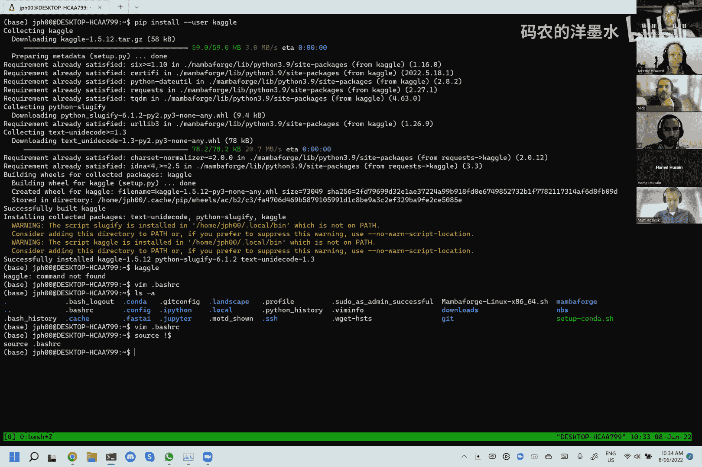

And so， now we。Can Keckle。Okay。So the next thing we need is somewhere to authenticate and Kackll uses something called。

Cackle do Json。To do that。嗯。嗯。So if I go to kggle。You can grab it。Therea。😊。

You can grab it by clicking create new API token。And what that'll do。Just a moment。嗯。Is it all。

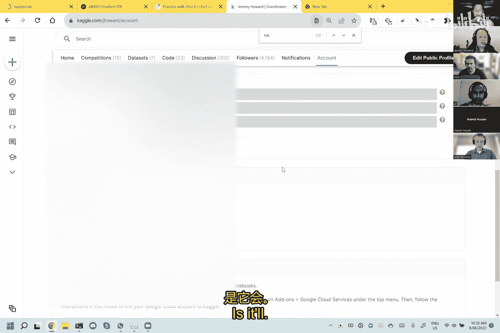

Download a file called caggle dot Json to your computer。嗯。And so once it's downloaded。

Depending on to where you are on Mac， it might be in your tool slash downloads directory and on Windows it'll be in slash mount slash C is your like Windows C drive and it'll be in your。

Users。Useername。Downloads directory。啊。So they say it needs to actually be in a directory called Dot Cagggel。

So I'm going make the duck kegel。诶。I think it's probably just created that for us when we tried to run it。

 That's good。 So now I can copy it。And in this case， I think what I'm going to do。

Is just copy it from my other account。Copy dot kgle slash。 There's my Jason， and I'll copy it into。嗯。

My， by the way， so I want to at the JPH 0，0s home directory。 So tilde JPH0。

0 refers to the home directory belonging to JPH00。Tilre on its own means the current user the own directory。

 So I'm going to copy it over to。开断开个。There we go。诶。And change its ownership。

 So it's owned by J PH 0，0。So you won't have to do this because you'll be downloading it and copying it from your downloads。

 I'm just doing this because I'm copying it from a different user。呃。All right。So yep。

 that now belongs to JP800。So now I should be able to。Go back into that username。And type kle。Okay。

 okay。 so I've got Keeggel installed。

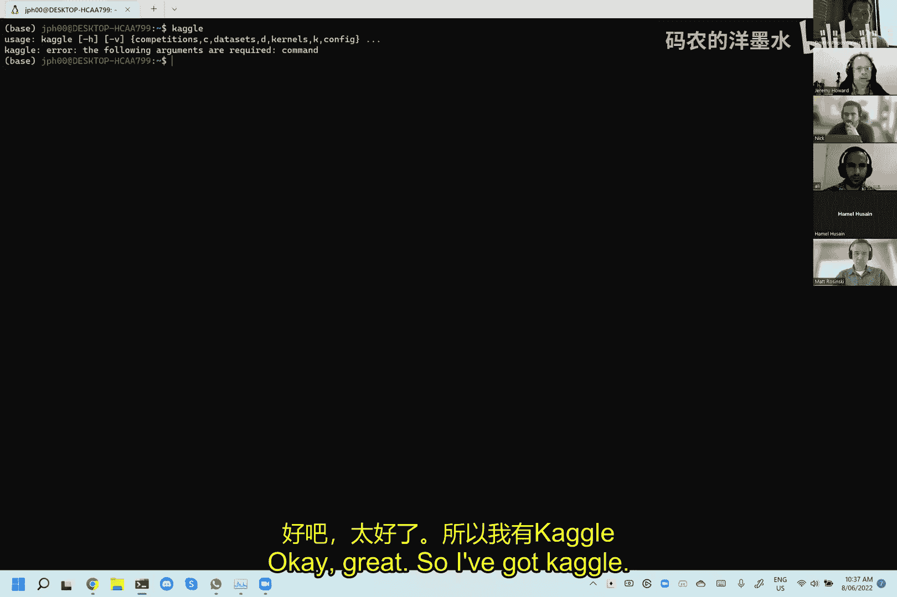

你录。Do a check front at a time to see。Whether anythings working。Not really。

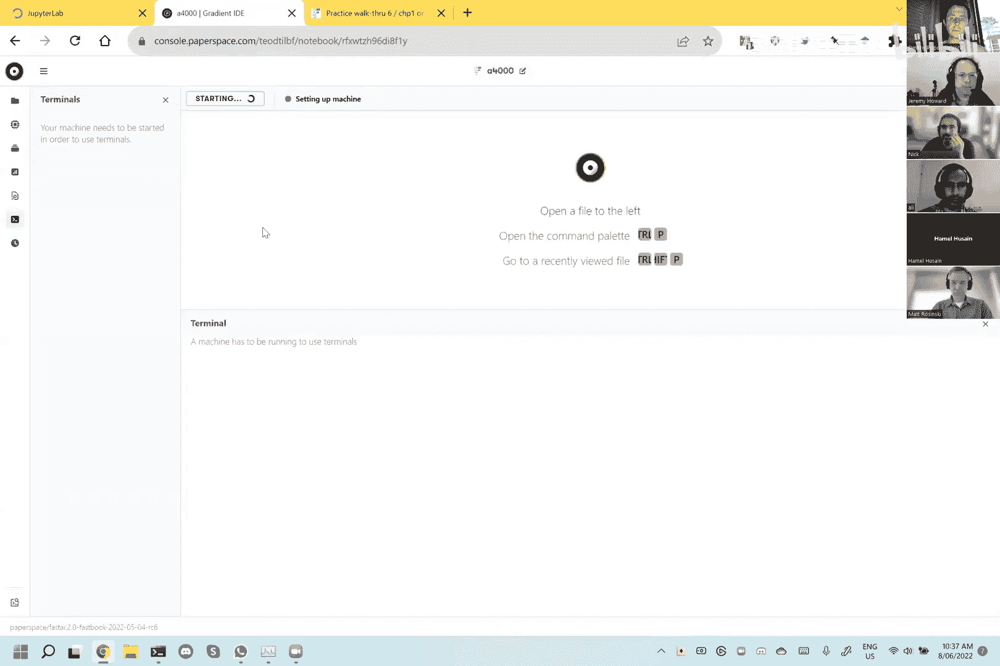

Tch。So the Ke competition。

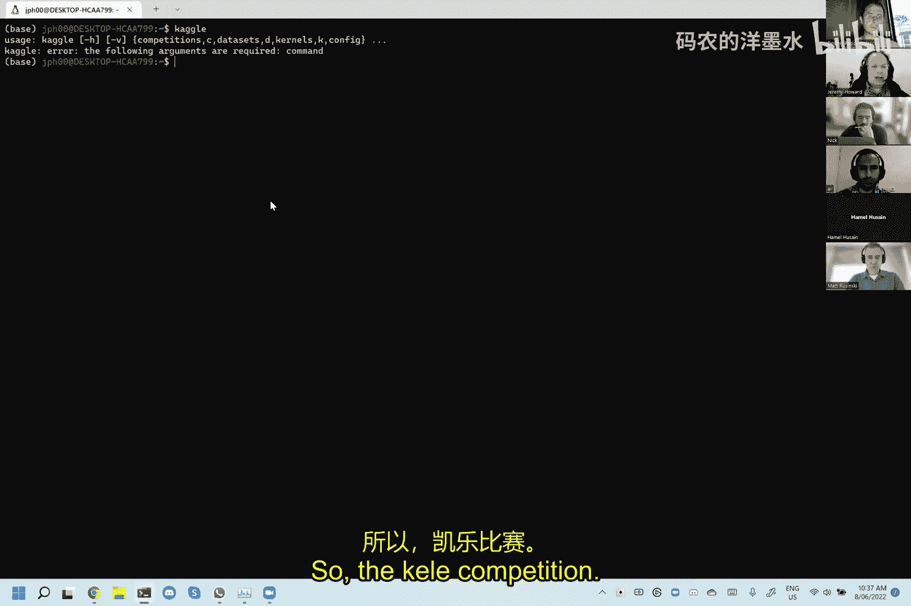

Said we can download it with this command so copy that。

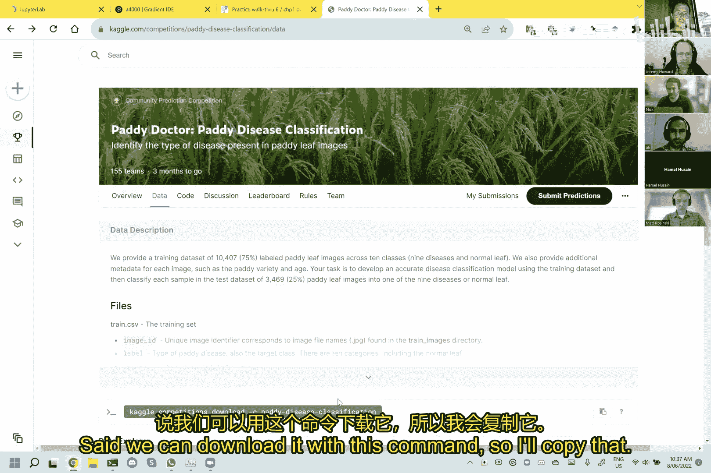

And。嗯。Let's create a directory for the competition。Ptty。And。Run that command。Nice。

Pick a bite of data。All right， did anybody have any questions or anything about this as we wait for that to download。

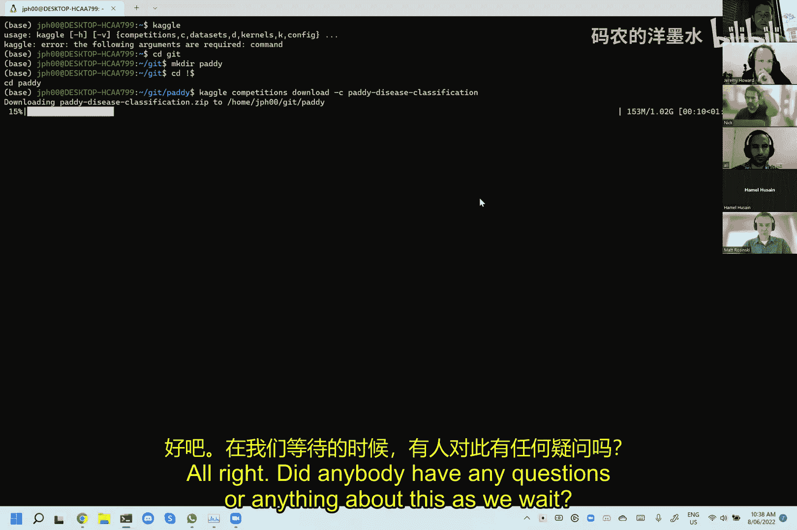

So Jeremy， we can use mumumbba install here since you're doing it on local right it's just that you're demonstrating paper space。

If， if it's on。Yes， it is on。 it is on Condeforge。 So yeah， membrane and store kgel should be fine。

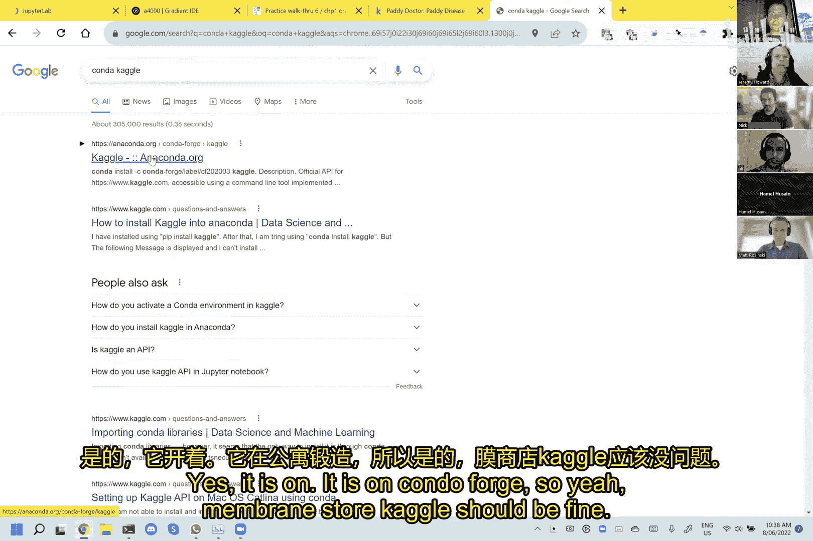

嗯。Although， you know， to be honest， like。For simple， pure Python stuff like this， I。

Often just use Pip anyway， because。Things like this。

 like pretty much most tools are Python libraries like。

Pip is the main thing people are kind of targeting so you can be sure that that's going to be the most recent version unless the documentation explicitly says like we provide condo packages as well。

 there's often often a good chance that the condo packages will be。

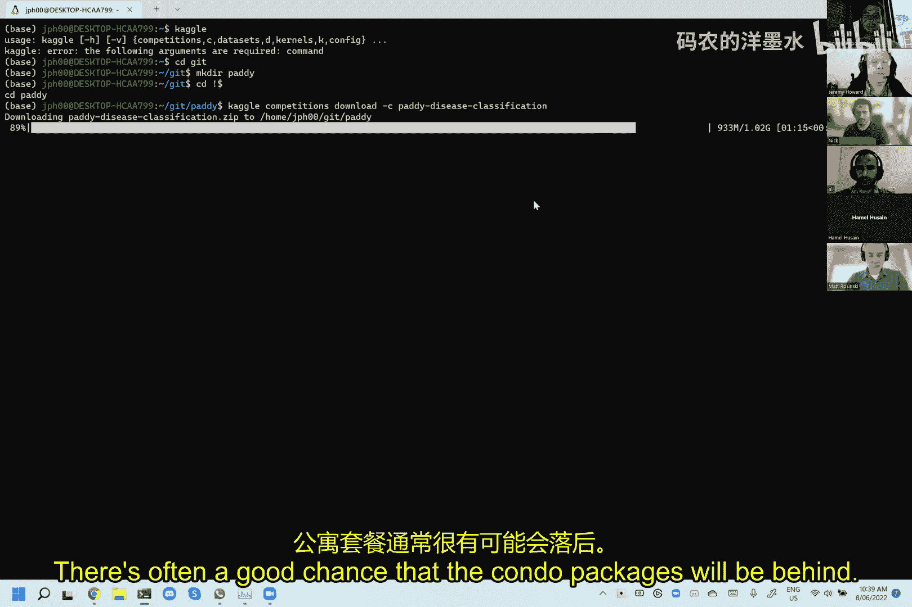

Behind， so if I was gonna do con a member install， I would be inclined to like。Tuple checkck。

That this is actually the most recent version。

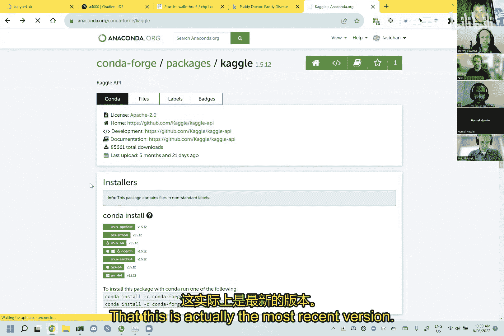

嗯。But yeah， I mean， as you see I just used。嗯。That is just pip anyway。

 I suspect for something like this。itDoes it used to be the case that you？

I remember something about like cookies and there's a browser extension and maybe you had your own tool for this or am I just looseating？

was it did you used to be this way from like an older past day， okay？Okay。

 so they're always zipped things so we can unzip it。Okay。

 so I hate it when that happens because it actually takes ages， so minus Q for quietly unziipput。

Yeah。Right。Okay， so that's gonna give us。A data。

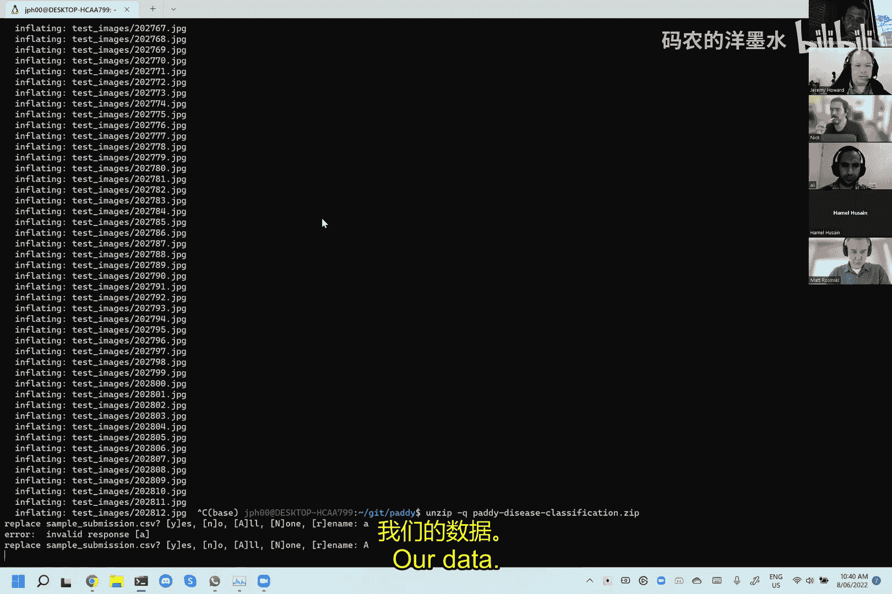

I guess one thing is forget getting our。Caggle dot Json onto paperspace。

 the easiest way is to click the file upload button in Jupiter Lab。So there's just a rule。

Upward pointing arrow button。If you click that， it'll upload it。And then。And then yes。

 copy it to tilda slash。cagel， and it does have to have the correct permissions。

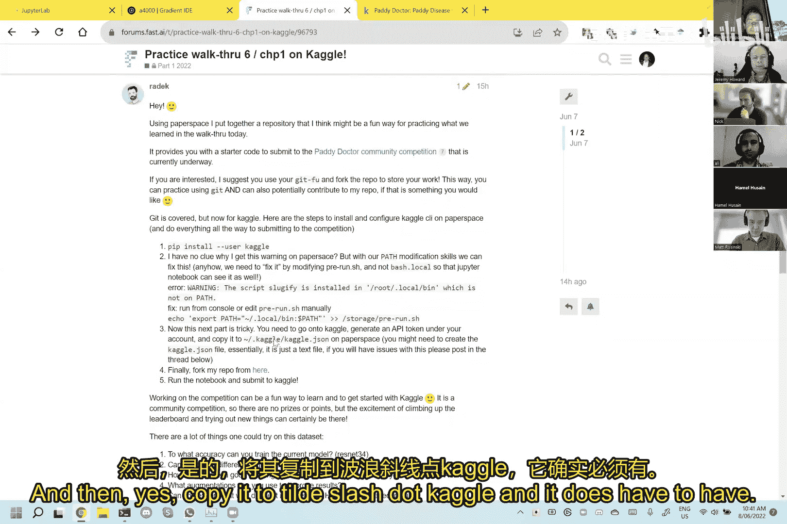

嗯。Which is hopefully you might better recognize this， so that's 4 plus two is6 and then00。

 so CH mod 600 on that file will give you the correct permissions。

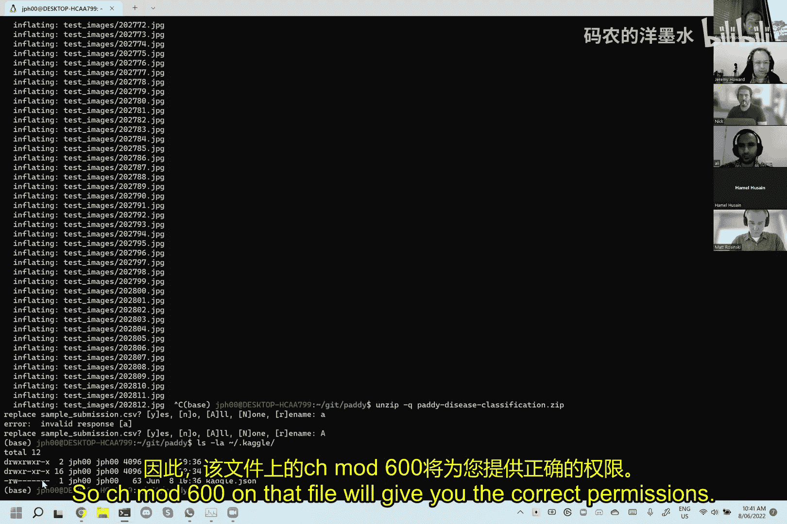

U。Okay。

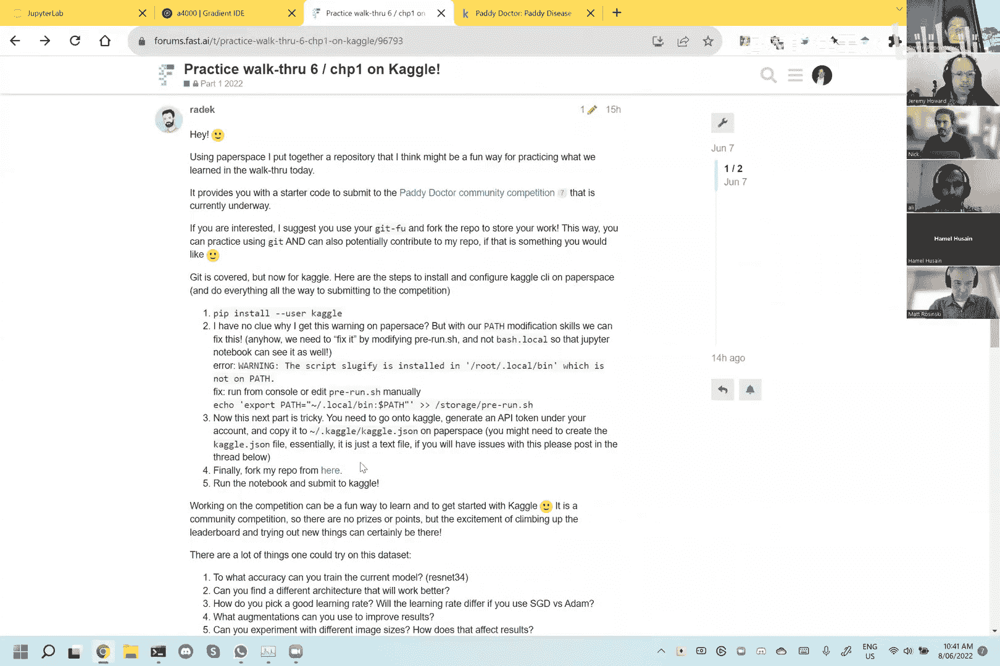

So oh， now the only problem is。That this is my desktop， which does not have a GPU。

 so that was actually a stupid place to put this。嗯。😊，So I'm got to copy this to my GPU server。

So the copy files from one。Lux or Mac thing to another very easy way to do it is SCP。

 secure copy and type the name of the file。And then type。嗯。Where you want to send it to。Oh。

 except I don't have that set up here。Alright， so I'm just gonna go back to my normal user。Zto copy。

 tilder， J H0，0。Get petty， petty disease classification。 I'm gonna copy that here。It is C， H O and J。

 Howard。At。Okay， so you can use S P to copy a file。To another machine。And off that goes。Yeah。

So how does it know what local colon is？So。There's a very underutilized handy file called do SSsh/lash config。

Where you can type things like。Post local and when I SSH to that it will actually SSH to this host name and it will actually use this username and it'll set up we haven't talked about SSH forwarding。

 but if you know about that it'll set up SSH forwarding so this is just a little trick for people who do use SSH。

That using the SSH config file is great and it's not just for SSH。

 it's also for anything that uses SSH， including SP SP is a secure copy over SSH。All right。

 so now that's done， I can log in to that machine。And now we're on a GPU machine。

 so to check your GPUs， you can type in videoS。And so this has got three GPUs。

And I can move that file， I just copied it into here into here。

So should we use SCP or R sync I that's fine yeah。嗯。I use S P just because I don't have to。

Type any flags to it strictly speaking SCP is kind of considered deprecated nowadays。

 but it actually works fine。嗯。Unziip that。对。Cool， okay。Making good progress。

 Let's see what we've got。Okay， so。There's a sample submission do CSv， there's a train dot CSV。

 train images， test images。So LS trade images， if this has got like 10，000 things in it。

 that's going to be annoying。So if you piped to head。So remember this vertical bar is caught pipe。

We to take the input of this output of this program and pass it in as the input to this program。

 and this program shows you the first 10 lines of its input。Okay， so actually。

 it turns out that's got folders for each category， So I don't really need to pupp it to head。 Okay。

 and so then we could do the same thing with one of these bacterial leaf blight。

And pipe that to head。There we go。 So now we might want to know like oh how many of those are there。

 So instead of piping to head， we can pipe it to word count， which is WC。

 but despite the name it doesn't only count words if you pass in Al line， it'll do a line count。So。

 that's how many。Bacterial leaf blade images。 there are。 So it's really useful to。Yeah， you know。

Play around with these things you can pipe into so ahead。WC， another useful one is Ta。

 which is the last10 lines。And then one we've seen before is Gr。So not particularly useful。

 but show me all the ones with the number。33 in it。Okay。😊。

And you can use head and stand also on files so head is very useful for CSV files if you're in your Jupyter notebook and it's streaming at you that it cannot read a CSV file it cannot pass a CSV file can just jump into console or even from Jupyter notebook just do Yeah well let's try it right because so we I think we know that if you type CA at a file name。

It will。It will。Send it to the output， which by default prints it to the screen。

 So we could pipe that to head。Right now real Uni gurus will say。

 well that was silly because actually if you look up the band page for head。

 if you pass it a file name it does the same thing。

 but to me I prefer to learn a smaller number of composable things。

 so piping stuff to head is a not a bad idea。And we could even。And you know。

 another nice thing about cat is I can pipe it into Gr。And search for everything。With。

I don't know how many of these ADT 45s are there， let's grab ADT 45 and then pipe that into word count count lines。

A A you got A DT。Yeah， so you can you know quickly get some information at the console， which yeah。

 I think can be quite useful。诶。All right。So。Next thing to do， I reckon， is to。Fire up a。Jupiter。

 So let's see the。Get。😔，Do you put a notebook。

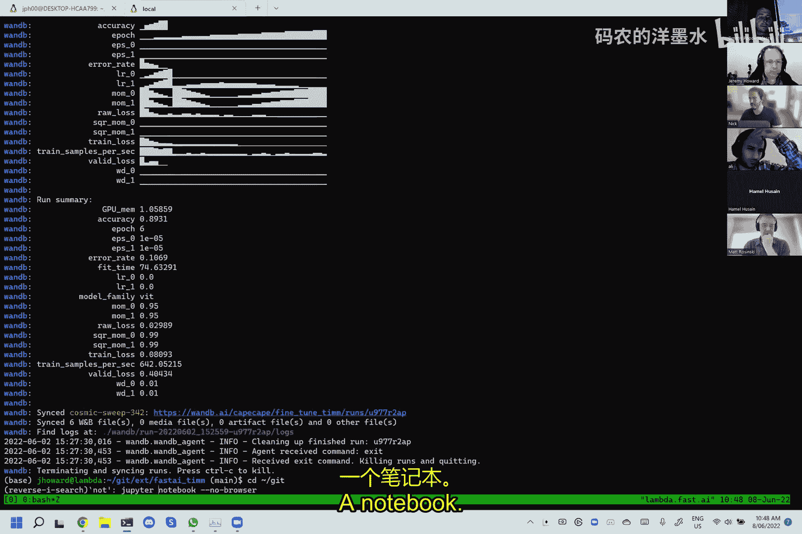

Justcus me Jeremy， if youre interested my。Per space， Jupiter instances started up now， hooray。

So I don't know if yours。😔，Would have to。Look at that。Fantastic。All right。

 so it's probably worth just quickly going through the exact same process one more time， I guess。

 isn't it so？We open up the terminal。嗯。Pip， install k。Mus minus user。That's interesting。

 So this is because I installed stuff to that condo directory the other day。 And so if I go。

 which Pip。It's actually finding that one， and I don't want there to be a p there。

 so we'll remove it。Conda oh， in my home tree。Okay， let's try that again。

I have to reopen this terminal。 How confused is it。Which p。There we go。 Okay， now it's happy。

Control R install to find the last thing I typed saying install。Okay， we've got the path issue again。

嗯。So Vm slash， I think I prefer。Radex approach or putting it in pre run so that way we have the ability to use this if we wish。

In。Jupiter， not echo。 So export。P equals，t local。In。And then the current path。

One of the confusing things I find about bash。嗯ん。It got me a couple of times if you are doing export something a variable name you need to have the equality sign straight after the variable name Oh yeah those't work and you know it's just one of these little quirks yeah yeah you know bash is a very old program and it has these weird old quirks about white space sensitivity so that's a really important point to mention thank you。

Um。And I run it here as well rather than restarting。 and so now Keckle。Should exist。 It does。

 It runs。 That's good。Um。

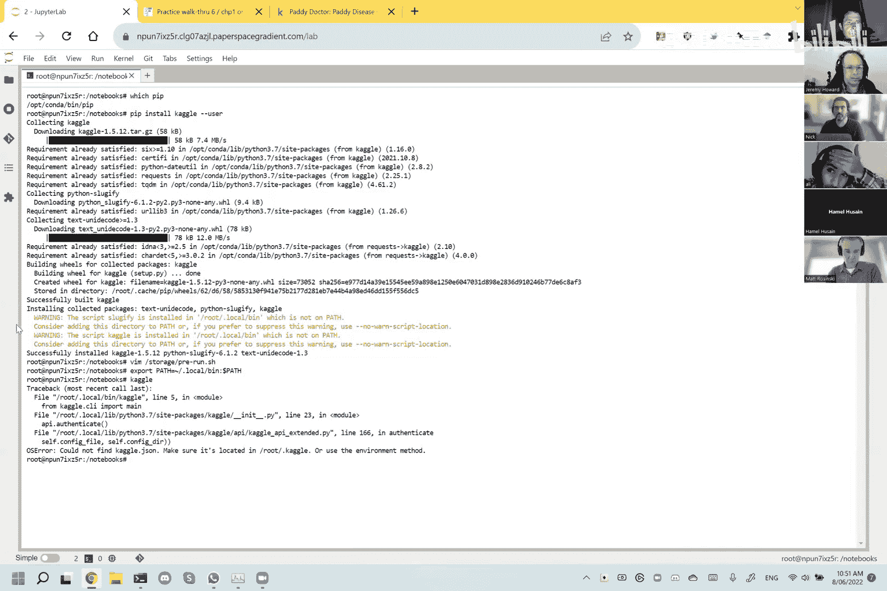

Alright， and so。Let's copy this。Into my downloads directory。😔，Or else， I guess what I could do。😔，诶。

Yeah， let's just do that。 Copy tool slash dot kgle。Ele slash mount slash the users J downloads。

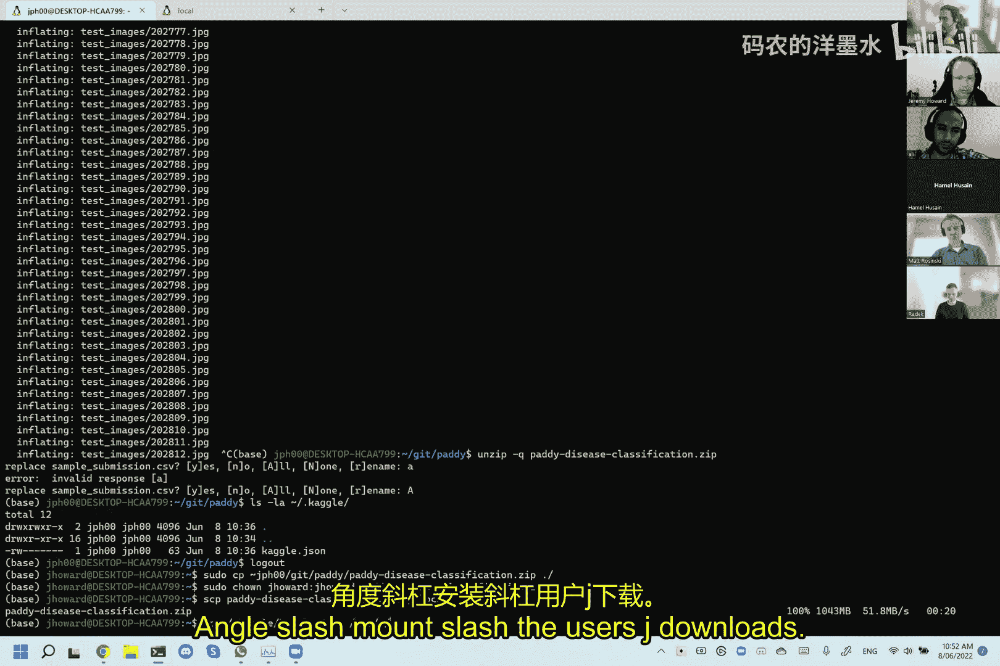

And so we should be able to now。Upload it。From my downloads directory。

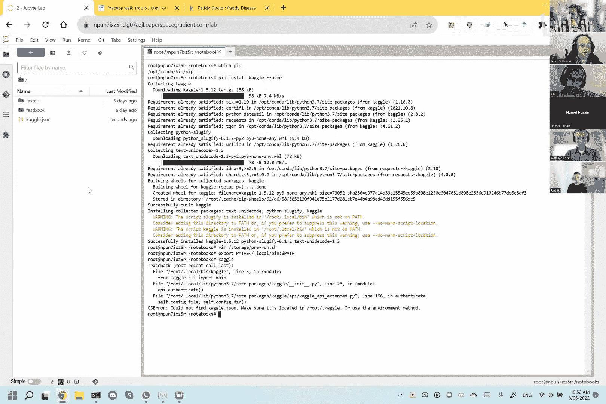

There it is。🤧Okay， and so。It's created a dot cattle directory for us。

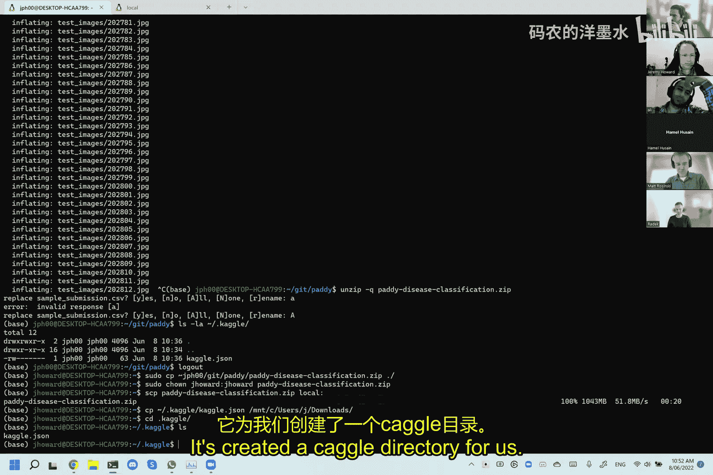

Oh， oh sorry， this is my wrong， sorry， let's do that again。CD tool slash dot kgel。 Yeah。

 it's created a kgel directory for us。 And so we should be able to move the thing that we just uploaded to slash notebooks。

Into here and the permissions will be wrong。So we can fix them。Yeah。Okay。

 and so let's see if it works here as well。It does。And paperspace's network is faster than my。

Connection in Australia， not surprisingly。Although， you know， mine wasn't bad， actually。Okay， so。Oh。

 that was a dumb place to put it， obviously I don't want to put it in padty disease classification。嗯。

😊，You know， we're only got to use this for this notebook， I guess。 So maybe move that to。

Slash notebooks。嗯。And so let's create a paddy folder。Up it in there。And unzip it。So that means， okay。

 that's interesting， there's no one zip， but we know how to deal with that。U。

Wasn't control R working for me。Oh， because control does a refresh。 Oh， that's annoying， isn't it。

So how do we search our history。😀H。In these terminals。哎 well。嗯。😊，That's fine。

 I will just type it in manually and we will figure out。

Aomimate control are working at some other the point。So。Micromeber。Minus C condo forge。

Minus prefix tde slash con。嗯。Install。Probably at the end。First。Yeah。

 a lot of the keyboard shortcuts don't work in the browser based terminal。

 which is actually pretty annoying。They work a bit better on Mac than on Windows because of Windows。

 the control key is both used for。The Linux terminal commands。

 And it's also used for like the normal browser commands。 Where on Mac。

 they use command for the browser commands。 And so the control key doesn't get overwritten。

 So this will probably be a better experience on Mac， actually than than Windows。Okay。

 so we're going to install onzip。And hopefully， by the time people watch this video if it's like。

July or later， things like Manmber and Unzip will already be installed。Okay， let's check。Okay。

 we have an un zip。 that's good。Okay， so that is。On its way。嗯。😊，So， that's going to use up。

A gigabyte of。Space in my persistent storage。Which。

You might not want to do that right and if you don't want to do that。

 then instead you said unzip it into your home directory if you unziip it into your home directory。

 it won't be there if you close it down and reopen it right so you might want to create a little script for yourself that does the kgggle download and the unzip。

On your notebook and then you can it'll you know run that each time you start up so you know are the these are the issues I mean。

Look， having said that， the overage cost on paper space for storage， I believe。

 is 29 cents per gigabyte per month， so。Your convenience of putting it in storage is probably worth 29 cents for the one month you probably won dont want it there so maybe that's just about plan。

😊，Um。😊，I do know， though， that the。Well， maybe this is a problem， actually。

 because I do know the paper space。Slash notebooks and slash storage are very， very， very， very slow。

And we can actually see that。When we're unzippping this。So maybe this is a bad idea。

 maybe we shouldn't put data。At least when there's lots of filess。Becauseuse this is painful。

 I'm going to cancel it and to see how far it got to U minus S H。Train images。426。

 And how about test images。Wouldn't you know it it was nearly finished。But yeah， I'm。I think。😊。

I think this is actually slower。 So I'm going。Remove that。Oops。

And I have a strong feeling if we move it back to our home directory。It's gonna be。Bster。

 I sure hope so。And the reason I care is not so much for the unzippping speed。

 but when it comes to like training a model， we don't want it to be taking ages to open up each of those。

Bileles， wow， you see even IM minus R text a long time。So。Wow， that's running。Let's move。Patty slash。

Zip file。Upp it into our home directory。There we go and then Cd to a home directory。Okay。

 that's now finished。嗯。So in terms of the steps we're gonna do。It would be first。

 we would make a directory for it。We would then do the caggle download。Actually。

 which we can just copy easily enough。From kle。 And then we would unzip。Let's see how long it takes。

 So the time Uni command runs whatever command you put after it and tells you how long it took。

Did I not move it there。Oh， dot tot slash padty。 I didn't move there。Yeah。Time unzip quietly。Bety。

So yes， I think what I would do now I think about it。Is。

Is I would have a paddy directory in my notebooks。I wouldn't store anything big here。

 I just have my notebooks here， and I would put a script here。嗯。Ced get data， say。U。And。

It'll just have each of the steps I need， so the steps would be suited to my home directory。

Make the padty folder， C D to the padty folder。Do the W get？Or not W get Keggy competitions download。

 I should say， unzip it。Pay。Disease。诶。Yeah， and I think that's it， right？

So we can make that executable with CH module plus X to add the executable permission to it。And so。

Yeah， that so then all I have to do is run that thing each time I start up paper space。 And yeah。

 it's only going to take8 seconds to unzip。 and it took about。5ive seconds to download。

 so actually that's not going to be really。Any trouble at all， is it。Cool。And that's， you know。

 slash notebooks remember is persistent on this machine， so that's all good。

So now we can create a notebook for it。And so my first step is always just to import computer vision functionality in general。

Which is the same thing we used yesterday， and now you know exactly what that does。

And then my second step is to look at the data， so it's easiest to look at the data if we set a path to it。

嗯。So it's going to be in our home directory。And it's going be called Patty。Flash。Well， that's okay。

 so slash Patty， right？You can go past that home wow I didn't know that that's that's quite quite neat and a nice the end yeah it's quite neat so that's that's that okay。

 so we can pass that LS。Tells me what's in there。 and if you remember my trick。😊，From yesterday。

 I also like to set that to be the。Path dot base path。Just so that my。

L lessons look a bit easier to read。嗯。There we go。 So at this point， we could create a data frame。

By reading in the CSV。Of path slash。Train。 cv。Okay， so we've got 10000 rows。 Each one is a Jpeg。

Each one's got a label。And so。Let's take a look at one of the images， shall we。Oh yeah， PIL image。诶。

Pa。Slash。Train， slash。Actually， you know， let's make life a little bit easier for ourselves by creating a train path。

Because， you know， it's just so good to be lazy。Slash。1，0，0，3，3，0 dot J pig。Pick。Oh， no。

 because then they're inside the label directory。Yes。

 so what we actually probably should have done would be to say trend path。Dot Ls。B paddy train。

 iss that not right。Train underscore images。And that's another good reason to put it in a variable。

 so you have to change it in one place。And so there we have that。And so let's create， I don't know。

 let's crawl it the。Bacterial leaf。Light。Pas。Equals train path。Slash。Bacterial leaf blight。

So now we should be able to go B or B。And look at that image。There we go。😊，But we have an image， yay。

诶。All right。So might be nice to like。Find out a bit about this。Maybe look at the size。So it's a 4。

80 by 6，40 image。Great， you know， another way。😊，We can take a look at an image you might remember from yesterday。

You can go files equals get image files。And pass in path。And this will be recursive。So。

 I can do this。As you can see， So this has got the 10000。 Okay。

 and that number there matches that number there。 So that's a good sign。

And so another way to do that would have been to go。Emage equal P L dot create。File zero。Okay， and。

🤧U。We could even take a look at a few， right， so if we wanted to check that the image size seems reasonably consistent。

We could go O dot size for O in， or actually。PIO image。Dooc create。2。Dot size。For O in files。10。

For example。So， you know， this is not particularly rigorous。

 but it looks like they're generally for by 640。Fileles。嗯。They're all the same size。Which is。Andy。

 that's interesting。And they're probably bigger than we normally need。 You know。

 we normally use images that are around 224 or so。嗯。Having said that。

 I don't know if like the presumably this is some disease thing， Patty disease competition。So。

 it's rice。嗯。Classify the images， according to their disease。😔。

So I can't even tell that this thing has a disease。

So I don't know how big it needs to be to see the disease。

 So it is possible it'll turn out that we actually need full sized images。

 So like I would start by using smaller images。And it's kind of see how we go。Anyway。

640 by4 already is not giant， so we should be fine。嗯。The the CSV file。

Has got one extra bit of information， which is the variety。Raddick。

 did you find out what this variety thing is about？I that founded out。

 I didn't even know that CSB file existed。But it's fun because we can build a。诶每冇得。

I see it's the type of rice。As opposed to the type of disease。 Yeah， so maybe。You know。

 the different diseases might look different depending on what type of race it's on。

My guess is that we wouldn't need to use that information because given how many images there are。嗯。

I would guess that。It's going to do a perfectly good job of recognizing the varieties by itself without us telling it。

Unless there's a whole lot of different types of varieties。

 which we can check easily enough right by checking the data frame。Grabbing the variety。

And doing at value accounts。And we can see how many there are of each。Okay， so there's not。Okay。

 so look， I mean， there's a couple of tiny varieties， but on the whole。

 most of it is AD DT 45 and quite a bit of。Knaaka pony。

Does that seem like a bit of a rice session today， doesn't it？Lots of rice going on。 Yeah。 So I'm。

 I think it's very unlikely that this variety field is going to help because。

There's so many examples of the main one anyway that it's going to be able to recognize it。嗯。I mean。

 at some point we can try it， but I would be making that a pretty low priority for this competition。

U。😊，And so yeah， given we're doing a practice walkthrough。Um。I'd be inclined to fire up fast book。

And the intro。And see if we can just basically do the same thing that we did last time。Um。

So I'm going merge these back together again。 We've already got those two。 got those。诶。Well， no。

 there's not much there。 is there。in APL mode， I wonder my things aren't working。

I don't know how that happened， haven't used APO today。Copy。Paste。Okay。

 so this is how we did cats so we needed a labeling function now in our case the labels are very easy each image is inside the directory which is its label so the parent folder name is the label and so we already have a function。

To。To label from folders。 So we can actually just do image e loaders from folders。

 because that's all we need。 So we're still going to need the path。

 Tra invalid valid actually have different names。 So let's fill all of those in。

 So we're going to have path。Train equals train， underscore。What was it images， images， yep。And。

Test images。Train， underscore images。嗯。Ballid percent。 so that's fine。

 we do that the same as last time。Okay。诶。It's expecting to have train and valid subfolders or valid percent。

 So hopefully that'll work。 Let's try it。嗯。And we'll use the same resize as last time。Okay。All， oh。

 no， that did。 well， did that work， No， it didn't work because we've got。That's interesting。

 Test images。So my guess is it's got confused by the fact。Yes。Okay。

So possibly what we should instead do is use train path。Here。嗯。And use valid percent instead。

 I wonder if that'll fix that problem。There we go， let's fix that problem。Okay。Great。😊。

So we should then be able to create a learner。And land dot。Time chair。

Let's just do one epoch to start with。There it goes。 So it can be useful to kind of make sure it's。

Being reasonably productive is its training， and。We can do that within video SMM。嗯。Nvidia SM I。

inus minus help。Yeah， so much help。嗯。😊，So， this。Let's take a look here。We've only got one GPU。

 so that's fine。Lo query。Okay， we're not modifying anything。Damon， I think that's the one we want。

No video am I。地问。Okay， that's just finished。So while it was running。😊。

So this is something people often say to use watch NVDdia SMI to like have it refresh。

 but actually I don't think most people know that there's a De on subcommand where you can use that just as you can see it shows you every second how it's going and it's showing me the most important thing is this column SM SMM stands for symmetric multiprocessor that's kind of what they call it instead of a CPUU for their GPUs and it's showing me that it's being used 70 to 90%。

Kind of effectively， if you like。 And that's a good sign。 It's， that's fine。

 So if this was like under 50。Then that would be a problem。

 but it looks like it's using my GPU reasonably effectively。Yeah。

 and it's got the error rate down to 13%。 So we are successfully。Training a model。

 So that sounds good， so。Jeremy just a quick question when you're saying that like if it's under 50% then that can be a problem is that because you've oversized the GPU like when you selected it or like just just wanted to clarify what you know by that what that would mean yeah thanks it's a good question。

😊，Justs rename this。It would probably mean that we're not able to read and process the images fast enough。

And so in particular my guess is that if they're in slash storage or slash notebooks you would see the SMm percent be really low because I think it would be taking a really long time to open each image because it's coming from a network storage and so generally yeah a low SM means that you your iO your input output your reading or processing time is too high and so the ways to fix that would be a few one would be to。

Move the images onto the local machine so they're not on a network drive a second would be to resize the images ahead of time。

To make them a overall reasonable size and a third would be to decrease the amount of kind of augmentation。

That you're doing or another would be to pick a different instance type with more CPUs。

So those are basically the things。Perfect， thanks。AndOkay， just the NV that a semi command。

 it also has a lot of useful information like your code version and stuff like that so you know it's also a useful comment even without demo。

就 to know the details址。It exists yeah or sooner yeah a lot of details here so if you're looking for the IDX of your GPU if you have my GPUs and some of the variables here are a little bit more descriptive so it might be easier to get started with that command or to at least use it every now and then and if you'd like to have this one running in a loop which is what I generally do just do Nvidia dash SM minus。

Yeah yeah I mean I agree this is useful， but I would suggest in a loop to use the demon because there's only two columns you care about it's the and and this one does not show you SM right so if you want to actually see it's being utilized you need to use demon and you can also see the percentage memory utilization so。

Just look at these two columns。The other ones you can actually ignore。Yeah， okay。

 I think that's a pretty good place to stop。 I'm glad you put us on this competition。😊，嗯。Tadick。

It looks fun。 And I feel like we've。Got a reasonable start。 So， yeah， maybe next time we can try。嗯。

Doing a submission。And we could also try creating a cackle notebook for other people to see。

 how does that sound？Ts excellent。One thing I also like about this is that。

We coming up across problems as we go and。Yeah， jumping through those hoops and exactly and these are the beginner sorts of roadblocks that we' have to face。

 I guess so exactly add super valuable if you guys， you know。

Repeat these steps or do it on another data set or whatever。 and hit some roadblocks。

 Then it's really helpful。 If you solve them， you know。

 come back tomorrow and tell us what happened and how you solved it。 And if you didn't。

 come back tomorrow and。Tell us to fix it for you。 I think they're both useful。Things to do。

 So things like Reds example of like。Doing a bash environment variable and having a space next to the equal sign。

 you know that kind of stuff。I forget even to mention it， but really useful information。

You know this competition is nice because it's relatively small like 10000 images and it's aligned with what you're doing in the course。

 but if you'd like to try something out on a competition that is not active right now you can still do this because schedule allows you to do this light sub thing mind if there。

And this opens up many competitions to you to play around with the current competitions that are how do they call it ranked competitions so they award your points and there are prices they are not on images so explore something on your own to try the methods on an older competition on an image doeset that might be something quite useful so to find those you'll let scroll to the bottom and click explore all competitions。

And。他。Yeah， this will。Bet you see closed competitions as well。嗯。And you can even see， I guess。

Here you go。 You can find out which are the ones with the most popular of all time。

 that can be interesting。Crypto forecasting。 Well， of course， it would be。That's a bit sad。

 but there you go。That's interesting。 This patent phase1 is super popular。 That's good to see。

Instant gratification。All right， thanks all， See you next time， bye。

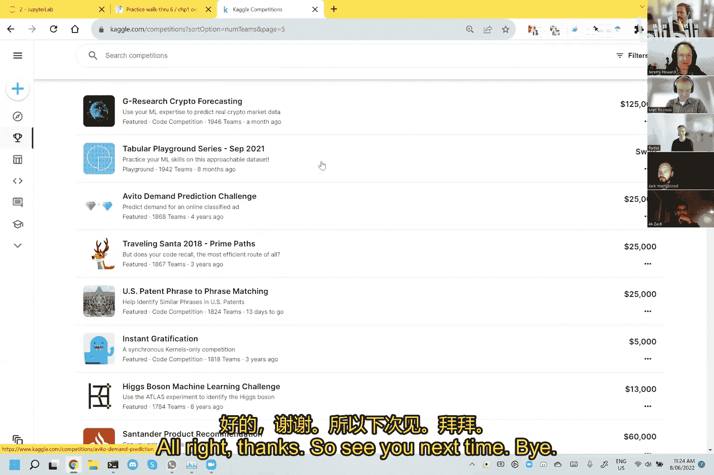

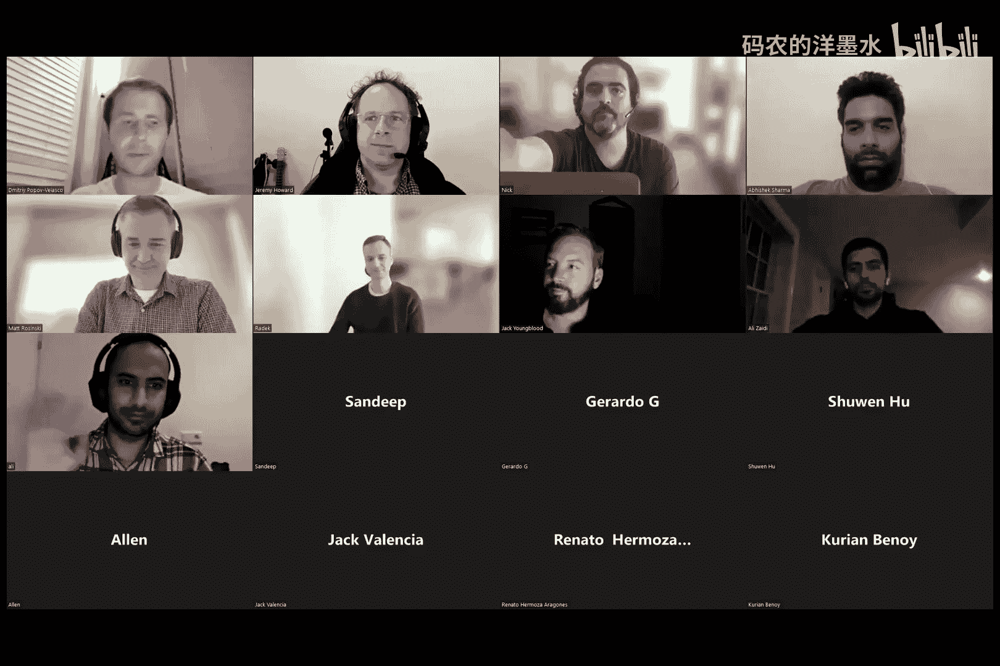