# 【全集】旧金山大学 实时编码 中英字幕 1080P p08 Lecture 8 - Kaggle竞赛本地实战 -BV1KZiTBWEeH_p8-

Okay， yeah you got a question yeah okay so I've got my paper space open and I can see haven machine yeah my machine is not actually starting which is not correct so so I can see a list of the direct like it goes clean image tools've got 0102 bh blah blah and how do I get the 20 know the。

The course2， the current course course 2022， so you would get clo。So you would open。

 so you would open up Jupyter La。Right you go into a terminal and you would Cd to slash docs sorry Cd to slash notebooks and then get clone and copy and post the。

The get URL from GithHub。完成。Let's see what happens。Okay， thank you。 That worries。Any other questions。

 anybody having any trouble。Getting things working smoothly。I ready in oops。You get。No now。

 please go。Just a question， I tried to look at my history， my bash history， I tried the sameimlink。

 I can see it there yeah in my home but I don't seem to be out of history from my previous session Yeah so the Bsh_ history file dosh history file is only created when you close the terminal。

So you can't send link it to it until it exists and so to make it exist。

 there's two things you could do， the first is you could open a terminal。

 run a command like LS and then close the terminal。And open a terminal again。

And now the bash history file will be there because you've done something and you can simil to it。

Or you can just create it and to create an empty file in UniX。

 you just type touch space and then the file name to dot Ash_qua history。Okay。

And somebody else had a question or comment， yes。So my question is about with。

Kigle part from last lesson， So what I understand from from the lesson。You need to。

Either do everything in the CAgggle website， the training and the inference， let's say。

Or it's possible to train your model in local machine or gradient， let's say。

 then somehow transfer it to the kegel。Somehow right， so what is yeah， how great。

 what is the proper way that was my question， Yeah， yeah， yeah， great， perfect。

 I love it when people。Ask the question that I want to solve today， because that's a。

Find that it's a question worth asking， answering， I should say。嗯。Okay， well。

 neither of my gradient machines are starting。Setting up instance。That's not good。Alright。

 I guess we're going to use the terminal。嗯。Now， the bad news is that I'm on my Mac where I don't think I've got anything set up。

😔，You can use your fancy setup。T script yeah， I mean， I mean， yeah。

 it's it's sort of slightly set up I don't have the kgel stuff downloaded。嗯。So all right， well。

 it's always good to revise anyway， isn't it？Shes gray。Advanced portion。

Share。不。Okay。Right。Okay， you guys can see that， hopefully。😊，嗯。

Yeah I wonder if we should maybe make this a little bigger as well。Okay， now you guys can't see that。

嗯。Okay， is that reasonably visible？Yes， it is great， Yes， yes。Alright。So So this is Tx。

 obviously running in a terminal and。Because I'm sharing my screen I'm using this you know slightly lower as a lun kind of area that usually also a particularly good idea to zoom into one of these panes。

 so I'll just kit control BZ to zoom into the paint。And。Let's see if on this machine I already。 Okay。

 so this machine does not currently have a cale directory。 So Pip install store。k歌。Great。

And if I try to run that。😊，It's not going to work。嗯。Do I have。SSH can fix it up。Oh， yeah。

 that's right。 I think Max got some really old version of SP that doesn't know how to。To much。

 So I might have to。Normally， with a current version of open SSH SP。

 you can tap complete even to get remote files， which is quite great。

 But I think I noticed that Mac tends to ship really old versions of。A lot of the Uni software。

 which is a shame， So we have to do it the slow way。 So we're going to copy dot cagle slashcagle。

 Json。To hear。OhW I' putting in sH， move kgle。json into docagle。And that should now work。Great， so。😊。

Let's。Download the data。

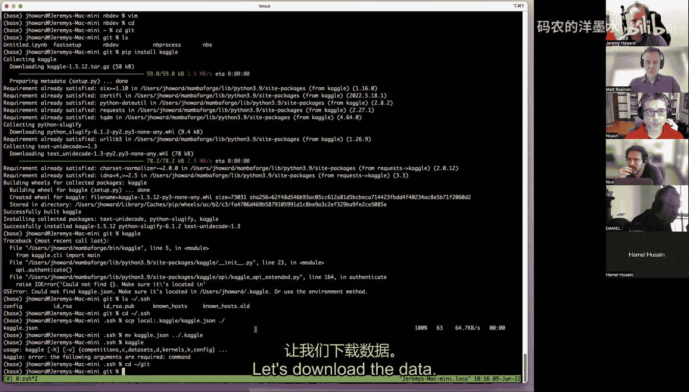

诶。up。All right。And we're going to go competitions。Patty。

And data and copy。And。嗯。Paaste。

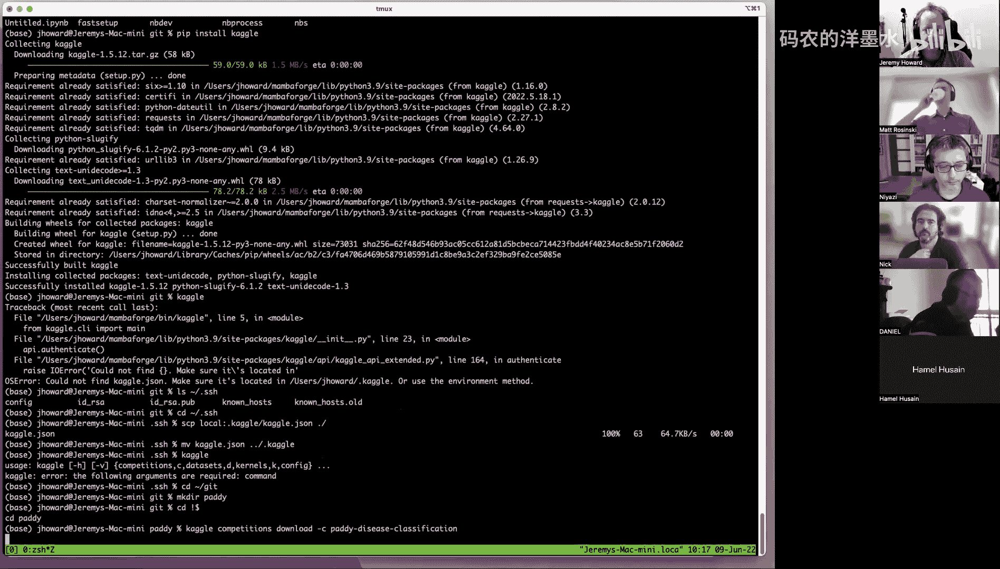

Okay。Alright， and then we're gonna， let's see if youve got Jupiter running。W too。 Allright。

But a bit crazy over there。So let's open up Jupiter。😔，嗯。And if anybody kicks an eye on paper space。

 let me know if paper space seems to start working。Right， his petty。Dear。helの。And I am Patty。Okay。

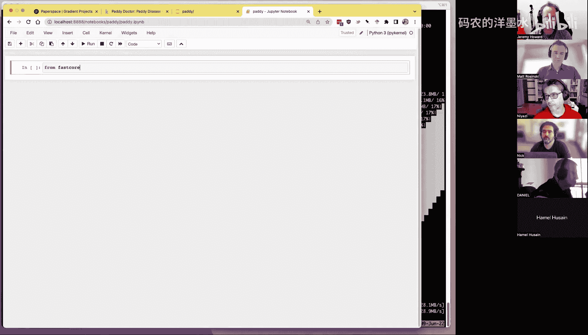

From Fast Ai dot visionion dot or import star。sLike this is finished so we can now unzip。Minus Q。

Not that and zip minus Q。Paty disease classificationification。

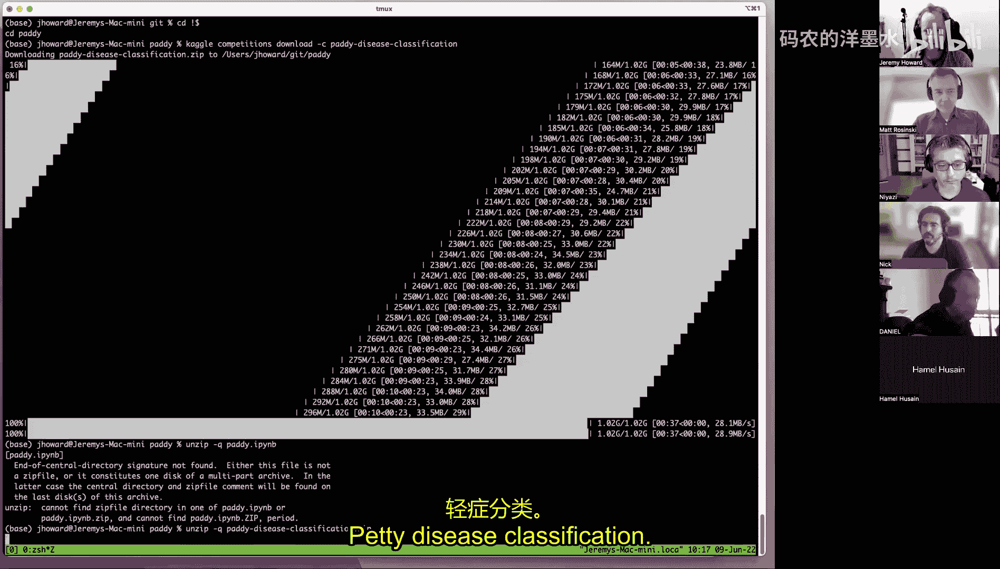

There we go。嗯。Oh， you know what we could do。😊，We could run this on my。GPU server because of course。

 running this on the max good of a dumb idea anyway。

So I don't think we've talked about how to do that before so。This might be slightly。Obscure。嗯。

That's okay。We'll learn something in the process。

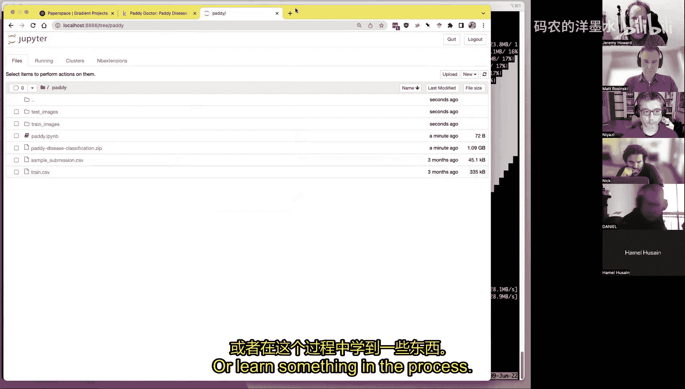

So。All right， I'm switching over now， actually， let's jump out of T Mus because running Tms in Tms is always a little bit weird。

So。😊，This is my GPU server。Okay， and it is running Jupiter。And it says， oh。

 you can go to local host 8888 to use this， but I can't， because that's。

Not local host refers to the machine I'm currently on and I'm not on this machine。

 I'm SSching into a remote machine。Um。But what I've done。And as I say， this is like something that。

Not everybody needs to know about for sure， but for those who are interested。

 what I've done is when I SSH to this particular machine called Local。

 it forwards in that I use on my local machines port 8888 to the remote ship machines 8888。

 which means that I can use。Local host 8，88，8， and it will actually forward those packets to the remote machine and forward remote machine packets back to here。

 So this is called SSH forwarding。You know， FYI。

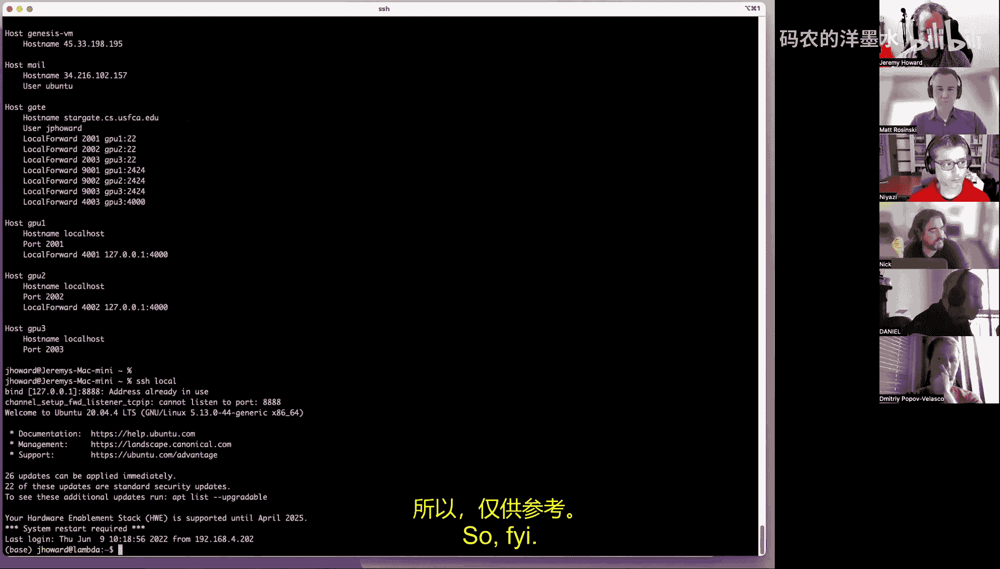

So if I。Theyre here。

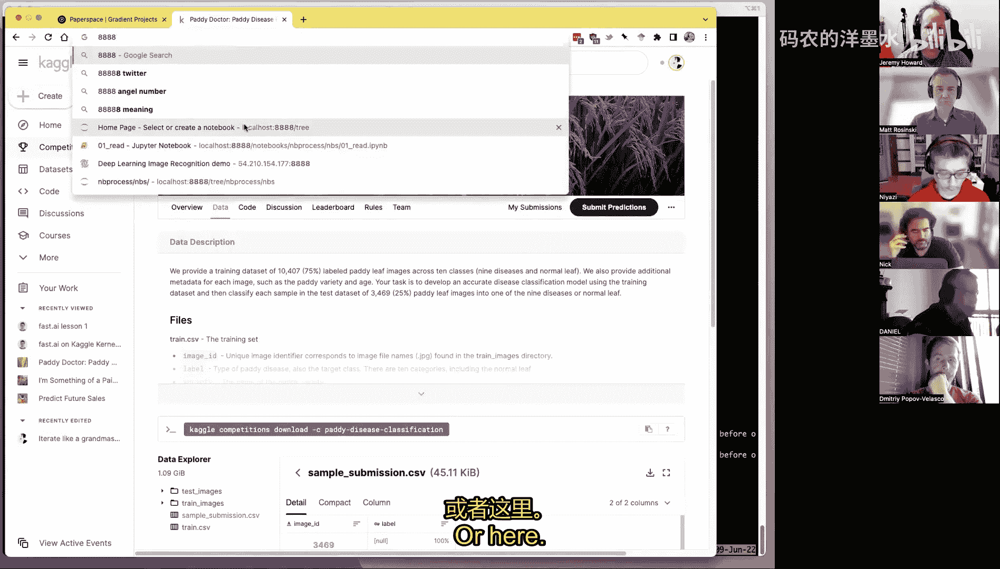

Oh， and the other thing we should probably do is make sure that。Jupiter is not running。

On the local machine。Cance that。And so to exit out of this。

 I could create another window or another tab or whatever。

 but I can just hit control BD to detach from TM so that stuff's all running still in the background and then I can SSH to my machine。

And let's see if that's or。😔。

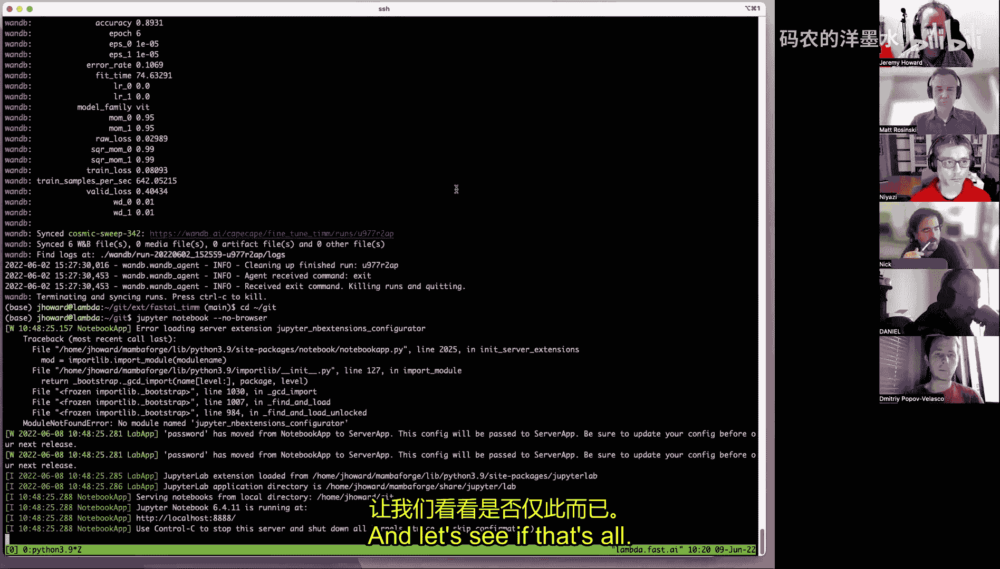

Working， there we go， okay。U。😊，So。That's great。And so here we actually have that going so we can create a new notebook。

Um。🤧嗯。And it's easy enough， by the way， if you do like。By a machine with a GPU。

 which it's not a terrible idea。Especially if eventually GPU prices start to come back down to reasonable levels at some point。

You know， it doesn't need to be a notebook or anything。 You can track it anywhere in the house。

 just like I've done。 And as you can see， log into it from your computer now。

I can only log in to mine， right， you know， by default， I don't even be able to log in from home。嗯。

If you want to be able to log in when you're not at home。

 you would have to go into your routers settings and say forward port 22。

 which is the SSH port to your GPU server and you'd also have to know the。

IP address that your house's wfi is on， and that tends to change。

 So you can use something called dynamic DNS。 There's lots of different providers of dynamic DN S。

 So you something。CalledDin。com just because they've been around forever。And so yeah。

 so I can log in my machine。From from anywhere， which is very nice。Okay。

 so let's try this again from Fastaiiotvision。 or imports。嗯。Alright， and so path equals。그。嗯。Yeah。

So we can do L S in bash， like so here we go。Okay， so。We can just use the current path。

Is rare our data is。And so a t path。Oh， and we're。Oh， that's fine。Yeah。And then， our training path。嗯。

Is。Paath slash。Yeah。Train images。 So I'm sure we've really talked much about path Lib before us。

 So this。This path object comes from a Python。Class called paththlib。

And it's imported by default with pretty much any fast core or fast AI thing you use so to learn about it obviously you can just Google for Perthlib。

 but basically。Yeah， it lets you create a part。 This is， you know。

 a path in your current working directory or you can do something here to go to a relative directory or you can go to a absolute directory。

 and then you can， you know， it's kind of got this somewhat neat。嗯。

Use of the slash operator to mean you know go to a subdirecty dols doesn't come with it by default Fastcore adds that to list things as you see。

嗯。Yeah， so that's pretty cool。 And so the other thing we did yesterday was we lookeded at the files。

😊，Get image files。Inside。Let's have a look at the ones inside the training path。

And so we could create an image。嗯。是。You can look at it。In size。嗯。Is a property。 Okay。

 so there's a few things we can do that kind of gets us back to where we were yesterday。

So a question I saw in the forum was， how would I get like the sizes of。All of the files well。

 I actually showed how to do it kind of。Slightly slow way。

 which is let's do it the slightly slow way in time how long it takes。Sizes。It calls。U。

Let's just copy that。Pass that here。2。Dot size 4，0 in。Bles。keep。Yes。Sos there a question comment？

So to do this in parallel， which would obviously be faster， one would expect I mean。

 it would depend if most of the time is spent reading this from the disk。

 then doing this in parallel won't be any faster if most of the time is being spent decoding the JPG then doing this in parallel will be faster and which of those is true will depend on whether we're using an SSD。

Or not。So anyway， I'll show you how to do it so if you。😊，Import a fast quarter parallel。

Which is a module。That module contains a function。Or parallel。Which applies this function。

To these items。So the function we want to apply。U。Is。嗯见。Then let's look at the do for it。

Show in duck。嗯。So here's an example of parallel。Now， that should be。What never mind。

 So here's something that takes to。Things X and A， and adds something to each one。

And so here's how we use parallel the docs for Fast AA libraries are a bit different to some in that the tests and the docs are all one thing。

 So to read this， this is saying if you call parallel。Passing at this function， which， which is just。

X plus a， where a defaults to one。And you do it on this input， which is range 50。

Then you would expect to get this output which is the range from 1 to 51 so this kind of is showing you lots of examples of using the function and telling you what you would expect to get for each one。

So if we want to function， which is going to take。Some file。And it's going to return。不记。This。是。So。

And so if we want to run that in parallel。Then， we can say。😔，Parallel。

And the function we want to run is this function and the files we want to run on is files and there's lots of other things we could pass in。

 So like let's say we want to do it on four parallel workers， see if that ends up any faster。

So as you can see， running stuff in parallel when you use fast core is actually pretty。Fast and easy。

 But as I say， it doesn't necessarily result in a speed up。 if the main thing that's taking time is。

Getting stuff off the disk that it won't be faster。 Okay， so in this case it was a bit faster。

I I think they use really slow discs on actually this is my disk。

 this is a good disk that it ought to be fast。So， we could see if。

Increasing it further is faster still。I guess it's withve probably。I will see。So Jeremy。

 quick question about this。Does this use CPUU course or is it using the GPU for running it in parallel CPUU so the GPU is only used for。

For models， basically。Pretty much everything else is going to be done on CPU。Okay，Okay。

So that's definitely worth the speed up now。I't don't normally create。A function。

To do one thing like this， what I would normally do instead。Is to use a lambda expression。

And so to use a lambda expression。It's just basically it's a function you define in line。

 you just type Lambda and you say the argument and you don't have to say return。

And so then we can get rid of the。Definition。And。Right。呃。Well okay。

 so that's interesting so we can't use a lambmbda with parallel oh I guess I didnt know that now I think about it。

All right。That's fine。 We won't use it， then。Paraallllel processing on Python is notoriously crappy。

So。Yeah， it has a lot of limitations， including now I think about it not being able to use lambmbdas。

Okay。Yeah。So then we created our data loaders。Image data loads do from path。😔，folderer。

And we passed in the training path。Yes。And。Ballot percent。嗯。

And I think we want some resize transform as well， right。Yeah。Cool。So。And so then we created a model。

 learnna。谢谢。Um。So last time we used ResNe 34， but what I'd be inclined to do。

There's to head over to kgggle。And look at the。Which image models are best。

And see if there's something we might want to use。 it's better than Resonnet 34。

So this is showing speed in a log scale， and this is showing accuracy on imagenet and the different colors of various。

 different kind of families so。Resnet is。This family here。And things like。Ressidenet 34 and not。

Particularly great， as you can see。嗯。So let's try using con next base in 22， blah， blah， blah。

 instead。Okay， so vision learner， are we first passing the the data loaders and so these image models here are from。

A library called Tim。Which。To use it， you need it installed。Which I probably have installed。

 but just to check。Yep， that's already installed。😊，And you can。Check out things on Tim。

 such as So if you report it。Then you can say Tim dot。嗯。List models。

 and it can pass in basically a globe。 So I want to look at come next models。

See what options there are mainly because I just wan to。Copy and post。 And so， okay， so there's base。

 this small as well， small。Now， why oh。Conext。If you double click， you'll get this。

 there's base large。Extra large。 That's weird。For some reason。The small one's not appearing。诶。

And this also tiny。Hi， Jeremy， Yeah， I， I think they added the small and the tiny one in the last version of steam that is not in the people cell。

Bson。Right， okay， so， oh， yeah。 We need to install the dev version of it。嗯。Correct， yes， thank you。

So Ross， who creates Tim。Created a pre release version，62。And so to install that， we would need to。

Call minus u for upgrade。Oh， just one moment， please。I don it's having computer problems。All right。

 Tim。Greater than。0。6。这 is record point。6。2 depth。 I think something like this。 I'm not quite sure。

OhIt says I've already got 0。6。2 dev installed。嗯。Oh， I see。 So I've got it on my machine。

 but it wasn't on the kgggel machine because I didn't install that version on kgggel， okay。Cool。

 well， we may as well fix it on kgel just so you see how these things work as well。

 because there's actually something quite。Nfty here。I we will click edit on Cale。And will。

Iun here somehow， but that's okay。Copy。😔，嗯。Oh， alright， it's。He doesn't have it in his data， I guess。

All right， so not much we can do about that。All right， well。

 I think we should just go ahead and try one of the smaller ones。So come， let's try small。

But that has to be a string when you use ti。Okay。See what happens。

So when you use a pre trained model。It needs the weights and so the first time you use it。

 it downloads the weights。嗯。Depending on how much space， if you're using paper space。

 depending on how much space you have and how long this takes on paper space。

 you may want to consider。Simlinking your home directories。c/torrch。Into s storage。嗯。

And that way you won't have to download these， not that it seems to take too long。

 I don't know if you care or not。嗯。You know， one thing we might want to do。Well。

 let's just stop trying to find students， shall we？嗯。 that's good。 Seems to be working。

Let me know if anybody's got any questions or。Thoughts。Along the way。So when it fine tunes， oh， okay。

 so the other thing we want to do is。Tell it that we want to keep track of the error， right。Okay。

It's help。 So， yeah。 So when we find tune。Just create another。Get a copy。ok。嗯。

So we can look at the source code to see exactly what it's doing。When we call fine tune。

So what's actually doing？Is it's calling freeze what that does is it。Says all of the weights。

 except for the very last layer。The optimizer is not allowed to change。

So if you think back to that Sler and Fergus paper we saw with the different layers and the different like。

The later layers were more in specific。So initially， we just want to fit the last layer。

 So it calls fit on the last layer only。And then it decreases the learning rate and then unfreezes so then it says okay。

 you know you can train the whole thing and then it trains the whole model for however many epochs we asked for so we can see so generally speaking fast AI。

Methods or， I mean， pretty much any methods， I write， tend to be。Very small。

 So they're designed to be。Reasonably easy to read the source code and see what's going on。

At least if you're reasonably comfortable with Python。Oh。

 and I just thought of something else we should do。Which is， if you are using a。

GPU released in the last， I don't know， four years or so。It's very likely。

That it'll be much faster using。嗯。What's called half precision floating point。

 which is basically like less precise numbers。Um。😊，It it'll be。Way， way， way faster。

Most of the time on coab and cale， you're not going to get。One of those more up to date GPUs。

 but having said that there's really never any harm in using half precision floating point and even if you use an older GPU it's still going to save memory so actually to ask。

Fas way to do that for you， you can add two floating points 16 as an 16 bit。

At the end of your learner。Command。So。Yeah， so when this finishes。Well might try rerunning it。嗯。

With this instead。Excuse me， Jeremy， I'm just following along on paper pace and if I don't want to bother with importing tin just to keep up what instead of using conn。

 what would be a good default to use？I mean， why not use Comf next， What's your I don'。

I guess because would I would need to import Tim， I think I missed that bit。So hep installed him。Y。

 or if you want to get the more recent。嗯。Models such as the one we're using， then。嗯。Pip install。

 Let me copy this for you。嗯。嗯。So that's the command there。 And I put it in the Zoom chat for you。

Great， thanks。Yeah。And Jeremy， just why we're while we're talking about， you know。

 fine tuning and and as that's going on， I don't know if anyone else would find it helpful。

 but I mean， obviously like conceptually understand what's happening with fine tuning， but。😊。

I don't know if anyone else kind of feels like trying to understand better what's actually going under the hood with fine tuning。

 like what's actually being altered。😊，With within the model like more than just like a kind of at a high level just trying to get a bit of a better grip on。

 yeah like what exactly where fine tuning and how it's going about fine tuning it。

 I guess just under that first surface level， just want to make sure I understand it better。Yeah， so。

 so we just looked at the source code for it。 So what， what， what， yeah， what did you want to go。

Which bit of this did you want to look deeper at or like， what did you。Yeah， me。

 tell me more what you want to know。Yeah I guess so yeah like stepping through it so like we we you've got it frozen at a particular point right and then this fit one cycle so just just going through the definition of fit one cycle again oh so we haven't done that yet in the course I don't think so yeah so we can certainly talk about that I don't want to hijack things so if other people want to kind of move on that's fine I can follow up later but I just I just kind of wanted to get a bit of an overview of what's actually going on there let's take a look fit one cycle so。

😊，So well look at the ducks。There it is。嗯。😊，So what does fit one cycle do？

So actually there's a paper you can read if you want to know exactly what it does。

 but there's a picture here which tells you what it does and what this picture is is so fit one cycle uses something called a scheduler and a scheduler is something which actually changes the learning rate。

During the training， so remember the learning rate is the thing we multiply of the gradients by before we subtract them from the parameters。

嗯。😊，When you'd have a randomly initialized model or even a pretrained model。

 we actually randomly initialize the last layer of weights。嗯。So at first。

 even a pre trained model that we're fine tuning can't do anything， it's still giving random answers。

And so that means we want to use a really small learning rate because。

It's very it's very difficult to get to a point where it's starting to learn something slightly useful and so when we start trading the first year batches use a tiny learning rate。

And then as it gets better and better at like doing something useful。

 you can increase the learning rate because it's it's got to a point where it's like。Yeah。

 it's kind of knows vaguely what it's doing and so as it trains the learning rate goes up and up and up and up and up。

😊，And then as you start to get close to。The answer。

You need to decrease the learning rate again and the reason for that is that。

You're really fine going to small little steps you're really really close now so when you so yeah so so you sitting down the side as you get closer to the answer like are we saying that that's in comparison to the validation set so that we're so that we're moving away from overfit where those might yeah I guess where the where the training school and training or anything this is just so so this is just a plot of of the curve of。

Btch number against learning rate。So this is okay， this is the shape， the exact shape that is used。

There's nothing clever going on。 It just， it just follows this exact curve。Okay。

 so there's no there's that's not interacting with anything else to derive those numbers it's just doing that Okay all right understood so in fact。

😡，If we look at the source code for it。嗯。What it does is it calls something called combined cause。

Mhm。Can look at definition of。嗯。Which is something that uses too。Cosine schedules。

 And so a co-sine schedule。Is one that。So it's also known as an Anneiler。

 it's called Learning rate Dealing is something that literally uses。开晒。got， that's itep。Okay。

 that's helpful， so I get now kind of aware that's mapping to that idea。Yeah。And， you know。

 for people who are interested in。Going deeper and understanding like what does FA AI do and why and what actually makes what's important in deep learning and stuff。

 this is how exploring the documentation and source code of fast AI。

 whether you at a point where you feel this is what you're ready to do can be super useful because know the documentation tells you what paper is being implemented and why and shows you pictures of what it's doing and the source code is something that you can copy and paste into your notebook can of yourself and so forth。

Yes， could you have any other questions about this。No， no no that's fine for the moment。

 I don't know if anyone else does。All right， I just wanted to comment that Sylvan had a very good blog post explaining the it one cycle。

Policy， yes， he does。你看。A perfect。And so there's other policies you can use like。

The triangularversion。So this is actually what we originally did I think for one cycle as you can see it ends up being pretty similar and what would be I guess the criteria for where you would change that policy like like what would I guess what's the basis for the decision you make about changing that policy I mean you don't basically it works fine and you just do it yeah okay like all right so it's pretty arbitrary yeah I mean it's it's no it's not arbitrary it's something that lots of experimentation has found that this works well。

Okay， right。 But like like everything pretty much in fast AI。

 we try to find the things that work well and yeah， the things that。Need changing。

 we generally tell people。All about them， but this is generally something that doesn't need changing too much at all。

So is this related to learning trade Finder？Okay， so let's talk about learning because I'm finding it quite confusing。

 which actually which， which。Number is correct with learning right finder。

So just before you do that I'll just point out so the mixed precision version on my RTX card。

 which is a consumer GPU， the speed's gone from a minute 41 to 28 seconds so you can see it really does make a huge difference to use FP16。

So there's questions about something called。The learning rate finder。嗯。

So the learning rate Finder does something very similar to one cycle。

The one cycle scheduler or one cycle ining， which is it gradually increases the learning rate。

While it trains。But it actually only does。Up to 100 batches。

 so generally speaking far less than even an epoch。

And it doesn't increase the learning rate and then decreases again。

 it just keeps increasing the learning rate until the whole thing falls apart。And so。

This is a graph of the learning rate。 And remember it increases it logarithmically increasing every batch。

 so this is also kind of a graph of time of batch number and then it shows you what loss it got so for batch the first few batches it got a loss of about four。

And until it got up to a learning rate of about 10 to the negative four， nothing really improved。

 so clearly learning rates of less than 10 to the negative four aren't very useful。

And then as it increased the learning rate， you can see the slope started to get steeper and steeper。

And so this area here is the point where it's learninging them most quickly。

And then it gets to a point up here， where it's。Too high。 And when it gets too high。Additionally。

 it just doesn't really improve at all and then it gets really too high。

 it jumps past the answer right and starts getting much worse so the yeah。

 so I generally just pick somewhere visually around the middle or you can you know see it says something around。

Quite or1。嗯。So is this the magnitude of that thing or why we wouldn't choose the minimum here。

 I mean okay please。sorry， that that's what I thought like this would be this would be a really bad spot right because at this point it's not learning。

😊，So what you want to look at is the gradient you want to look at the slope of this line because the slope is how quickly is it improving？

So at this point here that this learning rate it doesn't improve at all so if we use this learning rate so wouldn that make sense to use gradients actually for this to see what's the minimum that mean rather than doing that visually。

Well， not necessarily because you see here， there's a really steep gradient。

 but that's definitely a bad spot。Sure， okay， sorry。 So， and W， sorry， it's a great question。 Like。

 it's surprisingly difficult to come up algorithmically with。

The thing that our eyes do when we say like， oh， we'reabouts somewhere around here。

 wouldn't that be local mini minimum？No， sorry。 No because the minimum down here。

 which is definitely not what we want and the minimum gradient would be here。

 which is definitely not what we want I'm not saying it's possible。 it's totally possible。

 but the the learning rate finder。嗯。So Zach Millerer actually spent a lot of time trying different things and wrote a whole blog post for his company and came up with four different approaches。

 all of which actually don't work too bad， and you can actually look at all of them by sayingWhat suggestion functions do you want to use？

Oh。Best。And I wonder if there's。嗯。we probably should have a link to Z bug post in the docs because that would be quite helpful。

Take Google for it。Oh I don't know， maybe I'll check about that okay so。Yeah， so you can see minimum。

 it's actually one of the suggestion functions， but I don't actually know why it's even there because you'd never use it。

诶。And。So minimum will the plot will be at the minimum。

 but the suggested value is still like it's like 10 like divided by 10。Oh。

 is that what happens minimum Yeah so it finds the minimum divided by 10。 got it。

So we should probably plot that then on the minimum rather than plotting what's effectively 10 times that okay。

 thanks for explaining。Yeah， so you can see all these numbers are old。In the same order of magnitude。

And。被。Default is 。002。嗯。So is this something that Faia use uses underneath the hood or I mean like what's the benefit of of changing this landing rate manually or trying to find it up with it so most of the time at default works perfectly fine。

 which is why I。Don't talk about this as much as I used to， actually， but you know， sometimes。

Some data more particularly like for a tabular data set， the learning rate。Can be almost anything。

I really to put as depend on the model， I find most。嗯。

Pretty much all computer vision models seem to have pretty similar learning routes that are useful。

 so the defaults generally work pretty well， but yeah if you try something and it doesn't seem to be training particularly well just try running the you know。

 the first thing I'd try would be try running LI find just in case the default learning routes nowhere near the recommended values。

And then you could try， yeah， you could just try。Some different number。 But yeah。

 these are all very close to our through our default anyway， so I wouldn't bother。

In this particular case。Thank you。Yeah， no worries， these your questions。Okay， we've got a model。

 I'm actually going to have to train it again because I just created a new learner for the purpose of that。

嗯。And so the next thing we're going to have to do is to。Apply it to our。Training set。

 sorry to our to our test set in order to submit to CAgle。嗯。

So the test set it's always good to have two windows two tabs going on because that way we can start working on the next thing while this is training right and you can see it's still training because it all hourglass icon is there and the Fab icon。

So there's something called test underscore。DL， which for some reason is not appearing。

 it must be from some different part of the library。I trust you。第一个。

Comm fast AI dot data dot or import star。Something silly。Oh， it's a method， okay。My bad。Yll。

 start testio。Okay。到。No， do。Alright， so this creates a test data loader。

 so a test data loader is a data loader used for inference of a bunch of things at once， basically。

So there should be an example down here。 Okay， so testL is something that we pass some items to。诶。

So I don't know， like。R actishsh， anybody else， you know。

 I'm thinking I'm just gonna call get image files on the test set and pass it to test E L。

 Is that what you guys would do or do you have a better。Better way to do this。哦。Yeah。

 I think that should work。Okay。I don't know like what people， you know。

 I don't do nearly as much inference stuff as。Most people， so I never quite know what theyre。

Fast AO communities preferred idiomatic approaches。Test images。Test images。Test files。Okay。

 so we've got 3469 files to apply this to。So。So we could create a test。Data loader。

And that's going to be deals dot test deal。With those files， I guess。

And we should be able to go test D L。Dot show batch。 So I do always like to see what。I'm doing。

 you know， so that looks so full。And so a test data loader， the key difference。

Is that it doesn't have labels。So there's no dependent variable。嗯。Alright。

 so then I guess we would go。L。Is it dot get pretz or dot predict I never quite remember。

That's an item。 I guess it's get pres。 We need better names for these。Goods。到了别。Okay。

 and then DL data loader equals the test data loader。Oh， and I should have signed that to something。

 obviously， that was a bit silly of me。诶。And also， we should look at the documentation for it。

Still're not used to make people shortcuts duck。😔，Faste。Cha duck。

Get the predictions with some particular data loader。It can optionally return the input。

 it can optionally return the loss， we don't need any of that。嗯。

Okay so what I think we should do is we should look at kggle at this point and actually you don't even need to look at kggle what Cagggel normally does is they provide us with a sample submission here's one here right so let's look at the submission sample submission equals PDd。

t read CSV and notice in Jupyter if you start quotes and you press tab it will tab complete file names which is nice。

Okay。Not a very useful sample submission。Unless there's something wrong with Python。

 this is not a great submission， but they just want the name of the class。 how it appears I see。

 what a terrible sample submission， particularly for a training one， you would think they would。

People are helpful。 So they just want the text at the name of the class do they。 I mean， obviously。

 we could actually。Look it up and find out rather than guessing when you don't have radit on the line to tell you the answer。

Or maybe you could just call Radick and ask him。So data evaluation， yes。St。

 they've actually got a sample here。Yeah。All right。嗯。😊，So let's try that。So pres equals。

 And so by default， it's got to return the probability of every class。

Which we can certainly turn into what we want。 But I think if we call with decoded。

That will do it for us， does that sound right？Can see I'm so out of practice with this。 Okay。

 it's pretty close， right， It's given us。The the indexes of each one so this is actually going to be a really good exercise So in terms of like what's in there。

 there's three things， there's the probabilities。There's something we don't care about。

And there's the indexes。So these are the indexes。 So what are these indexes of their indexes into the vocab。

So if you remember， the vocab is the。Tells you what's what？哎。嗯。😊，So， we need to。Convert。

These predictions into。These pieces of these strings。嗯。

So the first thing I'd probably be inclined to do。Is to maybe turn that into a panda series。嗯。And so。

Igie Xes。I guess we should。Did you give it a name as well？There's okay， so let's call these indexes。

急时睇先。Oh， and it's called whats it。Cad。对。Okay， so there's a panda series and。嗯。I always find pandas。

The pan is API。Difficult to remember it。 I don't find it， particularly。Consistent or intuitive。

 But there is。A dot map。Function。Which I think we can look up。In to。Dl's dot bo cap。

Category app is not quaable， Fair enough。 So DLs dot vocab。嗯。Is。Although it looked like a list。

I guess it's not one。But we might be able to turn it into a list。 Normally。

 you can turn things into lists like so。 yes， we can。Let's see if that works。😔，懂。Oh， okay。

 that's annoying。So I'm pretty sure that you can pass a dictionary。Yes。

 you can and I thought a list would count as a dictionary， but apparently it doesn't， which is。

 I mean， at mapping。 so mapping just basically refers to something that behaves like a dictionary。

 so we actually have to create a dictionary， which maps from the index to the name， which is。

A bit of a。Pointless thing to do in a sense， but that's okay。So for K， comma V in。

So if we enumerate through that。Okay， so' that's what a mapping looks like。嗯。

So I could say mapping equals。And then here we'll say mapping。There we go， so that's what we want。

This is basically our results， right？So was stling an alternative way like mapping also map function also takes functions correct correct but I was avoiding that because that I mean I know it doesn't matter here but it's really slow so okay we could also pass in a function but I was just thinking like you could just have a function that just indexes into the into the list or something like that correct because like a Lada function or something like that exactly let's go ahead and do that to see what it looks like。

But。Almost nobody knows that you can use a dictionary or a mapping so almost everybody on KaL uses a function and often it can take a very。

 very， very long time to run you know on big data sets so yeah you could also have a Lambda and so that's going to be passed in each index and you would just want to return the DLs。

vo cab。At I。So that does the same thing now obviously this is tiny so it doesn't actually matter。

I thought I'd try to show。The neat trick， which almost nobody knows about， which is the mapping。Okay。

 so。We basically want to。Use。That。As our labels。So I think we can go SS。バいも？As。Dogs。There we go。Okay。

So。You know normally at this point I would like visually check some results and the easiest way to visually check some results is to go learn。

s results。嗯。嗯。And this is showing me the actual and the predictedor and the accuracy is very high。

 So these are all correct。 The problem is I don't know which of these are right and which you're wrong。

 So I have no idea what to look for， So I don't have that ability to do my normal。Checking。U。Okay。

 so we can save if this is a CSV。Submission。There we go， okay。

So there's a few things we could do here。 I guess probably the easiest one would be to。I the。

Kagle CI。I was going to note something for the submission or for the two CSsV。

 I think you might have to do index equals false because right Oh yeah I was got to say normally what I always do after that except this time which I forgot is to do exclamation mark head to show me the first few lines and yeah so now we would see as Tenishk says。

We've got this extra column out the front， which is because the default is that it shows kind of the row number thanks Denish。

And so that will fix it。And。If we compare that to their sample。Yeah， it looks nice and similar。

 so that's good。嗯。😊，So these are all kind of steps and the same things。 I I put these all together。😔。

And then， we might。

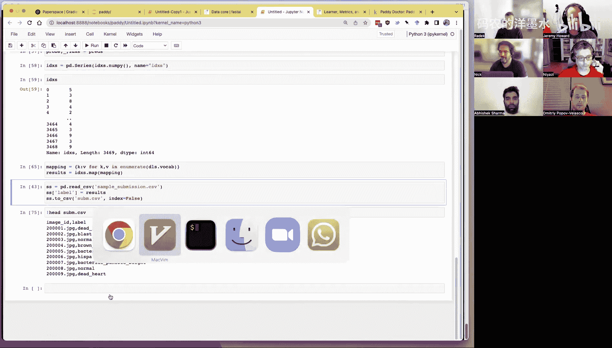

Theyavi item。And。D哋 to。Get petty。And。There's a submission file。Oh。

 and there's no kle installed on this machine。That's surprising。Okay。

 so generally minus help or minus minus sorry minus H or minus minus help normally gives you a quick version of help。

And so。You're going to want to do something with competitions。Compets。Okay， there we go。

 and so we're going to want to do a submission。All right， we need a fail for upload。

Am I going to need the competition。And so I could go kggle competitions， list pipe， Gr， patty。

That way， I don't even have to， oh。That's not what I expected to happen。Oh， I bet that pages it。Yeah。

Okay， so rather than Gr， we should use minus S。And it's going to use a regular expression or something is it。

嗯。Have a look at a few examples。Okay， so there's definitely something called spaceship， spaceship。

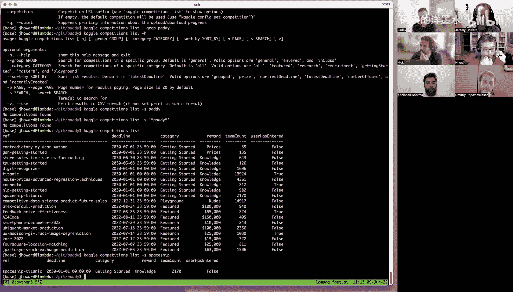

Allright， I will get it over here， after all。And this is what it's called。 So I don't know。

Is it not active， probably， that's why。It's active。Yeah， that true。

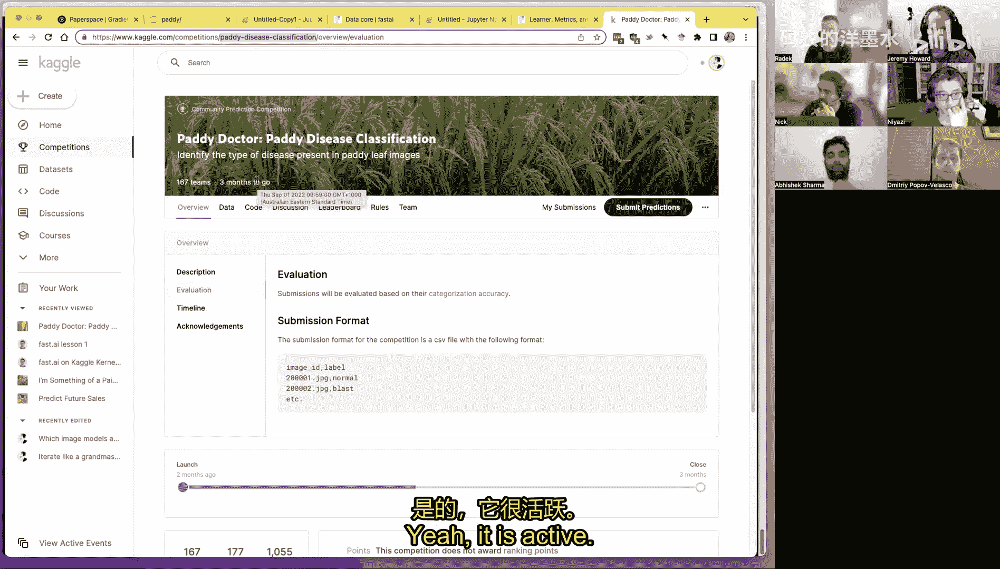

And I don't think it ought to matter。Is it because it's like not really actually organized by Cago。

 maybe only list the ones that are organized bygo or we need a copy letter category all it's fine。

 but maybe it's group。Maybe this is considered in class。Doello， yeah， Eddieho。

 so we were going to do a submission。And so we need to provide the file name， minus F。Oh， full path。

 That's a bit weird。Datty slash on it。嗯。Okay， and。A message， minus。Initial con next， con next， small。

2 epoch lime sheet， okay。And then， the competition。And good。Took a while for a 70 K file。

 but so be it。 Okay， so let's see if it's there。

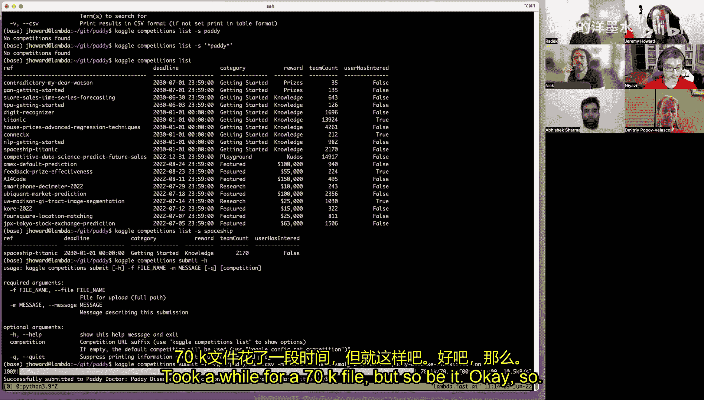

It is。 How did we do。Oh， I see。Ohhu， I jumped to your leader position。Hundred and57。Out of。167。

 so I'm guessing that there's a problem with our submission because it's I think maybe what happened was the test files were not like。

They got shuffled somehow。嗯。Like maybe when you did get。

Image files it got shuffled or something like that I think sometimes that might happen yeah that's a good question yeah yeah yeah that looks like that seems very likely。

So we didn't do a great job of checking as we went。 Yes。

 so they were expecting that 2001 would be first and we have 2300，19 first。So， that is not。Ideal。嗯。

Yeah， this has happened to me sometimes too。It would be nice if get image files by default。

 return things in a more sensible order。嗯。Anyway， it's good to see these problems。You know。

 we could just sort it， right。U。But。It looks like it works。

It probably does work as long as they've got exactly the same number as long as they're all one， two。

 three， four， five， six digits， if some of them are different numbers of digits。

 we we can't sort it because this is sorting in string order。嗯。But yeah， maybe that's okay。

Sir start tail。 Does't have tail。Yes，2，0，3，4，6，9。2，0，3，4，6，9。 Yeah， okay。Maybe we're fine then。嗯。

So sorted。 Oh whats see Daisy sorted。Returns the sorted version where all sorts in place。ok。So。

And those。Thanks。Brows。OK。And so it's very nice to， Yeah， have things set up。😊。

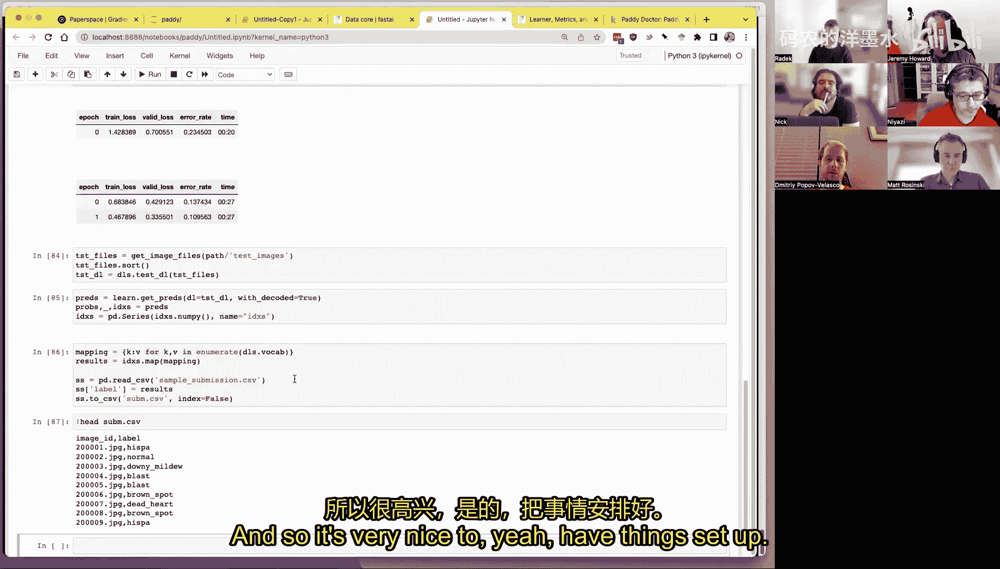

You know， that you're doing things from the command line and notebooks and stuff so that when you screw up。

 which， you know， if you're anything like me， you always screw up。

 you can pretty quickly repeat the process。So I just hit up arrow。And just add sorted to our message。

Both literally and figuratively， hopefully。

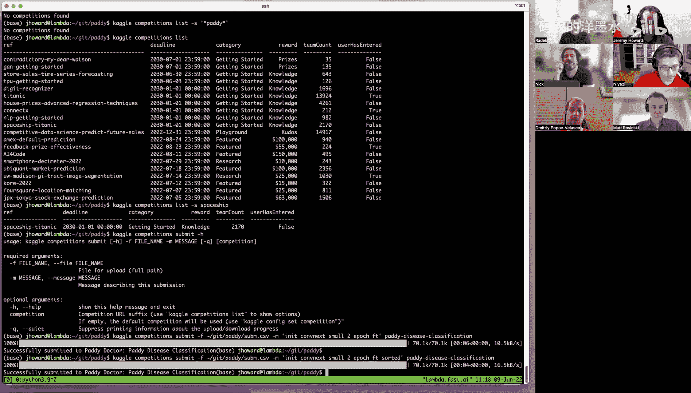

Welcome to the leaderboard， not a very successful welcome。😊，ok。Yeah， it's pet it。Quin91。There we go。

A good start。About in the middle。All right。So does anybody have questions about。Yeah。

 this process of。Yeah。I see Mike had a question in the chat and I had the same problem。All right。

 we' Pip installing Tim。This is in paper space， I assuming Mike was the same。

We can see the list of models。Yeah， but it doesn't actually create the learner， it says。

Name Tim is not defined so you'll need to。Yeah。So actually I was able to do that Matt。

 I just restarted my colonel Yeah， so just to explain when you say in Python something is not defined。

It， it means what it says。 It means that that symbol。Python doesn't know what it is。And so。

 there are。Two ways basically to define a symbol， to create a symbol。

 one is to say something like a equals one and that defines a symbol called a。

 or another is to do something like de。And that defines the symbol called F。

Right or the other way to define symbols is to import them。

 so in this case ti is not defined means you have not imported tim。And that will solve your problem。

Does that make sense？Yes， it does， but I。Yeah， it sort of I was。

Importing tin and running that command， I don't think it was working still it will definitely work if you say import to。

 this will definitely work。 so I'd say you might have reset your kernel or something and hadn't rerun that cell。

Yeah， you if you restart the kernel， it looks。Yeah， if you say import module。Oh， yeah， I mean。

 the other possibility is that you might have got a different message， which is something like。

This module not found and module not found means yeah。

 either you haven't Pip installed it or if you have Pip installed it。

 you might need to restart your kernel。By clicking Ca。

Restar so it can like recheck what modules you have since you just installed it。

That's what I had got it。Great。😊，Thank you。All right， well， that was pretty successful。

 even if paper space。wasnn't。Thanks， guys。😊，See you。 Yeah， see you tomorrow。Thanks， joining。

Thanks Jeremy， thank you， thank you。

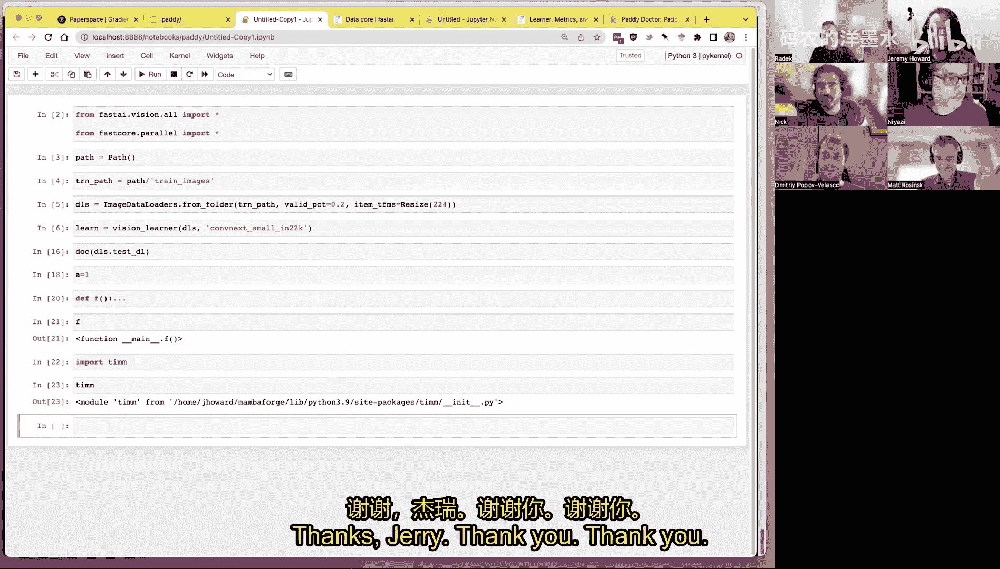

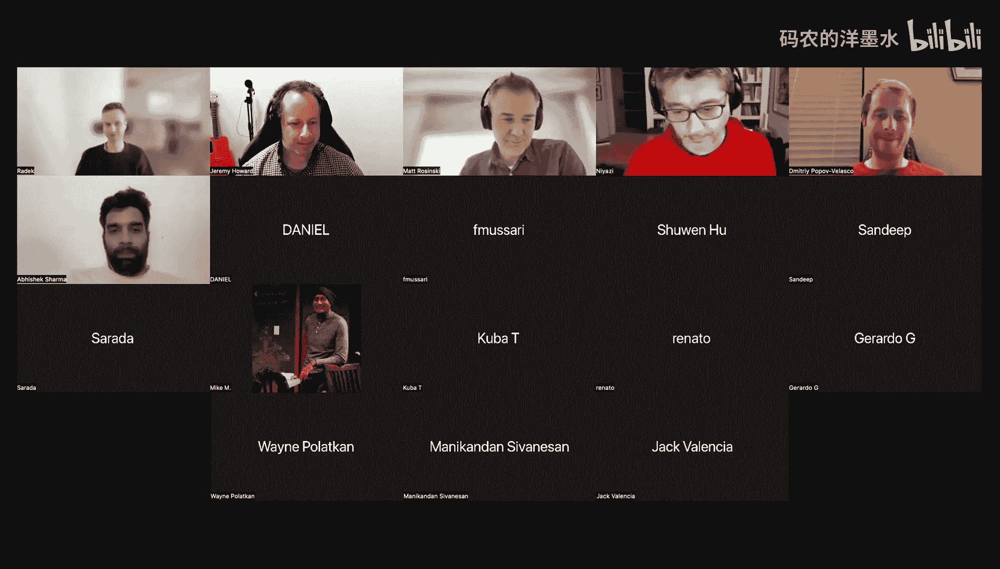