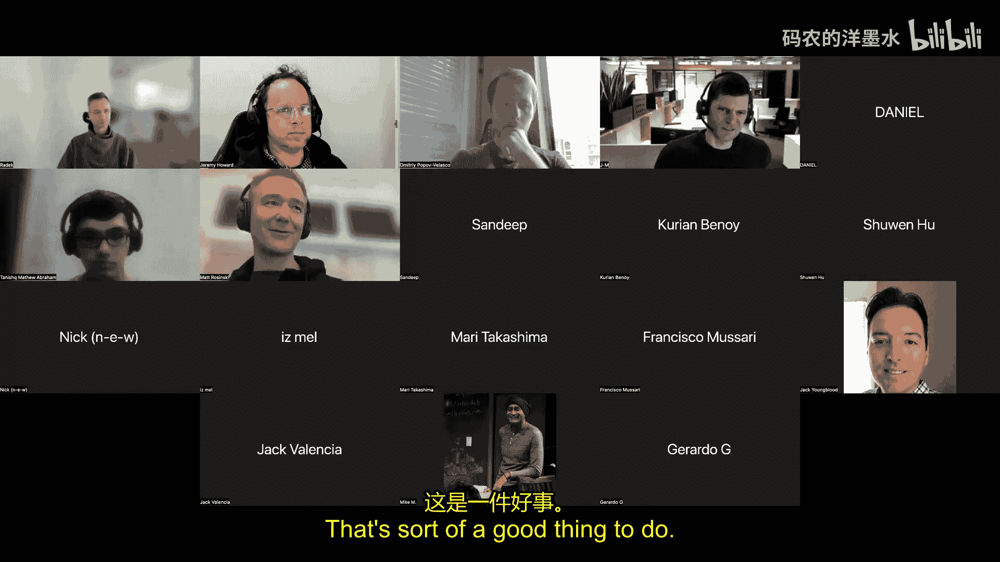
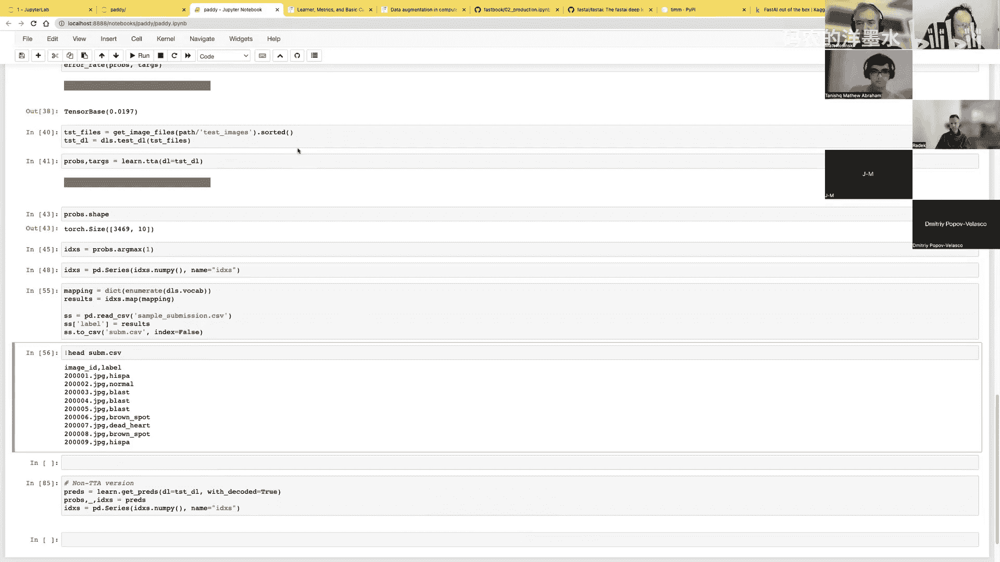
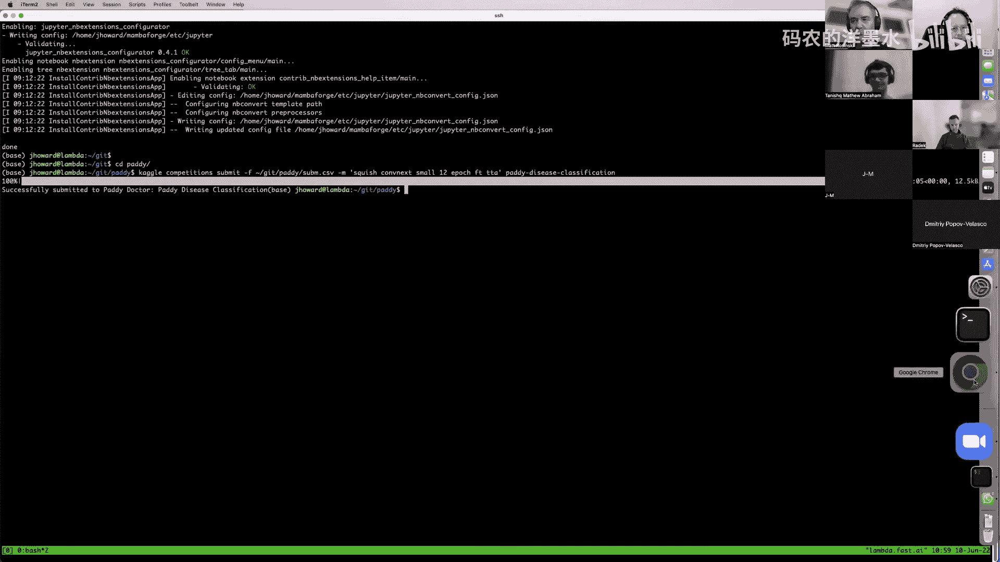
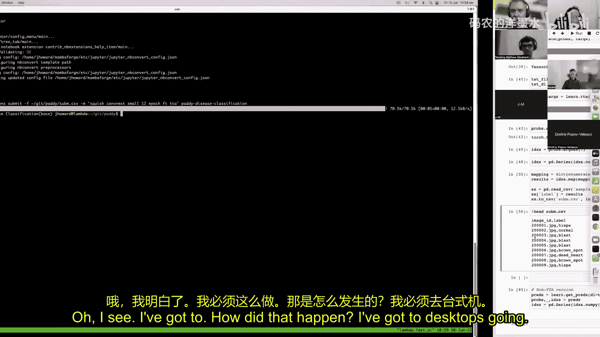
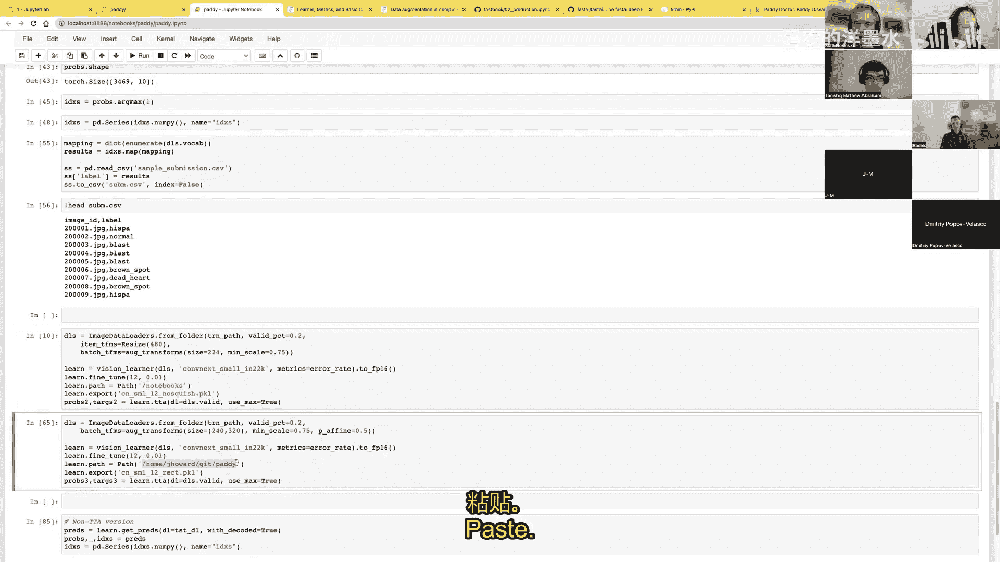
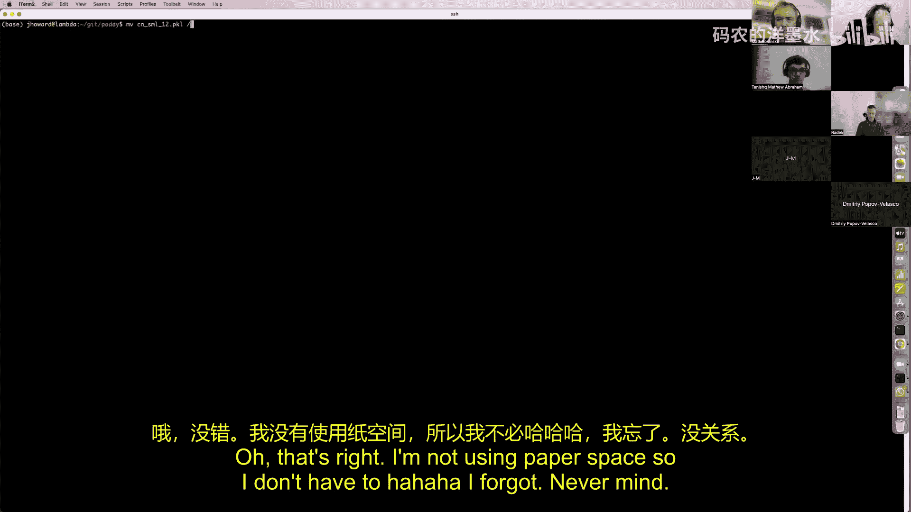
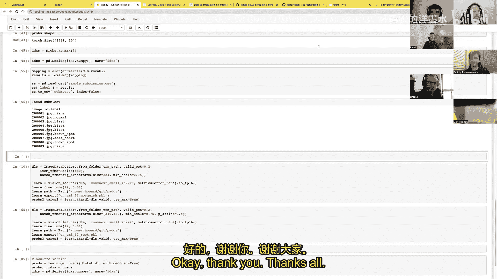
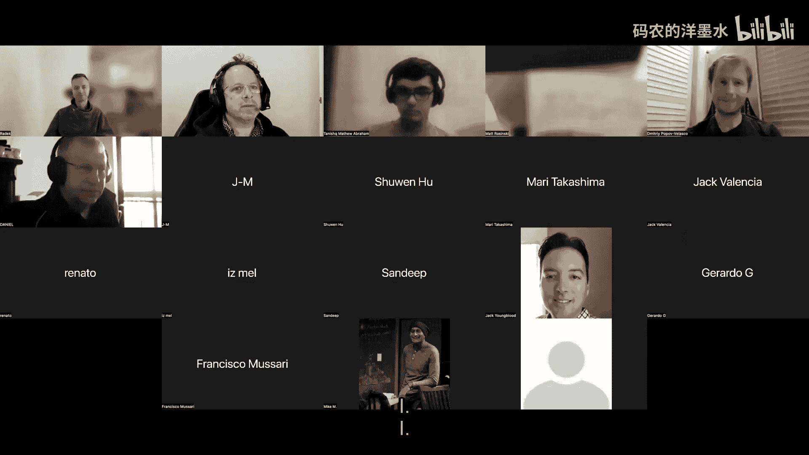

# 【全集】旧金山大学 实时编码 中英字幕 1080P p09 Lecture 9 - Kaggle竞赛进阶优化 -BV1KZiTBWEeH_p9-

Okay， we're recording。 So I know there were some questions on the forum。 Matt， I think it was you。

 right。Ha a couple of questions。Yep that's correct I can read them out for you if you like yeah or you can express them in your own terms。

 whatever yeah Tommy so I guess there weren't so much festival of all that went't。😊。

A couple of there weren't questions， though were just sort of differences。

When working on paper space， youre working on your local GPU and I found。嗯。

Simlinking the Kegle folder。Into storage with my API key is something that I did to make it a little bit easier to restart and just wanting to verify that that's sort of a good thing to do。

And but the one thing that I would be really keen to know about is the when I did the Pip install of Tim。

 it was。It was fine， it was installed， but I had to restart the kernel and I'm wondering。

That might be a bit of a pain going forward I'd prefer to have it persistently there ready to go。

 but it's not a condo package so I wasn't sure。How to yeah， so it's actually。

 it's actually packages are the only ones we've actually got the persistence working for。

 So let's do that one first。 So the the key thing， when you install10， let's see。

 Do I already have it installed。😊，Import him。Okay， great， I don't， so let's do it。嗯。😊。

So that the key thing to remember is when you install Tim is to do it with dash dash user now。

In order to make that easier， I think what I would be inclined to do would be to。嗯。

Addit our slash storage/。bash。loc。And add to it。Alias。Let's do P for PIip install equals PP。Install。

Let's do minus u for upgrade。I think that should work even if it's not installed already。

Minus minus user。Okay， now if I so I could close and reopen my terminal or I could just type source and then the name of the script。

 which of course in this case is exclamation mark Dollla。

Oop see Day exclamation mark V we'll rerun this， this whole thing needs to be in quotes。

Because it's a single thing that's my alias。Okay， up here twice。Okay， so now I can just type PI。

And by the way， if you want to know。What something is。

 if you type which P it won't tell you anything useful because it's an alias， not a。Binary。

 but if you type， type P， it will tell you exactly what it is。 in this case。 Oh。

 it's something that's an alias。 so I can type P I。Tim。

And the key thing about minus minus user is that's going to put it in my dash dash local directory。

Sorry， my dot local directory。Soir。There it is， Tim。So then all you need to make sure is that。

Your local directory。Is sant。To dot slash storage config。 now， that's interesting。

 Our this is here is telling us we've got a broken slink。 So that's what that means。 Yeah。

 dot config is similar linked to slash storage。But there is no dot get config there。

So I might have maybe forgot to move that or。Something。嗯。So that's okay。 next time we。Try to commit。

 it'll tell us and we'll know to fix that then。嗯。To create a file， that's empty。 you just use touch。

 So I'm just going to go ahead and create an empty file。So at least it exists。 and then。

Things won't get horribly confused。Yeah。Did I not touch you correctly。er。Clash storage。

 slash dot gettconfig。Oh， there's a slash at the end。That's why， that's why it's confused。

 So that would be a directory， but this is not a directory。嗯。

So my guess is that there's a bug in our prerun script for dot kind of fig。😔，Yes。

 I've got a slash at the end。That's why that didn't work。So if快啊。So what's that。Now， it's happy。K。

So now， yeah， so now since it's been installed into something that's similar linked back to slash storage。

 Tim will be available and if I run i Python we can confirm it did install。That should be all good。

 Does that answer that part of the question Matt Yes， thank you。 that So then the second one yeah。

 it was not a question， but a comment which is about Caor So yeah。

 when I get back to using Cale on this machine and we we will do that for sure。

Which will probably be next time。 And you also had a question about。Jumping around to。You know。

 the end of a string， for example。呃。Wch。Let's。Grab。Bust A repo， for example。

OhAnd you also had a question about loading and serving models。Great。So， I mean， one thing obviously。

 is it be nice to have a tags file？At some point， we could even talk about how to set up them to automatically create that。

For us from time to time。But let's have a look at， I don't know， layersers， for example。嗯。

So a few things to mention。 the first is something which sounds very obscure， but actually isn't is。

Is F in vim F in vim is like slash。 Now， slash searches。 So we've seen it before。 slash in it。

We'll search for the next Scor edit。 Okay， oh， maybe something we haven't discussed is to go back to where we were。

 regardless of whether it was a tag or a search or anything， it's control O。

And right next to control O is the letter I， which goes forward again。Okay。

 so control O and control I go kind of like pressing the back button and the forward button on your browser。

There's something a lot like slash， but which just finds a single letter which is F if I type F it's got to I don't search on the current line it'll search on this line for the next thing I type so if I type F double quote。

Actually， maybe more interesting， would be F full stop。 So if it had F full stop。

 it's going to jump to the full stop F dot。 So you see it jumps to the full stop。 right。

 And so your question was， well， what about jumping to the end of a string Now in this case。

 the end of a string is。The last character of the line。 So there's a better answer。

 which is to start inserting at the end of the line， its shift a。Just one moment。Yeah。

My daughter's got kicked off her Zoom call， always technical problems。Okay， so I can undo that。

Control O to go back to where I was。嗯。😊，But yeah， so let's say there was some stuff at the end。

 hassh some comment。 and we wanted to， yeah， we wanted to go to the next double quote。

 I can just type F double quote and it text me there。

And then shift F does the opposite it such as backwards。And the reason it's interesting。

 mainly is that that's a emotion。 and therefore， I can combine things with it。 So， for example。

 if I wanted to to everything up to the next quote， I can press D F double quote。Right。

 and then I could press slash double quotes of search the next one and press dot。

 and it'll do the same thing again。Right， or maybe delete everything up to the next comment would be Df。

Haash。嗯。So， yeah， those are a couple of useful things。 another really useful one。😊，Is percent。

Percent jumps to between the start and the end of a。Set of paired parentheses or braces or brackets。

 So if I press percent here。It goes to the start it goes to the start of end of the next parentheses and then press it again and you can see it jumps between the two。

Right， and so if I do it from here。You can see it jumps to the end of this one。

if I do it at the very end， it'll jump to this one。

So if I want to delete from here to the end of the。Parenticised parenthetical expression。

Like let's map to delete this bit。 I could press Df。Sorry， Df percent。Sorry， not DF%， just D%。

There you go。 Deep%。 see， although there's actually something even better for that。

 which is I and I is。Refers to an area， the whole area that is surrounded by some kind of parentheses。

 So even when I'm in the middle of these， these parentheses。

 the the enclosing parentheses would go from here。To here。 And so I stands for inside。

 So if I want to delete everything inside those parentheses， I can type D I open round， do it again。

 D I open round parentheses， and it deletes the contents。Which is really nice。

 So let's say I wanted to like replace all my parameters with something else like a comma B。 Then I。

 I would use C for change。😊，Inside parentheses， type may change like a comma B， right。

 And then I can come down here。And type dot。And it'll do the same thing。So， yeah。

 it's like mediaial work。 You can kind of really。Crush with these tricks。Great。sF。 Yeah， it's cool。

 There's a lot of them。 And you don't have to know them all。 You know。

 it's like you can learn one thing each day or something。😊，Yeah。

 I'm not using any plugins or anything， you know。嗯。嗯。Okay。

 so we're going to save a model in a moment。 Any other questions or comments before I go back to our notebook。

I wanted to make one comment about the ti installation I don't know if maybe you discussed this yesterday because I came a little late but with the Tim installation。

 sometimes it might be better to install from master because there are some changes that Ross has made that you might not receive from installing from mention yesterday Okay actually I think the conclusion we came to was to install the latest pre releaselease because that's like something that's。

More stable than installing for master， but。嗯。But， you know， better than his。

 sometimes it like here he went six months without， updating。 So， yeah， I agree。 In fact。

 So let's do that。 So this is 0。6。2 dev。 So I think we decided that we'd go。

 let's use our new P thing。10 is greater than or equal to 0。6。2。Deev。Great， yeah。

 thanks for the reminder， Tish。All right， great。It's kind of his thing in。

Python modules and quite a lot of other things。 if there's like。An extra dot dev at the end。

 That means it's a pre release， basically。 And so Pip has this。

Convention that if you say I want to install something that is at least as recent as 0。6。2 dev。

 then that's a way of signaling to that you're happy to include pre releasele options is there any reason that when you do the installation of a theme and then you try to use the learner。

It doesn't it says that thin doesn't exist when you try to load the model right that's because you have to restart the kernel after installing it。

Yeah。And so now that it's installed in local every time I start a machine。It's gonna be there anyway。

 So you wouldn't have to worry about that again。Yeah。Okay。So， this was our。No book from yesterday。

And I wanted to try and improve the model。And one of the reasons I wanted to try to improve the model。

Is because。We， you know， our， our result was， you know。Wort than the top 50%。 There you go， Top 56%。

 I didn't know that was a tip。 that's handy。嗯。😊，And so。We should， you know。

 I want to add into at least。u。Be as good as this helpful fast fast AI out of the box person。

 So they got 0。97385。嗯。Yeah。How far off are we， you know， which is going to bit better than ours。

 right？That was me。 That was my， my number fantastic。 I like it。 It's a good notebook。

 So we're going try to beat you。 I hope you don't mind。

 But then you'll know how to beat us because well， at least you know how to match us。 So。😊，So yeah。

 I saw that what you did here。Was you trained for longer， which makes sense。

And you also used some data augmentation， which makes sense。 So let's talk about。About this。

If we're going to train。For so whats your name， Gerardo， is it。Is it your at。 Okay Ra。Either way。

 that's fine which is right I want to be accurate well my name isra I see so both are right worries thank you。

😊，Herrado， okay， so if we're going trade as long as Herrado did then。You know。

 if you train more than about five epochs， you're in danger of overfitting and theres certainly 10。

 I feel like you're in sufficient danger of overfitting because your model's going to have seen every image。

 you know，10 times。So in order to avoid overfitting to the specific images it's seeing。

 we should make it so that it sees a slightly different image each time。😊。

And this is discussed in the book。In some detail。But basically。If you pass in batch transforms。

 these are things that are going to be applied to each mini batch。 So to each bunch of， however。

 many 32 or 64 or whatever images。And this is basically a bunch of functions that are going to be applied。

So what does this function do org transform So this is transforms for data augmentation。

 So we know that the best way to find out what something' is going to do is to check its help。

So let's start there。Add not help， doc。Okay， so。It's gonna do things like flip our images。

 rotate them， zoom them， change their brightness， their warp。See you show docs。Yeah。Okay。

 and here's some examples of a very cute puppy that Sylva found， I think Sylva found it。

So this is all the same puppy， it's all the same picture and as you can see。

 each time the model sees it it sees a somewhat skewed or rotated or brightened or darkened or whatever version of that picture。

😊，And so this is called data augmentation。Yeah。嗯。So。嗯。Yeah。Let's try， then。Running that。

And so org transforms actually returns a list。Right it returns a list of transformation。

 So here's the flip transformation where the probability of 0。5， it' will flip。

It's got a brightness transformation。With the probability of one。

 it will change the lighting by up to 0。2。And then random resized crop is perhaps the most interesting one。

 which is it we zoom in such that it has at least 75% of the height and width。And it will yeah。

 it will basically pick a smaller zoomed in section randomly chosen each time。

So what we can do is when we say show batch， if you say unique equal equals true。

 it all show the same picture each time， and so here you can see four versions of the same picture and you can see sometimes it's flipped。

 sometimes it's moved a little bit up and down， sometimes it's a little bit darker or less dark。

 and it's also a little bit rotated。U。So that's what data Or is。

 and that really helps us if we want to train a few more epochs。

Then the second thing I figured we should do is you know， renet's actually great。

 but there are things which are greater and as we talked about。

 Tim has a bunch of them and in particular Com next pretty good。嗯。And the other thing， you know。

 we could do is think about learning rates。 the default learning rate used by Fast AI is one where I would say I picked it on the conservative side。

 which means it's a little bit lower than you probably need because I wanted things to always be able to train。

嗯。😊，But it's actually a downside to using a a couple of downsides using a lower learning rate than you need。

 The first is that。Given fixed resources， fixed amount of time。Your。Gota have less epos。

 That but not less epox。 So less。Distance that the weights can move。The second is。

 it turns out a high learning rate。helpslps the optimizer to explore the space of options by jumping further。

To see if there's better places to go。So the learning rate Finder。

Is suggesting things around about 0。002， which is indeed the default。

But you can see that all the way up to like 10 to the negative two。

 it still looks like a pretty nice。😊，Slope and the other thing to remember is， you know。

 as we saw after answering next question yesterday， we're using one cycle training schedule。

 which means we're gradually increasing the learning rate。

 And my claim was that by doing that we can reach higher learning rates。

 So I would also say that even these recommendations are going to be a bit in the conservative side。

 So what I did just before I started this core was I tried training at a learning rate of 0。01。

 which is。Five times higher than the default。And so that's up here。 And I did find actually。

 that that did give us quite a better。Result。With a 2% error。 So let's see， I mean， obviously。

 you've got different trading sets， but。This is hopeful， right。

 that we're going to get a better result。Theyre our target。 it's nice to have a target to aim for。嗯。

Okay， so that's， that was the next thing。 So then it's， since this took， you know，6 minutes to train。

 it's probably a good idea to save it。嗯。So there's a couple of different things we can save with one is dot save and the other is dot export。

嗯。So learn it on export。Yeah。Saves the contents。 That's not very well written self say of the learner self means that this learner。

😊，And it saves it to self。pa/ ennet， so learner。pa/ enet using pickle。嗯。So basically。

 what that means is if you， if you call this land export， it's going to save it into learned up path。

 So let's find out learned up path is what。Train images。

 And so this is actually whatever we passed in。嗯。Yeah。So if we want to save things somewhere else。

 theres we've got a couple of options， one is to change loanup path by setting at equal to some other path。

Or we can just use an absolute。Path， so an absolute path is something that starts with slash。

 And so if I were to save it somewhere in storage， for example， that I can type slash storage slash。

Whatever， or maybe I want to put it in slash notebooks。Somewhere， so these are。

 these are some ways you can change。U。Where it's going to save。嗯。

I might even just put it into the current directory。 I think that seems fine to me。嗯。Well， actually。

 where are we current Rich， yeah。Butut it didn't get patty。 That sounds fine， or maybe to be。

A bit more short， just in case the directory ever changes。Be more specific。So， then。

 the other option。Is land not save。So learn not Sa doesn't save the whole learner。

 It just saves the model and the optimizer。State， the difference is that remember。

 a learner doesn't just contain the model， but it also contains。It also contains。

Inform about the data looters and specifically。What transformations replied。So。I。Don't really often。

 if ever used dot save。 The only reason I would use dot save is like if I was writing something to like。

And we already have stuff this in FA lets an example in FAA we have something that's a callback that can save the model at the end of each epoC or each time it gets a better result than it's previous best or whatever and those cases we might use dot saveve because then so then you recreate a learner and you can dot load into the learner but yeah for exporting something I want to be able to just load that exact thing with all the same details next time dot exports the way to go So I'm going to call dot export I'm going to use it's a cons next it's small and I did 12 epochs。

Oh， and this needs to be an actual path。Normally， we actually try to make these things do that for you。

 but this is less friendly than I would like。 Sorry about that。There we go。Okay。

So we should now be able to see it。There it is， okay。

 and it looks like we need to give it a dot pick or whatever。By default it with org transforms。

 which uses random re prop or randomly pick。Subset of the crop of the image of this up to this of this size or bigger。

And the validation set it will pick out the center。It'll you know。

 as all the width it can or all the height it can without changing the aspect ratio。

If you say squish instead， it will。Grab the whole thing and change the aspect ratio to squish it into a square。

 Matt， you don't have to raise your hand。 Just talk to me， mate。 What's up。U。Can you hear me。

I can't hear you。 Does that mean you can't hear me。I can hit。Oh， I can hear you。

 but I don't think you can hear。You can't hear anybody。So you do need to raise your hand。

 Why can't I hear you。呃。But you guys can hear me。Okay， yes， yes we can hear you， Jim。We can hear you。

I say喂。Okay， say something。Can you hear me now， Yeah， yeah I can。Al right。😊，Sure， okay。All right。

 did you guys， were you guys saying anything I was meant to be hearing。😊，Did I miss anything？Yeah。

 why did you choose 12 feetpos？Oh no particular reason I just saw that this one was using 14 and I thought oh aim for something around there but maybe just do a little bit less。

 I guess I often do around 12 fish epochs like。It seems to， like， for。For fine tuing things。

 which are somewhat similar to the original it。Often seems to get pretty close to， you know。

 getting all the information it can。Just as a roll of thumb。And I have runs in a recent word of time。

 too， I'd say。My assumptions were that the number 460 is because of the size of the images were 460。

And then another assumption was 224 because when you show the team with the different the con next and the image size was 224 that the reason that I selected that is that okay is that is that a correct well they was 640 by 480s so actually so we do this look it up in the book it's under the section called presizing and I think this is around what we always presize to so actually maybe 480 would have been better because then it wouldn't have had to change one of the dimensions because there was 640 by 480。

And then your size you picked I actually changed it。 so Coloradorato picked 230。

 but actually most of these models that are trained on imageNe。I generally trained on 224。

 so I wanted them to be the same size as what they trained on。 So that's why I picked 224。Yeah。

 so then sququiish I've talked about。😊，Oh， and then the other thing is the model I picked。

Is one with a suffix in 22K IN here refers to imageNe and the 22K refers to the version of IageNe with 22。

000 categories as opposed to the version that's normally used which only has 1000 categories。

So this is a convnex， which is small， but is trained on imagenet。With a 23，000 category version。

The 22000 category version， it just has a lot more images covering a lot more different things。

So there's a much higher chance that it's going to have seen something like。

Rice padty illness than the one with  a thousand0 images and has just seen a lot more different picks。

 you know。嗯。So yeah， I would recommend always using the N 22K。Pre traineded models。So those are。

 I think。The key differences at the training stage。去。Yeah。

 I think when you had put the the export and then the error came。

 that's when it cut off so I don't think you explained what you did to we didn't cast the part where you explained the fix。

The fix。Well because the export had an error right and then you I guess you've now added I don't think didt I don't think it had an error。

 but I just oh I see yes， yes， yes， okay， yeah， the export had an error because this was a string and it actually is to be a path which I'd say is an oversight on my part I try to make it so that everything can accept a path or a string so I would consider that a bug that ought to be fixed so hopefully by the time people watch this video。

That might have been fixed， but yes， at the moment， I had to change this to a path。 Thank you。嗯。

Allright， so。There's a few things we could do here， right， But one1， one key issue is that the。

Is that particularly if you don't have methodical squash， when we do validation。

 it's only selecting the center of the image。And that's a problem。

Right we would like it to see all the image and then another thing is that we've been training it with various different augmentations。

 but the validation set we don't use any of those augmentations。嗯。😊，So there's a trick you can use。

 which you should particularly use if you don't use squash and that's effectively cropping into the center。

 which is something called test time augmentation。 and in test time augmentation， we。Basically， get。

嗯。Multiple versions of each image， we actually by default get four different randomly augmented versions of each image。

Um。😊，And plus the unaugmented version， we get the prediction on every one and then we take their average and that's called test time augmentation。

 And as I say it's going it would work particularly well without the squash。

 but it ought to work well even with the squish so。To get those predictions。Let's， first of all。

 make sure we can replicate this error rate manually， right， So if we go。诶。Probabilities。

 comma targets equals learn dot get pres。And we pass in the validation set。嗯。

And then we should find that if we ask now for the error rate。Chiff tap。

So the inputs of the probabilities。And the targets are the targets。There we go。 Okay。

 so that's our 2。02% error rate。 So we've， we've replicated that。 Okay， so now we've got that 2。02。

 I would then。Try out TTA。And of course， before we use a new function。

 we would always read its documentation。Here we are do TTA。

 so return the predictions on some data set or some data loader。

We get the predictions n times by default 4。Using the trading set transformations。嗯。Great， oh。

 and instead of getting the average of predictions， we could also get the max of predictions。嗯。Cool。

 and， you know， the other thing， which I definitely encourage you to do。Is you know。

 it's always good to look at the source code because my claim is that fast AI functions are generally not very big。

And like also quite a bit of its stuff， you can kind of skip over right this kind of like， oh， what。

 what if it's none or what if it's none， like this is just setting defaults， you can kind of skip it。

Try finally， you can skip because it's just error handling with you can pretty much split progress bars。

 You can pretty much skip。So the actual work starts happening here。 we're going to call self。

 get pres passes in a data loader。And then it concatenates it altogether。

And then it takes either the maximum or the mean， depending on whether you ask for the max or not。

And it also grabs it for the。嗯。Validation set data loader。诶。Yeah， so you kind of get the idea。好。Yeah。

So， let's run it。See if we can beat 2。02%。So you can see here， it's running it。

Four times for each of the four augmented versions。

And then it will run at one time for the non augmented version。Okay， and it beat it。

 But just by a little bit。 And then， you know， another thing is， well， what if we did。

The non maximum。Use Mexico's spouse。Is Mexicos true。 Is the maximum instead of the average。Yeah。

 I kind of wish I didn't have this squ now， but I don't want you guys to have to wait 10 minutes for it to retrain because then you'd much more clearly see the benefit of using TTE。

That's interesting that one's worse。I generally find that when not using squish。

 that using TTA and use Max equals true is best。Okay。

 so now we've done all that we can try and submit。This one to kggle。嗯。

So we can just repeat basically what we had yesterday， but instead of get pres。Yeah。We'll do T TA。

Yeah。Now， there's no width decod， I don't think， for T T A。

 So we're going have to do a bit of extra work work here。

 So this is gonna to give us the probabilities。And the targets。And so the probabil is。

 each row is going to contain a probability for each。Element of the vocab。So we can take a look。

And so， it's a。So for each of the 3469 things in the test set， there are 10 probabilities。

 which presumably means the length of the vocab is 10。Which it is。嗯。😊。

Great so so find so what we want to do is find out well what's it actually predicting and the thing it's predicting is whatever thing has the highest probability so we got to go through each row and find the index of the thing with the highest probability so in math and pi torch nu that's called aG max so aG match is the index of the thing with the highest value。

😊，so嗯。Probs。Dot agm。And so what do we want to take the maximum over which dimension。

 So we want to do it over rows， which I think we say dimension equals one。There we go。😊。

So that's the correct shape。So now we should be able to do the same thing we did yesterday。

 which is to convert that into a series。And。Now we ship you to run。嗯。This mapping。 Now， I。

 I realize actually， this thing we did yesterday where we went K colon and V for K comma V it enumerate。

It's actually a really long way。Of just saying， create a dictionary。From。嗯。From those。

 from those tus。So。When you create a dictionary。You can do it like this。Yeah。喂。😊，Um。Or。

 you could do this。Yeah。嗯。HereHere's a coupleple of tuples。Okay， sorry， here's a tuple of tuples。

And ideally， what we'd like is to call di。And pass in。Each pair of these as an argument to it。

And so Python actually has syntax to do exactly that for any function， not just dit。

 which is the function star star and star star means takeker mapping。And pass it in as as pes。U。

So that's what this does， right。That's going to be a mapping。Which your nu rate already is。

That's what sta。Just put this here。Why is this not working， I expect this to work。How annoying。Well。

 so much for that discussion。Annoying。All right， I'm going to have to try to think of a better way to make this work because so far。

Similar problem to what we had yesterday。I think you don't need to start star in that case。Wow。

 that's nice， isn't it even better。Thanks for the trick， okay。

I didn't quite get to show you about how Col star star is， but never mind。对。Okay。

So what I'm do is I'm gonna make a copy of the last time we did ahead of the submission。

 And one reason I like to do that for my new submission is to confirm that our new one looks somewhat similar。

 So previously， we went Hispan normalmal downy blast blast。

 Now we go Hispan normalmal blast blast blast。 And so this makes me a comfortable that okay。

 we haven't totally broken things。 It's still giving。Lgely the same results as before。

 with a few changes。And so that's just something I like to do， okay。

And then another thing I like to do is kind of keep track of。Stuff I've done before。

 I try not to delete things I've used before， so and just pop it into a different notebook or comment。

 So down here I'm just going to have non TTA version just in case I want that again later。All right。

 so we should be able to。Submit that now。

Okay， so I use controller and then to started typing competitions。Okay， so this is now a。Squiish。

Come next， small。12 apoch。Fine tune。😔，Tta。诶。What on earth did it do to my window。How do I get back。

Oh， it。

Oh， I see。 I've got to。 How does that happen。 I've got to guess what it's going。

I didn't notice that。All right， let's go and check out Kagel。Aubs。Oh， look at that。

 Harraa' is still beating us， I think， but at least we've beaten our previous one。Yeah。

That's amazing。😊，That's great。Chumpry our leaderable position。 we're going have a good battle on。34。

No I think you beat me up wait， I thought you was better than that。I think I'm a little bit lower。嗯。

Code。Oh， you were 9，7，3，8，5。Yeah。Okay，9，7，9， okay。That's not bad， right， actually，34th out of。

I mean it's just a fun competition。 Nobody's really trying too hard， but still， you know。

 it's nice to feel like you're。In the mix， how far are we， Okay， so。This persons still way ahead。

 right， they've got an error of 1。3%， and we've got an error of 2。1%。嗯。

You know something else that would be fun。Would be。嗯。You know。

 you could like you can kind of super easily create an ensemble。

 So maybe I'll show you how I would go about creating ensemble to create an ensemble。

I would be inclined to。maybe。嗯。We could create an ensemble with an uns sququeed version。

 for instance， so what I would do is I'd kind of like copy all the stuff that we used。

To get out predictions。Right， and then I would kind of。Paste them down here。Go through and。

Remove the stuff That isn't quite needed。Like， so。This one's gonna be。I squish。And。Yeah。Go to Max。

Is Max。Calls true。And so then to merge cells that shift M M for merge。And。Yeah。

Dont need the error rate anymore。对。嗯。And so this is going to be a second set of probabilities and a second set of targets。

😔，Yeah。Yeah， so we could just run that。And take the average of these two models。

 I'll remove squish here。Okay， so that might be our third model。

And then another model I would be inclined to try is one that doesn't use square。嗯。So。

We've got 640 by 480 images， right？So the aspect ratio is four to three。嗯。So。

 I would be inclined to say。Take that and multiply that by the smaller side we want。Okay。

 that gives us 298。6。6。嗯。It nice to find something that works a bit more evenly， wouldn't it。

What if we did it the other way around？So we could create 1，68 by 2，2，4 images， for instance。Or。3，3。

6， maybe。3，3，6 by 2，5，2 images。Yeah， let's do that。So， let's change this size。

And I never quite remember which way round it is， but that's okay， we'll check it so。3，3，6。Bye 2，5，2。

Images。And so the reason I'm doing rectangular。 sorry， rectangular images is that， yeah。

 all of our input images are the same aspect ratio。

 So there's no particular reason to make them square。 You know， when some of your images are。

Wider than tall， and some are taller than wide than it makes perfect sense to。You know。

 use square as your。You know，s the thing that everything gets changed to， but there's， you know。

 when everything's wider than they are tall and especially when they're all the same aspect ratio。

 it makes more sense to keep them at that same aspect ratio。嗯。And， you know。

 another thing I guess we should consider doing for 6，40 by 3，80 is to。

You know you can change their resolution more gracefully without weird interpolating fuzziness by doing it by。

 you know， a factor of two， so we could do 320 instead of 640。嗯。And by 2，40。

So that would be another  one。 I'd be inclined to try。 Yeah， In fact， let's just do that。

 Let's pick that the aspect ratio。There we go。And so obviously。

 we should check it and we know how to check it， which is to go。Svech。Okay。

 so you can see I've got it the wrong way around。There we go。 That's better。嗯。Cool。Oops。

And like given that we're going to have such nice clear images。

 they would probably do the aine transforms or the ones where we're zooming and rotating and stuff。

 so to say don't do those so often， we can change the probability of aine transforms from 0。75 to 。5。

Probability of aine transforms to 0。5。So in theory， I feel like。This one feels the most。Correct。

Given that the data that we have is a fixed input size。Of that type。 So I would be inclined to。嗯。

Well， you know， we'll take a look afterwards， but。No， what did I just do？toppy。Go save。

A different set。 And so we can easily then check that。Accuracy of each of them。

 And this one's going to be。Rectangular。Tectangular。There we go。😊，Okay。Now that we're saving a few。

 I guess I'm a little worried that。Paper space might。Disappear。

 and so I'm actually inclined to save these into my notebook directory。I to be a bit paranoid。Copy。

Yeah。Haste， and so， let's move。

嗯。Let's move this one into slash notebook。Oh， that's right。 I'm not using paper space。

 so I don't have to。 I forgot。

Never mind。😊，I'm on my own machine。 That's I like the fact that I've got papers basede so well set up now that I don't even。

Remember， I'm using paper space。Okay。诶。Great， I think that's that。 Alright。

 I'm gonna not have you guys watch that run for 20 minutes。

 So I'm gonna go Any questions or comments before we。Rp up。

So I see that you're like focusing a lot on like the data transformations and augmentations。

 when would you focus on that versus you know， playing around with different models and things like that instead。

🤧诶。嗯。Given that this is a。Image classification task for natural link， for natural photos。

It will almost certainly have exactly the same characteristics as。ImageNe in terms of accuracy。

 or at least any fine tuning on INe。So。I would I'm working on the assumption。

 which I could read we can test later， but I'm pretty sure it's going to be true that the things that are in that。

That notebook showing which， which 10 models are better than others。Will apply to this data。

So I would once everything else is working really well。😊，You know。

 I would then try it on a couple of models or at least run it on a bigger one like base or large or whatever I can get away with。

If it was like a。Tegmentation problem or an object detection problem or a medical imaging data set。

 which has the kind of pictures that aren't an image net。 know， over all of these things。

 they would try more different。Architectures， but then for those cases， I would。

Let's say it was a segmentation problem which is about recognizing what each pixel it always is a pixel of even there I would not try to replicate the research of others instead I would go and look at something like papers with code。

com to find out which，Techniques have the best results on segmentation and better still I would go and find two or three previous tackleggle competitions that have a similar problem type and see who won and see what they did Now when you look at who won they always say oh we made an ensemble which is fine but the important thing isn't that they did an ensemble it'll be they'll always say pretty much the best model in our ensemble was X and so I would just use X and I would use as kind of like smallest version of X I can get away with。

And yeah， generally。Fitdling with architectures tends not to be very useful nowadays for any kind of problem that like people have fairly regularly studied。

 which。Almost any computer vision problem is of that type。

I guess the only interesting question for this one would be there is something saying what kind of rice is in this paddy。

 which is like a category， but I'm。😊，Fairly sure that using that information is not going to be helpful in this case。

 because the model can perfectly well see what kind of rice it is。

 so I very much doubt we have to tell it。Cacause it's got pictures。

Jeremy yeah its it's it's going to take me a while to work from a way through all of the videos yeah are they going to be virtually available yes cool thank you and。

Don't feel like。You can only join if you've watched all the previous videos and don't feel like you can only ask a question if you've watched all the previous videos like。

It's totally fine to ask a question about a video we did a week ago or about something that we just covered yesterday or whatever。

 If the answer to your question is， oh， we cover this in this video， here's where you go。

 I will tell you that。 And that's totally fine。 But and if it's like。😊，Okay。

 you said this thing in this other video but I don't get it， say it again。

 that's totally fine too like。We're moving at quite a fast pace because people can go back and rewatch the videos and because people can come back later and ask questions about things that aren't clear。

 So yeah， it definitely does rely on。People turning up and saying I'm not clear on this or whatever Yeah well I sort of started from ground zero in this whole environment but it is starting to make sense now on stage that's be a little bit more comfy with it let's want to take the time to work through my way through and' all what you're been talking about Well also Daniel I will say like there's a couple more lesson lessons to come yeah what is it next week or the week after I suspect during those two weeks so Ill probably stop the walkthroughs so yeah sure there'll be a couple of weeks there to catch up。

 but yeah like feel free to。😊，Yeah， join in any time or not join in any time and ask questions about any video or even about things that's not coveredven in a video。

 but you feel like。Would be something useful to know in order to understand。

I'm really looking forward to the tabular data actually。 Oh cool， yeah。Okay， thank you。 Thanks all。

Say it next time。

。拜喂。

Thank you。