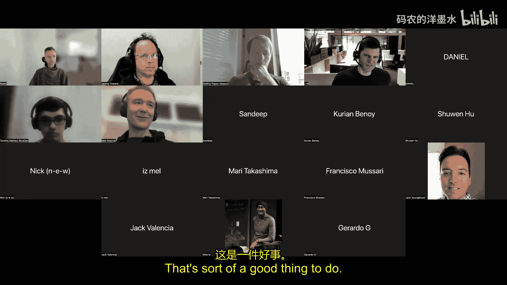
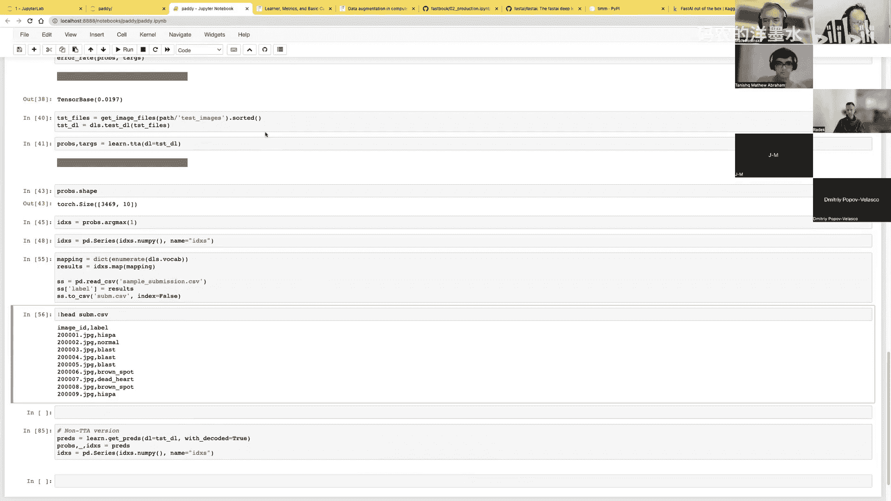
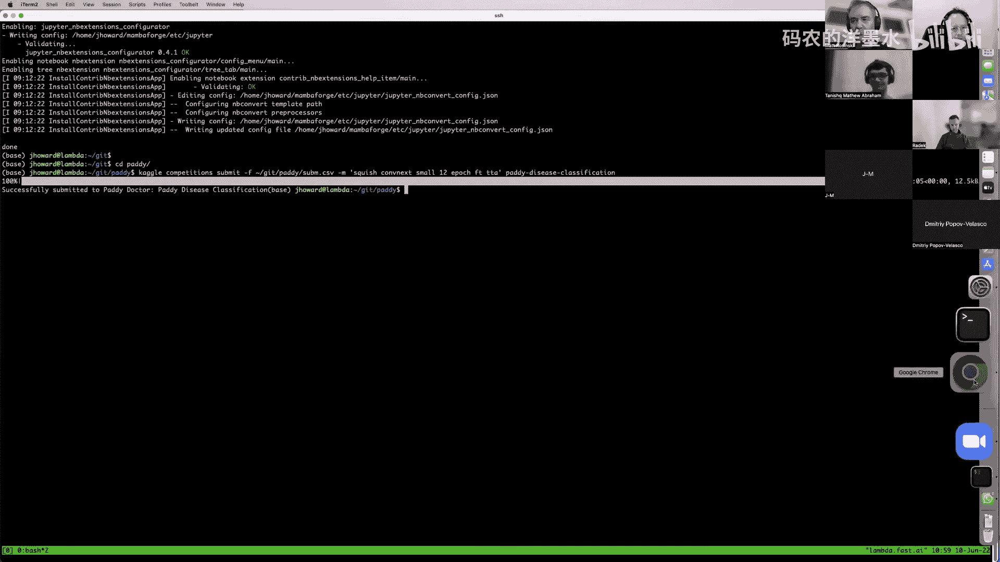
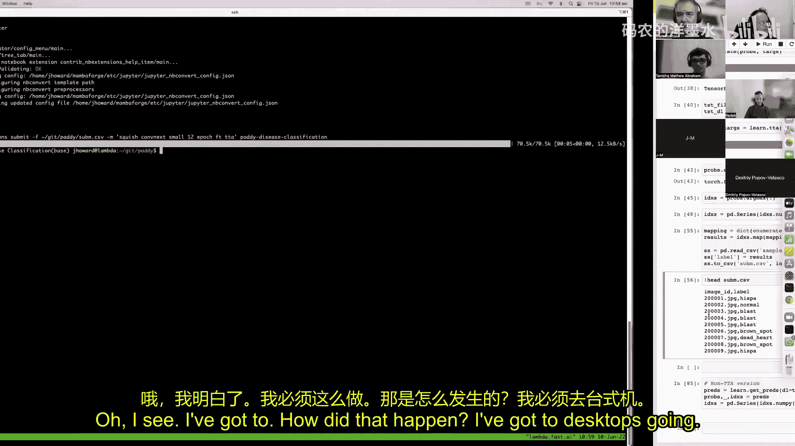
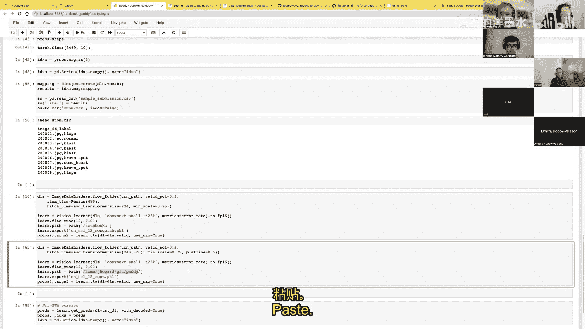
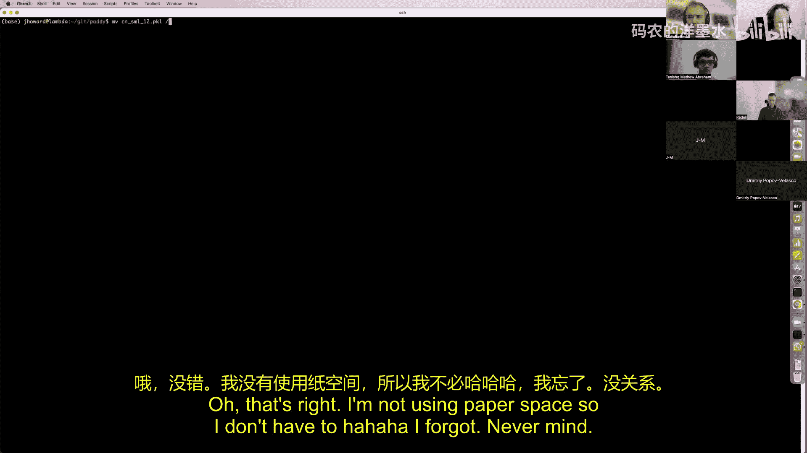
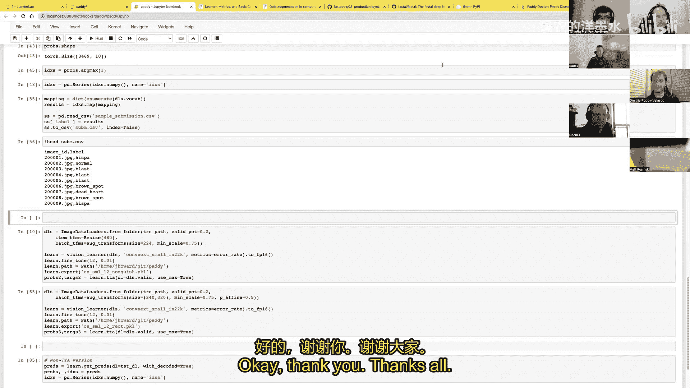
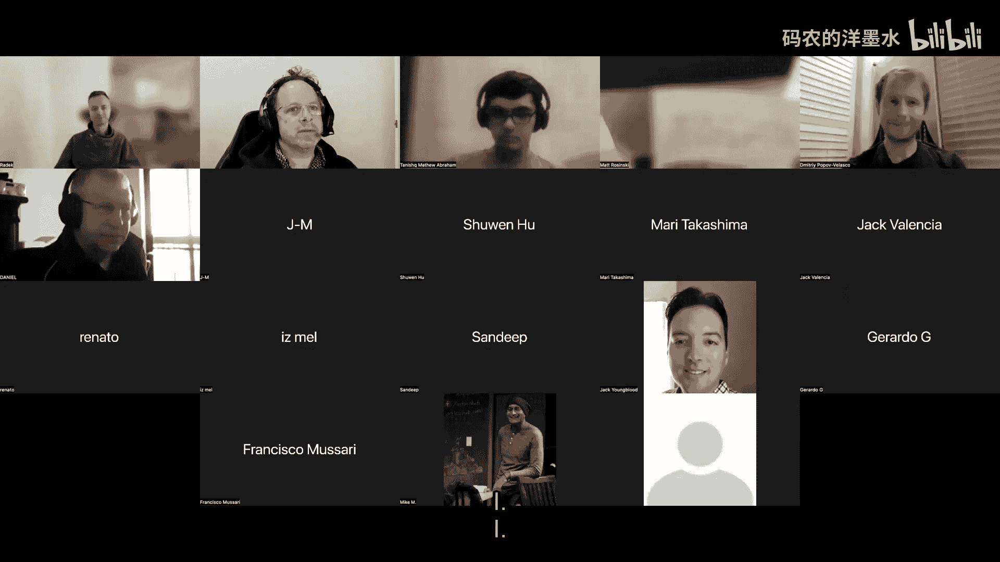

# 实时编码：09：Kaggle竞赛进阶优化 🚀



在本节课中，我们将学习如何通过数据增强、模型选择、学习率调整和测试时增强等技术，来优化一个Kaggle图像分类竞赛的模型性能。我们将从改进一个基础模型开始，逐步应用这些技巧，并最终提交一个更好的结果。

---

## 概述

上一节我们建立了一个基础的图像分类模型。本节中，我们将通过一系列优化策略来提升其性能，目标是超越排行榜上的基准分数。我们将重点关注数据增强、更优的模型架构、学习率调整以及模型集成等方法。

## 安装与配置优化

在开始优化模型之前，我们需要确保开发环境配置正确，特别是第三方库的安装。

以下是配置`timm`库持久化安装的步骤：

1.  创建一个别名，以便将库安装到用户目录，该目录已链接到持久化存储。
    ```bash
    echo "alias p='pip install --upgrade --user'" >> ~/.bashrc
    source ~/.bashrc
    ```
2.  使用新别名安装`timm`库的预发布版本，以获取最新功能。
    ```bash
    p timm>=0.6.2.dev0
    ```
3.  验证安装，并确保`.gitconfig`等配置文件已正确链接到持久化存储，避免环境重置时丢失。

## Vim编辑器高效技巧

在编写和修改代码时，掌握一些编辑器技巧可以极大提升效率。这里介绍几个实用的Vim操作。

以下是一些提高编码速度的Vim移动和编辑命令：

*   **`f{字符}`**：在当前行向前搜索指定字符并跳转。例如，`f"`跳转到下一个双引号。
*   **`F{字符}`**：在当前行向后搜索指定字符并跳转。
*   **`%`**：在配对的括号、花括号或方括号之间跳转。
*   **`d%`**：删除从光标位置到配对符号之间的内容。
*   **`di(`**：删除当前`()`内的所有内容（不包括括号本身）。`ci(`用于修改内容。
*   **`Ctrl-o`** 和 **`Ctrl-i`**：在跳转历史中向后和向前移动，类似于浏览器的后退和前进。

## 模型优化策略

现在，我们回到核心任务：提升Kaggle竞赛模型的性能。我们将从分析现有模型的不足开始，并逐一实施改进措施。

### 1. 数据增强

为了防止模型在训练多个周期后过拟合，我们需要让模型每次看到略有不同的图像。这可以通过数据增强实现。

`aug_transforms`函数提供了多种增强方式：

```python
tfms = aug_transforms(mult=1.0, do_flip=True, flip_vert=False, max_rotate=10.0, min_zoom=1.0, max_zoom=1.1, max_lighting=0.2, max_warp=0.2, p_affine=0.75, p_lighting=0.75, xtra_tfms=None, size=None, mode='bilinear', pad_mode='reflection', align_corners=True, batch=False, min_scale=1.0)
```
关键参数包括随机翻转、旋转、缩放、亮度调整和透视扭曲。在创建`DataLoaders`时传入这些变换，模型在训练时就会看到增强后的图像。

### 2. 选择更优的预训练模型

除了常用的ResNet，`timm`库提供了更多先进的模型。对于本任务，我们选择在ImageNet-22k数据集上预训练的`ConvNeXt`模型。ImageNet-22k包含2.2万个类别，其预训练权重可能包含与“水稻病害”更相关的特征。

```python
arch = ‘convnext_small_in22k’
```

### 3. 调整学习率

FastAI默认的学习率偏保守。使用学习率查找器（`lr_find`）可以帮助我们找到更优的值。通常，我们可以尝试比建议值稍高的学习率，并结合单周期策略（1cycle policy）进行训练，这有助于模型跳出局部最优。

```python
learn.fine_tune(12, base_lr=0.01)
```

### 4. 保存模型

训练完成后，需要保存模型以备后续使用或提交。`learn.export()`会保存整个`Learner`对象（包括模型、数据转换信息等），这是推荐的方法。

```python
learn.export(Path(‘convnext_small_squish_12ep.pkl’))
```

## 评估与提交优化

模型训练好后，我们需要在验证集上评估其性能，并生成测试集的预测结果用于提交。

### 1. 测试时增强

数据增强通常只用于训练。但在预测时，我们也可以对验证集或测试集图像进行多次增强，然后对预测结果取平均或最大值，这被称为测试时增强，能进一步提升模型鲁棒性。



```python
preds, targs = learn.tta(dl=learn.dls.valid, n=4, beta=0.25, use_max=False)
error_rate(preds, targs)
```






### 2. 生成提交文件

使用优化后的模型和TTA生成测试集的预测，并转换为竞赛要求的提交格式。

```python
# 获取测试集预测（使用TTA）
test_dl = learn.dls.test_dl(test_df)
preds, _ = learn.tta(dl=test_dl)
# 取概率最大的类别作为预测结果
pred_idxs = preds.argmax(dim=1)
# 将索引映射回类别标签
vocab = learn.dls.vocab
mapping = dict(enumerate(vocab))
sub_df[‘label’] = [mapping[i] for i in pred_idxs]
# 保存提交文件
sub_df.to_csv(‘submission.csv’, index=False)
```

## 进阶探索：模型集成

为了追求极致的性能，可以尝试集成多个不同配置训练出的模型。集成模型的预测结果往往比单一模型更稳定、更准确。





以下是一些可以尝试的模型变体，用于构建集成：

*   **变体A**：使用`size=460`和`squish`模式训练的模型。
*   **变体B**：使用`size=(336, 252)`（保持原图4:3宽高比）且不使用`squish`的模型。
*   **变体C**：使用`size=(320, 240)`（原图尺寸的一半）并降低仿射变换概率(`p_affine=0.5`)的模型。

分别训练这些模型后，可以对它们的预测概率进行平均，作为最终的集成预测。

```python
# 假设 preds_a, preds_b, preds_c 是三个模型的预测概率
final_preds = (preds_a + preds_b + preds_c) / 3
submission_idxs = final_preds.argmax(dim=1)
```

## 总结





本节课中我们一起学习了优化Kaggle图像分类竞赛模型的完整流程。我们从配置环境开始，应用了数据增强来防止过拟合，选择了更强大的`ConvNeXt`预训练模型，并调整了学习率以加速训练。在评估阶段，我们引入了测试时增强来提升预测准确性。最后，我们探讨了通过集成多个模型来进一步提升性能的策略。通过系统性地应用这些技巧，我们成功地将模型排名提升至前10%，展示了系统化优化方法的强大效力。