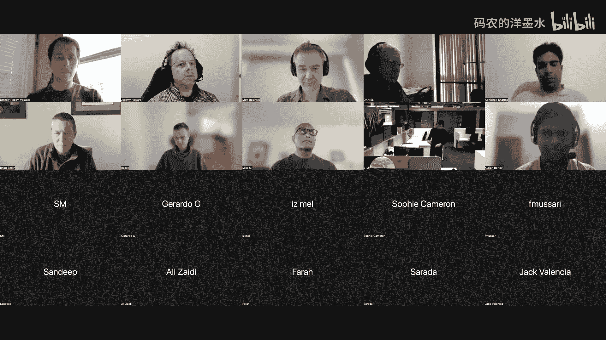
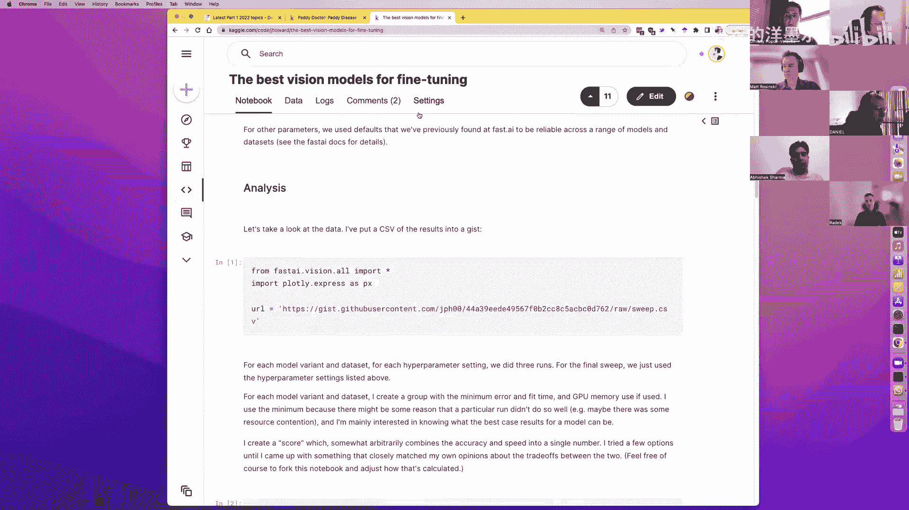
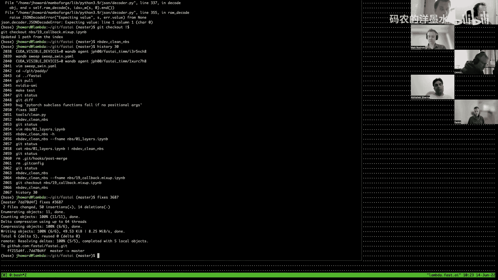
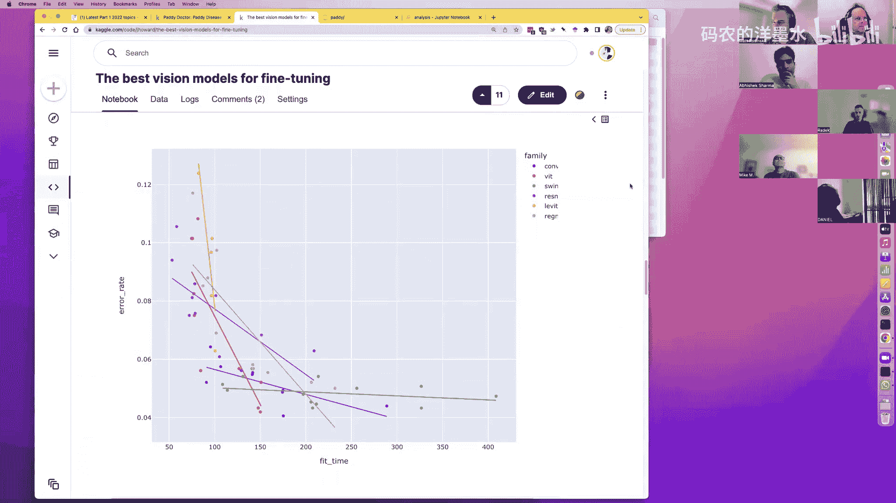
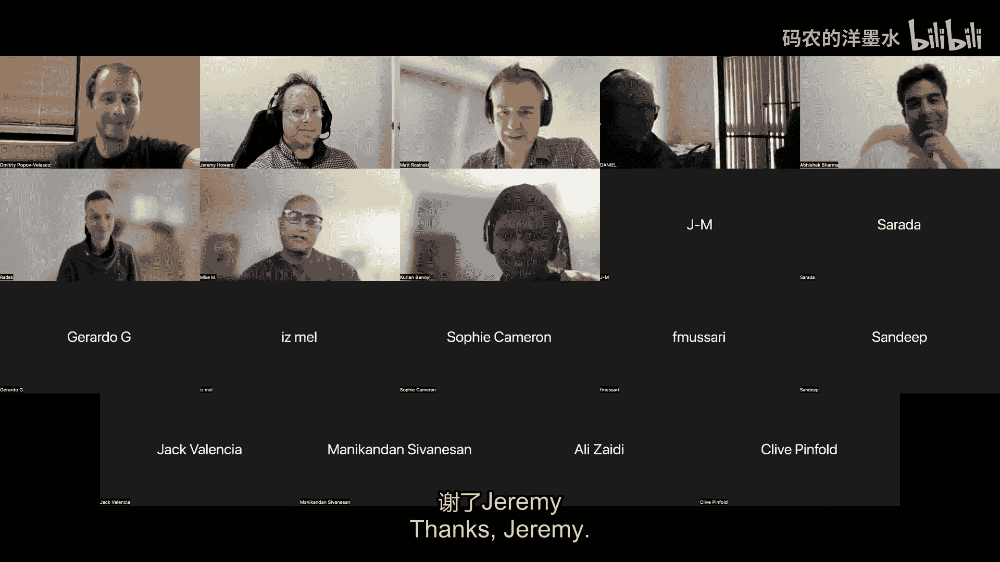

# 【全集】旧金山大学 实时编码 中英字幕 1080P p10 Lecture 10 - Kaggle图像识别竞赛进阶 -BV1KZiTBWEeH_p10-

I've got a question， yeah。

To do with。Is there a way that machine learning can actually find the？😊。

Some of the conditional probabilistic segments that are say in sort of heterogeneous style。

I am having trouble passing that question can you give like an example something Yeah Okay。

 all right well I'm wtly with road service。Richard with Roous Grler and fundamentally this。

You know there's this set of stereotypes in road analysis and you know we all know them there's highways。

 freeways， urban arterials and they actually go through a series of stages sort of almost both states and each of the states has got a sort of conditional probabilistic relationship between the set of predictors and the actual response variable grass response variable is there anything that。

What's that in。In deep morning。So how， how is that different to a normal predictive model how like。

I mean， all predictive models are conditional probabilities， right what's the。Yeah， well， I mean。

 I say something like X boost for example， and you want to predict a risk of a given road。

 say'll it'll give you value， but then you've got no idea as to what's happening inside of the model and。

Now'm really we're really interested in that because once you find the distributions。

 you can then start to do some quality testing on whether they actually follow the domain or you know whether your segmentation process that actually determine your predictions is good or not and so in a way。

Rather than say predicting some sort of。嗯。You knowCash rate or risk or whatever。

 I'm really looking for those probabilistic distributions and luing put the surface。

So all deep learning models will return a set of probabilities。 That's what there。

That's what their final layer returns。 And then we decode them by taking the Argm across them。

 but there's nothing to stop you。Using those probabilities directly。

And I'm probably misunderstanding your。Your question， it's。

 it's a little abstract for me to understand。 Like， I mean， I know there's。

There's lots of things you can do with。嗯。You know， confidence intervals and and whatnot， but。

It reallyally depends a great deal on the specific details of the application。

 what you're trying to do and how you're trying to do it。Good question Daniel。

 just are you talking about the probability of an incident or risk related to the road surface。

So you're going to need some sort of tabular data that has the occurrences。

With each road surface that you're trying to。And why wouldn't XG Bo give you that if you had。

A predictive model of， of， of。Incidents。in my mind。

 at least one of the big disadvantages of X burst is the fact that it only gives you a single set of variable effects。

You know， whereas in what we're dealing with。We've got say some really high high crash roads sort of sort of got a different conditional probability relationship between the predictors and the response。

Compared to say the average， and so HG boostst does an excellent job in making the predictions。

 but you've got no idea as to group them。嗯。Instances that they're actually making the prediction or the actual variable effects。

Okay， so I think I understand your question now and I think the answer is actually it does and what I suggest you do if you haven't already is read the chapter of the Fast DA book on tabular modeling。

😊，And it will cover something very similar， which is random forests。

 which is another ensemble of decision trees。 And it will show you how to get。Exactly the kind of。

Insights that I think you're looking for and all of the techniques there would work equally well for random forests and they also work equally well for deep learning。

 So maybe after you've done that， you can come back and let us know with them Yes， still helped Yeah。

 well I' some like with random forest， David。And， it doesn't really。

Given I'mI strongly suggest you read the chapter before you because I'm pretty sure it will。

And if it doesn't， that would be very interesting to me， but I've。Yeah， in fact。

 I mentioned to you last time that I'm really looking forward to thetular data。Cool。可。

I'llll show you guys what I've been working on。😊，Which has been fun。嗯。

So。The first thing I did， you know， after I got off our last call was I basically just threw together the kind of lake。

Most obvious。Basic steps one would do。4。嗯。A standard image recognition competition。

Just in order to show people。So that can be quite good。

And it was actually a little embarrassing because I didn't mean to do this when I submitted it。

 it turned out I got first on the lead port。 So now I feel like I'm gonna have to write down exactly what I did because。

 you know， during an active competition to everybody。

Needs needseds to share they what they're doing if they share it with anybody some publicly so I thought I'd show you what I did here。

 but I think this is about to go up quite a lot because。嗯。You know， what we're doing here is where。

They're interesting images。For a couple of reasons。

 One is that they're kind of like things that you see in image net， like they're pictures of。

Natural objects， their photos。But I don't think Imnet has any kind of like。Categories about diseases。

You know， they have categories about like， what's the main object in this。

 So they might have a category about like， I don't know if they do。

 like some different kinds of grass。Or some different types of， even some different types of。

You know， fields or something。 But I'm pretty sure they don't have anything about different kinds of corrupt disease。

 So it's a bit different to image net。Which is what most of our pre trained modelss are trained on。

 but it's not that different。And it's also interesting because nearly all of the images are the same shape and size。

So we can kind of try to take advantage of that。嗯。And。You know。

 so when we fine tune a pretrain model。There's theres so let me pull up this Kegle notebook I just created。

哦。So I just published this yesterday。嗯。Kind of look at the what are the best vision models for fine shooting。

 and so I kind of realized that there are two key dimensions。

That really seem to impact how well a model can be fine tuned。 You know， what。

 whether it works well or not or how it's different。 So one is what I just talked about。

 which is how similar。Is your data set to the data set used for the pretrain model？

If it's really similar， like pets。To image net。Then like the critical factor is。

 how well does the fine tuning of the model maintain the weights。That are pre traineded。You know。

 because you're probably not going to be changing very， very much。

 And you're probably going to be able to take advantage of really big。

 accurate models because they've already learned to do almost the exact thing you're trying to do。

On the other hand。So that's the PEs data set。 On the other hand， there's a data set。

Called the planet data set。Which is。Images of satellite images。And these are not really at all like。

Anything that Inet ever saw， you know， they're taken from above。

 They're taken from much further away。 There's no single main object。嗯。

So a lot of the weights of a pre train model are going to be useless for fine tuning this because they've learned specific features like。

You know， what does text look like， what do eyeballs look like， what what does fur look like。

 you know， which none of which are going to be any used at all。So that's the first dimension。

 The second dimension is just how big the data set is。 So on a big data set。You've got time。

 You've got epochs to。嗯。To， to。Take advantage of having lots of parameters in the model to learn to use them effectively。

 And if you don't have much data then you don't have。Much ability to do that。嗯。

So you might imagine that。deep learning practitioners already know these answers of how do we。

 you know what's the best models for fine tuning and but in fact。We don't。

 as far as I know nobody's ever done an analysis before of which models are the best for fine tuning。

 So that's what I did over the weekend and。Not just over the weekend。

 but really over the last couple of weeks。And I did this with Thomas Capppel。

Who works at We atbis and other fast AI community member s alumni。U。😊。

And so what we did was we tried fine tuning lots of models on2， two data sets， one。

 which has 10 times over 10 times less images。And where those images are not at all like Inet。

 that being the Caal Planet sample and one which is a lot like。

Image net and has a lot more images that being IoT pets。And I kind of figured， like if we。

Get some insights from those two。 Perhaps they'll be something that we can leverage more generally。嗯。

So Thomas wrote this script。Which。It's 86 lines， but really there's only like three or four lines and there all be lines you recognize。

 right？The lines are un data。Image data loaders。 from Blah。And then。Vision learner， DLs， model。

 et cetera。 So there's the normal， like three or four lines of code we see over and over again。

And then， you know， the rest of it is basically， let's you。Pass into the script。

 different choices about batch size， epochs， and so forth。嗯。And that's about it。

So this is like how simple the script was that we used。And then。

Partly because Thomas works at weights and biases and partly because weights and biases is pretty cool。

Used weights and biases then to feed in different values。For each of those parameters。

 so this is a Yaml file that Wes and biases uses。Where you can see， okay。

 try each of these different learning rates， Try each of these different models。Try。

 let's see if I can find another one， try。Each of these different resize methods。

 each of these different polling methods， this distribution of learning rates， you know， whatever。

 and it goes away and。And try them。And then。You can use their web Gui to look at like the training results。

 So then you basically say， okay， start training。 and it trains each of these。

Models over each of these data sets with each of these poor values and each of these resize methods and a few different selections from this distribution of learning rates。

And creates a web Gi that you can dive into， I personally hate web GI。

 I would much rather use Python so but they also thankfully have an API。So， yeah。

 so once we ran that script for a few hours。嗯。I then checked the results into her。Into a gist。So。

 it just is。嗯。Just a place to chuck。Text files， basically if you haven't used it before。Yeah。

So I can I checked my CSV file in here， as you can see， kind of displays it in a nice way。

 or you can just click on。To see the raw data。 So I find that quite a nice place just to chuck things。

 which I'm just gonna。Share publicly。 and so then I can that there's the URL to the gist。U。

And maybe let me show you how I did that。

Right。So I always kind of like everything to be automated so I can always easily redo it because I always assume my first effort is going to be crap and it always is normally my second third efforts are crap as well。

嗯。😊，So， here's my。Little notebook I put together， so basically each time you do one of these sweeps on weights and biases it generates a new ID and so we ended up kind of doing five different ones as we realized we wanted to add different models and change things a little bit。

And so they have this API that you can use。And so they you basically can go through and say。

Go through each of the sweep Is and ask the API for that sweep and grab the runs from it。

And then for each one create a dictionary containing a summary and the model name。

 so the details don't matter too much， but you kind of get the idea hopefully and then turn that into a data frame。

嗯。And so I kind of end up with this。With this data frame that contains all the different。

Configuration parameters。嗯。Along with their loss and their speed， their accuracy， GPU。

 maximum memory usage and so forth。So that's basically what I wanted to chuck into into a gist。

 And so specifically， I really wanted this subset of the columns。

 so these are the columns I wanted so I can grab those columns。And put them into a Csv。Now。

 one thing you might not realize is。😊，I would say for most Python libraries， or at least most。

Well written ones anywhere， you can put a file name。 And only when you say two CSB。

 you put here a file name or a path， you could instead put something called a string I O object。

 which is something that behaves exactly like a file。But it actually just stores the。

This stores it into a string。Because I don't want this sort into a file。 I put it into a string。

 So if you then。Call dot get value， I actually get the string。

And so even things like creating the gist， I want to do that automatically。 So there's a。Library。

 I'm very fond of。 I'm very biased because I made it called GH API， which is an API for Gitthub。

Where we can do things like say， create gist and you give it a description and here's the text。

 which is the contents of the CSV。And the file name make it public。And then you can get the H。

 URL of the gist。 So that's how like， I use。Used， in this case， a notebook as my。Kd of。You know。

 interactive rapple， readdevelop our loop or。Medipulating this data set。

 putting it together and then uploading it to GitHub。Jeremmy。

 I had a doubt in this pondda data frame here you have a like in your I just take to keep with you going just and it had in the data set entries with planned and that other data set or the pet data set so how did you populate it like。

So what's your question， how did I populate this data set？Yeah， that one does that。 Yeah， just here。

 So I passed it a list of dictionaries。And the list of dictionaries I created using a list comprehension。

Con a bunch of dictionaries。Okay， correct。And so that's going to make each key So that means all the dictionaries should have。

 you know， roughly the same keys。 Anyones that are missing are going to end up being N。嗯。

And then I've just fiddled around with it slightly。 So， for example， thattro。

 everything had an error rate that was equal to 1 minus the accuracy。

On the planet data set it's not called accuracy， so I copied accuracy multi into accuracy yeah nothing very exciting。

Thank you worries so Jeremy， what's the actual goal of this let me show you so what we've now got。Is。

A CSV。Which I can then。Was was very hopeful，Okay， a CSV。

Which I can then use Panda's pivot table functionality to group by the data set。

 the model family and name and calculate the min of error rate fit time and GPU memory。嗯。

And I can then take the pets。Subset of that。Srought by score。

 where score represents a combination of error and speed。 and take the top 15。

And this now shows me the top 15。Best。Mottles for fine sha on pets。And this this is gold。

 in my opinion， I don't think anybody's ever done anything like this before。

 there's never been a list of like here are the best models for fine shooting。

sorry sorryrry I have a question so you you fine tune different models with pets and then collected this information is that correct that's correct。

And then based on the information that you collected from the fine tune of five or whatever number of iterations。

 with it three runs for each model， yes and。And then you collected this information to find out which one is is the best behavior model for this specific case in this instance correct correct correct exactly and best is going to involve two things it's going to be which ones have the lowest error rate and which ones are the fastest now I created this kind of arbitrary scoring function where I multiplied the error rate times fit time plus 80。

Just because I felt like that particular value of that constant gave me an ordering that I was reasonably comfortable with。

 but you can kind of look through here and see like， okay， well。

VIT base has a much better error rate than convx tiny。But it's also much slower。

 like you can decide for your needs。Where you want to trade off。嗯。

So that's what I kind of the first thing I did was to create this kind of top 15 and it's interesting looking at the family right the family is like each of these different architectures。

 it always kind of from you know from you know different sizes of a smaller subset of families right so there's con tiny conx base conx tiny N 22K and so forth。

So you can kind of get a sense of like， if you want to learn more about architectures。

 which one seem most interesting。 And， you know， for fine tu on pets， it looks like home next it。Sin。

Resonnet。The main ones。So that， you know， the first thing I did。

 the second thing I then did was to take those。Most interesting families。

Actually also added this one called RegNe X and created a scatter plot of them。Colored by family。

And so you can kind of see， like， for example， come next。Which I'm rather fond of。Is。These。

 this kind of blue line， these blue ones， right， And so you can see that the very best error rate actually。

Whats the co next。嗯。So they're pretty good。诶。You can see this one here。Which is Renet x。Seems to be。

Had some pretty。Nice values。嗯。So like super fast seems like these tiny swings seem to be pretty good。

 So it kind of gives you a sense of like， you know。

 depending on how much time you've got to run or how accurate you want to be。

What families are likely to most most useful？And then the last thing I did for pets was I grabbed a subset of the basically the ones which are in the top。

Basically smaller than the median and faster than the median because these are the ones I generally care about most of the time because most of the time I'm going to be。

You know， training quick iterations。And so then I just ordered those by error rate。

And so con tiny is got the best error rate of those which are in the the upper half of both speed and。

Accuracy。What'？Yes GPU memory in this context。 That's the maximum amount of GPU memory that was used。

I can't remember what。诶。The units of measure are， but they don't matter too much because it'll be different for your data set。

 all that matters is the relative。Dsage。And so if you want something。You know。

 if you try to use this and it's actually uses too much GPU memory， you can try resonNe 50D。

For example。Or， you know， it's interesting that like re at 26。Is really good for memory and speed。

Or if you want something really lightweight on memory， rednet wide double04。

But the error rates are getting much worse Once we get out to here， as you can see。So then。U。😊。

So then， I looked at planet。And so as I said， planets kind of as different a data set as you're going to get in one sense。

Or it's very different。And so not surprisingly， its's top 15 is also very different。

 and interestingly。All of the top six are from the same family。So this Vt family。

 these are kind of model called transformers models。And what this is basically showing is that。

These models。Particularly good at rapidly identifying features of data types it hasn't seen before。

So， you know， if you're doing something like medical imaging or satellite imagery or something like that。

These would probably be a good thing to try and Sw， by the way， is kind of a another。

Transformers based model， which， as you can see， it's actually the most accurate of all。

 but it's also the slowest。This is Sw V， too。U。So I thought that was pretty interesting。And。

 you know， these VI T models。There are ones with pretty good error rates that also have very little memory use and also run very quickly。

嗯。So I did the same thing for planet。And so perhaps not surprisingly， but interestingly， for planet。

 these， these lines。Don't necessarily go down， which is to say that the really big models。

 the big slow models， don't necessarily have better error rates。And that makes sense， right。

 because if they've got heaps of parameters， but they're trying to learn something they've never seen before on very little data。

 it's unlikely we're going to be able to take advantage of those。Prams。嗯。

So when you're doing stuff that doesn't really look much like image net。粤语。

Might want to be down more towards。This end， so。Is the VIT， for example。

And here's that really good swim model。嗯。And there's con tiny。

So then we could do the same thing again of like， okay。

 let's take the top half both in terms of speed and memory use。Your conf nexts tiny。

 Still looks good。These VI T models this 2，2，4。 Yeah。

 this is because you can only run these models on images of size 2，2，4 by 2，2，4。They're not。

 you can't use different sizes or else the con next models you can use any size。So。

It's also interesting to see the classic re still。Again， they do pretty well。嗯。Yeah。

 so I'm pretty excited about this。 It feels like。😊，Exactly what we need to。啊。

Kick house on this Patty doctor competition， or indeed。Any kind of。

Computer vision classification task。Dates this。嗯。I， you know， I ran this week on。

3 consumer R T X GPUs in。12 hours or something like it's， this is not。

Big institutional resources required。U。And one of the reasons why is because。I didn't。

Try every possible level of everything， right。I tried。A couple of， you know which so。

Thomas did a kind of a quick learning rate sweep to kind of get a sense of the broad range of learning rates that seem pretty good and then we just tried a couple of learning rates and a couple of the best resize methods and a couple of the best polling types。

Across a few broadly different kinds of models across the two different data sets。U。

To kind of see if there was any common features and we found in every single case。

 the same learning rate， the same resize method and the same paing type was the best。

So we didn't need to try every possible combination of everything。 You know。

 And this is where like a lot of the。Stuff you see from like Google and stuff。

 they tend to do hundreds of thousands of。Experiments I guess because they don't they have no need to do things efficiently。

 right？嗯。Yeah， but you don't have to do it the Google way， you can do it the fasting eye way。诶。

Quick quick question， Jeremy， which cards did you use and another question is why do you keep cards。

 did you say？Yeah， the GPU cards， ohx 3090。Oh， okay， so they were all three different。

They're all same， they're all atX 3090s。ok。And you reset the index after the query， why Oh。

 just because otherwise it shows。The numeric ID here will be the numeric ID from the original data set。

 and I wanted to be able to quickly kind of say what's number six， what's number 10。

 what's number three， that's all。Justcrly。Yeah， okay。Jeremy。

 back getting back to the Earth satellite images， when you say， you know， like a classification。

 what is it trying to classify？In this case， the planet competition。诶。I have some examples。Basically。

 they try to classify for each area of the satellite imagery。What's it a picture of。

So is it forest or farmland or town or whatever， And what weather conditions to you observe。

 if I remember correctly。Okay， Thank you。Yeah。Question in this image space is is it just these two major data sets or how do you find other。

Models that haveve trained on beside the planet and imagine it。

You mean beside planet and pets so yeah， yeah and sorry what was your question。

 how do you do what with them？How do you find other trained pretrain models that have been worked on different data these all use pre trained models pre trained on imagenet。

 these are only using pre trained models pre trained on imageNe。So how do you find pre train models。

 pre trained on other things， Main you don't， there aren't many。诶。But， you know， just Google。I says。

Depends what you're interested in。And academic papers。嗯。There's， there is a。

I don't know how's doing its。There was a yeah， model zoo。 So there is a model zoo。Which。

I've never had much success with， to be honest。So these are， yeah， a range of。Praytrain models。

But you can download。嗯。Yeah， but as I said， I haven't found it particularly successful， to be honest。

 you could also try papers with papers with code。And I think these。Yeah。

 they have a link to the paper and the code。 That doesn't necessarily mean they've got a pre trained model。

And then you can just click on the code and。And see。And of course， for NLP models。

 there's the hugging F model hub， which we've seen before。

 and that that is an easy answer for NLPs like。But lots of different pre trade models are on that hub。

Jeremyeremy， since you touch on academic papers and papers with code， first question。

 will this comparison do you or intend to publish it？If not。

 if you were to do that were what would you go for actually what kind of journal would you look at so I'm not a good person to ask that question because I very rarely publish anything。

Which is partly a philosophical thing， you know， I find academia。Itll overly exclusive and I don't。

 don't， you know， and I don't love PDFdfs as a。Publication form。 And I don't love the writing style。

 which is kind of required。 if you're gonna get published as being like rather。嗯。Difficult to follow。

I I have。Published a capital of papers， but like only really one。Significant， deep learning one。

 And that was because。God name's Sebastian Ruda。Was doing his PhD at the time。

 And he said it' would be really helpful to him if we could co-publish。

Something and that he would kind of take the lead on。Writing the paper。

 and so that was good because I'm always very happy to have help students and。😊，You know。

 he did a good job and he he was terrific researcher to work with。

The other time I've written a paper of the meantime was。

When I wanted to get the message out about masks and I felt like probably not going to be taken seriously unless it's an exclusive academic paper because medical people are very interexusive things。

Yeah， so I don't know。 Like， I'd say like this kind of thing。

I suspect would be quite hard to publish， because most。Deep learning。

 academic venues are very focused on things with kind of。Resonably strong， theoretical pieces and。

This kind of。The old of， like。Trying things and seeing what works。Is。You know， experiment based is。

Said Leop。Very important part of science in other areas。 but in the deep learning world。

 it hasn't really yet been recognised as a。AVal source of research， as far as I can tell。

Oh I could concur with other the domains and feel the same quandary， to be honesty。 fairair enough。

What's your domain？😊，Hdroology， but more the computational science part of it。Okay， so。Then。

 what I did。我在。😔，I mean， this is kind of a bit at the same time， but I went back to Patty。And。How。

 what is it try out？A few of these interesting looking models。Rasonably quickly。嗯。

So what I did was I kind of took。Our standard， well， in this case， three lines of code because I've。

嗯。Already untararded earlier， took our three lines of code。 So I could basically say train。

And pass it in architecture。And pass in some per item。Pprosing。

 in this case resizing everything to the same square， using squish and some per batch preprocessing。

 which is in this case is the standard fast AI data augmentation transforms targeting a final size of 224。

 which is what most models tend to be trained at。嗯。And so then train a model using those parameters。

And then finally， it would use test time augmentation。

 So test time augmentation is where I think we briefly mentioned it last time we in this case。

 on the validation set。I。嗯。Basically run the model the fine tuned model four times using random data augmentations each time。

And then I run it one more time with no data augments at all and take an average of all of those five predictions。

 basically。 And that gets me。Some predictions。 And then I take an error right。For T T A。

 for the test time augment。 So that basically spits out a number， which is an error rate。Or Patty。

And I use a。Fixed random seed when picking out my validation set。 So each time I run this。

 it's gonna to be with the same validation set。 And so I can compare。

 So I've got a few different con next small models overrun。First of all， by squishing。When I resize。

And then， by cropping。When I resize。So that was 2，3，5。 This is also 2，3，5。

 And then instead of resizing to a square， I resize to a。Rectangle。嗯。In theory。

 this wouldn't have been necessary。 I thought they were all 480 by 680。 sorry，480 by 640。

 But when I ran this， I got an error and then I looked back at the results of that parallel image sizing thing we ran。

 And I realized there was actually three or four images that were the opposite。Aspect ratio。

 So that's why so the the vast majority of the images， this resizing does nothing at all。

Lets3 or four that are the opposite aspect ratio。 And then for the orientation， yeah， picker。嗯。

Size based on 2，2，4。Of a similar aspect ratio， but what I'm actually aiming for here。😊。

Is something that is a。Multiple of 32 on both edges。

 And the reason for that we'll kind of get into later when we learn about how convolutional networks really well really work。

 But it basically turns out that the kind of the final patch size in a convnet is 32 by 32 pixels。

 So you generally want。Both of your sites， normally you want them to be multiples of 32。嗯。

So this one， you got a pretty similar result Again，2，40。 And then， you know。

 I wasn't sure about my contention that they need to be multiples of 32。

 I thought maybe it's better if they like a really。Crisp resizing by using an exact multiple。

 So I tried that as well。And that， as I suspected， was a bit worse。嗯。And。Oh。What's this。

 I've got some which which ones in the right wayro now I'm confused。I think。Let's check。

Some of these originally I had my aspect ratio backwards。That's why I've got both。

 It looks like I never got around to removing the ones that were。Unnecessary， oops from button。嗯。M。

Tys。B。你睇傻。Eod as。Add。ops pad mode。 This just this makes it bit easier to see what's going on if you do。

Patting。Was black around them。Dale st。Train的 show batch。There we go。 Okay， yes。

 So you can clearly see this is a long way around， right， I've tried to make them wide， but actually。

 they were tall。So the best way around is actually。6，40 by。我爱你。That's more like it。So，6。

4 by480 is best。 So let's get rid of the ones that were the wrong way around。Okay。😊，All right。诶。😊。

Yeah， so that was all， you know， various different transforms， Trans preprocessing for con small。

 And then I did the same thing。For one of the BITs， its BIT small。Now VIT， remember I mentioned。

It can only work on 224 or 224 images， so these rectangular approaches aren't going to be possible。

So I've just got the。Squish and the crop versions。The crop version doesn't look very good。

The squish version does look pretty good。And I also tried a pad version。Which looks pretty good。

And then。Yeah， I also tried Sw。 so here's Sw V2。And this one is。Slow and memory intensive。嗯。

So I had to go down to the 192 pixel version。But actually， it seems to work very well。

 This is the first time we've had one that's better than 。02 is interesting。嗯。

This one's also very good。 So it's interesting that this this。Slow， memory intensive。

Model works better， even on smaller size，1，92 pixel size。Which I think is pretty interesting。

And then there was one more swing which seemed to do pretty well， so included that。

Which I was able to do it 2，2，4。That one had。Yeah， okay results。 So like， I kind of did that。

For all these different small models。 And as you can see， they run pretty quickly， right。

5 or 10 minutes。嗯。And so then I picked out the ones that look。Pretty fast。 sorry pretty fast。

 a pretty accurate。And。Created just a copy of that。Which I called padty large。 And this time。

 I just replaced。Small with latch。嗯。And actually， I've made a mistake。

 I'm going to have to rerun this because there should be not。 there should not be a C equals 42。

 I actually want to run this on a different。Subset each time。 And the reason why is my。

 my plan is to train。So basically what I did is I deleted the ones that were less good in padty small。

 and so now just writing the large ones。Now， some of these， particularly something like this one。

 which is 288 by 224， they ran out of memory。😊，They were too big for my graphics card。

And a lot of people at this point say， oh， I need to go buy a more expensive graphics card。

But that's not true。 You don't。嗯。So， if you guys remember。Our training loop。We get the gradients。

We add the gradients times the learning rate to the weights。And then we zero the gradients。

What you could do is half the batch size。So， for example， from 64 to 32。

And then only zero the gradients every two iterations。Right。

 and so and only do the update every two iterations。 So basically， you can calculate。In two batches。

 what you used to calculate in one batch， and it will be mathematically identical。

And that's called gradient accumulation。And so for the ones which ran out of memory。

 I added this little aum equals true。Which is here in my function。 And I said， yeah。

 I said if a cubic equal true， then set the batch size to 32 because by default at 64。And add。

This thing called a callback， callbacks are basically things that change the behavior of the training。

 and there's a thing called gradient accumulation callback。Which。Graient accumulation。

And this is like just the people that are interested。This is not。Like。Massively complex stuff。

 the entire gradient accumulation callback。Is that many lines of code？

These are not big things and like literally all it does。

Is it keeps account of how many iterations at Spain。嗯。And it's。Adds the keep track of the count。

And as long as we're not up to the point where we is the number of accumulations we want。

We skip the step and the zero gradient， basically。So it's， yeah， things like gradient accumulation。

 they sound like。Big complex things， but they， yeah， turn out。Not to be。

 at least when you have a nice。Code based， like plastic eyes。Jeremy。

 can I get a question or dispatch course。How exactly do the batch size mass nations work？嗯。

So we will get that into that in detail in the course。

 and it's certainly we get into it in detail in the book， but basically all that happens is。

We randomly shuffle the data set。And we grab。 So if the match size is 64， we grab the next 64。Images。

😊，We resize them all to be the same size and we stack them on top of each other。So if。

 if it's black and white images， for example， we would have 64。Whatever 640 by 480 images。

 And so we would end up with a 640 by 64 by 6，40 by 480。B Tena。And pretty much all the， like。

Functionality， provided by T torch。Well。Will work fine for a mini batch of things。

 just as it would for a single thing。好得好。So in the larger scheme things you like all further。

So some huge processes that's trying to characterize。What roles the batchlor of play？Well， it's just。

It's just about trying to get the most out of your GPU。 Your GPU can do 10000 things at once。

 So if you just give it one image at a time。Yeah use it so if you give it 64 things it can do one you know a thing on each image and then on each channel in that image and then you don't I have another few other kind of degrees of parallelization it can do and so that's where you start you know we saw that NVDdia SMmiI demon command that shows you the utilization of your symmetric multiprocessor if you yeah if you use a batchize of one you'll see that SMM will be like 1%2% and everything will be closely。

It's a bit tricky at inference time， you know， in production or whatever， because。You know。

 most of the time you only get one thing to do at a time。And so often inference is done。On CPUU。

 rather than GPU。Because we don't get to benefit from batching。嗯。Well， you know。

 all people will queue a few of them up and stick them model on the GPU at once and you know。

 stuff like that。 But yeah， for training， it's pretty easy to take advantage of mini batches。

Okay thank you。No worries。Jeremy， you have trained so many models will you consider using a majority vote or something like that？

No， I wouldn't because a majority vote throws away information。 It throws away。The probabilities。

So I pretty much always find I get better results by averaging the probabilities。

So them each of the models after I've changed it， I'm exporting。To a uniquely named。Model。

 which is going to be the name of the architecture and then an underscore and then some description。

 which is just the thing I pass in。And so， that way。Yeah， when I'm done training。

 I can just have a little loop， which。Openens each of those models up。嗯。Gras the TTA predictions。

Sticks them into our list， and then at the end I'll average those。TTA predictions across the models。

 and that will be my ensemble prediction。So that's my next step， I'm not up to that yet。Thank。

All right， I think that's it。 So that's really more of a like a little update on what I've been doing over my weekend。

 but hopefully。😊，Yeah， gives you some ideas for things to try。And hopefully， you find the。The开狗梦。

Notbook is。

So Jeremy， so how many hours did you spend in all these experiments because you spend a lot of experience here though so you know it's like。

A week or two of work。To do the fine tuning experiments。

 But that was like a few hours here and a few hours there。嗯。The final sweep was probably。

Maybe six hours of。3 GPpus。嗯。Patty competition stuff was。

Maybe four hours a day over the last four days since last saw you guys。

And writing the notebook book was maybe another four hours。Thanks， it helps， that worries。All right。

Bye， everybody， nice to say you all as much。Thanks， Jeremy， bye everyone。

