# 【全集】旧金山大学 实时编码 中英字幕 1080P p11 Lecture 11 - Paddy进阶技巧 -BV1KZiTBWEeH_p11-

Follow you up to the。

To the lesson nine and I can get to number 10 is never so close to you before so amazing。

 thank you okay。Yes， I saw you on the leaderboard。 Sararada， you were 10th in the paddy competition。

 that's。😊，Very cool。 So to catch people up the most recent news on the padty competition。Yes I did。诶。

Two more entries。And I don't remember。 I think I might have shown you。

I can't remember the showed you one or both。🎼But。Yes， so I ensemled the。Bttles that we had。

And that improved the submission from 9，876 to 988。And then the other thing I did was， I。You know。

 since the VIT models are actually definitely better than the rest。

 they kind of doubled their weights。And that got it from 9，8，8， seat1 to 9，8，8，4。And let's see。

 Serrada Serrada， you're down to 11th。 You're gonna have to put in another effort to。Yeah。

 back in the top 10， my friend。Yep。😊，Anybody else here on this playboard somewhere。继续。I'm Dan it。

 I don't know， was it 37 last time I checked 37， that's not bad what's your username。

Im guess this is not you Matt。Ising met。M。Mat Rasinski，45。Oh Stop digging further。 Yeah， you just。

 you can't stop for a moment with these things or somebody will jumping ahead。0Yeah。

 60s is pretty good。I have had promise paper space so I can train again。Oh no，And successful。

Like still just notping able to log in。Just error and I subscribe to the paid version still。

I'm not sure maybe the restructuring and something。An era。Now。But feel afraid to。

Share it on the forum if it's an error that we might be able to help you with I think it's just a generic when you try to set up a machine and just says error without hyperspace area yeah that's annoying the the quote receptive if you use that support email。

I know I had an issue and they got right back to meeting。Another thing is significant。

 if the error is your fault， Ie， if you put something in pre run dot S that breaks things， then。

Just fire up a pie torch instance rather than a fast AI instance。

 because that doesn't run pre run dot S。 And so then you can fix it。 I'll give it a try to think。嗯。

But I had to say thank you for writing to set up the competition to help us to get started。

What acratic day。He also shared in the forum to set up the logo for us。Oh yeah， yeah。

 so I think it's very thank you for him to get me back on the。😊，Cakoo， yes。Awesome。

 so now Redex's next job will be to become a。😊，Cagle notebooks， Grandmaster。

 That's what I'm gonna be watching out for。 I think he's got what it takes， personally。

It's got a you've got a coat， right， gra a gold medal， you've had a gold on kgggel for both books。😊。

Notbooks not I'm not sure what I have for notebooks just I haven't done that many notebooks ever I think I have what's your username on Kall let's find you Raic one Ra one with a。

Number not not written， not worried， yeah， that's me。2 silvers。 Okay。

 so this one actually is on the way to being a gold。 It just， it's got so close。

You had 50 votes from irreulars， I guess I don't know what counts as irreular。

Well that how it works so it's not in the relative terms the oh it's just 50 votes full stop so add。

 you know I definitely noticed like。It makes a big difference to。Yeah， so therefore。

 it makes big difference to put notebooks in popular competitions because that's where people are looking。

 So like。This one got 400 votes， right， and I'm not sure it's necessarily my best notebook。

 but it was part of the patent competition。Which。Had a lot of people。Working on it。

 So that's one trick。 The， yeah， so things which should not actually attach to any competition。

 It's much harder to get。That's for。Yeah， I'm getting pretty close to notebooks。 Grandmaster。

 actually， So pretty excited about that。 What's your something to do with loving science。

 I'm kissing。 What's your It's。 Well， yeah， my， the， the， the link is slightly different， actually。

 It's T A N。😊，T I M and L I。K， E， S。YeahMAT TH， Oh， math not science， okay。Mh。😊，Let's take a look。

 Look at you，74， Very nice。 And you did two more gold。 Now， So these9 silvers。 well。

 that's my go unload this stuff right now。 Let's see。吓。😮，And I'm going to go up vote Paul Oh。

 there we go。 Yeah， that's， that's some。Do it channel our enthusiasm to getting to Nichekinington Notebooks Grandma。

That would be cool。😔，不是。嗯。Yeah， so just have to。Get those silver ones over the line，hu。😔，Alright， so。

5ve。嗯。Somebody asked about where the。呃。The gist uploading thing is， so let me dig that up。😔，嗯。

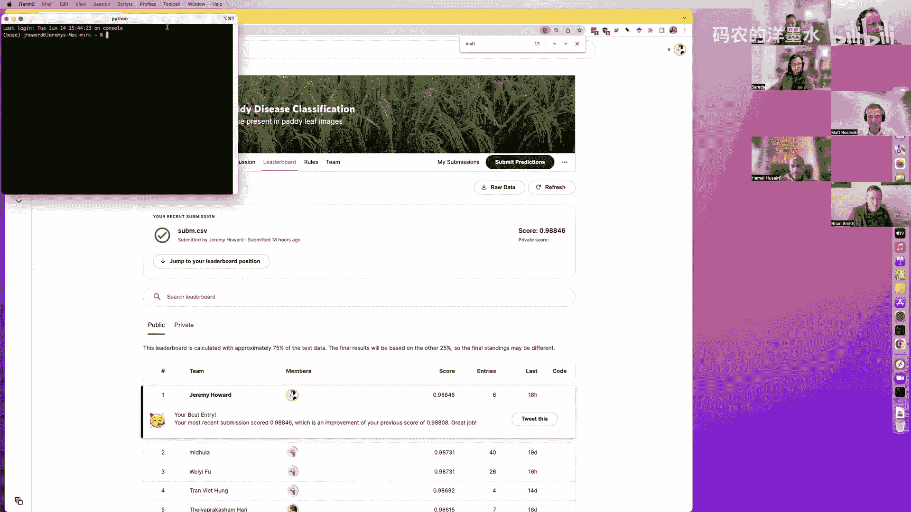

Oh， and actually， when I do， what I might do here is I'm gonna。I'm going connect to my。Server。

Does someone ask about what the gist uploadings or question asked in the forum somewhere， Yeah yeah。

 yeah， forum。Exactly。嗯。

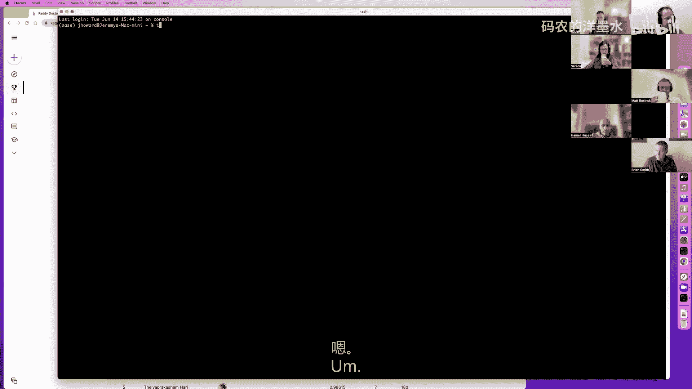

And we'll see， when I connect to this computer， it's。Busy。Doing stuff。嗯。And specifically。

 this is what it looks like。When you're busy training a modelddle。Using weights and biases。

 so you can see I've got three windows here。I think get rid of the knot。

 I always oh that just means that I've got another teamm session running on a different computer。

 which has a smaller screen than this one。And there is where some way to get rid of it by disconnecting other sessions disconnect。

Other clients。Prefix dig gives you connect to clients， whichever you select is disconnect。

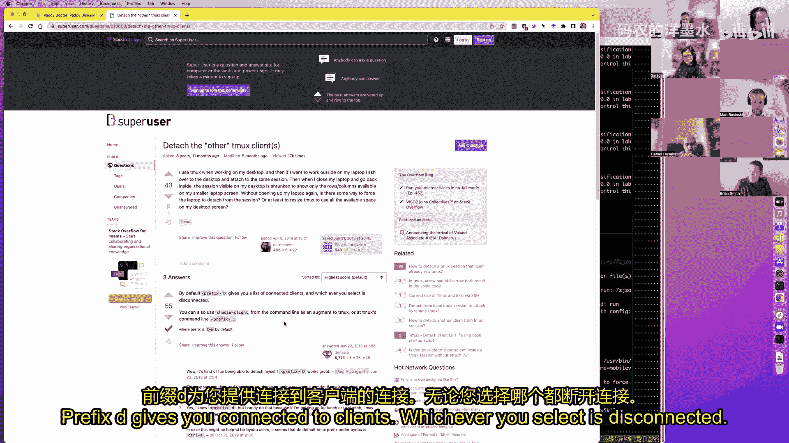

Let's try that。No， that's not right。 Oh， they've probably been shifty。There we go。😊。

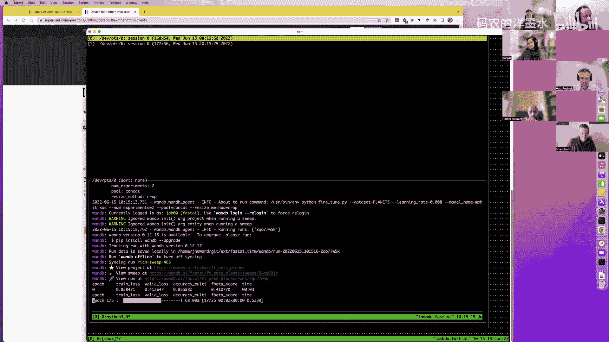

Al right， this is the one I just created。 So if I hit this。There we go。

 So shift D and then select the one to disconnect。Oh， nice。 Okay， learn something new。Oh。

 we've got another new face today。 Hello Sophie， I don't think you've joined us before。

 is that right？😊，I've been here just quietly in the background sometimes Okay thank you for joining we're about to you visiting us from in Brisbane Oh good on you and what。

😊，Do you work with AI staff where you're just getting started Not at all background in psychology。

 doing a postdoc and psych and sort of yeah trying to move over into data science。 Okay， cool。

 have you done a lot of the statistical side of psychology Yeah。

 yeah quite a bit and quite a bit of coding in R but I'm pretty new to Python So okay big learning curve Well you know what you you're our target marker right So if you have any questions along the way please jump in even things that you feel like everybody else must know I guarantee not everybody else knows them So yeah definitely these have been really helpful and really great running awesome thanks for joining。

😊，Okay， so we're training three models in parallel right now， Yeah。

 so I've got straight GPUs in this machine。嗯。And so。Yeah， one nice thing with。

 with weights and biases is you。Basically， let me share。

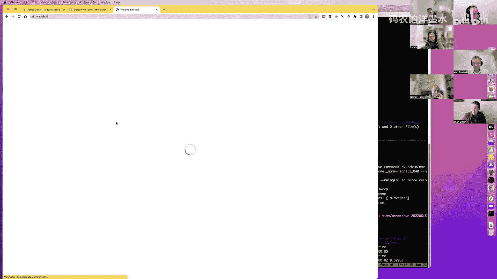

Okay， so here's whats and biases。Since yeah， I don't use my Mac very much because nothing's logged in。

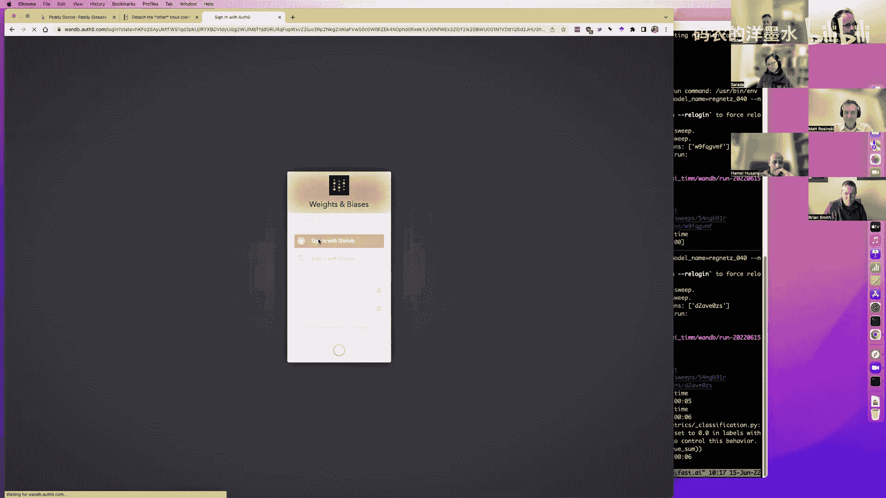

Alright。 And so you can see it's running this thing called a sweep， right。

So there's going to be 477 runs。😔，To know what it says。Create 31 seconds ago。

 because that's certainly not true。It's currently running。嗯。And so。It's coming from this Git repo。嗯。

I feel like there's a there's a like a sweet view because this is a particular run this is this is a oh this is a particular run that's right。

I'， I'm terrible with thewi， to be honest， Okay， so let's go to the project。 Yes。

 and then a project has， and that a project has sweeps。And then。Okay。

 this one here I can kill because。

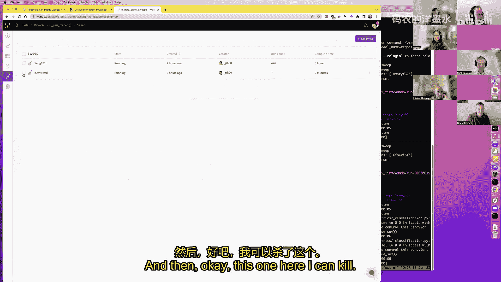

Out。Okay。

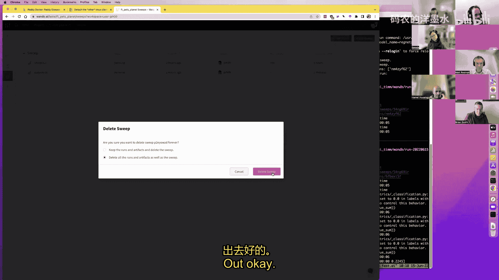

So basically， you kind of say on the Linux side， WNB， you know， sweet create or something like that。

And then。

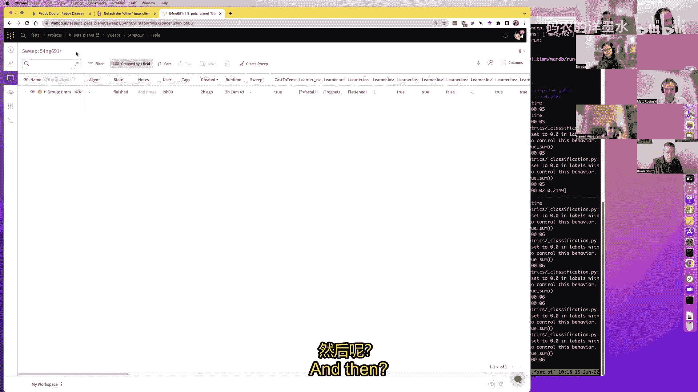

Ifings all grouped under this thing。 Oh， okay。 Al right。 So then， yeah， so then basically it runs。啊。

Lots of copies of your program feeding at different configurations。嗯。And yeah。

 you can run the client as many times as you like。 So I've run it three times at each time。

 I've set it to a different。Curator deviceDid you turn your models into Python scripts into able to do this or exactly so。

So， this is。Fine tuned up pie。 So it's just calling。So it causes PA as。

 So that's going to just go through and check what batch size， et cetera， et cetera。

 et cetera you asked for， right？Stick them all into。Is Pa thing。

And then it calls train passing in those arguments。And so， then， train。

Is going to initialize weights and biases for this particular project。For this particular entity。

 which is FA AI using the configuration that you requested。嗯。And so then you can save， for example。

 Okay， it's got some particular data set， some particular batch size and image size， etc cetera。

And then it creates a learner for some particular model name， some particular pooling type。

Find tunesuit。And then at the end， it logs how much GPU memory it used， what model it was。

 how long it took。And you don't have to lock much because the fast eye。

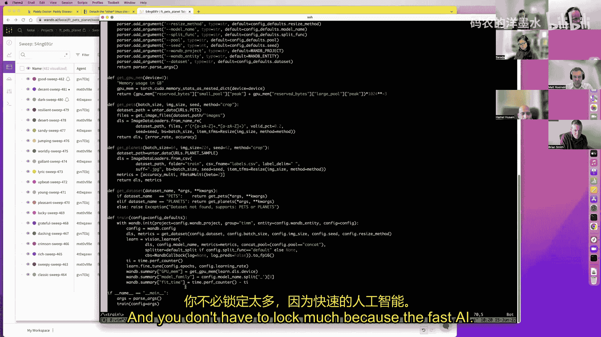

Weights and biases integration automatically tracks everything in the learner。

 so you can see here there's all this lag。Learn a dot architecture， learn a dot loss function。

 et cetera， et cetera。😔，嗯。Out of curiosity then was this process of refactoring into a script painful？

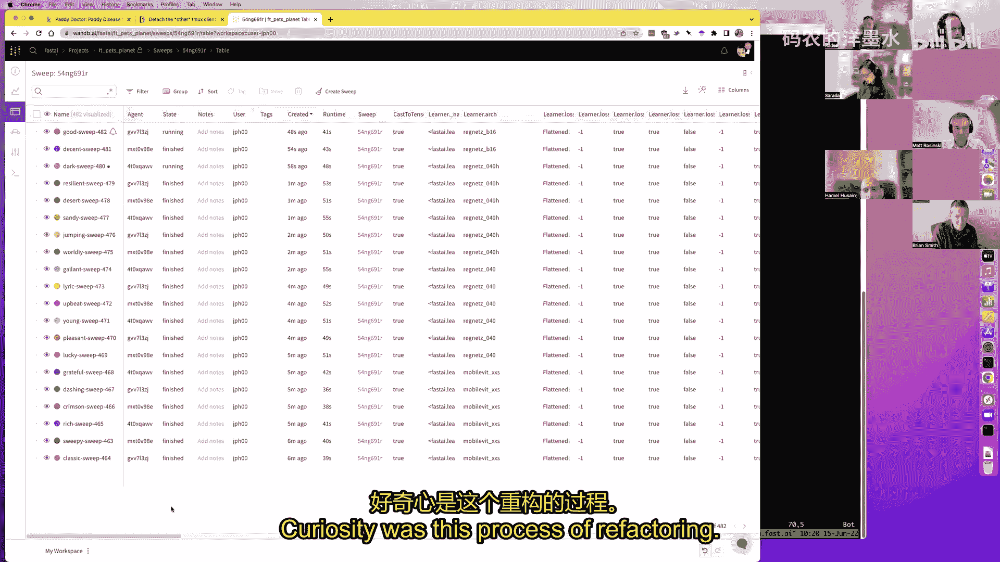

Alright so actually， so actually， you can probably actually tell， I didn't do this。

 Tom Thomas Capel did this。 If I had done it， I would have used fast fast code on script instead of。

This stuff， I guess， but no， I wouldn't have been painful。

 I would have just checked an NB dev export on the cell that I had in my notebook and that would have become。

Yeah， my script。就。嗯。Hi， Jeremy painful hi。Oh I have a question。 Would。

 Will it it be interesting to track power consumption， for example。I mean， for some people。

 it might be not for me。😊，As to how you would track how consumption， I have no idea。

 You'd have to have some kind of。Sense a connector to your power supply， I guess。

They track a lot of system metrics in the runs， so like if you look on a run。

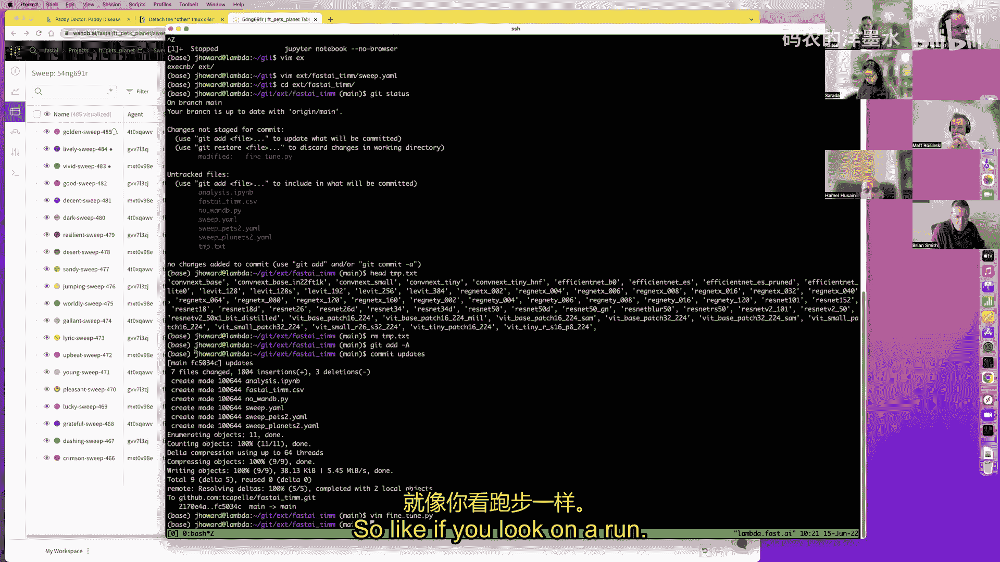

They will track like GPU memory， CPU memory， yeah all stuff。Like， yeah， if you click on the。

The thing on the left。That it looks like a CPU chip that thing yeah， there's a lot of。

So maybe there's power in here I don't see how it can be right because like it well。

 unless the Nvidia GP power to that is that that does here go GPU power so Nvidia tells you the GPU power usage apparently。

嗯。Although that won't tell you about your CPU， et cetera power。The thing that's useful about this is。

 I think， is the memory。The graph。Yeah， well， I mean the key thing is the maximum memory use。

 So we actually track that here。

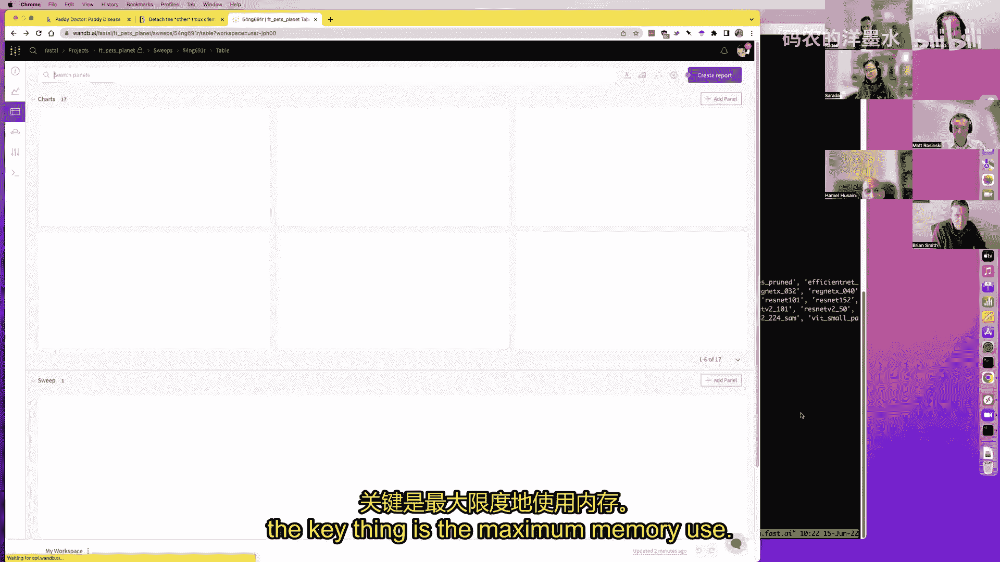

In the script， here， we put it into GPU me。Oh， good GPU， man， okay。

 that's a think got GPU members watch blah， blah， blah。So Thomas did that as well。

 I don't know why it's。To power of negative 3。 What's earth is that about。Stay curious。

Ill have to ask him what that's。That's doing。Thomas works at weight to my right is that correct。

 correct， correct， Yeah， so he。I had never used it before。

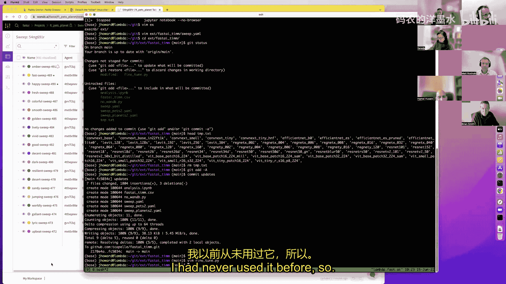

嗯。Yeah， so probably most people have never heard of this。 But fast A。

 I actually has a thing called Fast GPU。Which is what I've previously used for doing this kind of thing。

 So in general， when you've got rather one GPU or just even if you've got only one GPU and you've got a bunch of things you want to run。

 it's helpful to have some way to say， like， okay， here's the things to run and then set a script after go and run them all and track the results。

So fast GPU is the thing I built to do that， and the way fast GPU works is that you have a whole list of a whole directory of scripts in a folder。

And it runs each script run at a time and puts them in and it runs them。

 it puts them into a separate directory。You know， to say this is completed and it tracks the results。

 and you can do it on like。As many or few GPus as you like and I'll just go ahead and。Brt it and。

This is。Fine， but it's very basic。 And I've kind of been planning to make it。

A bit more sophisticated。 And yeah， weights and biases。

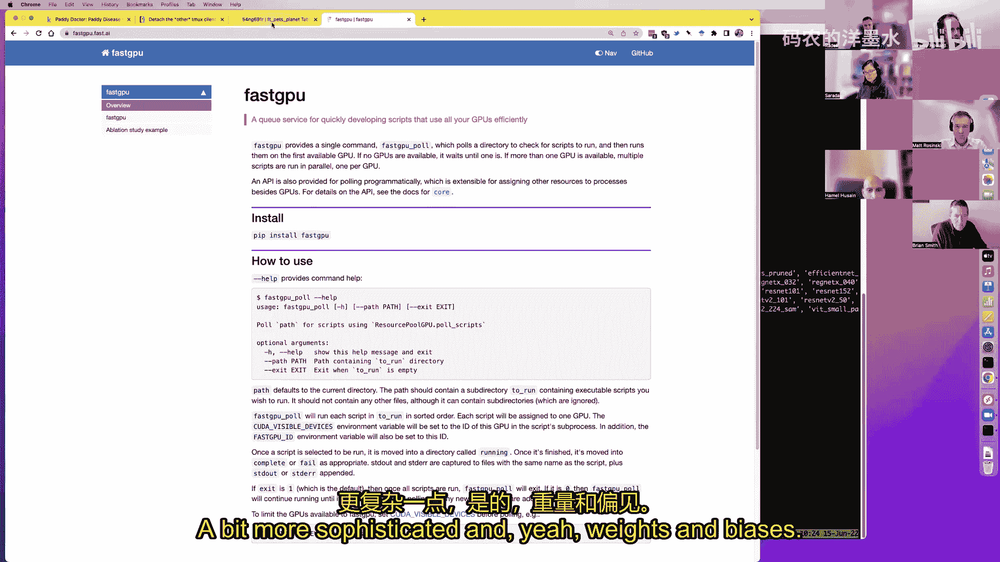

Tax it a lot further， you know， by。And I kind of what a re redo or add something on top of fast GPU so。

Is fairly compatible with weights and biases， but you could do everything locally。So， the key thing。

So the thing it's actually using for that config file。

Ass it goes through basically the Cartesian product of all the values in this Yaml。

 So it's going to do each of these two data sets， planets and beds for this one learning rate 08 for every one of these models。

For every one of these pools。嗯。For okay， this is just the one resize method and for every one of these experiment numbers。

So yeah。So that's a lot project I'd have to do at some point。

The sweep allows you to run arbitrary programs， it doesn't have to be a script。

So potentially you could just stay in the notebook。And use tiny kernel or or sorry， like Nmb。

Biant thing or whatever it's called。 Yeah， X can be， yeah。Yeah， yeah。

 it would be fun to work on this to make the whole thing It'll run with notebooks and。嗯。

Stick stuff in a local S load database。 And because like all this stuff， all this web gooei stuff。

Honestly， I don't like it at all。 But the nice thing is it actually doesn't matter because I don't have to use it because they provide an API。

 So before I realize they have a nice API。

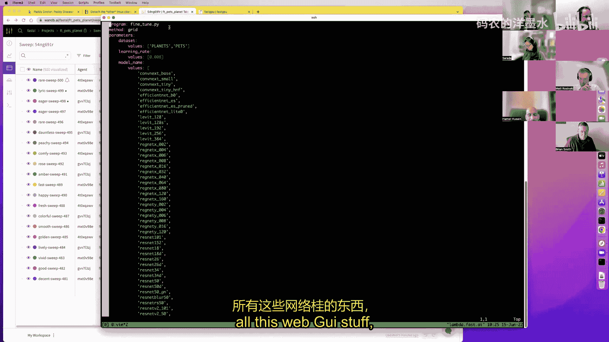

I kept on like sending Thomas these messages saying， how do I do this， How do I do that。

 Why isn't this working， And you'd have to like， send me these like。Pages of screenshot。 So like。

 click here， click there， turn this off。 Then you have to redo this three times。 and it's like， oh。

I hate this。 Yeah， and then I found that then he was like we do have an API and I was like。

 I looked at the API。 it is so well documented， it's got examples。 Yeah it's it's really nice。😊。

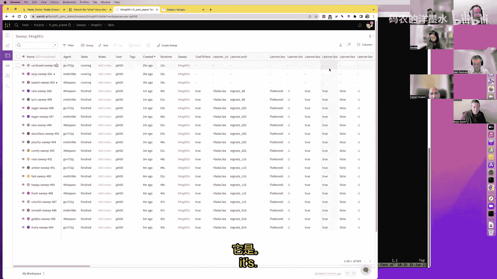

嗯。So， I've put。All the stuff I'm working on。Ento this Git repo。 And so here's a tip， by the way。

 the information about if you're in a Git repo。The et get directory， your clone directory。

 the information about your get repo all lives in a。Fiocor dot get slash config。So you can see here。

This is the gi ratepo。

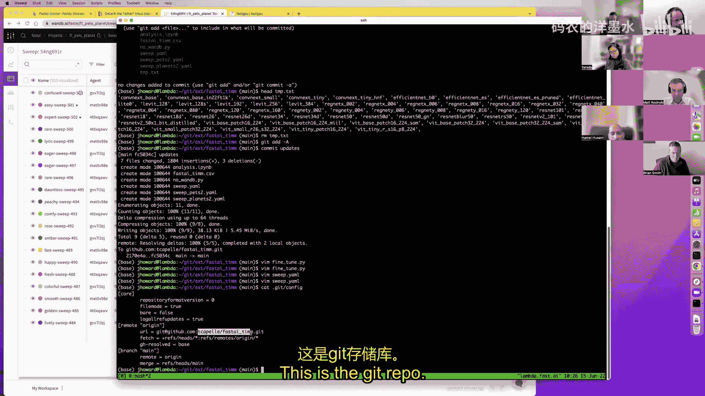

嗯。So if we now go to GitHub。One cool thing about this runs is it tracks your Git commit。Like the run。

 you can get back to what code version Yeah， that is very cool， isn't it yeah？Yeah， I mean。

 I I do think we could pretty easily create a。A local only version of this without all the fancy Goey。

 you know， which would also have benefits to then people who want the fancy gooey and run stuff from multiple sites。

 stuff like that would use weights and biases but。You know， you could also do stuff。

Without wes biases， anyway， here's our yeah， so here's our repo。

 and this analysis dot IP and B is the thing that I showed yesterday today if you want to check it out。

And I'll put that in the chat。Best。There go。Oh， by the way， you know。

 I think something else which would be good is we should start。

Keeping a really good list for every walkthrough of like all the like key resources， key， like。

 you know， links， key commands， examples we wrote and stuff like that。

 So I think to do that what we should do。Is we should。

Turned all of the walkthrough top topics into Wikis。

I don't know if you folks have used wiki topics before。

 but basically a wiki topic simply means that everybody will end up with an edit button。

So if I just click。Okay， this one already is a wiki。Okay。

 so everybody should find on walk through one。So you can click edit， right and so。嗯。

One thing we put in an edit， for example would be probably like often Daniel has these really nice full walkthrough listings which should have like a link。

To his reply。Which you can get， by the way， by。 I think you click on this little date here。

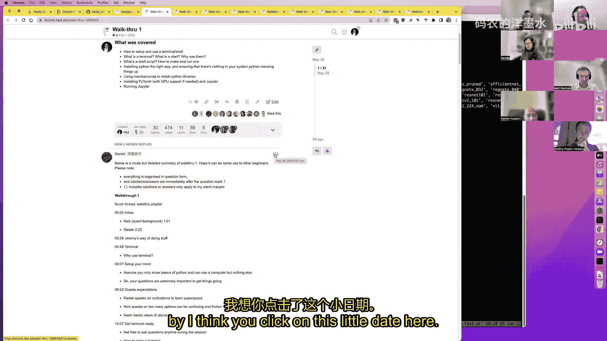

Yes， and that gives you a link directly to the post。

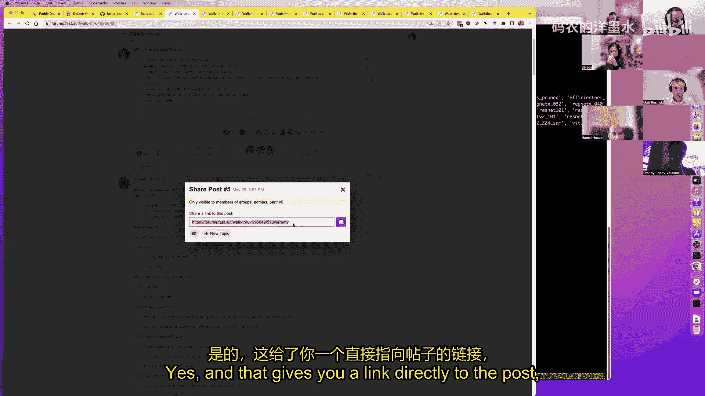

Which is handy。诶。What about this one？Okay， make that a wki。Sorry。

 this is going to be a little bit boring for you guys to watch P mouse will do it while I'm here。

And if anybody else has any questions or comments， while I do that。 Yeah， Jeremy。

 you that the fast GPU is possible to extend to high performance computing to use it on the note。

So to do what？Appie in high performance computing， so in the distributed environment。

 is it possible to track it as well？I mean， I don't。 I mean， it， Yeah， I mean。

 anything that's running on。InIn Python， auto Linux。Computer should be。Time。

I think some HPPC things look。Use their own weird job scheduling systems and stuff。 But yeah。

 as long as it's running a， you know， normal。Thenvi。It doesn't even have to be in media， honestly。

 but yeah， as long as it's running a normal。Linuxinux environment， it should be fine。It's。

 it's pretty generic， you know， pretty general。 Okay， so they are now all。Wiks。

 and so something I did the other day， for example， was in walkthrough4。

I added something saying like， oh， this is the one where we actually had a bargain you need to add Cd at the end。

 you know， and I tried to create a little list of what was covered。 and so， for example， maybe。

Matt's fantastic times stamps we could copy and posters。嗯。This item is into here， for instance。

Some of Red's examples， maybe or even just a link to it。嗯。Yeah， so for this walkthrough。

 we should certainly include this link to the analysis at IP and B。 anyway， so you could see， yeah。

 with the API， it was just so easy just to go API do sweep dot runs。Comes in as a dictionary。

Which we can then chuck a list of dictionaries into a data frame。Okay。

I'm re runningtting the whole lot， by the way， because it turns out I。Made a mistake at some point。

 I thought that Thomas had told me that squish was always better than crop for resizing and he told me I was exactly wrong now it's actually that crops always better than squish for resizing。

 So rerunning the whole lot is annoying， but shouldn't take too long。

Did you find that analyzing the sweep results like this was useful in relative to like what you can see in the the UI you know you can it so much better hammer yes。

 oh so much I was like。I mean， they've done a good job with that。

With that UI like it's very sophisticated and clever and stuff but I just never got to be friends with it and as soon as I turn it into a data frame I's just like。

 okay， now I can get exactly what I want straight away it was absolute breath of fresh air frankly。

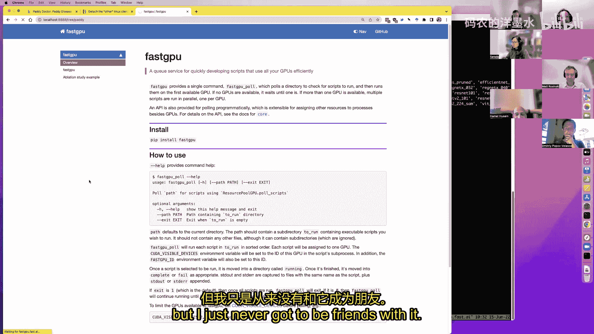

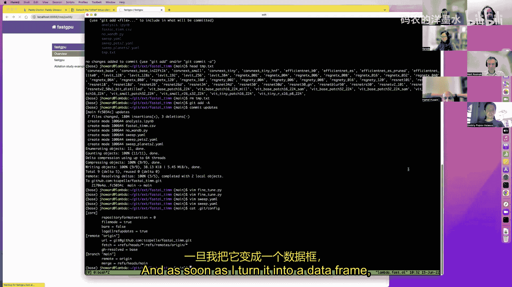

I really like their parallel coordinates chart。And I find it very difficult to reproduce that in like any visualization library like in a case way I don't like the parallel coordinates chat。

 but yeah， I mean there must be parallel coordinate chat for Python not there no there is there's like a plotly one but it's not that nice Okay because I don't like parallel bother with it so like hover over it and stuff and see。

 you know what they do they write their own。I think so， yeah， that's impressive。

And they kind of wrote their own data frame， kind of language， their own visualization library。

 like in a sense。It's like those weights and biases reports， seeing， they have their own syntax。

Right。嗯。There isn't what in plotly or something。Yeah， there's one in plotly for sure。

 Ply things are normally interactive。 So have you tried that one Do you know if it's。Yeah， it works。

It's just it's not as nice， but yeah， it works like when you hover over like there's a there is at least a version this one doesn't yeah。

 that one is like it's very fiddly you might have to draw a box around it。To highlight it。Oh， yeah。

 go。 Okay， so you just drag over it。 that's not terrible。Yeah， I mean， it's okay。

 it's not the best EI。门。You know。Oh okay， this is thanks for telling me about this。 it's cool。

But you don't think you don't， you don't like this that much It's not that useful for you I be I haven't managed to I mean I know other people like it so I don't doubt that it's useful for something it's just apparently not useful for the things I've tried to use it for yet somehow cool I mean how do you do you kind of like drag over the。

The end bit to say where they come from or something or yeah no I mean。

 it might be useful if you want to look at the weights and biases one because I think it renders one by default for you for the runs I believe yeah it does and it's easier to like let's check it out operate that yeah。

W and。Be。Flash。Alright。I think it could be in the sweeps thing。Most likely， okay。And then， yeah。

 pick a sweep。That one has zero runs， but。😔，I think maybe that one， okay， and then。Yeah， okay。

 so here we go like and then when you just hover over a section。

mean I don't see how this is helping me。Well， I guess like saying don know， I mean。

 so there's not that much variance in the well， I guess like what is the metric we're trying to optimize it doesn't really seem like it's even on this chart。

Like， you know what I mean oh， you know what， you probably have to tell it what your metric is and we probably didn't。

 So the far right hand thing is reize method rather than。So that's。

 is there some way to tell it that we care about think， there's an edit。

 there's like a little pencil， let's see。Okay， add the columns we add。嗯。

Lo or something It know let's do error wait， this is， no， let's do accuracy and multi。ok。Okay。

 now we're talking all right。You probably want to get rid of pool and resize methods since they don't have any variances they're not adding any information comment。

All right。There we go。 Now you can like cover over I actually want to do the thing。 Oh we go。

 Can I do this drag。 There we are。Yeah， that I mean， this is definitely not going tell me more than。

The number of experiments is not helpful either。No， that's true here。

This is some auditory thing anyway， there's a thing。Yeah， I'm a yeah， sometimes I learn something。

 sometimes I don't for that visualization， you know， it's a not always。

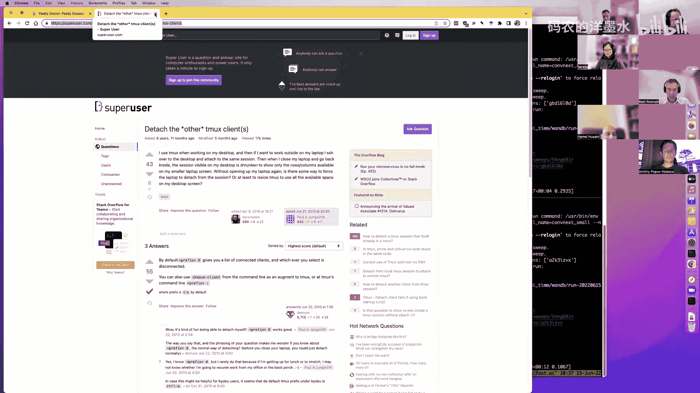

Okay。So。Yes。Control P D to detach。

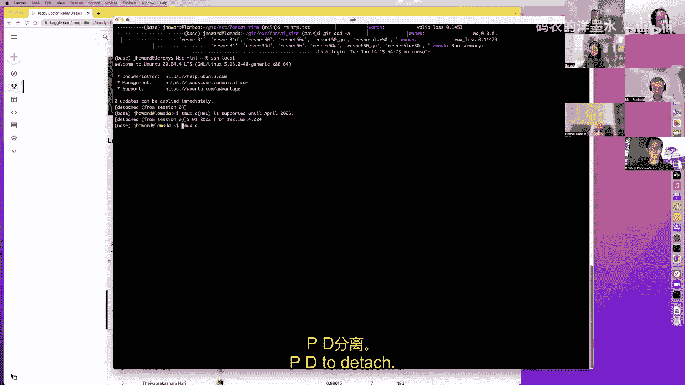

嗯。Do you generally like to do the the grid search thing or the Bayesian exploration I sorry'd like I'm all very new to all this right。

 so but like in general I don't do hyper parameterameter Bayesian hyperparameter stuff ever。

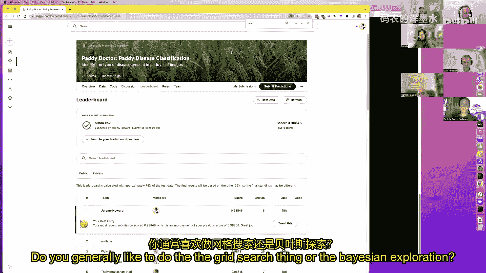

And that's kind of funny because I was actually the one that taught。😊。

Wes and biases about the method they used for hyperparameter optimization which actually tells you this is not quite true I've used it once and I used it specifically for finding a good set of dropouts for AWDLSTM because there's like five of them and I told Lucas about how I had like。

Created a random forest that actually tries to be predict。How accurate something's going to be。

 and then use that random virus to actually target better sets of hyperpara。 And then there。

 that's what they ended up using for weights and biases， which is really cool。

 But I kind of like to really。Use a much more human driven approach。 where I'm like， well。

 what's the hypothesis So I'm trying to test， How can I test that as fast as possible， like。

Most hyperparameters are independent of most other hyperparameters so you know like you don't have to do a huge grid search whatever and you can figure out so for example in this case it's like okay well learning rate of 0。

008 was basically always the best so let's not try every learning rate for every model for every resized type etc ceter's just use that learning rate。

Same thing for resize method， you know， crop was always better for the few things we traded on。

 so I don't have to try every combination And also like I feel like I learn a lot more about deep learning。

When I。You know ask like well what do I want to know about this thing well is that thing independent of that other thing or is it blurred or are they connected or not is it you know。

 And so in the end I kind of come away feeling like， okay， well， I now know that。But， you know。

 every model we tried the optimal learning rate it's basically the same。

 Every model we've tried the optimal。Resize methods basically the same。 And like， so I'm。Come away。

Knowing that I don't have to try all these different things every time。And so now。

Next time I do another project， I can leverage my knowledge of what I've learnt。Rather than。

Do you get another huge hyperparameter sweep， if that makes sense I see you are in the Bayesian optimism Yeah。

 my brain is the is the thing that's learning exactly， and I find like。😊。

People are big companies that spend all their time doing these big， you know。

 hyper parametermeter optimizations like。A always feel in talking to them that they don't seem to know much about the practice of deep learning。

 like they don't seem to know like。What generally works and what generally doesn't work。

 because they never。Bother trying to figure out the answers to those questions。But instead， they。

Just chuck in a huge。Hyperparameter optimization thing into。You know1 thousand TPUs。嗯。Yeah。

 that's kind of something up do that's really interesting I mean like。Do does it。

 do you feel like these like hyperpars generalize across different architectures， different models。

 different totally， yeah， totally。

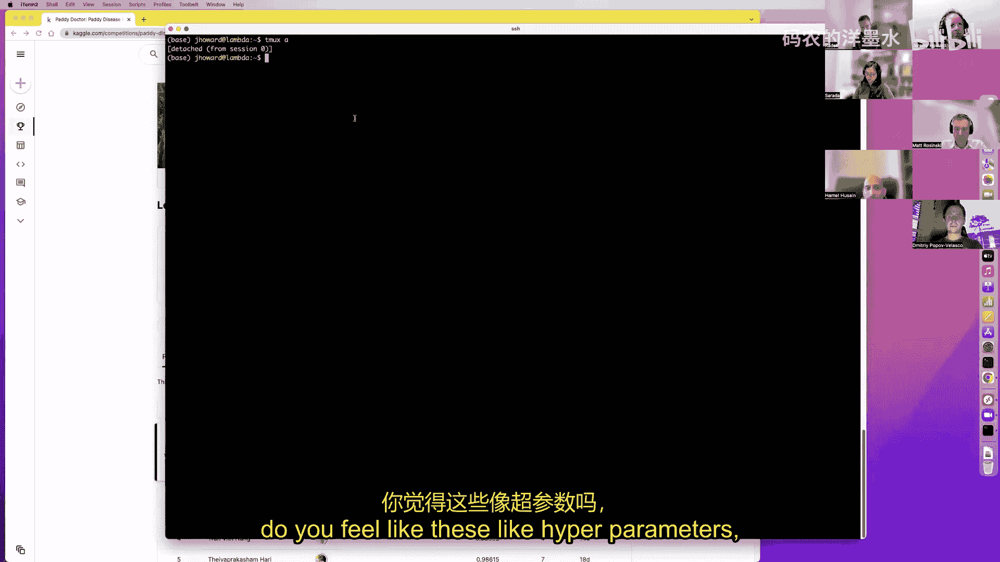

嗯。In fact， yeah， that was a piece of analysis we did， gosh。

 I don't know four or five years ago along with a fellowship to AI folks and the platform to AI folks。

 which is trying lots of different sets of high propmeters across as different sets of data sets as possible。

And the same sets of hyperparmeters were the best or close enough to the best for everything we tried。

嗯。好。That doesn't yeah， yeah it。With different architectures like I can somewhat imagine that you know data set maybe is not that super important。

 but you know between transformers and CNS， I mean I'm not questioning this because I don't have any experience to say that this is not correct I think this is wonderful and then it is surprisingly in a sense it is it's amazing so yeah the fact that across 90 different models that we're testing that couldn't be more different。

They all had basically the same best learning rate or close enough。You know。

So the very interesting aspect here is。Duringing the learning grade is something that you dump a lot of time into。

 usually when you start working on a project or in a K competition。

 you would be naturally inclined to hey， you know I'm using a different architecture。

 let me try to find a you experiment with learning ratess， but it's nice that you can discuss。

cus on what really matters Well， I should mention Radick。 this is true of。Computer vision。But。

Not necessarily vtabular。I suspect like all computer vision problems do look pretty similar。

 you know， the data for them looks pretty similar。I suspect， it's also true like。

Specifically of object recognition。 So like。Yeah， for。I don't know。 I mean。

 these are things like nobody seemss to bother testing， like which I find a bit crazy， but we should。

Do similar tests for segmentation。 and， you know。Boing boxes and。Circle。

But i'm pretty sure we' find the same thing you have the learning rate binder。

 so it would suggest maybe some。Different learning rates are good in different places Well。

 the learning rate finder I built。Before I had done any of this research， right， hell okay。

Like you might have noticed that I hardly ever use it nowadays in the course。

I don't even know if we've mentioned it yet in this course， maybe we have the last lesson。

 can't remember。Does anybody remembered have we done the learning rate finder yet in Co 22， Yeah I？

You you think we did。Could I just add that well one of the really you can sit there and play with parameters all you'king Sy wheels and getting nowhere it's one of the things I'm really taking away from the course is the fact that now you're talking about strategy and which goes back to Renaldo Copi at his 2002 paper you had a term called strategygy of analysis and that's something that really stuck with me so that's sort of transcends that idea of just mucking around with parameters。

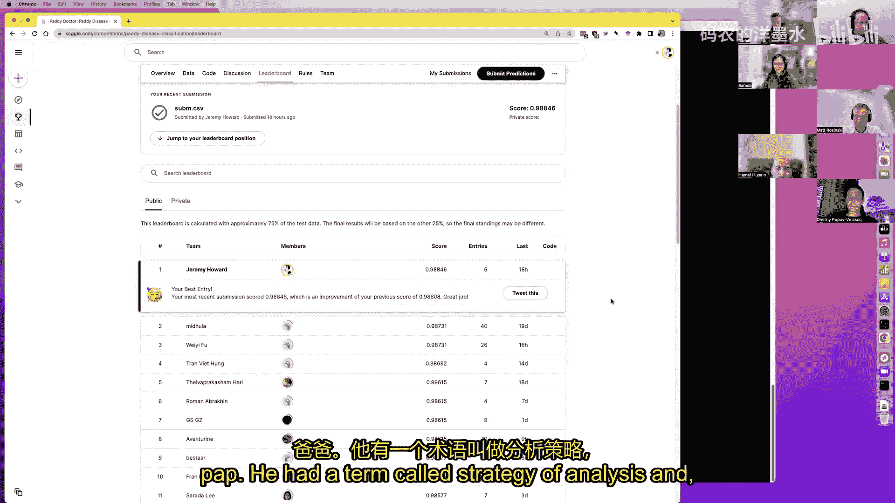

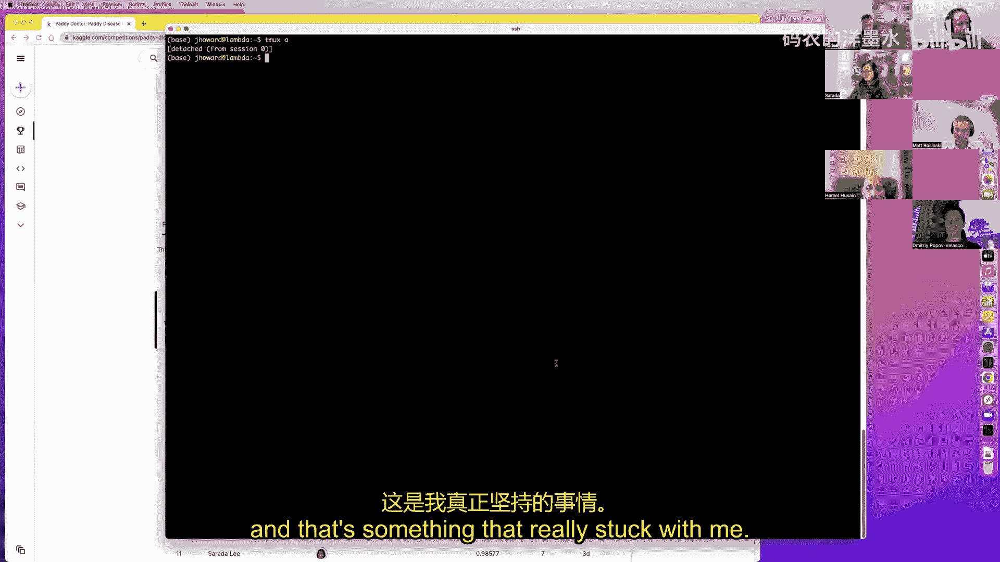

Yep。Exactly。I suppose these magic。Parameterters， these are the defaults and fast AI。Yeah。

 pretty much， although with learning rate。

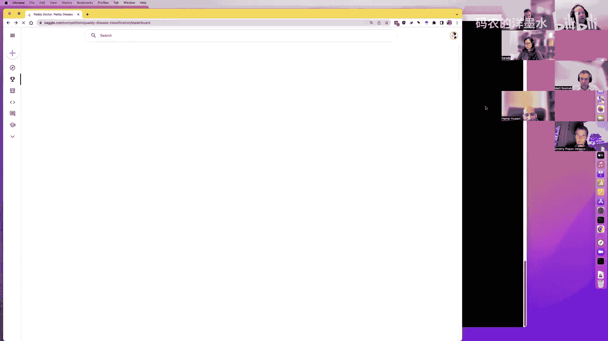

嗯。对。Oh， that's weird with learning rate。嗯。The defaults a bit lower than the optimal。

Just because I didn't want to like。Push it， You know。

 I'd rather it always worked pretty well rather than。Be pretty much the best， you know。Yeah， yeah。

 makes sense。Okay， I'm just gonna go and。Disconnect my other computer because it's connected to port 8。

8，8，8， which is gonna mess things up。 I'll be back in one tick。Yeah。嗯。对。Yeah。嗯。

Actually now I think about it， I don't quite know why this is connecting on port 8889。

 but part of this is to learn how to debug problems right。Normally the Jupyter server uses port 8888。

And I've already got my SSH connected to For port 8888， so it's currently not working。

So the fact that's using a different port suggests it's already running somewhere。

 so that to find out where it's running， you can use PS which lists all the processes running on your computer。

And generally speaking， I find。I get used to some standard set of options that I nearly always want。

 And then I forget what they mean。 So I have no idea what W A U or X means。

 I just know that there are a set of options that I always use。 So that basically lists all your。

Processses， which tell this is a bit too many， so we want to now filter out the ones that contain Jupiter or notebook。

So pipe is how you do that in Linux。 So that's going to send the output of this into the input of another program and a program that just prints out a list of matching。

Lines is called Gr。So we can grab for Jupiter。Okay， there it is。So。I'm kind of wondering。

Where that how that's running， I wonder if we've got like multiple sessions of tea marks running。

Nope， we don't。 So Tbox LS lists all your team box sessions。And。Oh。

 I've got a stopped version in the background。 Okay， that's why。 so I just have to foreground it。

 There we go。

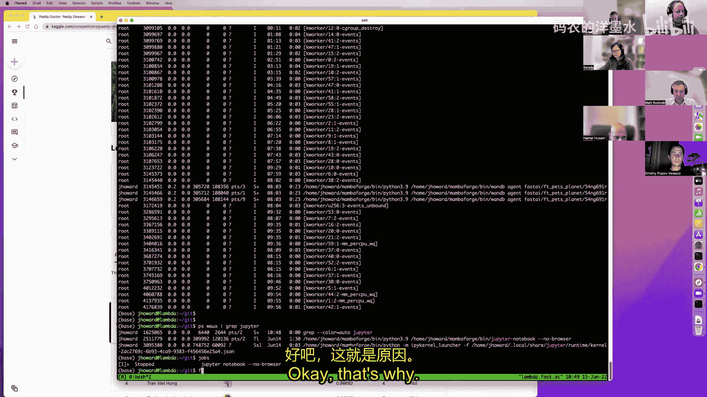

That was a bit weird。Okay， so。Now， that should work。How did you foreground Fg？嗯该。

Controls there to put it in the background FG to put it in the foreground。

And whether do you controls that somebody， It actually stops it。 right。

 You can put it in the background and have have it keep running。By actually， I'll show you。

So if I press control Z and type jobs， that's stopped right。 So if I now try to refresh this window。

It's gonna sit there， waiting forever。

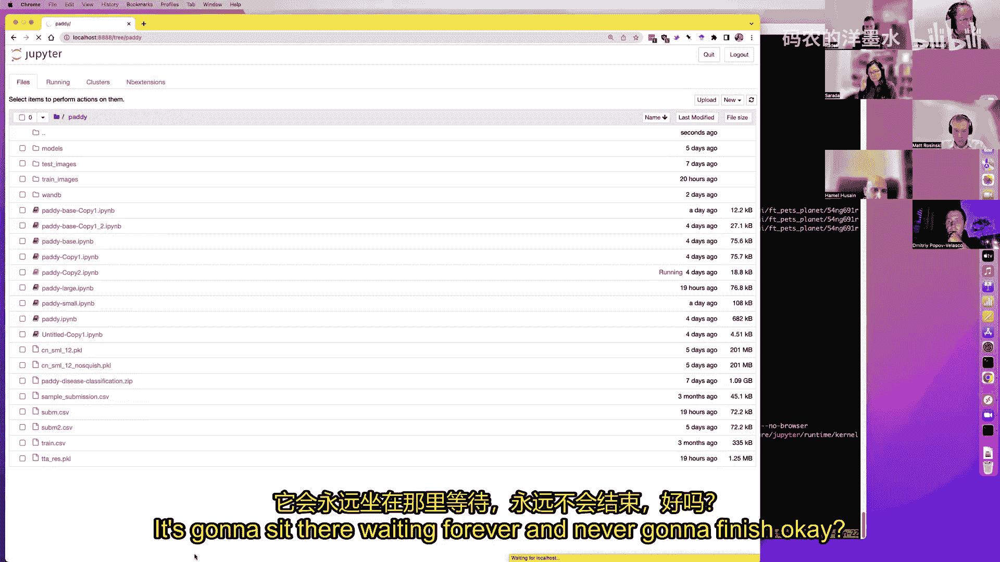

And。They were going to finish， okay。Because it's background。

s it's in the its stopped in the background。 If you type B G optionally followed by a job number。

 which would be number one and it defaults to the last thing that you put that you put in the background。

 it will start running it in the background。Even after you stop there， yeah。

 so it's now running in the background， so if I' type jobs。It's now running。Okay。

 and it's still attachedched to this console。 So if I。Open up this。

 You'll see it's still printing out things， right， But'， but I can also do other things。U。

And I don't do this very much because normally if I want something running at the same time。

 I would just chuck it in another tm pane。But don't know， it's kind of nice to know this exists。

Something else to point out is once I set BG。It added this ampersand after the the job。

 That's because if you run something with an ampersand at the end。

 it always runs it in the background。 So if you want to like fire off six processes to run in parallel。

 just put an ampersand at the end of each one and itll run。It around in the background。要 see。嗯。So。

 for example。嗯。Is a script that runs LS six times。And so， if I。Rt。You can see they're all。

Interspersed with each other Ca it ran all six times at the same time。

I see and let's say like you create a process like this in the background without teamms。

And you want to kill it， you use the thick thing could you could type FJ to foreground it。And then。

Then then press control C。嗯。Yeah， something like that would be fine or you can kill a single job。

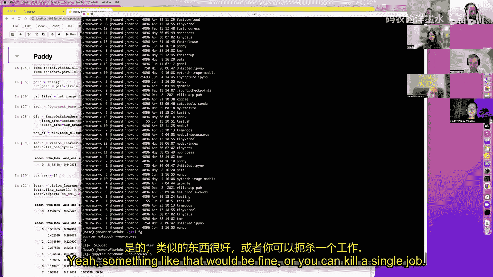

诶。So in general， like you probably would want。To search for ba job control。tlan。How these things。

And as I said， one of the cares it mentioneds here。

 one of the key things to know is that a job number。

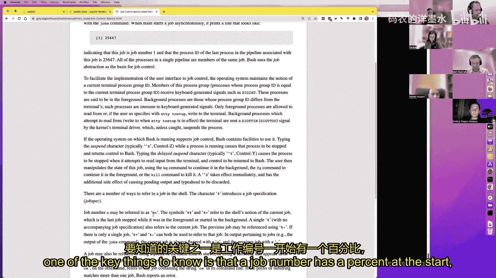

Has a percent to the start， So this is actually percent one。Would be to this。

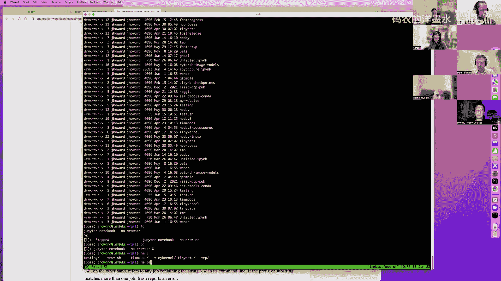

Knowing what to Google is definitely yes， the is the key thing。

Although often you can just put in a few examples， so you could I'm guessing like if I take troll C。

BG， FG jobs， which are the things we just learned about。There we go。

 it kind of gets us pretty close now we know they've got job control commands。嗯。All right now。

So when I kind of。Etorerate through notebooks。 what I tend to do is like once I've got something vaguely working。

 I generally duplicate it and then I try to get something else vaguely working。

 And once that starts vaguely working， I then rename it to the thing that it is what I want。

 So then from time to time。Then I just clean up the duplicated versions that I didn't end up using。

 and I can tell which they are because I haven't renamed them yet。

 And this is kind of how you can duplicate it like。

You you make a it looks like you're making copies of it and yeah， so you could just click file。

Make a copy， yep。Or in here， you can click it and click duplicate。

And so I mean you like what do you do after you duplicate you try to'll open up that i'll open up that duplicate and i'll try something else some different hyper parameter and different method or whatever so in this case。

I started out here。And Patty。And kind of just experimented。Okay。

 and show batchch and L find and try to get something running。And then， you know， after that。

 I was like， okay。I've got something working。 How do I make it better？And so， I created。Patty small。

 eventually had just be a copy me a copy in and it would be called Pattycopy。

 IP and B and I was like， oh， I wonder about different architectures。嗯。So I created this like I like。

 okay， well， basically， I want to try different item transforms。

 different batch transforms and different architectures。 So create a train。

 which takes those three things。And so creates a set of image loaders with。

Those item transforms and those batch transforms use a fixed Cd to get the same validation set each time。

 train it with that architecture。And then return the TTA error rate。

And so then so this is kind of like your weights and biases。

This is how you keep track on your different experiments， ideas there's no book。So。Yeah。

 so you can see I've kind of gone through and tried a few different sets of item and batch transforms for this architecture。

And this is like， so some just small architectures。 So they'll run reasonably quickly。

 So these ran at about 6 minutes or so。嗯。And this is very handy。 right。

 If you go sell all output toggle， you can quickly。Get an overview of what you're doing。

And so from that， I kind of got a sense of which things。Seem to work pretty well for this one。

 And then I replicated that for a different architecture and found those things which these are very。

 very different ones transformers based one's confident based。 You know。

 I'll find the things which work pretty well consistently across very different architectures and for those then try those on。

Other ones， swim B2 and swim。嗯。And yeah， then find， you know。

 So then let's toggle the results back on。So I'm kind of looking at two things。

 the first is what's the error rate at the end of trading， the other is what's the TTA error rate。

So my squish worked pretty well for both。Crrop worked pretty well for both。 This is all for con。

 next。嗯。This 640 by 4，80 to88 by 224 didn't work so well。 I mean it's not terrible。

 but it's definitely worse。And the 3，20 by 2，40 instead。诶。You know。

 can you talk a little bit about what you're looking for in the TtaA versus the I just want to say like I mean the main thing I care about is TtaA because that's what I'm going to end up using。

Um。😊，Yeah， that's the main one， but。Like， I's， let's see， in this case。

This one's not really any better or worse than our best cons next， but the TTA is way better。

So that's very encouraging， which is interesting so this is now for VOT， right？嗯。Now， VI T。

 we can't do the rectangular ones because V I T has a fixed input size。

 It has so their final transformation has to be 224 by 224。 So if you pass an in instead of a tuple。

 it's going to create square。Final images。And， you know， on the other hand， this one looks。Crepppy。

Be so。Definitely want to use squish for VIT。嗯。And then this one looks pretty good。You know。

 so this was using。Padding。So like for FVIT， I probably wouldn't use。Crop。嗯。And last time I looked。

 TTA was not really a thing in other modeling frameworks that is given to you。

 is that still the case Oh as far as I know that's true， yeah。You know。

 so there been a lot of people。Well， one group in particular has been copying without credit。

 everything they can from ClassI， they might have done it I won't mention their name but yeah。So。

 swim V2。Apparently， Tenishish told me as what all the cool kids on Kagel use nowadays。

That's a fixed resolution I found and for the larger sizes， there was no 224。

 you had the choice of 192 or 256 and 256 it got so slow， I couldn't bear it。But interestingly。

 even going down to 19，2， Sw's T T A is actually。Nearly as good as the best VT。

 so that's I thought that was pretty encouraging。嗯。This one， interestingly， like VIT。

 didn't do nearly as well。For the crop。And again， like BT， it did pretty well on the pad。

And then this is Sw V1， which does have a 224。And so here this T TA is okay。

 but the final results is not great。 And so to be unlikely， it's not not fantastic。😊，This ones again。

 you know， it's interesting but the crop， none of them are going well， except for con next。诶。

This one's upgrade great either， right， So swim V1。But unimpressive。

So basically that's what I did next and then I was like， okay， let's pick the ones that look good。

And about a duplicate of Paddy small。And I just did a search in a replace of small with large。

 so we've now got con next large。And the other things I did differently was I got rid of the fixed random seed。

 so there's no seed equals 42 here and so that means we're going to have a different training set each time and so these are now not comparable。

Which is fine。 You'll see if one of them like totally crap， right。

 But they're not totally comparable。 But the point is now， once they train each of these。

 they're training on a different architecture， a different resizing method。嗯。And I append to a list。

 so I start off with the lefty list and I append the TTA predictions。嗯。And so。

 and I deleted the cells from the duplicate that weren't very good in Patty small。诶。

So you'll see there's no crop anymore。 just squash and pad for VOT。😔，And for swim V，2。

Probably shouldn't have kept both of the Sw V ones。 Actually， they weren't super good。U。

And then what I did in the very last。Cagle entry was I took the two。

The two VIT ones because they were the clear best。And I appended them to the list。

So they were there twice， so that's just said。Slightly clunky way of doing a weighted average。

 if you like。嗯。Yes， tack them all together。Take the main of their predictions。

Find the arcms across the mean of their predictions to get the。

The predictions and then submit in the same way as before。So that was， yeah。

 That was basically my process。 It's like， it's very like。Yeah， nuts。Particularly。Thoughtful。

 you know， it's pretty mechanical， which is what I like about it。 In fact。

 you could probably automate this whole thing。Sorry， somebody just no， no。

 I was in how how critical is like this model stacking？In kgo。Thank you。

Just curious how you think about that。I mean， it's like a。I mean， you can kind of。I mean。

 we should try， right， We should We should probably submit。 In fact， let's， well。

 we're kind of out of time。 How about next time， Let's submit just the VO T， the best VO T。

 And we'll see how it goes。嗯。And that will give us。 Yeah， that will give us a sense of how much the。

Ensembling matters。We kind of know ahead of time， it's not。Gotta matter。Hugely。I mean。

 you specifically said on cackle， on cackle， it definitely matters because in cackle。

 you want to win。Yeah， but in real life。My。Small con。Got 97。 well rounded up that's 98%。

And my ensemble got 98。8%。 Now that's。In terms of error rate， that's nearly halving the error。

 So I guess that's actually。Pretty good。Really important question。

 how do you keep track of what submissions are tied to which notebook？Oh。

 I just put a description to remind me， but， you know。

 a better approach would actually be to write the notebook name there。Which is what I normally do。

 but in this case I wasn't taking it particularly seriously， I guess。

I was only planning to do these ones， and that was it。So I' was basically like okay。

 do one with a single small bottle， then do one with an ensemble of small models and then do one with an ensemble of big models and then it's after I said admit at that that I thought oh I should probably wait the VIT is a bit higher so I ended up with the fourth one。

So it's pretty easy for me though only did for significant submissions， so。Easy to track。But yeah。

 I think。Now that I know actually， that I'm doing a little bit more because actually did want to try one more thing。

 I think what I'll probably do is I'll go back and I'm going you can edit these。

 I'm going to go and I'll put in the notebook name。NH1 and then。

And that I wouldn't go back and change those notebooks later unless there was like， probably never。

 I would just duplicate them and make changes in the duplicate and rename them to something sensible and that of course this all ends up back in GitHub。

So， I。I' alwaysways see， yeah， see what's going on。So， this is like。AAbout up Tal without。

Its good it's like you have a you like every like quote run is a notebook like in the sentence like like the wait and buy can kind of keep track。

 yeah， yeah。Exactly， but I mean， the only reason I can kind of do this is because I had already done。

Like lots of runs with models。To find out which ones I can focus on， right。

 So I didn't have to try 100 architectures。 I mean， in the way。

 it forces you to really look at it closely。 Yeah， if you just kind of like have this dashboard kind of like use a like at this rule My view is that this approach。

 you will actually become a better deep learning practitioner。

And I also believe almost nobody does this approach and I almost feel like there are very few people I come across who are actually good deep learning practitioners。

 like not many people seem to know。

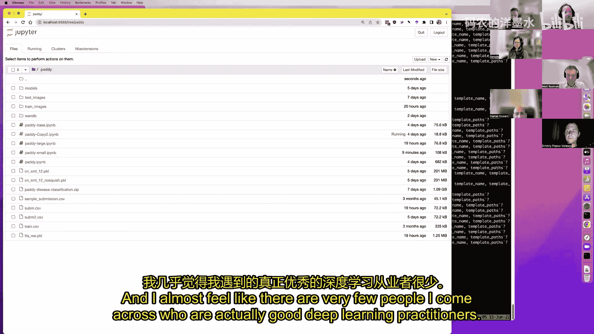

What works and what doesn't so。Yeah。All right。😊，Well， that's it， I think。

Thanks for joining again and。Yeah。See you all next time， bye thank you。

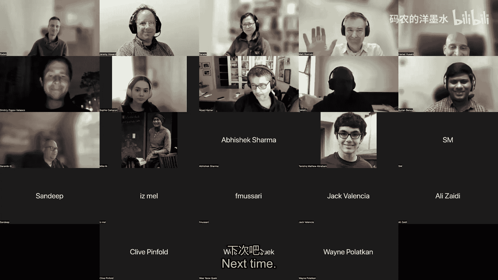

Thank you everybody。