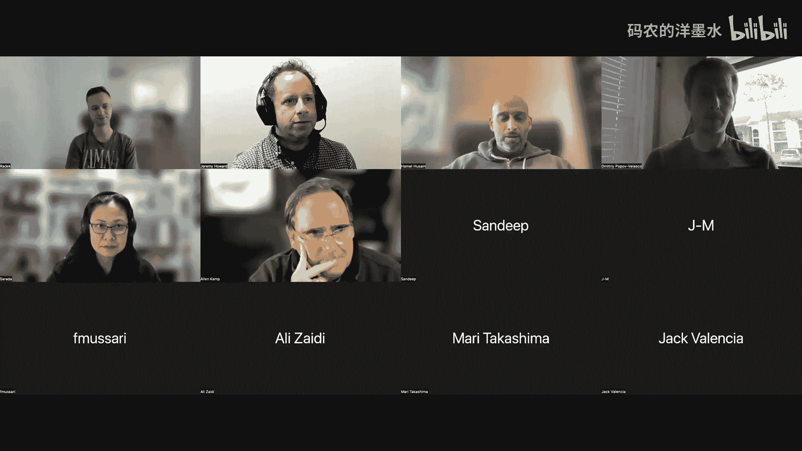
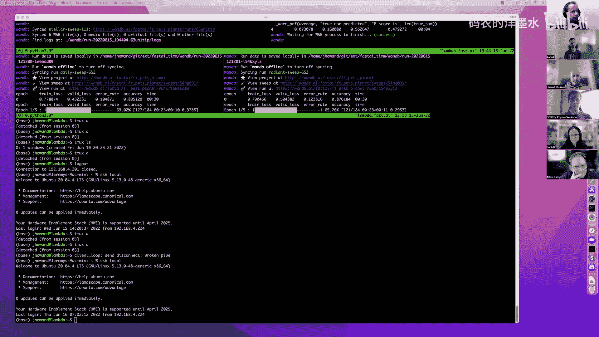
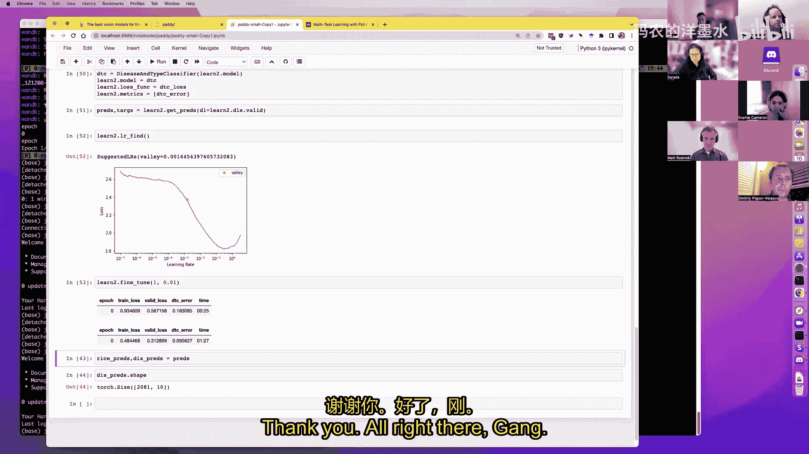
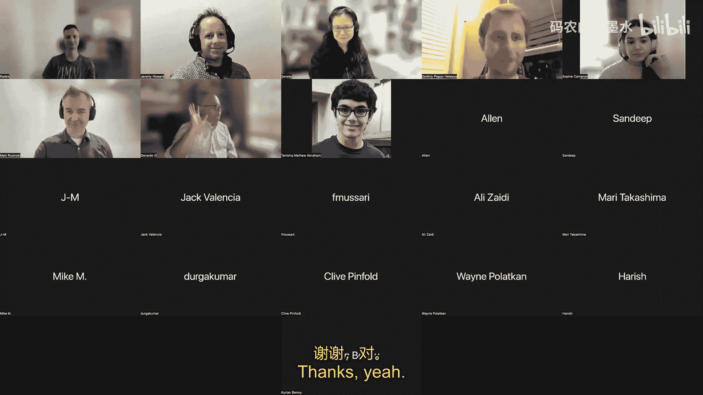

# 【全集】旧金山大学 实时编码 中英字幕 1080P p12 Lecture 12 - vision模型 fine-tune进阶 -BV1KZiTBWEeH_p12-

Yeah。Yeah， so I guess。

The the thing I've kind of learned， I guess I should。

 I can share my screen in tone and say what I feel like I've。

And。诶。

From this suite。Scrab it kettle。不。嗯。So on pets。This is the top 15 after。Ring a few more sweeps。

To see if there's some better options， but basically。I think what's interesting is in the top 15。

And pets， you have like。A bit of everything， right， You've got。Resnet I S and Resnet B2 distilled。

You've got V， you know， VOT transformers ones， VOT， Sw， mobile VOT。嗯。Classic Resnet， 2060。

Still in there。Actually the fastest of all， which maybe reflects like maybe that's the most well optimized kind of because it's been around a while and video has probably worked hard on that。

嗯。Richnet。GPU memory。 Like， yeah， it's kind of interesting the wait。

There's all these very different approaches， but they。They all kind of end up in there。嗯嗯。I think。😊。

You know， one thing interesting when you look it on the graph。Is。This， these brain ones。It's V T。嗯。

Whi they kind of cut off here at this fit time of 150 and I think that's because the larger vision transformers only work on larger images and I only did24 pixel images。

嗯。So if， if I included large images， we might see。BI T at the very best in terms of error rate。

I was pleasantly surprised to see。That。嗯。Some of the V I Ts。You， I didn't actually use much memory。😊。

And they were pretty fast。 And it's interesting， like， because that was quite a while ago， right。

 The vision transformers paper came out quite a while ago， and。嗯。Yeah。

 it was kind of like the way I remembered it was like just tacking together the first and most obvious thing people thought of when it came to kind of making transformers work on vision and。

Yeah， the fact that it jaw works so well seems that people haven't improved on it much other than perhaps。

Swim。So I guess they my takeaways。Under like small and fast models， Yeah。

 I guess I hadn't really looked much at resonnet IRS before。 So it's interesting to see。

That one's right up there。And then， on planet。It doesn't look that different， except。You know。

 it really is just VOT Sweden and co next and in fact entirely is VOT Sweden and con next。嗯。

The whole top 15。Yeah， so I guess that's。Some of the things I noticed。Let's go。Yeah。UYeah。

 look at this one， it's good that you were trying to try able to try so many different kinds of models and so anything things ran in less than 24 hours。

On my three GPUs。嗯。Something like 1200 runs or something。Yeah， I thought this was interesting。

 Look at this one， VIT small patch 32， memory usage is amazing。😊，嗯。And spade is fastest。And yeah。

 third from the top of the smaller faster ones I have a question yeah， can you hear me sure， yes hi。

Just a small question。 So you mentioned small and large。 Does large mean the size of the image。

Sometimes when I was talking about VI T， yes， it does for VI T。

They so I was specifically just doing 224 by 224 pixel images and pretty much all the transformer based ones a fixed。

 they can only do a one size。嗯。And so the VI T models， I don't think they have。

So there's two meanings of larger here there's larger as in more bigger models like more layers。

 wider layers， and I think all the VIT models which are larger or capacity slower。

 probably more accurate， I think only run on literally on bigger images which is like doesn't have to be that way that's just what they happen to do。

So， that's why。Yeah， V IT only goes this far。There are bigger VIT models that should be more accurate。

 but they don't work on 224 or 224 pixel images I there like a good threshold to know when is a good time to use large versus the small one or is it just all experimental larger images you basically do everything on a smaller images you can as long as it gets you reasonable results。

Because you want to iterate quickly。 And then when you're finished and you want to。You know。

 like like in case of cackle， you want the best accuracy you can。

 So you try bigger and bigger images to see what you can get away with and keep doing that as long as the。

Accuracy improves and a production environment， it's kind of similar。

 but you make them bigger and bigger until you the。Latency of your model is too high， you know。

 and you find the right trade off between。Model weight and and accuracy。

 generally speaking larger images will give you more accurate results。But a bit a bit slower。

 correct， I mean。A lot slower， right， because， if， you know， if you increase it from 224 to。

On one side to。3，60。Then you're going from 224 squared to 360 squared。

 So you end up with a lot more pixels。So like for， for example。

 an application would be like for object detection for video， for example， like live video。

 then even if it's a larger size， it will still be good to do small because it's faster。

Certainly for your iterating， there's no need to have a really accurate model for your iterating because you' trying to find out what data preprocessing works best or what architecture works best or whatever。

 So yeah， there's no point using large models and large images generally。

 as long as they're big enough to。Get the job done recently well。Okay， thank you very much， yeah。

 no worries。If you were you you were going to do this in like a business context。

 let's say and someone said， hey， jman want to。You know have a vision model would you would you kind of just pick a reasonable one and just kind of go with that and if the results were good do you would just use it or I would do exactly what i'm doing here。

 you know which is to try a few things on you know small fast models on small images。

On a small subset of the data。To find out what data preprocess to use and what architecture to use。嗯。

And then I would look at， yeah， one of the constraints in terms of operationalising this。

How much ra do we have， how much latency can we get away with how as expensive is it going to be to then。

Scale it up to the point at which。You know， we're getting acceptable results using acceptable resources。

So yeah， it wouldn't look very different at all， too。You know。

 a kal competition in terms of the modeling but then there'd be a whole。Piece of analysis around。

User requirements and costs and stuff like that。I see。对的嗯。I tried doing what you' were doing。

Was going from smaller to larger models。And。Mine somehow started out with much lower accuracy。

Is it just a flu or I mean， I had several issues happened that and then。Oh， it's not a。Yeah。

It means you press the wrong buttons somehow。😊，I will。

I think I already have haven't I shared my notebooks， so if I haven't。

 I'll certainly share them today。嗯。Maybe I haven't yet。 So I share my notebooks today。

 So what I suggest you do is like。Like， you know， go from mine。

 make sure you can rerun them and then look at yours and see how they're different and then。

Figure out where you went wrong。 But also like。Yeah， you know。

 I always tell people when debugging like to look at the inputs and the outputs。

 so what predictions are you making are you always predicting zero for example you know。

Did you run the LR finder to define what learning rate works well？Yeah， stuff like that。Thank you。

That worries。Jeremyer on the question for the production I tried to after your workle last week。

 you did mention learn do export and then later on we can learn the do no I found that is maybe that's bug the because when I load then they actually looking for the six is do p。

But when we save and they save to the models folder， and then you can give whatever name you want。

When you want to load them they actually have the suffix at the end so i'm not sure there's some some yeah so just to make sure you save it with a PTH suffix but yeah it certainly would make sense for us to do that automatically but in that documentation it seems it's safe in pickco。

The format is pickle。Not the extent but。So this is just Pytorrch。 So Pytorrch uses you know。

 a variant of the of the pickle format， and they normally use PTH as their extension。 So it， yes。

 it is pickle and yes it does use the PH extension。Okay。Jeremy， when you were opening this window。

 yeah you typed in like something in the。In the the URL bar to get where you Oh I just type my port number because I know that the other thing that has 8888 and that is。

OhOkay， yeah some magic going on， yeah， nothing like that。😊，ButLet me just chat these， too。嗯。

I did have。One more idea。About this。Competition。Which is。There was that CSV file， right？是。Yes。

 no here， train on CSV， that's right。嗯。Yeah。And it has this variety thing。Okay。嗯。Oh。

 and I want for variety。 Do you have top variety。U。So， there's 10000 rows。And 7。

000 of them are one variety。But there are 3，000 roads that contain other varieties。嗯。So the only。

 you know， idea I had for this was something which。Is a bit counterintuitive。

 but those of you that did， I can't remember 2017 or 2018 fastly， I might remember。

Sometimes if there's two different things， this in this case。

 what kind of rice is it and what kind of disease is it sometimes trying to get your model to predict both of those things。

Makes them better at both。So if we tried to get our model to predict what kind of disease is it and what kind of race is it？

嗯。It might actually get better at predicting the kind of disease， which。Might sound counterintuitive。

 or I think I find it counterintuitive because it sounds like it's got more work to do。But。

You're also giving it more signal， like there's more things you're teaching it to look for。

 and so maybe if it knows how to recognize different types of rice。

It can use that information to also recognise how different kinds of rice are impacted by different diseases。

So I have no idea if that's going to be useful or not， but I thought it would be an interesting。

Exercise。To try to， to try to do that。So that's what I thought we might have a go out today if that sounds of interest。

嗯。Which also is like， frankly， like a good exercise in。嗯。

Dlving into models in a way we've never done before。So this is gonna be like。Yeah， much more。

Sophisticated than anything we've done with deep learning before。

 which means it's very much up to you folks to stop me anytime something slightly confusing。

Because I actually want everybody to understand this and it's a really good。😊。

Test of how well you understand。You know what's going on inside a neural network。

 so if you're not understanding it， that's a sign I haven't explained it very well。So。Let me。Try。

 Let's have a look。 Okay， so one thing I just did yesterday afternoon was I just trained a model three times。

To see what the error rate was， because I wanted to get a sense of like how much variation is there and I found if they user error a load rate of 0。

02 and just train for three epochs， I seem to pretty consistently get reasonable results。

So here's something I can now do。In two minutes。To see how I'm going。

 So I thought that would be good。 So， so this is one thing I really like doing。

 People are often very into doing reproducible training。

 where they have like set the seed for their training and run the same thing every time。

 I think that's normally a bad idea because I actually want to see like。😊。

What the natural variation is。 And so if I make a change， I don't want to know whether that's。

You know， changes。The set， the difference I see in the result is might be just due to natural variation or。

It's actually something significant。So that's why I do think if the natural variation is really large。

 does that。That's going to be tough， Yeah， that's going to be tough to see like。Did I improve things。

 but that if the natural variation so large that improvements are invisible then。

Trying to improve it seems pointless， right because it sounds like you haven't really found a way to stably train something and normally that happens because my learning rate's too big。

So if you try this yourself and bump the learning rate up to 004。

 you'll see like at least for me I got like five%，6%， five and a half%， you know。

 it's like all over the place。嗯。So yeah， trading for more epochs at a lower learning rate will generally give you more stable results and there's a compromise because doing more epochs is slow so that's why I was trying to find a learning rate in a number of epochs which is fast and stable。

You could also try using a smaller subset of the data or。I don't know。 Like in the end。

 sometimes things just will be slow in such a life。

 But most of the time I find I can get a compromise， and I certainly did here， I think。嗯。

With6 epochs at half that earn rate， I certainly can do better。 I can get to 4%， you know。

 rather than 5， but that's okay。 I just want something for。For testing。

One thing that was always counterintuitive to me that I think you talk about is like these improvements that you make on a small scale。

Like show up on the larger scale。 like always， Oh yeah， absolutely。 Basically。

 they pretty much always will。 Yeah， because they're the same models。

With just more layers or wider activations。 Yeah， if you find something that's gonna。

Some pre processings step that works well on a con next tiny。

 it's going to work also well on a con next large 99。9% of the time。Y。

Most people act as if that's not true， I find， but you know， like in academia and stuff。

I feel like you have to do a fourth yeah which。Like most people just never think to try。

 but like intuitively。Of course， it's the same。 You know， why wouldn't it be the same， like it's。

It is the same thing。 Just scaled up a bit。 They behave very similarly。I mean。

 it's hard to argue with you because it works， so I mean。

But like you wouldnt yeah now you can argue that it's not intuitive that's fine。

 but like I feel like the only reason it would be not intuitive is because everybody's told you for years that it doesn't work that way。

 you know what I mean nobody told you that I think could be like， yeah， of course it works that way。

😊，That's fair。Okay， so， okay， let's do something crazy。 Let's， let's actually。Look at the model。

So inside our learner there's basically two main things there's the data loaders learn up deals and there's the model loanup model okay。

 and we've seen these before and if you've forgotten then yeah go back and have a look at the older videos from the from the course so the model itself basically。

Yeah， it's got like things in it。 And in this case。

 the first thing in it is called a Tim body and the Tim body has things in it。

 And the first thing in it is called model and then Tim body dot model。

It has things in it and the first thing called the stem and the next thing is called the stages and so forth right so you can see how it's this kind of tree and if we actually want to go all the way to the bottom。

So the basic top， the very at the， there's two things in it， at the very top level。

 there's a10 body and there's a。This thing here， which doesn't actually have a name。

 but we always call it the head。And so the body is the bit that basically does all the hard work of looking at the pixels and trying to find features and stuff like that。

 that's something we call a convolution or neural network。And at the very end of that， it spits out。

嗯。Yeah， a whole bunch of information about those pixels and the head is the thing that then tries to make sense of that and make some predictions about what we're looking at and so this this is the head and as you can see the head is pretty simple whereas else the body which goes from here all the way to here is not so simple。

And we want to predict。Two things， what kind of race it is and what disease it has。Now。

 look at the very， very， very last layer。 It's a linear layer。 So a linear layer， if you remember。

 is a iss just something that does a matrix product。Okay， and the matrix product。

Is a matrix which taxes import 512。Features and spits out 10 features。 So it's a 512 by 10。Mattrix。

 so like， let's do a few things。 Let's grab the head。

 right So the head is the index one thing in the model。But， there's our head。Quick question。You know。

 I've seen these model sort of。Whatever you want to call it x rays a lot。

 have you ever wanted to like is there is there a way that maybe I don't know about to see the shape。

Of the tensors as it flow or the shape of the data as it flows through the model， you know， like。

 yeah， some man。There it is。Oh， I didn't even know about this， okay？Dude。

 you should try watching some fast eye lectures yeah。

 so this will tell you how many parameters there are。😊，And yeah。

 the shape as it goes through and so the key thing is since we're predicting 10 probabilities。

 one probability for each of the 10 possible diseases， we end up with a shape of 64 by 10。

 the 64 is because we're using a batch size of 64 and for each image we're predicting 10 probabilities。

It's very thorough， it shows the callbacks Wow， I don't remember this Yeah。

 we don't look at red man here in F with Sarah。So， yeah， so that to the question。

 because that's that's a great thing for us to， to look at。So， yes， so in the head。

Let's create something called the last layer。Which is going to be the end of the head。And obviously。

 Dessie， the very end of the head。So our last layer is this linear thing， right？

And so this is so we could actually see the parameters themselves。How hate， what does that？

A lot of these things are generated lazily right so when you see this thing saying generator object。

 it's just it's it's literally the word is lazy， it's too lazy to actually bother cculatingulating what it is so it doesn't bother until you force it to So if you turn it into a list it actually forces to generate it okay so it's a list of one thing which is not surprising right there it is and so the last layer parameters。

Is a matrix。Which is， there we go， 10 by5 12， so it's transposed to what I said， but that's okay。嗯。

So we're getting 512 inputs and when we modifyply this by this matrix， we end up with 10 outputs。So。

Oh。My daughter is watchinging me。Sorry about that。Homechooling transitions always require some input。

唉。嗯。All right， so。嗯。So we're going basically have to。If we got rid of this。Right。Then our last。

Linea Laa here。Would be taking in 1536 features and spitting out 512 features。嗯。So。What we could do。

Would be to， yeah， delete this layer。嗯。And instead。Take those 1536。 Sorry。

 this 512 features and create two linear layers。One with 10 outputs as before。And one with， however。

 many。Varieies， there are。Which。Have a look。By Jeremyman， yes。So I was。

Just contemplating whether back in that linear layer where it was the output was 10 by 512 yes not the output that's the matrix but also the output was 10 the output of 64 by 10 yes so so when you want to mix diseases with like rice。

In the output， I was wondering whether that might be a。

Like I don't know how many rice types there are so it's five rice types that is 10 okay so that 10 might be a 10 by 10 matrix output no two by 10 so you want one probability of what type of race is it and one probability of what disease does it have。

Okay。So just two by 10。 so let's let's go ahead and like do the easy thing first。

 which is to delete the layer we don't want。 So this says sequential so sequential means like literally pi to is going to go through and calculate this and take the output of that and pass it to this and take the output of that and pass it to this and so forth right so if we delete the last layer。

That's no problem， it's just。W ever call it so。嗯。I can't quite remember if we can do this in sequential。

 but let's assume it works like normal Python。 We should be able to go delete。H。-1。

That looked helpful。Yep， we can。 Okay， so it's got normal。Python list semantics。So， this model。

We'll now be returning。Yeah，512。嗯。Output， so we want to basically wrap it in a model which instead has two linear layers。

So there's a couple of ways we can do this。 But let's do it like the most。

Step by step away which's just using anywhere rapid's let's take a look。

 So weve got to create a class right， So in pie torch modules are classes。Right。

 so we're going to take a class， which includes this model。 right， So let's call this class。U。诶。

Disease。And type。Pacifier。Right。Now， that is a。So Pytorch calls all things that it basically uses as layers in a neural net a module。

So this is a neural net module。Now if you haven't done any OO programming in Python before it would be very helpful to read a tutorial about basic Python OO programming because Pytorch assumes that you are pretty familiar with it if you've done any kind of OO programming before I'm going to work on the assumption you have then the constructor there's a lot of weird things in Python the constructor is called De in it so this is this is。

So dandam means underscores on each side。And it always passes in the object。

Being constructed or the object for're calling it on first。 So we'll give that a name。嗯。

And so we're basically going to create。2 linear layers。

And one easy way to create the correct kind of layout would be。Solf dot L1 equals。We could do that。

So one question is like， I understand this。Subclassing thing is there some other way that you could push to two additional layers onto the existing thing？

Or does that not make any sense。 Yeah， we could try that as Let's see if we get this one working。

 and then we'll try the other way。 How about that That'll be。

 And then we could also try using fast D I has a create head function as well。😊。

So we'll see how we go。 So here's， here's linear layer number one。 And as you can see。

 I' literally just copied and pasted。 It's inside the N N N submod。 So I just had to add that。

 But the representation of it。Is nice and convenient and that I can just copy and paste it， right。

In real life we'd have normally write the in features out features everybody kind of knows that。

The first two things are in and out features。 So I'm make it more normal。So then the second layer。😊。

And， you know， then maybe we'll like， just give ourselves a note here。 So we'll use this one for。嗯。

Rice type。And we use this one for disease。Okay， so at this point。

 once we create this is there's going to be these things are going to be in it and then we also need to wrap。

The actual model， right？ So what us call that M。And we'll just store that away。M equals。

 So what happens is when Pytorrch calls， like basically modules act exactly like functions in in Python terms they called callable。

 So act exactly like functions。 But the way Pytorrch sets it up。 is's when you call this function。

 which is actually a module， it will always call especially named。Baethod in your class。

 And the name of that is forward。 So you have to create something called forward。And it will pass。

The current。Set of features to it。Which。I normally I always call x。

 I think most people call it X if I remember correctly。So this is going to contain。😊，系啊。嗯。64 by 5。

12 tensor。Okay。So。U。是。No， it's not going to contain a64 by 5 draw tensor。

 It's going to contain an input tensor because this is going to be our model。

 So we need to create the 64 by 5。12 ten0s are from it by calling。The model。Like so。So results。

In fact， what we often do is we'll go x equals because we're kind of making it like a sequential model on x equals。

嗯。Oh， you know， another idea is we something else we can try is we can make this whole thing as a sequential model。

 let's do that next。就。this is probably going to be the least easy way is what I'm doing it here。

 the most manual way。 So first of all， call the original model。And then， basically。

 we're going to create。Two separate outputs。嗯。The rice type output。And the disease type output。

And so then we could return both of them。So that's， so what I would then do。Is I would say。

Let's create a new model。😊，So a disease type classifier。Um。So would create like this。

And we need to pass in。嗯。The existing model， which is。This thing here， right？ます。嗯。Oh， yes and。

You always have to call the superclass done in it to construct the object before you do anything else。

对。There's a lot of。Annoying boilerplate in Python00， I'm afraid。Okay。There we go。😊，Okay。

 theres just it's two。Yeah， point out how cool it is that。You created the last layer， I this existed。

 not， has the functionality to support Yeah， yeah， yeah， I kind of like it's nice。

 I generally find I can work on the assumption that P torch classes are well designed because it turns out they generally are And so to me well。

 you know， a well designed collection class would have the exact same behavior as。Python。

 for example， fast G L collection class has the exact same behavior as Python， so yeah。

Py watch is very nicely， very nicely made， I find。That thing where you deleted the thing that's a pieytor thing。

 it's not a fast， I think。Yeah， it's a Py thing。 This is just a regular。

 this is this is just part of the sequential， yeah。The sequential class。 So， yeahep。Wow。

 that's got her okay， nice， wow。The the way I。As this I would explode the model into layers and then reconstruct it using sequential without the layers that you need。

 but hey， you can actually do this this is so nice yeah exactly。So let's create a new Atlanta。

There' be a copy of the last one， right？And then， let's set。The model。To安 model。

So we've now got a learner that contains our new model。嗯。So that's cool。嗯。I guess， at this point。诶。嗯。

Guess we should be have get some predictions， right。Wait， oh yeah。

So the main thing I'm waiting for is the loss function like how you yeah yeah that's that's we're got to get there let's let's do this first。

Okay。And suppose you're doing the predictions just to verify the plumbing is working exactly right exactly。

Okay。Yep， and it's not。See stack trace input type。 Oh， right， right， right。 Flo point 16， okay。

Fair enough。I think to simplify things， we're going to remove。嗯。It dot to FP 16。

 and we'll worry about that later。Is that some kind of mixed precision mixed precision， yes。

So let's just pretend that doesn't exist for a moment。And we'll come back to that。打开。

What on earth just happened。Allright， so let's。Let's go back even simpler。

So it's useful to like if you talk about what's going through your mind when you see this error。

 like you see the like I want to create like a minimum reproducible example？嗯。So。

Let's just like create a learner and then copy it and then not change it at all。Yeah。

 I can't even do that。 Alright， so this， so then I would be like， okay， let's not even copy it。

 But instead， let's just call it directly。Ive got it plan， too。Okay， that works。

 So doing a copy apparently doesn't work。 though generally speaking。

 I would be inclined to change copy to deep copy at this point。Wait。

 but you still got the stack trace and then oh things。Oh。

 why are we still getting a half precision somewhere。Yeah。That's。Veryious， isn't it。Oh。

 it's probably because our data loaders got changed。 somehow let's recreate the data loaders as well。

It nearly made it， didn't it？Yeah。It looked like it was working and then at the very end。

 oh there we go。How are we getting half precision， What on earth is making it half precision。嗯。

That's。That's odd。Do you think resetting your kernelel and I think so， yeah？

I don't see how this would help， but there's never any harm， right。嗯。

Maybe be one of the callbacks somehow。嗯。To find act， okay。In some state。Yeah， maybe。Yeah。Yep。

 that's exactly what happened。 Okay， well， that's。That shouldn't happen。 So that's。

Not great you know what happened， Sorry， I don't know what happened Like some。

 like like Reds said some something has some。State。😊，That's keeping things in half precision， which。

Yeah， shouldn't be happening。 And so at some point we can try to figure out what that is。

 but not now。嗯。Okay， so。Let's make a copy of the learner。诶。And check this in into it。Okay。Actually。

 before we do。We're just gonna use the copy directly。

So we're just make as few changes each time as possible。Okay， that worked。Okay。嗯。是。

What are you looking for in this just saying like， I'm trying to say why it's for ttting。

I thought that was the decod thing。 So I was just wondering why it's being returned。嗯。

Sas here with is decoded equals false。Oh， they're the targets。 That's why。

 that's why that's why So it actually returns pre's comma targets。That's what it's returning。Okay。Um。

Alright， so now。It's。Working quite nicely。 And so I would be now inclined to like。

Create a really minimal。ま로。Which is like a。I'm going to call dummy classifier。

And all it does is it calls the original model。And let's see if that works。Because if this works。

 then we're at a point where we can then try out new models， right。Yeah。It's interesting。

 I would have just gone straight back to the the full model and tried that next but you're slowly walking away Yeah I probably should have done it that way in the you know。

 done it more slowly in the first place but。I got over enthusiastichu。No make sense。Okay， great。嗯。😊。

ok。😔，咁试先。Yeah。We could do this。诶。We could do this inside our model， I guess。This is all pretty hacky。

 but we're just trying to get something working。So， the head is the。Number one thing in the model。

 the last layer is end of the head。You don't need that。You delete。That last thing。

I we don't need that。Okay， so we might as well inline that。Keep it simple。 Okay。

 so we delete the ahead。And。Store it away。Okay， so we're going to create。Let me create a letter。

I get to create a letter。Create a class。This time， we call the。Disease， etc cetera， classifier。

Set the mu。To that。不。Yeah。Okay。Okay。Cool， okay， so we're now at the point where。

It's trying to calculate loss， and it has no way to do that。嗯。对。

Slightly surprised It's trying to calculate loss at all。Since with loss is false。That's， that's fine。

So， okay， so the last function。To remind you is the thing which is like a number。Which says。

How good is this model？And the loss function。That。嗯。That we。

We're using was designed on something that only returned a single tensor and we're returning a tuhold of tensors and so that's why when it triess to call the loss function。

It gets confused。Which is fair enough。So the loss function is another thing that is stored inside the learner。

Okay， there it is。嗯。So what we could do。😔，Is we could。What's the best way to do this？😔。

One thing would be we could look at the source code for Viion learner and see how that creates the loss function。

I'll fuck。Yeah。It just passes it to learner。Yeah。Okay， so let's look at that。嗯。Okay。

 so it's trying to get it from the training data set。 So the training data set knows what function。

 loss function to use。Which is pretty nifty。嗯。So， to start with。

We could let's create a loss function。 So let's create a really simple loss function。

So disease and type classifier loss。😔，They we're going to be past some。And。

We're going to be past predictions and actuals。Okay， so we're going to be past predictions。

Or sometimes called targets。Okay。嗯。And what we could do is。We could just say like for now。

 let's say the carrot loss function。Is。Whatever lost function we had before。

And let's just try to predict， let's just try to get it so it's working just on the disease prediction。

 which is this bit here。So。Predictions will be a tuple。So this will be rice predictions。

And it will be disease predictions。That'll be what's in our pres。And so just to start with。

 let's just keep getting this get this sort kit your works on disease predictions。

 So we'll just return。Whatever the carrot loss function was。

And we'll call it on the disease predictions。Okay。So。So now we need to go learn to。Dot plus function。

Is。That function we just created。嗯。That's interesting。Sorry。

 when you did that to like set the current loss set the gloss function in the learner。

Didn't want this mess up your code， I oh I guess like you need to create the learner again。

 oh never mind， sorry。Okay。WellJ， do you need to go up a little bit back to your loss function？

Is it you actually want to pass the pre date target， a disease D， okay。No， no， sorry。

 So I'm just kind to ignore the rice type prediction for now。

And just try to get it our new thing working。To continue to do exactly what it did before。

 but with this due。Structure around it。Do we have to split the targets as well？um。😊，No。

 because at the moment， our targets， we haven't included anything other than just the diseases in the targets。

 So， yeah， we're going to have to change our。Data loading as well。To include。Rce type as well。

 but we haven't done that yet。Okay， yeah。诶。Okay。Yes， okay。 So then we've got metrics。

 So metrics are the things that just get printed out as you go。

 And we don't yet have a metric that works on this。 So a very easy way to fix that is just to。

Remove metrics per now。Great， now Pret shape shouldn't work。Good。

 it doesn't because now we've got two sets of predictions。Right， we've got a topple because that's。

The predictions is just whatever the model creates and the model is creating two things， not one。So。

 we've now got。Bice predictions and disease predictions。So that's actually pretty good progress。

 I think。U。But you know， like for those of you who are involved in fast D eye development， you know。

 it's pretty clear to me and trying to do this that。😊，This is far harder than it should be。

 and it feels like something that should be easy to do。

I used to see Andrew using the magic the percentage and then have a patch and then just add some little thing on top of it。

Yeah， it's not so much about patching。 It's about， I I。

 I feel like there might even be some multi loss。Ting if there's not。

 I feel like this is something we should add to fast data item to make it easier。嗯。

Can you explain a little bit about why the loss is stored in the data？Loader like。

How that is a good thing。 Yeah， sure， so generally speaking。

What is the appropriate loss function to use， or at least a reasonable default？Depends on what。

Kind of data you have。 So if your data is， you know， a single continuous output。

 you probably have a regression problems。 You probably want mean grid error。

If it's a single categorical variable， you probably want cross entrytropy loss。If you。

Have a multi categorical variable。You know， you probably want。That。

Log loss without the softm and so forth。 So yeah， basically， by having it come from the。

From the data means that you can get sensible defaults that ought to work for that data。没事。就是。

So that's why we generally most the time don't have to specify what lost function to use。

Unless we're doing something。Kind of non standardard。你身。诶。Alright， so we're about to wrap up。

 The last thing I think I might do is just try to get put this back。

And we can do it exactly the same way。Which is to say， DTC。Yeah。Erra。诶。So。嗯。Partice a bit higher。

I no， it's okay what done here。 So we'll just return error rate。On the disease predictions。嗯。2 dots。

Mats equals。DTC era。Cool。So I guess we should now be able to do things like learn to do L find。

 for example。And this should， we should be able to just replicate our。Disease model， at this point。

Cause we're not doing anything with this extra race type thing yet。And up fine Sha。1 a park。By。05。

 say  I point。I wouldnt say。And while I wait for that。

 let's see if I search like fast AI multiple loss function or something。😔，Now。

2018 is gonna be too long ago。As functions。no nothing嘅。Mtiask learning。嗯。I got to go， but yeah。

 thanks a lot， no worries。Okay， so it looks like this person did something pretty similar。

They created their own on multitask loss wrapper。Al right， cool。 Well， I think we're。

That a good place to stop， that's。Yeah。We've got back。 so it's not totally broken。 So that's good。诶。

And。Next time， we will try and plug this stuff in。Anybody have any？Questions or I before we wrap up。

Just a quick question， Jeremy， it says the valley is 0。001， but you use 0。01 for the fine tune。Yeah。

 I can kind of see this is pretty， this is it's picked out something pretty early in the curve。

 I thought something down here seems more reasonable。Despiteballing it， you know。

 it tends to recommend like rather conservative。Values。 so， yeah。

 I tend to kind of look for the bit that's。I kind of look for the bit that's as far to the right as possible。

 but still looks pretty steep gradient。I guess it's been the thumb。Co， thank you right。

最惊。Thanks， yeah。

嗯。