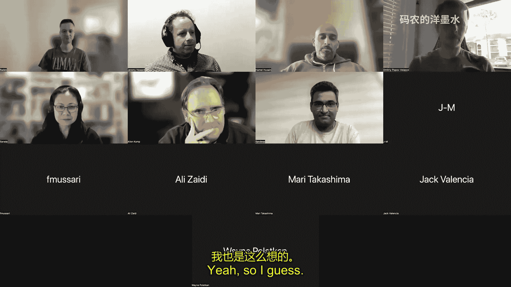
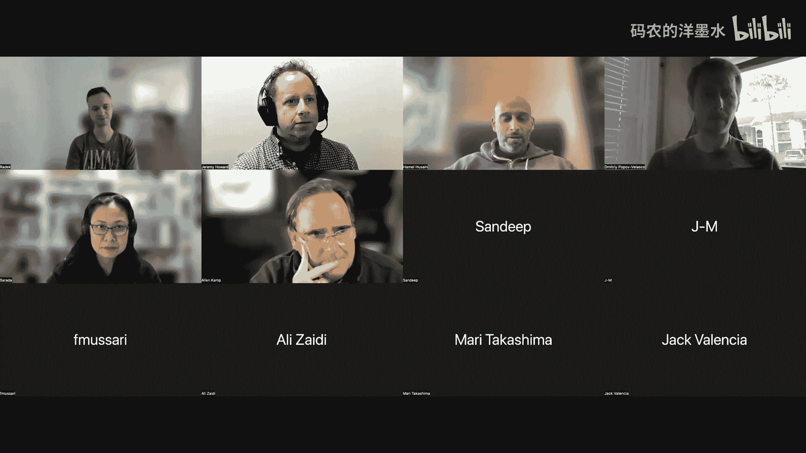
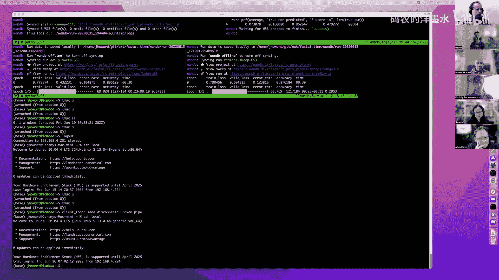
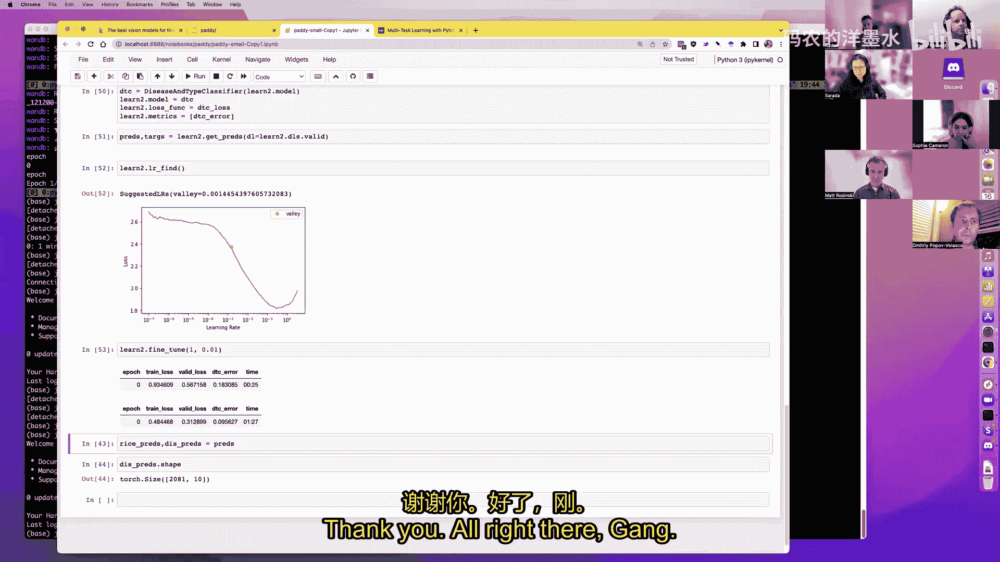
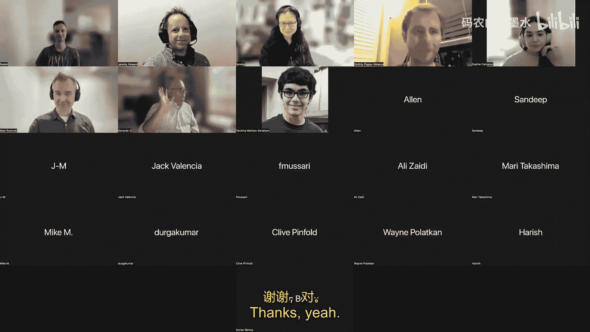

# 计算机视觉模型微调进阶：第12讲：多任务学习与模型修改








在本节课中，我们将学习如何修改一个预训练的计算机视觉模型，使其能够同时预测两个不同的目标：水稻的病害类型和水稻的品种。这是一个多任务学习的例子，我们将深入模型内部，手动调整其结构。

## 模型性能概览与实验策略

上一节我们介绍了不同模型架构在Kaggle竞赛中的表现。本节中我们来看看如何为特定任务选择和修改模型。

在实验中，我尝试了多种模型，并在224x224像素的图像上进行了测试。以下是一些关键发现：

*   **模型多样性**：在性能排名前15的模型中，包含了ResNet、Vision Transformer (ViT)、ConvNeXt等多种架构，这表明不同的方法都能取得不错的效果。
*   **速度与内存**：一些ViT模型（如`VIT small patch 32`）在保持较快速度的同时，内存占用也很低，这令人惊喜。
*   **图像尺寸的影响**：较大的ViT模型通常需要更大的输入图像尺寸（如384x384），因此在224x224的测试中，它们的性能被截断了。在实际应用中，我们通常从较小的图像开始迭代，以加快实验速度，然后在最终部署时根据精度和延迟的权衡考虑是否使用更大的图像。

对于生产环境，我的策略与Kaggle竞赛类似：首先在小尺寸图像和数据的子集上，用快速的小模型进行实验，以确定最佳的数据预处理流程和模型架构。然后，再根据实际的延迟、成本和精度要求进行规模化调整。

## 多任务学习：一个有趣的思路

本次竞赛的数据集中，除了病害标签，还包含了水稻的品种信息。一个有趣且可能违反直觉的思路是：让模型同时学习预测病害和品种，可能会提升其在主要任务（病害分类）上的性能。

其原理是，为模型提供更多的学习信号（即需要识别的特征），可能有助于它更好地理解图像内容。例如，如果模型学会了区分不同品种的水稻，它或许能利用这些信息来识别不同品种所特有的病害模式。

接下来，我们将尝试实现这个多任务学习模型。这将涉及到比以往更深入的模型修改操作。

## 深入模型内部：理解结构与修改

为了构建多任务模型，我们需要深入理解并修改现有的模型结构。一个典型的FastAI视觉学习器（`Learner`）包含两个主要部分：数据加载器（`dls`）和模型（`model`）。

我们的模型通常分为两部分：
1.  **主体（Body）**：负责从像素中提取特征的卷积神经网络部分。
2.  **头部（Head）**：接收主体提取的特征，并输出最终预测的全连接层部分。

我们可以使用 `model_summary` 来可视化模型结构和数据流。目前，我们的模型头部末尾是一个线性层（`Linear`），其公式为：
`output = input * weight^T + bias`
在我们的例子中，它将512维的输入特征转换为10维的输出（对应10种病害）。

为了实现多任务预测，我们需要修改这个头部。基本思路是：移除最终的单一线性层，然后创建两个新的线性层分支，分别用于预测病害和品种。

## 动手修改模型架构

我们将通过创建一个新的PyTorch模块（`Module`）来封装这个逻辑。以下是修改步骤的概述：

1.  **移除原头部最后一层**：我们可以直接操作模型的`head`部分，它是一个`Sequential`容器，支持类似Python列表的删除操作（`del head[-1]`）。
2.  **创建新的多任务模块类**：
    *   在构造函数（`__init__`）中，我们保存原始的主体模型，并定义两个新的线性层（`nn.Linear`），例如 `self.lin_disease` 和 `self.lin_variety`。
    *   在 `forward` 方法中，我们首先将输入数据通过主体模型得到特征，然后将这些特征分别输入两个线性层，得到两个预测结果，最后将它们作为元组返回。

```python
class DiseaseAndVarietyClassifier(nn.Module):
    def __init__(self, body_model, n_disease=10, n_variety=5):
        super().__init__()
        self.body = body_model
        self.lin_disease = nn.Linear(512, n_disease) # 假设主体输出512维
        self.lin_variety = nn.Linear(512, n_variety)

    def forward(self, x):
        features = self.body(x)
        pred_disease = self.lin_disease(features)
        pred_variety = self.lin_variety(features)
        return pred_disease, pred_variety
```

3.  **组装新模型并创建学习器**：用我们新建的类替换原来的模型，并创建一个新的学习器。

在修改过程中，我们可能会遇到一些技术问题，例如混合精度训练（FP16）带来的数据类型错误，或者模型深拷贝（`copy`）导致的状态异常。解决方法是简化步骤，逐步验证，必要时重建数据加载器或学习器。

## 调整损失函数与评估指标

修改模型后，我们的输出从单个张量变成了一个包含两个张量的元组。这会导致原来的损失函数和评估指标无法直接工作，因为它们期望的是单一输出。

我们需要进行以下调整：

1.  **自定义损失函数**：我们需要创建一个新的损失函数，它能够处理多任务输出。最初，我们可以先让损失只计算主要任务（病害分类）的部分，以确保流程能跑通。
    ```python
    def custom_loss(predictions, targets):
        pred_disease, pred_variety = predictions # 解包预测值
        # 暂时只计算病害损失
        loss_disease = F.cross_entropy(pred_disease, targets)
        return loss_disease
    ```
    然后，将这个损失函数设置给学习器：`learn.loss_func = custom_loss`。

2.  **调整评估指标**：同样，我们需要修改或暂时移除原有的评估指标（如错误率`error_rate`），因为它们也依赖于单一输出。我们可以先创建一个只针对病害预测的错误率函数。
    ```python
    def dtc_error(predictions, targets):
        pred_disease, _ = predictions
        return error_rate(pred_disease, targets)
    learn.metrics = [dtc_error]
    ```

3.  **修改数据目标**：目前，我们的数据加载器只加载了病害标签。要真正进行多任务学习，我们还需要修改数据管道，使其能同时加载病害和品种标签作为目标。

完成这些步骤后，我们的新学习器应该能够进行基本的训练循环了，例如使用 `learn.lr_find()` 来寻找合适的学习率。

## 总结与展望

本节课中我们一起学习了计算机视觉模型微调的一个进阶主题：多任务学习。我们从分析模型性能的策略出发，提出了一个同时预测病害和品种以提升性能的思路。然后，我们深入模型内部，详细讲解了如何通过修改模型头部、自定义损失函数和评估指标来实现一个多任务学习模型。





虽然这个过程比使用标准流程更复杂，但它极大地加深了我们对PyTorch模型结构和FastAI学习器工作方式的理解。这也揭示了现有库在支持多任务学习方面可能存在的简化空间。在接下来的课程中，我们将继续完善这个多任务模型，并尝试将其应用到竞赛数据中，观察其实际效果。