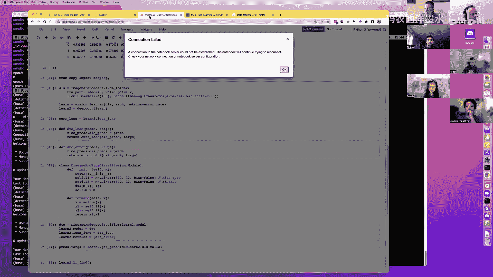
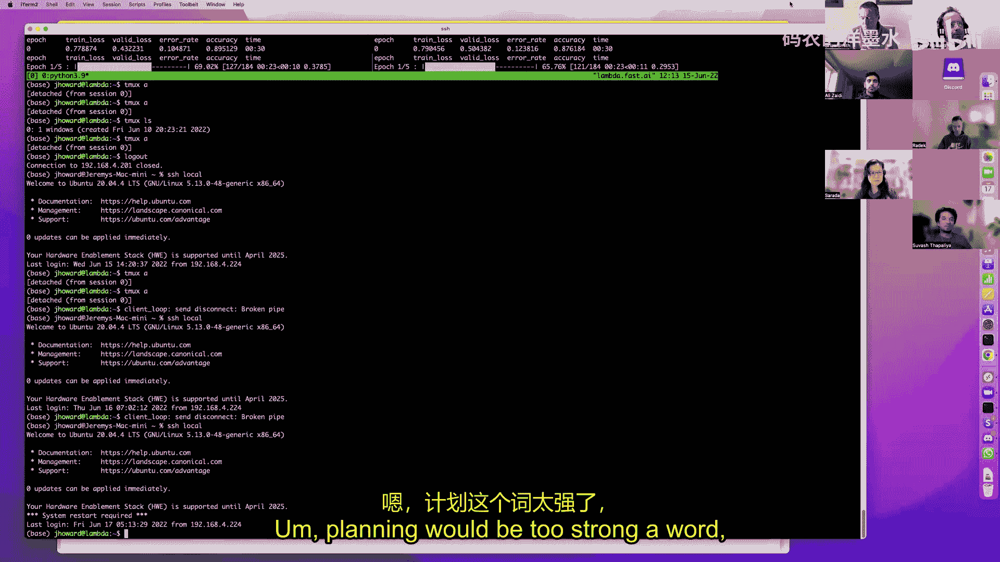
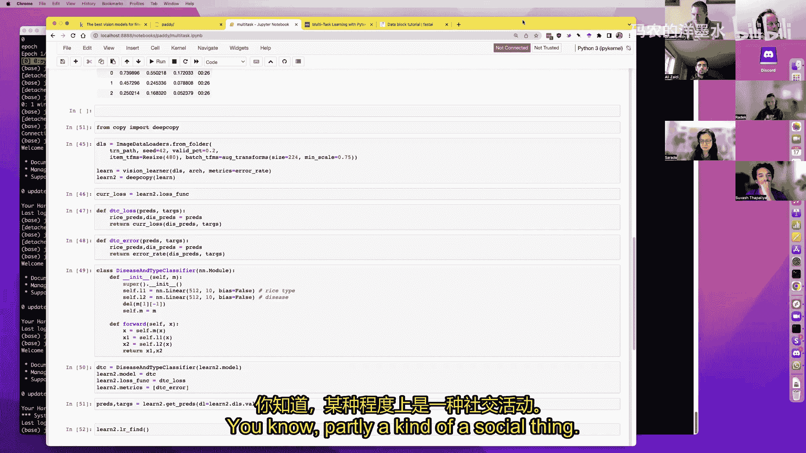
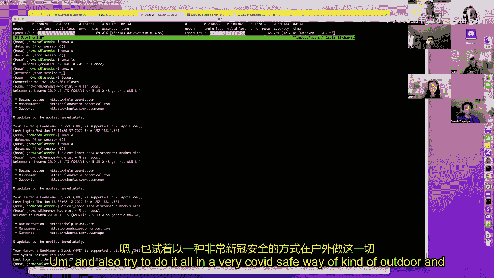
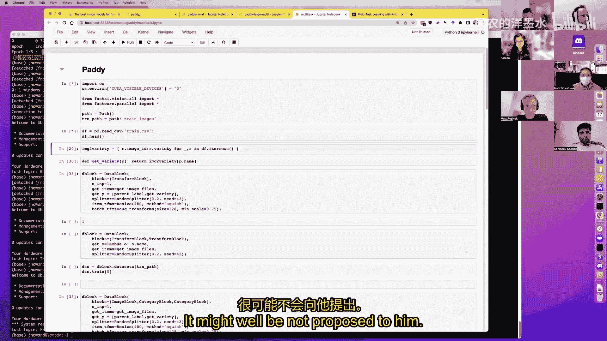
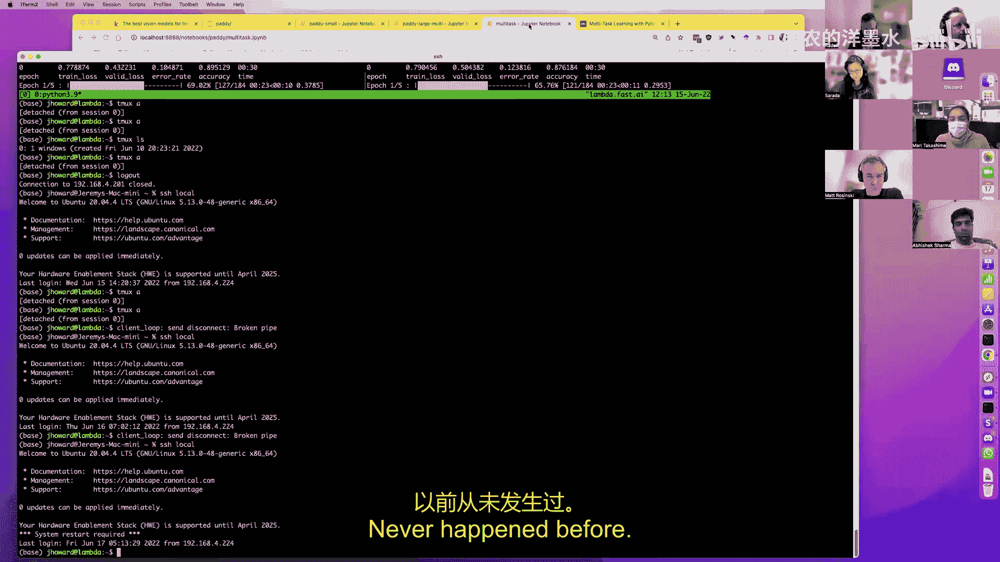
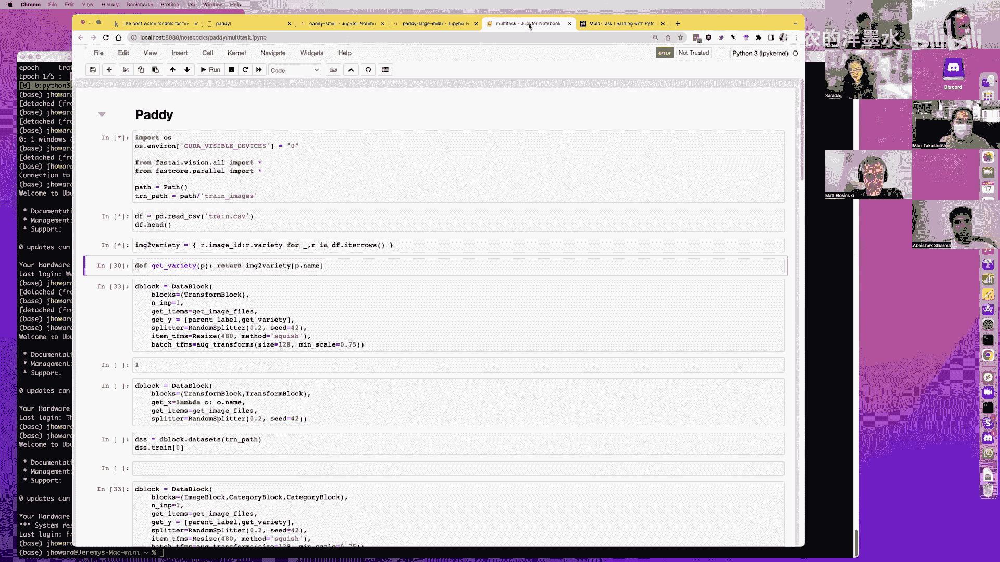
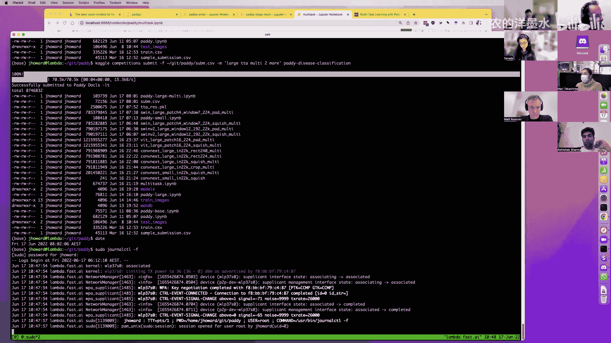
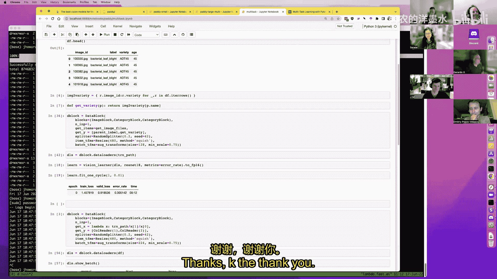

# 【全集】旧金山大学 实时编码 中英字幕 1080P p13 Lecture 13 - fastai DataBlock深度解析 -BV1KZiTBWEeH_p13-

Just continue with this。

Okay， great， yeah。Any other new faces today。Ali， have you been here before。

 I don't remember seeing you。 Maybe you've been quiet。 I've been here。

 I don't think I've had the camera on。 Okay， yeah。Thanks May you。

And Nick is back from his tour of tropical islands Hi Nick yes， yeah。

 not so far away though still pretty close Yeah， well when Queensland tropical islands are easy。

By default fault。Hi， Marie， nice to see you。 Where are you joining us from。😊。

Hello can you hear me I'm joining from Southbank Bris Yeah I'm at the Children's Health Queensland Hospital building yes。

 okay， great。😊，Um anybodybody got anything they wanted to talk about or ask about before we dive in because I've got some good news。

 which is I've made things much easier than the horrible direction we went last time。😊，All right。

 sounds like I should dive in then。Yeah。嗯。I know。 there was， like。

As I rather expected and quite fair enough， some， some concern on the forum about how。

Complicated and weird this all is， which is partly because we're kind of like jumping into stuff we'd normally do in part two。

 and so we haven't quite got the。Yeah， all the necessary background here。And so yeah。

 don't worry if you're feeling a little。At sea。But it's a good way to like， I don't know。

 start to see like some stuff you could。Look into after the course is finished。

All right， so let me just hear me， Yes， sorry， just on mentioning part two。

 are you planning a part two this year？Planning would be too strong a word。

 but as much as I ever planned anything thinking about Yes。

 I would absolutely like to do a part2 this year。 Awesome。

 and the fact that you're asking that question means that you are not up to date on our discord。

 So you should definitely join our discord channel because we've actually been talking about doing a。

Conference or an unconference to go with part two at the end of the year in Queensland。

And a lot of folks from。Places that are not in Australia are saying they would be up for coming coming here for that。

You know， partly a kind of a social thing and also trying to do it all in a very Covid safe way of kind of outdoor and masked and。

People tested ahead of time and stuff。Yeah， so that's。Yeah， so nothing's planned。

 like we don't have dates or syllabus or anything like that。

 But we absolutely hope to have something awesome。😊，Maybe towards the end of the year。

Where we can get to， yeah， get to know each other a bit better and get to know。

Fast AI and deep learning a bit better。 can I ask you。

 are you going to continue this waffle next week， Because I know that the class is going to resume next Tuesday。

 Yeah， I think so， like the fact that I'm doing it this week is。Interesting， because， yeah， like。系。

It has been I've got less time to actually work on the course。

 but I also feel like the stuff we're doing， perhaps the stuff I can do use in the next lesson。

 depending on where we get to so。U。Yeah， so I think we'll do it next week。 We'll see how things go。

 if I get really behind。 then maybe not。 But that I certainly plan to like。

Continue during them after the last class。You know， until。I don't know。 We all know everything。

 I guess， and then was top。 at which point there'll be more things to know。 So yeah。😊，Okay。

 we don't have to stop necessarily you know， there's just so much to learn the only problem is that it's obviously a burden on your time。

 but it's you I enjoy I enjoy it my issue is what about when we get to the point where there's nothing left to learn Rad。

 what do we do then you know， but is there such a point Sure。

 they must you know but then we just start all in a different language right。

 we start doing it all in our or C plus that would keep us busy know。

 I think this is my fifth year of doing courses and I'm still trying to complete the you know part one too modest。

😊，I don't know， it's true。Alright， let me see， so。Mautiita。All right。

I am just so happy about how this worked out， to be honest。😊，Although spoiler alert。

 it didn't turn out to help our score， the score was about the same。So。

 but I was so happy at how the whole process turned out。😊。

And I kind of want to show you how I got there。As well as where we ended up。嗯。And yeah。

 as soon as I kind of like turned off Zoom last time。 and I went for a walk。

 And then as soon as I went through that， I was like， oh， now I， of course。

 I know how we should do this。 And really， So there's quite a few， you know， we can make this much。

 much simpler so。Let me explain what we're going to try to do。We are going to try。To。Predict。

Two things， the disease and the variety for each image。And the first thing will be to create a。

Pair of data loaders look like this for each image they will have connected two things to them。

The disease。And the type of rice， So this is going to be step one right so let me kind of show you how I got to that step。

So that step1 that I took was to， first of all， try to replicate。What we've already had before。Right。

 so。Patty small。 But before I used image data loaders， which is like a。

 that's the highest level least flexible function。 You know。

 we can do all the data processing of a single line of code。

 But only if we want to do something really standard and trying to predict two things is not standard enough for it。

 right， So we now need to go one layer。Down and。There's like a lot of really good tutorials on Doc。

faster AI and because it's been ages since I've done any of this I'd forgotten entirely how fast AI worked。

 so I used them very heavily to remind myself of what's going on， but for example。

 there is a data block tutorial。This pets tutorial is， is great。 It like。

 it goes through all the layers of like， different ways of doing things with fast AI。Preprocessing。嗯。

This Siamese tutorial is another really good one。 So these are some of the things I looked at。

 And the other thing I looked at was。The actual API docs。 So if I click here on data block。

This is actually probably what I found。The most useful in the end。

There's lots of great examples in the documentation。 So yeah， I， you know， as a kind of like。😊。

You know how it is you come back to something a couple of years after you built it and you're now kind of the customer of your documentation and so my experience as a customer of my documentation was I was really delighted by it so I can definitely suggest checking all that out。

嗯。就。You know what you can do before we were using image data loaders from folder。

 so if we just do the double question mark trick， we can see the source code for it。You know。

 and it's the normal size of fast AI things。 It's very small。And you can see that actually。

 all the workss being done by data block。 So data block is that like， you know， still high level API。

 but not。Not as high level。 it's actually very flexible。

 And so we're going to step step one that I did was to replicate exactly what we had before but using data blocks。

And。So， this is， actually。You know， so many good examples in the tutorials and in the book you've seen them all before。

 we don't need to talk about it too much， you know， we can basically say okay。For the data block。

 the input will be an image。 The output will be a category。This is just to do disease prediction。诶。

The labeling function。Will be the parent folder。点嚟个。Do a random split。

The item and batch transforms we can copy and post from。What we had before。诶。

And that creates a data block。 So data loaders is then a data block dot data loaders end。

You then have to pass in a source。 So the source is。Basically， at at a that you can。

Eerate through or index into to grab the things that will be passed to these blocks under this function。

So for this， it's going to be a path。嗯。And then， we also。Data get items。

And so this what when we get a path， we're going to pass that path into the。

Get image files function because that's the thing that returns a list of all of the images in a path。

嗯。And let's see if that works。😔，How do you know that？In theOkay， so the block。

 you have an image block category block。嗯。How do you know that？Like。

How doHow do you know that the Git image files is going to be able to feed both those blocks？So。嗯。

I guess the short answer would be you to read the documentation about those blocks to see what they take and what they do。

Already of the tutorials that use them， as you can see， they're used all over the place right。

 so we can start with this tutorial or this tutorial or this tutorial。So any of those would show you。

What it does。Or。Yeah， the actual， let's say this， this is not good documentation。

 I' really never bothered to look at this because it's。嗯。Basically， longer good。we should fix that。

 I guess because there's so many tutorials。I mean， as you can see， like。

 I guess the reason I never really wrote Jock short is that it's literally a single line of code。

 So that's like。😊，诶。Yeah， so maybe looking at the code is actually interesting in this case。

 So an image block。😊，Is something which calls。Class dot create where class is。

PIO image it's going to call PO image drop create so to find out what's actually going to be called by it。

You can go。嗯。P I L image。Dot create。And you can see it's going to get past a file name。

 which can be a path or a string or various other things。So get image files。 then obviously you can。

 you can either run it to see what it comes out with or let's do that so we could just run get image files。

Passing in。The thing it's going to be given， which is the path。And so as you can see。

 it's a bunch of paths。 And so we could pass one of those。Copy that。

And it's gonna to be passed into this function。So we've now just replicated exactly what's happening in the code。

Yeah， but for this I generally just look at the tutorials， which。

Tell you what could you have could you have two different get items that feed different blocks we we're going to come to we're going to come to that Okay okay pack that so。

诶。Yeah， so there was also a batch transform like if it gets transformed later after reading right because yeah here we got the batch transform the in the image block。

Because right now we have a pill image or something and it needs to become a tensor right Yeah that's right it gets changed from an advancer to a float tensor later on。

 That's right。 Yeah that's a。Yeah， that's a fairly subtle thing。 But that's right， the。诶。

It sticks that in something image equals。And we look at like， N dot array image。

It's actually stored as bytes or U in eight， as they call it。In Pytorch。So yes， the。

This is going to add a batch transform that's going to turn that into a float tensor。

 which we can see。But that's gonna look like we could run it here， I expect。It a float tenseer。

The transformation that we're applying is 224， which is is like a square image， correct。

 a 224 by 224。This one here， Yeah。 So this is doing data augmentation of lots of different kinds so。

😊，嗯。That's。不屁。Duck。Haste。And if we show for data augment。

 looking at the ducks is particularly important because you can see examples of the。

Orugmentations it does。 so it tells you a list of all the augmentations and how you can change them。

 And here's some examples of what they look like。These would happen after the inter yes。

 that's some data they operate on the entire batch and some operate a single that's right so the ones in batch transforms operate on a whole batch and the ones in item transforms operate on a single item and so batch transforms。

Iperate because they operate on a batch。Before you get there， everything has to be the same shape。

 so it can be turned into a batch。 So this resize resizes everything to the same shape。And then。

 this does。These various different types of data augmentation and one of the key pieces of data augmentation it does is to randomly zoom into a subset of the image。

 as you can see。In these various examples here。And the data blue API。

Can you also use it with data frames where you would be reading your images from a data Yeah we're going to do that we're going to do that in a moment yes okay good absolutely。

嗯。So， yeah， I'm， I'm kind of like skipping over quite a bit of this because。

It's super well covered in the tutorials， so I don't want to like to say stuff that you can very easily read Ru else the stuff I'm about to show you isn't as well covered in the tutorials and it's kind of new。

But yeah， feel free to keep asking questions about anything you see。 So basically， yeah。

 so all we've done is we've just， this is just the same thing that we have in。Lesson one。

I just and it's doing exactly the same thing as my image total loaders do from folder。

 but just 1000 total lot。 And so that this is what I did just to show you through my process with step one was to get this working。

 and then I。Passed that into a learner。And I。So， let's go copy。And。

And I want this all run as fast as possible。So I would use the fastest。嗯。

T let's do this vision weather。Do you， when you make this data loader thing。

 do you try to make sure that the shape that it's outputting is what you need for your model or that's later？

Well， I generally use models Ham， which don't care what size they get。So yeah。

 that's one of my that's one of my tricks so Re8 is happy with any size。So actually for my testing。

 I'm going to bring this back down to 128， so it's super fast。And。

So I just wantna get the maximum iteration speed here。And so now I can call learn dot。Bit one cycle。

And let's do one epoch。嗯。Okay， so this is gonna run in under 20 seconds。

 which is kind of what you want。 right， You want something that you can test in under about 20 seconds so that way you can just quickly try things and make sure that end to end。

 it's working。 Yep， the error rate is down to 30%。 So that's， that's a good sign。

I guess one correlated question is look I understand the input size。

 but what about the output size of your data block like you know that this is what you need for that model。

 you know， let's say the model doesn't care the model's happy with any size。I mean。

 the targets or whatever。You heard about the labels， Yeah， the labels， I mean。

 labels don't have sizes， the labels are strings or just the this， the shape of that like he。

 like is it。You know， because maybe different models are kind of trying to predict different types of stuff。

Potentially， I don't know。U。Like some might have shape of the a vision letter is。

I suspect the thing you're kind of asking is the thing that we're going to be covering in a moment。

 So maybe put that on hold and then tell me your doesn't make sense， okay okay。I have a question。

On the data block， you randomly select a。The amount of records or the amount of entry the batch size that you're going to process I don't randomly pick the batch size no the batch size is actually selected in the dot data letters call and it the 64 64 so what is the guarantee that that every single one of the images in this particular case will be selected or there's no way to know。

Is there any way to know that every single one will list up Yes I mean， well， I mean yes。

 except that we're randomly selecting 20% to be our validation set。嗯。

But every single one will go through the learner of the 80% that in there。

 everyone will go through our learner because we randomly shuffle them and then we iterate through the whole lot。

🎼So in a epo in a single epoch， the model is guaranteed to see every example that is in train just once。

Yeah对对对。Yeah， and that's what this one means。 That's what one epoch means。

 is look at everything once。 And so if we put two there， or look at everything twice。

 But each time it randomly shuffles it。 So it does it in a different random order。

a quick question what I guess。This is by doch data loader stuff but what actually happens for the last batch the last batch it depends and this is actually not the Pytorch data loader it's actually fast AI is data loader so we have our own data loader although in the next version we're likely to replace it with the fast AI1 so it depends what drop last is if drop last is true then it deletes the last batch and if it's false that it includes the last batch and the reason that's interesting is that the last batch may not be。

It size 64， yeah。For the validation set， it always keeps the last batch。

It's super important to shuffpherle the trans the first A I does it for you。

 but if you will you know mess around with the data load or something yourself if you don't the you might get the very poor poor training performance even with when we used to use CAs I used to mess all this stuff up all the time yeah trying to get all those details right it's really annoying just to make sure on something you said you said in next it you can replace it with the Pytorrch data loads Yeah probably yeah okay。

You said fast I got confused oh did I that is confusing。Thanks， okay。

 so that was my step one is to just get it working exactly like before and then I ran then I ran it with。

😊，In the background on the same architecture for the same epochs to make sure I got about the same error rate and I did。

 so then I was happy that okay， I'm matching what we had before。So then step two。

Was to try to make it so that the data block spits out three things。

 which would be one image and two categories， the category of disease and the category of race type。

So to get it to spinit out an image in two categories。

 hopefully you wouldn't be surprised to hear that we just。Do that。

 we say we want three blocks an image in two categories。Now。This。Variety。

 we did some way of getting that。Given an image， I D。

And actually the way I did it was a bit ugly and since then I thought of a better way of doing it。

 which is what I think we should do is we should create a deck that maps from image ID to variety and then our function will just be to look that up right so let's call this image to variety。

😊，Eals， okay， and it's gonna to be a addict comprehension。So we're going to loop through。诶。

The rose in。诶。Df dot。呃。Itter items。Now， I always forget what these differences are。😔。

Column name from a series pair。 returning a tuple with the column name。Okay， that's not what I want。

I feel like it arose， yeah， it arose。Index come a series。Okay， cool。

I think like this it a tuples is the fastest one。But you know， this is not very big。

 so I don't say well let's keep it simple。Okay， so this is gonna iterate over rows and return。

Index kind series。 Okay， so we don't really care about the index。嗯。Oh。

Another thing we could do is make the image Id， the index。

 and then you could actually jump straight into it。 But I think I'd rather not use pandas features。

 I'd rather use more pure Pythony things because I think that'll make the explanation a little clearer。

So we're gonna look through。 It's gonna to give us the index and the row。

And so what we want is the key will be the row image ID。And the value。Will be the rose variety。打开入池。

Okay， that looks good。U。So then there's a couple of ways we could turn this into a function。

And I'm just going to show you a little neat trick， which is when you go like the。

 let's pick out something。 Let's say we're going to grab this one。When you go like this。嗯。

Behind the scenes， that square bracket thing is actually calling a special magic method in Python called Dunder Getite。

Which is a function。So this is the cool thing about Python。 it's so dynamic and flexible。

 like all the syntax sugar is like behind the scenes， just calling functions， basically。

 that's exactly the same thing。😊，Right， and so that means that this function here。

 image to variety done to get item is a function that converts。A file name into a variety。

So here's the cool thing， forget why you can pass it in array。

And it's going to call each of those functions。嗯。Which I think is rather nice。Um。So。

Another thing I find helpful。Okay， cool， so when I call that， it complains and it says， oh。

 get Y contains two functions， but it should contain one， one for each target。

 It thinks that there's only one target。 Why is that Well if you think about it we've said theres three blocks but we haven't told it how many of those blocks for the independent variable and how many for the dependent variable and so we have to tell it and the way we do that is just to say the number of inputs equals and so it' one we have one input。

And then the rest will be outputs。So when we do that。It's now happy。Okay。

And personally before I jump to data loaders， I first create data sets just to make sure they work so data sets are things where you can where you just grab one thing at a time there's no mini batches to worry about so data sets are easier to debug than data loaders so you can create data sets using exactly the same approach。

Okay。And so。Alright， so we've got an error。Okay， so here's the problem。

 It tried to look up our function and。In fact， it's not indexed。 It's not passing in。

The string of the name， it's actually passing in。The path。And so that's why we've got a key error。

 This path does not exist as a key in this dictionary， which is quite true。 right It doesn't。So。

What I think we should do is fix this up。So that we've got train images， bacterial leaf street， blah。

 blah， blah I mean the gi files。Function， the output of that is being passed to the get or get items is being passed to gettY。

So get image files。Yeah， so we haven't kind of gone into the details of exactly what's going on behind the scenes Ham let's do that in a moment Okay I kind of like the way you're wanting to jump into the nitty gritty。

But it's a little bit。 I'm trying to try to do more top down， right。

 So I'm gonna get to your bottom up。 We'll meet in the middle。 Okay， Okay， fair enough， fair enough。

 by the way， your video is not on that's which is fine。 I just don't know if it's intentional。

 I always like to see people in there。😊，You know， seeable color。😔，Okay。

So we're not going to use this trick after all， we're going to create a function called gett Va。

Actually， no， yeah， let's create a function called Gett variety。And so it's going to get past a path。

Okay。And so， we're gonna return。嗯。Image to variety。And we're gonna return image to variety。

With the name of the file， So the name of the file is a string。Come。Wait。

 may need image to a variety the Dunder thing like yeah， I'll just grab bracket actually， yes， yes。

Okayy。Oh， and then we need to use that。Okay。Yeah， underscore score。百里。Okay， so DS S S。嗯。

Matains a dot train data set。Okay， and it also contains a valid data set。Okay。

 and so we can look at the zero thing in the training data set， which is a single thing， right。

 So we can have a look now。 There's an image and Y 1 and Y 2。And so then we can look at the image。

 for example。Okay， so what's happened here is that。Get image files returned a list of paths。

The first one。Got passed to image blocklock， which as we saw earlier。

 got passed to PO image dot create。And here it is。U。

And that path name also got passed to a function called parent label。 In fact， let's do it， right。

So let's say file name equals get image files。And then the thing that we passed in training path。

And let's just get the zeroth one。Okay， and so。There it is。😊，Right， so。It ended up calling POimage。

 createate。With that file name。Okay， it also called parent label with that file name。Aent。大婆。Okay。😊。

And it also called get variety with that file name。Jeremy， can we look at Get variety one more time。

 I was just curious how you build a path。I didn't I removed the path I called see yeah in my original version of this I did it the other way round of like building back up the path and then realized that that was kind of stupid so yeah it's unique so that works one question。

😊，啊我系我系。Okay， this could be too you know low level but just let me know can you have multiple get items is this is the right place to ask that or so it wouldn't make sense to have multiple get items right like get items returns a single thing。

But it could be anything you like， right， It could be。

 it could return a top hole or a list or an object or whatever， right， And so or addict。😊。

And then get Y and get X are then the things responsible for pulling out the bit that you need to pass your blocks。

Now， don' we don't need to get x because image blocks just take parts。Directly。

 if I needed something a bit more like I wanted to put more things and get image file like have it emit a tuple。

 then would I have to like make my own image block to ignore no not your image block。

 you would write your own function just like get image files that returns the list of all of the objects you want。

 whichever the information you need。Okay， and then but like it almost never happens。

 I don't think that's ever happened to me because like nearly like nearly always。

 there's like a row of a database table or a path or something has。

All the information you need to like。Go out and get the stuff with your get Xs and get Ys。

That's like the central piece of information for each row and based on this information you can read in text you can read in images but you know specific to that one row actually let me show you my hacky version because this is the version that uses a data frame so this is so the version that uses data frame。

呃。See is is it is it right to think get William as yeah that's interesting let me just do this and let me come to your question okay。

 so this data blog I started out with a data frame。Like so。 right。

 And so by passing into data blocked up data load as I passed in the data frame。

 it's going to get it's going to get each row。Right， and so then get why。becomes co ra1。

 which is just a function which I mean， it let's look at it's that doesn't do much。It。

 let's see what it does。 So it's got， it's， it's， it's done as an object because you can do things like adding a prefix path and a suffix path。

 and you can splitit it with a label delimiter and whatever。 but basically。You know。

 all it's basically doing， okay， and it like checks what kind of thing you're passing in。嗯。嗯。

But basically all it does is it calls。Get at。To grab the column。嗯。And we've。Fororator for Honda。

 like reading data points sorry。This is called radar function， specifically for data frames。I mean。

 it can work with anything basically that that you're So what it's doing here is it's， yeah。

 it's saying。Grab。That column。 but it's really， you know， I've only really used it for data frames。

 but you could use it for anything。 But yeah， so basically here， get Y is saying， okay， well。

 let's return the the index one field and the index2 field。You know， and。what's up to get Yeah。

 so so because now we're being passed so you can't pass a row of a database table to PL image dot create。

So， get X。Is this function。Which basically is going， oh， it's going to be in the training path。

 slash disease name， slash。嗯。Image name so。That's。And then there's a special case for the test set because the test set things are not stored。

In subfolds， according to label because we don't know the label。

 so it's just directly in the test path。That's as I said， this was more hacking。

Um I don't this this this really helps so like a get x is kind of like get y you can have a list in there。

It yeah yeah， you can have it yeah， it's totally flexible and I mean。

 seriously how more like this like we have so many examples of all of these。😊。

Patents in the docs in the tutorials。 So like this exact pattern let's take a look at one。

 right docs。faster today， aye。嗯。So， tutorials。Let's do datab tutorial。Right here， look， multi La。So。

 here's one。And yeah， you can see here this is even splitting based on columns in the database table and here's the call reader using the prefix and here's a call reader using a label delimiter。

And here's the examples coming out。 Yeah， so this。Yeah， lots of examples you can you can check out。

To see how to do all this。嗯。Yeah， so I think I'm at a point now where I actually do want to go into the weeds。

 So Hamil， you're now after this， totally free to ask any super weedy questions。

The most basic kind of data block。Is called the transform block。And the transform block。嗯。Basically。

嗯。It's going to store a bunch of things you pass in。

 it's going to store things called type transforms。

 It's going to store things called item transforms。

 It's going to store things called batch transforms。And also。

 it always adds one thing which is to tensor because Ptor is tens。 if you look at。The image block。

We saw that that's defined as a transform block。Where the type transforms is this and the batch transforms is this。

So now's a good time to talk about how this all works， what this does。So if I。Pass in here。

 Transform block。And don't pass any transforms。 It won't do anything。Right， so。If I。

 let's get rid of like。Pretty much everything。Right。😊，Pat， let's do that。Separate cells。

 so it gets a little bit easier to read。😔，Okay， here is。The world's simplest Data book。Okay。

 so if we。All that。As you can see， all it does is it takes the output of gett image file zero。

And turns it into a tuple containing one thing， which is the thing itself。

If we have two transform blocks。It returns the tupper with two things in it。So。

 and the reason it's returning tuples is because this is what we want when we train， we have batches。

 right， containing。Inputs and。Outputs。Potentially multiple imports and potentially multiple outputs。

 right， So that's why。You know， indexing into this gives you back。A coupleple。My your question， yes。

 the， the blocks can either be a list or a twople。I don't know， probably。Yeah。Okay。I had no idea。😊，U。

Okay。は。Okay。嗯。😊，So then we can like。Do stuff。To。嗯。The first thing in the tuple。So， getx。Equals。

Say it's kind of lambmbda。呃 o dot name。嗯。定下 well。Hey， what are you doing？哦。Yes。

Something to do with Lambda， right？Does name have to be called？No。嗯。Maybe it's notebook restart time。

 it's my notebook restart time。

Oh， that's。Oh， I wonder if something happened to my。GPU server。I mean。

 something has happened to my GPU server， clearly。Never happened before。

Okay。

到。It looks like it's back。 Oh， okay， it just recognized that it disappeared。哎。That's wild。Oh， okay。

I very don't know what this happened。Ca it doesn't really matter。

What do you what are you doing right now， I just looking at the logs see if anything just happened。嗯。

nice。嗯。O。哎。Okay。So you see what happened here is。We， you know， got the first thing from image files。

 which was this and。Get X， got its name。So， we could also do。Get why。Equals land00 dot parents。Okay。

 so it first went like。First， the thing went to the transform block。

Get items yes so whatever get items got went to transform block and then went to get X and get one well transform block doesn't do anything right at all unless you pass it transforms so yeah so it's basically。

But the number of them you have is the number of pipelines it's going to create。

So if we created another one。But generally if you have like an block it going we're going to get to that yeah so here look we've now the order we're not quite there yet right so let's get to that and it's not quite the mental model you've got I think now that I've got three transform blocks。

I only。Have things to。Create two of them。So it's， it's sad， right， And so we could。Put them here。

For instance， and last one is the y and the first two or the correct， unless we say number of inputs。

Itquals1。Right， in which case now。G x is just going to have to return one thing is's going to be one function。

And get why will be two things。Okay。😊，嗯。😊，So。You could。U。You know。

 you could even put it here instead， right？ So you could say， oh， well， this is actually。嗯。嗯。

It's perfect。We could put it here。Item transforms equals。And so the stuff。

 the transform block is stuff that is applied。But that transformed。诶。How is that not working？😔。

Slightly surprising to me。Okay， it's to be a type transform。Okay， type transform。

 So it's now converted to。The type it's meant to be。 So Radick， you were asking about image block。

I'm just you know， curious how all the pieces interact let me you these things let me show you。

Let's do it manually。 So image block is just this。 Okay， so let's not use image block。 Let's instead。

 Why didn't the item transform work， Let's figure that out later。 Yeah。

 once we figure out what's going on here and then we'll debug it。 Okay， so now we've got three。

Transform blocks， two of them which do nothing。 in the first one of which。Is gonna call。

Something do't create。 It was perial image dot create。So， transform blocks don't。

If you look at the code of them， transform blocks。Don't do anything at all。They actually。

 they only store things。There's no。There's no dunder call， there's no forward， there's nothing。😔。

Transform blocks don't do anything， they just store stuff。

The data block is a thing that's then going to go through and say， okay。

 for each thing call its type transforms and then call to tensor and then call it item transforms and then at data load time call it batch transforms。

So does that help answer your question， Hamel， it's not that a transform block doesn't get called。

 It just stores the list of things that will get called at each of these times。

 The first thing that gets called is type transforms。嗯。Wait， is that right。 you think。

 that's not correct。 The first thing that gets called is get X and get Y。

 And then the result of that is passed into。Type transforms。 And so get X and get Y。

 So get X would be responsible for making sure that you have a path that you can pass to P or image dot create。

That's the oil。 So this whole of what happens sequence that lives in data that lives in data block。

 exactly。 Now the data block code is， frankly， Harry， and it could do with some。You know。

 simplifying and documenting and refactoruring， it's not long it's。About 50，50 or 60 lines of code。嗯。

In fact， it's almost all here， but basically。😊，Where you called dot data sets。

Really all it's doing is is it creates a data sets object passing in all of the type transforms。

To it and the answer to your question， how why didn't the item transforms get done is because item transforms actually get done by the data load or not by the data sets。

So data sets only use the type transforms。 And basically。

 the only reason there's like quite a bit of code in here is we try to kind of make sure that if。

Two different things have， like， the same。Type transforms。

 we kind of merged them together a in a sensible way。

 So there's is stuff to try to make sure this all just works I was going the the type transforms are separate from the items transforms because of some optimization you can do with the type transforms because the type transforms are they're happening earlier。

 they're happening before。Data loaders time， so data loaders are the things that are going to take tenses。

Right。So， or at least things that can be converted into tensesors。So yeah。

 so type transforms are the things that are going to create your data sets for you。

 and they're going to spit out things which need to be convertible into tensess and then then data loaders。

Has item transforms， which are things like reshaping everything to the same size and batch transforms。

 which are things like data augment。But you can have an item transform run on the GPU or not on the GPU right it depends on the ordering or。

I don't think an item transform is generally going to run on the GPU because it's not a batch yet。

I mean， I maybe it's theoretically possible， but that would be pretty weird because you， yeah。

 you really need things to be in a batch before the GPU can be。

Optimizing it effectively and everything thinking but transforms with around view。

Assuming that you're using a GPU。 I mean， there is a there this is， okay。

 this is some the part of the code base we're not looking at today。 but if there there is a。

I can't remember it think it might be a callback which sticks things on the GPU so it just depends on whether things are before or after that callback。

Yeah， that's that's probably a bit of a distraction so let's skip that bit for now。

To to kind of revise the difference between data set and data loader is it best to revisit the Pytorch documentation and kind of yeah pretty much we have our own implementation of them。

 but our implementation of data loader is a superet of。

Pytorrches and Pytorchs data set is like literally， it's an abstract class。

 It doesn't do anything at all。 It's just so a data set is something that you can index into。

And it returns a single tuple of your independent， independent variables。

 That's what a data sets defined as。At by Ptorrch， and therefore that's what we do as well。

A data loader is you can't index into it， the only thing you can do is iterate through it。

 you can grab the next one and it gives you a mini batch。Which is a tensor。So but yeah。

 that's a pieytorrch concept。I guess I'm trying to understand the type transform thing。

 why it has to be done in the data set。Before the data loader， what doesn't have to be。 But it's。

 it's like we want data sets like data sets are a very convenient thing to have to have something you can like。

Go into and grab items， you know， numbered X， Y or Z。 that's。

 that's the basic foundation of the P toch data model。 You know。

 I that there's things you can implement the type transform aspect of it later。 Yeah， so you need。

 you need something that converts the output of get image files。Into what you want in your data set。

And that thing needs a name and the name we gave it was type transforms。Okay。

 think I think I understand okay， like you this is not the only way you could do this right。

 but it's it's it's our way that's really nice because we now have this thing that you can say like oh。

Hamel， can you show me the 14th image and its label。 And you can say， yes， no problem， Jeremy。

 You can type DSSS do train bracket 13 and。And they， there it is， right。So。Yes。

 that's just a convenient thing， basically。So I guess a question around that is that if we did not have type transforms。

 then it would just be。One more step in the item transforms， right， Yeah， I think so。

 your your data sets， your， Yeah， your data sets would always just return a single thing or maybe the probably two things that get X and get Y results。

And then your data loader would have to do more work， basically， exactly。 Yeah， yeah， which is。

Would be as perfectly okay way to do things as far as I can tell that I think would be a little。

Harder to debug and work with and。Keep things decoupled。Yeah， I think it's a reasonable comment。

Is it like anything you want to do up front？That is like kind of uniform across your whole data set。

 maybe put it in the type transform that you don't need to。Change at training time。诶。Basically。

 like anything that you want to be able to like。Index into it and look at that thing， really。

 you know。If you're not sure where to put it。I'd say just chuck it somewhere and don't worry about it。

 You know， like， like， you know， we kind of put the， the rule is that， you know。

 you need something that。Can be turned into a tensor。 Like that's， that's the way fast AI does it。

 So you need to make sure that your type transform。

When you're working with us say I return something that is a tensor or going to be turned into a tensor。

Which PL image can be？For example。Okay。I think I understand it's kind of like u you want just。

 you want to make sure it's like a convenient thing that you understand to look at yeah， okay。Yeah。

Okay， so then like okay， so I can remove all that。😊。

Because that is that this is the definition of image block。

 So let's replace it with the word image block。Okay， and then let's change。诶。Okay， let me think。Okay。

 so let's pop a dot name here。嗯。Here's kind of something we want as our label， right。

 That's one of our labels。And then the other label we wanted。Was the。Auction call Get variety。Right。

 now we can't this breaks our rule。 This can't be turned into a tensor。Cause it's strict。

So what do we do about that？😊，You might remember from a previous lesson。

 we learn that what we do is we replace strings with integers。

Where that integer is a look up into a vocabulary， it's a list of all of the possible options。So。

If we。Change this to category block。That is exactly what category block will do。Right。And so。

Category block。This's got a type transform code categories， which I'm not going go into because it's。

Not particularly exciting。But if you look up the documentation for categories and you can see how it does that。

 So basically internally now， you'll find that the， that the vocab is stored for， for these things。

So if we look at this at the high level， get items。by the way。

 take just about here's a vocab right it's got two things it's got the vocab for the diseases and the vocab for the varieties Yeah sorry about so get items gets us the rows or the examples or whatever allows us to the core for a single example and then from get we use get y or get eggs to it somehow so that we can pass it into those blocks correct right specifically pass it into the type transforms of those blocks into types and types are things that yeah can get triggered right so they're doing a little bit something similar to get why but like our building on what get y does correct exactly because because these are like very general things。

Right， and so I didn't want you guys to have to write your own every time。 So these， these。

 these basically say， I， this says， I will work if you can pass me。

A path to an image and this says I will work if you pass me a string。

And so get X and get Y then are responsible for ensuring that you pass them a path。

And pass this by a string。And get image files is already returning paths， so we don't need to get X。

For this guy， but it's not returning strings， so we do need to get way for these guys。Okay。

 so I'm got to finish I'm going to run it slightly over time。😊，But let's have a look at。Yes。

So this is exactly。Okay。So this is exactly the same as what we just had right and so then we also then add the two things。

 which is the item transforms and the batch transforms Some other time we will talk about how it is that how come this is not being applied to the categories it's only being applied to the images for those of you interested in skipping ahead the secret is using fastco type dispatch functionality。

Anyway， so that's。That's why we're getting these three different things。

 the image we've got Y1 So determine if we had an image， if we had an image block in our。

For our wises， for our targets， the item transform would get applied。Correct。Oh wow。

 correct and there's a there's a have a look at the Sis tutorial on the Fast A dots because that has two images。

嗯。Yeah， and like if you think about it， any time we do segmentation。That's exactly what's happening。

 right The data augmentation is happening to X and Y and this is like really unusual I don't know of any other libraries that have this kind of totally transparent ability to do。

😊，Bounding boxes， segmentation， point clouds， whatever is dependent variables and have it all happen in unison very。

 very automatically。Or at least it didnt used to be， maybe there is now。嗯。Okay， so。嗯。So， now。

I can create data loaders from that。And thanks to the magic of。Fast AI， this is so cool。

 Check this out。 It's actually auto labeling it with each of our categories so。

Thanks to stuff we were discussed later， basically this stuff court。Type dispatch。

Fast AI does a lot of things automatically， even though I don't think I've ever like explicitly coded this to work。

😊，It just。That's because of how the API is designed。

So we now have something which can create batches of pictures and two different dependent variables。

H one of which has a category。嗯。And so。嗯。What we will get to next time。Is。It actually turns out。

 well， I briefly mention it now， actually， all that stuff I did last time about messing around with like multiple different heads and all that is actually totally unnecessary。

😊，All we need to do when we create our vision ladder。As tell it， we don't want 10 outputs。

 but we don't want 20 outputs。So normally， it automatically figures out how many outputs you want by how many levels are in your categorical dependent variable。

But in this case， we've got something custom， right， which is we've got a tuple of outputs。

 So we have to tell it， we want 20 outputs。 That's gonna make the final matrix that it multiplies by。

 have 20 outputs。Now。Then you basically need to tell it。What loss function？

To use and so if you look it up， it turns out we used to use a loss function for this called cross entrytropy Los flat。

So we're going to call that exact loss function on。The first 10。Items。

 and we're going to compare that to the。Disease。Probabilities， and then the second 10。

We're going to compare to the variety。Probabilities and we'll do the same thing for having an error rate。

 which just looks at the first 10 hit the error rate for disease and the same thing for variety。

 Look at the second 10 the variety。 And so basically then if you train that。

It's going to print out the disease and the variety error and the loss function will be the loss function on both。

Both the two halves。And， interestingly。For this single model。This 2。

3% disease error is the best aid I got for this architecture。

 so at least for ill for this single model case， this was better than than。呃。Training。

Something that only predicts disease Anyway， we can talk about that more later because yeah we kind of spent more time have a quick question yeah。

The last layer， it's， it's， it's a flat 2020 output layered。 Does this mean at entrance time that。

We would have to do the softm plus。What would it be I can't remember I had all that for you automatically。

对。Great， all right。 and and by the way， in the inference functions， you'll say there's like always a。

😊，ion options as to like whether to decode it and whether to put the final activation function on it and stuff like that。

 So actually， now I think about it in this case because we used a custom loss function。

I think that's would have broken its ability to do it automatically。 So， yeah， okay。

 I'm gonna say actually， you would need to。Add a soft max if you wanted to， although。

You actually don't need to because like at least for。The ca competition， I just needed the。

Which disease had the highest prediction and whether it's softm or not， it's going to be the same。

Cause that's a。嗯。Moloonic function。So depends whether you actually need probabilities or not。

my correct， but I didn't have to do it。Yeah， yeah， but you would only look at the first 10 or the second。

 I guess the first one did yeah so you just you can see it because otherwise， yeah。

So I was using TTA。to do test planning augment and I stacked up and I did an ensemble of TTA。

And then I just did an ag max on the yeah， first10。Sorry。All right， hold that okay。

 sure in the architecture， you selected for Resnet 1828。U。

Is there any programmatic way to find out the size of or the input size of the models that you are trying to use？

These models handle any input size。All right。Y， all the renets and all the conf nexts handle any input size。

All right。It's not the transform would also do。That also tripped me up in the beginning。

 but there's a lot of interesting stuff there that might take a whole lecture to understand。

I writing and all that。Thanks， Ken， Theia， thank you you。

