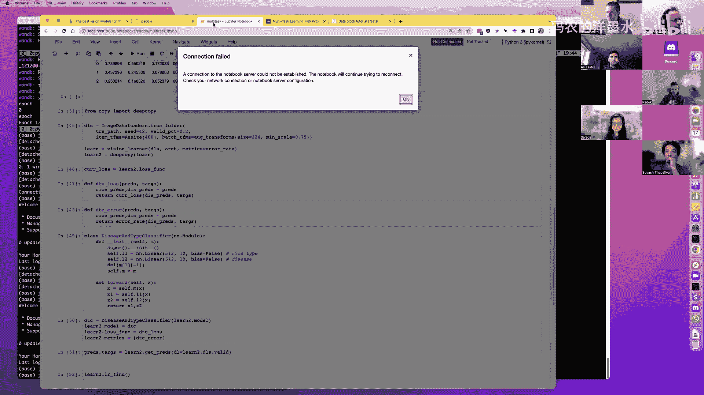
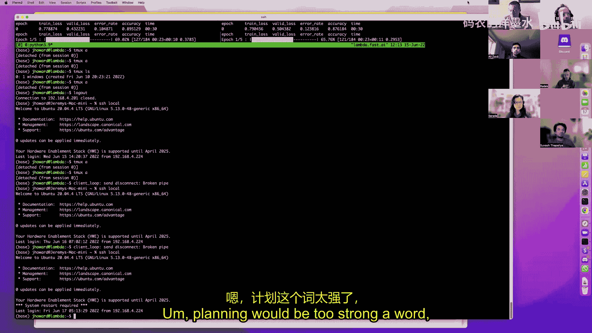
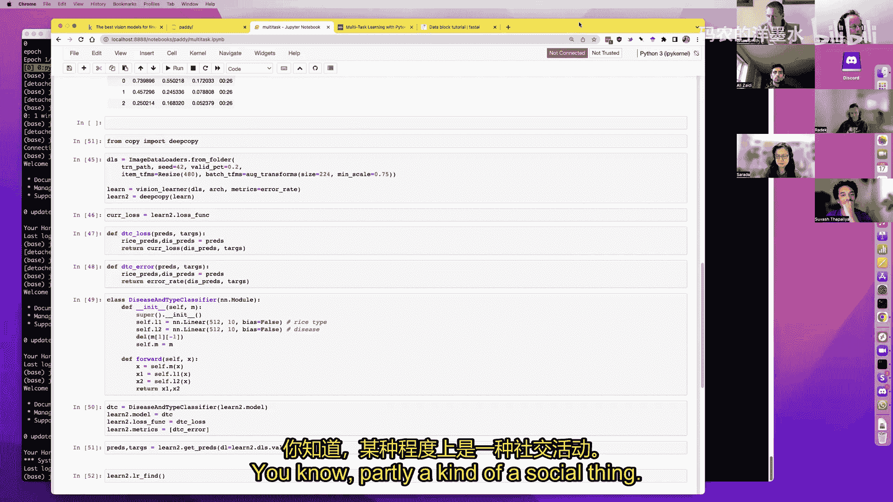
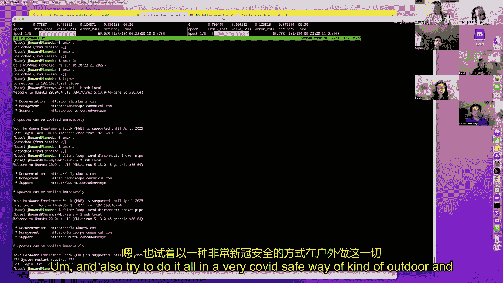
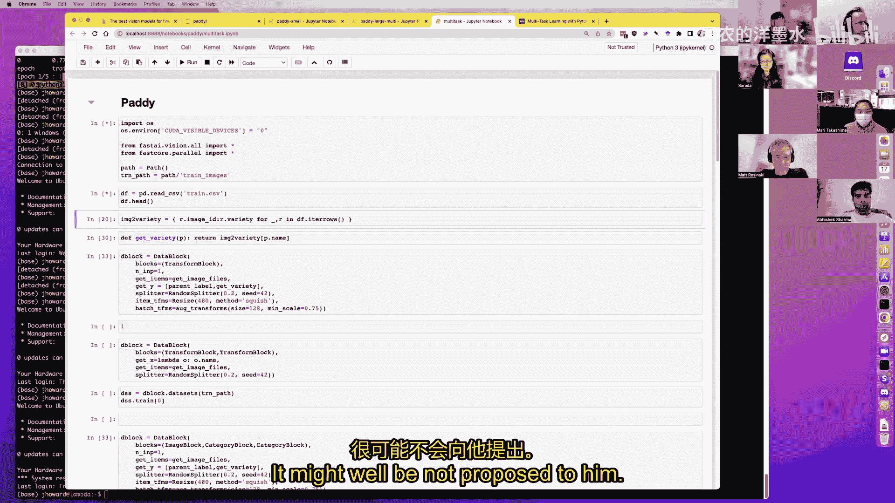
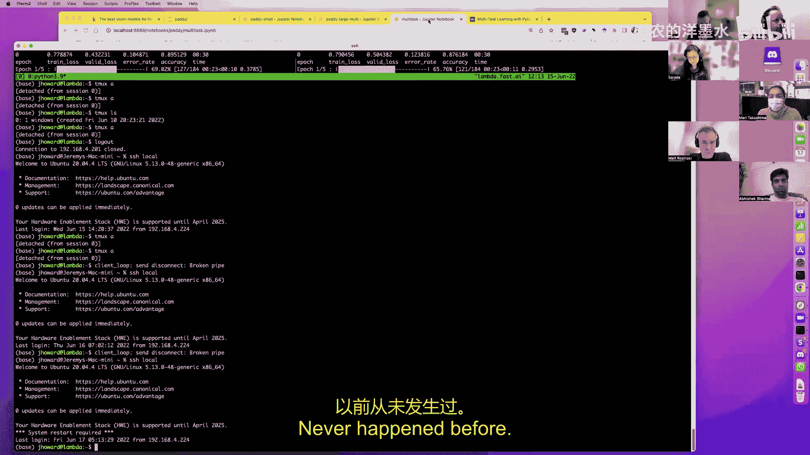
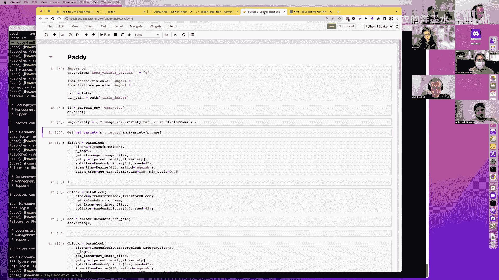
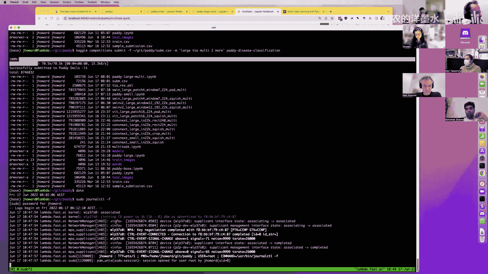
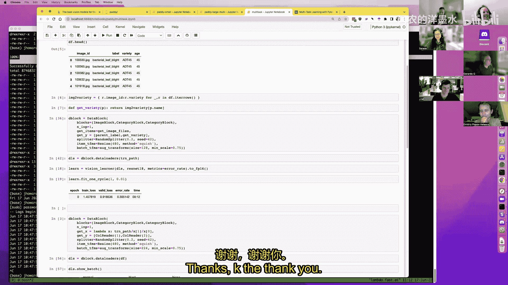

# 深度学习实战：13：fastai DataBlock深度解析 🧩






在本节课中，我们将深入学习fastai库中一个非常强大且灵活的组件——DataBlock。我们将通过一个具体的案例，即同时预测水稻图像中的疾病和品种，来详细解析DataBlock的各个组成部分和工作原理。通过本教程，你将学会如何构建处理多输出任务的复杂数据管道。





---

## 概述：从简单到复杂的数据管道

上一节我们介绍了使用高级API `ImageDataLoaders` 进行图像分类。本节中，我们将探讨当任务变得复杂（例如需要预测多个目标）时，如何利用更底层的 `DataBlock` API 来构建自定义的数据加载流程。

`DataBlock` 是fastai中用于定义数据流的核心抽象。它允许你清晰地指定数据的来源、类型、如何分割、以及应用哪些变换。

---

## 第一步：使用DataBlock复现基础流程

首先，为了理解`DataBlock`，我们用它来复现之前用`ImageDataLoaders.from_folder`完成的单标签（疾病）分类任务。

以下是构建该DataBlock的关键步骤：

1.  **定义数据块类型**：使用 `ImageBlock` 和 `CategoryBlock` 分别处理图像和标签。
2.  **指定获取标签的函数**：`get_y=parent_label` 表示从图像父文件夹名获取标签。
3.  **定义数据分割方式**：`splitter=RandomSplitter()` 进行随机训练集/验证集分割。
4.  **应用数据变换**：`item_tfms` 和 `batch_tfms` 用于图像预处理和数据增强。

```python
dblock = DataBlock(
    blocks=(ImageBlock, CategoryBlock), # 输入：图像， 输出：类别
    get_items=get_image_files,         # 获取所有图像文件路径
    get_y=parent_label,                # 从文件夹名获取标签
    splitter=RandomSplitter(valid_pct=0.2, seed=42),
    item_tfms=Resize(224),             # 将每张图像缩放到统一尺寸
    batch_tfms=aug_transforms(size=128) # 批处理时进行数据增强（测试时用128x128加速）
)
```

创建`DataBlock`实例后，需要为其提供数据源并生成`DataLoaders`：

```python
dls = dblock.dataloaders(path, bs=64)
```

这样，我们就得到了和之前功能完全相同的数据加载器，但使用了更灵活的`DataBlock`方式。

---

## 第二步：扩展DataBlock以处理多输出任务

我们的目标是同时预测疾病和品种。这意味着对于每个输入图像，我们需要两个类别标签作为输出。

以下是实现这一目标的关键修改：

1.  **修改Blocks**：我们需要三个块：一个`ImageBlock`用于输入，两个`CategoryBlock`用于两个输出。
2.  **指定输入数量**：通过 `n_inp=1` 告诉DataBlock，元组中的第一个元素是输入，其余是输出。
3.  **自定义获取标签的函数**：我们需要为第二个标签（品种）编写一个查找函数。

首先，创建一个从图像ID到品种的映射字典：

```python
# 假设df是一个包含‘image_id’和‘variety’列的DataFrame
image_to_variety = {row[‘image_id‘]: row[‘variety‘] for _, row in df.iterrows()}
```

然后，定义一个函数，根据图像文件路径获取品种：

```python
def get_variety(p):
    # 从路径中提取文件名（不含扩展名）作为image_id
    image_id = p.stem
    return image_to_variety[image_id]
```

现在，构建新的DataBlock：





```python
dblock = DataBlock(
    blocks=(ImageBlock, CategoryBlock, CategoryBlock), # 图像 + 疾病类别 + 品种类别
    get_items=get_image_files,
    get_y=[parent_label, get_variety], # 返回两个标签的列表
    n_inp=1, # 指明第一个块（ImageBlock）是输入
    splitter=RandomSplitter(valid_pct=0.2, seed=42),
    item_tfms=Resize(224),
    batch_tfms=aug_transforms(size=128)
)
```





当我们查看生成的数据集中的一个样本时，会得到一个包含三个元素的元组：`(图像张量, 疾病类别索引, 品种类别索引)`。`DataLoaders` 会自动为这两个类别标签生成对应的词汇表（Vocab）。

---

## 深入理解：DataBlock的核心组件

为了更自如地使用`DataBlock`，了解其内部组件的职责很有帮助：

*   **`blocks`**：定义每个数据项最终应被转换成的类型（如图像、类别、多标签等）。它包含`type_tfms`，负责将`get_x`/`get_y`的原始输出转换为指定类型（例如，将文件路径字符串转换为PIL图像对象）。
*   **`get_items`**：函数，返回一个可迭代对象（如文件路径列表），其中每个元素代表一个数据样本的“源信息”。
*   **`get_x` / `get_y`**：函数，它们接收`get_items`返回的单个“源信息”，并从中提取出需要传递给对应`block`的`type_tfms`的输入。如果`block`可以直接处理`get_items`的原始输出（如图像路径直接给`ImageBlock`），则可以省略`get_x`。
*   **`n_inp`**：指定`blocks`元组中有多少个是输入块（默认为1）。其余均为输出块。
*   **`splitter`**：函数，负责将`get_items`返回的列表分割为训练集和验证集索引。
*   **`item_tfms`**：在单个样本被组装成批次**之前**应用的变换（例如，调整每张图片的大小至相同尺寸）。这些变换在CPU上执行。
*   **`batch_tfms`**：在样本被组装成张量批次**之后**应用的变换（例如，标准的数据增强操作，如旋转、裁剪、亮度调整等）。这些变换可以利用GPU加速。

**工作流程简述**：
`get_items` 提供原始项目列表 -> `splitter` 将其分为训练/验证集 -> 对于每个项目，`get_x`/`get_y` 提取原始特征/标签 -> 各`block`的`type_tfms`将其转换为指定类型（形成`Dataset`）-> `item_tfms`进行逐项预处理 -> 组成批次 -> `batch_tfms`进行批处理增强 -> 最终输入模型。

---

## 模型与损失函数适配

当我们有了输出两个标签的数据加载器后，需要调整模型和损失函数来处理它们。

1.  **修改模型输出层**：标准分类器头输出节点数等于类别数。现在我们需要两个头，或者一个能同时输出两个预测的大头。一个简单的方法是让模型最后一层输出 `疾病类别数 + 品种类别数` 个节点（例如10+10=20）。
2.  **自定义损失函数**：我们需要一个能同时计算两个分类任务损失的函数。可以使用 `CrossEntropyLossFlat` 分别计算疾病和品种的损失，然后求和或平均。

```python
# 伪代码示意
def combined_loss(preds, targets):
    disease_preds = preds[:, :10] # 假设前10个节点是疾病预测
    variety_preds = preds[:, 10:] # 后10个节点是品种预测
    disease_targ = targets[0]
    variety_targ = targets[1]
    loss = F.cross_entropy(disease_preds, disease_targ) + F.cross_entropy(variety_preds, variety_targ)
    return loss
```

在创建`Learner`时，需要指定这个自定义的损失函数，以及相应的评估指标（如分别计算疾病和品种的错误率）。

---

## 总结




本节课中我们一起深入探索了fastai的`DataBlock` API。我们从复现简单的单标签分类任务开始，逐步将其扩展为一个能够处理多输出（预测疾病和品种）的复杂数据管道。我们学习了`DataBlock`中`blocks`、`get_items`、`get_x`/`get_y`、`n_inp`、`splitter`、`item_tfms`和`batch_tfms`等核心组件的含义与用法。最后，我们探讨了如何为多输出任务调整模型和损失函数。`DataBlock`的模块化设计使得构建复杂且高效的数据处理流程变得清晰而直观，是解决多样化机器学习任务的重要工具。