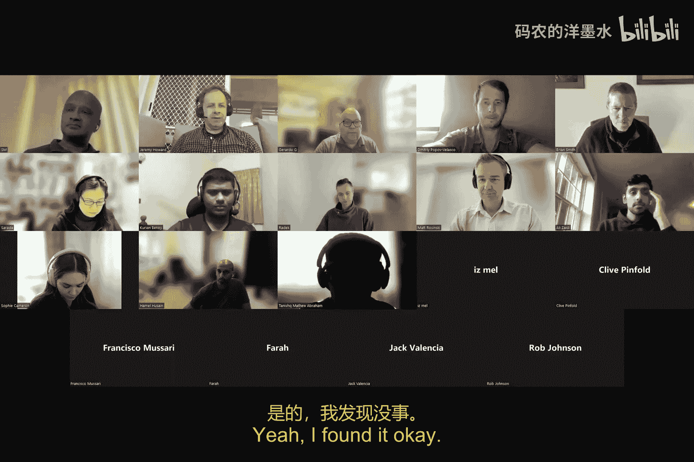
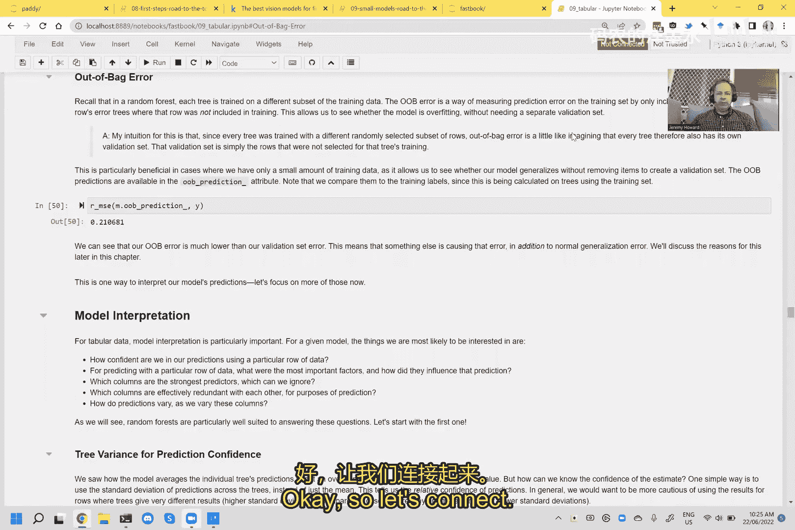
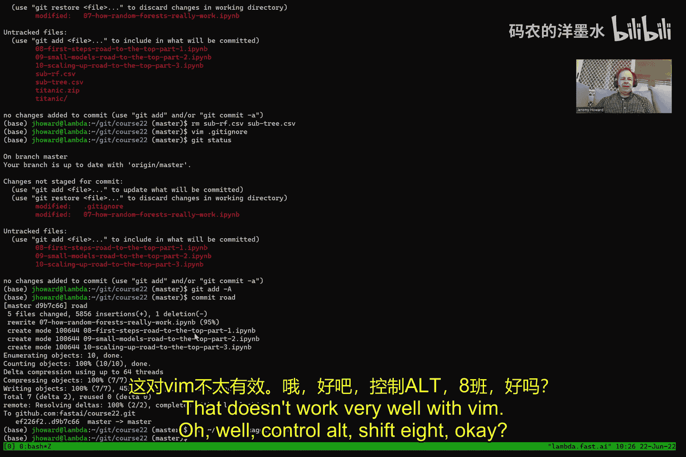
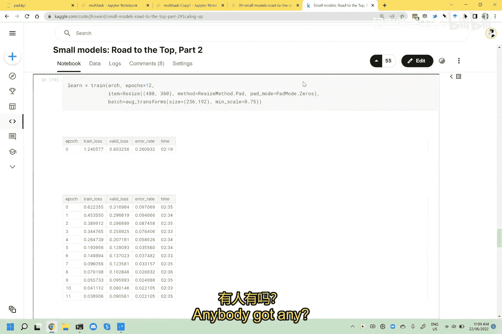

# 【全集】旧金山大学 实时编码 中英字幕 1080P p14 Lecture 14 - Diabetic Retinopathy实战 -BV1KZiTBWEeH_p14-

Peter。

There we go， yeah。Good right question， Mr is Joe。The training sort of process in FADI。

 like is there a concept or capability to do like early stopping or best kind of thing or if there isn't to why is there a reason why you chose not to do that or？

嗯。I never remember because I don't use it myself， so what I would check kind checking now is the callbacks。

Which is under training， let's go to the docs training， Corbacks。😔，诶。And if anybody else knows。

 please shout out。be there is a callback early stopping callback yeah I found it， okay。

 it's under tracking callbacks so if you go to the docs trading callbacks tracker there's an early stopping callback。

嗯。So perhaps the more interesting part then is like why do I not use it so I don't even know whether it exists？

Um。There's a few reasons。One is sit。It doesn't play nicely with。嗯。You know。

 one cycle training or fine tuning， if you stop early then the。

Learning rate hasn't got a chance to go down。So。And for that reason， it's almost never the case that。

Earlier。Paypos have。Better。Accuracy。Because the set landing rate hasn't settled down yet。

If I was doing one cycle training and I saw that。And earlier Apoch had a much better accuracy。

Then I would know that。😔，I'm overfitting in which case I would be adding more data augment。

Rather than doing early stopping because it's good to train for the amount of time that you have。

So yeah， I can't think offhand of a situation where I would。

I I haven't come across a situation where I've personally wanted to use early stopping。

It like in some of the training examples like。Where you had the error rate。

 like some of the prior runs may have had a better。No error can you oh， I mean。

 the ones I've shown like a tiny bit better， yeah， but like not enough to be like meaningful。

 you know。And。Yeah， so that there's no reason to believe that those would those are actually better models and there's plenty of a prior reason to believe that they're actually not。

 which is that the learning rate still hasn't settled down at that point so we haven't。Let it。

Fine tune into the best spot yet。So yeah， if it's kind of going down， down and down it it'。😊。

Kind of bottoming out and just bumps a little bit at the bottom。

 that's not a reason to use Z stopping。It's also I think important to realize that the validation set is relatively small as well。

 so it's only a representation of you know of the distribution that the data is coming from so reading too much into those small fluctuations can be very counterproduct I know that I've wasted a lot of time in the past you know doing that but。

Yeah， time but， we're looking for changes that dramatically improve things， you know。

 like changing from resident 2060 to COf next and we improve by what four or 500% and it's like。

 okay， that's that's an improvement。Over the weekend I。

I went on my own server that I have here behind me I have a 108 and I run all like 35 models for the padty thing。

I was just， I didn't do the example， but I was thinking about this that。

When when I was taking algebra back in high school or college。

 you have some of these expressions that you have the function of x is equal to x is squared for the x greater than something and the absolute value of x when you have x equal to something so it just got me。

My the idea is that maybe some of the data set。Is going to fail the target value for every single one of the models that we tried。

 but if we try different models it's going to be successful。Can we do that I mean， of course we can。

 but I mean what would be the easiest approach to say for this validation when x is equal to this or greater than that。

 this is the model to use， but then if this is all the other model this is what you have to use。Yeah。

 I mean。You could do that， right and like a really。😊，Simple way to do that， which。

I've seen used some success on Kale。Is to train lots of bottles。

And then to trade a gradient boosting machine。Whose inputs are those model predictions？

That whose output is the targets and so that'll do exactly what you just described。It's。

Very easy to overfit。When you do that？And。Your。Only going to get a if you've trained them well。

 you're only going to get a tidy increase， right， because。Because the neural net's very flexible。

 it shouldn't have that situation where this part of the space it has bad predictions and this part of the space it has good predictions like it's。

That's not really how de audits work。If you had。A variety of types of like different totally different types of model like a random forest and a G BM and a neural net。

I could say that。M be。But most of the time， one of those will be dramatically better than the other ones and so like I don't that often find myself。

😊，What into ensemble across totally different types of model？So， you know。

 I'd say it's another one of these things like early stopping， which like。😊。

A lot of people waste huge amounts of time on， you know， and it's not really weather they big。😊。

Benefits are going to be seen。 but yeah， if you're like。

In gold medal zone on a ca competition and you need another 。

002% or something then these are all things you can。Certainly try at that point。系。

And I think you can remind me of about。U， when he kind of reminded me of auto and now like the regime of tools。

I don't know how you feel about those things。Yeah， we talked about that in last night's lesson actually。

 so you'll have to catch up to see what I what I said if you haven't seen the lesson yet yeah。😊，Um。

I'll mention also reading。😊，Cag or w's descriptions of their approaches is， is great。

 but you've got to be very careful because remember。😊。

The ca winners are the people who did get that last 0。002%， you know。

 because like everybody found all the low hanging fruit and the people who won。

Grab the really high hanging fruit and so every time you win a cowgo winner's description they almost always have。

😊，Complex enssembling methods。And that's why， you know。

 in like something like a big image recognition competition。

 it's very hard to win or probably impossible to win。With a single model。

 unless you invent some amazing new architecture or something。And so you're kind of。

 you might get the impression then that。😊，Ensembling is the big thing that gets you ortho the low hanging fruit。

 but it's not ensembling is the thing which。Or particularly complex ensembling is a thing that gets you that last fraction of a。

Fraction of a percent。Yeah， course。The TTL concept， right som trying TTA。

TTA sorry TTA yeah not time to live。So if I understand。

 like I'm trying to understand conceptually why PTL improves the score because。Technically。

 when you're training， it is using those augmented sort of pictures and providing and providing a percentage number。

 but when you're kind of when you run that TTF function， why is it able to predict that？Sure。

 so like。You know how sometimes you like。A looking at some like。I don't know。

A screw head or a plot or a or a socket or something that's really small and you can't quite see like what how many pins are in it or what type is it or whatever and you'll kind of like look at it from different angles and you'll kind of like put it up to the light and you try to like。

🤢，And at some point， you're like， okay， I see it。Right， and there like some。Angle and some lis that。

You can see it。That's what you're doing for the computer。

 you're giving at different angles and you're giving it different lighting in the hope that。

In one of those， it's going to be really clear。And。

For the ones where it's easy it's not going to make any difference right but for the ones where it's like。

 oh I don't know if it's this disease or that disease， but oh。

 you know when it's a bit brighter and you kind of zoom into that section like oh now I can see。😊。

And so。When you then average them out。You know， all the other ones are all like oh I don't know which kind of beers I don't know which kinds it's like 05。

5。5 and then this one is like 06 and so that's the one that in the average it's going to end up picking。

😊，That's basically what happens。It also has another benefit， which is。😊，When we train our models。

 I don't know if you've noticed， but our training loss generally gets much lower than our validation loss。

And sometimes I validate sometimes。U。Our。嗯m。Well， so basically like what's happening there？😊。

Is that that on the training set the model's getting very confident so even though we're using data augment。

 it's seeing slightly different versions of the same image dozens of times。And it's like， oh。

 I know how to recognize these。And so what it does is that the probabilities it associates with them is like 0。

90。99， you know that I could say， I'm very confident of these。😊，And it actually gets overconfident。

Which。Actually， it doesn't necessarily impact our accuracy。You know， to be overconfident。

But at some point it can。嗯。And so we are systematically going to have like overconfident predictions of probability。

😊，When。Even when it doesn't really know。Just because it's really seen that kind of image before。

 so then on the validation set。😊，It's going to be。You know， over picking probabilities as well。

 And so one nice benefit is that when you average out a few。Agmented versions。You know it's like oh 。

9 probability is this one and then on the next one it's like augmented version with the same image it's like oh no 。

1 probability it' that one and they'll kind of average out。😊，To much more reasonable。Probabilities。U。

Which can， you know， allow it sometimes to。嗯。Yeah， combine these ideas into an average that。

That makes more sense。So that can improve accuracy， but in particular， it improves。

The actual probabilities to get rid of that overconfidence。

Is it fair to say that when you train without when you train。

 it's not able to separate the replicated sort of images or the distorted slightly the variant of the moment？

Image， but when you use the TTA， it is able to group all the four。Well， that's what KTA is。

We present them all together and average out that group， yes， but in training we don't。

Indiiccate in any way that they're the same image， or they're the same underlying object。嗯嗯。

One other question， Jeremy， we I'm glad we touched in stumbling and how to pick the best on stumbling。

 I was going to ask about that。Another question is。

We have a fairly unbalanced data set I guess with the normal versus the disease states Yeah when you're doing augmentation is there any benefit to sort of over overrepresenting the minority classes so let's let's pull away augmentations it's actually got nothing to do with augmentation so more generally when your're training does it makes me sense to overrepresent the minority class。

嗯。And the answer is maybe， yeah， it can， right。Okay， so just for those who aren't following。

 the issue Matt's talking about is that there was you know。

 a couple of diseases which appear lots and lots in the data and a couple which hardly appear at all。

U。And so， you know， do we want to try to balance this out more and one thing that people often do to balance it out more is that they're all。

Throw away some of the images in their more represent highly represented classes and I can certainly tell you straight away you shouldd never ever do that you never want to throw away。

Data。But Matt's question was， well， could we？You know， over sample。The less common diseases。

And the answer is， yeah， absolutely you could。 and in fast AI， if you going into the docks。😊，嗯。Now。

 where is it there is a。Waier to data load us somewhere。W should。Search for that。

Here we go of course it's a callback So if you go to the callbacks data section you'll find a weighted DL。

Callback her awaited data loaders。Method。Are you sharing your screen I'm not now I' just telling you where to look。

 thanks for checking。😊，嗯。So。Yeah， I mean。Let's look at that today。

 right because I kind of what to look at like。😊，Things we can do to improve things。Today it， it， it。

 it doesn't necessarily help because it does mean。You know given that you're you know let's say you do 10 epos of a000 images。

 it's going to get it to look at 10，000 images right and if you oversample a class then that also means that it' get it's going to see less of some images and going to get more repetition of other images。

Which。Could be a problem， you know， and really it just depends on。pend on a few things。

If it's like really unbalanced， like 99%， all of one type。

 then you're going to have a whole lot of batches that never sees anything of the underrepresented class and so basically there's nothing for it to learn from。

 so at some point you probably certainly need weight。😊，Sampling。U。It also depends on the evaluation。

 You know， if people like， say in the evaluation， okay， we're going to kind of average out。

For each disease how accurate you were so every disease will then be like equally weighted then you would definitely need to use weighted sampling。

 but in this case， you knowum presuming that the test set。

Has a similar distribution as a trading set。Where did sampling might not help？

Because they're going to care the most about how well we do on the highly represented diseases。嗯。

I'll note my experience with like oversampling and things like that。

 I think one time I had done with I think diabetic retinopathy。

 there was a competition for that and I had used weighted sampling or oversampling and it did seem to help and then also a while back I did an experiment where I think this was back with FAi version1 where I took like the minsced data set and then like artificially added some sort of imbalance and then I trained with and without weighted sampling and I saw like there was an improvement with the weighted sampling on accuracy on like just the regular minced validation set so from that from those couple experiments I'd say like I've at least seen some help and improvement with weighted sampling and with that cases where that data set was like highly unbalanced or was it more like the data。

t that we're looking at at the moment it wasn entirely unbalanced as maybe like， I don't know lakes。

Maybe like， yeah just。75% versus 25% or something like that。 It's not like 9999 versus 1%。

 nothing like that。 It was more isn't that bad。 Let's go。 Let's try it today， yeah。

I see we've got a new face today as well， hello， Zach。Thanks for joining。Hey， hey。

 glad I could finally make these Yeah， are you joining from Florida？No， I'm in Maryland now。

 Maryland now， okay， that's quite a change。Yes， much more up north。Okay， great， so let's。😊。

Let's try something。U。Okay， so let's connect。

To my little computer。Hpstairs。Thre a way to shrink my Zoom out of the way。

 it takes up so much space。Hide floating meeting controls， I guess that's what I want。

 control alt shift H。Wow。Press escape to show floating meeting controls。

That doesn't work very well with Vim。😊，That will control oh shift eight， okay。诶。

嗯。Alright， we're not doing tabula today。 So let's get rid of that。So I think what I might do is。

 you know， because we're iterating。U。Well， I guess we could start with the。Multiitaask button。

Cause this is a kind of like。Things to try to improve。Version。Okay。Don't close that。

We'll leave that open just in case we want it。By the way， if you've got multiple GPUs。

 this is how you just use one of them， you can just set an environment variable。😊，Okay。

 so this is where we。This was where we did the multi。Multi target model。And。Okay。Yeah。

Just moved everything slightly。嗯。Cup。😔，Cup。Not comp path。Right， back to where we were。Okay。So。

Oh know what？What's reckon。They a block。Get image files。Oh， this is working the other day。嗯。

So I guess we better try to do some。Debugging so。The obvious thing to do would be to call this thing here。

 get image files。On the thing that we passed in here， which is train pass。Okay， so that's working。

Then the other thing to do would be to check。Our data by doing show batch。Okay， that's working。诶。

Then I guess， all right， and it's showing are two different things， that's good。Oh， is it。Oh right。

 we've got the two category blocks so we can't use this one。We have to use this one。So fit one cycle。

😔，Yeah， okay。So that to remind you， we have this is the one where we had two。嗯。Categories。

And one input。And to get the two categories， we use the parent label and this function。

 which looked up the variety。From this dictionary。Okay， and then when we find tuned it。是。嗯。

And let's just check。 Yeah， C equals 42。 So that's our standard。Set。

 we should be able to then compare that to small models。Train for 12 epos。嗯。Okay。系。

And then that was this one。嗯。Pat2。嗯。And。Let's see。They're not quite the same， because。This was。4。

80 squish。Or elsese， this was。Rectangular pad。U。Let's do5 epochs。 Let's do it the same as。This one。

Yeah， let's do this one because we want to be able to do quick iterations。Let's see。 Resize。1，92。

 squish。Yes。There we go。And then， we trained it。For。01 with FP 16。The5 epos。对。All right。

So this would be our base case。Well， you know， I mean， like I said this is our base case。0。045。

This will be our next case。Okay， so while that's running。😊，The next thing I wanted to talk about is。

Progressive resizing。So this is training at a size of。128。诶。Which is。And。Which is not。

Very big and we wouldn't expect it to do very well。So。

But it's certainly better than nothing and as you can see it's。😊，Well that's not error。

 disease error， it's down to 7。5% error already and it's not even done。Um。So that's not bad。And。

 you know， in the past， what we've then done is we've said， okay， well， that's working pretty well。😊。

Let's throw that away and。Try bigger。U。But， there's actually。Something more interesting we can do。

Which is we don't have to throw it away。What we could do。Is to continue training out。

On larger images， so we're basically saying， okay， this is a model which is fine change you recognize 128 by 128 pixel images。

Of rice。Um。That's fine tune it to recognize one92 by one92， pixel your images price。

And we could even like。And like there's a few benefits to that， one is like it's very fast。😊。

You know， to do the smaller images。And they can recognize the key features of it。Um。So， you know。

 this lets us do。A lot of epochs quickly。And then like the difference trends。

 more images of rice disease and large images of rice disease isn't very big difference。

So you would expect it would probably fine tune to bigger images of rice disease quite easily。

So we might get most of the benefit of training on big images， but without most of the time。

The second benefit is it's a kind of data augmentation， which is we're actually giving it。😊。

Different sized images， so that should help。So here's how we would do that。Let's grab。

This data block， let's make it into a function。Good deal Okay， and the key thing。

 I guess we're going to do。Well， let's just do the item transforms and the batch transforms as usual。

Oops。So。U。So the things we're going to change are the item transforms。And the batch transforms。

And then we're going to return the data loader for that。Which is here。Okay。Yeah。U。So， let's try。

Going up at that。Deales equals。Get tail。I guess it should be get Dls really because it returns data loaders。

 get Dls。I'd okay， so let's。Yeah。See what we did last time。Let we scaled up a bit。😔。

So this is going to be data augmentation as well， we're going to change how we scale。So， we'll scale。

With zero petting。And let's go up to 160。Okay。And。系。Yeah。So then we need La。Yeah。So， our。诶。

Here is our squ one here。Squiish。So， the squish here got。45 our multitask got 0。48。

 so that's actually a little bit worse。Um。This might not be a great test actually。

 because I feel like one of the reasons that doing a multitask model might be useful is it might be able to train for more epochs。

UmBecause we're kind of giving it more signal。😊，So we should probably revisit this with like 20 epos。

Yes。Any questions or comments about progressive resizing while we wait for this to。Trane。Sorry。

 I can't see how you progressively。Change the size because I actually didn't。 I messed up。Whoops。

Thank you， We going have to do that again。😊，I actually didn't Oh and we need to get our yells back as well Okay。

 let's start again。Okay， and let's in case I mess this up again， let's export this。

We'll call this like stage one， say。Yes， the problem was we created a new learner。

 so what we should have done is gone。😊，Land dot。Fs。Equals。Ds。That's actually so that would actually。

Change the data loaders inside the learner without recreiting it。

Was that where you were heading with your comment？You me， there was an unfred method， right。

 Like aren't we using that。There was an unfreezeed method like in the same thing in the book actually mention using the unfreeed method。

There is an unfreeezed method， Yes， what were you saying about the unfrreeeze method？

In't un required thought progressive reizing no because fine tune has already unf。

 although I actually want to fine tune again。So if anything， I kind of actually want to。

 I actually want to rephreeeze it。😊，Um。Because we've changed the。

Because we've changed the resolution， I think fine tuning the head might be a good idea to do again。

Which line of code is doing the Re？The progressive resizing part。

 just to be clear it's not online of code it's well I mean it's basically this it's basically saying our current learner is getting new data loaders。

And the new data loaders。Have a size of 160 or else the old data loaders had a size of 128。

And our old data loaders did a presizing of 192 squish。

 and our newly data loaders are doing a presizing of rectangular padding。

Does that make sense why are you calling it progressive in this case？

It just you going to keep changing the size or something like that yeah。

 it's changing the size of the images。Without without resetting the learner。

Just looked it up because I was curious， fine tune calls a freeze first。

I had a feeling it did thanks， thanks for checking Zach。Right。So this time， you know。

 let's see it'll be interesting， right， to see how it does。So after the initial epoC it's got 0。

09 right else previously it had 。27 so obviously it's better than last time。

 but it's actually worse than the final point right final this time it got all the way to 0。

418 point yeah where else this time it。Has got worse。

 so it's got some work to do to learn to recognize about what 160 pixels or images look like。

Can I just clarify， Jeremy？You're like doing one more step in the progressive resizing here。

 it's not kind of an automated resizing correct correct yeah。Yeah。

 there isn't anything in fast A to do this for you。😊，And in fact， this technique is something that。

We invented， so it doesn't exist in。Other vis。At all， so yeah， it's it's the name of a technique。

 it's not the name of like a。A method in fast AI。And yeah。

 the technique is basically to replace the data loaders with ones。Ha a larger size。

And we invented it as part of a competition called Dawn Bench。

 which is where we work very well on a competition for imagenet training。And。

Google then took the idea and studied it a lot further as part of a paper called Efficient Net V2。

And。Fund ways to make it work even better Oh my gosh， look at this so。We've gotten from 0。418。The 。

0336。Um。Have we done training at 160 before？😔，I don't think we have。Oh I should be checking this one。

128， 128。😔，Okay。诶。171 by 128。No， we haven't。😔，This is a 256 by 192。

 so eventually I guess we're going to get to that point。So， let's。Let's keep going。 So okay。

 so without a 2。9% error。I did you come up with the idea for this is something that you just wanted to try or did it have did you like stumble on it while looking at something else Oh I mean it just seemed very obviously to me like something which obviously we should do because like we were spending。

Okay， so on Dawn Benchfield were training on imagenet， it was taking。12l hours， I guess。

 to train a single model。And。The vast majority of that time。It's just recognizingogniing very。

 very basic things about images， you know？It's not learning the finer details of different cat breeds or whatever。

 but it's just trying to understand about the concepts of like fir or sky or metal。AndI thought。

 well， there's absolutely no reason to need 224 by 224 pixel images。😊，To be able to do that。

 you know like。It just seemed obviously stupid that we would do it and partly it was like also like I was just generally interested in。

😊，Changing things during training。So one of， you know， in particular， learning rates， right？😊。

So the idea of changing learning rates stream training goes back a lot longer than。

Dawn Bench that people had been generally training them by having a learning rate that kind of dropped by a lot and then stayed flat and dropped by a lot and stayed flat and Leslie Smith in particular came up with this idea of kind of like gradually increasing it over a curve and then gradually decreasing it following another curve and so I was definitely in the mindset of like oh there's kind of interesting things we can change during training so I was looking at like oh what if we change data augmentation during training for example like maybe towards the end of training we should like turn off data augmentation so it could learn what unormented images look like because that's what we really care about for example。

U。So yeah， that was the kind of stuff。That I was kind of interested in at the time。 And so yeah。

 definitely this thing of like。You know， why are we？

Looking over 224 by 324 pixel images the entire time like that just seemed obviously stupid and so it wasn't something where I was like wow here's a crazy idea i but it won't work as soon as I thought of it I just thought okay that this is definitely going to work you know that it did。

😊，Interesting， thanks， yeah， I worries。One question I have for you Jeremy there was a paper that came out like in 2019 called fixing the test train resolution discrepancy Yeah I fake you that。

Yeah were they like trained on 224 and then did inference finally on like 320 by 320 yeah have you seen that still sort of work have you done that at all in your workflow I mean honestly I don't remember I need to revisit that paper because you're right it's important tonight。

U。I。Um。You know， I would generally try to find June on the final size I was going to be predicting on。

Anyway？嗯。So。Yeah， I guess we'll kind of see how we go with this trade。

 I mean you can definitely take a model that was trained on 224 by 224 images。😊。

And use it to predict 360 by 360 images。And it will generally go pretty well。

But I think it'll go better if you first find a tune on 360 by 360 images。😊。

Yeah I don't think they tried pre training and then also training on like 320 versus just 320 and the 224 yeah that would definitely be an interesting experiment yeah it would be an interesting experiment and it's definitely something that any of us here could do you know I think it'd be cool。

Right， so let's try scaling this up so we can。Change these two lines to one。

 And so this this one something I often do is I do things like。Yep。I think we don't have your escape。

As I saying previously， I had like。Two cells to do this and so now I'm just going to combine it into one cell。

 so this is what I tend to do as I fiddle around as I ti like。Gradually make things。

A little bit more concise， you know？诶。系。Okay。Does it make sense to go smaller than the？

By the original pre traininging。Like conve。Cot co next。Yeah， I mean。

 you can fine tune to any size you like。Absolutely。

I'm just going to get rid of the zero padding because again I want to like try to change it a little bit each time just to kind of。

😊，You know， it's a kind of augmentation， right？So okay， so let's go out to 192。You know。

 one thing I find encouraging is that， you know， my training loss isn't getting way underneath the validation loss。

 it's not like were。It feels like we could do this for ages before our。Arrr rate stock going up。

Interestingly， when I reran this。My error rate was much better at 0。4。8。

We've got a good memory to remember these。These old papers， so it's very helpful。To able to do that。

Usually what I wind up doing is my dad and I will email back and forth papers to each other so I can just go through my scent look at archive and usually if I don't remember the name of it I remember the subject of it in some degree Yeah I can just go through it all I mean it's a very very good idea to use a paper manager of some sort。

ToSa papers， you know， whether it be Mendelay or the nodo or。

Archiived sanity or whatever or bookmarks or something。Um。Yeah。

 because otherwise these things disappear personally， I just tend to like。😊。

Tweet or favorite tweets about papers I'm interested in and then I've set up pinboard。

A I don't know if you guys have seen that， but it's a really nice little thing which basically anytime you're on a website。

You can click a button in the extension and it adds it to pinN board， but it also。

Autoomatically add sort of your tweets and favorites and it's got a full text search。Of the。

Thing that the URLs linked to which is very helpful See you favoriteed something that just says oh shit no I actually wrote something that just said oh shit that is me。

😊，I think I shit。It was this I've been totally off topic with this absolutely disaster。

 I hope it's wrong。😊，But this absolutely disastrous sounding。

Paper that came out yesterday that basically， where was this key thing？

People who've had one COVID infection have a list of one  sickia 8。4%， two infections， 23%。

 three infection 36%， it's like my worst nightmare。Is like the more people get infected with COVID。

 the more likely it is that they'll get long term。Symptoms， is horrifying。

 That's my appropriate moment That's very horrifying。 It's really awful。 Okay， so keeps going down。

 right， which is cool。Let's keep bringing it along， I suppose。

I guess you know what we could do is just grab this whole damn thing here。

To kind of have a bit of a comparison， So we're basically going to run。

Exactly the same thing we did earlier。About this time。With some precisizing， first。诶。Alright。

So that'll be an interesting experiment。So while that's running。You know。

 this is where I hit the old duplicate button。And。This is why it's nice if you can。

 perhaps a second card， because while something's running， you can try something else。

Cuda visible devices。There we go。So we can keep working。Okay， so。😊，Wait a data later。

So this is something。I added。To fast AI a while ago and haven't used much myself since。😔，U。

But if I just search for weighted， here it is。Here it is。So you can see in the docks。😊。

It shows you exactly how to use weighted data loaders and。😊，We pass in a batch size。

 we pass in some weights。Yes this is the weight， there's going to be  one，2，3，4，5，6，7，8。

 or's actually 0，1，2，3，4，5，6，7。And then some item transforms turn things to tensor。

 So like these are kind of really really interesting in the docs in some ways。😊。

It's extremely advanced and in other ways， it's extremely simple。

 which is to say if you look at this example in the dos。😊，Everything is totally manual， right。

 so our labels are some random integers。Kind of them。UAnd I've even added a comment here， right。

 iss going to be in the trading set two are going to be in the validation set。😊，Um。So our data block。

It's going to contain one category block。Because we've always just got the one thing right and。😊。

Rather than doing getX and get Y， you can also just say getters。

Because getx and get Y basically become getters， which is a list of。Transforms to do。

And so this is going to be a single getter or a single getx， if you like。😊。

Which is going to return the I label。And a splitter。

 which is going to decide whether something's going to do or not based on this function。

 So you can see this whole thing is like totally。😊，Manual， you know。

So we can create our data set by passing in a list of the numbers from not to known。

And a single item transform that's going to convert that to a tensor。

And then our weights will be the numbers from not to seven。And so then we can take our data set。

Or data sets？And turn them into data loaders。Using those awaits。So。With a batch size of one。

 if we say show batch， we get back a single number， okay？😊，And it's not doing random shuffling。

 so we got the number zero because that was。😊，The first thing in our data set。U。Let's see。

 what do we do next Now we've got to do n equals 160。

So now we've got all of the numbers from not to 159。With various points。Um。Yes， forget us， yep。

You mentioned so this is for X or Y this is a list it's whatever right this is so there is just one thing。

 I don't know if you call that X or you call it Y it's just one thing。

So if you have a Gt X and a G Y， that's the same as having a getters with a list of two things。😊，ok。

So yeah， I think I could just write get as this has been H since I've got this。

 but I think I could just write getx here and put this nu on a list。😊。

Would probably be the same thing。Probably handle a little bit of mystery that might be happening as well the data block has an end input parameter correct which is how it determines what of the getters is x versus y correct which we actually looked at last time。

Here， when we created our multi image block。But that's before you join， sec。Yeah。Yes。

 useful reminder， Okay， so。So， here we。See in a histogram of how often so our。

We created like a little synthetic learner that doesn't really do anything。

 but we can pass callbacks to it and there's a callback called collect data callback which just。😊。

Collects the data that it's part that that is called in the learner。

 And so this is how we can then find out。What data was passed to the learner。

 get a histogram of it and we can see that yeah， the number 160。

Was received a lot more often when we trained this Mon， which is what you would expect。嗯。

This is the source of the weighted data load class。Here and as you can see。

 other than the boilerplate。😊，It's one， two， three， four， five lines of code。

And then the weighted data loaders method is one， two lines of code。

So there's actually a lot more lines of example than there is of actual code so often it's easier just to。

😊，Read the source code because， you know， thanks to the。Very layered approach to FAD。

 We can do so much stuff。There so little code。And so in this case， if we look through the code。😊。

We're passing in some whites。And basically， the key thing here is that we set if you pass in no ways at all。

Then we're just going to set it equal to the number one repeated。N times。

 so everything's going to get one weight of one。And then we divide the weights by the sum of the weights so that the sum of the weights ends up summing up to one。

 which is what we want。Um。Yeah。And then。If you're not shuffling。

 then there's no weighted anything to do。 So we just pass back the indexes and if we are shuffling。

 we will grab a random choice of。based the based on the weights。诶。Cool。Alright。

 so there's gonna be one weight per row。All right， let's come back to that because I want to see how our thing's gone。

 it looks like it's finished notice that the fav icon。😊。

And Jupiter will change depending on whether something's running or not。

 so that's how you can quickly tell us something's finished。😊，216。😔，221。 Okay， I mean。

 it's not a huge difference， but maybe it's a tiny bit better。 I don't know， like it's。诶。我要去。😔，嗯。U。

You know， the key thing though， is this lets us。Uses our resources better。

 right so we often will end up with a better answer。But you can train for a lot less time。 In fact。

 you can see that the error was。At 。216 back here。So， you know。

 we could probably have trained for a lot less epos。So that's progressive resizing。嗯。

Consider why did？Look at that and go。Oh actually， I'd like to take the outputs from EOC9。Chris。

Ha a better Yeah so that that was a question we got earlier about that's called early stopping and the answer is no。

 you probably wouldn't want to do early stopping。But you can't go back to a previous。

Like epoch there's no history sort of you can you have to use the early stopping Corback to do that cool Okay。

 okay I'll look at that or there's other things you can use as I say I don't think you should but you can if I go training Corbacks。

ATer。I the other part of that is yeah is it counterproductive or yeah it's kind kind treat if it works but not if it doesn't it won't it it's probably not a good idea it probably will make it worse yeah okay great so the other thing you can do is to safe model callback。

Which saves， it is kind of like early stopping， but it doesn't stop。 It。 It saves the。

Prameters of the best model during training， which is got probably what you want instead of early stopping。

 but I don't think you should do that either for the same reason we discussed earlier。

Why shouldn't you do this， it seems like you could just ignore it if you didn't want it or。

Like it might not hurt you。嗯。Well， so this actually automatically loads。The best。

t of parameters at the end。U。And。You know， you're just going to end up。

It all with this kind of like model that just so happened to。

Look a tiny bit better on the validation set at an earlier epoch but at that earlier epoC the landing rate hadn't yet stabilized and it's very unlikely it really is better so you've probably actually just picked something that's slightly worse。

And， you know。Makey your process slightly more complicated for no good reason being better on when thought there doesn't necessarily say anything about the the final hidden。

Yeah， test it， yeah， yeah， we have a strong prior belief that it will improve each epoch。Um。嗯。

Unless you're overfitting and if you're overfitting， then you shouldn't be doing early stopping。

 you should be doing more augmentation。It seems like a good opportunity for somebody to document the arguments。

Because I'm like curious what Ad end does。Yes， that would be a great opportunity for somebody to document the arguments and if somebody is interested in doing that。

😊，We have a。Really cool thing called documents。Which。I only invented， after we。Created fast A I。U。Oh。

 this is like that's not， I should delete this because this is the old version， you know。

 it's part of fast core。And documents。You document each parameter by putting a comment after it。

And you document the return by putting a comment after it。

Zach actually started a project to after I heard documents to add documents， comments。

Through everything in fast AI， which of course is not finished because fast AI is pretty big。

 And so here's an example of something that doesn't yet have。Documents comments。

 so if somebody wants to go and add a comment to each of these。

Things and put that into a PR then that will end up。In the documentation。U。

I know what anyone wants to do then to do I was just going to say Zach something we should do Zach is to actually include an example in the document documentation of what it ends up looking like in NV dev because I can see that's missing and might be a good idea I see if I can get on that tomorrow Yeah sorry Ham what were you saying。

😊，No， I just wanted to encourage everybody that like。

Writing the documentation is like an excellent way to learn deeply what how everything works and like you get you know what ends up happening is you you write this documentation and you know somebody like Jeremy will review it carefully and let you know what you don't understand。

And that's。Yeah， that's how I learned about some you know， some other fast AI libraries。

 so I highly recommend it going， you know， going and doing that。

And here's what it ends up looking like， right， So here's optimizer。

 you can see it's got a little table underneath。And if we look at the source of optimizeizer。

You'll see that。Each parameter has a comment next to it。

 so those parameters are automatically turned into。Into this table。All right。

 that sounds like a super cool。 they are， super cool。 This sounds like a good place to wrap up。

 Any got me。😊。

Questions or comments or anything before we wrap up。I have a question regarding two public。

Presizing yes。We didn't do actually L fine after each S step。

Don't you think it's something helpful because the L find， did you say？Yeah， yeah， yeah I。

To be honest， I don't use L find much anymore nowadays because。嗯m。know。

 but at least for object recognition in computer vision。

 the optimal learning rate pretty much always the same。😊，It's always around 0。008 。01。U。Yeah。

 there's no reason to believe that we have any need to change it just because we change the。

Resolution。So yeah， would I wouldn't bother。Just leave it where it was。German。

 if your training and validation loss are still decreasing after 12 es。

 can you pick up and train for a little longer without restarting？

You can the first thing I'll say is you shouldn't be looking at the validation loss to see if you're overfitting。

 you should be looking at the error rate， so the validation loss can get worse whilst the error rate gets better and that doesn't count as overfitting because the thing you want is to improve is the error rate that can happen if it gets overconfident but it's still improving。

😊，Yeah， you can keep training for longer。Because we're using if you're using Fi one cycle or fine tune and fine tune uses fit one cycle behind the scenes。

U。😊，Continuing to train further， your learning rate is kind of going to go up and then down and up and down each time。

 which is not necessarily a bad thing， but you know， if you。😊，Yeah。

 if you basically want to keep trading at that。😊，At that。You know， at that point。

 you would probably want to like decrease the learning rate by maybe 4 x。Also， and in fact， you know。

 I think after this， I'm going to rerun this whole notebook。😊，But half the learning rate each time。

Because I think that would be。Potentially a good idea。I have a question。

 I don't know if it's too late but。嗯。😊，I think it might be useful to discuss when you do the progressive resizing。

what？Part of the model gets dropped。Like what， you know。

 is there some part of the model that needs to be？Re initialitialized for no nothing needs to be re initialitialized。

 no， I found this on the web。Who found what in the whip？I know you were talking to me。

 but you're talking to Siri， I'm offended。😊，😊，Sri， teach me， take learning。Um。Yeah。

 COf next is what we call a resolution independent architecture。

 which means doesnt it works for any endpoint resolution。And。Time permitting in the next lesson。

We will see how convolutional neural networks actually work。

 but I guess a lot of you probably already know so。For those of you to do， if you think about it。

 it's basically going patch by patch and doing this kind of。😊，Many matrix multiply for each patch。

So if you change the input resolution， it just has more patches to cover but it doesn't change the parameters at all。

 so there's nothing to。Reinitialize。Does that make sense， Tail， Yeah， that makes sense。

I was just asking for the right general for the record， fair enough yeah。It just a question。Oh yeah。

 go ahead。I was just going a quick note to say he is resonate resolution independent good yeah basically everything we use is normally but in the like。

U。Have a look at that。 Like， Best fine training。Mottleels notebook and you'll see the two of the best ones are called。

VIT and SwN and also Sw V2， none of those are resolution independent。Um although there is。

A trick you can use to kind of make them resume independent。

 which we should try out in a future walkthrough。Is that fiddling with the head？Oh， there's a Tim。

 there's a thing you can pass to Tim。😊，嗯。I don't know if we can use it to support progressive resizing or not。

 it'll be interesting to experiment with。It's basically changing the positional encodings。

IHave a question interesting yeah。After you've done your experiments progressivesizing。

In fine tuning， how do you in AI train with the whole training set I never got around to do that。

I almost never， I almost never do like instead I do what we saw in the I was the last walkthrough。

 which is I just train on a few different。😊，Randomly selected valid trading sets。U。😊，Because。

U that way， you know， you get the benefit ensembling。

 you're going to end up seeing all the images at least one anyway。

 and you can also kind of see if something's messed up because you've still got a validation set each time。

😊，So yeah， I used to like do this thing where I would create a validation set with a single item in to like get that last bit of juice。

 but。😊，II don't even do that anymore。Okay， thanks， no worries。All right， gang。

 enjoy the rest of your day slash evening nice to see you all。Bye， goodbyee， thanks。Thank you。

