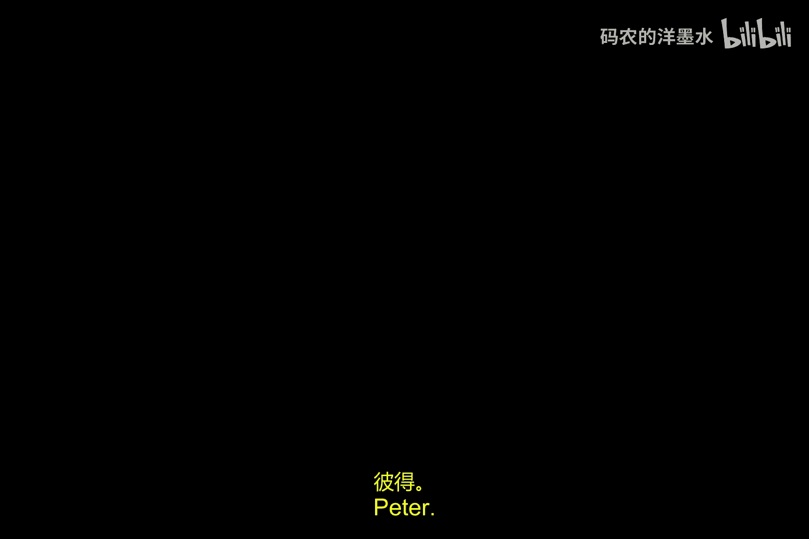
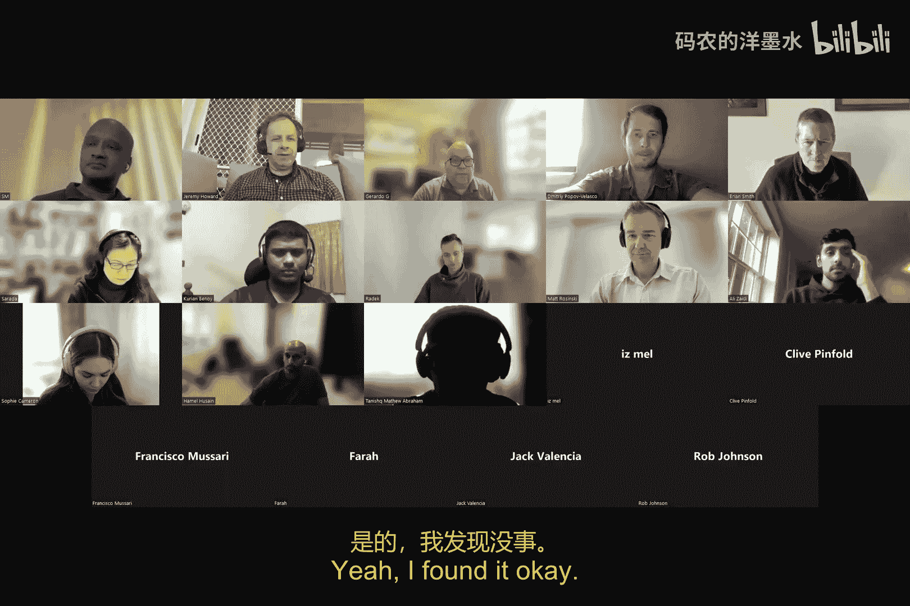
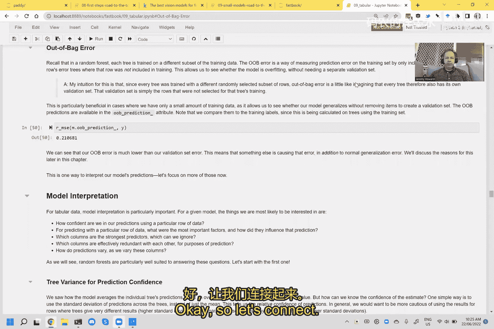
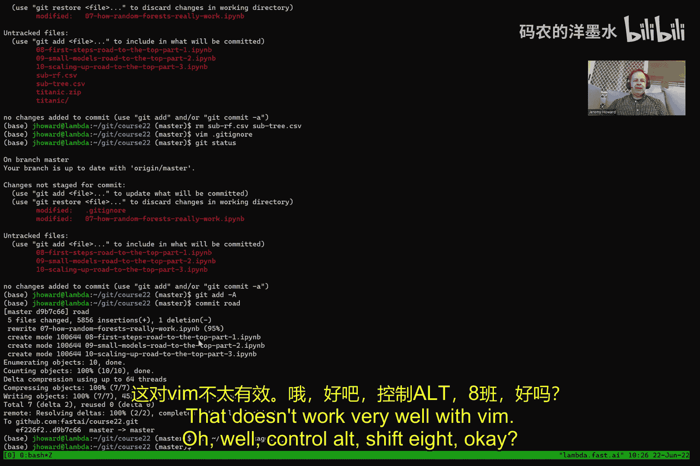
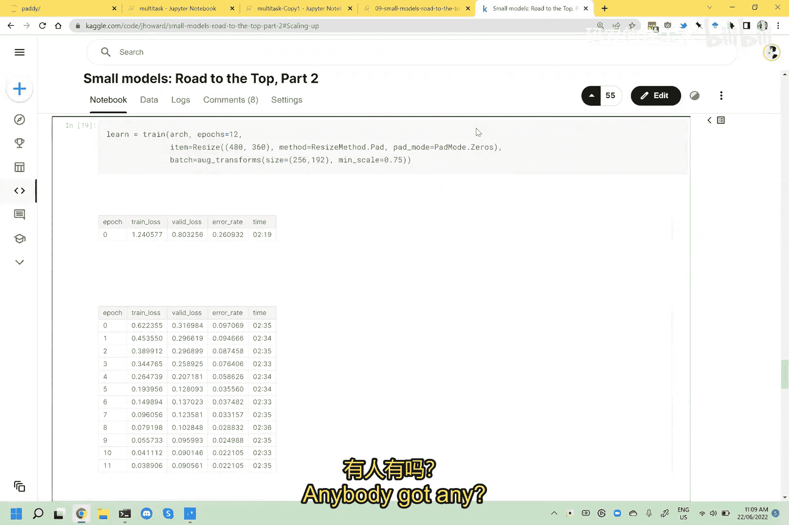

# 深度学习实战：14：糖尿病视网膜病变实战





在本节课中，我们将学习如何通过多种技术优化一个糖尿病视网膜病变图像分类模型。我们将探讨早停法、测试时增强、加权采样以及渐进式调整图像尺寸等概念，并理解它们在实际应用中的取舍。

---

## 早停法：为何通常不推荐使用？

上一节我们介绍了模型训练的基本流程，本节中我们来看看一个常见的训练技巧——早停法。早停法是指在验证集性能不再提升时提前终止训练，以防止过拟合。

在FastAI中，可以通过回调函数 `EarlyStoppingCallback` 实现早停。然而，在实践中，尤其是在使用单周期学习率调度或微调时，早停法可能并不适用。主要原因如下：

*   **学习率未稳定**：如果提前停止，模型的学习率可能尚未下降到合适的微调阶段。此时验证集上表现稍好的模型，其泛化能力可能不如完成完整训练周期的模型。
*   **过拟合的更好解决方案**：如果发现模型在训练早期就出现过拟合迹象（即训练损失远低于验证损失），更有效的策略通常是增加数据增强，而不是停止训练。
*   **验证集波动**：验证集通常较小，其损失或准确率的微小波动可能只是噪声，过度解读这些波动可能导致选择次优的模型。

因此，与其依赖早停法，不如让模型完成预定的训练周期，并专注于通过数据增强和正则化来改善泛化能力。

---

## 模型集成与测试时增强

当我们拥有多个模型时，一个自然的想法是将它们组合起来，即模型集成。一种简单的方法是训练多个模型，然后使用它们的预测结果作为特征，再训练一个梯度提升机（如XGBoost）进行最终预测。





然而，对于神经网络这类高度灵活的模型，不同模型在数据不同区域表现差异巨大的情况并不常见。通常，一种模型架构（如ConvNeXt）会显著优于其他架构。因此，复杂的集成方法往往只在竞赛中为追求最后0.002%的性能提升时才值得尝试，并非获取主要性能收益的“低垂果实”。

接下来，我们看看另一种提升单模型性能的技术——测试时增强。

测试时增强是指在模型预测时，对输入图像进行多种数据增强（如旋转、缩放、调整亮度），生成多个变体，分别进行预测，然后对预测结果取平均。

以下是其工作原理的简单示例：
```python
# 伪代码：测试时增强流程
predictions = []
for augmentation in augmentations:
    augmented_img = apply_augmentation(original_img, augmentation)
    pred = model.predict(augmented_img)
    predictions.append(pred)
final_prediction = average(predictions)
```

TTA主要有两个好处：
1.  **提供多角度信息**：就像人从不同角度观察一个难以辨认的物体一样，TTA让模型看到图像的不同增强版本，对于难以分类的样本，可能在某个特定增强版本中变得清晰可辨，从而提高预测准确性。
2.  **缓解过度自信**：在训练后期，模型可能对训练集变得过度自信，输出非常极端的概率（如0.99）。TTA通过对多个增强版本的预测取平均，可以使最终输出的概率更加平缓和合理，有时也能间接提升准确率。

---

## 处理类别不平衡：加权采样

在我们的数据集中，不同类别的样本数量可能差异很大，这被称为类别不平衡。一个自然的想法是对少数类进行过采样，即让模型在训练中更频繁地看到少数类的样本。

在FastAI中，可以通过 `WeightedDL` 回调函数实现加权采样。它会根据你提供的权重来调整每个样本在训练中被选中的概率。

以下是使用加权采样的关键步骤：
1.  为数据集的每个类别或样本计算一个权重。
2.  在创建 `DataLoaders` 时，使用 `weighted_dataloaders` 方法并传入权重。

需要注意的是，加权采样并非总是有益。它可能导致模型对某些图像重复学习，而对其他图像学习不足。是否使用取决于不平衡的严重程度和评估指标。如果评估指标对每个类别平等看待，那么加权采样很可能有帮助。如果测试集分布与训练集相似，且更关注模型在多数类上的表现，则可能不需要。

---

## 渐进式调整图像尺寸

渐进式调整图像尺寸是一种强大的训练技巧，它不是在固定分辨率下训练整个周期，而是从小尺寸图像开始训练，然后逐步增大图像尺寸并继续训练。

其核心优势在于：
*   **训练速度更快**：训练小图像的计算成本远低于大图像，可以快速完成多个周期，让模型学习到基础特征。
*   **平滑过渡**：模型已经在小图像上学到了良好的特征表示，将其微调到更大图像相对容易，可以更快地收敛。
*   **一种数据增强**：在不同尺寸上训练本身就是一种形式的数据增强，可以提高模型的鲁棒性。

实现方法很简单：在训练一段时间后，用更大尺寸图像创建新的 `DataLoaders`，然后替换掉学习者中的旧数据加载器，并继续微调模型。
```python
# 伪代码：渐进式调整尺寸
learn.dls = get_dls(new_size=160) # 替换为更大尺寸的数据加载器
learn.fine_tune(epochs=5) # 继续微调
```

这种方法由FastAI团队在DAWNBench竞赛中首创，后来被谷歌在EfficientNetV2等工作中进一步研究和完善。它允许我们以更少的计算资源，获得与直接训练大尺寸图像相当甚至更好的性能。

---

## 其他训练技巧与问答

**关于保存最佳模型**：与早停法类似，`SaveModelCallback` 会保存验证集上表现最好的模型参数。但由于同样的原因（学习率未稳定、验证集波动），保存的“最佳”模型可能并非全局最优。建议让训练完整进行，并通过改进数据和方法来提升性能。



**关于训练更长时间**：如果训练和验证误差仍在下降，可以继续训练。但请注意，`fit_one_cycle` 结束后，学习率会进入循环。若想继续训练，可能需要手动将学习率降低（例如除以4），然后调用 `learn.fit` 继续训练。

**关于分辨率独立性**：我们使用的卷积神经网络架构（如ResNet, ConvNeXt）通常是分辨率独立的。这意味着改变输入图像尺寸不会改变模型参数，只是改变了卷积操作处理的“补丁”数量，因此无需为新的图像尺寸重新初始化任何模型部分。

---

本节课中我们一起学习了多种优化深度学习模型性能的实用技术。我们了解到，像早停法和复杂模型集成这类技巧的收益往往有限，且容易导致时间浪费。相反，**测试时增强**和**渐进式调整尺寸**是两种简单有效、能带来稳定提升的策略。同时，在处理**类别不平衡**问题时，需要根据评估目标和数据分布谨慎选择是否使用加权采样。掌握这些技术的原理和适用场景，能帮助我们在实践中更高效地构建和优化模型。