# 【全集】旧金山大学 实时编码 中英字幕 1080P p15 Lecture 15 - 加权采样与数据处理进阶 -BV1KZiTBWEeH_p15-

So you've got a new paddy submission。 Let's take a look， Ca all。Competition by the way。

 it's really beautiful to see over the last week or two all these fast AI people just pop up at the top of that needed one it's so cool Okay fast AI fast AI fast AI fast AI fast AI。

😊，Whos this person as his task A I。At least the top five， yeah， like most of the top five。

 the top 10 are are following you in these walkthroughs。You've all got the same score， though。

 Somebody's got a like， you know， Korean's got something。Secret source there。Well。

 I've got a few ideas I can show you guys today if you want to try and take it a bit further。

Which I bet you do。Anybody have any。

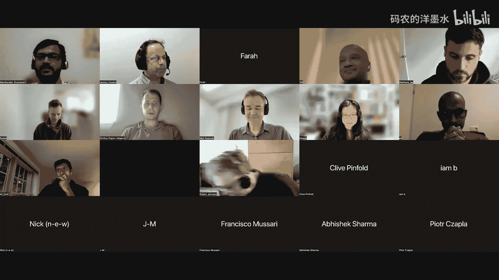

Comments or questions。In the meantime。Yes。Yes。All right。诶。Chest cream。And that's the right screen。

And I'm move you guys under the other screen， and now I can see。Yeah， all right。So。Betty。Stateboard。

There we are。嗯。Where' is Radick？Not here。 Soda， I see。嗯。

One thing that I guess it would be nice if it wasn't so sort of， I don't know。

 a little bit hidden miss because。I set this up in paper space and then started running it and then I went to bed because it was taking so long。

啊。I just have a fear that if my browser sleeps or guys sleep， that it'll。

Just basically stop the session， even though there's more hours and processor in the workstation is yeah running。

 I wasn't sure， so I mean it shouldn't， but what happens is a queuees up。

You know for when your browser comes back。 But the problem is there is some limit to how much it'll queue。

So although itll have run。If you've hit that limit， you won't see all the outputs。Yeah。

 which is nearly just as bad。嗯。😊，So， you know， there's a few things you can do。嗯。

The most obvious one would be to use Nb dev to export。The notebook to a script。

And then run the script in teamworks。Because then you can close it down， come back。

 reattach T marks and。There it is okay， thatd be interesting now something。Yeah。

 so maybe we'll look at that sometime。Yeah， something I don't。Well。

Does paper space gradient let you have。Doest let you SS S H in with a suitable IP P。 I'm not sure。

 if you've got your own GPU at home， you know， or on AWS or GCP or whatever， then what I do。

Is I run X RDP on it， which is a remote desktop server， and then I can。Connect to it。

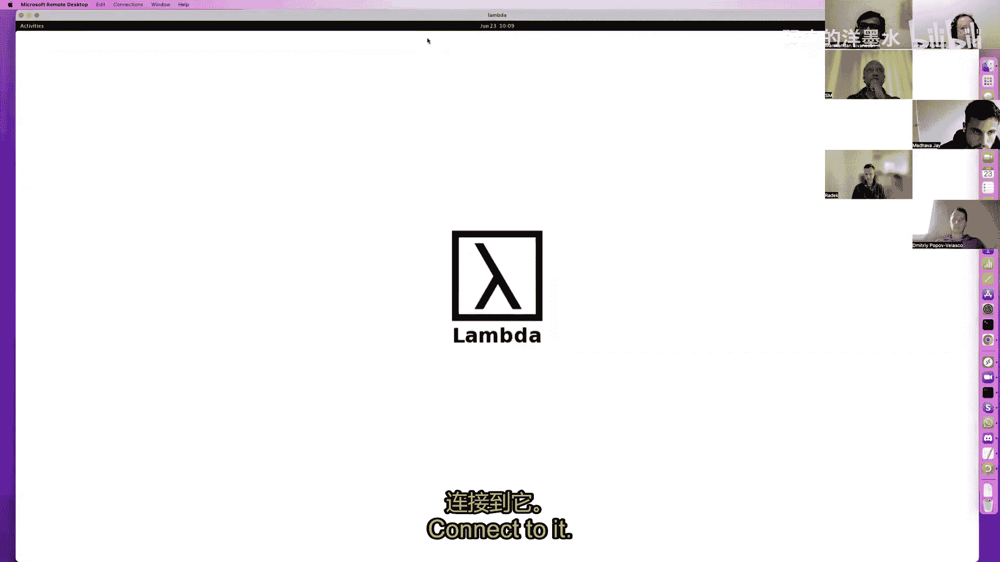

Like so， and。Radton。Firfox。

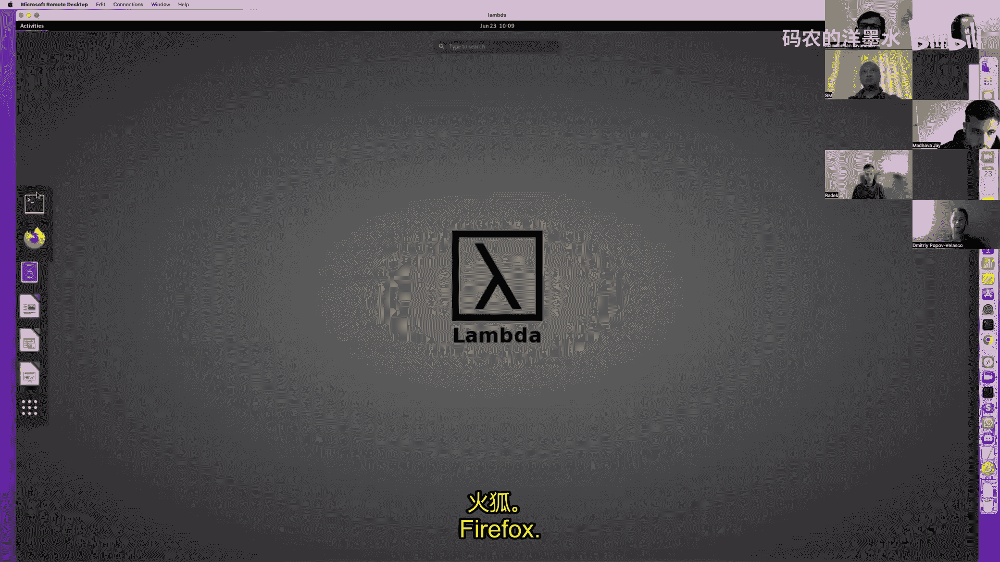

And so this is my， yeah， this is my server's screen。You know， remote dust topping in。

 So if I now go in and run something。嗯。Yeah。Okay。嗯。Patty， I remember from last time。She。Yeah。Okay。

 so I can set this running。And then I can close it down。哎。Go to sleep。 come back the next day。

 reconnect to that screen。And it's still running。So like， that's the。

That's your preferred way to do it。But I， yeah， as I say， I don't know if it's possible on。

Paper space gradient。Oh。machines seem to have a limit of six hours that I've seen so far if you。

Subscribe to their。Pro or whatever。You can dump it up。Or get rid of it altogether。So诶。

It's this tab here。Machine tab。 you can change the auto shutdown。 Okay。

 it looks like a week so maximum。 I know， this one dont limit there as well。嗯。Yeah。

When you're paying， no it's when you're paying， but I mean。You know， it's。

I think it's like 8 bucks a month。 Yeah，8 bucks a month。He may as well。Yeah， I've got the probe。

 but I don't have when you pick a free machine， yeah。Right。3e pay 5000。对。Po。Ex6 hours， y。So Jeremy。

 sorry interrupt hope space in there。In their support channels。

 they talk about you can assign a public IP to a machine and then SSH to it。

So you could SS and then T markx， is that to a gradient machine though？Well good question don't look。

 I'm not sure that it would be。Advanced options。No， it's not。

And so they also have this thing called core， right， which elects more like AWS or Google servers。

Which absolutely lets you do it。Static I。 and you don't even neatly。

 I don't even know if you need a static I necessarily。 but you could use a dynamic I。

Would work just as well。 bit cheaper。 The thing is， though， I reckon they're pretty expensive。

You a cool product。诶。So， that。These are very basic GPUs， so that's not bad 45 cents an hour。诶。

I guess they're not too terrible。 but you， if you want a R T X。 I I guess they're the same price。

 really 56 cents。 So I， I take that back。I guess the thing I found expensive was theres CPU pricing for running it。

All the time。嗯。对。So Jeremy， with this RDP solution that you showed。How does that work do you Oh。

 just a moment， Reddit close here。Okay。So how does that work？呃。

I didn't get where what computer you' RP into Im RP into my own GPU machine。

 but it could just as well be a AWS machine or GCP machine。 This is basically the same as VN C。

 if you come across BN C before。RDP is the kind of Microsoft version of that。

 I like it generally quite a lot better。 And much to my surprise。

The Mac client RDP is better than the Windows client RDP even shows you a little mini screenshot。

 you know， with the screen。😊，So yeah this is now finished training no。

 merely finish as halfway through training whatever what' this tricky to set up because you you're running Linux not even slightly tricky to set up。

So， yeah， youve just。Yeah。It's quite XrDP since it's RDP for X Windows。And you just go app install。

 I mean， yeah， I mean， I hate installing this kind of thing。 It drives me crazy， but this is it。

 You just pseudo app install。嗯。Sudo add user， pseudo assistant CTO restart。

And then you might also want to run pseudoysem CL enable。

 which will cause it to automatically start when you start your computer。嗯。And I don't think I。Oh。

 you know， if you've got a firewall， you'll have to let it in。So it's port 3389。

 basically this line of code。 And I think I did have a firewall So I was around this。嗯。Yeah。

 that was it。 It， it just used my。Use the name imp password that I had on the machine。Yeah。

 so very surprisingly not。Yeah。Annoying And then I think I just installed Microsoft remote desktop from the Mac app store or on Windows。

 I think it comes with Windows。😊，So that was easy。 Yeah。

 nobody seems to talk about it Ma'm mainly talk about BNC， which is also fine， but。

K I find it a bit slower。A little bit more awkward。Al right。😊，I mean， one weird thing， I guess， is。I。

I guess my machine。 and this is pretty common。

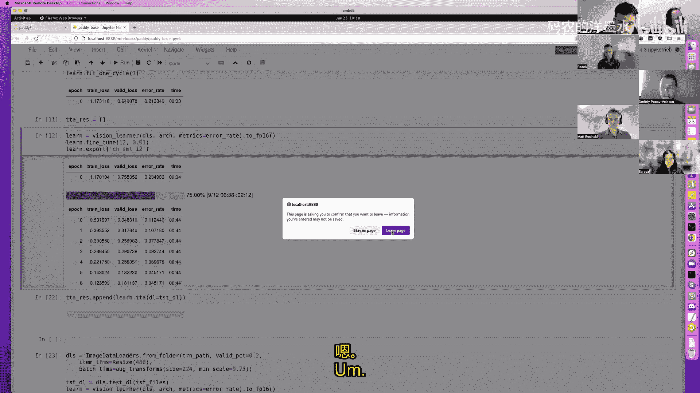

I， I haven't set up。Really， to be a graphical workstation。 I always use it from the console。

 So I actually。Don't really have much of a window manager here。 I can't even like It know。

 I can do a little bit。 I don't know， I don't know what the hell window manager is even using。嗯。

But often you'll find like there is no window manager or whatever running。

 but you know a bit of Googling will' show you how to app to install。😊，嗯。You know whatever， K T E or。

Nough。Okay， since were on the installation topic， could I ask a question？So。

I think I kind of brought it up a little bit， but I can't launch Fast AI。

 a machine that runs fast AI， and a Ptororch one would work。So。What suggestions would you have about。

 So that means that your pre run S H file has got a problem。

So maybe commented out from my Pitor just started out yeah open up your Pi torch open up a Pi torch machine。

 move pre run dot sh to pre run dot back or something。

Or just open it and see like it might be obvious what's wrong with it Yeah I couldn't see anything。

Yeah， so。Well， when you say it's not working， what's like what's not working it just says error when I try to start it up just as error and I tried to reach out to the paper spread space support a couple of times。

Maybe it's a too abstract for a question I don't know in your response yet。But I'll try that。

 thank you。Oh， people are putting stuff in the text chat。

Please try to say things verbal chat if you can because it's way nicer for me and I don't have to check all four windows。

I don' know it's not possible for everybody。Okay， so sorry Jeremy there is a way to SS agent into a gradient machine。

 but you have to trigger the virtual machine to be built from the command line so you have to initiate the job and there's ablespace to have a Github repo。

And is there any reason to do that like that sounds complicated like would you just run a way more effort than it's worth just run a call just run a paper space core machine if you want to I guess yeah exactly so you can do it it's just what I would you。

U。😊，So， yeah， I mean， so for paper space， the issue around the， the， the notebook closing。

 I would like start。Running something。Close the notebook。And then reopen it。Just to say what happens。

Getto。And。You know， let's try it here， right so。

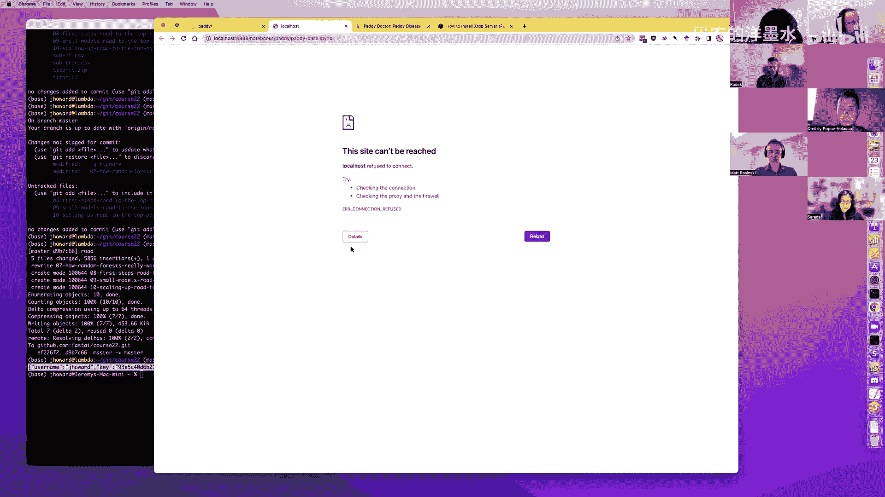

Now， what was that thing we learnedt the other day， it was shifty。And go to the other one。看着。

Oh that was my one Okay， I gotta learn how to he Jeremy yeah can using i term two because you can do T Muux minus CC and you'll get native windows in T Mus instead of the little sort of terminal ones that sounds interesting let me try that Yeah。

 I'm addicted to that awesome。😊，呃。Minus minus capital CC。Unone option C， does it be before the A。

 Yeah， so it'll be t marks minus capital couples。 Yeah， you go oh。Okay。😊。

And what are the benefits of this。They're native windows you can click and drag them and move them around。

 pop them out yeahep all that stuff I mean you can click and drag。Two max windows， as well。See。Okay。

 so it's all the same as like you， you've got to have mouse mode on for them to work。

So like the shortcut keys like command shift D will split pans。

 you don't have to go into I think is it colon or something and command something it's just like less gimy。

 just use control B。Then maybe it's exactly the same。Yeah。

 I mean you have the sense control doesn't work anymore so all my T Max shortcuts are not going to work anymore。

How do I I think they they're different escape， I think or。Yep。

If you go back to the original window that launched it， it'll have like a。Okay。Okay。Yeah。

 I'm not convinced it's going to help my workflow。 but I think， yeah。

 for people who are more familiar with。诶。Tamax shortcuts。 That could be cool。Thanks， the tip。

It's going gun down here。 It's a be weird。嗯。The trick to get mouse support working。 So for example。

 most scroll wheel， as you can see， works nicely in this normal team marks window is to。嗯。Have a dot。

Tammarks dot con file。 that contains。Said Op minus G mouseson。

And then you can also increase your history limit。And yeah， that's how come I can scroll。

 I think the thing like。You know， or a thing I like about teamax is。

It's very integrated with my kind of the the normal way of doing things in。In Udix， you know， So。

 for example， if I want to search through。My previous session。

 I could just hit question mark to search up， and I could search for make file。For example。

 a you know， hit N just like I would in vim。It slash to look forwards。 You know， it's like。

My terminal works the same way as as VM or whatever， which I。Yeah， which I really like。And I think。

 yeah， that way I don't have to know like， oh， the items set of shortcuts and some other set of shortcuts is's just this kind kind of like。

General unique sea way of doing things， I guess。And of course， they'll also all work on。

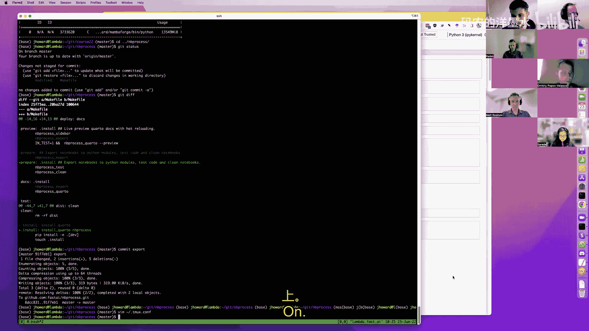

The paper space terminal。As well。Yeah， so let's try。This。So if we start running this。Okayk。

Close that。Leave it for a few seconds。And。You can see here， it says in my console。Starting buffering。

So it's remembering things that were sent to me。 So if I click now back here。There we go， It's。

Let's see。嗯。That didn't seem to work either。 That's interesting。Okay。

 so let's try something different。 So I don't think you can just close it and reopen it。right。

Let's try something else。

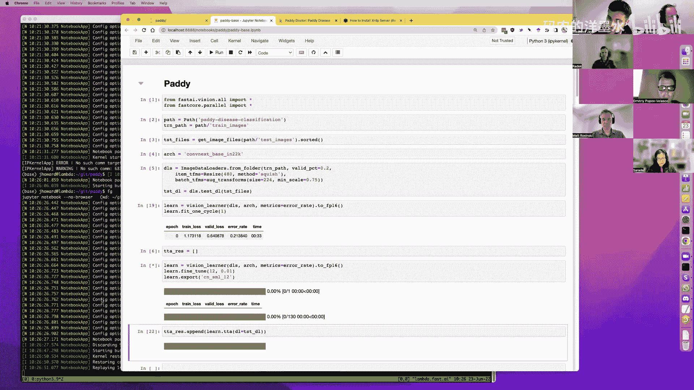

What if we fake a network disconnection by closing SSH？Okay， so now， all right， connections failed。

So I'll leave that window open。And then， we reconnect。

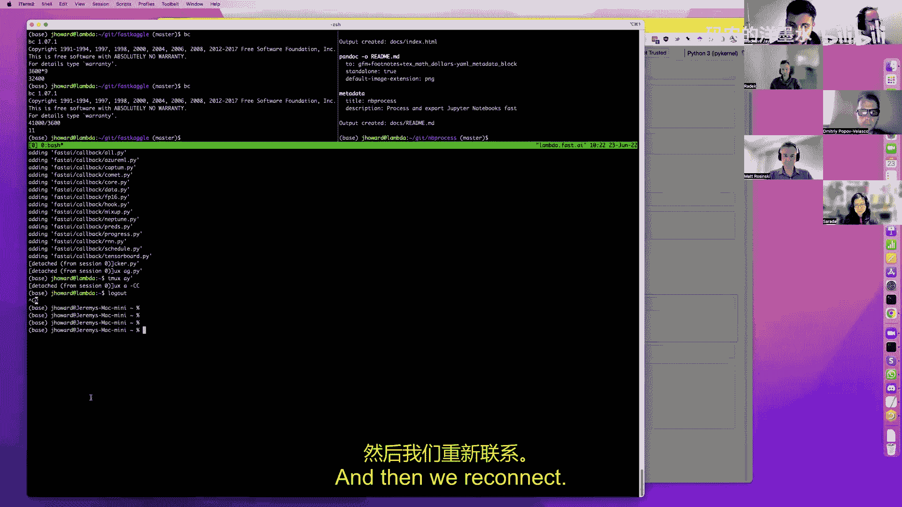

And。 okay， so that worked。So there's some of her answer。 But yeah， I think there's something now。

 if you leave it long enough。😊，It says， I've stopped listening for events because there's been too many and tells you there's some configuration option you can change to make it bigger。

 should probably be a useful thing to know about。Let me just go and turn this alarm off hang on。没有。

Okay。Sorry for that。My daughter likes to be permanently entertained。

 so any gaps in her homeschooling schedule。She wants to be。Amused。

She doesn't like the fact that I'm doing this。 And Rachel's a Crossfit。Okay。嗯。

So we had a look the other day at。Progressive race sizing， right。嗯。And so this is where I got to。 I。

 I think like。Progressive resizing。 one interesting thing you can do is like， you can go crazy， Like。

 you can go extra large。诶。And。You know， we start out with some。Ty tiny images。And。Train。For a while。

And then combine that。With。Gradient accumulation。嗯。To then go up to big images。

But don't have to train so long。So this， I think this is a good trick for probably particularly for code competitions on KagO where you've got serious resource constraints。

You know， or just。Wing to do more with less time。嗯。So I think， on Kackgo， you would have needed。

Accumulation level of 4 rather than 2 to make this fit because they've got 16 gig cards。

 We also got a 24 gig card。嗯。So then， something else that。Then we started talking about was weighted。

Models。嗯。That's weird。 What happened to my weight model。嗯。Did I move it to Co 22。啊。大宝。That's fine。嗯。

k球。So the question I think we had yesterday。Was about。Unbalanced data sets。

 And would it be a good idea to balance our data set。嗯。So。Let's。嗯。Let's start with a nice。

 small model。For use a base case， something we've done before。Con next。Okay， let's use this one。

So actually， there's no point copying progressive， I guess， let's copy。mall models。Okay。Great name。

And so， this is。Gonna be for weighted。Ok。Mas what do the resizing。

I don't really need it on my machine。 but since we'll be putting it on kle as well。Okay。

 so that's going to be our base case。So for waiting。嗯。We can。D F dot label。Dot out the accounts。So。

 there's our。Level of unbalancedness。So it's not too bad。 There's a lot of normals， a lot of blasts。

Not many of these are bacterial thing。U。Nick， I don't know if you're around。 I mean。

 I can see you are around。 I don't know if you're able to talk， but if you are。

 you could make be to tell us about what you've found because I know you've been looking at these。

 which， which of these are hard to kind of visually see the difference between。Yeah。

 yeah for sure I'm sorry I dropped out earlier because we had a power cut here but I'm back now so intentionally video list or I'm not intentionally videoist。

 but that's the break at the Im sorry about that worries but yeah like one thing that I did just to I guess get a better handle on the data set was going through them I having look at the different types I found it really hard to pick even what the difference was between a normal image and say like Downy mildew or whatever it could be quite hard to pick out and so one thing I thought it would be fun to do was to almost like segmental mask the images playing with the color channel to see if they would come out a bit better and then when I did that I was able to take kind of I guess a yellow dead bits or disease parts and I could see them better when they were like in bright red and the thing is is that so many of these like when I found like when I've trained them I find that there is a handful of。

😊，A handful of images really like like 20 to 25 images that are very difficult to classify and it tends to be these actually from these imbalance classes where it tends to categorize them as blast when it's not and so these art ones tend to go yeah in fact let me just pull up in one of my notebooks you want to maybe share your screen yeah let me see so like where do you look at this are you able to see。

😊，不。But it helped to make these。Bigger， are you able to see the disease in these。

 Because I don't know what I'm looking for。How do we make this bigger。诶。

Probably there's like a figure size in matte plot Lib， isnn't there， matte plot Li。

 Is it like fig size， F size。Yes。Big size。Es。I don't know。Which way around is it。A way around。9 15。

 we can't hear you， by the way， Nick I don't know if you。We we lost you。Jeremy。

 I also try to look into the image and using the confusion matrix and then the most laws to pop it out but it's just too hard it's beyond my domain and I was planning to do that today actually so that's yeah。

I don't know what happened to Nick， maybe he's having some internet problems again。

I wonder if it's just， like。Red spots saw something。嗯。So yeah， I mean， it's in anyway。

 it's interesting that Nick said he found these ones difficult， so yeah。

 there's basically two reasons to wait different rows differently One is that some of them are harder。

And that you want them to be shown more often to give the computer more of a chance to learn them。

 and the other is some less common and same thing。So。嗯。You know。

 one possible waiting for these would be。To take their reciprocal。And so then， you know。

 normal is going to be shown less often if we wait all the normal ones by this amount and all the bacterial panic or blight ones。

 this amount， you're going to get more of these。So that's like one approach we could use。

 I feel like that might be overkill。 So I'd be inclined to kind of like。Not。Do it quite that much。

 So like another approach would be to let take the square root， maybe。1 over the square root。

 kind of like that。So then these are going to be shown about twice as often as these。You know。

So maybe like let's start with trying this as our set of weightings。嗯。So Jeremyerem。

 I could ask a question at this point。诶。So the waiting and when you talk about waiting such that。

Image is are shown more or less or fun yes。I wonder in cases where it's very imbalanced。

Whether that could lead to some。Classes being overfited， too。

 because the the model learns about the images themselves came across in look。 Yeah。

 definitely classification。 Yeah， and whether there was a way to a read about。

Out there how to deal with imbalances， and I've seen some recommendations to try to wait。

When calculated the weigh when calculating the losses rather than the recycling the input。

 so just wondered whether it supposed they're different right like so。In the end。

 you want it to be able to recognize。The features of the images you care about and there's no substitute for like having them see the images enough time to recognize them。

嗯。However， when it does that， it is then going to， because it sees the rare cases more often。

 it's going to。嗯。Think that those rare cases are more probable than they actually are。

So you have to reverse that then when you make predictions。嗯。So that's yeah。

 that's something to be to be careful of， so I mean I mean。

 I think it probably just helped to try to take a look at it to see what that looks like。So yeah。

 so here's our whites， right？I would be inclined to probably。Can we merge things directly。

 Let's take a look， So if I go。DF dot merge， which is kind of like a way of doing a join in pandas。

And the right hand side， Yeah， the right hand side can be a series， cool。So， emerge on weights。

What does that look like no。Why not。呃。And then， okay。Left， I see。 So left。 Okay， so on。Left left on。

Left on equals label。And right， I think that's called the index。 I'm not a panda's expert。

I don't know if anybody is。there we go。Okay。So that's added these weights。Here。嗯。

Given the slightly weird name， but that's okay。So if we called that weighted D F。Yeah。And so then。

We could get take out。Little little function。 and move them over here。And I think。

What we want to do is use data blocks at this point。often a good idea。嗯。And we have a Tb version。

Certainly make one otherwise。Okay， here's a data block。So， let's。Get a data of block。

Go've got an image block and a category block。Yes。诶。Get why is parent。第波。Okay。Item transforms his。

That。Item transforms is this Jeremy， I think you're in the wrong。That book should be weighted。

Thank you。Thank you。Yes， I had these here， but。😊，Thank you， okay。Pix it up。Right。Okay。

 and batch transforms。Now we should just use the same ones we had here。To make it fair。Okay。

So there's our data block。嗯。Oh， we actually use this resizing。Size。

Jeremyeremy yeah sorry sorry didn't drop up there so this approach is we're going to use the data block to even the numbers of what's being sampled so that we get more augmentations of the same images for the lower representative samples or kind of so it's nothing to do with the data block we're going to use things called weighted data loaders the weighted data loader is going to use these numbers here。

To as as basically like probabilities。Of how likely it is to pick that row。

But it grabs a row in a batchep I was going to add them all up and and and do each of these divided by the sum so they'll add to one The reason I needed data blocks is because the the weighted data loaders method is a method of data block。

It's not something we get in the， you know， quick and dirty image data loaders thing that doesn't have as much flexibility。

 So now that we've got a data block， we can type deep blocklock dot Oh， and we'll have to import it。

Import fasti dot call back dot。呃。What was it in again？I don't remember fast AI weighted data loader。

It's a data callback。嗯。Oh， okay， so that's it's actually a method of data sets。

So we can get a data sets object from a data block。Like， so。And we pass in。Source。

 so that would be our list of image files。嗯。So we can。Fles equals get。Image files。

In our training set。You could pass those in。And。There's our training set and there's our validation set。

So their data sets， so these are the things that remember we can index into and get a single X Y pair。

And so way to data loaders is then something。We can pass data sets to and give it weights and a batch size。

Okay。And the whites sit for the training set。Okay， we're gonna have to be bit careful about this。

So we should be to go DSSS dot weighted data loaders。And so， the source code。I， yes， it calls。

I said TL。Which is here。嗯。K。😔，Whites column whites。Alright。

 I'm not 100% sure how this is going to work， but let's try it。嗯。So， our。Wai a data frame。hoops。

So this is the weight for each row， right。嗯。And then we've got our files。😔，Yeah。

 we' got to be a bit careful here， right， because they're in。They're in different orders。Oh。

So we actually need。We actually need a way to get a list of weights where the two。

Orders are gonna match each other。You do it by key lookup can you put Yeah。

 we could do it by key lookup I'm actually thinking of something a little lazier。

Which is just to sort them both。Okay， so。Although。This seems to only have a what's going on here。

Doesn't have them all。Are they not contiguous。Sot values by image Id。Now， they are contiguous。

So where is image 1，0，0，001。The sorting must be by folder first though。Yes， of course。

 That's exactly what it is。 Thank you。Okay。So， we could use a key。That looks hopeful。

 it says here if the K string use attribute get us， So I think I can just pass in the key name。

That is magic。That is the magic of fast call right there。There we go。 So that's sorting by name。

And we can do the same thing for this one。Next so。And so now they're sorted by the same thing。

 So that's a good step。um。So， the whites。Are basically。WDf dot。Label why。Now， that's a panda series。

Which。Yes， to Nmpy would turn it into an array。So I just not quite sure whether this has to be just for the training set or is for both。

We'll find out in a moment。If I run that。It doesn't like it。Oh， that's interesting。嗯。Of course。

 So the batch transforms actually。Didn't end up getting applied， because。We use data sets。

 which doesn't apply patch pants fundss， so we would need to now apply them here。

So that's quite confusing。嗯。So， presumably， I don't。See it here。

 But I would expect to be able to go batch transform to this point。Oh， D L quags。

this is all quite awkward， isn't it。嗯。So， data loader。Keyword arguments。As。Btch。

So if we're creating a data loader， weighted data loader。嗯。

You know what would be a good idea would probably be to look at the data block dot data loaders source code。

To see how that does it。Data sets do total loaders。 Here we go。 after underscore batch。Is what it is。

After underscore batch。Nope。Okay， that's not it。Let's see。Okay。

 it's calling do data loaders passing in the keyword arguments。And。Okay。

 letter Loters does not call it after batchch。嗯。But data loaders。Wow。嗯。Let's start data sets。Yeah。

 so okay， so data sets do data loaders existing thing here。 And that doesn't do call it after_ batch。

So。Oh， and I think I know why。I think that's because when we look the other day at data block。

We noticed that it， like ads。Like。Oh。Yes， yes， yes the the image block。That adds int to float tensor。

As a batch transform。So we might need to add that as well。Okay。So it's getting PIO images。

So the fact is getting PO images。Means it's never being converted to a tensor。So， data block。

Id really think there's something that calls to ten or or something at some point。Oh， there is here。

 item transforms。So why isn't that getting called？Because。Oh， item transforms a。

Are also done at the data loader stage。Item transforms， Let's see。Item transforms。Yes。

 that's also done， okay。So basically， using data sets instead of data loaders。It's quite awkward。

 I think we need to fix this in fast D。Because。Yes， it's not being done for us。

 but you know what we could do， actually。Is what we could do。Is。The same thing that。

Data blocklock does， which is just to use these self dot item transforms and self dot batch transforms。

So， if we have a lock。At our data block。Oops， day。To block。 Okay。

 I think this is all gonna become clear in at the moment， hopefully。

It's got these item transforms in it。And it's got these batch transforms in it。

And so what we actually want to do when we create our data loaders is say that after batch。Is。

Whatever the data block says， the batch transforms are and after item。Is whatever the data block。

Says the item transforms are。Okay， that's ugly。So that's something I think we should try to make easier。

 so hopefully by the time people see this video， this will all be easier。嗯。

So there' are some data loaders。Okay。U。Yeah。So my guess is that here。

Is we've given the wrong number of whites， I'm guessing。

This needs to be weights just for the training set。

 So the way I would check this is I would take percent debug。 And that puts us into the。

Python debugger and the Python debugger is a very， very cool thing。It's called PDB。

And definitely want to know how to use it， H gives you the help。嗯。And。嗯。

W shows you where in the stack you are。 so you can see this is the line of code I'm about to run。

And so I can print out with P self。 n。And I can print out with P。Self dot weights。And I can。

 you don't actually normally need to even say P。 It just assumes it。

 so I can just say soft its touch shape。And so that's the problem， so it's expecting 8326 weights。

 not 10，407 weights。And so that's because and you know。To be fair。

 the documentation warned us about this， it's expecting weights just for the training set。

Not for both training and。Validation sets。嗯。Okay， no problem。

Did you predetermine your split by adding another column in you？

In the same data set there to put the weights in yeah， could do that。But actually。

 and somebody actually asked about this the other day。This is our trading set。And items tells you。

 though。The file names， actually， so we just need to look each of these up。嗯。In the。Data frame。

 So what we could do is we could say weights。A equals。And so we could go through each of those。

 so that's going to be all of our files。And then， we need to。Look up the image Id。And， you know。

 I think something you could possibly do here is。Set the index。To image Id。

Right because this kind of panda's idea， WTF equals。And then。We say。Dot location of1，0，0，0，0。

1 dot JPg。There it is。诶。For。内部 why。😔，There it is。So。If we copy that over to here。😔。

And replace that with O。Oh， O dot name。Look at that。Okay。So。Okay， so we don't want to sort values。

 We want to set index。 I should probably take more use， make more use of in indices in pandas。

 I guess I。Still don't have a great sense in my head of quite how they work。

 So I tend to underuse them。 Okay， so weights should now be the right length。For the trading set。

Okay， so now。诶。The whites here。It's just whites。Cool。

 and then what I'd be inclined to do is to do a few more。

And what I find encouraging here is that we've got a lot of bacterials。嗯。Brown spot。 Yeah， you know。

 this seems like a good mix， right。嗯。So， then。We should just be able to。😔，Pass those to a learner。

F tune for 5。Epos。Alright， sorry， that was a bit more awkward than I would have liked and definitely used a whole bunch of concepts。

 which we haven't。Covered before。 So don't worry if you're feeling lost about the implementation here。

嗯。Basically Jeremy yeah just about the how the sampling works， we've got weights and that's creating。

How is that actually sampled from the training set is it do we have a X number of rows or number of images that we're trying？

Create a sample。 Yeah， So what happens is it creates creates batches。

 So each batch will have 64 things in。And so it's gonna grab at random 64。Images。But it's。

 it's a weighted。Random sample， where each row is weighted by this。This wait。

And so an EpochC is not exactly an epoch anymore。In that it won't necessarily see every image once an an epoch just equal to the total number of rows in the data set is how many rows I've seen。

 but you know， we'll see。A lot of the less common ones， multiple times。

And so there's a definite danger of overfitting。嗯。The weighted sampling is not done for the validation set。

So we should be able to compare these。Let's take a look。 So5。6。Versus 4。6。 Now， you know。

 this is expected。But where this might be interesting would be like。Through all of our training。

And then， maybe at the very end。Do a few epochs with weighter training。

 you know at the point that it's already really good just to show it a few more examples of the less common ones。

嗯。Or just train it for longer with more data augmentation。 But yeah， I mean， you know， I'm。

 you would expect the error rate at this point to be worse， I think， because。The most common types。

 which it's。U。Particularly， you want to care about because they're the ones it's going to have mainly in the training set。

 It hasn't seen very much。So the overall era has gone down。 But yeah， I think you like it， it might。

 there may well be ways to。To use this。Jeremy， is it possible you could quickly explain where the deficiency was in the this random weighted API。

 how you would prefer that to look like you said do you have Oh yeah sure fix it up later。

 but I mean so I think the way this ought to look would be that I can say DLs equals D block。

Dot waiteded data load。Like that。In fact， you know。

 we could we could fix it up now the reusing the existing after batch and after items already and then yeah we could we can fix it up now if you're interested。

 Yeah， I'd love to see how to Okay commit commit change。So， you know。

 the first thing I do before I change the FAD library is make sure I've got the latest version of it by doing a Git pull。

Cause nobody likes conflicts。Alright， it's up to date。 So then I would。Go into the notebook， and。

It was in the data callbacks， so callback dot data。嗯。And so here's way to data loaders。Jeremy。

 is this a bit of a silly question， but is it a callback or is it just a kind of like a transform within the。

Actual data block， should it be？If you send weights to a data in， it just does it。Is it a callback？😔。

诶。No， it's not a callback。So。It's in a strange place。It's not a callback。😊，What it is， it's。

 it's a data loader。Actually。And a patch to datas。嗯。So there's a。You know。

 something I like very much in fast call called patchch。

 which is allows us to add a method with this name。To this class。

 And I want to add something to the data block class。嗯。Like， so。嗯。And but yeah。

 I think that the the the dock string is correct。And。I would。Then be inclined to just grab this。Here。

 copy。and。Paste it。In here。Pste。Okay， and so this would be calling。Yep。

 so we're calling the data blocks。嗯。So I guess we're going to do the two steps。And of manually。

 aren't we。So we're first gonna。go。Okay， the data sets。嗯。Data sets。

And so that means we need to be passed in。The I elementss。Cd sauce。 And I'd be inclined to like。

 grab all that。Okay， so。This。嗯。Thisist thing in data block。It's going to need a sauce。

It's going to need the whites。It's got to need a batch size。Apparently。

 there's something called verbo。 so I don't know what that means， but that's fine。

So the data sets is self do data sets passing in the source。And verbo equals verbo。And then。

We called DSS do data loaders。And when we did that。Okay， so now we're going to be passing doing DSss。

weighted data loaders。Best thought。Wait a data alert。嗯。And。That。That's basically。Oops。

 what happened there。Better date like this。And then we pass in the weights。Rs。

So weighted data loaders yeah gets the weights。And then the batch size。 and then the things we added。

Any additional keyword arguments。And this will delegate down to。

Data sets stop weighted data loaders is where the keyword arguments get passed to。Okay， so。

As far as I can tell， these same tests。Should's all work。 We don't need these labels anymore。

 We don't need is valid。We've already got a data block。

So previously we called data set and item transformforms and weights manually。So。That is our source。

So we could get rid of all this。And we're now gonna go。Datablock dot weighted data load。

And we've got to pass in our source。Okay， and we're got to pass in our weights。

Which were called weights。Oh， we already had that， never mind。And we don't need that anymore。😔，Okay。

Why don't I get 0？ That's slightly surprising to me。Hello，0。 Yeah， that's fine。Yeah， get 0 or1。 Yeah。

 because it depends how it。啊。Why is that slightly random。I'm not sure somethings slightly random。

 but anyway， it's working。So， then。Okay， and again， for this one， we shouldn't need to do datas do。

 we should be able to go data block。Got weighted data loaders。And we should be able to pass in。😔。

Our items。And our weights。And。Okay， what did I do wrong there。Da of lock outweed data loaders。 Oh。

 it's got it。Okay， let's see。What sauce。What are whites。嗯。Why doesn't it like that。Souce。Of course。

So let's see how it's different to what this one said。Data sets。Okay， this doesn't use a data block。

 So okay， I can't replicate that。That's fine。Okay， so。That's our test。There we go。

 So what I would then do。If I would export it。And。If。嗯。

So that that I don't have to like rebuild or reinstall or anything like that my Fast A library。

 that's because I have it installed using something called an Edable install so if you haven't seen that before basically or maybe you have a new wanted way when you go Pip install minus E dot in a git repo。

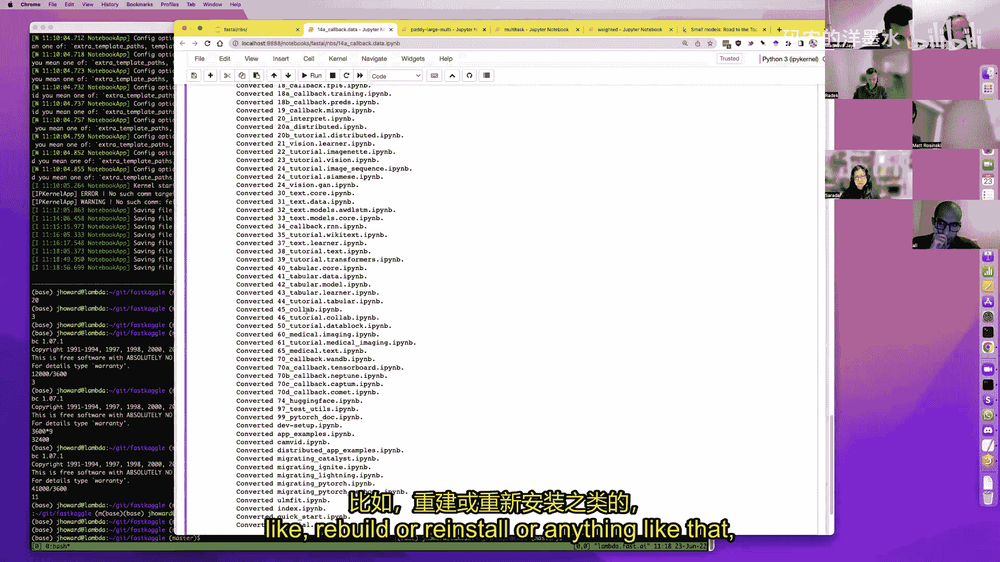

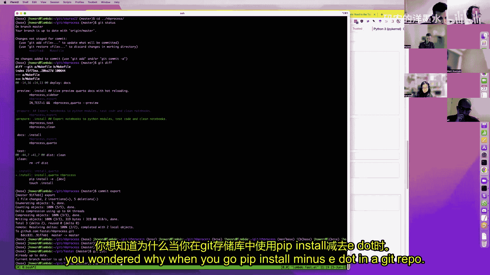

Basically， that creates like a Sim link from your Python library to this folder and so fast AI when I。

When I import first AI， it's actually going to import it from this folder。嗯。

And so now back over here in my weighted thingingy。嗯。系。嗯。Do all this。Data block。嗯。

We should find that there's now a D block dot。They a data letters。Which。

I can pass source and weights。And my sources files。And my whites is。Whites。Oh， and my weights。 Okay。

 so that's interesting。I wait， yes， we don't have data sets yet。嗯。So that's a very interesting point。

So how do we know what our weights are， we don't because they haven't been split。So the。

Could you not send them through as one of the blocks and the as a column get from and then use that because then it would be linked quite intimately with the actual row well we don't need to I think what we need to do is pass in weights。

I think we should pass in all the ways。And then。This。

Thing here should then be responsible for grabbing the subset for the training set。

And that would actually be much more convenient。Because after all， it's what we want。

So should determine the weights based on the the distribution across the classes rather than just tell it directly we should split the weights based on the splitter。

In a training and test set， so then we don't need any of this， so then weights。嗯。Actually。

 will simply be。啊。There's outweighed data frame。So， basically， what I would。

To here is this Well actually， we'll go back to saying this is sort values。And then。

 our whites will be。WDf dot label Y。That's actually how waits。诶。As a nu。Silly silly question。

 could you not just send a function for weight to the standard data block and if it doesn't get one then。

It does nothing。🤧嗯。

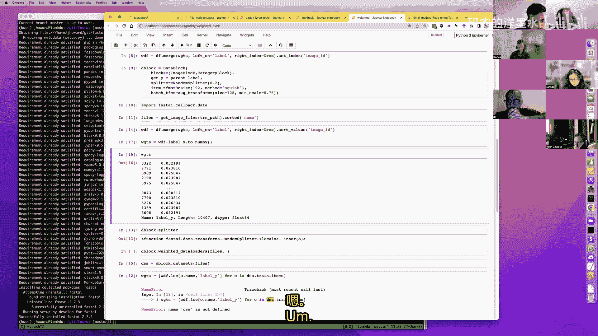

Potentially， we could。哎呀。It's。I kind of like this， though， because like。Yeah， I don't know。

 It's like。Whites were all one as a default then。Could use the one solution for yeah yeah。

 you could I just I don't I find it's a little bit too coupled for me I don't love it。

 but it's it's it would be doable it's an unnecessary model case I suppose。You know。

 I like how nicely decoupled this is。 So I think this is what I want it to look like。诶。So。嗯。

So I would look at how the splitters work。So， the splitter。Okay。

 so the splititz gets created here in datas。Cool， and then。I wonder if data sets。

Remembers what those splits are。Oh， I don't have tags， yeah。Okay， what do you mean， No tax file。Okay。

 there we go， Data sets。So that's control rate square bracket to remind you to jump to a symbol in vim。

诶。I see。 And that's actually mainly happening in this inheritance。 that superclass is where。

There's this split stuff Here we are。 splits。 I see， though， there is a splits。

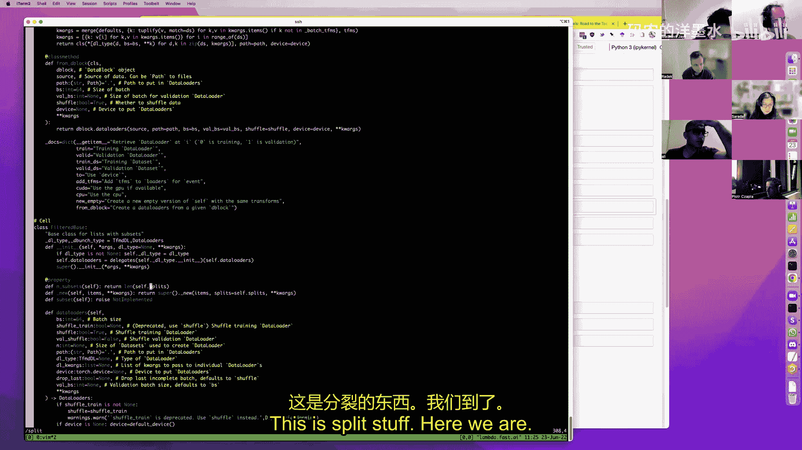

嗯。So， the S S starts splititz。OhOkay， fair enough。DSs。た。Spitz。Yeah。

 so there's the indices of the training and test sets。And so that's the indices of the training set。

So the actual weights we want are those ones。So， here。I can say trading weights。啊。

So we will change this data set from training set。And so this will be the weights。At those indices。

And that's what we use。Like so self thought splits。Thank you so much。No， DSS touch splits。

Self is a data block， and it's actually the DSSS that has the splits。

 The data block has a function that knows how to split。

 but the split doesn't happen until you create it。That way you can get different random splits each time if you want them。

Thank you for checking， though。Okay， so I'll export that。And。

Pro would be good to have auto load going， but we don't so be it。Okay。Now that we did miss a。

 but it's not the one you thought of。诶。This one here。Yeah。Okay。导湾。I guess actually。

 if I just comment this out。Then we can just run all above without worryiring。Aha， okay。

 things are happening。So， Dls equals that。

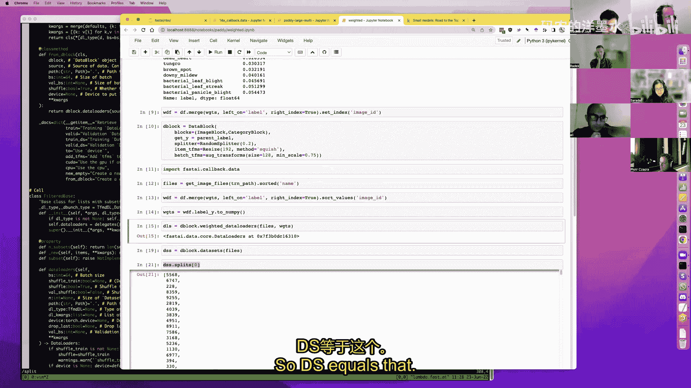

Okay， that looks pretty good。Okay， so I think we've created our feature。嗯。

So then the next thing I would do is to it would be very， very weird if。Any tests broke， but I。

 I would go ahead and run the tests。嗯。I would then。Create an issue for my feature。

 And so I'm gonna so I've got a。A bunch of。Tiny little aliases and functions。

 one's called enhancement， which creates an issue with the enhancement label。So I'll go enhancement。

Add。Data block。Dot weighted data loaders。And so that creates the issue。As 3706。

So if you were interested， you could。Take a look at that issue。

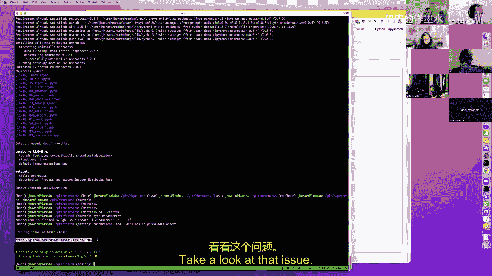

Not the world's most interesting issue， but there it is。

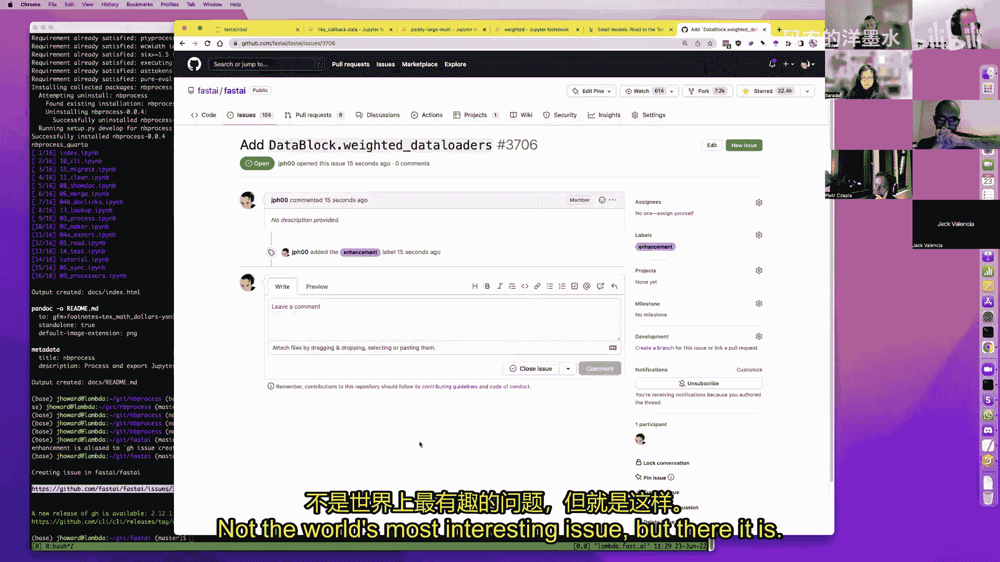

诶。Alright， looks like the tests are basically， oh， no， we've got an issue there we go。

 So we've got a test that's failed。Range in must be introduced or slices。Yes。

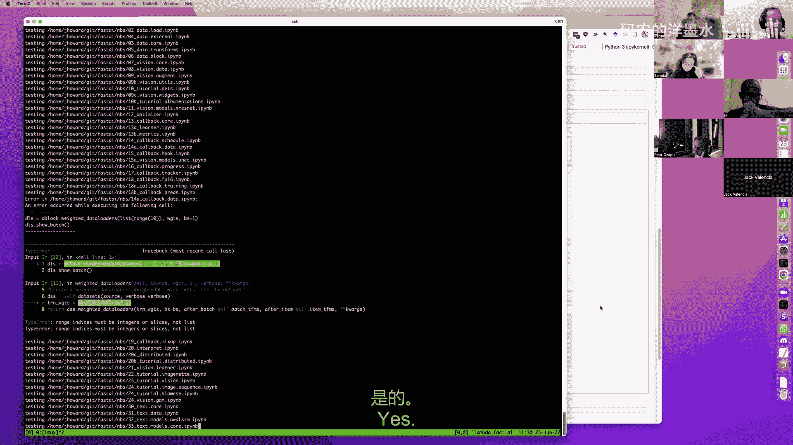

Right， so I'm glad we checked。嗯。Okay， so the problem here is that I've sliced into my weights。

On the assumption that this is something I can slice into。Which would only be true， if it was a。嗯。

Cancer or an array。But in this case， actually my weights are not。Either of those things。诶。So。

What would I do to fix that。Tll me a question here Yeah when you split you only keep you back the index of the training and validation data set and how can you know this is the weights because you haven't actually do the calculation and do the inverse of one square would kind of thing the weights are being passed in as a parameter and so we calculated the weights up hereep。

And then we passed them in。Yeah。What's the incorrect type that's coming through in the test？

It's not that it's an incorrect type。 It's that see how here I'm indexing into the weights using my splits。

嗯。This here is a is a list or an array。 You can't index into a Python list with a list。

You can only do that with tensors or some rate I guess Yeah， I mean。

 what we actually want to do is check whether it's it's an array type。嗯。

Is there is a listy or something that function that there is。

 but that's not quite I think we're want the opposite which is。

 is this the kind of thing that one could expect to be able to do non post style indexing on？嗯。

And I believe the correct way to do that。Might be to look for this thing。嗯。Yeah。So。

 I would be inclined to say。嗯。

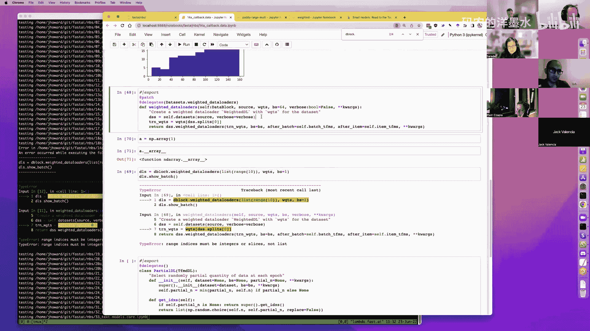

And there may there may well already be something in fast AI that knows how to check for this。

 to be honest。诶。不是鬼先。Oh， WG， oops， not she。Okay， so this。What's this thing。

So that's something that's commented out。 Alright， So I guess I don't have anything。

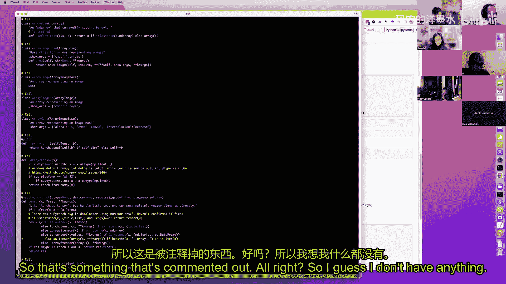

Which checks for that。 So we'll just do it manually。 So if waits。Has the Dunder array attribute。

Because I'm pretty sure that tenss have that as well。Yeah， it does。 So if it has that attribute。

 then I think we're good to go。Otherwise， we can use a list comprehension。嗯。Oh。

 you know what we could。Yeah， okay， what we'll do is we'll just say if it doesn't have that。

I don't know if this is too。Too rude。To change there。Whites。But I think this is fine。

It's not a nu type array， it's probably going to benefit from being converted to one anyway， right？

Yeah， I mean， I don't。 I mean， I don't see a downside。How is our test。Thus， it's all of our tests。

Okay， so。And that was our only test that failed， which is now passing。

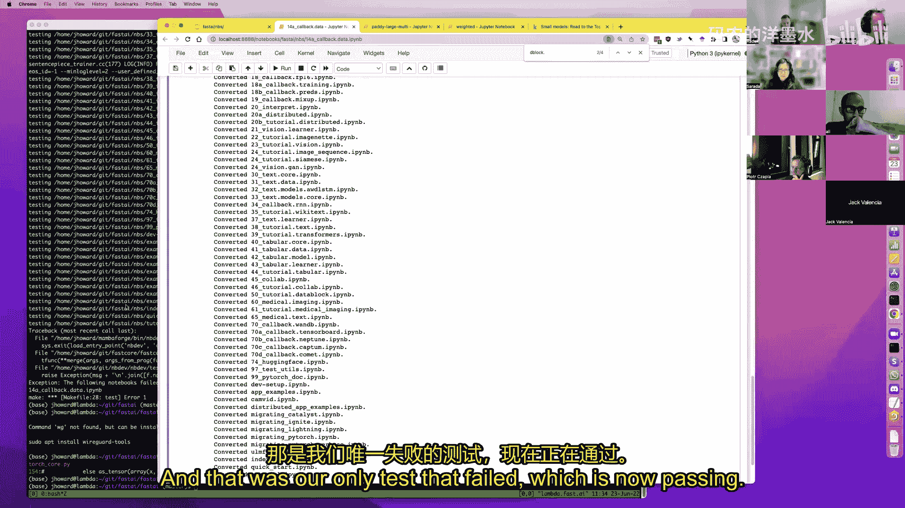

嗯。So I would now say， we've。Fixed issue 3，7，0，6。So I've got a fix this little function that does that。

3，7，06。Okay， and so now if we look at。

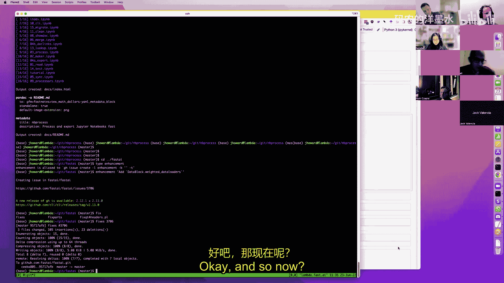

呃。That issue。You'll see that it's been resolved。Theyre usings this commit。

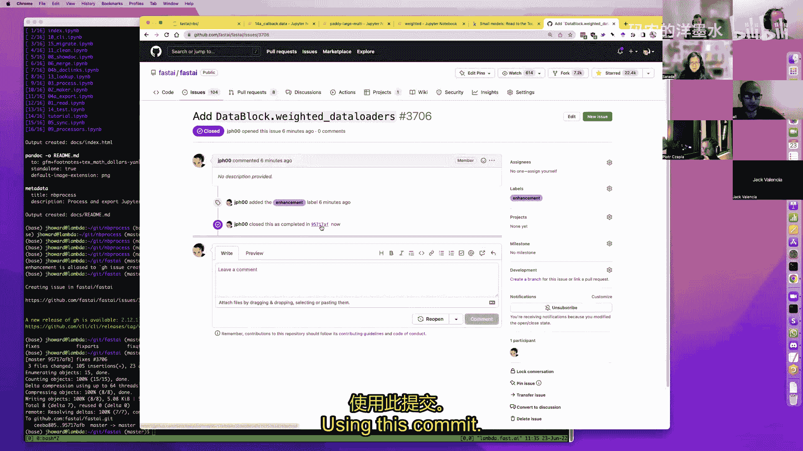

诶。might read it before， but what do you commit from the notebook。

 do you sort of have it like reset with empty cells or do you run the cells？

I commit them basically however they are， but with unnecessary metadata removed。

So there's a hook that automatically runs。This。Faction。Which is the thing that removes。

Stuff like the execution count。Unnecessary notebook metadata， stuff like that。

 So the idea is that the notebooks。Want to have all the outputs in place because they get turned into documentation。

 And we wouldn't want to。Ran them all in continuous integration to create the documentation because they can like involve like。

Spending 10 hours training an NLP model， for example。

 So we don't remove the the outputs for that reason。

 And also because I want people to be able to look at the notebooks in GithHub and see。You know。

 all the pictures and stuff。Alright， I better stop there。 Oh， that's interesting， today I。Okay。

 I guess I don't have my hook installed。 So I'm glad I ran that manually。

 So you can see exactly what it does。 right empties out the execution counts and removes the betterada。

sorry。I'm sorry for another question I'm just trying to find that。

 is that GitH available in the repo or do you doum Yeah， so it's if you go MB dev install。Kit hooks。

 It installs the hook。And specifically， it's going to。What did I say。Is that under M BS folder。No。

 this is part of Nb dev。Oh okay， right， so once that package is installed it's a built and so that then installs a filter here。

I'll read more about it， thanks。And it also。Installs a git hook。To trust the notebooks。

 which calls N B dev trust Ms。 Anyway， Yeah， that's all in the N B dev docs。

And then what's gonna happen now on the fast ice on the Github side。

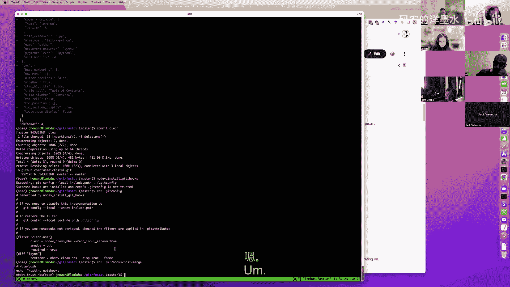

Is。It's now。Bisily running all the tests again。嗯。Like so。

 And one of the things it checks is to make sure that the notebooks are clean and that the export's been run。

 then it checks or the notebooks somewhat in parallel。A it go。😊，小。😊，Thanks。

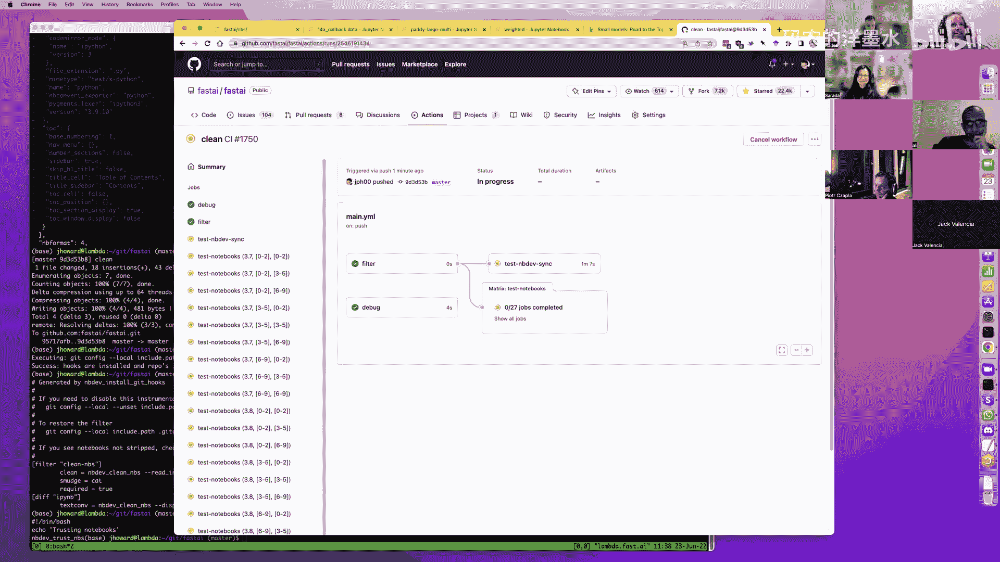

系。Thank you， by bye。