# 实时编码：15：加权采样与数据处理进阶


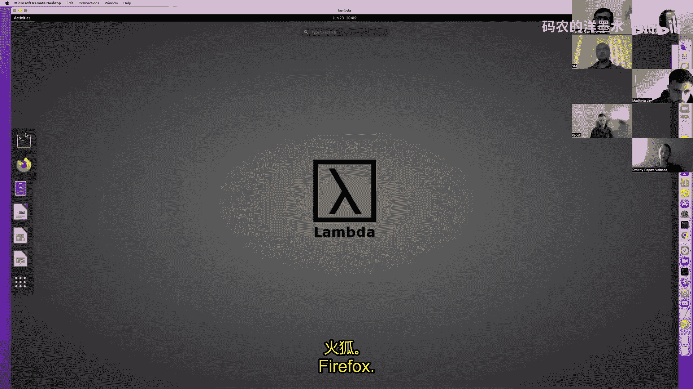

在本节课中，我们将学习如何处理类别不平衡的数据集，并探索一种名为“加权采样”的技术。我们将从基础概念入手，逐步构建一个使用加权数据加载器的模型，并在此过程中了解如何改进FastAI库以简化这一流程。

## 概述

在上一节中，我们探讨了渐进式调整图像大小等技术。本节中，我们将重点关注数据集中类别不平衡的问题。当某些类别的样本数量远少于其他类别时，模型可能难以学习这些少数类的特征。加权采样是一种通过调整数据加载过程中每个样本被选中的概率，来让模型更频繁地看到少数类样本的方法。

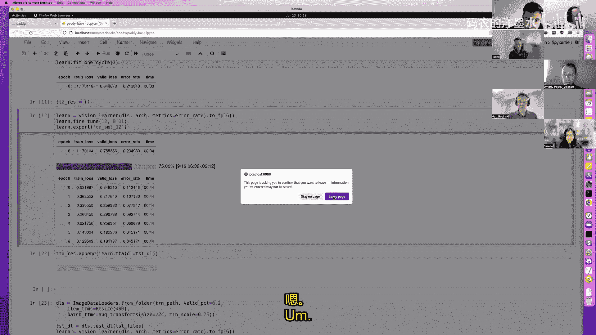

## 加权采样的动机

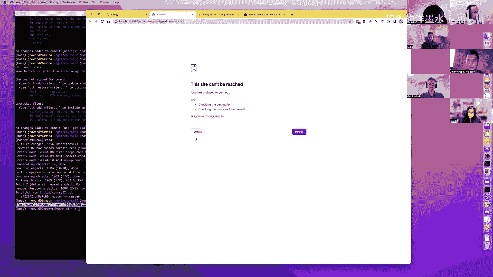

首先，让我们查看数据集中各类别的分布情况。

```python
df.label.value_counts()
```

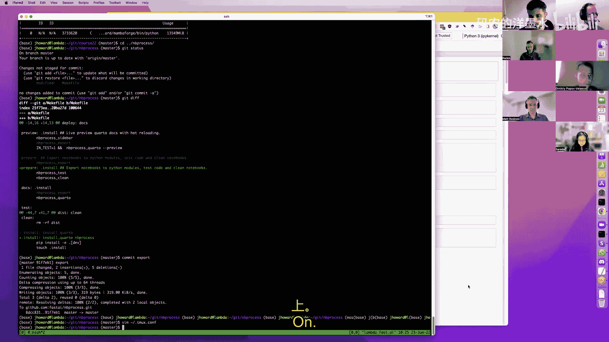

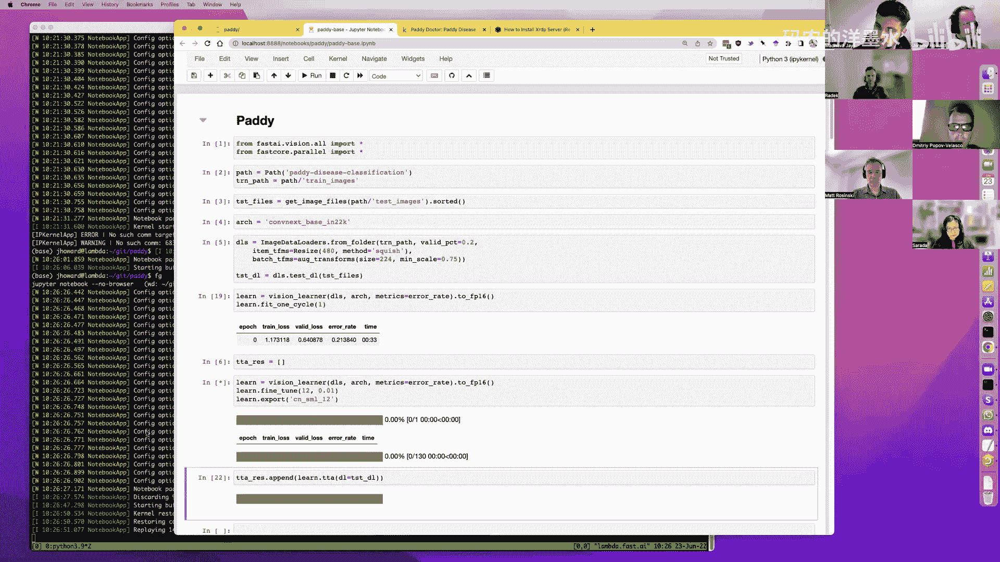

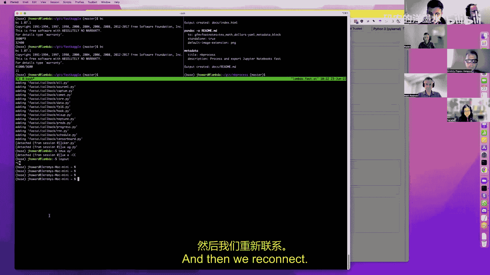

输出结果会显示每个类别的样本数量。例如，可能存在大量“正常”类样本，而“细菌性叶斑病”类样本则很少。这种不平衡可能导致模型对多数类过拟合，而对少数类识别能力不足。

加权采样主要有两个目的：
1.  **平衡类别频率**：让模型更频繁地看到稀有类别的样本，给予它们更多学习机会。
2.  **处理困难样本**：即使某些类别样本数量不少，但如果它们本身难以分类，也可以通过增加权重让模型更多地关注它们。

一种简单的加权策略是使用样本数量的倒数。例如，如果某个类别有 `N` 个样本，则其权重可以是 `1/N`。这样，样本数少的类别权重更大。但直接使用倒数可能导致权重差异过大，因此我们也可以尝试使用平方根来缓和这种差异，例如 `1/sqrt(N)`。

## 实现加权数据加载器

接下来，我们将使用FastAI的`DataBlock`和`WeightedRandomSampler`来实现加权采样。以下是实现步骤：

1.  **计算权重**：根据数据框中的标签列计算每个类别的权重，并将其映射到每个样本。
2.  **创建DataBlock**：定义数据块，包括图像块和类别块，以及必要的转换。
3.  **使用加权数据加载器**：调用我们即将添加到`DataBlock`类中的新方法`weighted_dataloaders`来创建数据加载器。

以下是计算权重的示例代码：

```python
# 假设 df 是包含‘label’列的数据框
class_counts = df.label.value_counts()
# 使用类别的倒数作为基础权重，这里使用平方根使其更平缓
weights = 1 / np.sqrt(class_counts)
# 将权重映射回原始数据框的每一行
weight_df = df.copy()
weight_df['weight'] = weight_df['label'].map(weights)
```

## 改进FastAI库

在实现过程中，我们发现直接使用`Datasets.weighted_dataloaders`有些繁琐，需要手动处理数据分割和转换应用。因此，我们决定为`DataBlock`类添加一个`weighted_dataloaders`方法，使其更易于使用。

我们查看了`DataBlock.dataloaders`的源代码，并创建了一个新的`weighted_dataloaders`方法。这个方法会：
*   接收源数据、权重列名等参数。
*   内部调用`Datasets.weighted_dataloaders`。
*   自动处理训练集和验证集的分割，确保只为训练集应用权重。
*   继承`DataBlock`中定义的`item_tfms`和`batch_tfms`，无需手动传递。

核心添加的代码如下（位于`fastai/callback/data.py`中的`DataBlock`类）：

```python
@patch
def weighted_dataloaders(self:DataBlock, source, weights, bs=64, **kwargs):
    dsets = self.datasets(source, verbose=False)
    trn_weights = weights[dsets.splits[0]] if hasattr(weights, '__array__') else [weights[i] for i in dsets.splits[0]]
    return dsets.weighted_dataloaders(bs=bs, weights=trn_weights, **kwargs)
```

完成代码修改后，我们运行了测试以确保新功能不会破坏现有功能，并提交了更改。

## 使用新功能训练模型

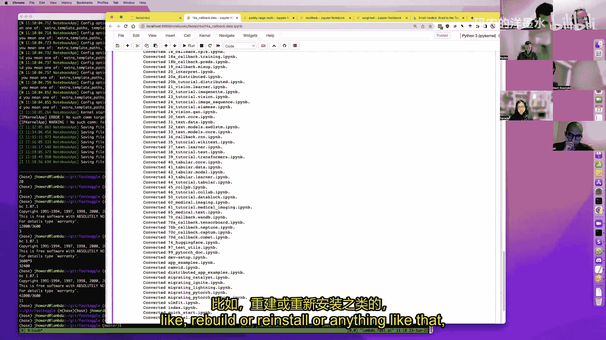

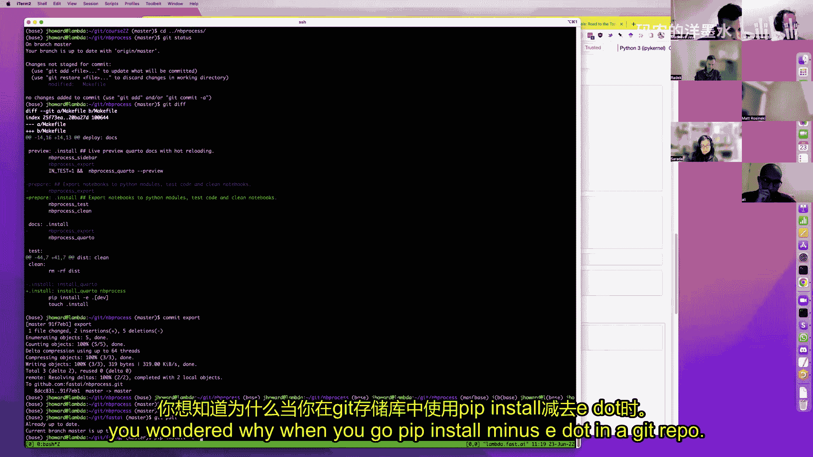

现在，我们可以使用新的`weighted_dataloaders`方法来简洁地创建数据加载器并训练模型：

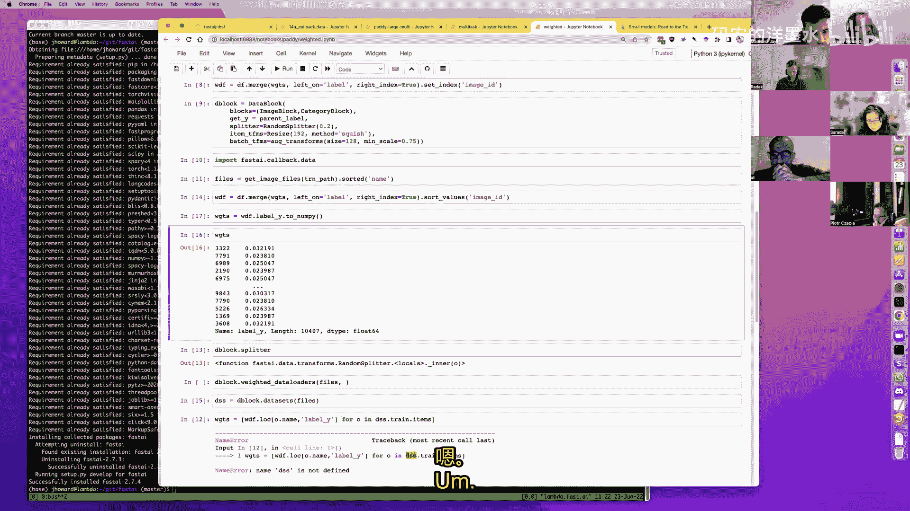

```python
# 创建DataBlock
dblock = DataBlock(blocks=(ImageBlock, CategoryBlock),
                   get_y=ColReader('label'),
                   splitter=RandomSplitter(seed=42),
                   item_tfms=Resize(224),
                   batch_tfms=aug_transforms(size=128))

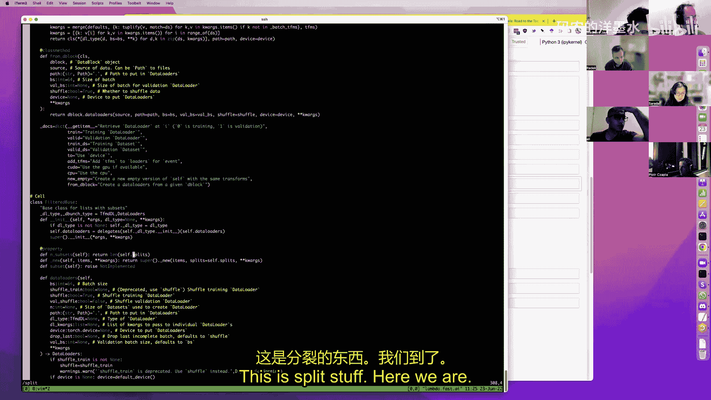

# 使用加权数据加载器
dls = dblock.weighted_dataloaders(source=df, weights=weight_df['weight'], bs=64)

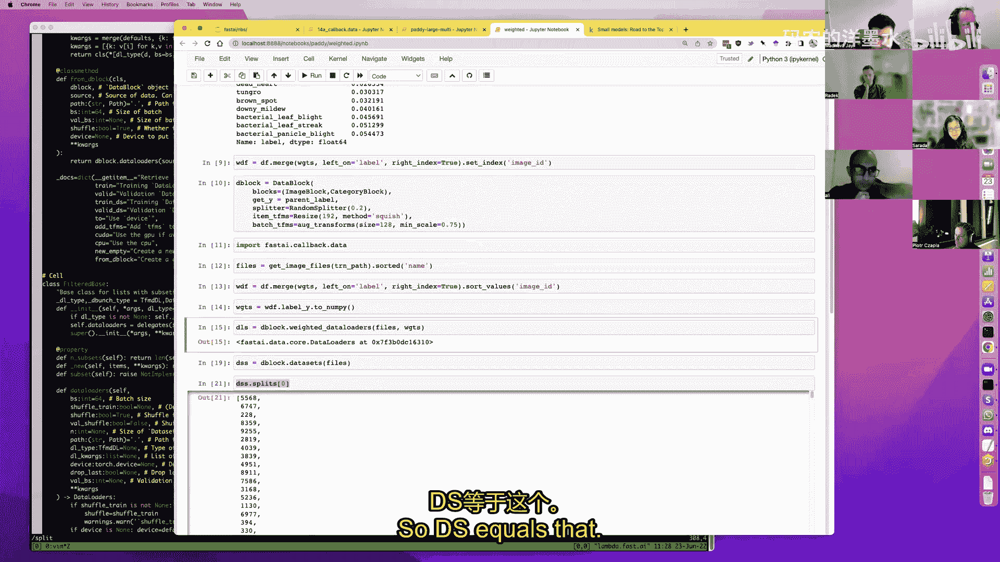

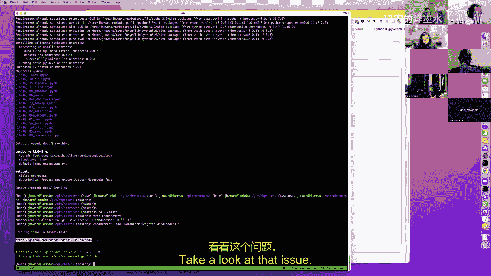

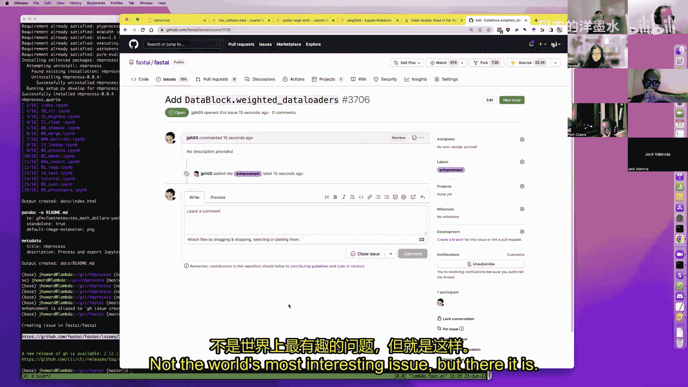

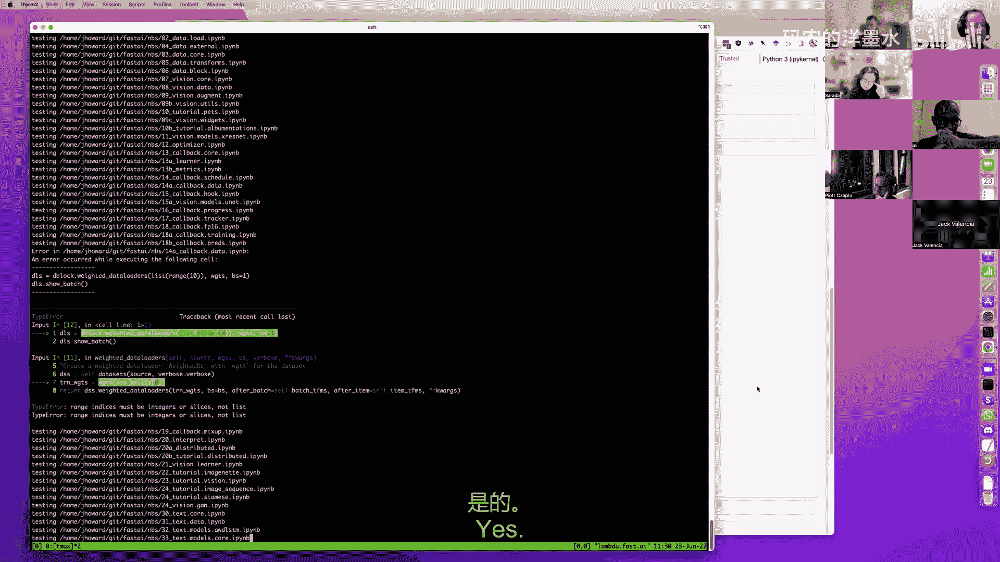

# 创建学习器并进行训练
learn = cnn_learner(dls, resnet34, metrics=error_rate)
learn.fine_tune(5)
```

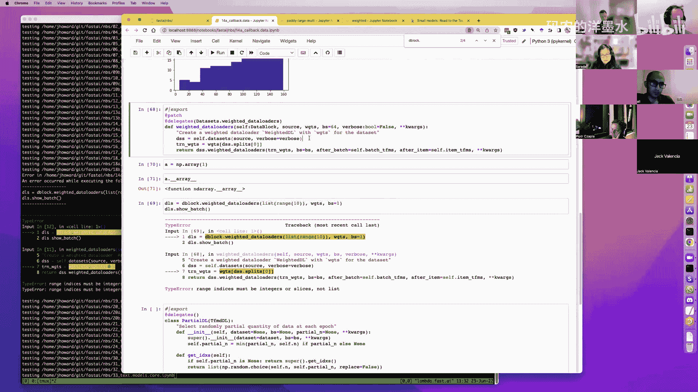


使用加权采样后，模型在每个周期内看到稀有类别样本的次数会增加。需要注意的是，这可能会改变“周期”的传统定义，并且存在对少数类样本过拟合的风险。因此，一种常见的策略是在训练后期（当模型已经学得较好时）再使用几轮加权训练，或者配合更强的数据增强使用。

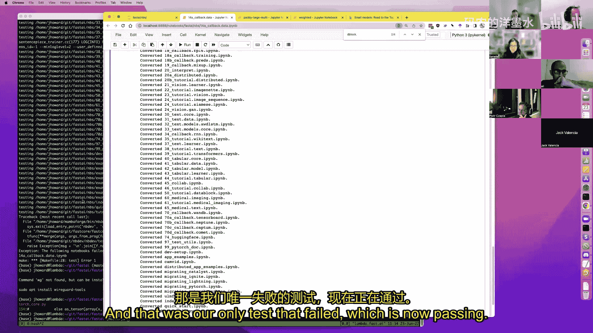

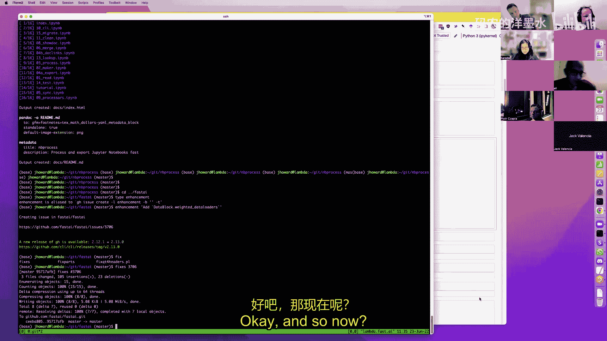

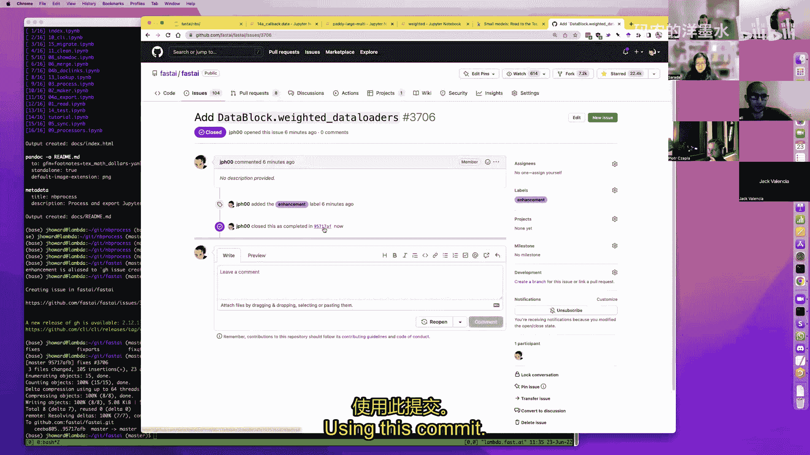

## 总结

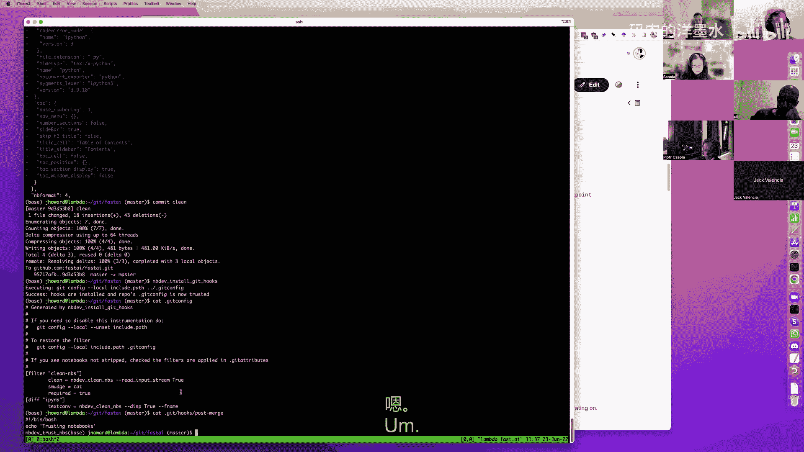

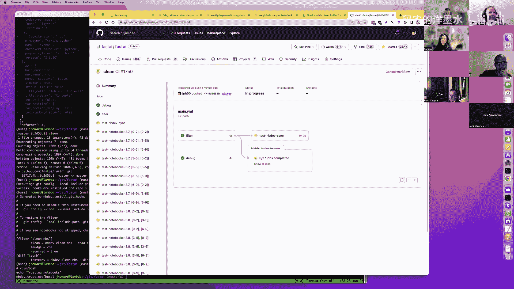

本节课中我们一起学习了如何处理类别不平衡的数据集。我们介绍了加权采样的概念及其动机，并一步步实现了在FastAI中使用加权数据加载器。更重要的是，我们通过查看源代码、添加新方法并运行测试，亲身体验了如何为开源库贡献一个实用的新功能。这展示了FastAI库的模块化设计如何让我们能够灵活地扩展和定制工作流程。