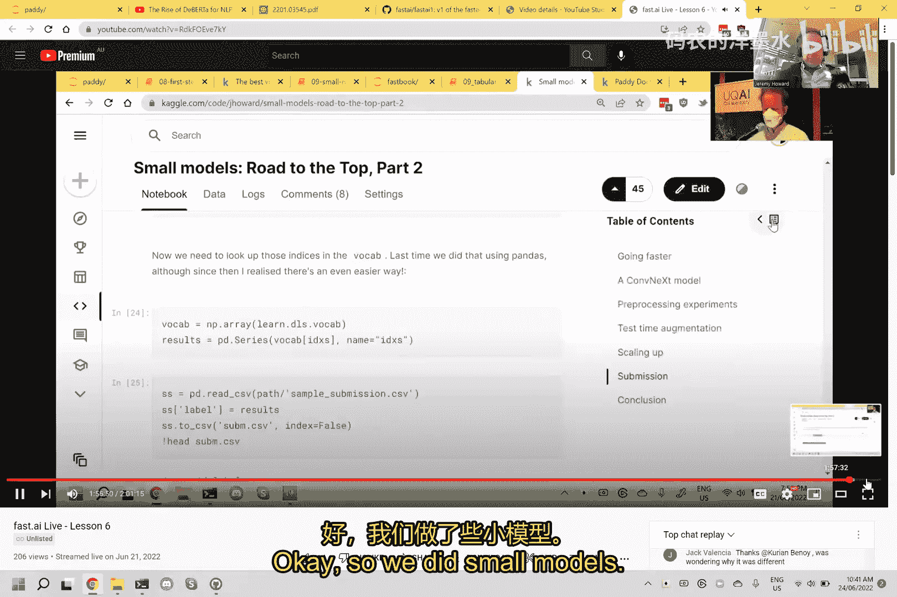
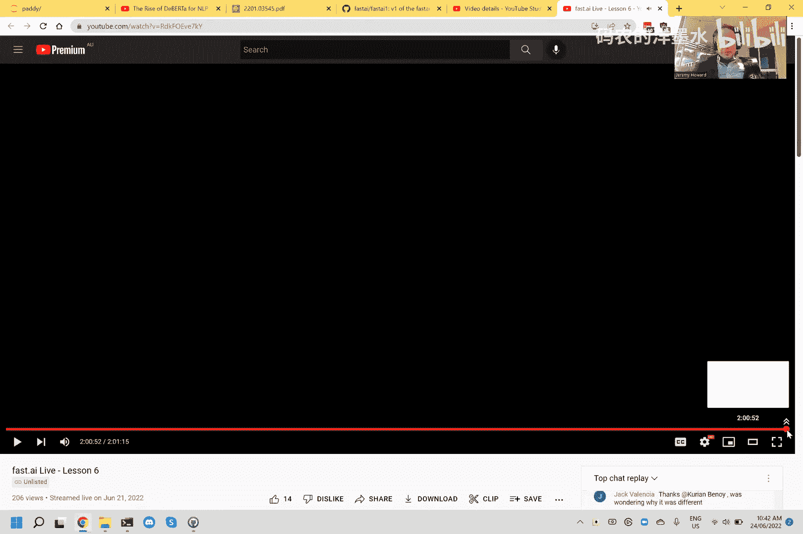
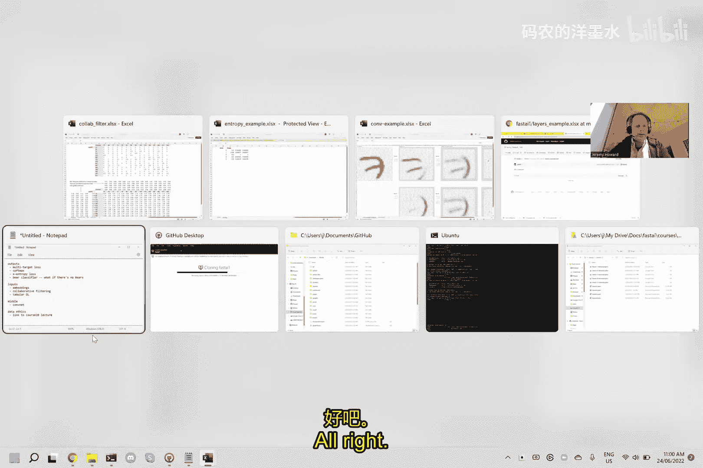
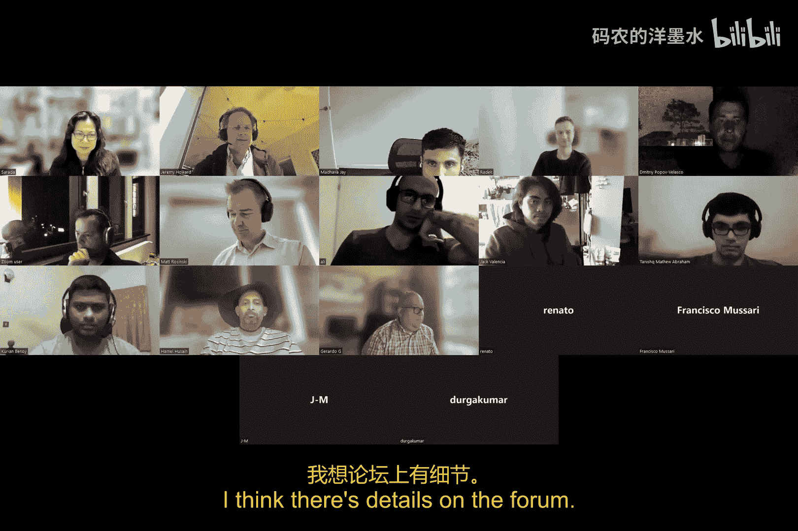

# 【全集】旧金山大学 实时编码 中英字幕 1080P p16 Lecture 16 - 高级训练技巧 -BV1KZiTBWEeH_p16-

It's really a。

I am recording now， so， but please keep talking and don't be shy， Zrada， it's okay。

Oh getting a bit noisy out here with。Streight sing something。

We don't hear it I think your headset is very good。Oh good， I didn't hear anything so。I mean。

 I say street cl， it's more like footpath cl， we have a walking path along the front of our house。😊。

Sure。I'll come on， I start pressing the recording， but not everybody stops talking， well， you know。

't want to just TMI voice all the time on these recordings guys。嗯。

There's things I wanted to cover in today's session。

 but then the responsible part of me says I probably ought to create a lesson before Tuesday's class。

 so maybe we'll do that。It's I've got a question Jeremy Phil I had to leave before you finished that code change yesterday。

 did you was that actually did do you want to recap on where we got to with waiting with probably not because you can just watch the video and so like other I guess we just do we get so is it working now that yeah yeah it's all good you know I mean。

It's。The concept is working correctly in terms of the code。嗯。We didn't like get a better score。

 but I didn't particularly expect to either。U。😊，You know。

 maybe after next Tuesday's lesson we will revisit it because I actually think the main thing it might be useful for is what's called curriculum learning。

 which is basically focusing on the hard bits。嗯。Looks like Nick's internet still isn't working。

 but Nick was saying the other day that yeah he。Look at which ones we're having the errors on。

 which is like what we look at in the book。Looking at the classification interpretation and looking at like plot。

 top losses and stuff and he said like。Yeah， all the ones that we're getting wrong are basically from the same one or two classes。

So。I haven't done much with curriculum wording in practice， like all it means in theory。

 is that we use our weighted data loader to weight the ones that were getting wrong higher。And。

Whether that will actually give us a better result or not， I'm not sure。

That I think that's more likely to be a。Useful path than simply reweighting things to be more balanced。

Because。We don't want things to be more balanced because the ones that we observe the most often in the test set are actually the ones we want to be the best at。

 you know。I will say I didn't check whether the distribution of the test set is the same as the training set。

If it's randomly selected then it will be and if it's not。

 then that would be a reason to use a weighted data loader as well。嗯。Yeah。U。Okay， so。

What's the difference between I guess like what's the。

Is the curriculum learning kind of related to boosting？And conceptually not really， I mean。

 maybe so boosting is where you calculate the difference between the actuals and your predictions to get residuals and then you create a model that tries to predict the residuals。

😊，And then you can add those two predictions together。😊，Which is。If not。

 done carefully as a recipe for overfitting。But if done carefully， can be very effective。Yeah。

 well we're talking about something which is conceptually very different， which is saying like oh。

 we're like really bad at recognizing this category so let's。

Show that category more often during training。That a question。

Of kind of focusing on examples you're getting wrong。

 like more kind of conceptually doing something similar。

I was just going to ask are the labels ever wrong like by accident or intentionally cangg of course absolutely so both intentionally as well no not intentionally I I mean not normally like sometimes there might be a competition where they say like oh。

 this is a synthetically generated data set and some of the data is wrong because we're trying to。😊。

Do something like what happens in practice but we can't share the real data so is there in trying something like some uncertainty values from something like MC dropout try to find like a threshold of things that are too difficult and then potentially they're wrongly labeled I'm not sure you would need that like the thing we use in the book and the course is simply to find the things that we are。

Confident of that we know we're wrong， but turned out to be wrong and then just。

Look at the pictures the values enough， you think to basically know whether or not I do。 Yeah。

 I mean， that seems to work pretty well。 I mean， the the the only thing is you would need to be able to recognize these things in photos。

 but I'm sure if you。Spent an hour reading on the internet about what these different diseases are and how they look。

 you would be able to pick it up fast soon enough and then， you know。

 just like we did in chapterpt2 if you're recognizingogni the things that aren't black and brown daddy bears Okay。

 but so plausibly even just knocking out some of the extremely difficult examples might get you higher on the leaderable purely by virtue of them misleading the not by knocking out the。

The hard ones， but by knocking out the wrong ones， yes。

 unless the tests unless the test set is mislabeled consistently with the training set in which case you would not want to knock them out because you would want to be able to correctly predict the things which people are incorrectly recognizingognis as the wrong disease something to try that。

Yeah， yeah， so。I would do exactly what we did in chapter two， you know。

 you can use exactly the same widget， but as I say you'd have to probably spend an hour learning about R's disease。

 which probably be a reasonably interesting thing to do anyway。

I just a link there's a discussion in the Patty some people identify there's some mislabelling at least over 20 already oh okay。

 yeah， so it definitely happened。It saysys we have manually annotated every image with the help of agricultural experts。

 but there could be errors。Wow， this person knows more about rice than I do。

 I think the images in the T grow have class of issues。

 these symptoms can easily be confused with potassium deficiency。Fair enough。😔。

Is that an example of what you're talking about where if a layman or sorry if a semi expert gets confused then the labeling in the test that's probably the same so yeah exactly so you' probably fixing these would probably screw up your model because assuming that the test set was。

Labeled used by the same people in the same way。I mean sometimes test sets the test set is more of a gold standard they'll make more effort to talk to like a larger number of high quality experts and have them vote for something honestly this competition seems like it doesn't even have any prize money attached so like I think it's really。

ow low investment， probably。And so I doubt they did that， but。But that can happen， yeah。

 that the test it。Could have， I mean， it makes sense to invest。

In getting really good labels for the test set。Actually。

Is looking at one of the other competitions on UniIE。

 the Xrays and I think there there was one somebody hadd identified that a wrist was wrongly labeled as a yeah it's not there's no money again but it's been running fine while what's it called？

A UniF UNIF ESP。诶。Oh right， it's another community competition I yeah gosh， it's not very popular。

 why is there only 7014s？😊，Yeah there I go no don't know I was just looking around and it looked interesting。

 so I'm number 15 at the moment。😊，Good on， but it is a slightly weird one because well。

 it's it's interesting because some of the xrays have multiple。Labels。

But the labels are just concatenated， so there's an interesting discussion on how you don analyze that would you treat？

A combination as a distinct classification， whether it was like a neck and a chest or something。

 or do you look at each of them individually and then try and label a multiple one from the different things so。

Okay， so I'm just having a look at this competition。 So when does it close， this is a month to go。

 but I don't know。Exactly。When that is。Normally there's like 31st， okay， where do you say that？

When you go like to the bottom of like on the overview and it says there's a whole timeline so then you just hover over the oh my God。

 I see it says close in a month， but you actually have to get a tool tip by hovering Okay。

 thanks Denish。That's strange， UX。Okay， so we've actually got more than a month。

 so maybe next week we could have a look at this one because it would be a good opportunity to play around with medical image stuff because they're using docom I think。

😊，Yeah somebody is also which I used supplied a library of PGs which made it easier to use。

 but I don't know what you lose in using that rather than the diCO images well it rather depends so Dacom is a very。

Generic file format that can contain lots of different things one of the things dicom contain is is higher bit depth images than a PG allows so if they've。

Yes， they may， they might have gotten rid of that。 Fast A I has a nice medical imaging。

It's prettyty small， but like has some useful stuff， medical imaging library。😊。

Which I think is fastai。vision。medical。Which can handle Dcom directly。嗯。😊。

And I say there's a fast AI entry。As well。Oh that'd be fun， we should try this next week。

I seen there's the PNGs。I think the dicoms come to about 27 gigabytes Oh oh my god Okay so the the PG was quite attractive from that point yeah so one thing that you can do with DCO is to compress them particularly using JPG 2000 which is a really good compression but yeah people often don for some reason so probably the first thing I'd look at and that' competition is to see。

😊，Look at a docom and see， is it stors。16 bit data or not and if it is I would try to find a way to。

Resa that without losing。The extra information。Which I think we've got examples of in our medical imaging tutorial。

Why don't take a look at that。All right， I'm going to share my screen。

Even though I don't know what I'm doing。I'm going to have to drop in a few minutes。

 but I'll catch the rest on the recording thanks for this Nice to see you。Thank you。对。By the way。

 I was looking at this。C next paper。And gosh， everybody。Congratulates， transformers on everything。

Vission transformers bring new ideas like the Adamom W Opizer。

I guess who actually wrote the first thing saying we should always use the as& W optimizeizer。

That would be so。In fast AI， I think that was years before vision transformers。😊，Aam W。There we go。

Mid 2018。I read that paper last night and I was just thinking like they kind of talk about how all of these things were already there。

 right， but they just rediscovered them like slightly larger。Conal size and things like that。

 which like begs the question why isn't no one just done like experiments to you know to just tweak these things together。

 I mean it's I mean we do but。Nobody takes any notice because they're not written in Pdfs， you know。

就是。I mean， these benchmarks， though like the thing is that like a lot of researchers aren't good practitioners。

So they just they're not very good at training accurate neural networks and they don't know these tricks。

 you know， and they don't hang out on kle and learn about what actually works so。😊。

But then the thing is like。It's not always easy to publish like even if you did stick it into a PDF and submit it to Europe。

 there's no particular high likelihood that they're going to accept it because。

The field research wise its very focused on theory results and you know things with lots of Greek letters in them does that mean that the part of the problem is that the data sets the benchmarks are just too inaccessible to the average person so no I cant say that for imagenet 1K No I wouldn't say that the issue is I think the culture of。

Research is not particularly interested in experimental results。You know。With my limited experience。

 I will say。It's very hard to find reviewer as well， especially you have a very strong domain。

 not just running all the sample data set you can find in open source when you call domain and then a lot of peer reviewer that they're just not taking up to review it even we。

Pay for the reviewer we use and so people can get it for free and we take a few months just to find theer。

嗯哼。😊，Jeremy is so enough。Topic of papers， one do you know when the papers were reading？

Given the situation。U。阿美你。It don't like until， I mean。

I'm very fond of like papers that describe things which。Did very well in an actual competition。

 you know， that then we know this is something that actually predicts things accurately。Um。You know。

 you can get similar results if they've got a good。

You know just table of results so generally speaking I like things that actually have good results。

 particularly if they show like how long it took to train and how much data they trained on。😊。

And yeah， so are they getting good results using less data and less time than？

You might expect from the same thing。And yeah， I certainly wouldn't focus only on those that get good results on really big data sets。

 that's not。Necessarily more interesting， I'm very interested in things that show good results using transfer learning。

 so look for things that are like。😊，Practically useful， I don't train that much from random。

 so I'm very interested in things that do well on transfer learning。Also like。😊，Look for people who。

You've liked their work before， you know， and， and in particular。

 that doesn't mean like always reading the latest papers。You know。

 if you come across a paper from somebody that you find useful for。

Go back and look at their Google Scholar and look read their older papers。

Let see who they collaborate with and read their papers so for example。

I really like Quack Lee and Google G him and his team do a lot of good work it tends to be。

you know very practical and high quality results and so widow when his team releases a paper and I also know like he seems to have similar interests in mine like he tends to do stuff involving transfer learning and getting good results in lesss Epos and stuff like that so if I say he's got a new paper out i'm pretty likely to read it。

I have a question in I mean for the casual competitions and like like in a lab type of environment is I mean when to the question that I have is when to stop iterating on a model on a model that you have is I have the。

Someone asked me when is enough enough to do all the training on the data that you have。

 when is enough？So that question。I mean。Yeah。U。There's some reason you're doing this work， right。

 So like you hopefully know。When it does what you want it to do。

I mean the thing that happens all the that happens especially to me all the time is that it train the model and it works perfectly fine on the lab when we're doing it and then as soon as we throw a couple of images that they are not part of the set I mean that thing goes nuts and okay because so that's like light or more light or the temperature different or stuff like that so that's a different problem right so that means your problem is that you're。

You're not using。Um。The you know， the right data to train on so like you you need you。

You need to be thinking about how you're going to deploy this thing。When you train it。

And if you train it with data， that's different to it all。How you're going to deploy it。

 it's not going to work。Um。Yeah， so that's what that means and。嗯。

It might be difficult to get data enough data of the kinds you're going to deploy it on。

 but like at some point you're going to be deploying this thing。

 which means by definition you've got some way of getting that data you're going to deploy it with so like do the exact thing you're going to use to deploy it but don't deploy it just capture that data。

 until you've got some actual data from the actual environment you want to deploy the model in。

You can also take advantage of semi supervised learning techniques to then， you know。

 and transfer learning。To maximize the amount of juice you get from that data that you've collected。

嗯。And finally I'd say like that's say for medical imaging like okay。

 you want to deploy a model to like a new hospital they've got a different brand of。

MRri machine you haven't seen before， I would take advantage of fine tuning， you know。

 each time I deployed it to some different environment where things a bit different。

 I would expect to have to go through a fine tuning process。

To train it to recognize that particular MRIri machines images， but you know。

 each time you do that fine tuning it。It shouldn't take very much data or very much time because it's your model's already learn。

The key features， and you're just asking it to learn to recognize slightly different ways of seeing those features。

All right。Yeah， I don't think yourself solve this by trading for longer。You know， you'll solve it by。

Figuring out your。Your data pipeline， your data labeling， and your Roout strategy。

Usually the issues that we're having is that we don't have enough data of certain category。

 but I mean the thing that you did yesterday。ItRe a little bit of that problem I think we're going to start using yeah well also like if you don't have enough data of some category don't use the model for that category。

 you know， so like。You know， rather than using soft Macs use binary syigmoid。

 you know it your last layer and so then you've kind of got like a。

Probability that X appears in this image and so then you can you can recognize when none of the things that you can predict well appear in the image and so。

Um， then have a，um you know， you always want a human in the loop anyway。

So when you didn't find any of the categories of things you've got enough data to be able to find。

 then。嗯。Triage those two。To human review。嗯哼。😊，One thing that we did is I mean。

 we have like 50 something categories oh just one moment， hang on。Yes。Sorry about that。

We had like 50 categories and some of them are like they have a lot like 10 of them have a lot of items so we end up doing like in a three step kind of process like the ones with a lot。

 the ones with medium number and with a smaller number and it looks like it resolved the problem a little bit but。

But this was to classify metadata coming from other systems。Classify for legal purposes。

For legal retention， I see。Got it。嗯。Jimmy I had a question actually yesterday you tried the weighted data lot right。

 so I think you haven't submitted that to Kaan notebook so did you do any validation doally first before submitting to Kaan something like that。

 Do you have a setup。No， I mean， you saw what I did right and when I did it， so I just。Yeah。

 I just like I was intentionally using a very mechanistic。Approach。Because it was part of like just。

 yeah， showing like his。The basic steps of pretty much any E computer vision model， which is。

Entirely mechanical and doesn't require any domain expertise。So yeah。

 my question more was about like， shouldn't we always treat the public leader board like I say good or like should we take a hold out local data sets first to validate？

Yeah， so I mean， I always have a validation set， yeah。Which we saw in this。In this。

 I just used a random splitter because as far as I know。

Test set in the kgo competition is a random re split validation set。 Yeah。

 so like whether it be for kgo or anything， Id think a。

Creating a validation set that as closely as possible represents the data you expect to get in deployment or in your test set is really important。

And yeah， I actually didn't spend the time doing that on this padty competition。Normally uncaggle。

 if somebody does and notices there's a difference between the private leader board and the public leader board like the test set and the training set。

 normally it'll appear， you know。In discussions or on a Ke kernel or something which is。

Hardly only I didn't look into it， but yeah， mean you should probably check。

Doesn't have the same distribution of disease types， you know from the predictions that you create。

Do the images look similar， do they have the same sizes？And for me， if I said。

 as I see any difference between the test set and the trading set。

 that puts my alarm bells on right because now I know that's not randomly。

Selected and if you know it's not randomly selected， then you immediately have to think。

 okay they're trying to trick us so I would then look everything I could for differences。😊。

Because it takes effort to not randomly select a trade a test set。

 so they must be doing it very intentionally for some reason。嗯。Quite often for wrong reasons。

 it turns out in practice。 I think so。 Like， I don't think a ca competition should ever silently give you。

A systematically different test set I think there's great reasons to create a systematically different test set。

 but there's never a reason not to tell people so if it's like medical imaging it a different hospital you should say this is a different hospital or if it's fishing you should say these are different boats or you know because like you want people to do well。

😊，On your data， so if you tell them。Then they can use that information to。Give you better models。

And so Korean， like going back to what you asked about， there's this validation in training。

 then there's this。Whether your local validation maps to what's happening on the leaderboard。

 the score on the hidden test set， but there's one address scenario that I encountered recently and maybe it will be interesting for someone when you're working on a competition sometimes you might miss something in your code or the prediction。

You know your model is still doing something useful but you're failing to output a correctly formatted subm file and not in a sense that the submission phase on Kagle。

 but some predictions are not aligned where there should be or you know therefore' for a different customer ID or stuff like that so once you have one good submission file relatively good you can just store locally and then see you know run a。

Check the correlation between your new submission and the one that you know that this is okay and you know the correlation should be upwards of 。

9 and then you know yeah okay so I didn't mess up anything with the technical aspect outputting the prediction I mean it's not a great trick but you know I was like putting my hair out why is this not working is a better model so this was like a sanity checks that maybe at some point useful。

Thanks， cool。Thanks， for that。All right。Let me share my screen。😔，嗯。诶。That's fine， Zoom， Zoom。

Share screen。嗯。Oh， that's not the right button。Control up shift H， okay。Um。Where did we get to。Okay。

In the last lesson。嗯。So。We。Finished random forests， right？And。Yeah。Oh， that's right。

 and I haven't posted that video yet。Um。That's okay。 We can check the live。Pasity life。嗯。Yeah。Okay。

 so we could get small models。

And do we get to the end of this。

Okay， so that basically。So we basically finished。The second one of。OfAbout。Kckle things。So next week。

嗯。See what's in part three。Right。Cadient accumulation I think that's worth covering so one thing that somebody pointed out on kggle is I've actually I'm using gradient accumulation wrong。

😊，U。I was passing in two here to me。To make create two batch。

 like do two batches before you accumulate。But actually what I' meant to be putting in here is the kind of target batch size I want。

 so that would be actually I should be putting 64。Here。Um。So I feel a bit stupid。

 So what I've been doing is I've been。😊，Actually not using gra accumulation at all。

 I guess it's been doing a batch and saying that's over saying my maximum batch size should be two。😊。

Okay， so this has actually been not working at all， that's interesting。hoops。

So it's been using the batch size of 32。And not accumulating。Ha。Okay。

So that's one thing to note so when I get CAg or GPU time again we'll need to rerun this。Actually。

 it only took 4000 seconds。U。So， I guess we should。We could just get it running right now。

 couldn't we？嗯。So。嗯。Oh。That should be 64。嗯。Gably a path defines how。Large the effective。

Thatch size you want。Is。Over batches。Oh， we can just remove this sentence entirely。Oh no。

 that's right。We divide。The batch size by。Some。Number based on how。Sll。

 we need it to be for our GPUus around。不。Okay。So。So。Yeah。And on Caggle， I think。

These were all smaller。 I don't know why， but the kgel GPUus use less memory。

Then my GPU for some reason。😔，Okay。So， we're now。Let's try running it。Yeah。对。So Jeremyeremy。

 you would increase that acu number until no longer get good out of memory。 Yeah。

 and you could be able a pretty much guess it's by looking at like， I mean， you can just。

Once you've found a batch size that fits， you know， so the default batch size， I believe is。

32 so once you find a batch size that fits sorry 64 is a default。

 a batch size that fits you're just like it's like， okay， what if it fits in 32。

 then I just need to set it to2 because 64 divided about about two is。Is enough and。

The key thing I do here is you know， so I've got this report GPU function。

 so what I did at home was I just you know changed this until。It got less than 16 gig。

And as you can see， I'm just doing like a single epoC on small images so this ran in。I don't know。

 15 seconds or something。嗯。Thank you。Yeah， batch size 64 by default。嗯。Yeah。

 so then I just went through。Check in the memory use of。Conth next large are different image sizes。

 again， just keeping on using just one apoC。And that's how I figured out what I could did to set a k to。

Getri to work。All right， so。should be right to save and run。嗯。And then。Turn off this one。

So when you're running something like you click save version and you click run。

 you'll then see it down here。嗯。And that runs in the background， you don't have to leave this open。

And so you can go back to it later， so if I could copy that can close it。And if I go to my。

Backbook in kgel。This shows be version three or four because version 4 hasn't finished running yet。

 so if I click here。😊，I can go to version 4。 and it says， oh， it's。Still running。Um。

And I can see here we go， it's been running for about a minute。

And it shows me anything that you print out will appear。Including warnings。So that's， yeah。

 that's what happens in Kale。嗯。So， if we also do the。Multi objective loss function thing。

That would be cool。😔，Um。So I thought like next time in our next lesson， broadly speaking。嗯。Gosh。

 this is taking a long time。U。I kind of what I cover， like。

What the inputs to a model look like and what the outputs to a model look like。

So like in terms of inputs。Really， the key thing is embeddings。嗯。

That's the key thing we haven't seen yet in terms of what model inputs look like。嗯。For model outputs。

 I think we need to look at softmax。U。Outputs。Softm。😔，Ccroross entropy loss。Entropy loss。诶。

And then you know， our'll multiy target。Loss。Which we could do first kind of a segue。

So maybe in terms of the ordering。😊，The segue would be like。Doing multi target loss first。Okay。

And we could talk about softms。And cross entropy， which would then lead us potentially to like。

Looking at the。Bear classifier。What if there's no bears？😔，So we can just use the binary sigoid。Um。

So then for embeddings， I guess that's where we cover then collaborative filtering。

 collaborative filtering because that's like a really。Nice version of embeddings。诶。

So I guess the question is for those who have done the course before。Are there any other？Propics。

 I guess like time permitting， it would be nice to look at， like。The confnet， what a cofnet is。

Just kind of so that' all that then we've got like the outputs， the inputs and then the middle。😊，嗯。

What about more NLP stuff I know people interested like what？Well， I've heard that。

How face is getting integrated with plus day I may be looking at that how it works。Well。

 it's not done yet， so we can't do that yet， but definitely in part two。😊。

I've got a question I don't know if it's helpful but there's a lot of emphasis on outputs and inputs。

 but like in the middle just understanding like the outputs of a hidden layer。

 whether they're going awry or not， how do you kind of debug that。

 how do you understand you know when to kind of look at those Yeah very helpful。

Last time we did a part two， we did a very deep dive into that and I think we should do that again in a part two because like。

😊，Most people won't have to debug that because if you're using an off the shelf。Model。You know。

 like it's， you know， with off the shelf initializations， that shouldn't happen。U。

So it's probably more of an advanced deepbuging technique， I would say， but yeah。

 if you're interested in looking at it now， definitely check out our previous part too because we did a very deep dive into that and developed the so forth colourful dimension plot。

Which is。Absolutely great for that。Jeremy yeah so that would exactly so collaborative filtering would lead us exactly into that Thank you yeah sorry Serrata。

Do you mind to spend finally talking about the importance of the ethical side。

 at least you to the resources ritual prepare before。

 so I't many people because so easy to build a model but how to apply is getting more scary now。Yes。

Yes， I mentioned in lesson one。The data ethics course， but you're right。

 it would be nice to kind of like。Patch on something there， wouldn't it。

Mture by Rachel from part one before that was that was a great lecture yeah I mean that I mean okay。

 I mean that actually would be a great thing just to。Talk about， you know。

 that that lecture is not at all out of date so。Yes。

So maybe touch on it in this one and also talk link to， you know， for varying levels of interest。

The two hour version would be。Rachel's talk in the 2020 lecture and then deeper interest J would be the yes。

 the full ethics course， that's a great point， thank you。So then for。For actually。

 pretty much all of these things。嗯。We have Excel。Spreadsheets。嗯。Which is garden。So there's。

 let's have a look， collaborative filtering。Oh， looks like I've already downloaded that。J。

 I will encourage you to continue teaching in Excel yesterday I on the panel in a data science conference and when I mentioned I start with Excel actually inspire a lot of people they want to have a go with data science and learning it so please please back。

Yeah， because there' are certainly some people who don't find it useful at all and they tend to be quite loud about it。

itSo it's certainly nice to hear that feedback。😊，What bother you， Jeremy， sorry。

So I thought you didn't let those people get to you。I only pretend that anybody doesn't get to me。

I was going back of so I don't necessarily to say that' that was really great to see learning this in it done once before and that was in。

😊，A physicist Belgium who explained radioative transfer modeling using Excel。

 and it was just so nice to see the clarity。ねした。Great， okay， thank you， I will。😊，嗯。Let's see。

 So we've got。So I think these are actually from the 2019 course， fast AI1 courses DO01。

So I'm just going to grab them all。So thing I don't think we're got to cover this year。😊，This part1。

we walk over in part two is like different optimizers。Like momentum and atom and stuff。

 But I think that's okay because I feel like nowadays。😊，Just use the default Adam W and it works。

So I think it's fine。Not to know too much more than that。对。It's it's a little bit of a nowadays yeah。

 that's like Jeremy it used to be something we did in one of the first lessons， you know。

 but that was when。You kind of had to know it right because you always fiddled around with meum and blah。

 blah， blah。To me， always like the biggest thing when starting on something is to have to。You know。

 once I figure out how to read in the data， then things。

So I'm really grateful that there's such an emphasis in this。

Additionalition of the course on the reading of data and you know。With cellular data。

 that is something that I will also stay on the lookout for just understanding better about reading the data。

Great， I don't think we did this one anymore because we kind of have better versions in。😊。

In Jupiter with IP widgets。 so we've got。Thiss fun。Convols example。Which I think is still valuable。

Um。Okay， we've got soft Max。And cross entropy examples。And we've got collaborative filtering。

It sounds interesting， wonder what that is。And then。Also， we've got word embeddings。All right。

 embes are such a cool and important subject and it's something that we haven't discussed that much in this course no。

 I mean we haven't touched them at all。Great。All right。

U。It feels like a lot to cover。嗯。That we will。We will do our best。Okay。I think we're up to our hours。

 So thanks， everybody。 Nice chat today， and I will。Get to work on。Putting this together。

Have a nice weekend。Thank just remind everyone that's a ways and bias video today。😊。

I think six o call basementman time so with anyone interest the guy mentioned here Thomas mentioned he're going to have another US session as well we can join yes。

 I think there's details on the forum。

Thanks。只啊。😊。