# 【全集】旧金山大学 实时编码 中英字幕 1080P p17 Lecture 17 - TIMM模型整合 -BV1KZiTBWEeH_p17-

Okay。All right， so this is the repo FastI paperspace setup， I've started a machine。

I'll send you to my home directory， I'll get clone in the repo。I'll Cd into the thing I get cloned。

 I'll run do/ setupup。sh。Okay， and it says install complete， please start a new instance。

 so then I'll stop the machine。And then I'll start a machine。And。That's going to install a pre run。

tsh script， which is going to set up。All these things and all these things。And it's going install a。

Dotbashed up local script。Which will set up our path and it's going to also install set up things for installing software。

 Pip I for Pip install and Mamba eye for Mamba install。So we now have a machine running。Yeah。

And so we should able to create a terminal。Did I just press press terminal。嗯。嗯。Yeah。No。

 something's happening great， okay。Check creating a terminal here then。Okay， much better。All right。

 so in theory， if we look at our home directory， look at that， well this stuff is now slink。

To slash storage。So I should be able to Pippye fast AI and get the latest version。

I wonder if I can add a。Minus u to say。😔，Upgrade。Yes， I can。 So that's how I get the latest version。

 and so that should have installed it locally。There it is。And。Okay， so now if I。Create a notebook。

Import fast AI。Fast AI dot version。Oh look， that's a good start， Okay， next question。Can we install？

Bininearies。For example， universal seat tax， mamba。I remember install Univeral CTtX。😔，There we go。

 so you see， the nice thing about this is even all this persistent。Staff we're installing into a。

 you know， all works on the free paper space as well。嗯。So we should now be able to check see tags。

That it works and which one is it？And that is。Actually， our storage oh， so I think we've done it。😊。

What do you guys think？Simple enough。跟。All right。It's good。😊，Okay， so。Next step is。

I thought we might try to fix a。I don't know if you call it fixing a bug or maybe it's probably we could generously call it adding an enhancement to fast AI。

Which is。To add normalization to 10 models。So。Yeah。All right， so。It's Gr fast AI。Now this is where。😔。

So when I get clone this？😔，So let's get into notebook books。

So slash notebook is persistent on this particular machine。

And I think this will not work because I'm using SSH， oh， it's already there。That's interesting。嗯。Oh。

 you know， So there's a bug in。Our script。Which is I didn't p tea。是。So， let's fix that。P run at S H。

 they did a push to at the start。But no pub tea at the end。😔，Okay， fixed。Allright， no worries。Um。

That means， okay， yes， we're actually in here， no worries。All right， so let's restart this。嗯。

And then I'll tell you about the bug we're fixing while we wait for it。

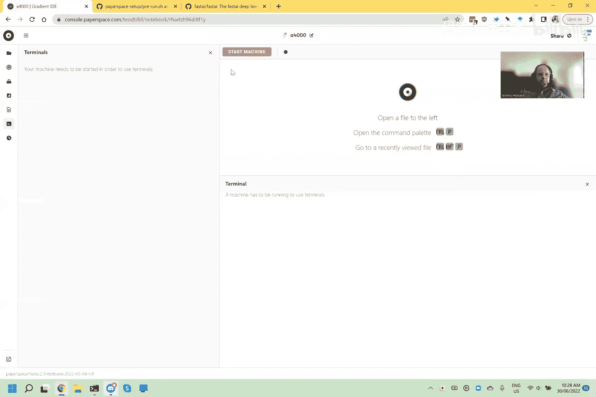

Okay。So。So normalization is where we。Subtract the。Means and divide by the standard deviation of each channel for vision。

And goes that's a transform called normalize。And。We need to use the same standard deviation and mean that was used when the model was pre trained。

嗯。Because you know there is you so some people you know will normalize so it's everything's between zero and1。

 some will normalize so it's got a mean of zero and a standard deviation of one so we need to make sure we use the same。

You know， divideivide by the same thing to track the same thing。If you look at vision learner。

Vision learner has a normalized parameter。And if it's true。

Then it will attempt to add the correct normalization。嗯。Yeah。😊，So if it's not a pre trained model。

 it doesn't do anything because it doesn't know what to normalize by。

 otherwise it's going to try and get the correct statistics。From the model's metadata。

 So the model's metadata is here， model underscore met。嗯。And it's just a list of。Butttles with。嗯。

With metadata and the metadata。Yeah， stats。Imagenet stats。

 so the image net stats is the mean and standard deviation of imagenet。

Which I can't quite remember where that comes from， but that's。Something we import from somewhere。Um。

So none of these are 10 models， and so that means currently。T0 models aren't normalized。嗯。Now。

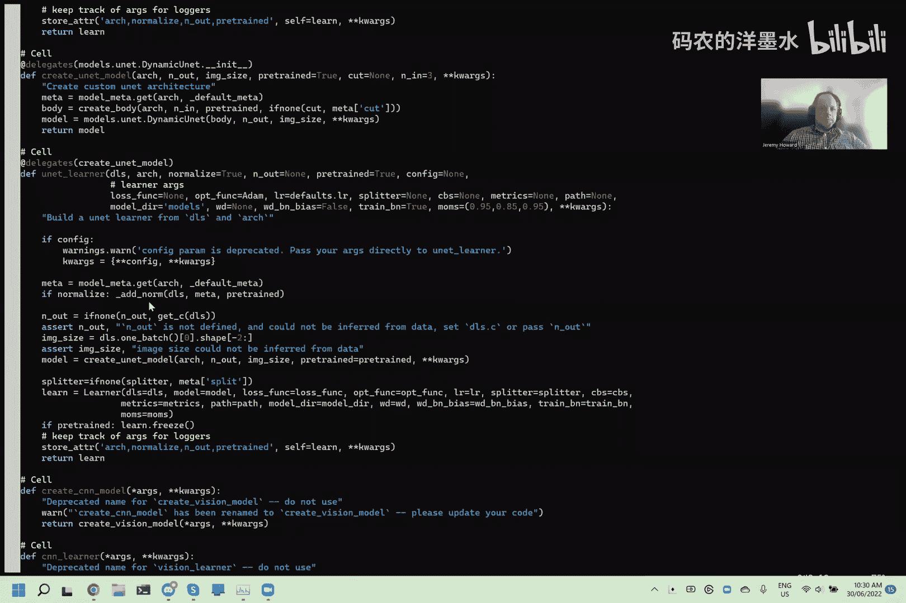

。听五。Has its own stats。😔，Not this。 Not this。呃。As long as stuff in TM I still haven't looked into。

 I actually haven't used this transforms factory。Maybe in Fast A I3。

 which should consider using more of this functionality from Tim。嗯。There's like a。Configuration。

For them， at oh， I guess we can just try and find it。Oh， actually， we forgot to edit this。hos。My bad。

Not letting me start machine， here we go。Okay。So we can just do this locally now。All right。

 so this happens in Vis learner。And Tim is optional。You don't have to use it。嗯。But if you do， then。

We have a createate T model which you don't normally call yourself。

 normally you just call Viion learner and youre pass in an architecture as a string and if it's a string it will create a T model for you。

嗯。So， there's a。Pist models， for example。Let's say conv next or something like that。

 I don't know what con it is， never try that one。😔，Let's do a tiny。诶。

So we can create a model using like create model， we pass in a string。Okay。And。

I have a feeling that's， yeah， that's got a config。Here we are。Yeah， see。

 and it's got a mean and a standard deviation。So models equals ch do list models。😔。

Maybe just do pre traineded ones。😔，嗯。So I wonder if they all have this for M in。What else。

So let's create a model。嗯。And have a look at。M dot default config。诶。没。And a deviation。😔，嗯。Yeah。

 so you can see。A lot of them is 0。5。Um。And then。Some of them use imagenet stats。

And I'm guessing they are the only two options。Yeah。So okay， so hopefully you get the idea。Um。

Germ adjusted out， usually putting the image in the means should be zero and standard deviation should be one right。

嗯。I mean， not necessarily， sometimes people make the minimum zero in the maximum one。Um。诶。

But what we need to do is use the same stats that it was pre traineded with。

Because we want our range to。To be the same as the range is pre traineded with otherwise our。

You know， data has a different meaning。perfectfect。So。So let's go to add norm。Okay。

 so here's Aden norm。And it's being passed a meta。Stats。嗯。So。哎。This only works for non1。

 so how about we put。This here， and we'll curtain else。Or I guess really an earlier。And。Then， here。

We'll have for Tim， if normalized。😔，We could have a Tim。😔，Normalize。嗯。Yeah。Which， you know。

 we can refactor out since duplicate look at code。Later。But basically for Tim。

We're gonna be passing in。The architecture。嗯。嗯。Oh， we don't need to pass in the architecture。

 we can just pass it in the model。Clss in the model。And。

To protect against future like ability to pass in other types that are strings that aren't Tim。

 do you think there's any benefit having like a default normalization function that if you pass through。

 you can actually do your own normalization？嗯。No。Because my answer to all of those questions is always you a't going to need it。

 so I yeah very intentionally。Don't do like。😔，You know。

Dealing with things that may or may not happen in the future。

It'd be simpler just to create your own vision learner because that looks like there's not much going on there that you could duplicate if you wanted to have support for a different model。

U。Yeah， yeah， exactly， I mean it's you know， this is just a small little raper really you can call create Tim model or create vision model you can call loader you can call create head yep。

To。Okay， so we'll call that M。So the normalize。😔，Ts。A main and standard deviation。So， it should be。

Just those two things， I guess。Yeah。Next so。All right。嗯。Okay。Kim normalize。

Using the model and pre tradede。O。I see I already had an else there。So do that。There we go。And。Okay。

 so let's test this out。嗯。Des， so what happens when you add a transform？😔，快。嗯。

It adds a transform to each data loader in it。Okay。So。And what does that to？没有。What did I do of。Oh。

 it's part of， I see。 It's part of。Okay， that's a bit confusing。Right。嗯。

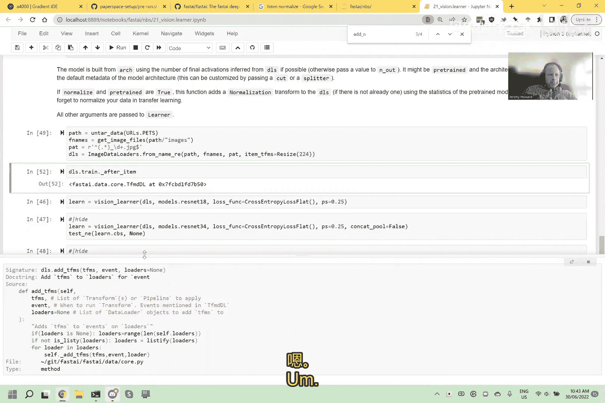

Okay， so let's find sometimes it's just easiest to look at the code。😔，At Tra。I see。

Such as calling add。😔，I see， for this particular event， and。

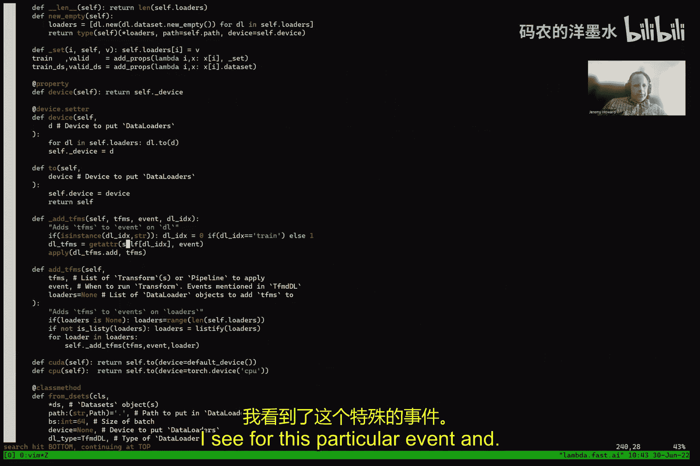

嗯。We're adding it I see， we're adding it to the afterbech event。So， we should find there's a。😔。

After batch event， here we are， I see。 And there our transforms。 So if we。Cll visionlanna。

That should change our depth data load， yep， and it's now got normalized。Using the image net steps。

And。If we now try it for a string version。No， that's interesting。Okay。嗯。What happened differently。

 Oh， I see。We need to recreate the data loaders。😔，For this test。

So that that doesn't have normalized anymore。And that gives us， okay。

 that gives us an error and that's because it says we're passing a sequential object。Okay。

That makes sense。Because。Create ti model。Actually。Yeah， butteries things。That's why。

And it creates a sequential model because it's got the head and the body in it。

So we need to change how we do this。😔，All right， this is。Timbody here is the model。😔，And oh。

 look here we use default config to get stuff here。Interesting。So Timbody。😔，It's called from here。😔。

嗯。I guess like it would be nice to know how Tim does this exactly。😔，Where is that。

Deult country come from。So when we call ti doc create model。U。Set layer config。嗯。

I wonder if we should。

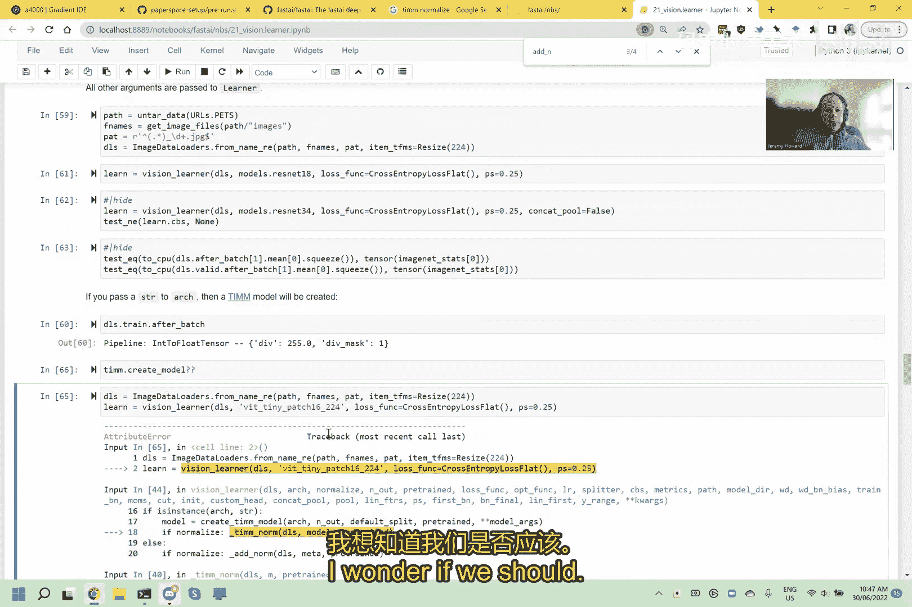

Take a look。Defat conflictfi are going to be a lot。😔，Is data conflict up high。😔。

So where does it get set？😔，Maybe bottles help us。😔，The old modelt with config。嗯嗯。Well。

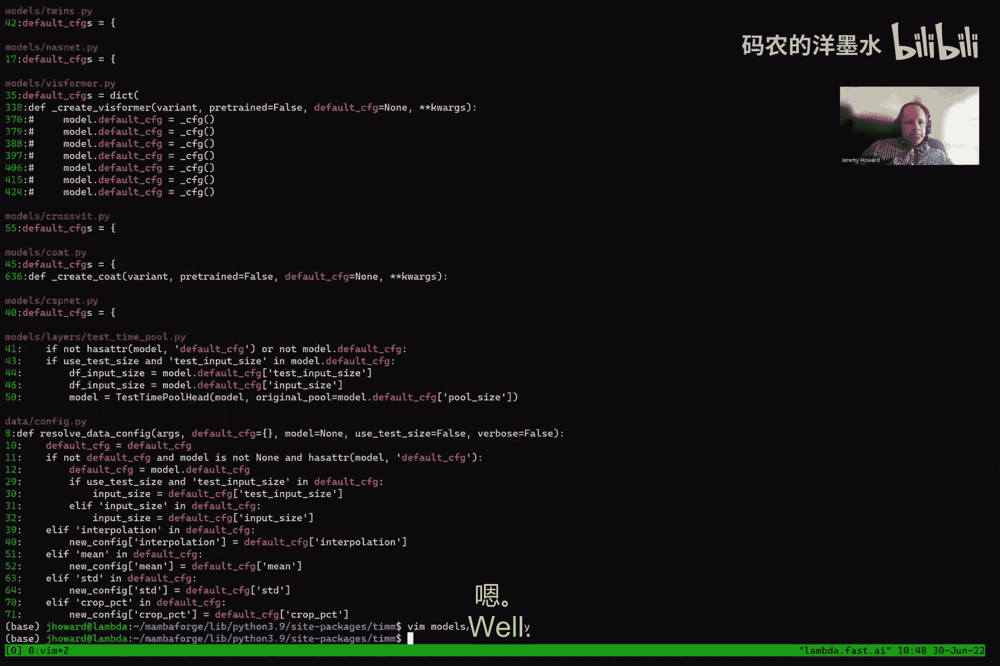

Seems like this， but needs some restructuring。 It's not surprising。

 it was originally built not to expect between stuff with Tim。Create vision model。Calls create body。

😔，And create body。Here， this is where it creates the model。😔，嗯。

So maybe we should change how these work。Yeah。嗯。So let's do so much。

 we think about doing some redesign maybe。And so the idea of the redesign， I guess， would be that。

This。Doesn't。Instiate the model。Yeah。嗯。But it assumes it's already instantiated。

So we would remove that。Okay， so that's now not gonna work， of course。 So then we're creating body。

Its model。Okay。嗯。And so then。😔，We have to instantiate that。😔，So we may well just。Do that directly。

 right？Yeah。嗯。If you make this a function。😔，So， it's new on each time。Okay。So in this refactoring。嗯。

We now are passing around models。Not。Architectures。C head won't change。😔。

Or the model meta stuff doesn't change。😔，Okay， so this changes。So now we say model equals arch。😔。

Pre trained。Pass in muddle。对。Okay， and looks hopeful。So we're going to do the same thing for Tim。😊。

You're going to pass the inner model。😔，Okay。诶。So it's going to be the same here。😔，马咯。

Let's see a visionssion learner your works。😔，Okay， it does。嗯。嗯。嗯。嗯。So maybe we should move。

 keep moving this back further and further。😔，诶。So to make Tim work。不。We do that。

And this is kind of like the body。😔，maybe we'll just call that the T model。千马路。嗯。Yeah。嗯。

A problem with that is the keyword arguments。So there's a lot of， this is this gets a bit crazy。

 there's a lot of keyword arguments's going to create a model and。The ones we don't know about。

 we pass on to。Tim。So I think actually what we'll do。Is we'll do it up here。Okay。And so Tim body。😔。

Doesn't need quags anymore。嗯。And what we might do。Let well say this is the result。And we'll return。

The things。Or even return。Those two things。So now we've got the config。

And so we can pass the cotton fig。ち thisす。Next so。Let's see how much we breast broke。😔，是。Yes。Okay。

 so create10 model。是。Yes， we do pass it in architecture after all。Because we just change that back。😔。

Oh， that looks helpful。So we should find that if we create a。VIT。Yeah。And check hits。Dealult config。

Yep， that looks good。Yeah。啊。Now Comfn tiny， on the other hand， uses image net stats。Next Hu。是。

That looks very hopeful。哦。So if somebody feels like an interesting and。Valuable problem to solve。

Making createre unit model work with Tim would be super helpful。All right， now create unit model。

Yeah。好了。Needs to do the same thing。Has create vision model。

 which is to actually instantiate the model。Okay。Is anybody potentially interested in having a go at doing unit models with Tim。

 if so， did you want to talk about it， I've interested okay？So。嗯。All right。

 let's just get this working first。😔，All right。Are you somewhat familiar with using units？

In general and in frontIs dynamic unit。A little bit i'm training one at the moment that's my maximum experience and then I've been through some notebooks to walk through last AI one and everything great so okay so。

The interesting， Okay， so you know， the basic idea of your is。嗯。That it has。

Not just the usual kind of。Downward sampling path where the image is getting kind of effectively smaller and smaller。

 as it goes through convolutions with strides。And we end up with。

 you know a kind of a very small set of patches and then rather than averaging those to get a vector and using those as our features through our head。

 instead we go through reverse convolutions， which are things which make it bigger and bigger。

And as we do that， we also don't just take the input from the previous layer of the up sampling。

 but also the input from the equivalently sized downsling layer。Before FA A I， all units。

Had to be only handled a fixed size。What Karen did was he created this thing called the dynamicy unit。

 which would look to see how big。Each size was on the downward path and automatically create an appropriate size thing。

On the upward path。And that's what the dynamic unit does。嗯。Fasty eye is been。A very。

Aggressive in like using pre train models everywhere。

 so something we added to this idea is this idea that the downward sampling path。

Can can have a pre trained model。Which is。Not rocket science。Obviously。

 it's like this one line of code。Um。嗯。

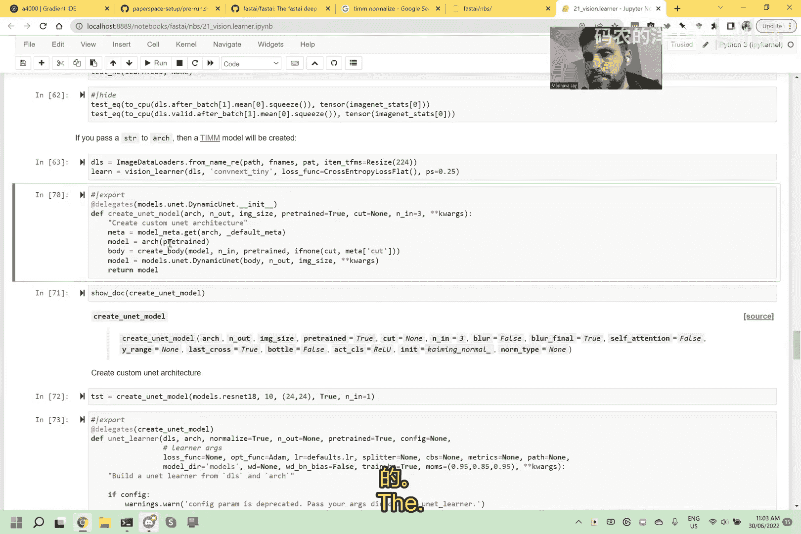

嗯。

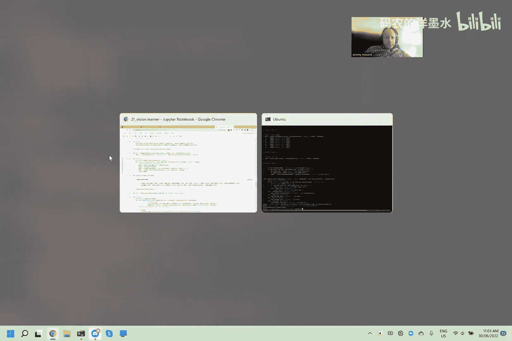

So to understand like at the moment I'm using say like a resonnet 34。

 does that mean the down path is a resonant 34 backbone and then there's a reverse ressonant 34 being automatically generated not a reverse it's not a reverse resnet 34。

ItIt is a resonant 34 backbone， so here's our dynamic unit， upward the up sampling path。

I has a fixed architecture。嗯。Which is。嗯。诶。They are indeed rebx。

but they're not like if you use as a downward sampling part you know downward sampling of VIT the upward sampling is not going to be a reverse VIT you know's not a mirror no exactly it's just would there be an advantage in doing that or is it just not really helpful I don't see why there would be I'd also don't see why there wouldn't be nobody's traded as far as I know I don't even know if there's such a thing as an up sampling transformer block。

There may well be digress but yeah there's need to do there's no need to worry about that。

 the key thing is that in the downward sampling path，What we do is we。

We have the downward sampling bit we call the encoder。Okay。

 and what we do is we do a dummy avval now a dummy aval is basically to take I can't remember like either a zero length batch or a one length batch like a very small batch and pass it through at some image size。

And。诶。We use， I believe we use hooks if I remember correctly。嗯。嗯。What's happened to my screen。

 My screen's gone crazy。Okay。Yeah， so we've got these hooks。That are pie torch trucks。嗯。Yes， okay。

 so we use fast AI hook outputs function， which says I want to use Pytorrch hooks to grab the outputs of these layers。

UAnd so。😔，What is SC CH G indexes like is that So this is， yeah， Okay， so that's a great question。

 So this is the。Indices of this is the key thing， this is the indices of the layers。

Where the size changes。And so that that's where you want the cross connection。Right。

 either just before that or just after that， you know， so get get the indices where the size changes。

So， the sizes。嗯。Here， but sizes。嗯。So we hook outputs。We do a dummyval and we find the shape。

Of each thing and yeah so here you can see Wval is using just a single image and so yeah this just returns the shape of the output of every layer。

嗯。That's going to be in sizes and so then this is just a very simple function which just goes through and finds where the size changes。

Okay。And so this is the indices of those。Things。So now that we know where the size changes。

 we know where we want our cross connections to be。Now， for each of the cross connections。

 we need to store the output of the model at that point because that's going to be an input in the upsling block。

So these Sfs。For each unit block we create， so for each change in the index。

 for each sub sampling block， we have to pass in。That that。Those。Outputs from the down sampling side。

 So this is the index where it happened。 and so this will be the actual。

So if we go to the unit block。And it looks like it's so it's the size of that list minus one is that how the unit blocks get created on the other side so so it's got to be past the hook right which is and so that that's just the hook that was used。

Hook， that's the hook that was used on the downtling side。And from that， we can get the stored。

Activations。And so those stored activations then。So this is the。嗯。Shape of those stored activations。

And this is a minor tweak， so let's just ignore this if block for a moment。

 basically all we then do is we take those activations， sticken through a batchnob。

Concatenate them with the previous layers up samplingling。

And check that through a value and then we do。Sometimescom。诶。And the comms aren't just comms。

 they're fast A icons， which。Um can include all kinds of things like。Bch norm， activation， whatever。

 So that it's it's a。It'sSome combination of。Btched on。You know， activation， convolution。

You can also do upses that's transpose。Bachelon can go first or last， whatever。

 so that's quite know a very rich convolutional layer。Um。Okay。

 so then this if part here is that it's possible that。

Things didn't quite round off nicely so that the cross connection doesn't quite have the right size。

And if that happens， then we'll interpolate。The cross connection to be the same shape as the upseampling。

Connection and again， I don't know if anybody else does this， but this is to kind to make it so that。

The dynamic unit always just works。That's the basic idea。Yeah， so to make this work for Tim。You know。

 this encoder。嗯。Ne needs to know about the spots right oh what do check the spots so yeah so so honestly this this might almost just work like I don't like I don't think it does I think somebody tried it it didn't right？

But yeah， it it would。

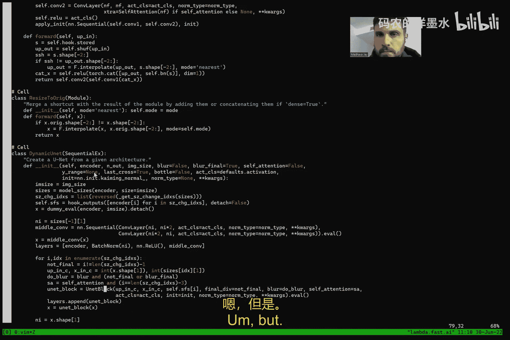

You know， to figure out。What doesn't work， you know， you would need to change this line to say oh。

 if it's a string， create trim model， other ways do this。

 you know and then you like create body would need to be create dim body if it's a string so like at minimum do the same stuff that create vision model does。

And then， yeah， and then see if this works， right， and it might well now I will say if you do get it working。

😊，Tim does have an API to actually tell you。Where the feature sizes change。

 so like you could actually optimize out that dummy ofval stuff。

 but I don't even know if I'd bother because it would make the code more complex for no particular benefit。

Yeah sure so look I think if you know you commit this is a PR i'll definitely be looking at it I was actually going try conex in my unit so I had no idea it would work actually so that would have been I would have noticed that already but I just hadn't had time so I'd love to because I you know tried Rent 32 i've got particular results and I'd like to see we can push it with a different model Yeah no I mean I think there'd be a lot of benefit to that so all right so now we should run the tests。

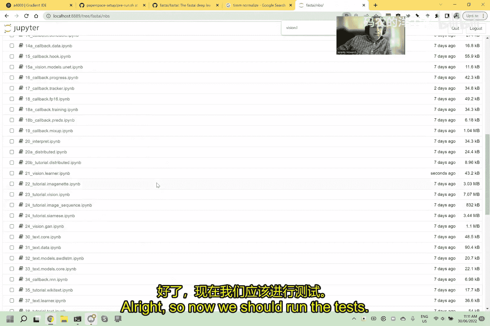

Just to know would that all likely be in the same notebook that you're editing the vision learner is that where most of the source code is are unit learners。

 or is it a difference？I don't know I was just using I to jump jump to whatever automatically in VMS so I was using VMC tags to jump around so I don't I have no idea where I was。

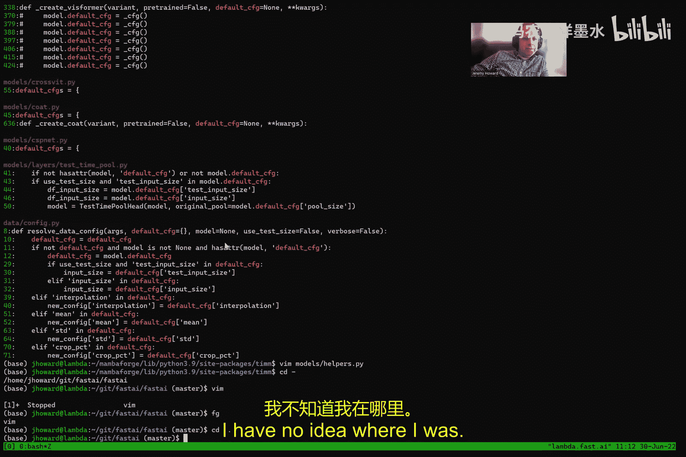

Right right。诶。I mean， actually。

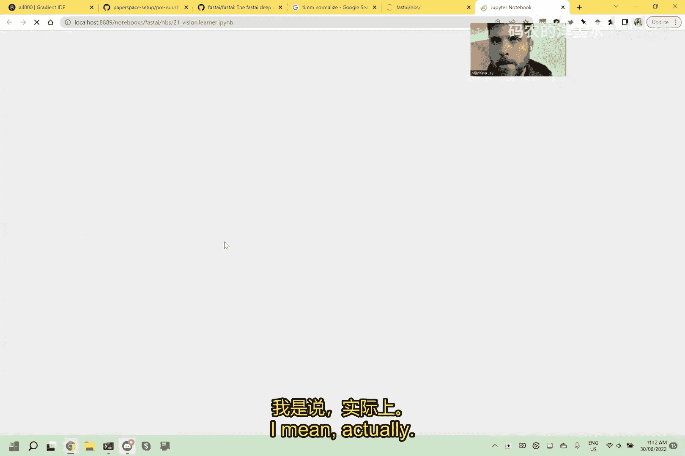

嗯。So yeah， so there's a models unit this where the dynamic unit lives。

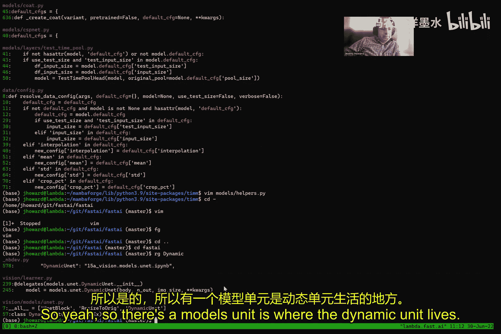

嗯。嗯。

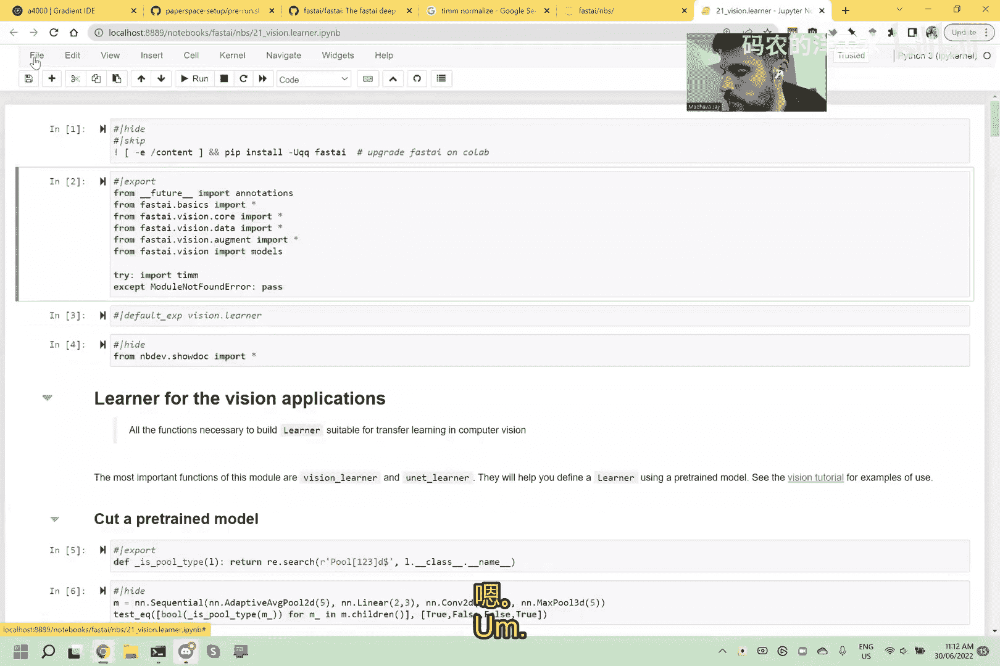

Okay， so is there anything unique about the fact that the tin model doesn't that sort of an option there to cut the tail and head off does that need to be done with the unit architecture？

Oh， got an error here。

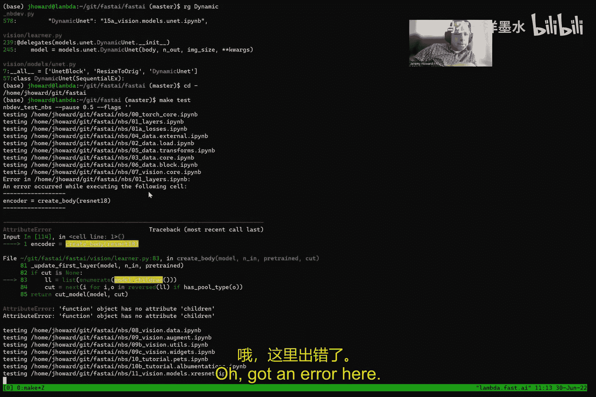

嗯。😊，Yeah， so yeah， you absolutely have to cut the head off because it comes with a default classifier ahead so you will need you know。

So you know， once you get it working， you'll probably find you can factor out some。

Diplicate code between the unit and the vision letter， but yeah。

 you basically have to cut off the classifier ahead in the same way that。Create1 body does。嗯。😊。

And I don't think you'll need to change any input processing as far as may know。嗯。The， the vision。

 create vision model。You know， handles like。You know。

 if you've only got one or two or four channel inputs and the models is the three channel input。

 it handles that automatically， but Tim actually， I think Ross and I independently invented this as far as I know we both kind of。

Autoomatically handle like。copying weights if necessary or deleting weights if necessary or whatever。

 but yeah， so the same stuff vision minor should work there as well。So interestingly。

 layers the layers notebook。嗯。Does't work because it is actually creating a model。Which is。Curious。

That we easily fixed。😔，Yeah， that's interesting。嗯 go。ok。是。So。The big question then is。

Can we still predict race disease。哦。Yeah。So's compare。

 I don't know if it's got going to make much difference or not， you know。

 because we're pretty careful about。Findine tuning the batch norm layers is actually interesting to see whether normalization matters as much as it used to。

It used to be absolutely critical。嗯。Is it possible to create like a layer that learns the normalization sort of thing Yeah I mean that's basically what Paton does you know。

To understand it's a those weights in the batch on layer are basically learning the aggregate of that batch that optimally give the best activations for the next layer yeah exactly yeah yeah it's just it's just you know。

Multiply by something and add something。So it's finding what's the best thing to model play by and a by。

So let's take a look I mean all right， so this got。47% error。It's got 44% error。Yeah， so I mean。

 it's a bit disappointing after all that work， it doesn't actually， I mean。

 this is fascinating like yeah， when you find tune in the way we do。😊。

Basically doesn't really matter， you know？And let's just double check it actually is。

It actually is working。😔，Would it be fair to say that the one advantage would be if you wanted to use pretrain models without fine tuning you definitely want the statistics in there right yes。

 absolutely。I mean， I don't know if that's an actual thing that people do， but yes， if you did。

All right， so we did deals， dottrain do afterbech。😔，Yep， there it is。Gravy。Yeah。

 it's funny these things， you know， we've been doing for years and I guess never question。U。

I have a question relating to that because one of the things I wanted to do is get this unit into a mobile app so I use the latest torch script and it works with the demo app iPad to particular analog lock because it's broken from Pytorrch but of course in there you need to provide the averaging statistics for the app so it's like inference mode so I wonder I know that at the moment the fast AI's kind of idea is that you dump everything as like a pickle but conceivably it would be helpful if you could maybe extract those new finetd statistics or something for your deployment in particular environments because that how would I go about doing that。

I mean， they're just parameters and betterome layers， you know， they're just parameters。

 so they'll be in the parameters。Attribute of the muddle。But like they're not。

 they're not really parameters that make sense independently of all the other parameters of them at all。

 so I don't think you would。Treat them any differently to if you use say imagenet statistics when you're fine tuning and that's the result of your model right you're going to use that down the track as well well。

Yes and no， like that's what you normalize with， but。But you've got Baronom layers， which then。

Obviously。Dividing and subtracting。Themselves。So yeah， I mean。

 those normalization stats aren't going to change， but there isn't really a need。Reason to， you know。

 it would only be if you。嗯。诶。Trained a new model from scratch。

I just want to have a look at this conf next one so this is。27 to 1824。 Yeah。

 this is actually kind of what I thought might happen is on a slightly better model， you know。

 we may be getting slightly better errors initially。But then as it trains a bit it。

Makes no difference。嗯。Cao。All right。

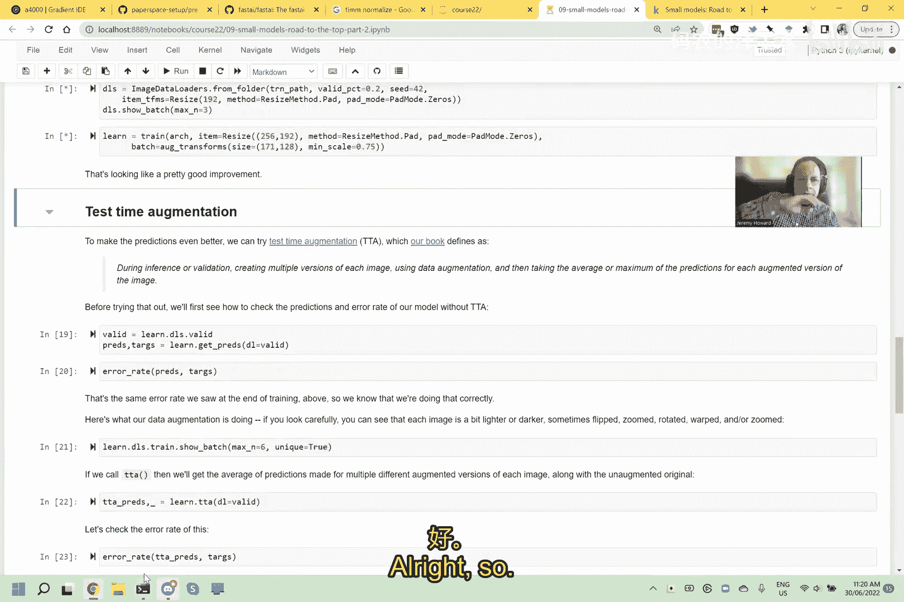

嗯。Yeah， I'd love people to。Try out fast A I from master， because some。Tell me if any of your models。

 look。Substantially。Better or even more important， substantially worse。嗯。Or to oize。Tim models。Okay。

Fixes 3，7，1，6。Yeah。

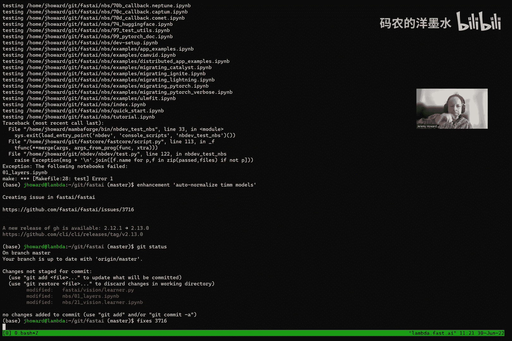

All right， anybody have any questions before we wrap it up？

So just with normalization as you say it's just the initial error rate will be a bit more less than earlier approach Yeah so like that that that you know well。

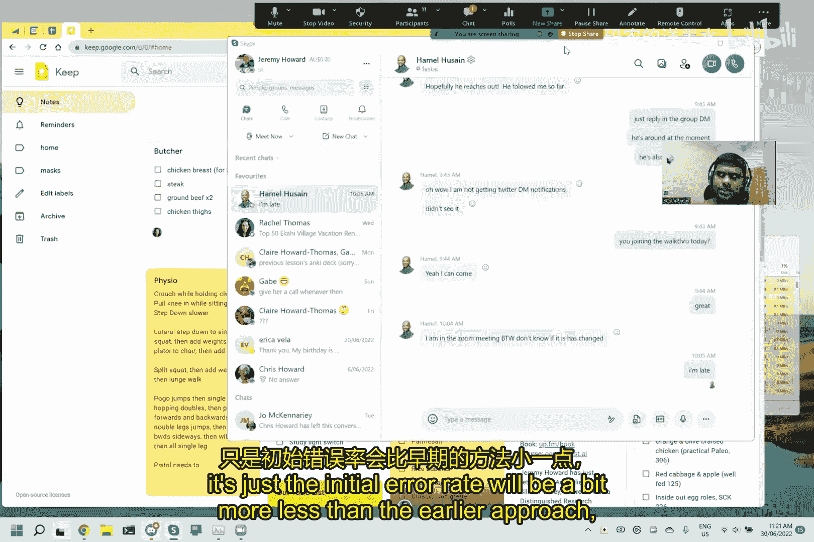

At first， you have a random head。So at first it doesn't actually matter right， it randoms random。

 whether you normalize or not。So。哎呀。Maybe， you know， after 10 batches。It's better or something。Yeah。

 I don't know。It it be interesting to see if anybody notices a difference。😊，I mean， this just。

This used to matter a lot， right， for a couple of reasons。

 One is that most people didn't find tune models。 Most people train most models in scratch until。

Until fast day， I came along pretty much and then secondly。😊，Well， we didn't have Mat on。Right， so。

It was totally critical and that even when batchronome came along。

 we didn't know how to fine tune models with batchronm， so we just fine tuned to the head。

At that point， we didn't realize that。You had to find tune in the patronronomas as well。I remember。

Emailing Francois the。Creator of Kaas。 And I say saying to him， like。

 I'm trying to fine tune your kas model when its like。

Bizarly bad like why why is that well're probably doing the wrong thing is documentation。

 whatever like no， I'm pretty sure I'm doing the right thing and I yeah I spent like three months trying to answer this question eventually I realised it's like holy shitd its。

😊，The better， I sent him an email and I said， oh， we can't find tune。Caras models like this。

 actually you have to fine tune matchal mode。Which I don't think they changed for years， actually。

Anyway， so yeah， so those changes is why I guess。This whole normalization layer thing is。

Much less interesting than I guess we thought。Which is why we hadn't really noticed it wasn't working before。

😊，Because I'm not also training fine。Anybody else have any？Questions before we wrap up。Okay。See you。

 let's see all， good luck with you that bye。诶。