# 实时编码：17：TIMM模型整合

在本节课中，我们将学习如何为FastAI库中的TIMM模型添加缺失的归一化功能。我们将从设置开发环境开始，逐步分析问题，修改代码，并最终验证修复效果。

## 环境设置与代码库克隆

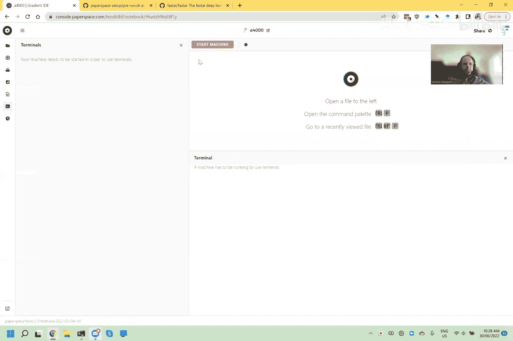

首先，我们需要设置一个开发环境并克隆FastAI代码库。

以下是具体步骤：

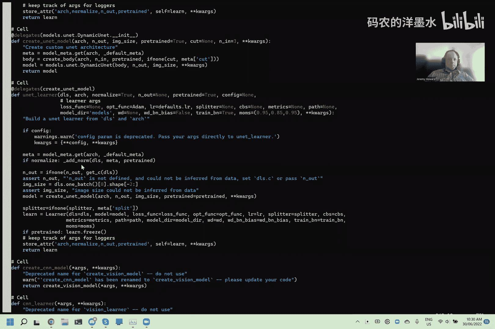

1.  启动一台机器并进入主目录。
2.  克隆FastAI代码库。
3.  运行安装脚本 `./setup.sh`。
4.  脚本执行完毕后，重启机器以应用所有设置。

重启后，环境将包含用于安装Python包的工具（如 `pip` 和 `mamba`）。此时，我们可以通过 `pip install -U fastai` 命令安装或升级FastAI到最新版本。安装完成后，在Python中导入 `fastai` 并检查版本，可以确认安装成功。

接下来，我们还需要安装一些必要的二进制依赖，例如用于加速计算的 `universal-ctxt`。这些安装是持久化的，在免费的计算资源上同样有效。

完成上述步骤后，开发环境就准备就绪了。

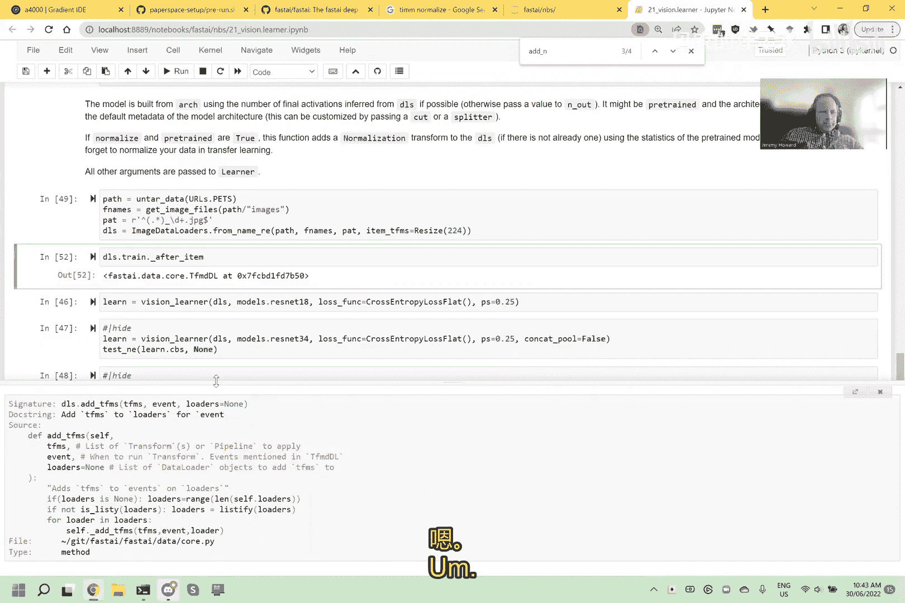

## 问题分析：TIMM模型缺失归一化

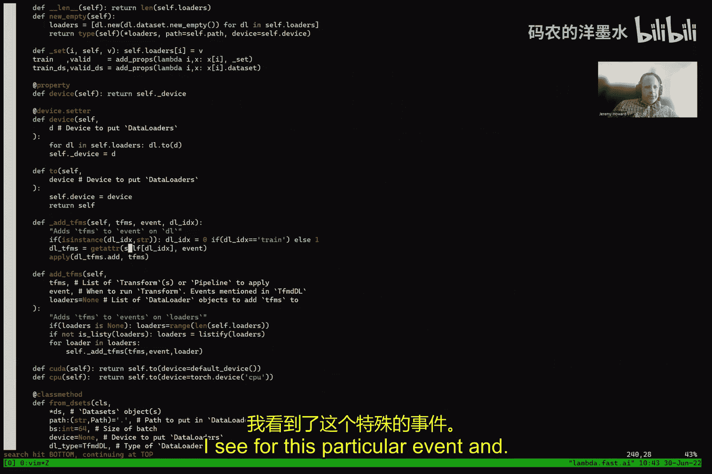

上一节我们完成了环境搭建，本节中我们来看看需要解决的具体问题。

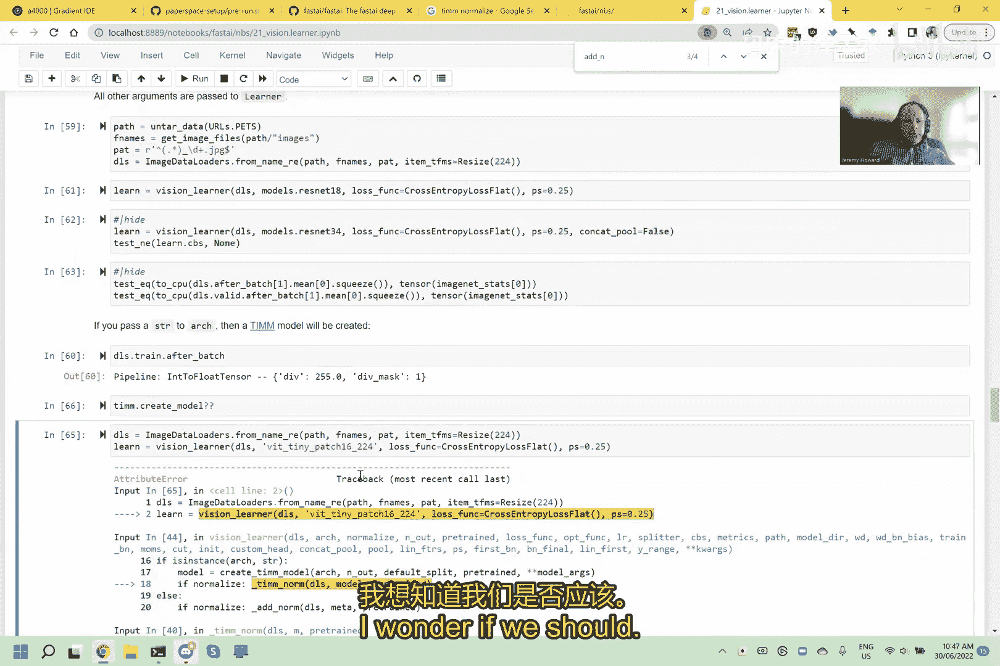

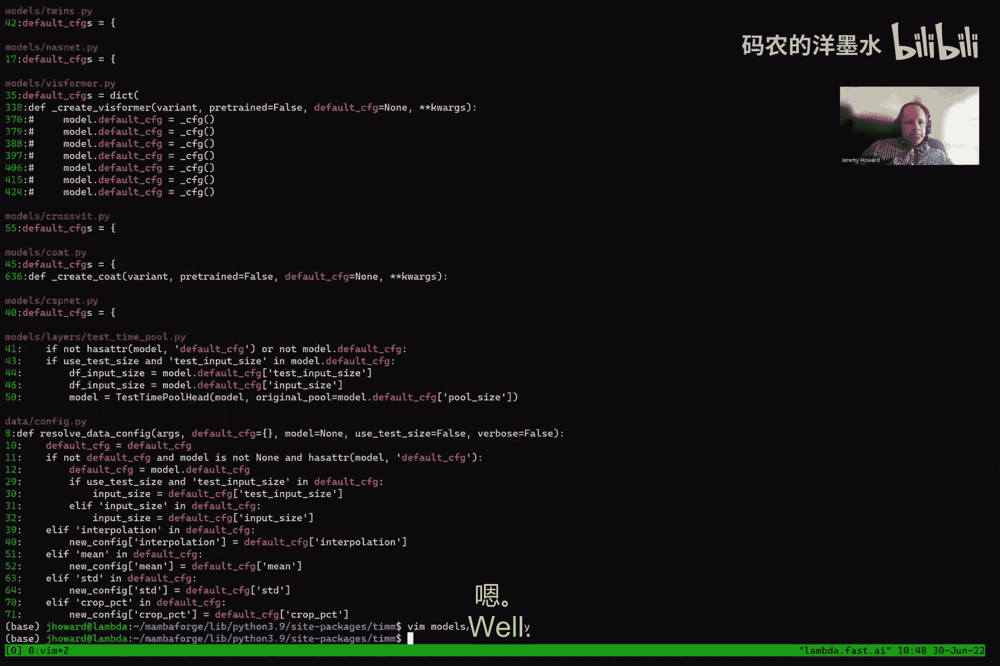

在计算机视觉任务中，归一化是一个常见的预处理步骤，其目的是对每个颜色通道减去均值并除以标准差。公式表示为：
`normalized_image = (image - mean) / std`
对于使用预训练权重的模型，我们必须使用与模型训练时相同的均值和标准差进行归一化，否则输入数据的分布将与模型学习时的分布不一致，影响性能。

在FastAI的 `VisionLearner` 中，有一个 `normalize` 参数。当设置为 `True` 且模型是预训练模型时，它会尝试从模型的元数据中获取正确的统计量（均值和标准差）并添加归一化变换。

然而，当前代码仅对非TIMM模型实现了此功能。TIMM模型拥有自己的归一化统计量，存储在模型的 `default_cfg` 属性中，但FastAI尚未利用这些信息。这意味着目前使用TIMM架构时，即使设置了 `normalize=True`，也不会自动添加正确的归一化层。

## 代码修改：为TIMM模型添加归一化

分析了问题所在后，本节我们将着手修改代码以实现功能。

核心思路是：在创建TIMM模型时，检查其配置（`default_cfg`），提取其中的均值（`mean`）和标准差（`std`）信息，然后为数据加载器添加相应的 `Normalize` 变换。

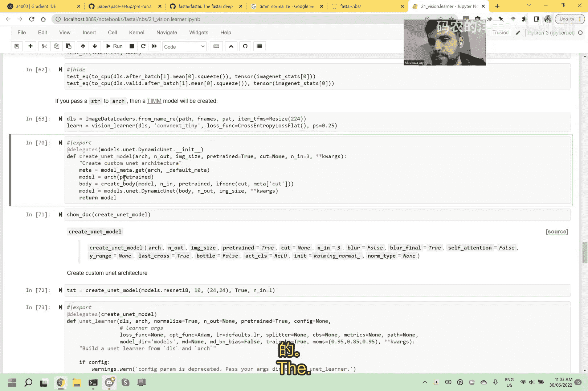

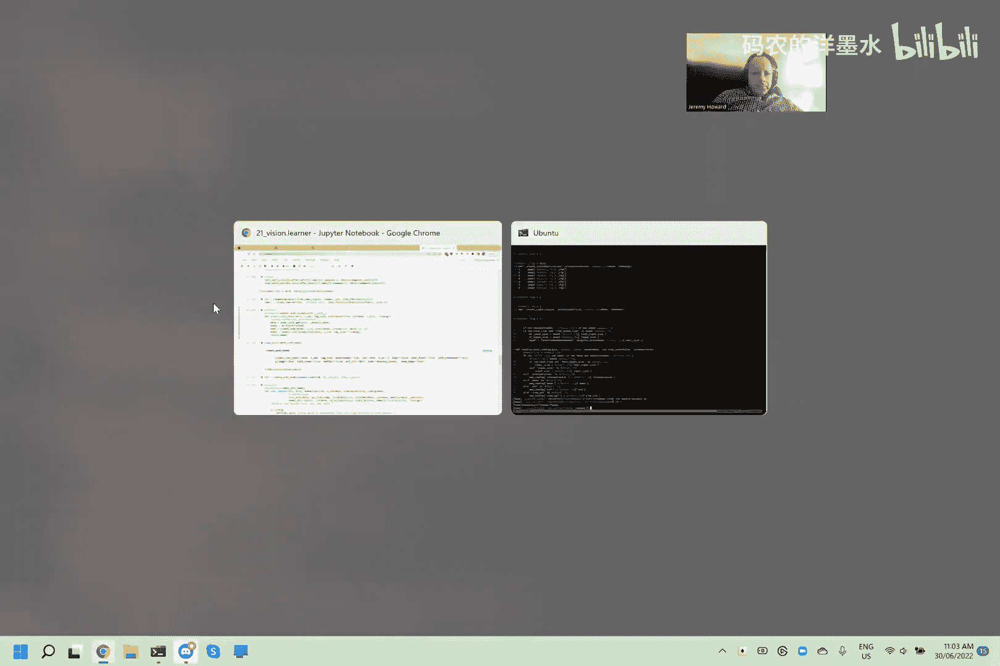

我们需要修改 `fastai/vision/learner.py` 文件中的 `_add_norm` 函数。修改后的逻辑如下：
```python
def _add_norm(self, stats):
    if self.normalize:
        # 检查是否为TIMM模型
        if hasattr(self.model[0], ‘default_cfg’):
            cfg = self.model[0].default_cfg
            mean = cfg.get(‘mean’, [0.5, 0.5, 0.5])
            std = cfg.get(‘std’, [0.5, 0.5, 0.5])
            stats = (mean, std)
        # 原有的非TIMM模型处理逻辑
        # ...
        self.dls.add_tfms([Normalize.from_stats(*stats)], ‘after_batch’)
```
这样，当学习者使用TIMM模型时，就会自动根据模型配置添加正确的归一化。

## 测试验证与结果分析

修改代码后，我们需要验证其是否正常工作。

首先，我们创建一个使用TIMM模型（例如 `‘vit_tiny_patch16_224’`）的 `VisionLearner`，并检查其数据加载器的变换列表。应该能看到包含从模型配置中获取的统计量的 `Normalize` 变换。

为了全面测试，我们运行了FastAI的测试套件。最初发现了一些因代码重构（例如 `create_timm_model` 函数返回顺序模型）而导致的错误。通过调整函数返回值和调用方式，我们解决了这些问题，确保了测试通过。

最后，我们在实际任务（如CIFAR-10分类）上对比了修复前后的模型性能。有趣的是，在使用了我们常用的微调技巧（如解冻层、差分学习率）后，添加归一化对最终准确率的影响微乎其微。这可能是因为批量归一化（BatchNorm）层在微调过程中已经适应了新的数据分布，削弱了输入归一化的重要性。

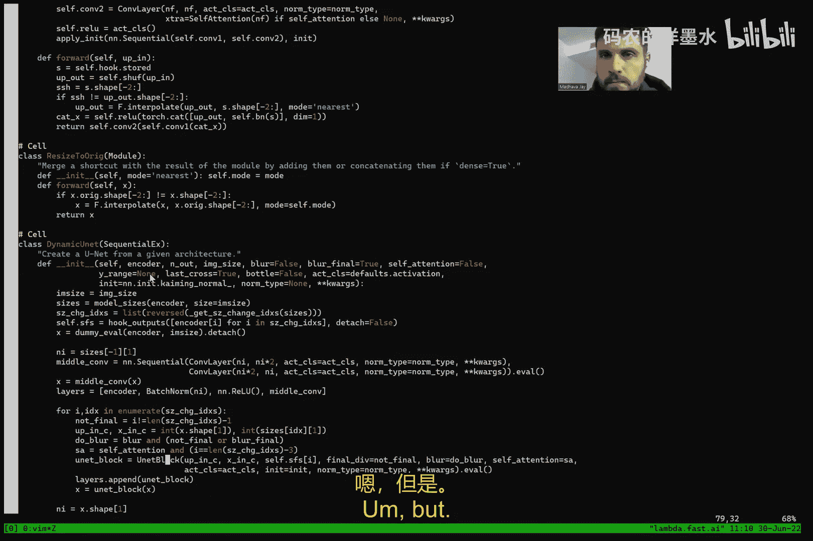

然而，这个修复仍然至关重要。如果用户希望不进行微调而直接使用预训练模型进行推理，或者从头开始训练模型，那么正确的输入归一化就是必不可少的。

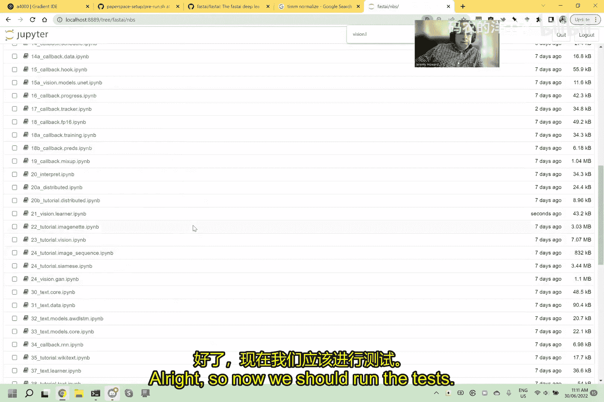

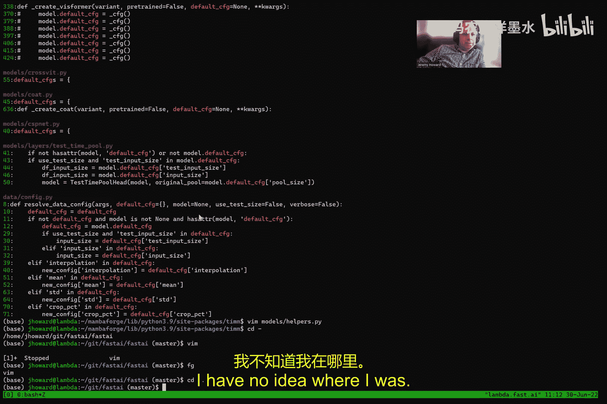

## 拓展讨论：动态UNet与TIMM模型集成

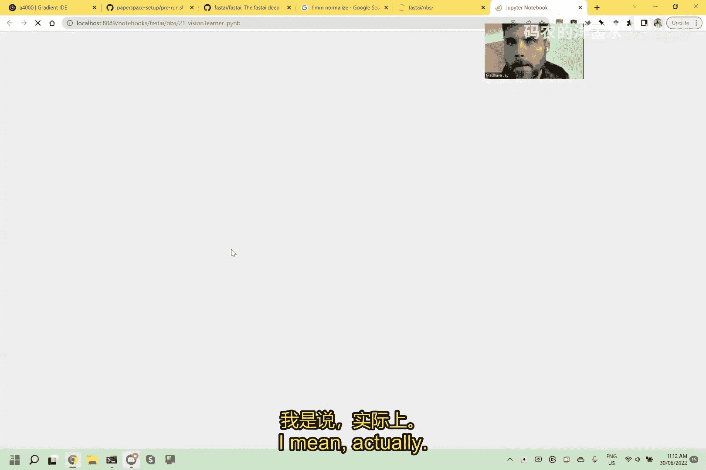

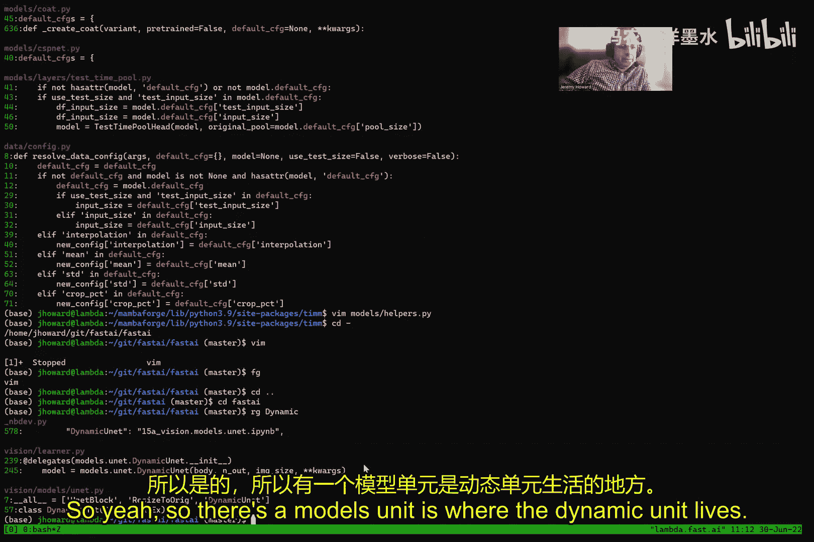

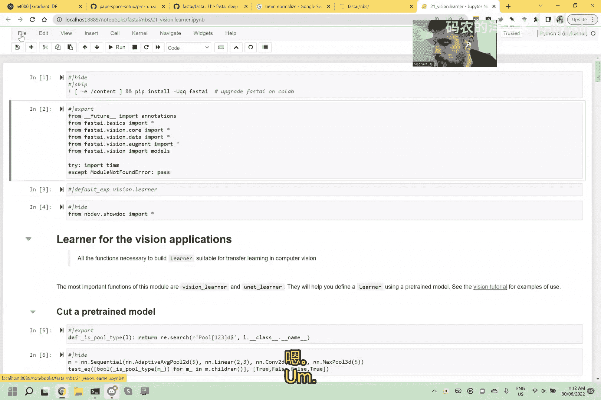

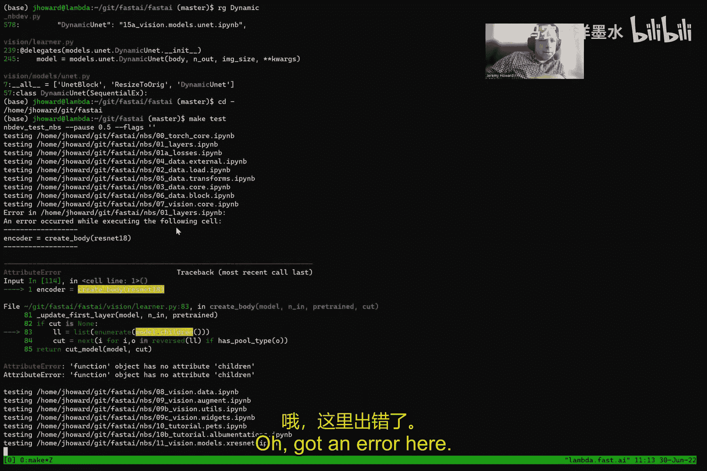

本节课我们主要解决了视觉分类模型中的归一化问题。本节我们将视野拓展到图像分割领域，讨论如何将TIMM模型集成到FastAI的动态UNet架构中。

动态UNet是FastAI的一个强大特性，它允许编码器（下采样路径）使用任何预训练模型，并自动构建对称的解码器（上采样路径）。其核心原理是：通过前向传播一个虚拟输入来钩取（hook）编码器各层的输出形状，识别出特征图尺寸发生变化的层，并将这些层的输出作为解码器对应层的跳跃连接（skip connection）。

要让动态UNet支持TIMM模型，需要完成以下步骤：

1.  修改模型创建逻辑：类似于 `create_vision_model`，需要一个新的函数（如 `create_timm_body`）来实例化TIMM模型并移除其分类头。
2.  集成到UNet创建流程：在 `DynamicUnet` 初始化时，如果传入的是TIMM模型字符串，则调用 `create_timm_body` 来构建编码器。
3.  处理跳跃连接：动态UNet现有的钩子机制应该能自动适应TIMM模型，捕捉其下采样点的输出。

这项工作具有很高的价值，能让用户方便地在图像分割任务中利用各种先进的TIMM预训练模型。有兴趣的开发者可以尝试实现这一功能，这将是对FastAI生态一个很有意义的贡献。

## 总结与展望

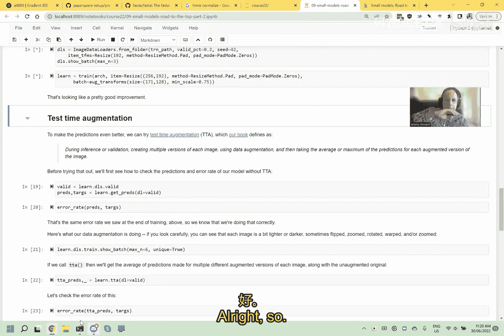

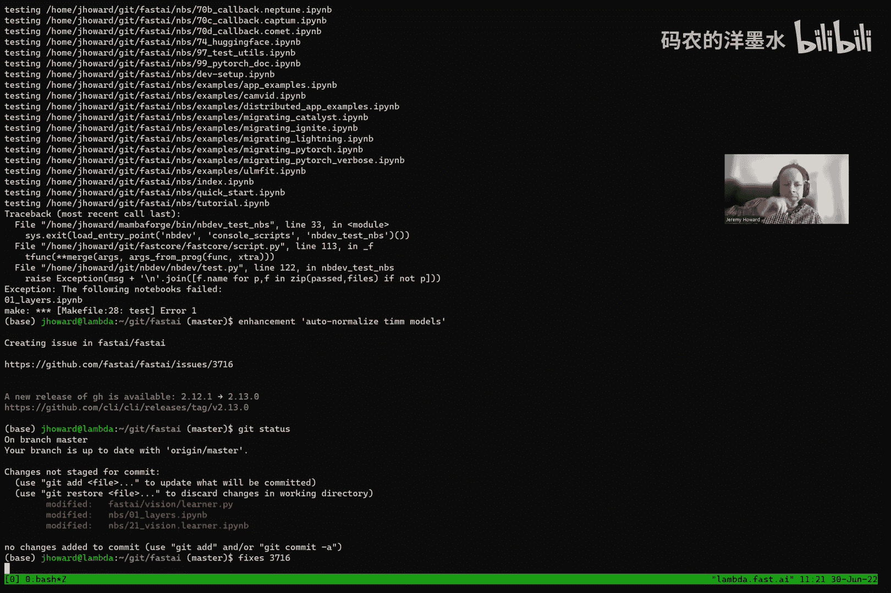

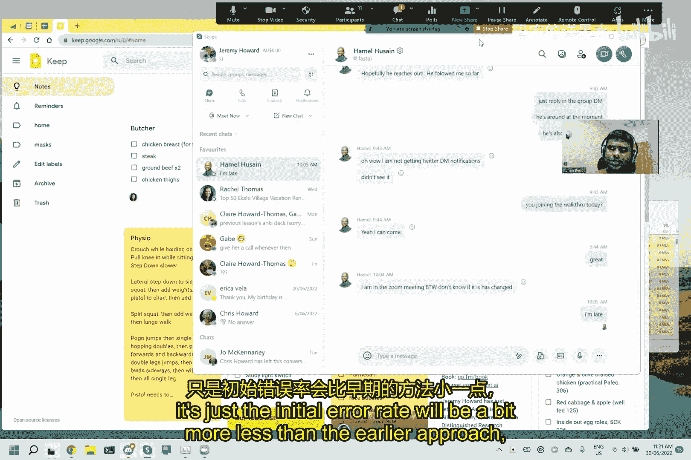

本节课中我们一起学习了如何为FastAI库中的TIMM模型集成缺失的归一化功能。我们从环境配置开始，分析了问题根源，实施了代码修改，并进行了测试验证。虽然在实际微调场景下影响不大，但这一修复保证了模型在不同使用场景下的正确性。

我们还探讨了将TIMM模型集成到动态UNet中的可能性，这为图像分割任务打开了利用更强大预训练模型的大门。

FastAI是一个持续发展的项目，鼓励社区贡献。欢迎大家尝试使用最新代码，测试不同模型，报告问题或提交改进，共同完善这个深度学习工具库。