# 【全集】旧金山大学 实时编码 中英字幕 1080P p18 Lecture 18 - 现代API使用 -BV1KZiTBWEeH_p18-

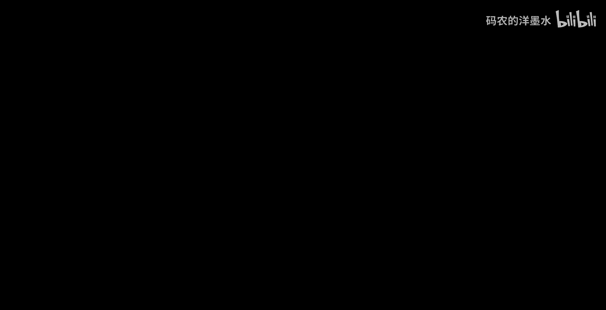

嗯。😊，I don't know if you saw it， but somebody。On the forum， not just somebody。

 somebody extremely helpful and kind being Daniel on the forum。 he does these。Summaries。

Of the walkthroughs。嗯。And I saw that Jamie， I tried to do a little bit。

 but I think I didn't have time to finish it off。 but oh yeah， okay。

 so did you want to maybe share your screen and to get us up to speed with like what the problem is we're solving and where the data is for it。

Stuff like that。Go' muted， by the way。Sorry， yeah， actually， it's just what was in。

 I think it was the 713th live coding live coding， which one live coding， live coding 13。

 live coding 13。Okay， yeah。Yeah so I basically I kind of had a really janky solution it's not it probably doesn't work but what I was thinking of doing was like putting them in some kind of like a file side by side and then sort of indexing it but I actually didn't do anything what I did is basically this at the end so so I'm not quite sure how to take it any further because I don't even know what it is yet so let me just so okay so I've got my screen sharing here and so。

Can you guys say that okay？嗯。So where do I start So he。I didn't quite understand like。

See un finishedish note on the forum。Yeah， okay so that's basically like if you have that note at the end。

 he's got all the images， yep。Right， so these are kind of like the。At the end。

 he's got the actual images in that drop down。And what I did was I actually went in there and I looked at the code or what the HTML are they supposed to be in the same order as。

Like do they have names or I don't think so all this in the same order， let's see so this is。

this is called a to actually what we could do。Is if we click edit。Right， that's what yeah。Oh。

 I say this is like got off the edge of the screen。And so， let's see。 So these have。Okay。

 these have names。Okay， cool， like add to class。And then presumably there's an addd to class somewhere here。

Let's try searching for that， a。2 class。 yes， yes， yes。 Oh， that's cool。

And then the sizes are different a little bit and this is in double brackets at the end。

 so I wasn't sure like what kind of rex would do that。

 but I think the one that I got it kind of it just kind of captures。

So what I did was what I actually did was I went to the bottom I took all of the ones from the bottom and then I got rid of the。

I just extracted that and that's about how far I Okay， no worries， all right。

Let me just start up Jupiter then。嗯。Yeah。Okay。嗯。Alright， so this is our。

These are kind of source images。Okay， so do you guys know if you put things in triple quotes。

Then it creates a multiline string。Okay， and so then we've got our destination。

I guess which is everything else， right？Destination。Okay。So there's a good start。 We've got out data。

😊，So like I guess like the reason I thought this might be interesting to do。😊，Here is basically。U。

Yeah， people often ask， like。How do you go about actually solving a problem or doing coding or whatever。

 So I thought， I guess if we do it together then。We can go through the process。

Which will work a lot better if you。😊，Yeah， ask questions or add comments， you know as we go。

 obviously。One thing that does occur to me is in this notebook。 Actually， this is， I find quite this。

 is quite awkward to have so much data here。 So what I might do actually is instead put them into into。

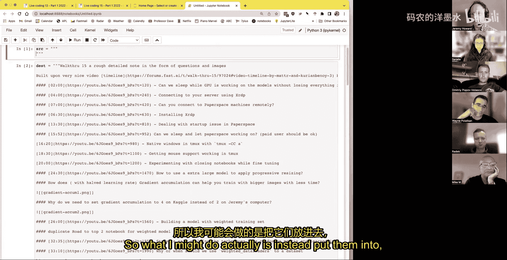

Text files。嗯。So this one is the source， right？In F。If you type cat。And read。

 and then this means redirect to a file， right， so we could create a file called source dot text。

It's now reading from standard N， it's reading from the input， right so I can paste。Like so。

 And then to tell basically in Uni next to say， I finished this file， you hit control D。Okay。

 and so if I was to nail vim。That you can see it's there。Okay， so that's。How you can。

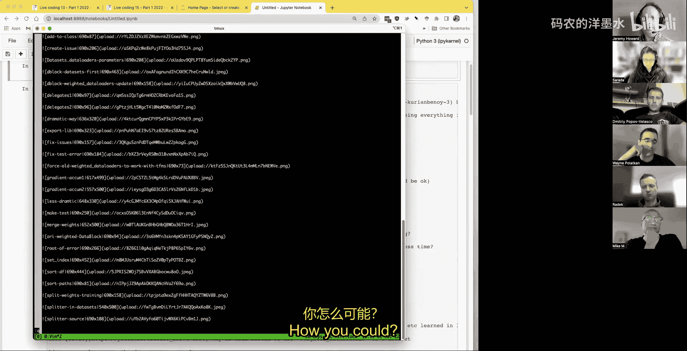

Quickly and easily， there's lots of quick and easy ways to create text files in I got was and I wow you know and sorry's just the name of directory I mean。

 yes yes， yes， I figured it out。

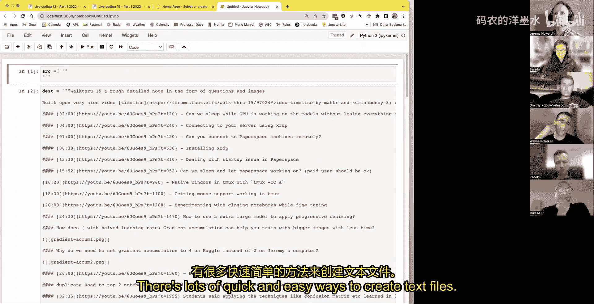

Fuck my。All right so it's just right just it was just this less than sign which five6s to the greater than sign Yeah yeah or greater than sign which yeah right so the main thing I guess the main like just to put this together if I just type cat。

Right， and then I type text。It just。Pris out whatever I type it。Okay， so that's what cat does。

The reason it's called cat is actually concatenates things。 If you feed at multiple things。

 it adds them together if I。诶。I can redirect from a file， which means instead of me typing things in。

 it'll get its input from a file。So that would cause it to print it out。Or if I redirect。It's output。

 then whatever I type in will go to the file。So one way to copy things， for example。

 would be to read things into CA。And then output things into something else。OhWell。

 I a really dumb way to copy， but like its you know， it does the job， right？So yeah。

 catt just anything Cat B gets into standard N。Goes to start it out。

Stud it in being the input to a Uni command andstead out being the output from a Uni command So if you do get greater than。

快你。It will still let you type in stuff。 Right， so that's what I did before， right is I。Pasted。

And then at the end， I hit control D。Right， so now if I cat and take it from that。Hey， yesD。There's。

 but I just typed。Okay， press control D control D at the end。 control D means end of file in indexex。

Yeah， so if I say， let me move you over here。 Yeah， So if I hit control D at the end， that's that。

 then it says， oh， you're all done。 You might have seen something similar。呃。诶。Like。

I think it's like this。Yeah， that's thing a know Okay。

 and at the end you type whatever you typed so like。

 but there's no reason to do that you can just because you can just use control D。哭了。

If you use this double。West hand side， it means keep reading until you see that stream。

That's quite a heat dog。This is the mystify lot。Yes， yes， alright。 So let me show you that again。

 So I'm gonna do it again for my destination。 right， so let's。

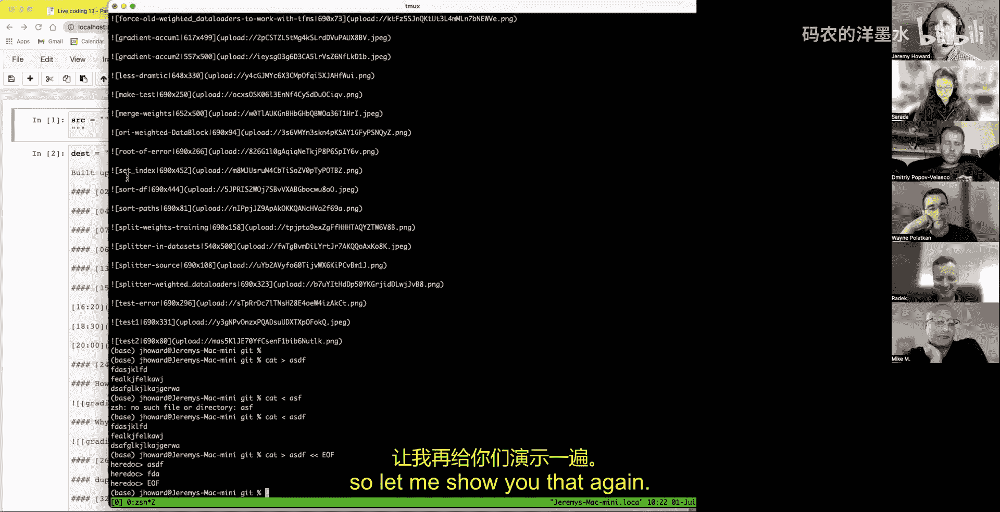

Grale that。And by the way， knowing how to。Do things like select to the end of line and select to the end of file and stuff like youre all using command and control and shift and end and home。

 that stuff's really important to know， get varies between Mac and PC。

 So if you don't know how I just selected all that， then it's definitely worth。

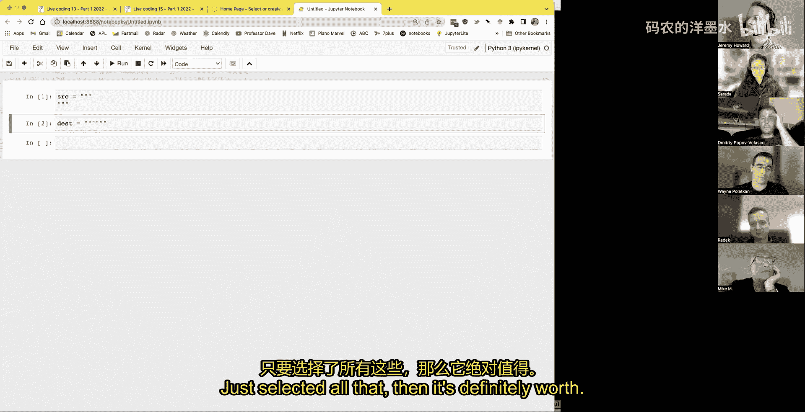

Googling that。 Okay， so I've just copied that。 So I just want to put that into。Cat。

Redirect the output to destination。text。Okay， paste。Control D。Control day。

Don't know why I had to press it twice there。 That was strange。 Maybe I had to。Hititch。代不代理人。

Did the job。Okay。

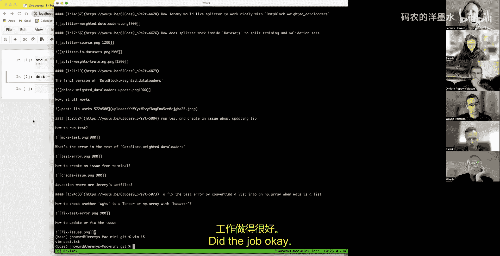

So， actually。So I guess like my starting point normally is just to kind of like input。

 import my like。Standard set of things that I wish Python had， which is called fast quarterdo U。

Os import star。So as some folks have pointed out before， some languages have things called a prelude。

 which is like the。The kind of stuff that。People like to always have available。

 And this is kind of my version of of a prelude and。

One of the things it does is it imports some things from the standard library。

 Python standard library that I always use， and it also imports some things that fastco adds to the standard library。

 So one of the things it adds is。Path Li path。诶。So。Ha。呃。Okay， likes say。And so path up path has a。

Great text。Okay， so that's better。One thing that's I don't particularly like is that the standard representation of strings in Jupyter uses backslash n。

If you want to replace it with actual。Near lines， you can say print。Or， you know， like。

 you can't just。嗯。Do this。And so just remember curly brackets。

 So this means do this as a bash command。And Carly Baett's spins read this Python variable and put it into the bash command。

嗯。Allright， so then we can do something similar for destination。嗯。

One thing that people complain about with。With my code quite often is my use of abbreviations。

 like you might reasonably ask or why not at least put the E there。 And it is totally fine。

 You could put the E there。 But just to explain， I quite like to have。

Similar things be similar lengths because it makes it really easy for me to then like have lines next to each other that operate on those two things and all the bits will be in the same place。

 And so my eyes can immediately see if there's some unexpected difference or something。

 So it's not just me。Trying to be difficult。 It's， it's， you know。

There's actually a reason that I quite like doing that。Just not just say everybody has to do that。

 I just that's why I quite like to do that。嗯。And there's also something to be said for， like。

Having our standard way of coding。That then you just don't think too much about how you code。

 you know， So like， I just have stem standard where I tend to name things。

 And then I don't spend time thinking about。Naming things too much that's。

Cognitive load I can focus then on solving the problem。嗯。😊，Alright， so。

I guess the first thing we might want to do then is we basically。好。

We probably want a dictionary that goes from。The name of the thing。To the。嗯。

To the location of the image， right？And so then basically then we'll just go through each type each one of these here and replace the name with the value of that when we look it up as a key。

嗯。So。There's a thing called Fiol。Which should give it a richx。Add it。

Finds all the places of that rejects。嗯。Do you guys tend to use red Xs。

 Is there anybody here who like doesn't really use red Xs or。Not so much。So yeah， so Richardx is a。😊。

What we call it a DSL， a domain specific language。They are， yeah， they're not Python， really。

Python happens to have support for them， but they very much don't look like Python。U。😊。

I actually tend to think of them as a notation。 and notation is one of my favorite topics。

 A notation is。😊，A way of representing some potentially complex。To main。in a concise。

 expressive and flexible way， so for example， a notation that you've definitely used before。

Is this one。 which is called math notation。If you play music in the Western tradition。

 then you will have seen you the staff based music notation if you juggle。

You might have come across the juggling notation。U。If you've done quantum stuff。

 you might have come across the Feynman diagram notation。So， notations are。Yeah。

 they're expressive ways to represent things。 And redexx is are a notation for。Yeah。

 for finding stuff in text。嗯。You are not be。Honestly。

 things in computing have got to the point that they're so。

Well understood and studied that we've brought them to the point that they are a notation。

But red Xx is one and my view is often， you know quite most， you know。

 most of the time perhaps when when something has got to that point。

 we should learn that notation because it's like a way of like。

Composing things together very concisely that can solve a world class of problems。嗯。Jeremy。

 would you recommend？Do you recommend learning things like A and sad also long term？

I wouldn't recommend Orkin said I would recommend Pell because Pell is a super set。Of A can said and。

As such， it's more expressive than either because you can combine everything from O and said and find and。

That。Pretty much everything from Python as well， so yeah。At some point in your。

Life it's well worth Googling for Pell1 liners。P up。Diving into the that rabbit hole。

So another nice thing about redexes is because Pell's red Xes were so good。

 They were built by a linguist。 You know， Larry Walls， it's not surprising。

 perhaps that theyre used almost everywhere。 So Javascript， Python。😊，Pll。s。You know。

 via the PCRE library， they all use the same red Xes。

VmMS are slightly different in Vm you have to add a few more back slashes to things。

 but it's actually possible to turn on。A ri mode， which is almost identical。To Python and pearl。

 which is called the very magic mode， so you can turn on very magic mode and then wem basically as the same as everything else。

😊，Okay， so I got a quick question about like 20 minutes at this。 I was here last time。

 So what are we trying to do Yeah， oh this is not a from last time this is what we're trying to do is this is something new So so what we're trying to do thanks is Daniel creates these these nice。

Descriptions of everything in these。Sessions。But this is how his images come out。

That's just not very helpful。So I thought it'd be nice if we could。😊，For him。

 make a script or something that would allow him to put the correct images in here。

Oh and I don't know why it comes out this way， but that's fine he's got a process he's happy with and in this process the images end up。

😊，You know he can easily post them all at the end。Right。

 so here's all the images and say so the images。😊，The images。

In his 30 posts at the end look like this。So they have names。Right， and then in the。

 in the in the forum post， they appear like this。 So we have to replace this。Basically， with。

 with this。But with probably with this size would be my guess。😔，In thanks。Let's just check that， so。

Yeah， that's what he wants。 I guess， fixed test error。I wonder which size he wants。嗯。Yes。诶。

Gtful fix test。In。Soce path。6，90 by1，8，4。And。Where was that fixed test error。 Okay。

 that's at the end。And then in。Destination path。嗯。I wonder if these are the actual sizes。

 Did he that's say a look， did he say。I think these are the actual sizes I'm not sure why it has the 900 standard size or something it seems to have like。

Presumably， that's what he wants。 That's presumably the size he wants。I guess。嗯。Let's have a look。

 So if I copy that。This post is to test image stuff for Daniel。Haste。Okay， so that's the。

Size it appears there。And then。What if it says 900。嗯。Oh， doesn't really make any difference。Well。

 without this， I'm not sure if that makes sense but I again if you were to try it without it work without it would just oh yeah。

 it would work， I just think like he's I assume that some of the images he's intentionally trying to resize。

嗯。notes up maybe this is for his notes up。Well， yeah， I mean， he's got two different sizes。

 One of them is for his notes app， I assume。And one of them， I'm not going to ask you。

 And this is the size you actually wants。Maybe it's already as big as it can show and that bottom I guess I think so if you right clicks and open it in the new chat would that。

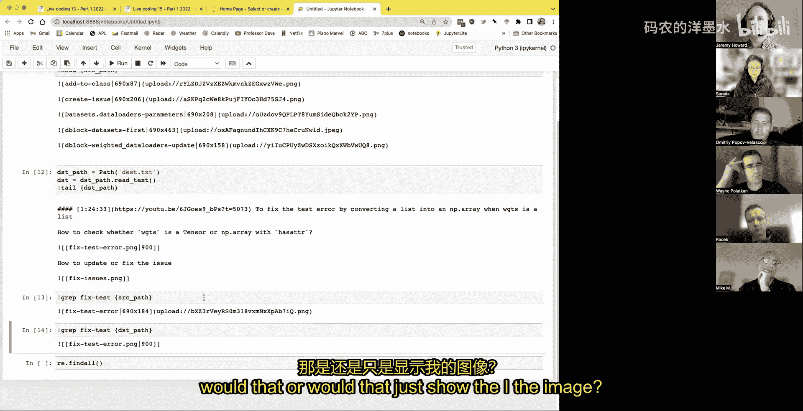

Or would that just show the original， I think I'll show the image。 Let's have a look at some more。

Oh wait， Does it always say 900。 Oh sum 1200。I see。

I think all of X by y is the one when he drops them into the interface and it just takes whatever the I would say so so I think this is prophyplexisy and this is actually what he wants。

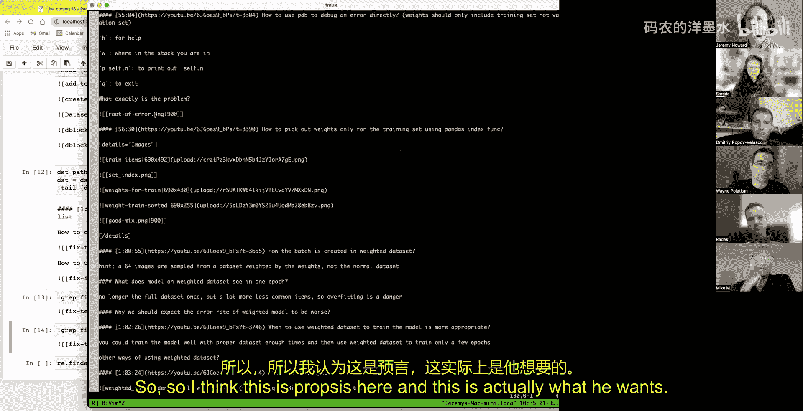

I think that's a reasonable guess。Okay。So I can say sometimes I just judge， you know。

 grab bash commands。But I'm fiddling around just because， yeah， sometimes I don't know。

 It's just like。An easy way for me to quickly check things。So gripp。So actually。

 Gr doesn't take normal redxes， but you can。And I need to get into a habit of doing this。Yeah。

 you can use minus capital P。To use pell compatible regular expressions。

 So when you're looking for like， can I use normal regular expressions， specifically。

 the thing you only want to search for is PC， They're called pell compatible。So apparently。

 we can do this， not that it'll make any difference in this case， but no， this one。 Okay。

 what about E grip。Nope， okay， so that maybe it's in some more recent。Oh， you know。

 maybe the best thing is not to use E gripP， but instead to use RG， which is rip grip。嗯。

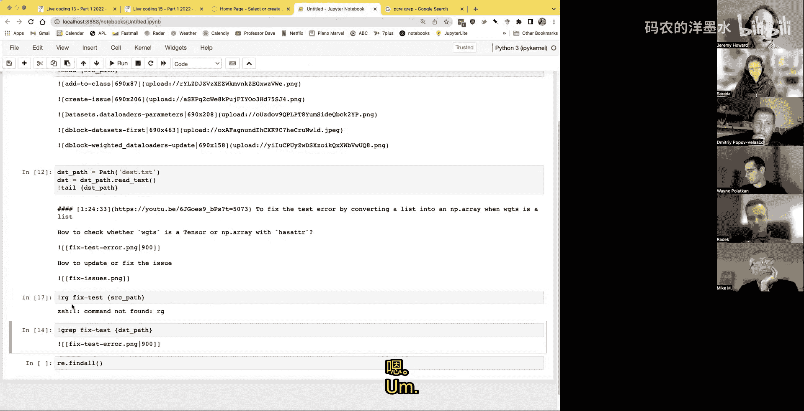

Which I guess I have to install。I noticed that is that a different version of grip that you use Yeah so RG is like so basically like for pretty much all the classic UniX tools。

Somebody's rewritten it in， in rust， and made it better。Or say plus plus or go， you know。

 increasingly its' rust。 I don't know what rip grip was。Written in， but like。

 it's basically like in this kind of general category of like better versions of classic Uni tools。

 And I tried like。Get into the habit of using the newer better versions。

 even though it takes some retraining。

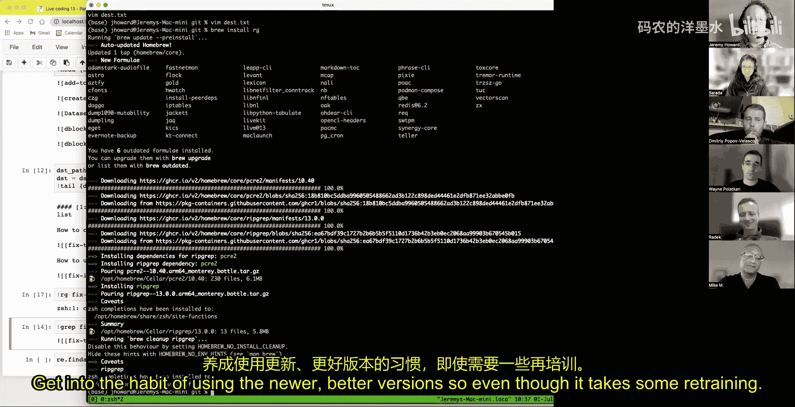

So yeah， actually is。kind ofI meant to ask about why yesterday because I noticed you were using that and I thought maybe A is for recursive pre or something oh yeah。

 yeah， no it's it's yeah it's actually a program。Which， amongst other things， seems to be。

Highlighting the thing I'm searching for， which is cute。And showing the mind number。And Jeremyer。

 you find that B install doesn't mess with your maba forge installation and those orthogonal pretty much in their functions No it should be fine。

 Yeah， I mean， I'm not in paper space here right so like I wouldn't use I tried filling with brew in paper space because there is a Linux。

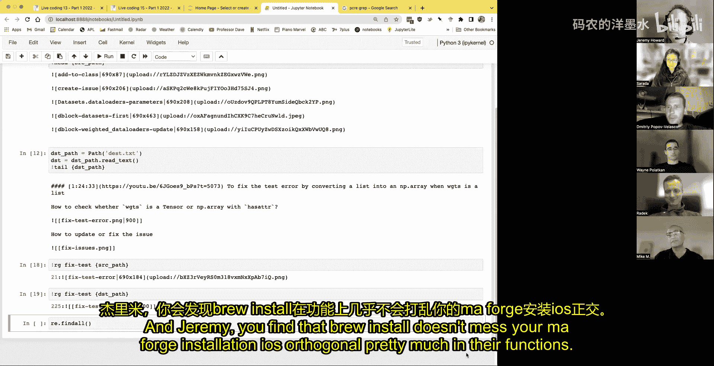

Brew， nowadays， at Sand cable but it uses up a lot of space。

 So I thought just using manber to install binaries like rip Gr in paper space is probably the best option。

You know， because it doesn't use any more space than necessary。But， you know。

 the two shouldn't get in the way like。They'll both add themselves to the path， right。

 so up to B bin。And。Bmb for it been。 So they're just both in the path。Yeah， shouldn't。

 I can't see why they would get in the way of each other。

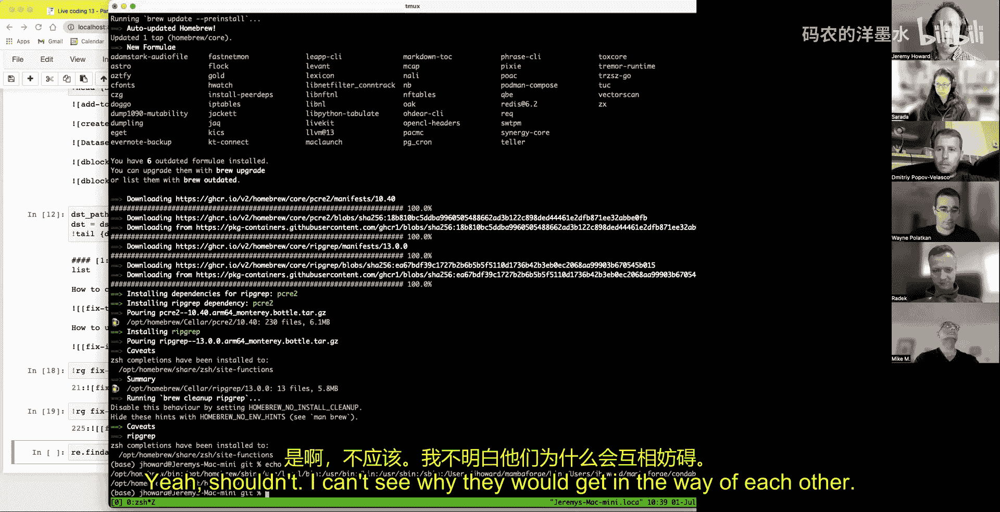

Okay。Alright， so find all。Dos for a pattern in a string， right？ So so you know。

 I tend to like to like to create like a really simple version of something just to make sure I understand a command before I dive into it。

 So I reckon and wish should be able to find the word fix。In our source， right， And there it is。

 Okay， it's appeared more than once。Okay， there it is， right。 And so then。If we。

Generally with redxes， we use backslashes quite a lot to mean certain things。

 but Python uses a backslash to mean something else。

 which is that the next character is a control character。

 so to tell Python that treat backslashes as back slashes you put an R before the string。

So this looks for the， you know。Back slash F fix test， in fact， it'll， if I just show you here。嗯。

Back slash n is normally a new line。But if I put an R there， it's not a new name。Actually。

 this would be easier if I say print。So that prints newline fixed test。And that prints。

B slash head fixed test。Okay， so we're going to look for stuff of。嗯。This fall， that's our source。

 right。So I would be inclined just to paste it in here。Okay。

 so square brackets have a special meaning in reject so we can use a backslash to say。

 don't use a special meaning。Did I with pipe。Did are with parentheses。Let's get rid of all those。

Okay。And so。So， this is gonna be。The name of something。And so， if we want to。

Remember some block of text， we can put it in parentheses。Right， so。

 so the thing we're going try to find here is basically。

 I think probably anything that's not white space will be fine。 So back slash S。

Means not white space。And plus spins one or more。诶。I don't think we care about the size。

 So we'll just skip over this。And then this is actually something we do want to keep。

 which is the actual file name we're going to end up with。 so I'll create parentheses for that。

I put my back slash S plus there as well。Okay。So that's looking pretty hopeful。

 So what it's done here is。Found equals。Found 29 things。Which looks something like this。Oh。

 I put parentheses twice here， which is why it's appear twice。That's better。Does that make sense。

 so it's basically showing us each of the parenthesized expressions？Okay。And so actually。

 we don't need this bit to be parenthesized because I don't think we care about the original size。ok。

嗯。And so we should be able to create a。Dictionary from that。Because we've now got a list of tuples。

I'd never quite remember how this works。 but yeah， there you go。 So the list of tuppples。

 if you pass it to Dic， it'll create a dictionary。And I think like， there's something to be said for。

Programming in an interactive environment， you know， that allows us to like。

 gradually build up a thing that works。 and then。You know。

 assign it to a variable or stick it in a function or whatever。

 So now we should be able to search for。Found。Add to class。And we do。 So we've got the dictionary。

 We want to。 Does that make sense so far。Yeah。I just have a question about that you got rid of the the size so if you don't put the parentheses does that mean it will just ignore that yeah I mean it has to be there right so if。

If we said， oh， look for A A A。Well， that's not there。Right， so it won't find anything。

So it's still searching for it。 It's just not。Storing it。So it's finding an exclamation rock。

 open square bracket。Finding and remembering a bunch of Don White space characters。

Followed by a pipe sign。Followed by a bunch of non white space characters， which it doesn't remember。

 followed by a closing square bracket， followed by an opening parenthesis。

Followed by a bunchn of non white space characters that it does remember。

 followed by a closing parenthees。So putting parentheses makes it remember essentially correct correct it does two things it also groups things which is a bit confusing that it does two things。

 but yeah in this case the thing we're using for is the fact that it remembers things and will end up in the output of I。

fin all。Amongst many other things， if you just do I。match or I。 searcharch， it'll also remember them。

 it just returns slightly different。Things。Hry dot find all is one of the easiest things to use those though。

 So I think it's good。Okay， so now we need to basically search and replace in destination。

Looking for stuff like this。Okay， so。嗯。So this is our destination。呃。Kind of w a。

You look at the end of it。Okay， here's two things we want to change right。

 so I'm just going to like use the last few characters just so I can see what's going on。

 So I'm just going to put that in a variable for now okay。嗯。So there's a thing called Ae dot。

Sub for substitute。It's funny a lot of Python programmers complain about me using three letter abbreviations。

 but Python apparently is allowed to use three letter abbreviations， I。 substitute。

So we're going to find a pattern and replace it with something else。

And I's got a search in Sunstream。So for example， if we replace。Space。😊，With star。Endy。Okay。

 that's basically how it works。Or you can search for regular expression。So， let's search for。That。

Okay， and again， we're going to use R because we're going to use back slashes。

We're going to search for a literal square bracket。

We're going to search a little literal vertical bar。Okay。

And you can see that's been replaced with a star。嗯。And so， this thing here。Is a file name。

And the bit before the dot is what we're gonna look up。So， I'm going to do。

So we're going to capture this and the thing we're going to look for is everything except for a dot。

😊，Okay， so to say everything except for a dot， you've put in square brackets。

 you put the things to look for。And carrot means things you don't want to look for。

 So this is everything except a dot。And this says to capture it。 So remembering。

 I called it remembering， is's actually called capturing。Dot has a special meaning。

 normally which is anything at all， so that's a lital dot。Let's not assume it's not。

 maybe it's not always P And G。So I'm just going to say any three characters。In fact。

 regardless of whether it's JPg or Pi， Oh here we are it could。 Oh。

 it's also sometimes this JPG could be four characters。Okay， no worries。😊，H。Okay， well， anything。

Could do。 Oh， I don' know。 We can just do。Some letters。 So back slash W is a a word symbol。

 So basically letters and numbers and stuff。 So we'll have a bunch of those。Okay， now interestingly。

 in this case， this has got a。Pippe 900。This has got a closed square bracket。嗯。Okay。

 so there's a few ways we can do this。 I'm gonna show。Okay。

 I've got to show you the more interesting way。嗯。Which is that。No， let's do the simpler way。 Okay。

 so the simple way is rather than looking for any word symbol。

 let's just look for anything that's not a closed square bracket。

So this is going to be slightly confusing， but basically。

This is a redexx that searches for any A's or B's or C's。

This is a redx that search for anything that's not an A or A B or a C。

This is a redx that searches for anything that's not an open square bracket。So， we want to find。

A bunch of things that are not a square bracket。Plus means one or more。

And then there's going to be two close square brackets。Okay， so that didn't work。

 which is good because now I can show you how I go about debugging these things。

 So to debug these things。As I would just gradually make this simpler and simpler until it starts working。

 And that way we'll be able to figure out why it's not working。 So I'm going to delete all of this。

Okay， so that didn't work。So let's keep deleting。Okay， so that one did delete。Oh， okay。

 I see the problem。 So you can see here it's just replaced the first letter。

Which wasn't what I wanted， right， I wanted to grab a bunch of these。 So this here says， oh。

 this here says anything that's not a dot。But we actually want one or more of things that aren'do。

That's better。Okay， so。W are more things that aren't a dot。

So we can go back and now replace that up here with one or more things at under dot。There we go。

 so that's now successfully replaced。All that。With a star。

 So that tells us that we've got our search working correctly。

What confused me is the carrot in the square brackets because I know that the car is a symbol for start of line oh yeah that's true but so I had to Google it and it turns out that if it's inside the square brackets it means not what if it's。

Outside start the yeah yeah， no one's going to claim that necessarily this notation is feltt the best。

 I guess。😊，It was made pre unicode。It also， it had to rely only on ASI signs。

 And so I don't think there's enough ASI symbols。 So it ends up having to。

Reuse ASI symbols in ways that are entirely incompatible with each other。 Yeah， that's correct。

 So if it's not inside square brackets， it means start of line。 If it is inside square brackets。

 it means the complement of the set， the the opposite of the set。And that' not。The dot。

 which is inside bracket。Don't mean any character。 those special charactert。 Yeah。

 that just means a do。 And I think in square brackets， except for， except for carrot is literal。

 Yeah， so you could do this to make it extra clear。嗯。Yeah。In the chat。

 I shared link to pthite dot org。Which is， which is nice because it has a。

So whenever I'm working on the reix myself， I never remember。

This is based on Rabuar that was very famous in the Ruby world。Yes。It's nice for testing your redx。

But also， if we expand the cheat sheet， which is。Yeah。

 and then now as you put a string in your test string。

 it will and you can put a couple of strings there， it will you know， show you what it's doing。

That's how I figured out the rejectx I went to one of these sites and the most crucial bit here is the regular regular expression cheat sheet when you click on it it expands。

And you have all these things that you can use。Yeah， I think Res 101 is the one I've tried before。

Which I think has a bit more of an explanation if I remember correctly。呃，江本。

So I like this so we've got a quick reference。But you've also got this like explanation。

Matches this character。 Matches the character。So a capturing group。

 that's something that remembers is a capturing group。A single character that is not one of these。

Oh yeah。 Yeah。 So the first， like。Learning a notation is hard， you know， And so like。

Almost any notation people don't， as a matter of course， learn at school。

It generally gets categorized into the。Weird complicated， annoying thing， category， you know。

 but there's nothing like。More or less weird or annoying about rejectx than。

Basic arithmetic notation。 It's just isn't something we know at school， you know， and it's， yeah。

 you know， arithmetic takes us。Some years to learn redx。

Has anybody learned Rex recently you got a sense of how long it takes to learn like days， months。

 weeks first time I started using a I think it was actually last year's FAI course where you introduced it and yeah I always saw it before and I thought it was kind of like you know these weird magical symbols that I'd never understand and then basically I like got a basic understanding of it really useful tool and then every few months when I have to come back and use it for something I just use one of those like online rex tools to kind of like give myself a jumpstart to get back into it yeah。

I mean， it comes up so much， it's like， I would say it's notation worth mastering。You know。

 which I wouldn't say about that many things and lasty requires。

Probably some fairly intentional practice over a period of time。诶嗯。Yeah， but yeah。

 certainly the kind of like。Use it from time to time and learn a little bit more each time also works。

So I've got to show you something which I would guess most Python programmers don't know。

 but which is amazing， which is that this thing here。

 the thing we're replacing it with is doesn't have to be a string。It can be a function。

So here's a function that returns star。And that does the same thing。Right， or return。

 we' got to be past the thing that's being replaced。So。You know， just， I mean。

 one thing we could just do is just print that out。Okay。

 so we're getting past an RA dot match object。嗯。And so。You could be to handle this。

An Iory do match object。We can also audio， I think， or is it only mean。Can you guys hear me。

I can' this hearI can't do anyone so it must be me。唉。Oh sorry。

 my computer did something on its own it's a bit weird with audio， sorry about that。Okay。

 so I think to play with a match object， we should probably try and create one。😊，嗯。H。

Which I think if we go A dot search， we。 yeah， we'll get a match object。 So let's search for。

That pattern。U。In that string。Okay， so there's a match object。嗯。

So hitting dot and pressing tab isn't a bad idea just to see like what kind of stuff we can do。嗯。

That looks nice， groups。It doesn't seem to do anything。That's a default。 Got it。

This is confusing with groups because group zero is everything right so there's groups and group so group。

Is something where you give an index or name。And so0 gives you everything that was matched。

 and one gives you the first thing that was captured。So that's actually what we want， right？

 So if we。Yeah， I did。P1。Star。X stock group1 star。嗯。Okay， you see what's happened there。So again。

 I'm doing a lot of exploring and explore， you know， as I go。嗯。And so like， I don't， like。

 I find using this approach。系。If I'm working with my code， I almost I basically never get stuck。

Because every step I'm doing is so small， and it's from a known。Place。You know。

And it's a small increment。 And I'm kind of keeping most of the steps along the way。 So it's really。

 yeah， it's very hard to ever get。Lolost or stuck。嗯。So yeah， so now what we have to do is look up。

The thing infound， right， so。foound。There we go。😊，Okay。

 so now we've got to put it in the right format。诶。So， actually。Yeah， we basically。Yeah。

 this is interesting。We actually want to kick this bit， right？If it exists。So。嗯。So what we can do。

Yes， we want to keep that bit if it exists。 So this thing here where we're searching for。

Anything that's not a square bracket isn't quite what we want。😔。

I think we actually need to specifically find the extension。Right， so we're looking for。

We it for a full stop and then an extension。 Okay， so an extension。Is。嗯。A bunch of letters。Right。

 is a bunch of letters。 So back slash W plus。Strictly speaking。

 it should be three or four letters most of the time。 But that's okay。

 What does say back such W plus right。 And then next after that。

 there's either going to be a closed square bracket。

Or there's going to be pipe followed by a bunch of digits。So in other words。

 there's going to be optionally piped followed by a bunch of digits。

And I want to keep that because we want to， we want to put it in there if it exists。

 So we're going to look for。Pippe。Followed by a bunch of digits， backslash D of digit。Okay。

 so we've got to look for all this， right。Now to say that that is optional， you use question mark。

Yeah。And so I'm just going to change this to0 just so we can print out the whole thing to make sure it's working。

Oh， and we don't want to do that anymore。Let's see。Okay， so it seems to have worked， right。

And in fact， what we could even do is to say。Preut out the groups。And that way we'll see， okay。

 it's got fixed test error， pipe 900。And fix issues none。

 So you see how the optional thing is coming through as none。Here， right。

So what we want to do is then look up group 1， right， which is this。And then， if it exists。

We then want to put in the pipe 900。Okay， switch is X dot group。2。But see not inside square bracket。

A found Xtop Greek 1。Oh， and that's， oh， that's the end of curly brackets there。

And start curly brackets there。There we go。Upload blah， blah， blah up P and G 900。Cool。

And so then this string is going to start with。Exactly the same thing we had before。Which is that。

And it's going to end with two square brackets。Okay。So we get rid of our stars。How does that look？

We have extra none， at the end。你 should不 should know it。Okay， we too。Sly annoying。So。

Or is a Boolean operator。Which returns the thing on the left。

 if it's true and the thing on the right otherwise。 And so because none stifies as the name。

 the string none。But it also is also considered fsy， so this will turn none into an empty string。

Okay， well， let's try that on the whole thing， so。One easy way to you when you're doing something on a subset。

 change it to the whole set is you just go delete。Like， so。Alright， so we've got a key error。

 which is understandable。嗯。So we're missing good mix。 So let's see if that's actually missing or not。

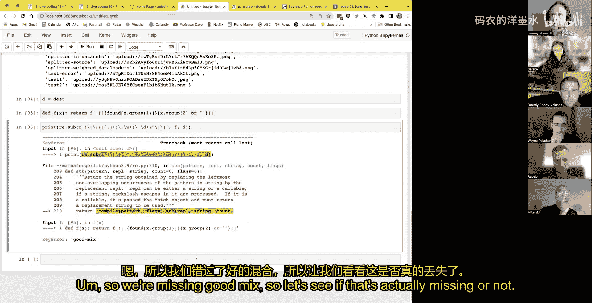

So let's have a look on the source and search for good。 Okay， there is not a good mix。

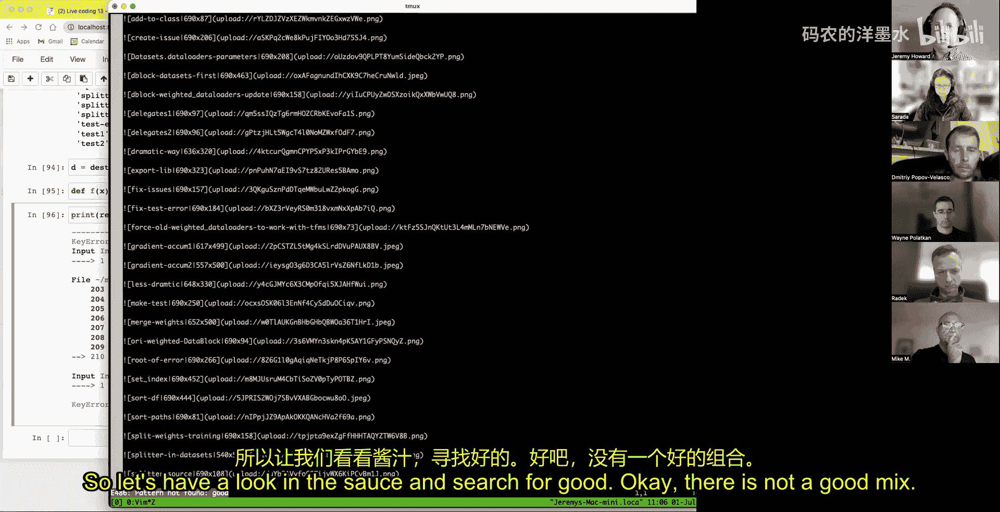

So what I'd be inclined to do then is change square brackets。To dot get， because dot get lets us。

Provide a default。So let's use that as a default。看吧。At。Doox hackphone。

Or you know what actually would be nicer。 I think this is going to end up kind of having like just a broken。

Emage symbol， I think instead， what I'd rather do。Is criple this。And say， if we found it。

Then do that。Otherwise。It's10。That way， we'll actually be able to see it。Oops。Oh。Yes。Area。

 missing image。So let's test it。Okay， so I did it Sure Oh， okay， so I think I made a mistake。

 The destination format is not that at all。 The destination format。I's actually this format。

 It's actually。Exlamation， it's square bracket okay。So that's not correct。If res。

It's exclamation mark。Square bracket。诶。ItDoesn't really matter what the name is。

 but I guess give it a name。And then。Oh， and then the。Then the size， if there is one。嗯。Interesting。

Size if it is one。Just the。This。Then close square bracket， and then a parentheses。

 and then the file name。Okay， is that right。Oh， I've got an Iory that shape， that's not right。Oh。

 it's。哎呀。This。That looks better， doesn't it？隔屁。Paste。哦。That looks helpful for。哈哈。😊，How about that。

 How about that， Yeah， some of these are too big， but Daniel can easily change。 I mean。

 let's test it actually。 So for 33，33。Let's see if we can change the size。33，33。

Sometimes it puts a little percent sign of what we could put in。Does that work？好。嗯。诶。Discourse。

Image size。Oh comma。All right。Was that a bracket didn that come？A bracket in the comma， sorry。Yeah。

 I think it was。Because the next comment they say just by adding。

But I think't have about 20% you still have to have a python there its at the end when he's like a quick just fictioner。

Yeah， so at the end。Yeah， the last sentence there yeah so so that might be you could just do just the comma 50% I assume after a bracket maybe that would work well and here it's got before the bracket。

Oh， not the bar thing。Oh the bracket the pipe， yeah。Let's try。Yes， okay。

Maybe take the dimensions out。No。嗯。嗯。啊。后。So， oh， here we are，50%。对。嗯。Okay。Okay。

 so I think we probably shouldn't be putting in his sizes because they actually want to keep the sizes。

So， let's change it。嗯。嗯。So。嗯。If you press O， by the way， it opens and closes the。Output of a cell。

 which is quite handy。All right。嗯。So。I guess we've gonna have two things。

 We're gonna to have the size and the file name。So that's fine。

 So all we need to do then is to capture this。嗯。So it's not a dictionary anymore。😔，Okay。

 and so then we could say found and we could do a dictionary comprehension。So， for。Name， comma， size。

 comma file。😔，In that。We're going to go that from a name to a tapple。Of the size and the file name。

Okay。So。We're now gonna go。Ex stock group。Yeah。对。And so that means we don't need this pipe 900 bit anymore。

So we don't have to remember that。Okay。And， instead。We've now got。The name and the size。

 the size and the name。Are the two things that are going to be in this tuple。

And so we're gonna go pipe。Followed by the size。And then。A name。Extract clearly based in the size。

There is extra carely braces around size。Okay。Why did this one not work？😔，Fix issues dot PN G。

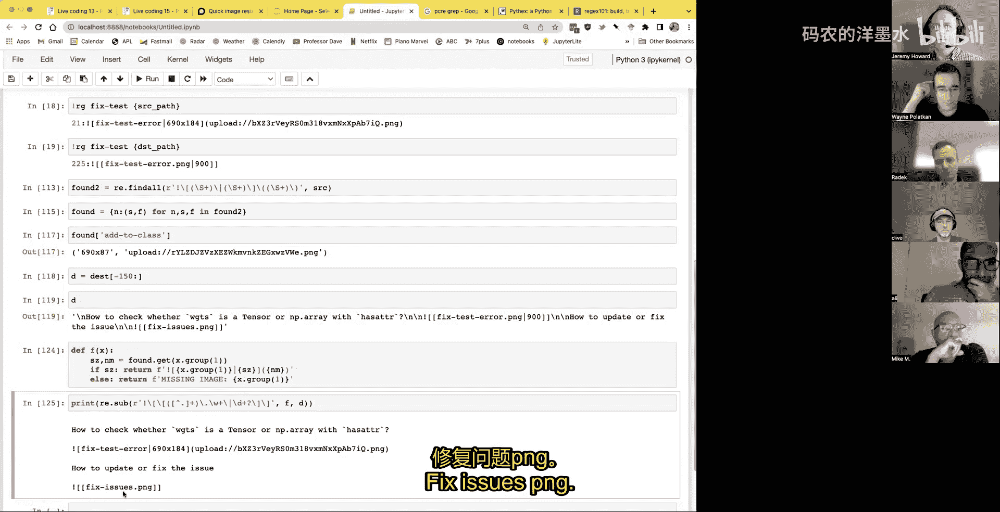

嗯。Fix issues。Fix issues。Should have we。

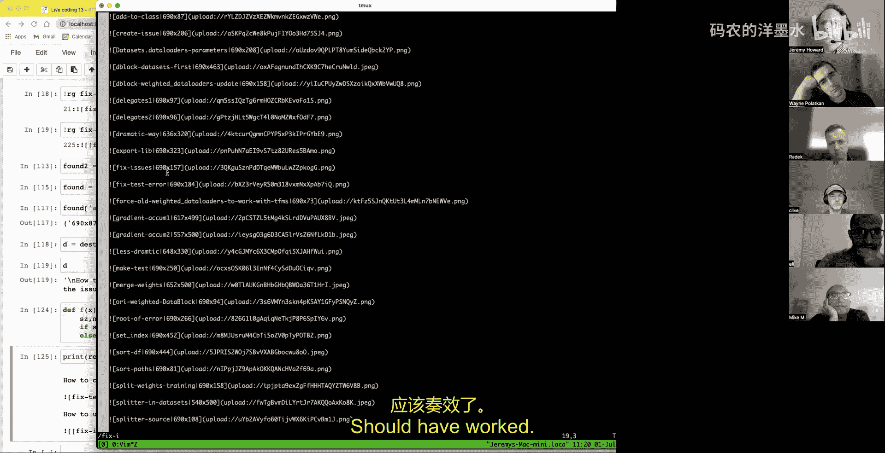

嗯。Oh， okay。 So remember how I told you earlier that parentheses do two things。 They both group。

And capture。So when I removed the parentheses， it stopped grouping。

Which meant the question mark now referred only to the back slash D plus。

 So actually I need the parentheses there okay， that fixed that。All right。Okay， and so。

Sometimes that's missing。 So we'll call that res， after all。We'll call that re here。Do that， okay。

Let's see how that looks。咖啡。Fte。That call， Sir。Look at that。They've got names。

And you can change the sizes。Awesome。I think we're done。 Are we done。Yeah。Yeah。Okay。

 so these ones here are too big。 Let's fix them now。Yeah。

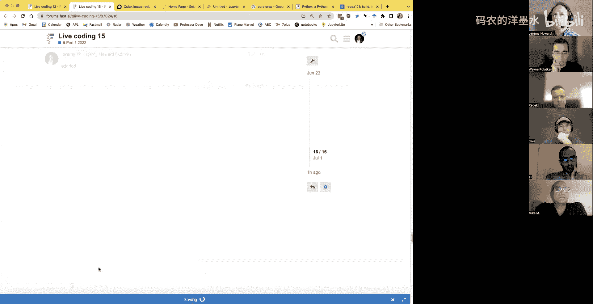

Ch now。Okay， yeah。

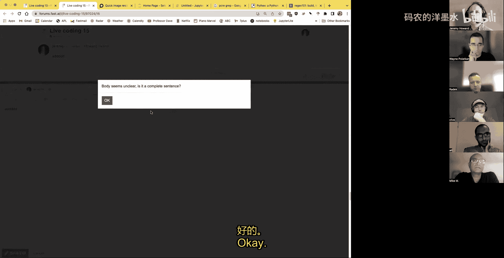

Alright， so let's change。Is。Alright， so let's delete that。So。Yeah。Next step。嗯。

Is to turn this into an app， right。Okay， so which bits do we need。So we don't need this head。

T me that tail。Don't need the R Gs。😔，嗯。Chuck this inside here。Don't hit that。诶。Okay。

 so let's restart the kernel and run it all。 just to make sure。Okay， so that was。Just that， I guess。

Cool。Alright， so a function。For this。Right right， so this is basically。Replace。Image。P image。

 There we go。Jeremy yeah。What that does， this is7 cell 7， it applies the function to the DSD。

It goes to the search through that string。Yeah， let's kind of look for this regular expression。

And then each time it finds that regular expression。

 it'll call this function passing in the match object that the regular expression。Gets。Thank you。

All right， that worries。So， this is like a very。Versaile。Approach to。

You doing just about anything you can think of with text really。

Search your regular expression and replace it with a function。Okay， so。If we have， okay。

 so let's create our function， which is going to be。Fix images。Okay。

 we're going to be passed in a source and a destination。Okay， and this。

If you haven't done this before， you might be surprised to discover you can define a function inside a function。

And the reason I'm doing that is that the first thing we're going to do。Yes we're gonna search for。

是真思。We're going to search。 we're going to create this dictionary， right， of things to look for。

And then this function here refers to that dictionary。

So this is a function that kind of only makes sense inside inside here。

And then we're going to return this， right？Ted。😔，Yes。So we should now be able to print fixed images。

Passing in our source and destination。There we go。😊，Right。嗯。😊。

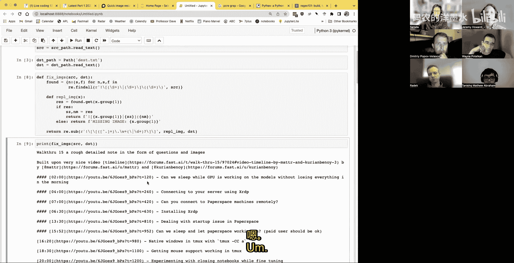

So， let's。Install radio。Actually， we've got the latest version by using minus U for upgrade。

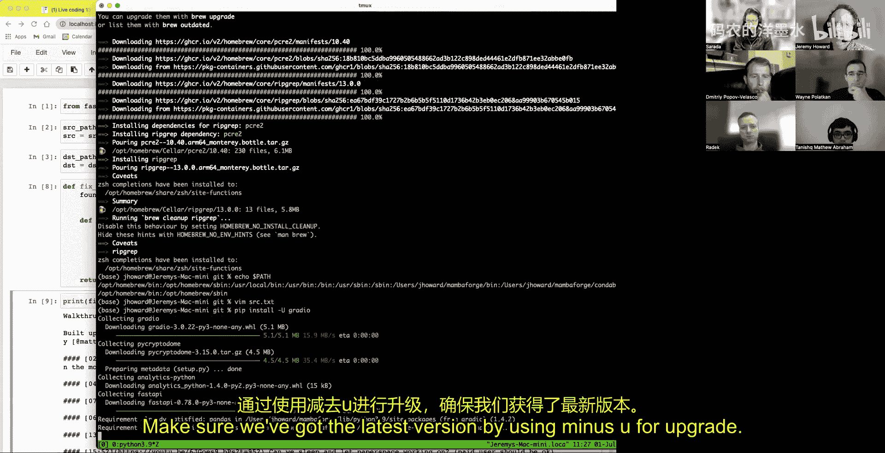

。And I haven't used Gio much at all， except when we did that lesson。 So I've forgotten everything。

So I might need some help with this。😔，喂 are喂 yeah。Okay， so input radio。Gona create interface。

And the function is fixed images。2。Okay， this took a while。Okay， now what's this input thing。

Inputs is sketch pad。 outputs says， oh， I see。 We can just say label。Dos。

Is there a different kind of label for like a large bit of text。

Should be like a text box or something like that。 Maybe yeah， something。 here we are， text box。

 Great， Here we are， Max liness。嗯。对呀。ok。呃。Inputs， wait。 And then do we。Okay。

 so if we pass this string， it's going to construct it。 And what like otherwise。

 we construct it manually， I that how this works， It said that there's a shortcut。

 if you purchase just text， it would work， I think if you go。IThink I saw it when you were scrolling。

I string short。 Oh text area would have 7 lines。Yeah。I see， I see。 I see， which isn't that many。

 so let's just try doing it their way。😔，啊。So， input is。That。And output is that。Okay。嗯。

And they've got that new like grid flexboxy thing we might be able to use to like get one under the other because we don't really want them side by side。

 do we。嗯。Okay， so。Sir， where to。App a file。An image there is。Oh wait， here's something called file。

B a file for uploading a generic file。嗯。I guess you's probably going to copy and paste it from。

Beforeum。 so maybe we should just do it like that， too。嗯。Yeah， let's just do it here。

Can we still run stuff。We can。 It's nice。Cat sauce a text。Oh， so that's an output。 That's not right。

We did two things to pass to fix images。嗯。So does that mean we put square bracket here or something or a dictionary。

Inputs。String component， with strings。Mary of preence。Right right。Okay， so that's our sauce。

That's cool。 Let's name them。 That's nice。That's your destination。Yes。Submit。靠ol。All right。😊。

That it's too working， doesn't it。嗯。嗯。So for， alright， so Grio needs a script。嗯。😊。

And so I guess we got to， I guess we go to spaces first， right， Huing face spaces。

I've forgotten everything。And we create a space。Okay。And we call it。D your image fix。Right。

 it's a radio space。Okay。Clarown。You could just create the app file right there if you wanted to。

Cate the up file。In the U I， I don't know if that might be easier。 Oh， can you。

How do you some as there hint， create the app dot P file right in your browser alternatively？到。

I didn't know that exists， Co。Yeah， I guess it's kind of like Github only so just thing， Yeah， yeah。

 absolutely。Okay。So we don't need that stuff。嗯。We're gonna to need that。

We're got to need like a requirements dot text or something， don't we？Okay。So we commit this。

 Does that look right。What is it is it a requirement text we aid。

 what is the thing to get Yeah I think so yeah， requirements that text and I think you just need to put fast score and yet yes。

 okay， you automatically have radio。Nam it。Require require requirements， do text。

Containing first core。Yeah。Me。I love doing this stuff just through there。Web going。

It's just so wonderfully lazy。😊，Okay， and that's should be A， right？Yeah， I think so just， yeah。

 it has to build the app so yeah。Okay， since it's done， so refresh。Where it is this building。

Here it says because I think it builds for each commits。

 then you probably built when you committed the app up high and then it's building again when you committed I just want to say that I want to say the latest looks。

 you know。It's got secrets。Yeah啊。I like the way this stuff's still getting kind of standardized now around this idea of just like some key values store secrets that you can chuck in there。

 Everything looks pretty similar， doesn't it。This is annoying。Runtime error。Okay。

 so hopefully that means we've got new logs we can see else based not ready。Oh。

 that's not very helpful。 Los is now empty。Great。😊，唉。

Can you try of rerunning the building process so like other setting says you is restart the space it says okay。

Or I guess the I don't know the difference between the factory reboot or the restart。

 I feel that your space could use a GPU。 What does that mean， does that。Is that a thing。

faceI don't know。 Like， I think that provided if you like。Email them or something like that。

 It's a custom kind of thing。 Oh，right。I don't like emailing people。😀。😊。

Case by case basis makes we feel like I'm being judged。Okay。Is that happening， I think。Yeah。

 it's a little slow， I guess。对啊。唉。So I want to ask。

 how long do you plan to keep this live coding running， Is it just indefinitely， Yeah I。

I'mI've got a plan， actually。 Okay， I hope you guys don't think it's too crazy， but。I'm oh。

 just one moment。Important lunch discussions。嗯。Allright， so。Why is it still building？Yes。

So I hopefully， you know， I'll get the course out in a couple of weeks。嗯。And at that point。

 I'm thinking of like， resetting this。It a walkthrough in which。You know。

 things are actually better organized。 And so I hope you guys can still join。 I mean。

 it will be stuff you're already familiar with at this point， but certainly be helpful to have。

And nice to me to have familiar faces and people who can help so hopefully that'll be a lot more people because it'll be open to everybody and over a period of a few weeks you know we'll catch up to where we are now as a group。

But for the couple of weeks before that， I'm planning to do a complete change。😊。

Which is to do two weeks of APL。So I don't know if you guys are aware of APL， but APL is。

Just about the world's oldest programming language。 that' still。Widely used and it's actually。

 we talked about notation earlier。 it's actually a， it's actually a notation。 So APR was。

Originally developed。As a notation， not as a programming language。And Iverson won the Turing Award。

 which is kind of like the Nobel Prize of Comp Science for it。For this paper about it。

 which was written。About 20 years after he created the notation。嗯。APO is a。

So the most common why is this not working because they're not using windows， I have to press that。

So the most widely used APL implementation， there's a lot of them。

 but the most widely used one is called dialogue。Yeah， its it's basically math。😊，Yeah。哎。Okay。Okay。

 looks like math。U。Betabain。If。He started with mathth。

 which itself has been developed over hundreds of years by very smart people。

And then one of the smartest people in the world being Ken over said。

 then took everything from that and combined it with。嗯。Tensor analysis ideas from physics。

 which have been developed by mainly Albert Einstein and many other people。And then。

 combine that with。嗯。Ideas from computer science。And then have a large group of people continuously work on that from 1960 through to to 2022。

So kind of 60 years of continuous development。And that gives you AO。

And so just to give you a taste in math。😊，To add up a series， we use capital Sigma。Right。

 and capital Sigma means。Only one thing， it means add up a series。

If you want to multiply together a series， you have to use something completely different。

 which is capital P。嗯。APL。U。Instead。Has this idea that says you can take a function like plus。

And you can modify it using something that they call an operator， so plus as a function。

 slash is an operator， doesn't mean divide divided by means divide。And this operator。

What it does is it takes a list。That's a list， right。

 And it inserts this between every pair of things in the list。Which is the same as sigma。

Right in math。 And so here's how to do the same thing。As capital Pi in Beth。Okay。So， for example。

Here's so then there's a bunch of other symbols， right。 So， for example。

 a symbol which actually finds that way。 so lots and lots of ideas from APO have found their way into other programming languages。

 One of them is a lot of programming languages have something called Aota。

Which means the same thing as range。In。啊。Can Python。So Iiota 6。

 it means almost the same thing as range， it's range plus one。

 if you like rather than zero to five it's one to six and is this is how sequences and series are defined in math in math。

 we start at one normally。😊，So if I want to do factorial。Right， I could do apply。Time slash， sorry。

 apply。Time slash to Iiota 6。So that's going to take one two。 So you actually read right to left。

In A P。 So that takes this series， this series here。

And sticks times between every pair of things in it。So one times 2 times 3 times 4 times 5 times 6。

You got the idea。And so I'll give you an example of another operator。Back slash is the same as slash。

Except it basically， it's cumulative。 It shows me the results as I go。So this is one， one times2。

 one times  two times3， one times  two times three times 4， one times 2 times three times 4 times 5。

 one times  two times 3 times 4 times 5 times6。诶。So it's basically， yeah， it's a notation。😊。

It's know built on mathematical notation。嗯。诶。Fly， can you hand go compas number as well。 Yes。

 absolutely， yeah， absolutely。 So complex numbers。I written with Jay。 that's a complex number。

 and so one of the interesting things about。APL is every function or nearly every function。

Maybe every function has both monadtic and diadic forms。

 The diadic form means it takes two arguments， one on the left and one on the right。

 So here are the diyadic versions of plus by Mr。 byent times。Um。

But there's also monadic versions and so for example。

 so if I wave my mouse over any of these it tells me so the diadic version of plus is plus。

 obviously。😊，The mod version is conjurate， which is a。Complex number thing。

So the conjuative real number  two is。two。The conjugate of the real number。2， y plus 3。I。

Two I minus-3。So， yeah， it's。It's， yeah， handles it it， it's。It's kind of， in some ways。

 a superet of mathematical notation。U。And so。Yeah， it's not just plus minus times divide。

 but see all these different things at the top。 It's all of these as well。

Some of which you' are recognized like epsilon， which as you would expect， means。Membership。

Has Dadic， but also has a montic form。 That's why you know。

 So there's it does a lot more things than normal math notation。

 And so some of them like are really quite interesting。 So， for example， there's something called。😊。

Ap style。😊，Which is。Looks like this。And it returns the maximum of those two things。U。Now。

 where that gets interesting。Is what if we do a maximum slash。What did that do。Well。

 that did the maximum of 4 and 3。That's sorry， maximum of five and4。

And then it was the maximum of that and6。 and then the maximum of that and4。

 and then the maximum of that and three。 So in other words， it's 5 up，4， up 6。

 up 4 up 3 which when you think about it is the maximum of the list。Okay， so。

A lot of the kind of things that in normal math notation， we have to。

Like invent something in the paper as we go or whatever in APO。

 it's just this kind of like natural extension。So。Yeah， so I just。

 I thought it'd be fun to have a couple of weeks of。😊，Exploring this。

And it's actually very helpful for。High torch， Tensorflow and array and nup programmers。

 because those ideas were in many ways。Sttolen from APL。 So for example。

 just like you can do an APL a number plus a list。You can do that in APL， but APL invented it。Okay。

 and does it kind of like。Often， more interesting。Whyice。诶。One of the fun things about APO is。

Defining functions。Things tend to be a bit more consistent than a lot of other languages。In Python。

 for example， you define a function with like kind of a unique。

 you know syntax in AL to define a variable。You use arrow。And to v a function， you use a variable。

As well， it's just that the function goes in curly brackets and you can pass one thing to the function in which case it'll be called omega。

 or you can pass two things to a function， which case itll be called omega and alpha。

 So if I were to define plus， I would go。Alpha plus a bega。And I now。Created my own operator。

 And you can use any Uniiccode symbol so you can actually。😊，Build up your own。

Nototation and so it gets kind of pretty interesting because a lot of like， for example。

 there's an operator called power。Which repeats a function。N times。And so， for example。

 you can define exponent， literally as。Repeat pallor and tones。嗯。嗯。

And so then you can like come up with。Your own versions of repeating things a bunch of times in ways which aren't necessarily in math but might be quite helpful in whatever you're doing anyway。

 So that's my do people use APL for nowadays。Honestly。

 there's two main areas so APL is one of a classic what's called array languages of which says three main ones in use。

 APL K and J。The array languages are most commonly used in hedge fund trading。U。

Which is partly a historical thing， you know， that's where the money is， I guess。 And so， you know。

 that's a group of people who。Don't care about trends as long as they can make money。

 So when they kind of realize this is a really good way of expressing mathematical ideas。

 they kind of really。Diveed into it。嗯。And in particular， Arthur Whitney。

 who helped create APL and went on to create K， he developed。A kind of a。

Extended version of APO called A+ at Morgan Stanley。So Morgan Stanley did a lot of stuff in A+。嗯。

Yeah， so nowadays K actually there's a whole database built on K called KDB。

 which is considered perhaps the fastest database in the world for a lot of things。

The whole K implementation is so concise that it fits in the cache on a CPU。

 which is pretty amazing because as you can imagine with this kind of expressiveness you can often write。

Pretty sophisticated programs in。M or two lines of code。Um。Yeah， it's also used in kind of like。Yes。

Legacy， big business stuff because it's been around a long time， you know。

 but I don't think that's a very interesting use of it。 But then like it's starting to get popular。

 I mean popular niche popular again， just as like。People interested in math and notation， you know。

 So some of the ideas from it have made their way into mainstream maths。 So， for example。

 something that。You know， pretty much any working mathematician will be familiar with is Iivson brackets。

This it says a type in Ison， it says Ison bracket， right。

Which is basically the idea that you can put a Boolean expression and make it one or zero and once you make bullions。

 ones and zeros， you can manipulate them in mathematical ways， you know。

 and so that idea comes from APL and。So， for example。

Which of these things is greater than the corresponding thing？In。嗯。Pro all out that's not very good。

😔，In Iioa 6， Iioa 5， rather。At least on my end， I cannot， oh， okay。

 because it you' at the bottom so the。It's getting little bit covered by the。In Zoom， okay。Yeah。

 okay， I see that line。 Yeah， cool。 Yeah， So， you know， once， you know。

 once you recognize that you can do things like this and。

 if you return ones and zeros as the truth values， you can be like， oh， like。

 how many times was that true， you know。😊，Stuff like that， you know。Yeah， so anyway。

 so like some of the ideas of have made their way into。Math and coding and stuff like that。

 So maybe that's kind of I think it's used for in some ways。

 but my my interest just kind of to look for ideas and things like that。

 I guess it's kind of yeah useful thing。 Yeah， a lot of people including me who have spent time with the array programming feel like it's the。

Most mind opening。Thing they've done in computer science。Because it's like。

Going to this alien world where they've spent 60 years going in a different direction。

And suddenly realizing like and a lot of the smartest people who have worked in computer science were on that path and not our path and it's like wow。

 what have they been doing so like。I actually find it very enjoyable because you end up reading interesting papers from the 60s and 70s and stuff。

 and it's just like， oh my God， you know and。😊，So， for example， I don't know if you saw it。

 but Mathematica came out with a new version of。Mathematica today。嗯。Which。So very helpful。😔，Okay。嗯。😊。

对没啊。So the latest version of Mathematica， which yeah came out。Yesterday or the day before。

Basically says， oh， we've invented this new thing called threaded。And anyway。

 it actually turns out if you read it， that it's the same thing as what's called the rank conjunction in APO and J。

 which has been around for decades。So it's like one of these things where it's like， oh， you know。

Ideas that are decades old are sometimes only just finding their way into。Modern languages。Yeah。

 like like Mathematica。It's also a really it's a really great way to learn math。😊，Or。

Part thick parts of mouth。Um。It's。Yeah， because as you go through it，'s for example。

 lets Adam' question， Does it have complex numbers。 So as you go through it。

 my plan is to kind of go through each cliffph。And so some of those glyphs are going to be like。

 okay， well， this is the conjugate。😊，Of complex numbers， what on Earth does that mean。

 so it like you know really gives you a chance to explore that。And then in particular。

 the the language called J， which was developed by the developer as APO as a kind of a。

Getting all the best ideas from APO over the decades and making them better actually comes with a whole bunch of。

They call them laps。Which basically take you through really interesting mathematical ideas like polynomials。

 you know all this stuff like。Using J as the notation。

 and I prefer that to normal math notation because。I already always do exactly what it means。

 you know， and it has a totally consistent meaning。Yeah， so。Yeah， so that's my plan for。

Next week and actually I come across KdP before my o boss is worked for Morgan Stanley and I think they still have that free version maybe I need to take around with the memories less than for it they actually have three version every versions and and he last time we try to do some IoT applications so contact all the different sensor for machinery and they come by and actually better and the performance faster than Pada as well he do all the configuration in KdP and then give me the bow and then I start doing the visualization so yeah。

 but he used to told me take six months to actually train a person to actually can read it。

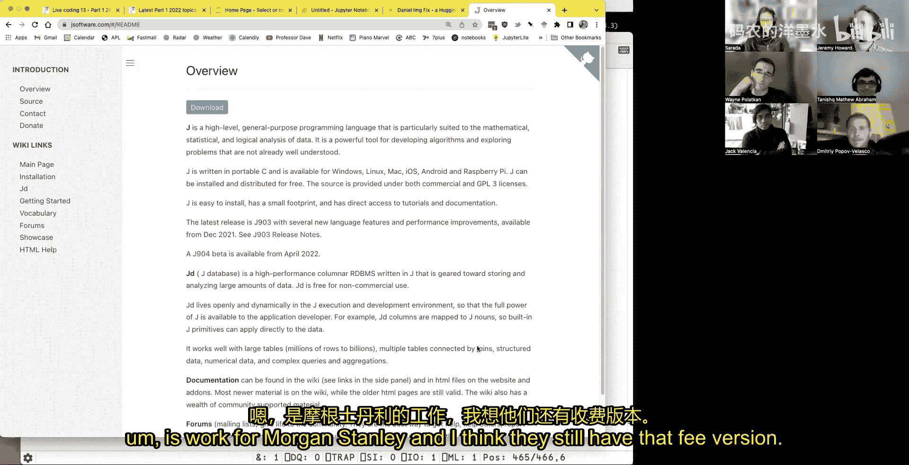

So we you can get this get us up and one thing in couple with that。 Yeah， yeah， well you know。

 we'll just get up and running。 So I've actually I and so like I don't know much APL at all to be clear。

 So this is not like。😊，Teaching you this is a shared exploration。

I've done a little bit of like a little bit of J before。

 and then two or three weeks ago reached the point in teaching my daughter and so I teach my daughter and her best friend。

 Ma， I tutor them。And we reached the point a few weeks ago where we we were up to doing sequences and series。

 you know， like Sigma notation， and I started trying to teach them and they had no idea what I was talking about and I was like。

I always thought of signaligma nottation is actually being extremely easy because like。

 if you explain it to me， it youd just be like， oh。

 it's like this list comprehension with some on the front。 You know， it's like it's a very。😊。

It's just like， oh， that's exactly what it is。 But， of course， they didn't have。

Any of that kind of idea of indexing or anything。 So， you know。

 kind of trying to say like T N equals T N -1 plus1 is a arithmetic sequence， you know， or whatever。

 you know， or like sigma， I equals 1 to 6 of I。So it just like， what's T N， What's I。

 Like what's going on。So then we stopped trying， you know， that there's like one failed lesson。

 and it's like， okay。😊，Forget all that。 I'm going to teach you APL and nu instead。

 And so we did like。Three lessons of APL at Dumpey。 And then I said， okay。So， here's。That thing。

 sigma， you know， I equals 1 to 5 of I。That's this。 That's plus slash iota 5。And they're like， oh。Oh。

 that's all。Okay。😊，You know， or， you know， in Ny MP， or didn't use MP docs。 I use World card import。

 So some a range。5 plus one。 Oh， that's all。So， yeah。 So that's why I've been like。

Re engaging or engaging more deeply with APL。But I think it's beautiful。 You know。

 I think it's just a beautiful。😊，A beautiful notation and it reminds me in some ways of like learning Chinese like once I started learning Chinese。

 I was like， oh my God， there's this whole culture of thousands of years。😊， you know， AL's like that。

 But， there's this whole culture of 60 years。 You know， there's this whole。

And recently I tried to converting some MALb mathematical formula into Python actually quite painful sorry yeah。

Doing some signal processing， cool。How did our think， oh， look， there's a thing here so。

Please try it and tell me if you find anything broken and I'll put it in the chat。Oh。

 why is there an M there。不得了。All right， thanks， all。拜e。youre looking forward to everybody take right。

 awesome。拜拜拜。