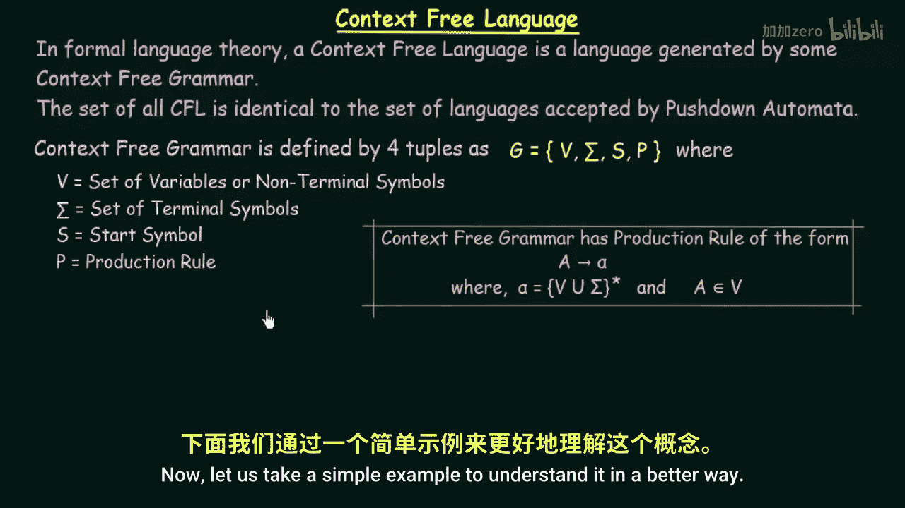
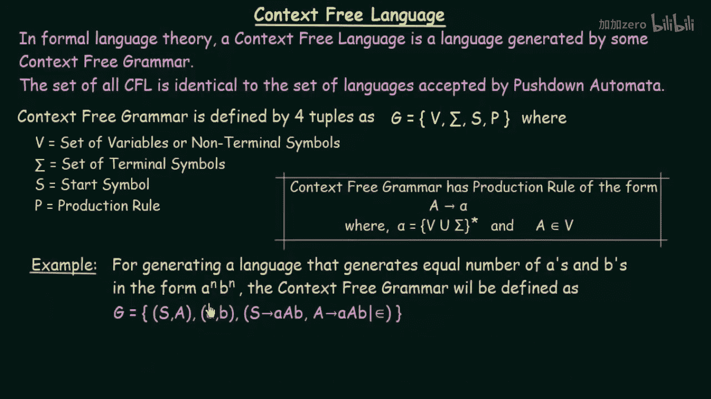
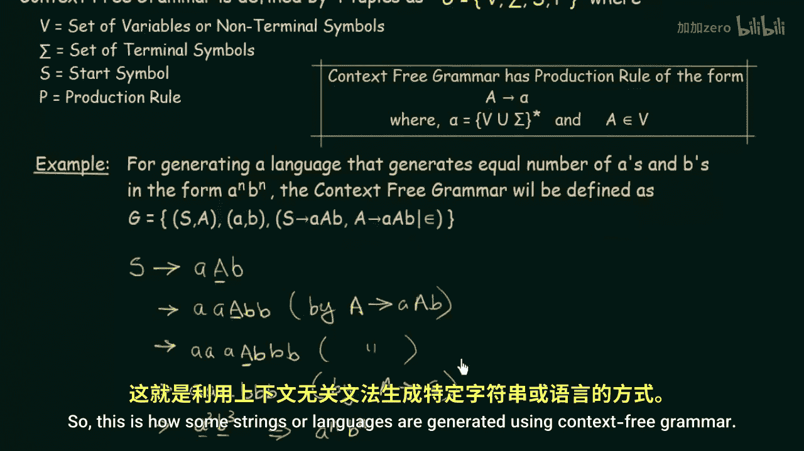

# 007：上下文无关文法与上下文无关语言 🧩

在本节课中，我们将学习上下文无关语言。

上一节我们介绍了正则语言及其局限性，本节中我们来看看更高级的语言类型——上下文无关语言。

## 概述

在本节课中，我们将要学习：
1.  什么是上下文无关语言。
2.  上下文无关文法的形式化定义。
3.  通过一个具体例子，理解如何使用上下文无关文法生成语言。

## 什么是上下文无关语言？

在形式语言理论中，上下文无关语言是由某个上下文无关文法生成的语言。

正如正则语言由正则文法生成，由上下文无关文法生成的语言被称为上下文无关语言。

所有上下文无关语言的集合，等同于由下推自动机接受的语言的集合。

如果你还记得几节课前看到的乔姆斯基文法分类表，用于设计上下文无关语言的自动机是下推自动机。

就像我们使用有限状态自动机设计正则语言，对于上下文无关语言，我们使用下推自动机。

我们知道，与正则语言相比，上下文无关语言被认为是更高级的语言。因此，下推自动机也比有限状态自动机更强大。

## 上下文无关文法的形式化定义

现在让我们看看上下文无关文法如何被形式化定义。

上下文无关文法由四元组定义：`G = (V, Σ, S, P)`。

如果你还记得，正则文法也由四元组 `(V, Σ, S, P)` 定义。上下文无关文法同样使用这四个元素，它们的含义与正则语言中的相同：
*   **V** 是变量或非终结符的集合。
*   **Σ** 是终结符的集合。
*   **S** 是开始符号。
*   **P** 是产生式规则。

正则文法与上下文无关文法的区别在于产生式规则的形式。

在上下文无关文法中，产生式规则的形式为：
`A → α`
其中 `A ∈ V`（即 `A` 属于非终结符集合），而 `α ∈ (V ∪ Σ)*`（即 `α` 是 `V` 和 `Σ` 的闭包中的任意字符串）。

这意味着 `α` 可以是非终结符、终结符，也可以是空串 `ε`。

## 示例：生成特定语言

为了更好地理解，让我们看一个简单的例子。

以下是用于生成形式为 `a^n b^n`（即 `a` 的数量等于 `b` 的数量）的语言的上下文无关文法。

该文法定义为：
`G = ({S, A}, {a, b}, S, P)`
其中产生式规则 `P` 为：
1.  `S → aAb`
2.  `A → aAb`
3.  `A → ε`

我们之前讨论正则语言时多次使用过这个例子。我们已经知道，生成这种形式字符串的语言不是正则语言，因为它无法用有限状态机设计。

既然无法用有限状态机设计，我们现在学习上下文无关语言。如前所述，上下文无关语言是比正则语言更高级的语言，能够生成这种形式的字符串。

让我们看看如何使用这个上下文无关文法生成字符串。

以下是推导过程：
1.  从开始符号 `S` 开始。
2.  应用规则 `S → aAb`，得到 `aAb`。
3.  应用规则 `A → aAb`，将 `A` 替换为 `aAb`，得到 `a aAb b`。
4.  再次应用规则 `A → aAb`，将新的 `A` 替换为 `aAb`，得到 `a a aAb b b`。
5.  最后，应用规则 `A → ε`，将 `A` 替换为空串，得到 `a a a b b b`。

我们最终得到的字符串是 `aaabbb`，其形式为 `a^3 b^3`。`a` 的数量等于 `b` 的数量。

无论你扩展多少次，你总会得到这种形式的字符串，其中 `a` 的数量等于 `b` 的数量。这意味着你可以将其推广为 `a^n b^n`。

我们看到，这是通过具有这种形式产生式规则的上下文无关文法生成的。这就是如何使用上下文无关文法生成某些字符串和语言。

## 总结

本节课中我们一起学习了：
*   **上下文无关语言**是由上下文无关文法生成的语言，并由**下推自动机**接受。
*   **上下文无关文法**由四元组 `G = (V, Σ, S, P)` 形式化定义，其核心特征是产生式规则为 `A → α` 的形式，其中 `A` 是非终结符。
*   通过生成 `a^n b^n` 语言的例子，我们实践了如何使用上下文无关文法进行推导，并理解了其比正则文法更强大的表达能力。