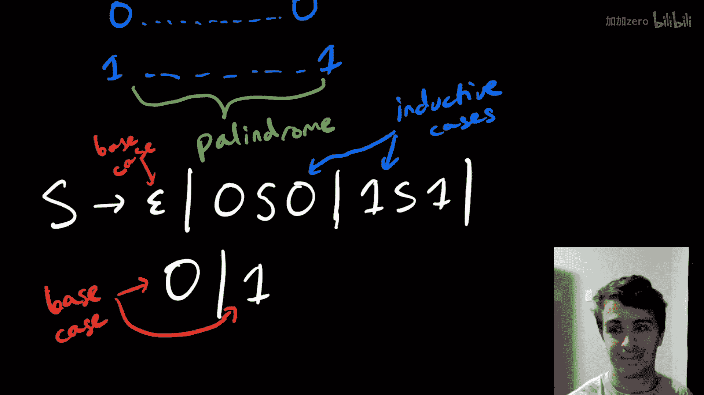

# 009：上下文无关文法与上下文无关语言


在本节课中，我们将学习上下文无关文法（CFG）及其生成的语言——上下文无关语言（CFL）。我们将了解它们与正则文法的区别，并通过具体例子理解其工作原理。

## 概述

上一节我们介绍了正则文法，它生成的语言是正则语言。本节中，我们将放宽文法的规则限制，引入上下文无关文法。我们将看到，这种更强大的文法可以描述一些非正则的语言。

## 什么是上下文无关文法（CFG）？

上下文无关文法是一种文法，其中所有规则都具有特定的形式。

以下是上下文无关文法的定义：
*   **规则形式**：所有规则都形如 `A -> X`。
*   **左侧**：`A` 是一个**单一**的变量。
*   **右侧**：`X` 可以是变量和终结符的任意组合，也可以是空串 `ε`。

这意味着，在上下文无关文法中，我们总是用一个单一的变量来替换为任意长度的字符串（由变量和终结符组成）。规则的应用不依赖于变量周围的“上下文”，因此得名“上下文无关”。

## 从正则文法到上下文无关文法

所有正则文法都已经是上下文无关文法。因为正则文法的规则（如 `A -> aB` 或 `A -> ε`）完全符合 CFG 的定义：左侧是单一变量，右侧是允许的组合。

因此，我们可以得出一个重要结论：**每一个正则语言也都是一个上下文无关语言**。

然而，反过来则不成立。存在一些上下文无关语言不是正则语言。接下来，我们通过一个例子来理解这一点。

## 一个关键例子：语言 {0^n 1^n}

考虑以下文法：
```
S -> 0A | ε
A -> S1
```
其中 `S` 是起始变量。

让我们推导这个文法生成的语言。我们可以生成空串 `ε`。应用规则 `S -> 0A`，然后 `A -> S1`，得到 `0S1`。如果此时 `S` 再推导为 `ε`，我们就得到字符串 `01`。通过重复这个过程，我们可以生成 `0011`， `000111` 等等。

实际上，这个文法生成的语言是 **L = {0^n 1^n | n ≥ 0}**。我们之前已经证明过，这个语言**不是正则语言**。但是，我们刚刚为它找到了一个文法。这个文法不是正则文法，因为它包含了 `A -> S1` 这种规则（右侧是“变量+终结符”的顺序，而非正则文法要求的“终结符+变量”）。

这个例子至关重要，它表明：
1.  我们新定义的这类文法（CFG）比正则文法更强大。
2.  语言 `{0^n 1^n}` 是一个**上下文无关语言（CFL）**，但它不是正则语言。

## 上下文无关语言（CFL）的定义

基于以上讨论，我们给出正式定义：
*   **上下文无关语言（CFL）** 是能被某个**上下文无关文法（CFG）** 生成的语言。

所以，`{0^n 1^n}` 是一个 CFL，因为我们为它找到了一个 CFG。同时，所有正则语言也都是 CFL。

## 实例：回文串语言的 CFG

让我们构建一个更复杂的例子：回文串语言。
定义字母表 `{0, 1}` 上的回文串语言 **PAL** 为：
**PAL = { w ∈ {0,1}* | w = w^R }**
其中 `w^R` 表示 `w` 的反转。例如，`0110`, `010`, `ε`, `0`, `1` 都属于 PAL。

我们可以为 PAL 设计一个上下文无关文法。设计思路基于回文的递归结构：一个回文要么是空串，要么是单个字符，要么在两端具有相同的字符，并且中间的子串本身也是一个回文。

以下是 PAL 的一个 CFG：
```
S -> 0S0 | 1S1 | 0 | 1 | ε
```
其中 `S` 是起始变量。

让我们分析这个文法：
*   **基础情况**：规则 `S -> ε`, `S -> 0`, `S -> 1` 生成最短的回文（空串和单个字符）。
*   **递归情况**：规则 `S -> 0S0` 和 `S -> 1S1` 表示，如果一个字符串 `S` 已经是回文，那么在它两边加上相同的字符（0或1）后，形成的新字符串仍然是回文。

这个文法巧妙地利用了 CFG 的递归描述能力。可以证明，PAL 也是一个非正则语言，但它是一个上下文无关语言。

## 总结

本节课中我们一起学习了：
1.  **上下文无关文法（CFG）** 的定义：规则形式为 `A -> X`，左侧是单一变量，右侧是变量和终结符的任意组合。
2.  **上下文无关语言（CFL）** 的定义：由某个 CFG 生成的语言。
3.  **CFG 与正则文法的关系**：所有正则文法都是 CFG，因此所有正则语言都是 CFL。但存在不是正则语言的 CFL（例如 `{0^n 1^n}`）。
4.  **CFG 的递归特性**：通过像 `S -> 0S0` 这样的递归规则，CFG 能够描述许多具有嵌套或对称结构的语言，例如回文串语言。




通过引入上下文无关文法，我们扩展了形式文法描述语言的能力，为处理更复杂的语言结构（如编程语言中的括号匹配、嵌套语句）奠定了理论基础。