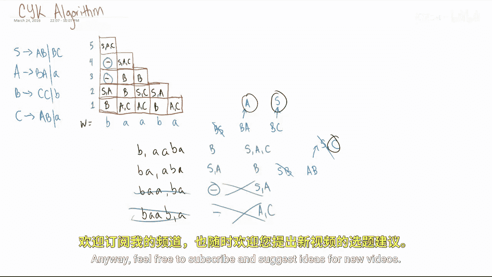

# 011：轻松掌握CYK算法（语法分析）⚙️

在本节课中，我们将要学习CYK算法。这是一种用于判断一个给定字符串是否能由某个上下文无关文法（CFG）生成的解析算法。我们将通过一个具体的例子，一步步演示如何构建CYK解析表，并最终判断字符串是否属于该文法定义的语言。

## 概述

CYK算法的核心思想是动态规划。它通过一个表格，自底向上地计算字符串所有子串可以由文法的哪些非终结符推导出来。我们将从一个简单的字符串开始，逐步分析更长的子串。

## 算法步骤详解

### 第一步：分析单个字符

首先，我们处理字符串中的每一个**单个字符**。对于字符串中的每个字符，我们查看文法中哪些非终结符可以直接推导出这个**终结符**。

以下是字符串“B A A B A”中每个字符对应的可能非终结符：
*   字符 `B` 可以由非终结符 `B` 推导。
*   字符 `A` 可以由非终结符 `A` 和 `C` 推导。
*   字符 `A` 可以由非终结符 `A` 和 `C` 推导。
*   字符 `B` 可以由非终结符 `B` 推导。
*   字符 `A` 可以由非终结符 `A` 和 `C` 推导。

因此，在表格的第一行（长度为1的子串），我们填入对应的非终结符集合。

### 第二步：分析长度为2的子串

上一节我们分析了单个字符，本节中我们来看看如何分析**长度为2的子串**。我们不再看原始字符，而是看两个字符的组合。

对于子串“BA”，我们需要考虑其所有可能的拆分方式（即“B”和“A”的组合）。我们取第一个字符的可能非终结符集合（`{B}`）和第二个字符的可能非终结符集合（`{A, C}`）的**笛卡尔积**。

以下是计算子串“BA”可能推导出的非终结符的步骤：
*   组合 `B` 和 `A` 得到 `BA`。在文法中查找，`BA` 可以由非终结符 `A` 推导。
*   组合 `B` 和 `C` 得到 `BC`。在文法中查找，`BC` 可以由非终结符 `S` 推导。
*   因此，子串“BA”可以由非终结符 `{A, S}` 推导。

我们按照这个方法，计算所有长度为2的子串（“AA”, “AB”, “BA”）的可能非终结符，并填入表格第二行。

### 第三步：分析长度为3的子串

现在，我们开始分析**长度为3的子串**。对于长度为3的子串，如“BAA”，其拆分方式更多。我们需要考虑所有可能的二元拆分：`(B, AA)` 和 `(BA, A)`。

以下是分析子串“BAA”的过程：
*   对于拆分 `(B, AA)`：取“B”的非终结符集合 `{B}` 和子串“AA”的非终结符集合（从第二步可知为 `{B}`），做笛卡尔积得到 `{BB}`。在文法中查找，没有规则能推导出 `BB`。
*   对于拆分 `(BA, A)`：取子串“BA”的非终结符集合 `{A, S}` 和“A”的非终结符集合 `{A, C}`，做笛卡尔积得到 `{AA, AC, SA, SC}`。在文法中查找这些组合，发现没有规则能推导出它们。
*   由于所有可能的拆分都无法在文法中找到对应的规则，因此在表格中对应“BAA”的位置填入“-”（表示空集）。

我们重复此过程，分析所有长度为3的子串（“AAB”, “ABA”）。

### 第四步：分析长度为4及以上的子串

随着子串长度增加，原理是相同的。对于长度为4的子串“BAAB”，我们需要考虑三种拆分：`(B, AAB)`, `(BA, AB)`, `(BAA, B)`。

以下是关键步骤：
*   我们查找之前步骤中已计算的子串“AAB”、“BA”、“AB”、“BAA”的非终结符集合。
*   对每一种拆分，取两部分非终结符集合的笛卡尔积。
*   在文法规则中查找这些组合。如果某个组合（如 `BC`）存在于文法中（即 `S -> BC`），则将左侧的非终结符（`S`）加入当前子串的集合。
*   如果所有拆分得到的组合都不在文法中，则填入“-”。

我们继续此过程，直到处理完整个字符串（长度为5的子串）。

## 核心概念与表示

在CYK算法中，我们频繁地进行集合操作和规则查找。核心操作可以表示为：

**笛卡尔积与规则查找**：
对于子串 `s[i:j]`，我们检查所有拆分点 `k` (i < k < j)。如果存在非终结符 `B` 属于 `s[i:k]` 的集合，`C` 属于 `s[k:j]` 的集合，并且文法中存在规则 `A -> BC`，那么非终结符 `A` 就属于子串 `s[i:j]` 的集合。

这可以用伪代码表示：
```
for length from 2 to n: // 子串长度
    for i from 0 to n-length: // 子串起始位置
        for k from 1 to length-1: // 拆分点
            for each rule A -> B C in grammar:
                if B in table[i][i+k] and C in table[i+k][i+length]:
                    add A to table[i][i+length]
```

## 判断结果

完成整个表格的填充后，我们检查表格的**最后一行最后一列**（代表整个字符串）的集合中是否包含文法的**起始符号**（通常是 `S`）。

*   如果包含 `S`，则该字符串可以由该文法生成。
*   如果不包含 `S`，则该字符串不能被该文法生成。

## 总结

本节课中我们一起学习了CYK算法的完整流程。我们从分析单个字符开始，逐步合并，利用动态规划的思想，通过查找文法规则来判断更长子串的派生可能性。算法的关键在于理解如何通过已计算的较短子串结果，组合并查找文法规则来推导较长子串的结果。最终，通过检查表格顶端单元格是否包含起始符号，我们就能判定整个字符串是否属于该文法语言。



*（图示：CYK算法解析表示例）*


*（图示：用于演示的上下文无关文法规则）*