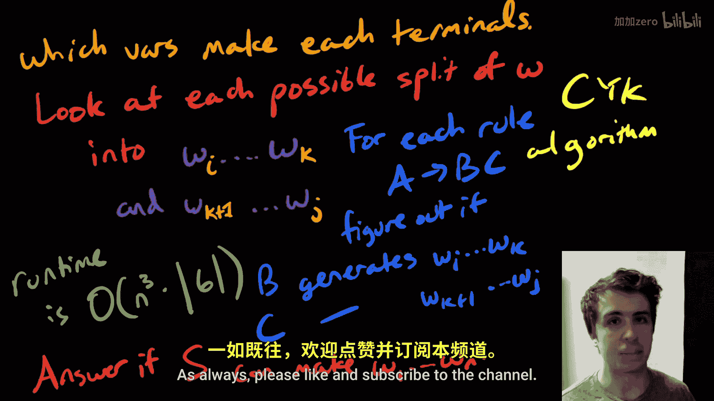

# 015：CYK算法如何工作？动态规划！

在本节课中，我们将学习CYK算法。这是一种用于判断一个给定的上下文无关文法是否能生成某个特定字符串的算法。其核心思想是使用动态规划技术，自底向上地解决问题。

## 概述

CYK算法是算法领域与计算理论领域的一个有趣交叉。它利用动态规划来解决上下文无关文法的成员资格问题，即判断一个字符串是否能由给定的文法生成。为了应用此算法，文法必须首先转换为乔姆斯基范式。

## 上下文无关文法基础

在深入算法之前，我们先回顾上下文无关文法的基本组成部分。一个上下文无关文法由四个要素构成：
*   **V**：变量集合。
*   **Σ**：终结符集合，可以理解为构成字符串的字母表。
*   **R**：规则集合。
*   **S**：起始变量。

文法的目标是生成字符串。我们从起始变量 **S** 开始，反复应用规则，将变量替换为规则右侧的符号串（可以是变量和终结符的混合），最终希望能得到我们想要的、完全由终结符组成的字符串。如果存在这样的规则应用序列，我们就说文法**生成**了该字符串。

规则的一般形式是 **A → X**，其中 **A** 是一个变量，**X** 是由变量和终结符组成的串。

## 乔姆斯基范式

为了使CYK算法有效工作，我们需要将文法转换为**乔姆斯基范式**。在CNF中，只允许三种类型的规则：
1.  **S → ε** （只有起始变量 **S** 可以直接生成空串 ε）
2.  **A → a** （一个变量生成单个终结符）
3.  **A → BC** （一个变量生成两个变量，且 **B** 和 **C** 不能是起始变量）

一个重要的推论是：任何非起始变量最终都必须生成一个非空字符串。此外，可以证明，如果一个长度为 **n** 的字符串能被一个CNF文法生成，那么恰好需要 **2n - 1** 步规则应用。

## 算法核心思想：动态规划

现在，我们来看如何判断文法 **G** 是否能生成字符串 **W = w1 w2 ... wn**。

如果字符串长度为1，我们只需检查是否存在规则 **S → w1**（或经过变量推导）。这很简单。

对于长度至少为2的字符串，要生成它，起始步骤必须应用 **A → BC** 这类规则。这意味着字符串 **W** 被分割成两部分：前半部分由 **B** 生成，后半部分由 **C** 生成。

因此，问题“**S** 能否生成整个字符串 **W**？”被转化为两个子问题：“变量 **B** 能否生成子串 **w1...wi**？”和“变量 **C** 能否生成子串 **wi+1...wn**？”。

这里的关键是，我们不知道正确的分割点 **i** 在哪里。如果使用简单的递归尝试所有可能的分割，效率会非常低，因为子问题之间没有共享信息。

## 自底向上的动态规划解法

CYK算法采用动态规划，自底向上地构建解。我们不再从整个字符串开始分割，而是从小子串开始，逐步组合。

我们定义一个更通用的问题：对于任意下标 **i** 和 **j**（1 ≤ i ≤ j ≤ n），判断哪些变量可以生成子串 **wi ... wj**。

以下是算法的步骤框架：

1.  **初始化**：处理所有长度为1的子串（即单个字符）。对于每个位置 **i**，找出所有能直接生成终结符 **wi** 的变量 **A**（即存在规则 **A → wi**）。这对应CNF中的第二类规则。

2.  **递推计算**：依次计算长度 **L** 从 2 到 **n** 的所有子串。
    *   对于每个长度为 **L** 的子串，其起始下标 **i** 从 1 到 **n-L+1**，则结束下标 **j = i + L - 1**。
    *   对于该子串，我们尝试所有可能的分割点 **k**（i ≤ k < j），将其分为两部分：**wi...wk** 和 **wk+1...wj**。
    *   对于文法中每一条 **A → BC** 形式的规则，我们检查：是否已经计算出变量 **B** 能生成第一部分 **wi...wk**，并且变量 **C** 能生成第二部分 **wk+1...wj**。
    *   如果存在这样的 **k** 和规则 **A → BC** 满足条件，那么我们就知道变量 **A** 能够生成子串 **wi...wj**。

3.  **得到答案**：在完成所有计算后，我们检查在用于表示整个字符串 **w1...wn** 的子串（即 i=1， j=n）对应的可生成变量集合中，是否包含起始变量 **S**。如果包含，则原文法能生成该字符串；否则不能。

## 算法复杂度

算法需要三层循环：
*   第一层循环子串长度 **L**（O(n)）。
*   第二层循环子串起始位置 **i**（O(n)）。
*   第三层循环分割点 **k**（O(n)）。
对于每个 **(i, j, k)** 组合，我们需要检查文法中的所有 **A → BC** 型规则（假设文法大小为常数，或记为 |G|）。

因此，CYK算法的总时间复杂度为 **O(n³ * |G|)**。对于固定的文法，可以简化为 **O(n³)**。

## 总结

本节课我们一起学习了CYK算法。该算法通过将上下文无关文法转换为乔姆斯基范式，并运用动态规划技术，自底向上地计算每个子串可以由哪些变量生成，从而高效地解决了文法成员资格问题。其核心在于将大问题分解为重叠的子问题，并利用表格存储子问题的解，避免了重复计算，最终在多项式时间内（O(n³)）给出答案。