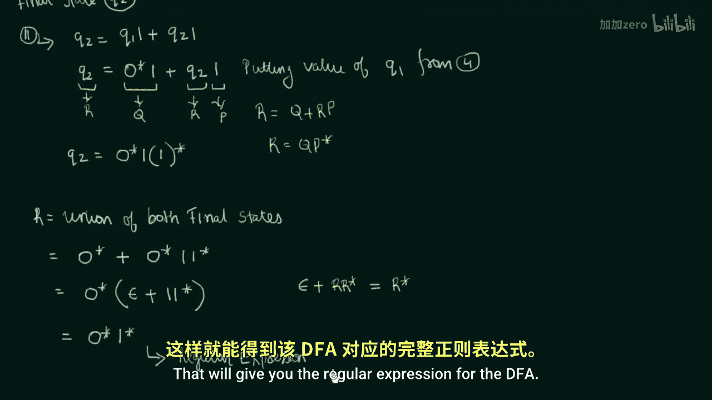
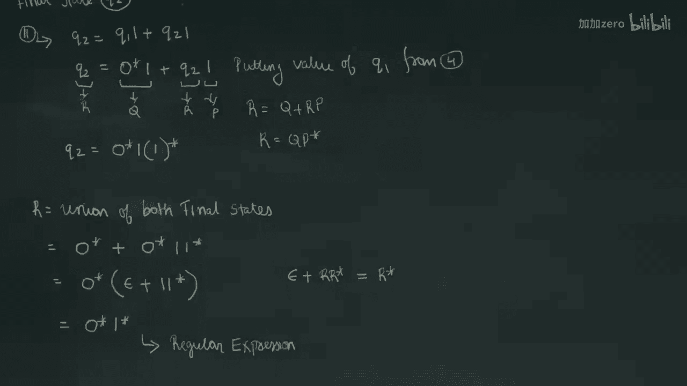

计算模型：16：多终态DFA到正则表达式的转换 🔄

在本节课中，我们将学习如何为一个具有多个终态的确定性有限自动机设计正则表达式。在此之前，我们已经掌握了为单终态DFA设计正则表达式的方法。本节将重点介绍处理多终态DFA的通用流程。

**核心思路**：当DFA有多个终态时，我们需要分别找出从起始状态到达**每一个终态**所接受的语言对应的正则表达式，最后对这些表达式取**并集**，即可得到整个DFA对应的正则表达式。

---

### 构建状态方程

首先，我们为DFA中的每一个状态建立一个方程。方程描述了“如何到达该状态”。对于状态 `Q`，其方程形式通常为：
`Q = (所有进入Q的路径的表达式之和)`

观察给定的DFA，我们有三个状态：`Q1`、`Q2`、`Q3`，其中 `Q1` 和 `Q2` 是终态。

以下是每个状态对应的方程：

1.  **状态 Q1 的方程**：进入 `Q1` 的路径有两条。一条是从起始状态直接进入（用 `ε` 表示），另一条是从 `Q1` 自身通过输入 `0` 循环进入。
    `Q1 = ε + Q1·0`  —— (方程1)

2.  **状态 Q2 的方程**：进入 `Q2` 的路径有两条。一条是从 `Q1` 通过输入 `1` 进入，另一条是从 `Q2` 自身通过输入 `1` 循环进入。
    `Q2 = Q1·1 + Q2·1`  —— (方程2)

3.  **状态 Q3 的方程**：进入 `Q3` 的路径有三条。分别是从 `Q2` 通过输入 `0` 进入，以及从 `Q3` 自身通过输入 `0` 或 `1` 循环进入。
    `Q3 = Q2·0 + Q3·0 + Q3·1`  —— (方程3)

---

### 求解终态的正则表达式

现在，我们分别求解两个终态 `Q1` 和 `Q2` 的正则表达式。

**求解终态 Q1**

我们使用方程1：`Q1 = ε + Q1·0`。
这个方程符合 **阿登定理 (Arden‘s Theorem)** 的形式：`R = Q + R·P`，其解为 `R = Q·P*`。
*   其中 `R` 对应 `Q1`
*   `Q` 对应 `ε`
*   `P` 对应 `0`

应用阿登定理：
`Q1 = ε · 0*`
根据正则表达式恒等式 `ε·R = R`，可得：
`Q1 = 0*`  —— (方程4)

**求解终态 Q2**

我们使用方程2：`Q2 = Q1·1 + Q2·1`。
首先，将刚刚求得的 `Q1` 的值（方程4）代入：
`Q2 = (0*)·1 + Q2·1`  —— (方程5)

方程5同样符合阿登定理 `R = Q + R·P` 的形式：
*   `R` 对应 `Q2`
*   `Q` 对应 `0*·1`
*   `P` 对应 `1`

应用阿登定理：
`Q2 = (0*·1) · 1*`
这可以简写为：
`Q2 = 0*·1·1*`  —— (方程6)

---

### 合并终态表达式

我们已经得到了分别到达两个终态的正则表达式：
*   到达 `Q1`：`0*`
*   到达 `Q2`：`0*·1·1*`

整个DFA接受的语言，是能被 **至少一个终态** 接受的字符串的集合，因此需要取这两个表达式的**并集**（用 `+` 表示）：
`正则表达式 = 0* + 0*·1·1*`

我们可以对这个表达式进行化简，提取公因子 `0*`：
`正则表达式 = 0* · (ε + 1·1*)`

根据正则表达式恒等式 `ε + R·R* = R*`（其中 `R` 为 `1`），括号内的部分 `(ε + 1·1*)` 就等于 `1*`。
因此，最终化简后的正则表达式为：
`正则表达式 = 0* · 1*`

---

### 总结

本节课中，我们一起学习了为具有多个终态的DFA构造正则表达式的方法。关键步骤如下：
1.  **列出方程**：为每个状态建立方程，描述所有进入该状态的路径。
2.  **逐个求解**：利用阿登定理，分别求解出从起始状态到达**每一个终态**的正则表达式。
3.  **取并集**：将求得的各个终态的正则表达式用并集运算符 (`+`) 连接起来，得到整个DFA的正则表达式。
4.  **化简**（可选）：利用正则表达式的恒等式对结果进行化简，使其更简洁。

处理多终态DFA的核心在于，分别处理每个终态，最后合并结果。只要掌握了阿登定理和基本的并集操作，这个过程就变得清晰而直接。