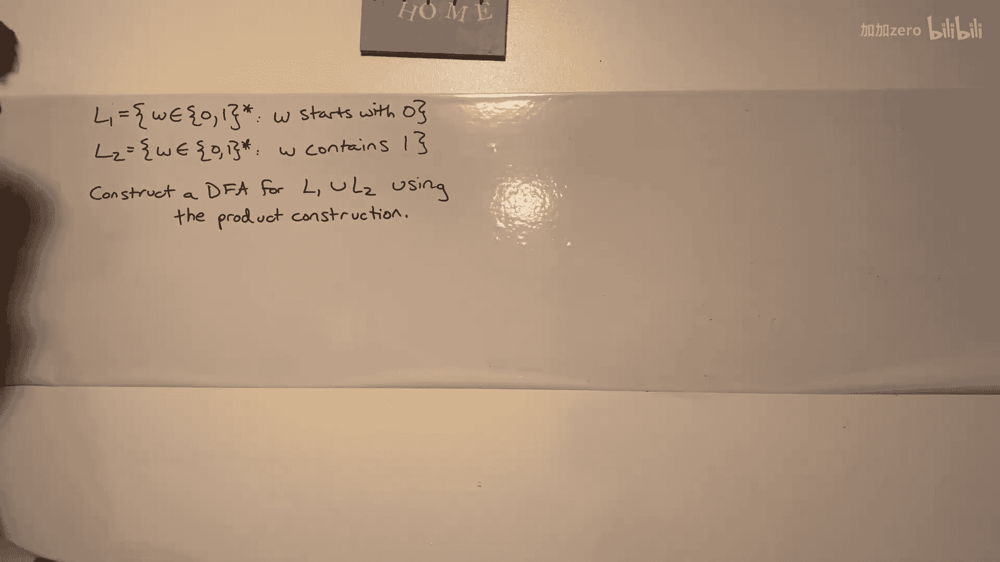

# 019：如何使用乘积构造法求两个正则语言的并集

在本节课中，我们将学习如何使用“乘积构造法”来构建一个接受两个正则语言并集的确定有限自动机。我们将通过一个具体的例子，将整个过程分解为清晰的步骤，确保初学者能够轻松理解。



## 概述

我们有两个正则语言：
*   **L1**：所有以 `0` 开头的字符串（即 `0(0|1)*`）。
*   **L2**：所有包含至少一个 `1` 的字符串。

我们的目标是构建一个DFA，使其接受的语言是 **L1 ∪ L2**，即满足L1条件**或**L2条件的字符串。我们将使用乘积构造法来完成这个任务。

## 第一步：为L1和L2分别构建DFA

在使用乘积构造法之前，我们首先需要为每个语言单独构建一个DFA。

### 为L2构建DFA
L2要求字符串包含至少一个`1`。
*   我们从起始状态 `Q0` 开始。如果只读到`0`，我们尚未见到`1`，因此保持在`Q0`。
*   一旦读到第一个`1`，我们就转移到状态 `Q1`。从`Q1`开始，无论后续输入是什么，字符串都满足“包含至少一个`1`”的条件，因此`Q1`是接受状态，并且对`0`和`1`都有自循环。

以下是L2的DFA状态转移图：
```
       0         0,1
Start --> [Q0] ----> (Q1)
        \     /
         1
```
**代码描述**：DFA_L2 = ({Q0, Q1}, {0,1}, δ_L2, Q0, {Q1})，其中δ_L2定义如下：
*   δ_L2(Q0, 0) = Q0
*   δ_L2(Q0, 1) = Q1
*   δ_L2(Q1, 0) = Q1
*   δ_L2(Q1, 1) = Q1

### 为L1构建DFA
L1要求字符串以`0`开头。
*   我们从起始状态 `R0` 开始。
*   如果第一个字符是`0`，则转移到状态 `R1`。因为已经满足了“以0开头”的条件，所以`R1`是接受状态，并且对后续的`0`和`1`都有自循环。
*   如果第一个字符是`1`，则转移到状态 `R2`。因为第一个字符是`1`，字符串永远不可能满足L1的条件，所以`R2`是一个“死状态”（非接受状态），并且对`0`和`1`都有自循环。

以下是L1的DFA状态转移图：
```
       0           0,1
Start --> [R0] ----> (R1)
        \     /
         1
          \
           v
          [R2] <-- 0,1
```
**代码描述**：DFA_L1 = ({R0, R1, R2}, {0,1}, δ_L1, R0, {R1})，其中δ_L1定义如下：
*   δ_L1(R0, 0) = R1
*   δ_L1(R0, 1) = R2
*   δ_L1(R1, 0) = R1
*   δ_L1(R1, 1) = R1
*   δ_L1(R2, 0) = R2
*   δ_L1(R2, 1) = R2

## 第二步：应用乘积构造法

现在我们已经有了两个独立的DFA，接下来我们将使用乘积构造法来创建它们并集的DFA。其核心思想是**同步运行**这两个自动机。

### 创建新状态
新DFA的每个状态都是原有两个DFA状态的一个**有序对** `(q, r)`，其中 `q` 来自DFA_L2，`r` 来自DFA_L1。这被称为笛卡尔积。

由于DFA_L2有2个状态（Q0, Q1），DFA_L1有3个状态（R0, R1, R2），新DFA将拥有 2 × 3 = 6 个状态。它们是：
*   (Q0, R0)
*   (Q0, R1)
*   (Q0, R2)
*   (Q1, R0)
*   (Q1, R1)
*   (Q1, R2)

### 确定起始状态
新DFA的起始状态是原有两个DFA起始状态的组合，即 **(Q0, R0)**。

### 定义转移函数
对于新DFA中的每一个状态 `(q, r)` 和每一个输入符号 `a`（`0`或`1`），其转移目标是 `(δ_L2(q, a), δ_L1(r, a))`。也就是说，我们分别查看两个原始DFA在当前状态和输入`a`下会转移到哪里，然后将这两个新状态组合成新DFA的目标状态。

以下是计算过程示例：
*   从 `(Q0, R0)` 出发：
    *   输入 `0`: DFA_L2从Q0到Q0，DFA_L1从R0到R1。因此，新目标状态是 `(Q0, R1)`。
    *   输入 `1`: DFA_L2从Q0到Q1，DFA_L1从R0到R2。因此，新目标状态是 `(Q1, R2)`。
*   从 `(Q0, R1)` 出发：
    *   输入 `0`: DFA_L2从Q0到Q0，DFA_L1从R1到R1。因此，新目标状态是 `(Q0, R1)`（自循环）。
    *   输入 `1`: DFA_L2从Q0到Q1，DFA_L1从R1到R1。因此，新目标状态是 `(Q1, R1)`。
*   ... 以此类推计算所有状态和输入。

### 确定接受状态
因为我们要构建的是**并集**（L1 ∪ L2）的DFA，所以一个字符串被接受，当且仅当它**至少被其中一个原始DFA接受**。

因此，新DFA的接受状态集合是：所有满足 `q` 是DFA_L2的接受状态 **或** `r` 是DFA_L1的接受状态 的状态 `(q, r)`。
*   来自DFA_L2的接受状态是 `Q1`。所以，所有形如 `(Q1, *)` 的状态（即右列所有状态）都是接受状态。
*   来自DFA_L1的接受状态是 `R1`。所以，所有形如 `(*, R1)` 的状态都是接受状态。这包括了 `(Q0, R1)` 和 `(Q1, R1)`。

综合以上两点，新DFA的接受状态是：`(Q0, R1)`, `(Q1, R0)`, `(Q1, R1)`, `(Q1, R2)`。

## 最终DFA与验证

根据以上步骤，我们可以绘制出新DFA的状态转移图。在实践中，我们可能会发现某些状态（如`(Q0, R2)`和`(Q1, R2)`）从起始状态无法到达，在优化DFA时可以将其移除。但为了完整展示乘积构造法，我们在此保留它们。

让我们验证一下这个DFA是否正确：
*   **空字符串**：从起始状态`(Q0, R0)`开始，它不是接受状态。空字符串不以`0`开头，也不包含`1`，因此确实不应被接受。✅
*   **以`0`开头的字符串（如`0`, `01`, `001`）**：读入第一个`0`后，进入状态`(Q0, R1)`，这是一个接受状态。此后无论输入什么，都会保持在接受状态（`(Q0, R1)`或`(Q1, R1)`）。这满足了L1的条件。✅
*   **包含`1`的字符串（如`1`, `10`, `010`）**：只要读到一个`1`，DFA_L2的部分就会进入`Q1`，从而使新状态进入右列（`(Q1, *)`），而右列所有状态都是接受状态。这满足了L2的条件。✅
*   **既不满足L1也不满足L2的字符串（即全`0`串）**：对于全`0`串，DFA将始终停留在左列（`Q0`）和状态`R1`，即状态`(Q0, R1)`。这是一个接受状态吗？是的，因为`r = R1`是DFA_L1的接受状态。等等，这里似乎有问题？全`0`串并不以`0`开头吗？它是以`0`开头的。实际上，全`0`串（如`0`, `00`）**满足L1**（以0开头），因此应该被接受。我们的DFA中`(Q0, R1)`是接受状态，正好接受了它。如果字符串是空串，则停留在`(Q0, R0)`（非接受）。如果字符串是`1`开头的全`0`串？这不可能，因为`1`开头后就不是全`0`了。所以验证通过。✅

实际上，L1 ∪ L2 是“所有以0开头**或**包含至少一个1的字符串”。唯一不被接受的字符串就是**空字符串**。我们的DFA恰好满足这一点。

## 总结

本节课中，我们一起学习了如何使用乘积构造法为两个正则语言的并集构建DFA。我们首先回顾了为单个语言构建DFA的方法，然后详细讲解了乘积构造法的三个核心步骤：
1.  **创建状态**：新状态是原DFA状态的笛卡尔积。
2.  **定义转移**：新转移同步模拟两个原DFA的转移。
3.  **确定接受状态**：对于并集，新状态是接受状态当且仅当它在**至少一个**原DFA中是接受状态。


通过这个系统化的方法，我们可以将复杂的并集DFA构造问题分解为可管理的步骤。虽然最终得到的DFA可能包含不可达状态，但乘积构造法保证了其理论上的正确性，并且是理解有限自动机闭包性质的关键工具。