# 024：上下文无关文法构建示例

在本节课中，我们将学习如何为不同的语言构建上下文无关文法。我们将通过一系列具体的例子，从简单到复杂，逐步掌握CFG的构建方法。

## 概述

上下文无关文法是一种用于描述编程语言语法和某些形式语言的有力工具。它由一组变量、终结符、产生式和一个起始符号组成。本节将通过多个示例，演示如何根据语言描述来设计相应的产生式集合。

## 示例一：任意数量的a

首先，我们构建一个CFG，用于生成字母表 Σ = {a} 上由任意数量a组成的字符串。该语言包括空串ε、单个a、两个a等。

该语言对应的正则表达式是 `a*`。为了生成任意数量的a，我们需要一个递归的产生式。

以下是该文法的产生式集合：
*   `S → aS`
*   `S → ε`

其中，`S`是起始符号。第一条产生式`S → aS`是递归步骤，用于生成更多的a。第二条产生式`S → ε`是基础步骤，用于终止递归并允许生成空串。

该文法的四元组形式化表示为：
`G = ({S}, {a}, P, S)`，其中`P`是上述产生式集合。

## 示例二：任意数量的a和b

接下来，我们构建一个CFG，用于生成由任意数量的a和b以任意顺序组合而成的字符串。语言包括ε, a, b, aa, ab, ba, bb等。

该语言对应的正则表达式是 `(a|b)*`。我们可以扩展上一个示例的思路。

该文法的产生式如下：
*   `S → aS`
*   `S → bS`
*   `S → ε`

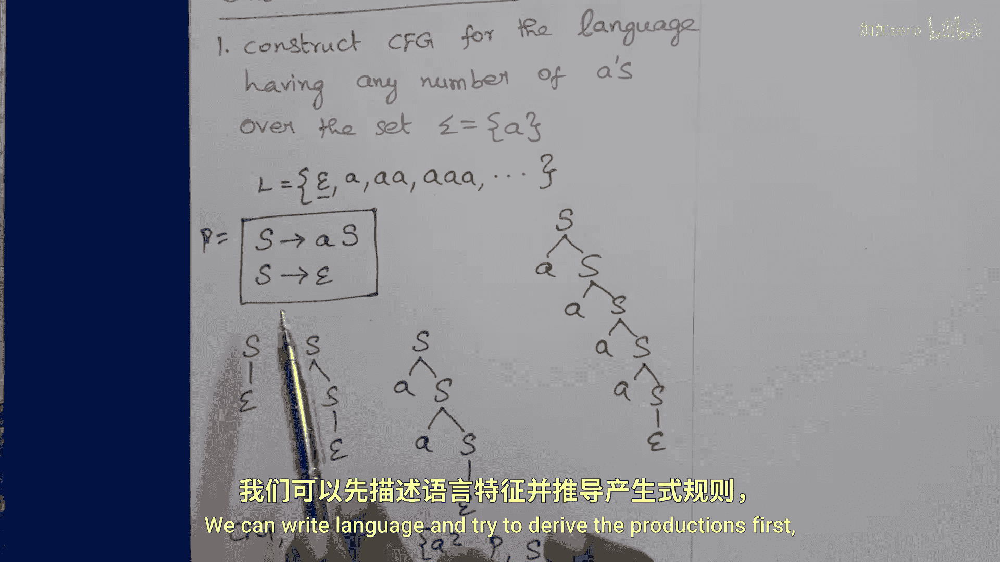

由于这些产生式具有相同的左部（头），我们可以使用竖线`|`将它们合并写为：`S → aS | bS | ε`。

该文法的四元组形式化表示为：
`G = ({S}, {a, b}, P, S)`，其中`P`是上述产生式集合。

## 示例三：至少包含两个a的字符串

现在，我们构建一个CFG，用于生成所有至少包含两个字母`a`的字符串。字符串中这两个a的前后可以有任何数量的a和b。

该语言对应的正则表达式是 `(a|b)* a (a|b)* a (a|b)*`。关键在于确保字符串中至少出现两个a。

我们可以引入一个新的非终结符`A`来生成任意数量的a和b（即`(a|b)*`）。文法的核心思想是：起始符号`S`生成“任意a/b串 + a + 任意a/b串 + a + 任意a/b串”。

该文法的产生式可以设计为：
*   `S → A a A a A`
*   `A → aA | bA | ε`

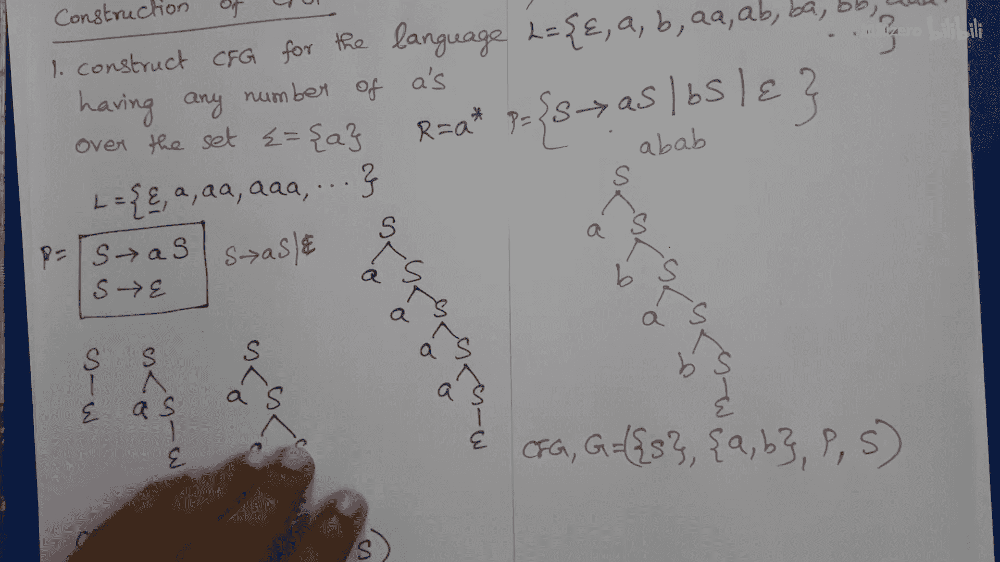

这里，`A`负责生成`(a|b)*`部分，而`S`的结构保证了至少两个a的出现。

## 示例四：包含子串“000”的字符串

此例要求构建CFG，用于生成所有恰好包含一个“000”子串的字符串。这个“000”子串的前后可以有任意数量的0和1。

该语言对应的正则表达式是 `(0|1)* 000 (0|1)*`。构建思路与上一个例子类似。

我们可以引入非终结符`A`来生成`(0|1)*`。文法的核心是确保“000”出现且仅出现一次（通过文法结构隐含约束，通常指“至少一次”，更严格的“恰好一次”需要更复杂的设计，此处按“至少一次”理解）。

该文法的产生式可以设计为：
*   `S → A 000 A`
*   `A → 0A | 1A | ε`

## 示例五：a^n b^n 型字符串

这是一个经典例子：构建CFG，用于生成形如`a^n b^n`（n ≥ 1）的字符串，即a的数量与b的数量相等，且所有a在前，所有b在后。例如：ab, aabb, aaabbb。

关键点在于保持a和b的数量相等。我们可以使用递归产生式在生成a的同时“预订”一个b。

该文法的产生式如下：
*   `S → aSb`
*   `S → ab`

第一条产生式`S → aSb`是递归步骤，每次应用它都会增加一个a和一个b。第二条产生式`S → ab`是基础步骤，用于终止递归并生成最小的合法字符串`ab`。

对于字符串`aaabbb`，推导过程可以是：`S ⇒ aSb ⇒ aaSbb ⇒ aaabbb`。

## 示例六：a^n b^2n 型字符串

此例是上一个的变体：构建CFG，用于生成形如`a^n b^{2n}`（n ≥ 1）的字符串，即b的数量是a的两倍。

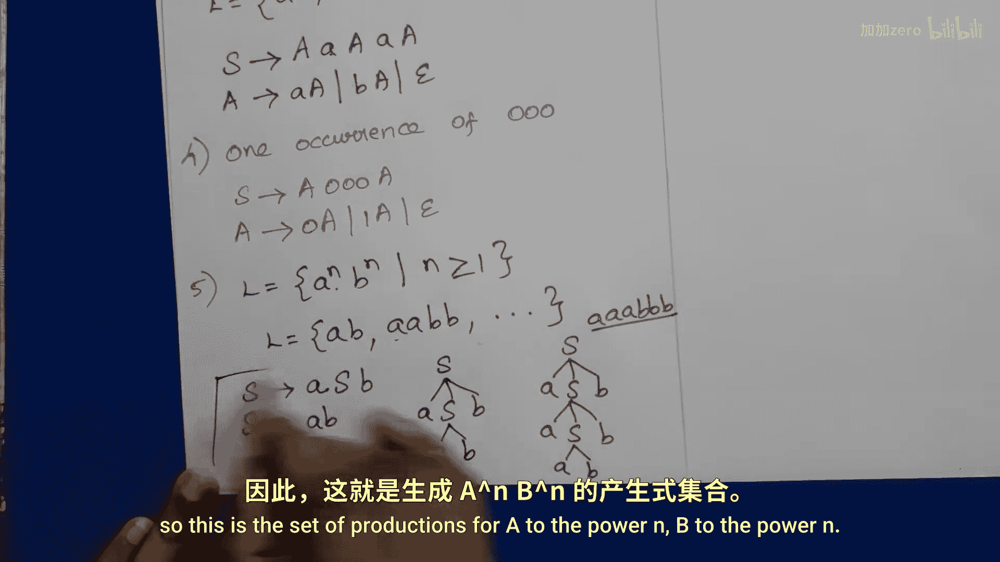

思路类似，但在递归步骤中，每次生成一个a时，需要生成两个b。

该文法的产生式如下：
*   `S → aSbb`
*   `S → abb`

## 示例七：w c w^R 型字符串（奇回文）

此例要求构建CFG，用于生成形如`w c w^R`的字符串，其中`w`是由a和b组成的任意字符串，`w^R`是`w`的逆序，`c`是一个中心标记符。例如：`a c a`, `ab c ba`。这是一种带中心标记的奇长度回文。

核心思想是：如果字符串以a开始，则必须以a结束；如果以b开始，则必须以b结束。递归地，去掉首尾符号后，中间部分仍然符合这个模式。

该文法的产生式如下：
*   `S → aSa`
*   `S → bSb`
*   `S → c`

前两条产生式递归地构建回文结构，第三条产生式提供中心标记，从而终止递归。

对于字符串`ab c ba`，推导过程可以是：`S ⇒ aSa ⇒ abSba ⇒ abcba`。

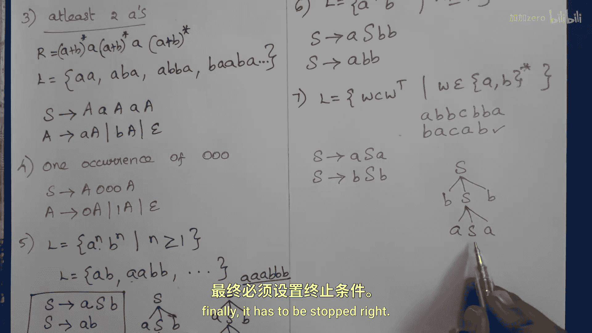

## 示例八：a^n b^m c^n 型字符串

此例要求构建CFG，用于生成形如`a^n b^m c^n`（n, m ≥ 1）的字符串，即首尾a和c的数量相等，中间有至少一个b。

我们需要同时处理两个约束：1) a和c数量相等；2) 中间有b。可以先用递归产生式生成a...c的框架，再在框架内生成b。

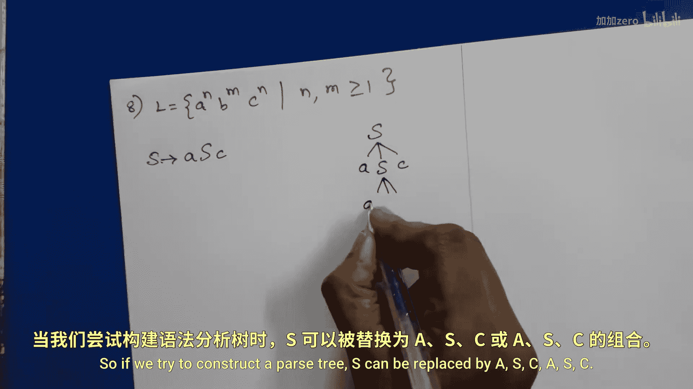

该文法的产生式可以设计为：
*   `S → aSc`
*   `S → aBc`
*   `B → bB | b`

第一条产生式`S → aSc`递归生成外层的a和c。第二条产生式`S → aBc`将递归转换为生成中间b的阶段。非终结符`B`通过`B → bB | b`生成至少一个b。

对于字符串`aa bbb cc`，推导过程可以是：`S ⇒ aSc ⇒ aaScc ⇒ aaBcc ⇒ aabBcc ⇒ aabbBcc ⇒ aabbbcc`。

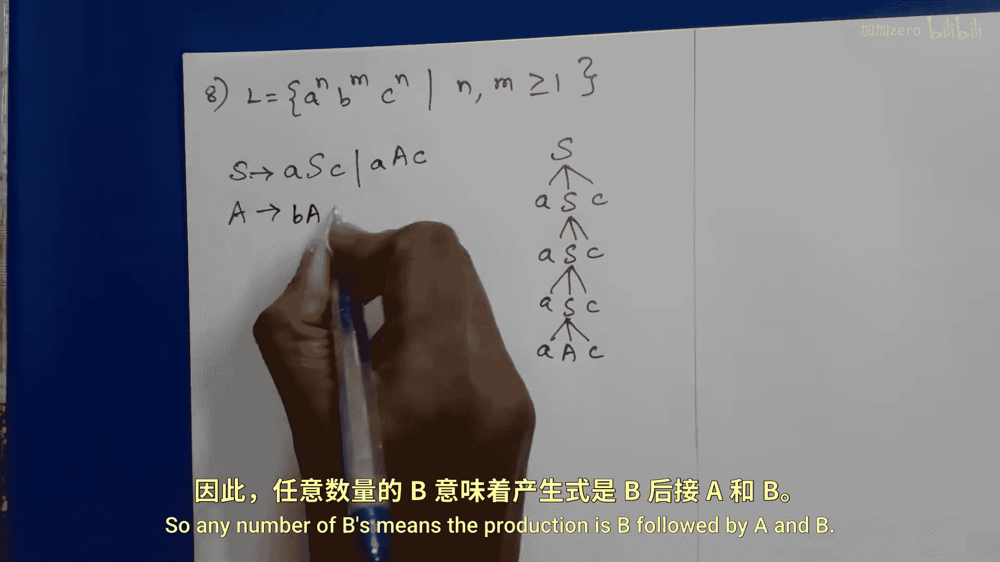

## 示例九：a^n b^n c^n d^n 型字符串（非CFL）

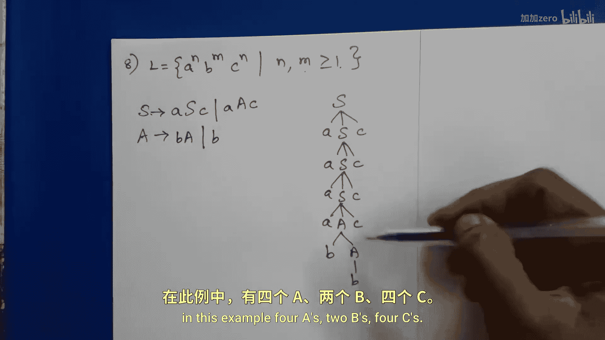

我们考虑语言 `a^n b^n c^n d^n`（n ≥ 1）。可以证明，这个语言**不是上下文无关语言**，因此不存在CFG能精确生成它。

直观上，CFG的栈式记忆能力有限。要同时匹配a、b、c、d四组数量，需要记忆多个独立的计数，这超出了CFG的能力范围（属于更强大的上下文有关文法范畴）。

## 示例十：a^n b^n c^m d^m 型字符串

此例要求构建CFG，用于生成形如`a^n b^n c^m d^m`（n, m ≥ 1）的字符串。这可以看作是两个独立结构`a^n b^n`和`c^m d^m`的拼接。

我们可以用两个非终结符分别生成这两个部分。

该文法的产生式可以设计为：
*   `S → XY`
*   `X → aXb | ab`
*   `Y → cYd | cd`

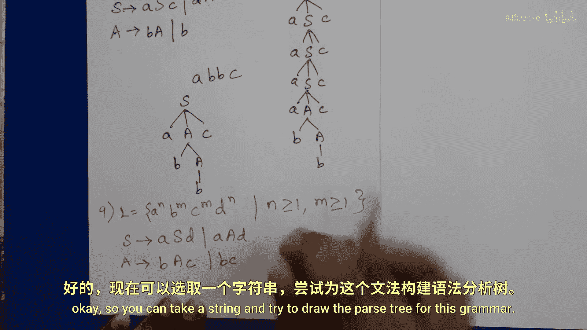

这里，`X`负责生成`a^n b^n`部分，`Y`负责生成`c^m d^m`部分，起始符号`S`将它们组合起来。

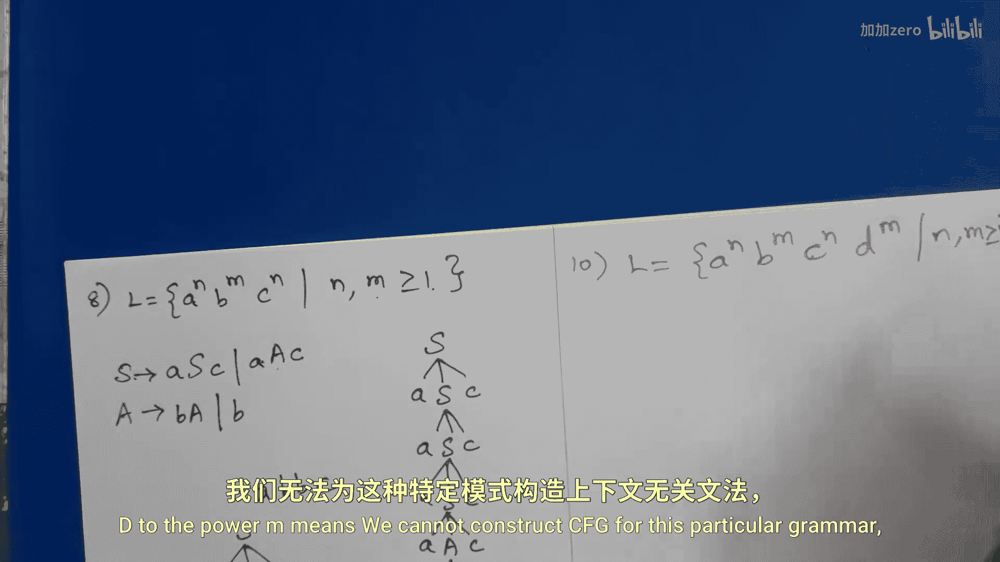

## 示例十一：a^{m+n} b^m c^n 型字符串

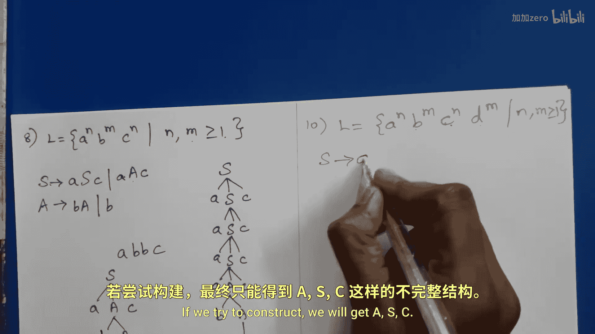

最后，我们构建CFG，用于生成形如`a^{m+n} b^m c^n`（m, n ≥ 1）的字符串。我们可以将字符串重写为`a^m a^n b^m c^n`。

观察发现，这可以视为`a^m b^m`和`a^n c^n`的组合。我们可以设计产生式，首先生成`a^n c^n`的框架，同时允许在框架的a部分前添加额外的a，并为这些额外的a生成对应的b。

该文法的产生式可以设计为：
*   `S → aSc | A`
*   `A → aAb | ab`

第一条产生式`S → aSc`生成`a^n c^n`的核心结构。`S → A`将生成任务转交给`A`。`A → aAb | ab`则在核心结构的前端添加`a^m b^m`部分。

对于字符串`aaa bb c`（m=2， n=1），推导过程可以是：`S ⇒ aSc ⇒ aAc ⇒ aaAbc ⇒ aabbc`。

## 总结

本节课中，我们一起学习了上下文无关文法的构建方法。我们从生成简单模式（如任意数量的字符）开始，逐步深入到生成需要计数和匹配的复杂模式（如`a^n b^n`）。关键步骤包括：
1.  **理解语言**：明确语言包含哪些字符串。
2.  **识别模式**：寻找字符串中的递归或重复结构。
3.  **设计产生式**：
    *   使用递归产生式（如`S → aS`）生成重复模式。
    *   使用基础产生式（如`S → ε` 或 `S → ab`）终止递归。
    *   引入新的非终结符来处理语言中不同的子部分或约束条件。
4.  **形式化表示**：将文法写成四元组`(V, T, P, S)`的形式。

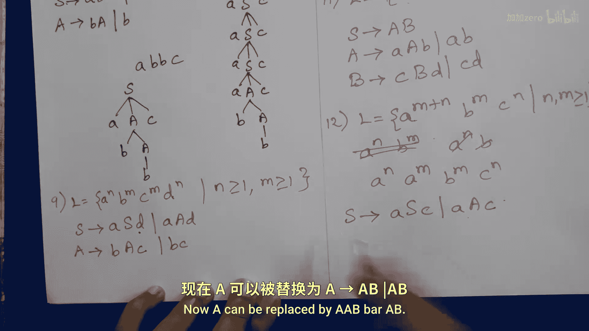

通过练习这些示例，你应该能够掌握为许多常见语言设计CFG的基本技巧。