# 悉尼大学【中英⚡计算模型｜COMP2022 Models of Computation】 p05 P6 SATto3color -BV1vTe6zzENb_p5-

It's pretty hard to color graphs according to no conflict rule。 as a matter of fact。

 it's even hard to color a graph with just three colors。

 That is to figure out whether the graph can be colored with three colors and I'm going to explain in this little video just why and the reason is that the notorious satisfiability problem for propositional formulas reduces to three coloring what that means is that if I could find a good way to three color an arbitrary graph。

 in fact， I could use that method to test whether or not a propositional formula was was satisfiable I've had a good three coloring method。

 I'd get a good satisfiability method and there's a lot of evidence in an overwhelming opinion of all the experts in the field that there is not going to be a good way to do to check satisfiability and that means there's not going to be a good way to do three coloring。

 Let's see how that argument goes。

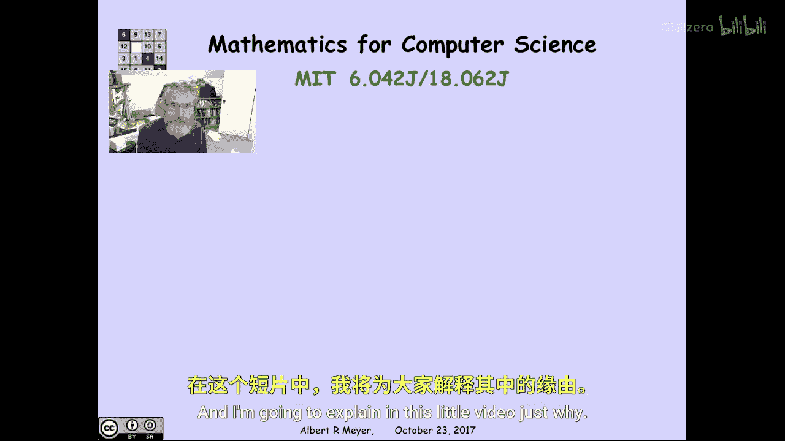

So I'm actually going to look instead of at formula satisfiability。

 I'm going to actually even look at a harder problem and show that it's reducible to threecolability。

 I'm going to look at the problem of whether a circuit is satisfiable so let's imagine that we have some Boolean circuit or propositional circuit it's built out of these little gates that's an or gate and that's an inverter not gate and there's an output and there's a bunch of inputs and it's enough to have or's and knots because I can express all the other kinds of gates that you might want like ands and implies gates if you wanted them in terms of just these two primitives or and not。

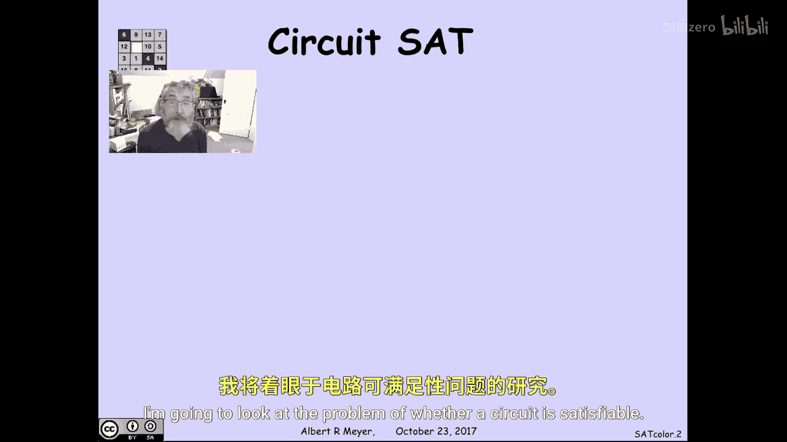

So the circuit satisfiability problem is that I'd like to know。

 is there a way to assign truth values to those inputs so that the output becomes true okay。

 is there a way to set you know the first one to true and the next one to false and so on down to the last one to some value true or false in such a way that the circuit will produce output true if there's a set of inputs like that they would be called a satisfying set of inputs。

Because the circuit then produces it true in terms of formulas that this would mean a truth assignment to the variables that led the formula to be true。

 so that's the circuit SAT problem。

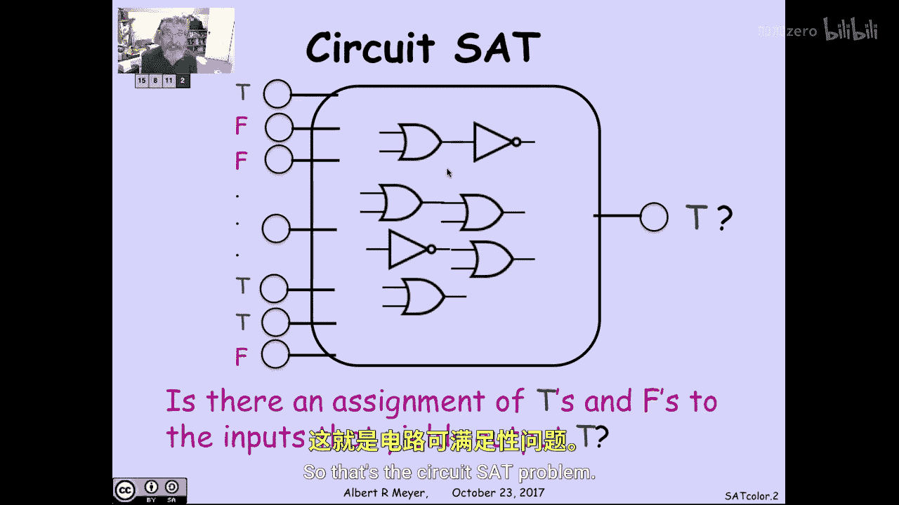

Now， the way that I'm going to reduce the circuit problem to three coloring is I'm going to build a graph where the three colorings of this particular graph simulate the way the circuit does calculations with truth values。

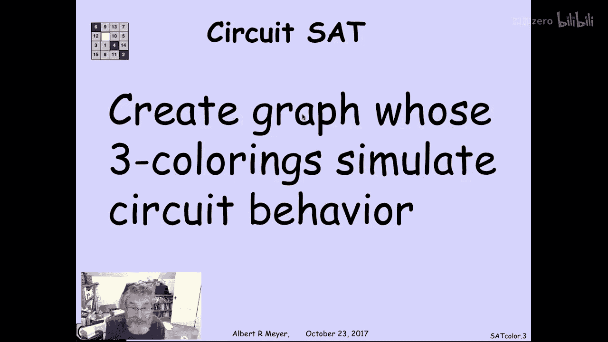

And the the so let's see how that's going to work I'm going to build a little gadget within my graph that I'm going to construct that's a triangle just so that I can be sure that the three vertices in this triangle have different colors and i'm going to arbitrarily call them one of them is going to be the true color one of them is going to be called the false color and one of them is going to be called the other color the neutral color so。

We start off with this little triangle。Now， suppose that I have some other vertex and I want this other vertex to act like a propositional variable。

 I like this。Vertex to be colored either with the true color or the false color。

 just as the propositional variable would take on the value true or false。 How long I get a force。

This vertex that I'm calling P to be truth colored well it's really very easy All I do is attach it via an edge to the neutral color。

Well， in a three coloring， it has to have a color that's different from the neutral color and there's only two other colors。

 the true color in the false color。 So this simple edge attached to P forces P to be a vertex that must be colored true or false in any possible three coloring of a graph。

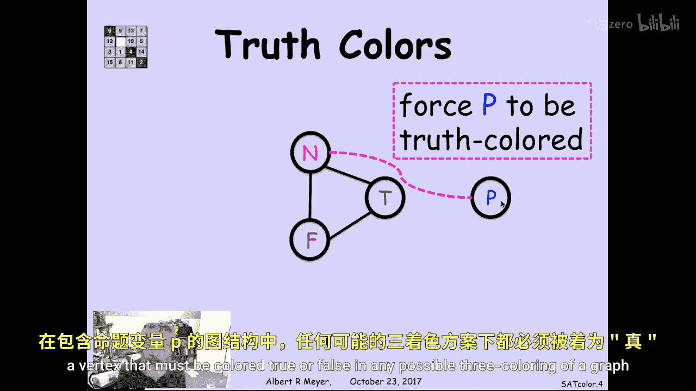

That P appears in。Well， that also lets me figure out an easy way to construct an inverter， a not p。

 because once I've got p to be true false， how do I force another vertex to be the output of an inverter to be a not P value。

 Well， again， I force it to be true false。 and then I just attach it to P。

 Since it's attached to P by a vertex， it must have a different color。

 it can only have a true false color。 So if p is true， not p is false if P is false， not p is true。

 So we're talking a coloring now， the way let's say it again in any threecoling of this5 vertex graph。

I have to have P colored with either true or false and not P vertex is going to be colored the opposite way and what's more。

For any way of coloring page or false， there is a way to color the other graph with false or true。

 so it's in that sense that the coloring is simulating this this invergate it's。

I can let P be any truth value and not P will be the opposite truth value。 Well。

 let's go on with the same exactly the same idea， But let's look at the more interesting and slightly more complicated。

 Well， it's more complicated case。 of an or gate。 So the or gate is going to have three vertices。

 One is going to be a P vertex for one of the inputs to the or and the other is going to be a Q vertex And the output of the or is going to be a vertex that I want to act like a P or Q。

 So what that means is that I want to fix it so that in any three coloring of the graph in which these three vertices appear。

If P gets colored true or Q gets colored true， then P or Q will have to be colored true。

And if or if they're both colored true than this， then P or Q will be colored true。

 And if they're both colored false， then P Q must be colored false。 So again。

 what we're trying to accomplish is that I'm going to build a graph around these three vertices。

 And it's going to be possible for any assignment of truths or false is to P And Q for this graph to be three colored。

 But the only way to three color it will be to have P Q take the proper truth color。

 according to the truth colors of P And Q。 Let's see how this gadget works。

So there's our triangle that defines the colors and there's some。

Neutral lines that's going to force P And Q to be true， false colored。

 And another line that's going to force the P or Q output of vertex to be truth colored。

 And there's the rest of the gadget。 Now， I love this gadget。

 because it's basically due to a student of mine from many years ago named Larry Stackmeer。

 who walked into my office one day。 This was in the early years of studying N P completeness and complexity theory and said that he had shown that three colorlerability。

 was as hard as satisfiability。 It was just a wonderful result。

 And I'll say a little bit more about that at the end。 But let's keep going。

 Let's understand how this little。😊，Graph is going to act like an ore gate。

 We'll call it a graph gadget that acts like an ore。 Well， let's consider a coloring。

 Suppose that I colored P green and Q red。 that is the truth color for P and the false color for Q。

 Then how can I color the rest of this graph。 Well， looking at it。

 this vertex is adjacent to a red and a green。 It's got to be colored neutral。

Now this vertex is next to a green and a neutral， it's got to be colored red。

And this vertex is adjacent to a neutral and a red。 It's got to be colored true bangang。

 I've forced the output P or Q vertex to be indeed true because P is true。 And Q happens to be false。

 Now， I still have to verify that the rest of the graph can be three colored。 let's just check that。

 while， it's easy to see how to do that。 just since P is neutral colored。 sorry。嗯。Since this graph。

 this vertex is adjacent to a P or Q。 It could be a red or a neutral。

 but this one has to be neutral because it's next to a green and a red， it forces that one to be red。

 So to summarize， we figured out that if you assign P to be。True and Q to be false。

 Then there is a way to three color it， and every way to three color it forces P or Q to B green。

 Let's do another case just to kind of keep practicing。

 Suppose that P and Q are both assigned the red color。Well。

 I want then to be sure that P or Q has to be red colored in any satisfactory three coloring。

 let's check it。First of all， these two vertices are going be adjacent to each other。

 and they're each going to be adjacent to a red edge。

 So they have to be colors that are different from red。

 and they have to be different from each other。 So without loss of generality。

 I can say that one's going be green and that one's going be。 neutral。 I could be the other way。

 but by symmetry。 I don't care which。 Okay， so I'm sort of forced to choose those two colors。

 They're going have to be the two different colors green and magenta one order or the other。

 All right， now what have I got。 Well， the P or Q is already forced to be true or false because it's next。

 it was already next to a magenta。 and it's next to a green。 it's got to be the other color false。

 So I've already forced the output to behave properly。

 I just need to verify that the rest of the graph can be three colored。 Well。

 let's see how to do that。Do I have flexibility here， not really no， because this。

This vertex has has to be neutral because it's next to a red and a green。 And once this is neutral。

 this one becomes next to a neutral and a red。 So it has to be green。 So I forced the。3 coloring。

 but that's not so much。 doesn't matter so much as long as there is one。

 The important thing is that I forced P or Q to be read when these two are red。

 and there is a way to finish the three coloring， Given that this is red and that's red and that's red。

So that's how my。

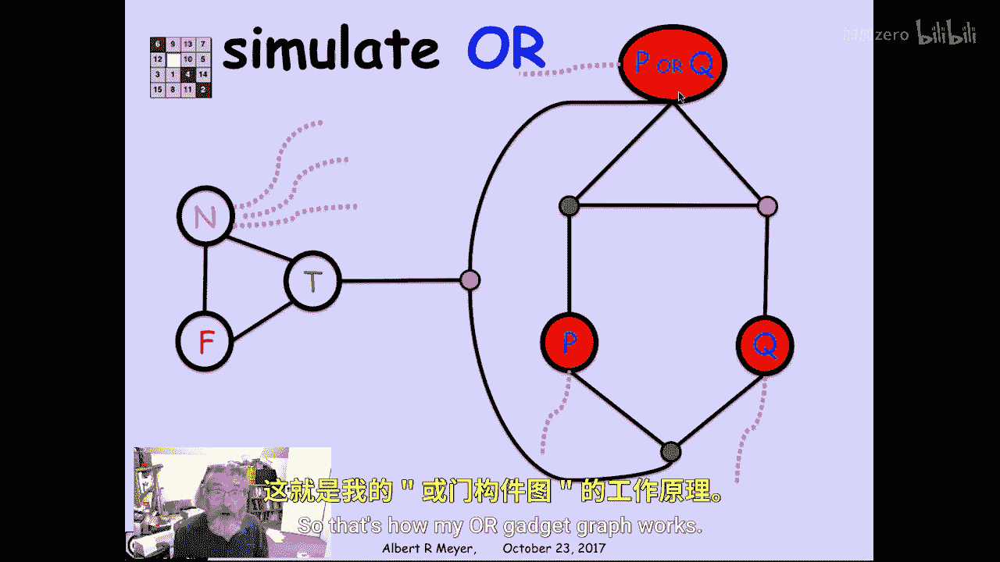

Or gadget graphra works。So now how do I simulate the circuit， Well。

 if the circuit has an or gate with， let's say， an input A and another input called B and an output that I'll call A or B。

 that I'm going to have a corresponding gadget and I'm going to call the P and Q vertices A and B in the P or Q output vertex A or B and wherever this or gate appears in the circuit。

 I'm going to replace it with a gadget and wire it up。

 I'm going to do the same thing with the inverters if there's a knot in the circuit。

 I'm going to replace it by this the trivial knot gadget。

 which is just two vertices connected by an edge。

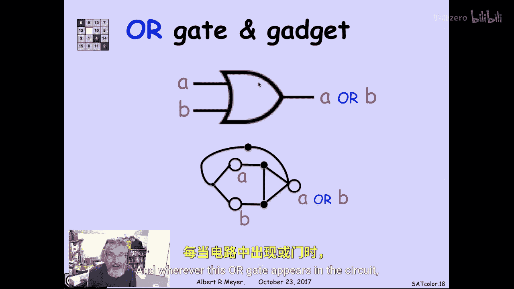

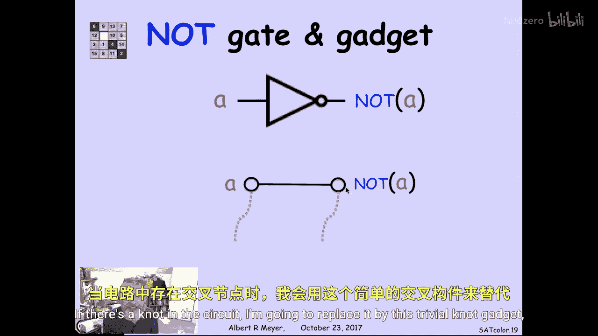

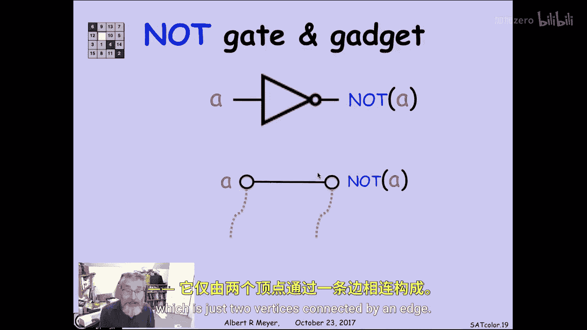

And let's see how I'm going piece together my gadgets to act like the circuit。

 So suppose that the circuit has an or gate and its output feeds into another or gate。

 So there's the crucial connection between the output of this or gate and the input of that or gate。

 Well， what I'm going to do is replace each or gate by a gadget。😊。

And so I'm thinking of these are the inputs to the first or gate。

 There's the output of the first or gate。 There's the input of the second or gate that I want to get the signal the same value that this produces as output。

 All I'm going to do is just merge those two vertices。

So now I've connected up these two gadgets so that they act just like my two or gates where the output of one is connected to the input of the other。

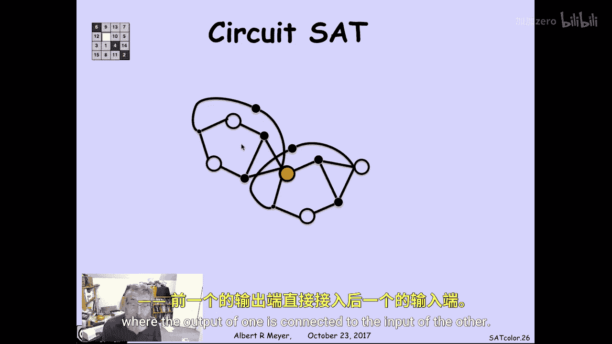

You continue that idea and you take the whole circuit with inverters and oars。

 and you replace all the gates by gadgets。 So you wind up with。

 here's a gadget with an inverter at the end。 And then the other gadgets I've left floating。

 but they're all going to be connected up and exactly the way that corresponds to the way the circuit is wired。

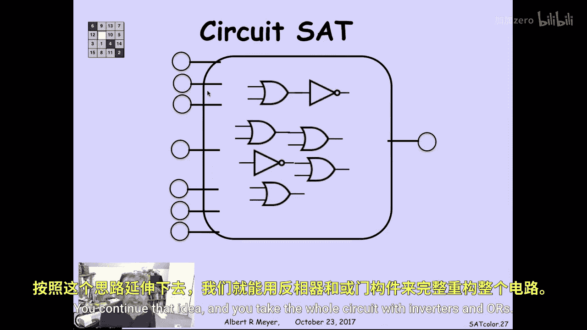

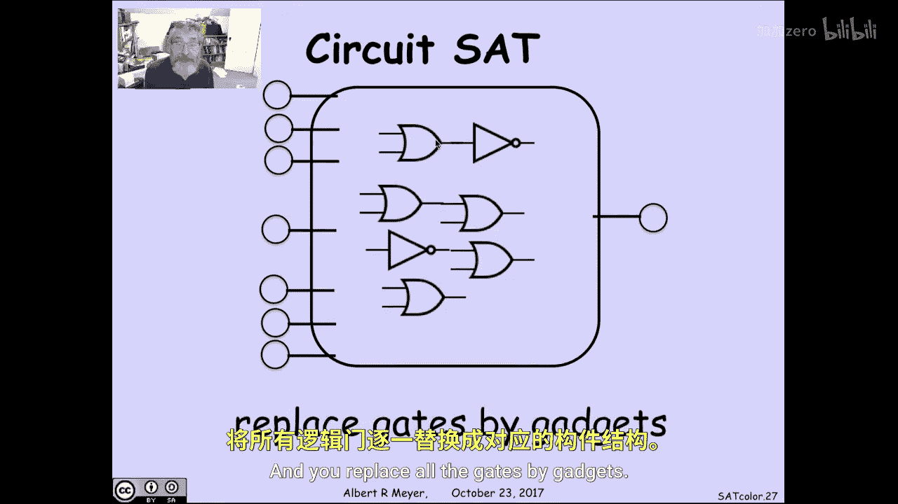

In addition， I'm going to have some inputs to the circuit and outputs。

 these are now going to be vertices connected up to my gadgets， and here's another vertex。

 the output vertex connected up to some gadget。I'm going to need to force the inputs to be true。

 false valued in the coloring， and the output I want to force to be true。

 so I connect it to both the neutral color and the false color。

So the result is that if this graph is three colorable。😊。

Then it has to be three colored using truth values for those inputs and it has to be three colored with true on the output。

 and its because of the way it simulates， the calculation of the circuit。

 the graph is going to be three colorable， if and only if on the given set of true false inputs。

 the circuit could have produced that true output， the graph is three colorable。

 if and only if the original circuit is satisfiability， is satisfiable。

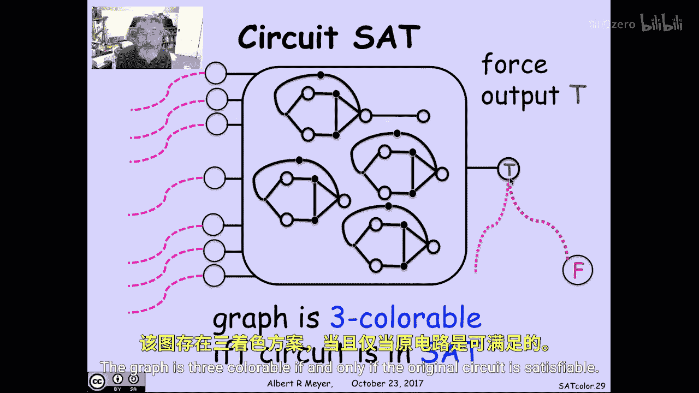

So what we've just shown， as I said at the beginning is that the satisfiability problem for circuits reduces to the three coloring problem。

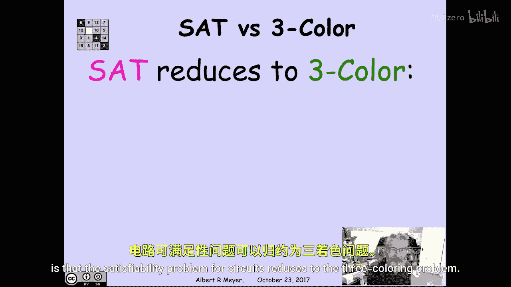

If I had a fast procedure for three coloring， I would immediately get a fast procedure for testing satisfiability。

 namely you give me the satisfiability problem， the circuit。

 I quickly build the graph out of my gadgets and the graph is going to be about the same size as the circuit and very easy to put together and then I check whether the graph is three colorable and I deduce whether or not the circuit is satisfiable。

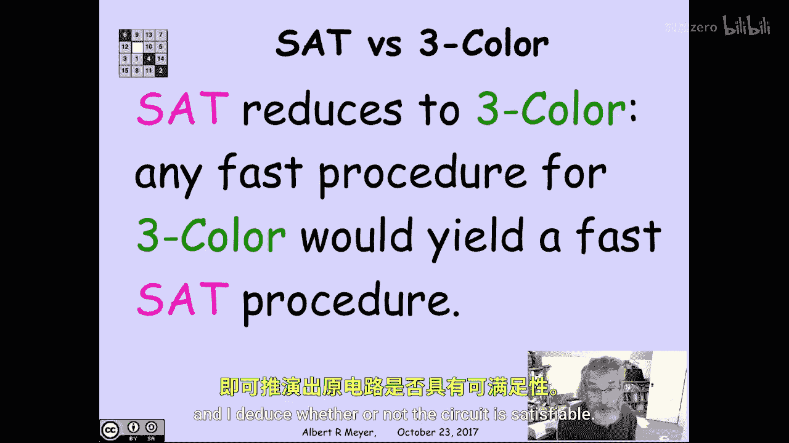

Okay， well。

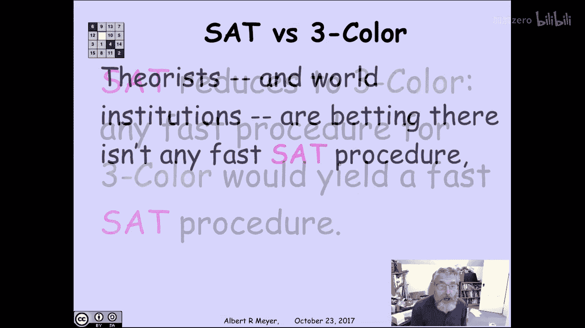

The theorists in the business me include it， and the world institutions are betting that there isn't any fast satisfiability procedure。

The reason is that if satisfiability was there was an efficient procedure to test for satisfiability that in fact。

 all cryptoy， all secret codes could be broken our financial institutions would fall apart。

 our military institutions would fall apart， the world wouldn't be the same place。

 although a lot of things that seem hard would suddenly get easy。

 there would be revolutionary and extremely implausible to think that satisfiability could be done well。

 and that means that we can also safely bet that there is no fast way to three coloror a graph。

So I was going to wrap up with the story about Stockmire。

 so he came into my office with this lovely result about the difficulty of three colorability。

 and then I thought a little bit and I said to him Larry， you know if you could only make it plainer。

Then I could sell it Now the reason is that it's a well-known result you may have heard of already that every planar graph can be color with four colors and now isn't it cool to know that although you can always color a planar graph with four colors。

 it's very hard to tell whether or not you can color it with three colors and so as I said。

 I sense Larry home to make it planer and his wife tells me that he spent a week or more anxiously thinking about it and grumbling about it and finally came up with a crossover gadget that would enable you to take any two wires in the circuit diagram that you had drawn in the plane to replace the crossover by another little piece of graph that was planer that transmitted the signals across the wires and so therefore the satisfiability problem the threecoling problem for non-planar graphs reduces to the threecoling problem for planar graphs and that wraps up。

The whole story。

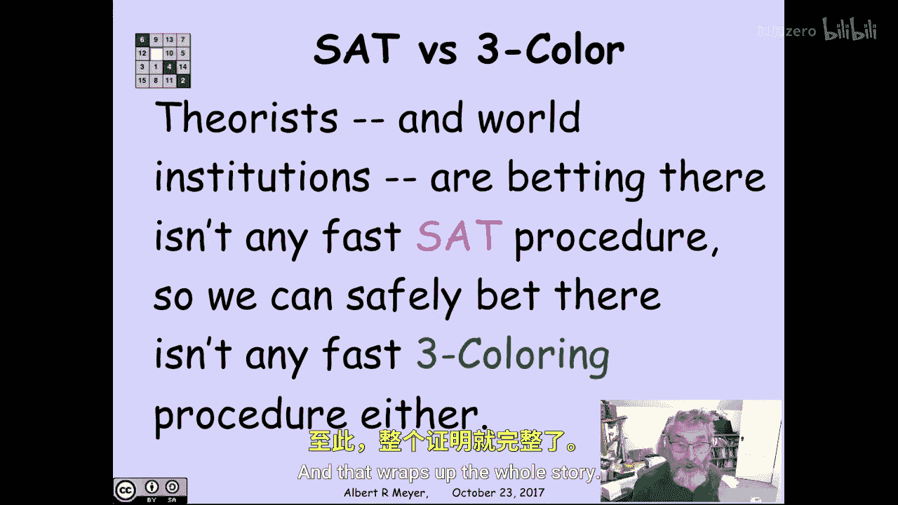