# 计算模型：05：从SAT问题到三色问题 🎨

在本节课中，我们将学习如何将命题公式的可满足性问题（SAT）归约到图的三色问题。我们将看到，如果能高效地解决三色问题，就能高效地解决SAT问题。由于专家们普遍认为不存在高效的SAT求解算法，因此三色问题也被认为是难以高效解决的。

## 核心问题：三色问题的难度

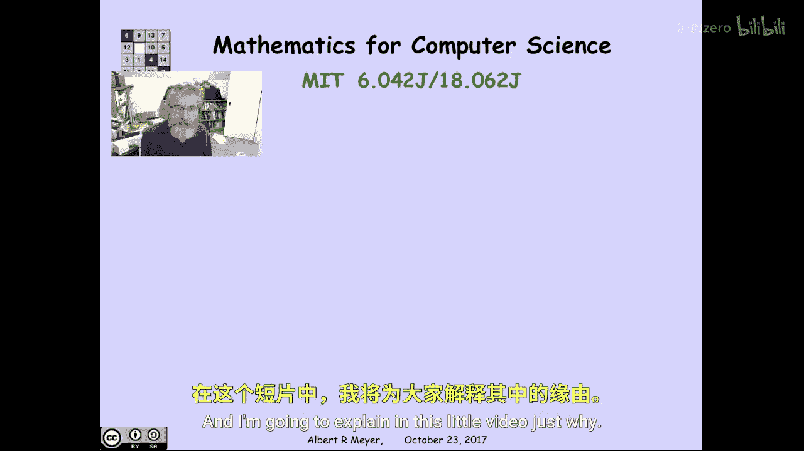

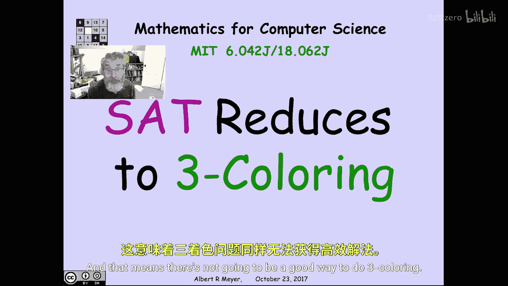

根据“无冲突”规则为图上色是困难的。事实上，仅用三种颜色为图上色也是困难的。这里的“困难”指的是判断一个图是否能用三种颜色上色。本节视频将解释其原因：著名的命题公式可满足性问题可以归约到三色问题。

这意味着，如果我能找到一种好方法来为任意图进行三色上色，我实际上就能用该方法来测试一个命题公式是否可满足。如果我有一个好的三色上色方法，我就会得到一个好的可满足性测试方法。该领域的所有专家都有压倒性的证据和观点认为，不存在检查可满足性的好方法，这意味着也不存在进行三色上色的好方法。

让我们看看这个论证是如何进行的。

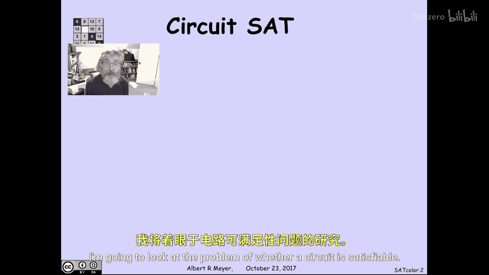

## 从电路可满足性到三色问题

实际上，我将考察一个比公式可满足性更难的问题，并展示它如何归约到三色问题。我将考察电路是否可满足的问题。

假设我们有一个布尔电路（或称命题电路），它由一些小门电路构成。这是一个“或”门，这是一个“非”门（反相器）。电路有输出端和若干输入端。仅使用“或”和“非”两种基本门就足够了，因为你可以用它们来表达所有其他类型的门，例如“与”门和“蕴含”门。

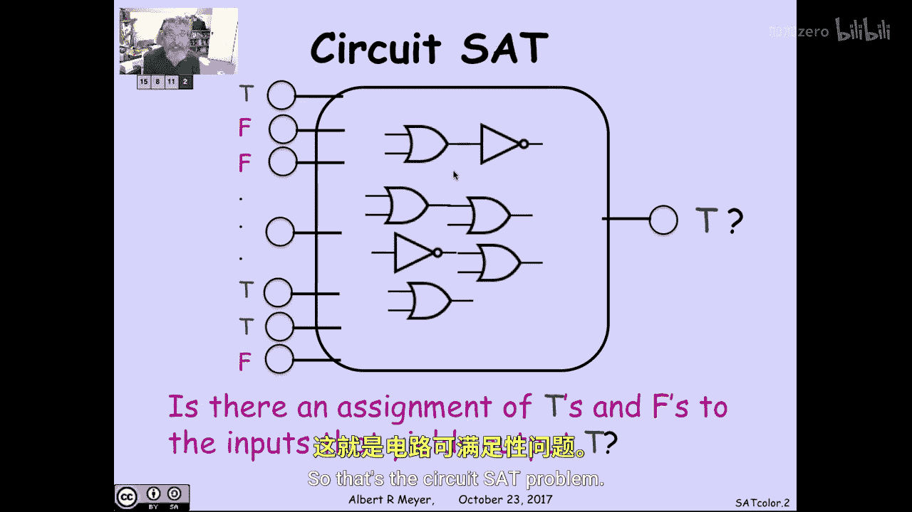

电路可满足性问题是指：是否存在一种为那些输入端分配真值的方法，使得输出端变为真？换句话说，是否存在一种方式，将第一个输入设为真，下一个设为假……直到最后一个设为某个真或假的值，使得电路能产生“真”输出？如果存在这样一组输入，它们被称为一组可满足的输入。

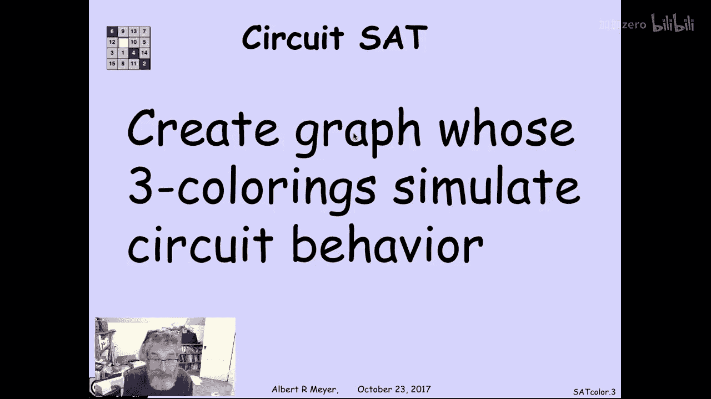

对于公式而言，这意味着存在一种对变量的真值赋值，使得公式为真。这就是电路SAT问题。

现在，我将电路问题归约到三色问题的方法是：构建一个图，使得这个特定图的三色上色方式能够模拟电路用真值进行计算的方式。

## 构建基础：颜色定义与变量表示

让我们看看这是如何工作的。我将在要构建的图中设计一个小“组件”。这是一个三角形，以确保这个三角形中的三个顶点具有不同的颜色。我将任意地称其中一个颜色为“真”色，一个为“假”色，一个为“其他”色（中性色）。

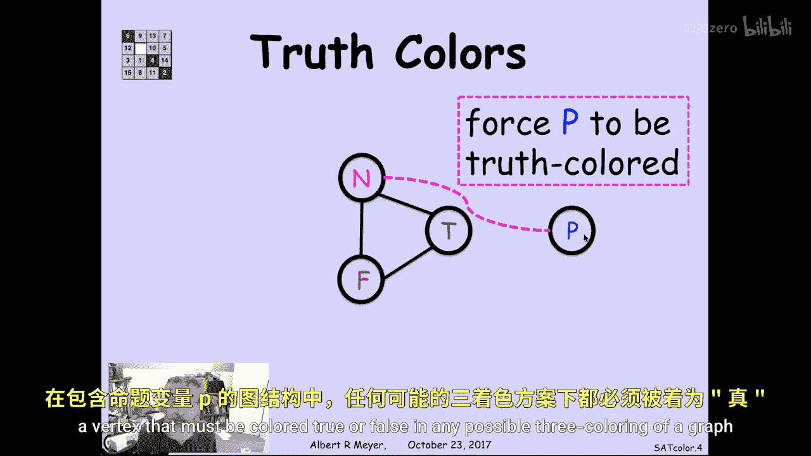

我们从这个小三角形开始。

现在，假设我有另一个顶点，我希望这个顶点像一个命题变量一样。我希望这个顶点被着上“真”色或“假”色，就像命题变量取值为真或假一样。我如何强制这个称为 **P** 的顶点为真值颜色呢？这其实很简单：我只需通过一条边将它连接到中性色顶点。

在三色上色中，它必须有一个与中性色不同的颜色，而只有另外两种颜色：真色和假色。因此，这条连接到 **P** 的简单边，强制 **P** 在任何可能的图三色上色中，必须是着真色或假色的顶点。

## 模拟逻辑门：非门

这也让我想出了一个构建反相器（非门 **¬P**）的简单方法。因为一旦我让 **P** 为真或假，我如何强制另一个顶点成为反相器的输出，即 **¬P** 值呢？同样，我强制它为真或假。然后我只需将它连接到 **P**。由于它通过一条边连接到 **P**，它必须有不同的颜色，它只能有真或假颜色。所以，如果 **P** 是真，**¬P** 是假；如果 **P** 是假，**¬P** 是真。

让我们再表述一次：在这个5个顶点的图的任何三色上色中，**P** 必须着真色或假色，而 **¬P** 顶点将被着上相反的颜色。更重要的是，对于 **P** 的任何真/假着色方式，都存在一种方式为图的其他部分着色，使得 **¬P** 为假/真。正是在这个意义上，着色模拟了这个反相器门。我可以让 **P** 为任何真值，而 **¬P** 将是相反的真值。

## 模拟逻辑门：或门

让我们继续使用完全相同的思路，但看看更有趣且稍微复杂一些的情况：或门。

或门将有三个顶点。一个将是 **P** 顶点，作为或门的一个输入；另一个将是 **Q** 顶点；或门的输出将是一个我希望其行为像 **P ∨ Q** 的顶点。

这意味着，我希望确保在包含这三个顶点的图的任何三色上色中，如果 **P** 被着真色或 **Q** 被着真色，那么 **P ∨ Q** 将必须被着真色。或者，如果它们都被着真色，那么 **P ∨ Q** 将被着真色。如果它们都被着假色，那么 **P ∨ Q** 必须被着假色。

同样，我们要实现的目标是：我将围绕这三个顶点构建一个图。对于 **P** 和 **Q** 的任何真/假赋值，这个图都可能是三色可着色的。但对其进行三色着色的唯一方式，将是让 **P ∨ Q** 根据 **P** 和 **Q** 的真值颜色，取正确的真值颜色。

让我们看看这个组件如何工作。

这是定义颜色的三角形。有一些“中性”线将强制 **P** 和 **Q** 为真/假颜色。另一条线将强制 **P ∨ Q** 输出顶点为真值颜色。其余部分是组件的核心。

我非常喜欢这个组件，因为它基本上是我多年前的一个学生拉里·斯托克迈尔想出来的。有一天他走进我的办公室（那是在研究NP完全性和复杂性理论的早期），说他证明了三色问题与可满足性问题一样困难。这是一个非常棒的结果。我将在最后再谈一点这个。但现在让我们继续。

让我们理解这个小图如何像一个或门。我们称它为行为像或门的图组件。

考虑一种着色方案。假设我将 **P** 着为绿色（真），将 **Q** 着为红色（假）。那么我如何为图的其余部分着色呢？观察这个图，这个顶点与一个红色和一个绿色相邻，它必须被着为中性色。

现在，这个顶点与一个绿色和一个中性色相邻，它必须被着为红色。而这个顶点与一个中性色和一个红色相邻，它必须被着为真色（绿色）。这样，我就强制了输出 **P ∨ Q** 顶点确实为真，因为 **P** 为真，而 **Q** 恰好为假。

现在，我仍然需要验证图的其余部分可以三色着色。检查一下，很容易看出如何做到。由于这个顶点与 **P ∨ Q** 相邻，它可以是红色或中性色，但这个顶点必须为中性色，因为它与一个绿色和一个红色相邻，这迫使那个顶点为红色。

总结一下，我们发现如果你赋值 **P** 为真，**Q** 为假，那么存在一种三色着色的方式，并且每一种三色着色的方式都强制 **P ∨ Q** 为绿色。

让我们再做一个案例来练习一下。假设 **P** 和 **Q** 都被赋值为红色。那么我需要确保在任何满足条件的三色着色中，**P ∨ Q** 必须是红色。

首先，这两个顶点将彼此相邻，并且它们各自都与一条红色边相邻。所以它们必须是不同于红色的颜色，并且它们必须彼此不同。因此，不失一般性，我可以说一个将是绿色，另一个将是中性色。顺序可以反过来，但由于对称性，我不在乎哪个是哪个。

好的，所以我被迫选择这两种颜色。它们必须是两种不同的颜色：绿色和洋红色（中性色），顺序任意。

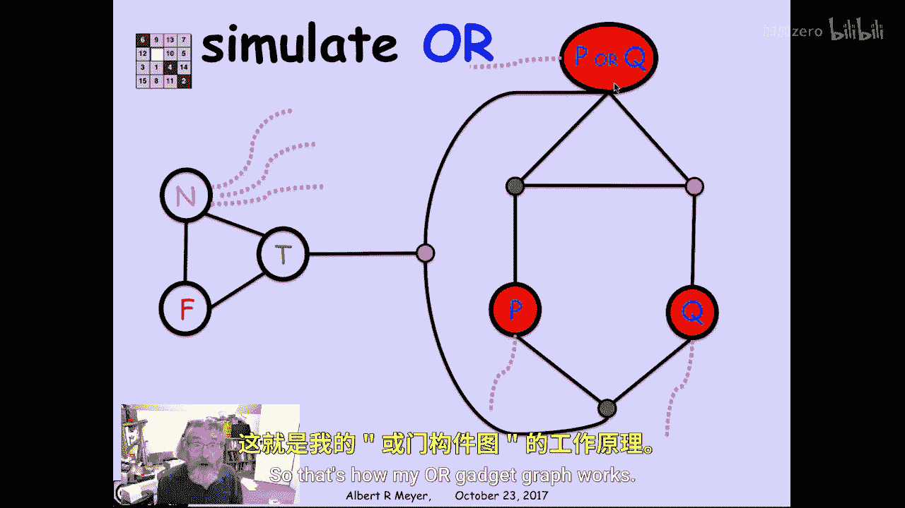

现在，我得到了什么？**P ∨ Q** 已经被强制为真或假，因为它已经与一个洋红色相邻，并且与一个绿色相邻，它必须是另一种颜色：假色（红）。所以我已经强制输出行为正确。

我只需要验证图的其余部分可以三色着色。让我们看看如何做到。我在这里有灵活性吗？其实没有，因为这个顶点必须是中性色，因为它与一个红色和一个绿色相邻。一旦这个是中性色，这个顶点就与一个中性色和一个红色相邻，所以它必须是绿色。这样我就强制了3-着色，但这并不那么重要，只要存在一种着色方式就行。重要的是，当这两个输入都是红色时，我强制 **P ∨ Q** 为红色，并且存在一种方式来完成三色着色。

这就是我的或门图组件的工作原理。

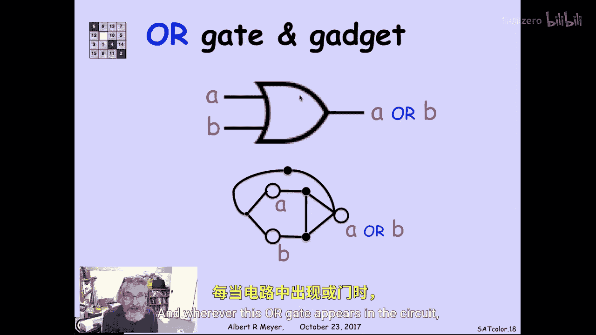

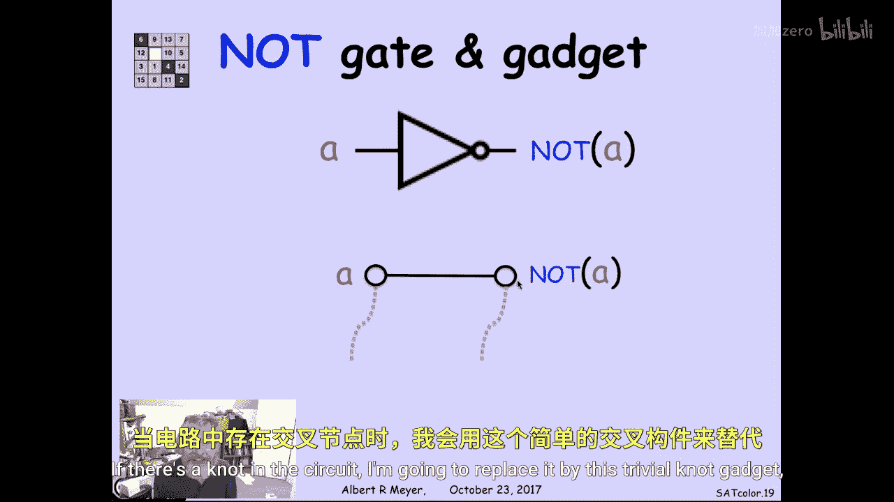

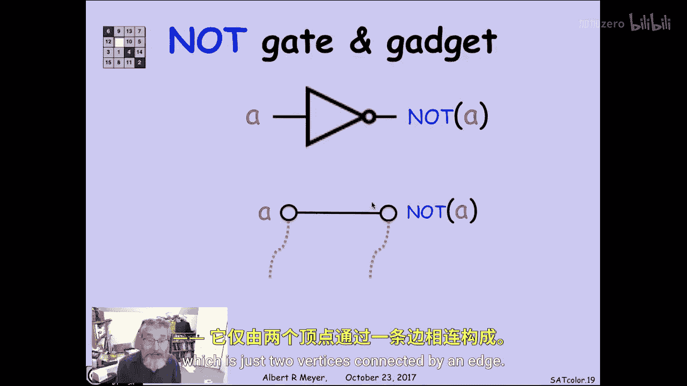

## 模拟整个电路

那么，我如何模拟整个电路呢？如果电路有一个或门，输入为 **A** 和 **B**，输出我称为 **A ∨ B**，那么我将有一个对应的组件，我将称其中的 **P** 和 **Q** 顶点为 **A** 和 **B**，而 **P ∨ Q** 输出顶点为 **A ∨ B**。无论这个或门出现在电路中的哪个位置，我都将用一个组件替换它并进行连接。

对于反相器，我也会做同样的事情：如果电路中有一个非门，我将用这个简单的非门组件替换它，它只是由一条边连接的两个顶点。

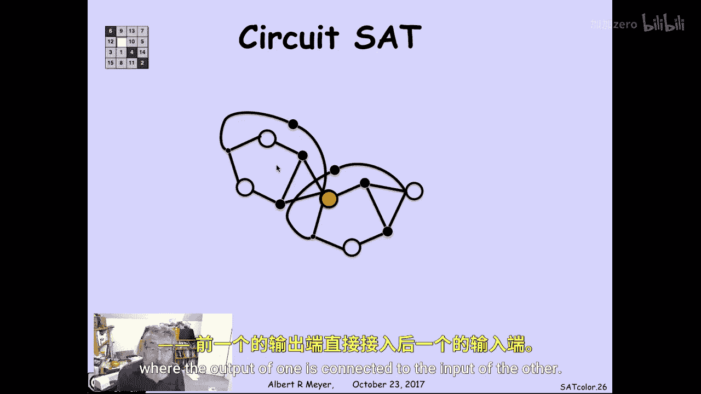

让我们看看如何将我的组件拼接在一起以模拟电路的行为。

假设电路有一个或门，其输出馈送到另一个或门。这是第一个或门的输出和第二个或门的输入之间的关键连接。那么，我要做的是用组件替换每个或门。

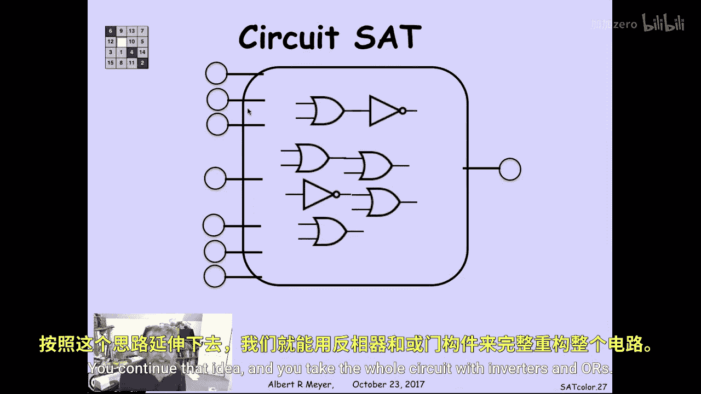

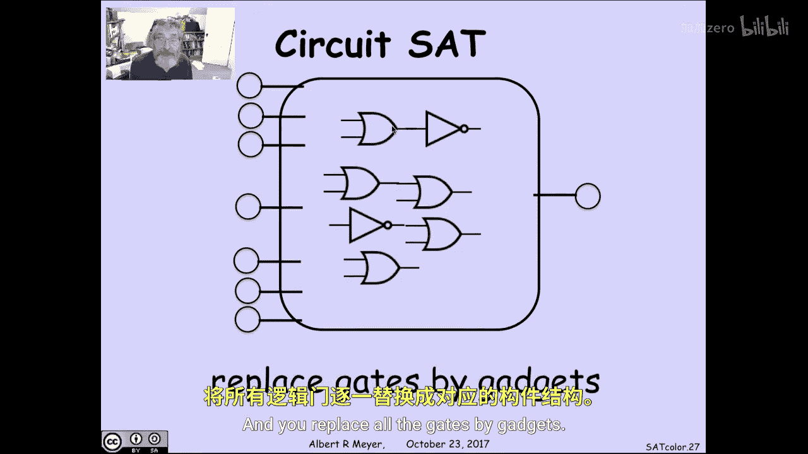

所以我把这些看作是第一个或门的输入。这是第一个或门的输出。这是第二个或门的输入，我希望它获得与第一个或门输出相同的信号值。我要做的就是合并这两个顶点。

现在我已经连接了这两个组件，使它们的行为就像我的两个或门，其中一个的输出连接到另一个的输入。

继续这个想法，你取整个包含反相器和或门的电路，并用组件替换所有的门。最终你会得到：这里是一个末端带有反相器的组件。其他组件我让它们浮动，但它们都将以与电路布线方式完全对应的方式连接起来。

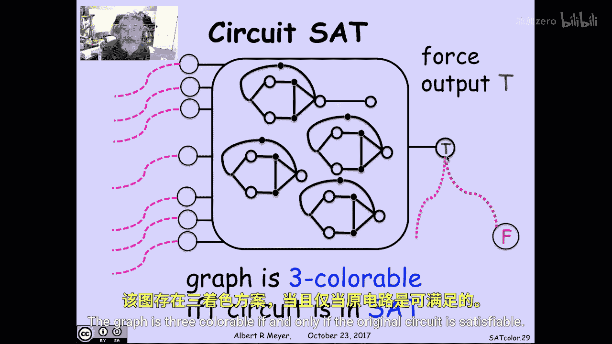

此外，电路将有一些输入和输出，这些现在将成为连接到我的组件的顶点。这是另一个顶点，输出顶点连接到某个组件。我需要强制输入在着色中为真/假值，并且我希望强制输出为真，所以我将它同时连接到中性色顶点和假色顶点。

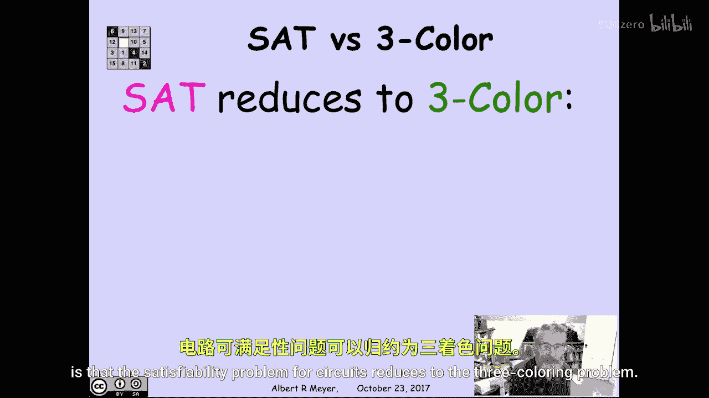

结果是，如果这个图是三色可着色的，那么它必须使用那些输入的真值进行三色着色，并且输出必须着真色。由于它模拟了电路的计算方式，该图将是三色可着色的，当且仅当在给定的真/假输入集合下，电路能够产生那个真输出。该图是三色可着色的，当且仅当原始电路是可满足的。

## 结论与意义

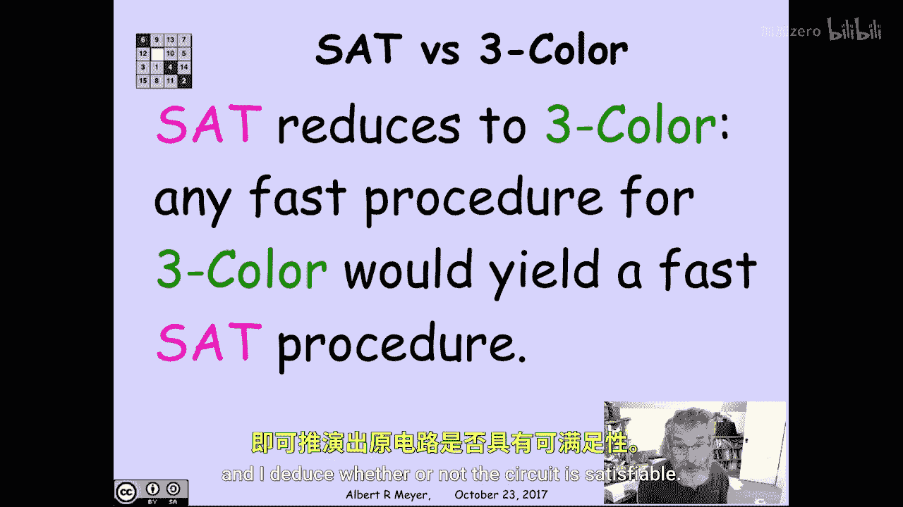

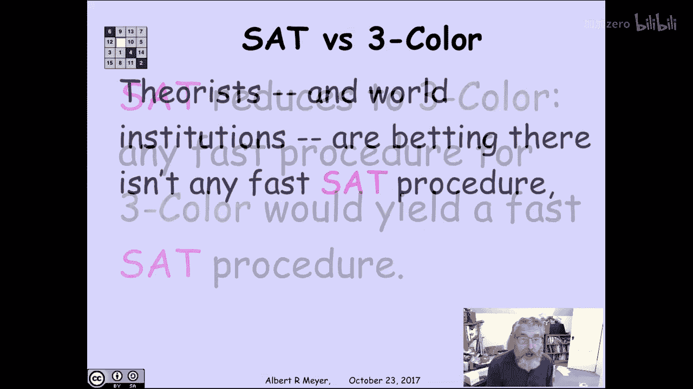

正如开头所说，我们刚刚展示的是：电路的可满足性问题可以归约到三色问题。

如果我有一个快速的三色着色程序，我将立即得到一个测试可满足性的快速程序。具体来说：你给我一个可满足性问题（电路），我快速用我的组件构建出图。这个图的大小将与电路大致相同，并且非常容易组装。然后我检查该图是否三色可着色，并推断出电路是否可满足。

该领域的理论家（包括我）和世界各地的机构都认为不存在任何快速的可满足性测试程序。原因是，如果可满足性存在高效的测试程序，那么实际上所有的密码、所有的秘密代码都可能被破解，我们的金融机构会崩溃，我们的军事机构会崩溃，世界将不再是同一个地方。尽管许多看似困难的事情会突然变得容易，但这将是革命性的，并且认为可满足性可以很好地解决是极不可信的。这意味着我们也可以有把握地认为，没有快速的方法来为图进行三色着色。

## 后续故事：平面图三色问题

最后，我想用关于斯托克迈尔的故事来结束。他带着这个关于三色问题难度的可爱结果走进我的办公室。然后我想了想，对他说：“拉里，你知道吗，如果你能让它是平面的，我就能更好地推广它。”原因是，有一个众所周知的结果你可能已经听说过：每个平面图都可以用四种颜色着色。现在，知道虽然你总是可以用四种颜色为平面图着色，但判断是否能用三种颜色为它着色却非常困难，这不是很酷吗？

所以，正如我所说，我打发拉里回家去让它变成平面的。他的妻子告诉我，他花了一周多的时间焦虑地思考这个问题，抱怨它，最终想出了一个“交叉”组件。这个组件可以让你在平面上绘制的电路图中，用另一个平面图的小片段替换任何两条导线的交叉点，从而跨导线传输信号。因此，非平面图的三色问题可以归约到平面图的三色问题。这就完整地讲述了整个故事。

---

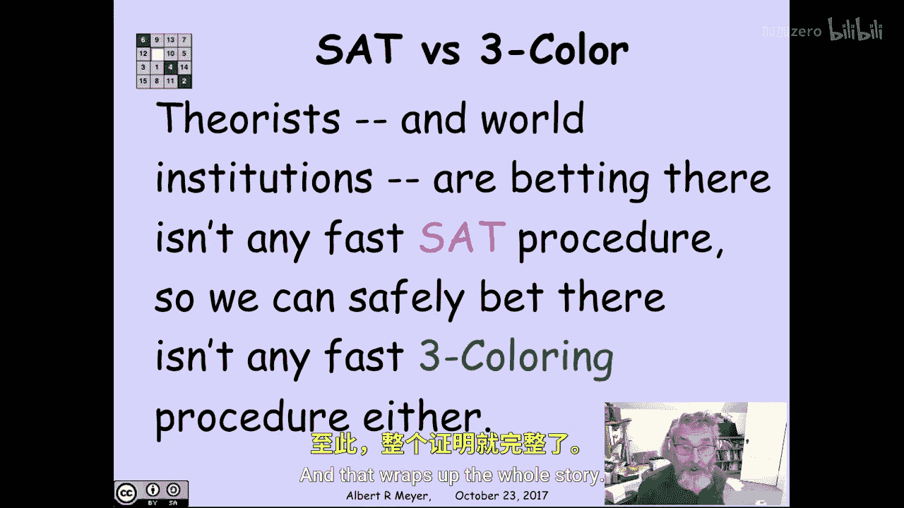

**本节课总结**：在本节课中，我们一起学习了如何将电路的可满足性问题归约到图的三色问题。我们通过构建特殊的图“组件”来模拟逻辑门（非门和或门），并展示了整个电路的布线可以对应地转化为图的连接。由此证明，如果存在高效的三色问题解法，就将存在高效的SAT问题解法。由于SAT问题被广泛认为是难以高效解决的（NP难问题），因此三色问题也同样困难。最后，我们还了解到，即使是平面图的三色判定问题，其难度也与一般图相同。