# 悉尼大学【中英⚡计算模型｜COMP2022 Models of Computation】 p06 P7 Context Free Grammar & Parse Tree -BV1vTe6zzENb_p6-

Hello everyone today we'll be discussing about context free grammar。

 which is another form for describing another form of describing languages。

 much like regular expressions， but context free grammar has its own set of rules So to start off context free grammar has a terminals variables start symbol and productions terminals are just the symbols that of the alphabet of the language being defined。

 variabless are a finite set of other symbols， each of which represents a language starch symbol is the one that the language will first start with and productions are rules that that we would use to describe that language。

So for the example of variables could be A， B and C。

 and variables are usually on the left hand side of a production and example of terminals are small letter A。

 small letter B， small letter C or 01， etc ce， and they are usually on the right hand side numbersumb and small letter symbols are usually given as terminals and the best way to identify a terminal and a variable would be to observe the productions。

 which we are looking into right now。So these are productions。

 Products have this arrow symbol that determines the rules。

 and these what this means is that this letter， this symbol on the left hand side can be replaced by 01。

So the left hand side is usually the variables and the ones on the right hand side that are not that do not have the left hand side symbol is are the terminals。

S is a start symbol as well as a variable and01 are the terminals here S is also a still a variable because this S could just be replaced with the left hand side。

 basically everything on the left hand side are the variables and everything on the right hand side are the terminals except these variables that are again written and start symbols are the ones that are always at the beginning of a production and in the beginning of production。

 all the variables at the beginning are all start symbols。So its in the questions。

 it will always be given which are variables and which are terminals。

 but the easiest way to know is that left hand were on the variables and the right hand one other terminals。

Right， so context free grammar， what it usually does， It just gives derivativerivations。

 It gives iterative derivativerivations。 It just replaces a symbol with another symbol。

 So we know the rules or the productions for this context free grammar is S goes to01 and S goes to0 S1。

 So we first start off with a start6 starting symbol。

 So starting symbol we go to we always go to 0 S1。 we could start with 0，1，2。

 but depending on the language that we're trying to get， we use that。

 So the language that we're trying to get the language that we're trying to derive is0 to the par n and1 to the par n。

So how do we derive that first we write 0 S1 Now，0 S1， Why do we use 0 S1 and not 01。

 Because if we just use 01， we can't replace anything。01 is a final state。

 and there are no variables that we could replace here。 We use 0 S1 because there's a variable S。

 which could be replaced further with the same productions。 So we start with 0 S1。

 And then we replace S with again，0 S1 because S goes to 01 or 0 S1。 So we replace S with 0 S1 again。

 And after that， we replace this S with 01 to make a point that we have the equal number of0s and equal number one。

 So 0 to the par n and 1 to the par n is satisfied。

Then now we're going to look at some examples of how to write context free grammars。Right。

 so suppose we need to write。 we to design a context we grammar for a substr of that that has a substr of 10。

1。 How do we do that。 So first， let's define a start symbol。 And we define a rule。 So 10。

1 has to be there。 And we don't care what what we get in the beginning。

 we don't care what we get in the end。 So since we don't care what we get in the beginning。

 and we don't， we don't care what we get in the end。 So let's write a rule for that。

 So E could be any symbol of one。Anytime one can be replaced and it could be any symbol of0。

Or it could be epsilon。So E could be replaced by1 E again and 1 e and just to Epsilon or E could be replaced by 0。

 So 1，0，1，0， there could be many combinations of strings。 It could be 1，0，1，1 or1，1，0。

1 and stuff like that。 So this is a context free grammar rule for this。 How do we test it out。

 let's start from the start symbol。 So let's go to let's， let's say we want to derive this symbol 1。

1，0，1，0。 Okay， so 1，0，1 of the substream here。So let's write。E 1，0，1， E。 Now， let's replace E width。

1， E and 1，0，1。 And let's replace this E with 0 E because we want to get this here and we want to get this one。

 Now， let's replace the E's with Epsilon so 1，0，1。 and let's replace this E also with Epsilon。 So 1。

1，0，1，0。 We get this。 we do get this string。 So this this context gramar is accepted。

And let's look at the next one。We need to have。 we need to design a CG such that it has at least three zeros。

Right， so to design a CG with at least three zeros。

 what we could do is we need to know that we know that three the number of zeros that we would have in a string is minimum number of zeros is 3。

 So there could be the strings could the string could be something like 0，1，0，1，0 or 0，0，0， just 0，0。

0 or1，1，0，0，1，0， something like that。 So in the middle of these zeros。

 it wasn't mentioned that this the three zeros have to be consecutive。

 So in the middle of the zeros that could be any symbol。 So that's right in the beginning。 also。

 there could be say any symbol in the middle， it could there could be any symbol。 And in the end。

 also， there could be any symbol。 we just know that there the minimum of threes that we have the minimum of 0 that will have is 3。

So this E could be further replaced by1 E。Or0 E or Epsilon， much like the the previous CG。

So we could again， test this out。Let's start with the start symbol， and let's。

Let's say that we want this string， this one， we want to get this string。Right， so。E0， E，0， E，0。

So replace this E with1， E，0， E，0， E，0， E。4 is。 so replace this E again with 1，1， E and E 0， E 0。

 E 0。い。So again， we replace this E with expsilon， so we had 1，1，0。E 0， E 0， E， And then we replace。

 now we need to get this string。 So observe， we have one in the end。 So we replace this E with1， E。

 So 1，1，0， E 0，1， E 0， E。So1，1，0。 Let's replace E with Epsilon So nothing 0，1。

 Let's replace this E with Epsilon So nothing。 So 0。 And let's replace this E with also Epsilon。

 So we get 1，1，0，0，1，0。 So this C， F G is accepted。

Let's write another let design another CG with at most 3 zeros。

 That means the there could be one there could be just one0， there could be0 zeros。

 or there could be two zeros but and there could also be three zeros， but not more than that。

 So how do we design the CG for that。So first， let's start with the start symbol， always。

We could define that there could be 1 zeros。 There could be 10。

 and there could be another0 that we could replace this with B with another0 and then C。

 And then this C could also be replaced with another0。 So the third0。 and the combine it。

 and we get 3 zeros at most three zeros。And then。We it wasn't mentioned how many number of ones there will be。

 So ones could be ones could be。 you could have any number ones as possible， so。

Let's replace D with 1 D。And Epsilon could have nothing even， no string even。 So now we could also。

 we could also replace a with one。 So we could also replace S with1 S or Epsilon could also replace a B with1。

 B。Or Epsilon， we could also replace C with1 C or Epsilon， And we could also replace D with。Exbsil。

 that's it。So that's how the we would get for at most 3 zeros。 Now。

 let's look for a to the per x and B to the Y。 Well。

 this is kind of similar to the0 to the per n on1 to the per n problem。ToCG。

 So that would basically just be as goes to A S B and as could be replaced by as many number of times of A B as possible。

 And it could also be in the end replaced with Epsilon， or it could also be just replaced with A B。

Right， so that would be the， that would be the context programme gramar for this， right， So that's。

 that's all with just normal context free gramars。 let's look at some。

Leftmost and rightmost derivation。Now， if a string is given and all these productions are given to us。

 these are the productions given for the particular string。 we could just derive。

 We could just start from the starch symbol and derive the string somehow。 So in the end。

 we end up with that string that we supposed to derive。

 So what we did was just replace the productions accordingly and try to derive the string that was given to us in the question。

 So E you could pause the video and just see how E was replaced each time with all its productions like here like so。

 So E was replaced by parenthesis E and then。

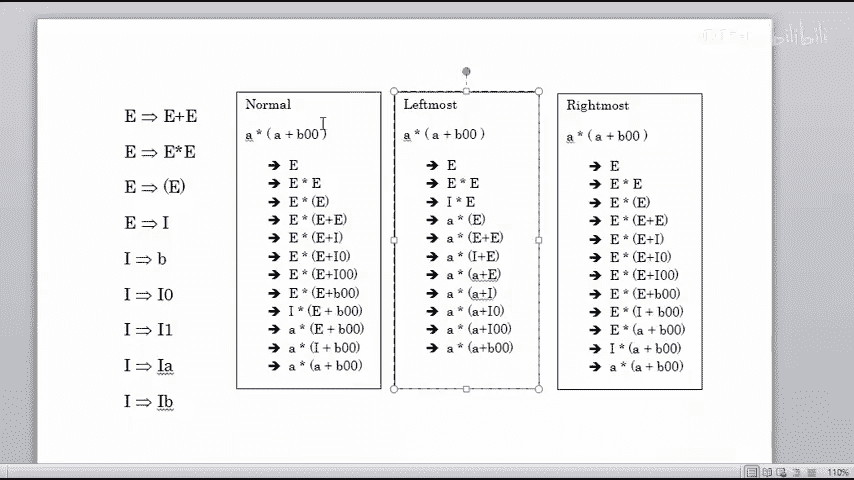

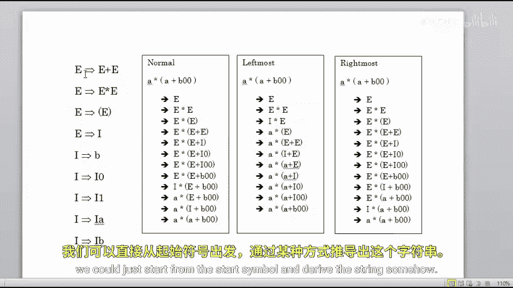

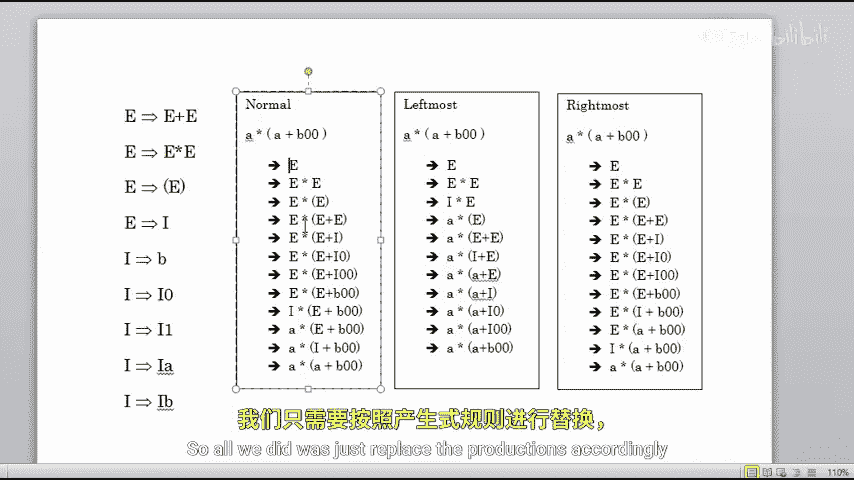

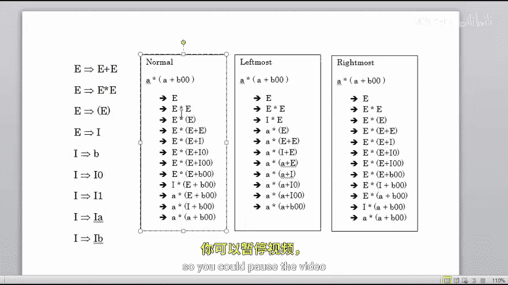

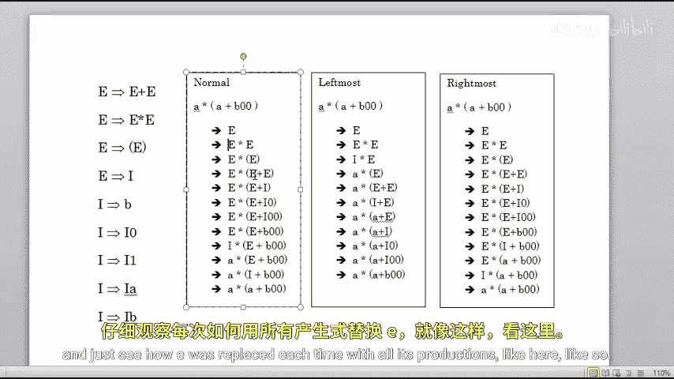

This E plus E was again replaced by E plus E so that we would get these operators here。

 So in the in the beginning what we did was we tried to divide this into two operators just。

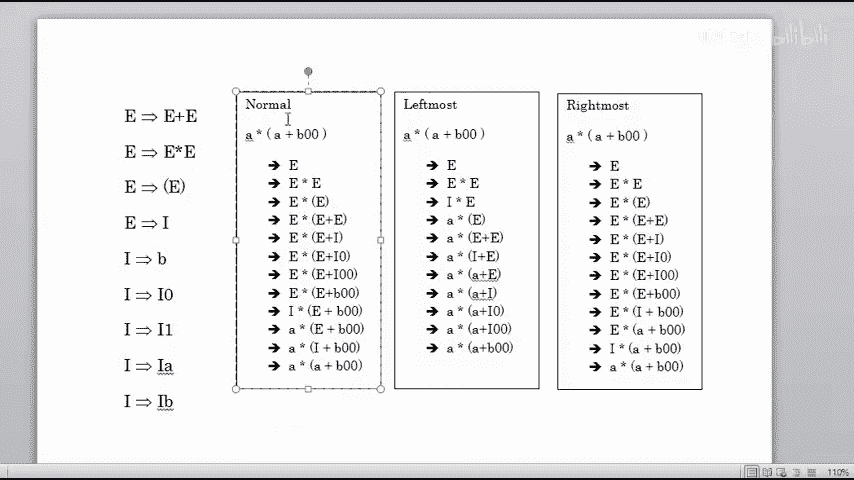

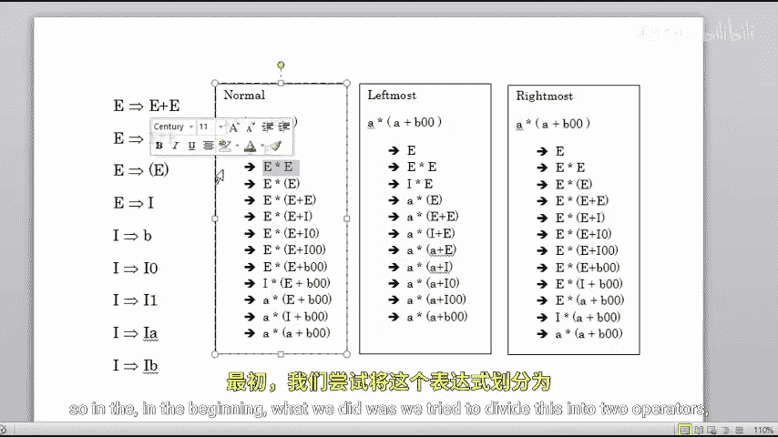

sorry，2 two sections。 And after that， before the div into， try to try to get these this operator。

 and after that we accordingly derive it， you could pause it and see and try it on your own and check the answer。

 Now， what is leftmost and right most derivation。 Leftmost derivation is basically just deriving from the left side from the left hand side first。

 So first， of course， we just derived from the start symbol we get this star operator。

 asterisk operator somehow after that， we replace this， the left side stuff first。

 So E is replaced by I， this I is replaced by a。 And then since after that， there's no more。

 And we have got we've got this part of the。

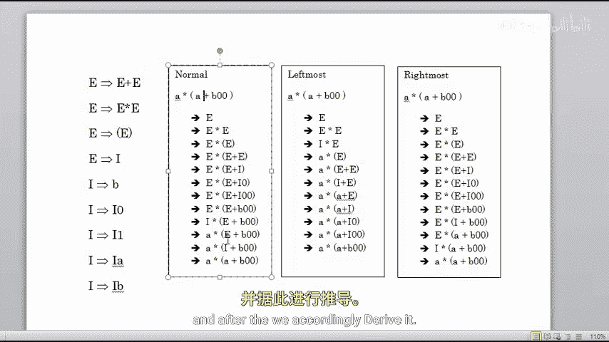

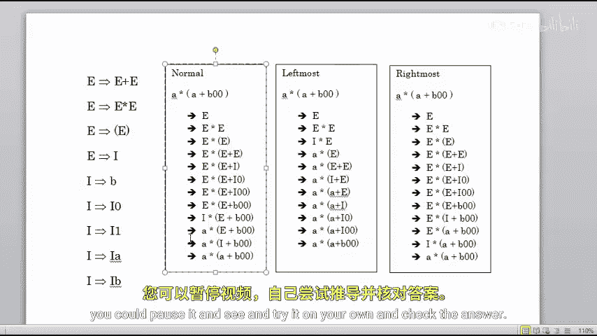

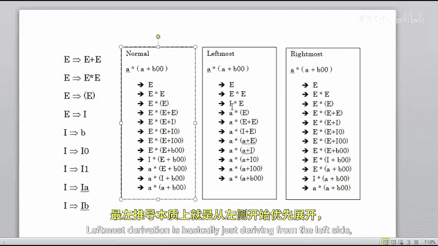

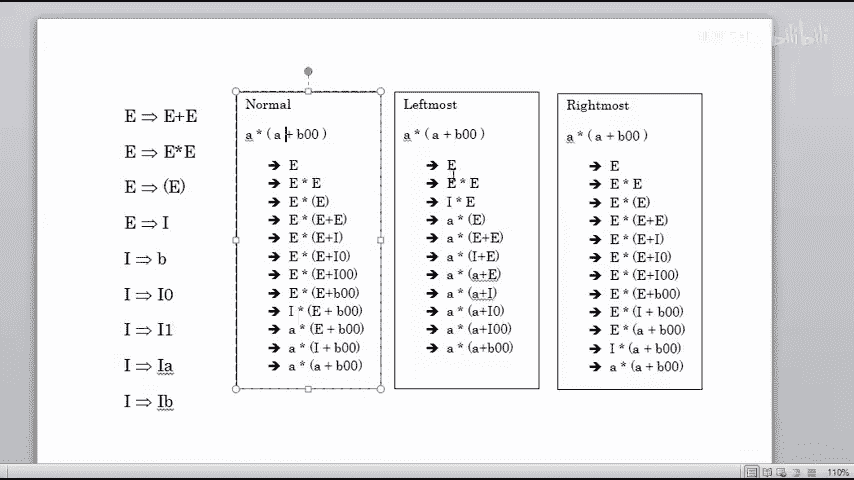

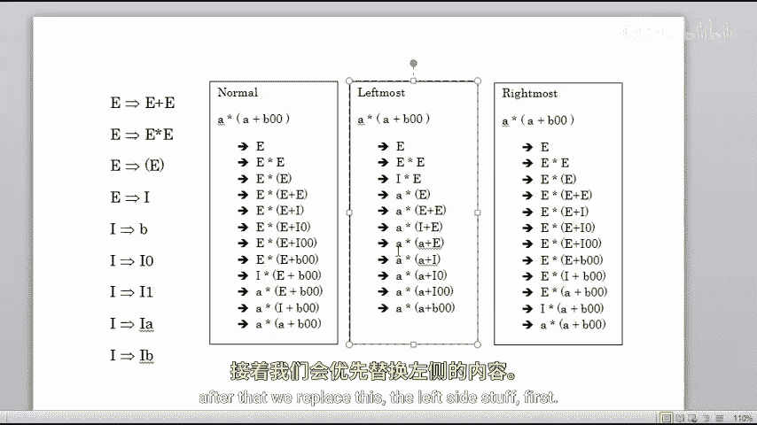

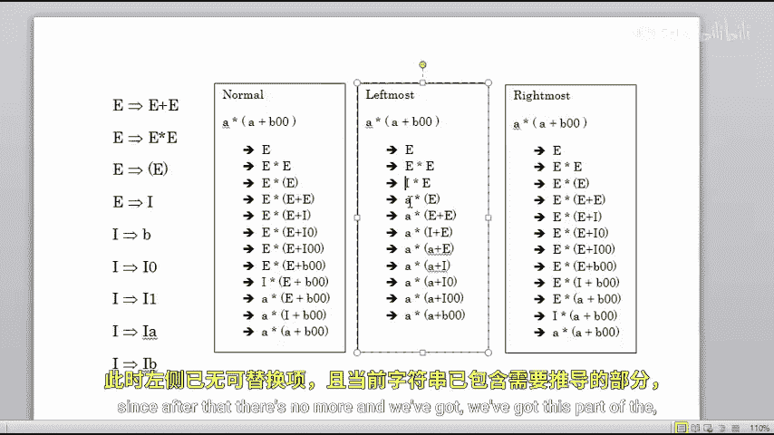

Of of the string that were supposed to derive。 Now we start deriving from here。

 but then again we start always from the left side。

 So E will be replaced replaced by this parentheesis E。

 but then after that after we replace E plus E we then replace from this we replace this left side first So E is replaced by I I is replaced by a then after a is over then we go the right side So the left side is prioritized first and then we go move towards the right side Similarlyly right in the rightmost devation the right side is prioritized more first and then in the end we go towards the and sorry derive the replace the left hand side parts。

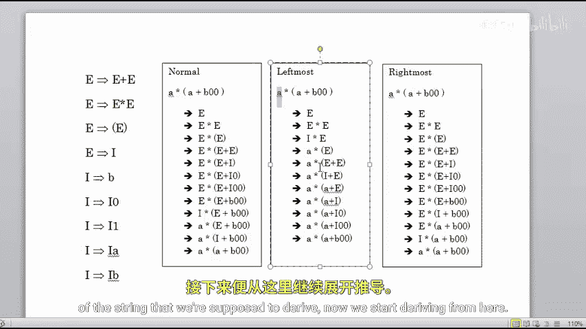

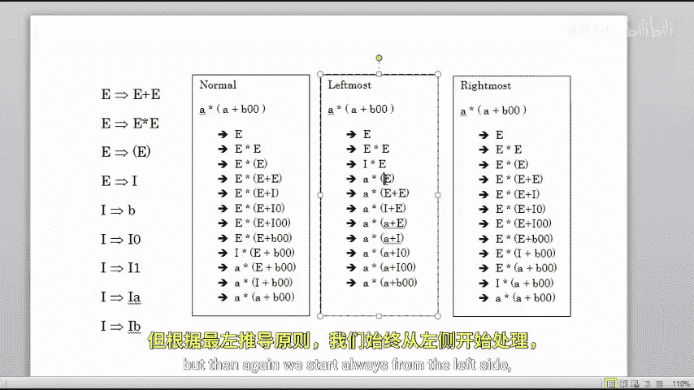

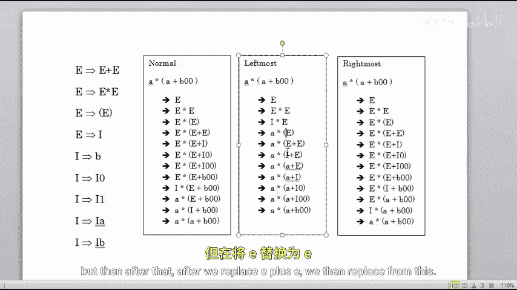

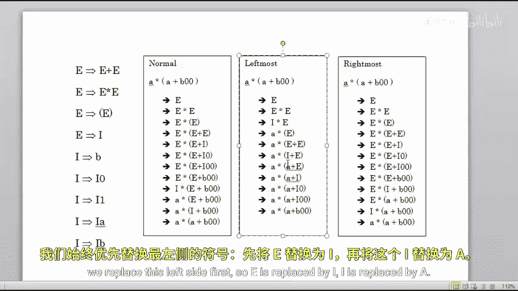

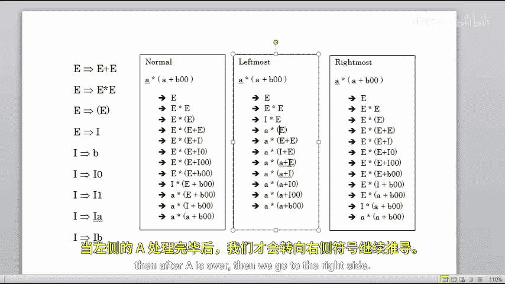

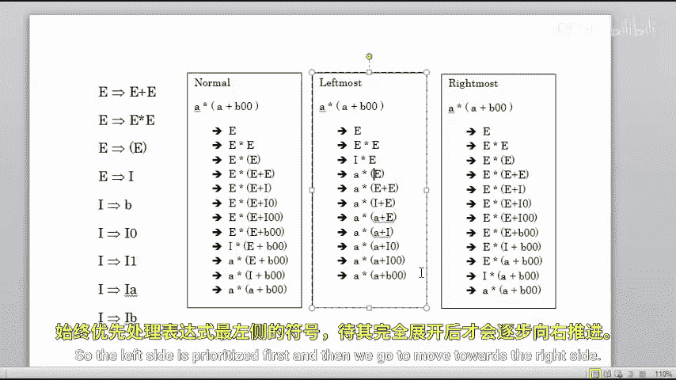

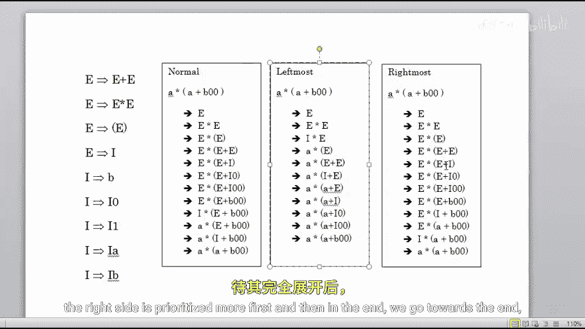

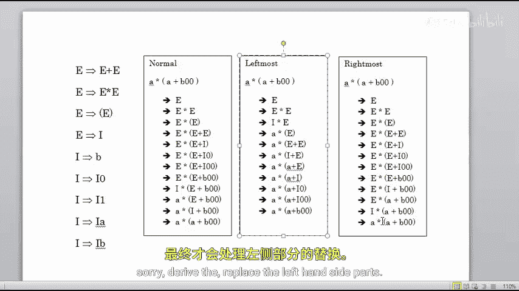

Now， let's look at something called a parse tree。 What is a parse tree。 Now， for this expression。

 let's just minimize this。

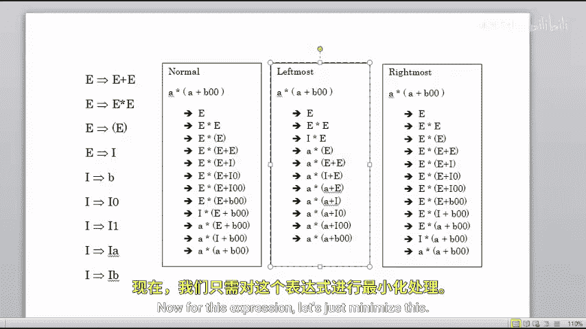

For this expression， there is a par street that's drawn。

So what it basically does is it's another way of representing。 It's another way of representing。

 sorry。Yeah， so it's another way of representing this derivation here over here like this。

 So you could replace you could what you call。 You could represent it in this format in equation sort of format。

 algebraic equations format or you could use a par tree and represent it in that way。

 So as you can you can mix and match this parse tree with this algebraic equation format So E was first it always starts from the start symbol here。

 the start symbol is E So from E， it's divided into two part three parts to get the star asterisk operator from then we then we then replace this E with the parenthesis E and then we replace this middle E with E plus E and so on。

 you could possibly and see if the answer matches and you could see how a par is so much similar to this。

 it's actually up to you whichever you find easier or you could just drop both if the question bes for it but yeah。

That's how you represent these derivations。That's all about context free grammar。

 I hope you the concept is a bit clearer after watching this video。

 Give a thumbs up to support this series and。